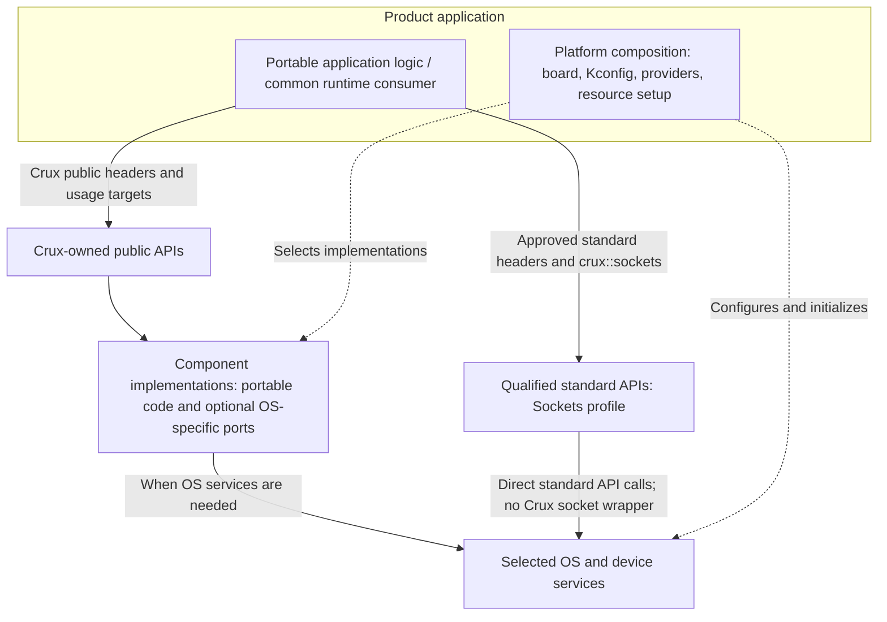

# Crux Pilot architecture

This document explains the architecture implemented in `crux-pilot` so that developers can understand the component boundaries and extend the code without access to a separate planning repository. It is an implementation overview, not a complete product architecture or a replacement for individual API contracts.

For setup and initial builds, start with the [README](../README.md). For contribution rules, use [CONTRIBUTING](../CONTRIBUTING.md). Current supported behaviour is defined by the public headers, adopted capability contracts, and recorded validation evidence. Historical proposals do not override implemented contracts.

## Scope and support boundaries

Crux is a reusable embedded software platform organised around small, component-owned capabilities, primarily using C17. A capability may instead qualify a standard API where that is the more appropriate boundary. It aims to let portable firmware and runtime-adapter code reuse the same selected interfaces across supported environments while the underlying operating systems retain responsibility for kernels, drivers and board support.

The current development environments are a Linux Host build and Zephyr, including `native_sim` and the documented RT1060-EVKB Rev B QSPI configuration. Linux Host is a development and test environment, **not** a qualified Embedded Linux product variant. An EVKB cross-build is not proof of physical operation. A component is supported on a given environment only to the extent stated by its contract and validation record. Do not infer that every component has a Zephyr provider or has passed physical qualification.

The repository is an evolving pilot. Consult its [GitHub milestones](https://github.com/wonny-labs/crux-pilot/milestones), issues, and merged PRs for current delivery status. In particular, later board and independent-consumer qualification work must not be treated as complete merely because a component builds.

## Architecture model



**Platform composition** is the board/project-specific configuration, initialisation and linkage that select OS-specific implementations and bind device resources. An application may contain both portable logic and platform composition code. These are responsibilities, not mandatory directories or additional abstraction layers. Here, **native** refers to OS-, SoC-, board- or vendor-specific APIs, resources and implementations, not a separate Crux architecture layer. The **native-free boundary** applies to portable application logic and common runtime consumers, not to platform composition.

The diagram distinguishes two supported consumer paths. Crux-owned APIs use component implementations, some of which need no OS-specific port. A qualified standard API instead calls the selected OS facilities directly: Sockets uses its bounded POSIX profile and `crux::sockets` usage target, without an intervening Crux socket implementation. Neither path authorizes arbitrary native APIs in portable logic.

| Role | Owns | Boundary |
| --- | --- | --- |
| Product application | Application policy and assembly of portable logic with platform composition | Declare which code is portable and which belongs to platform composition |
| Portable application logic / common runtime consumer | Policy, state, workflows and calls to supported public contracts | No Crux private headers, provider selection, board identifiers or unqualified native OS APIs |
| Public capability | Crux-owned declarations or an approved standard API profile, usage target, semantics and errors | No OS-, SoC-, board- or vendor-specific declarations in Crux-owned public headers. Approved standard API use stays within its qualified profile |
| Component implementation | Shared mechanisms, private resource state and optional OS-specific ports | No application-specific policy or generic OSAL |
| Platform composition | Board/project configuration, provider selection, OS and device initialisation, toolchain requirements and linkage | Keep unqualified native requirements and private implementation paths out of portable consumer usage |
| OS and board support | Kernel services, drivers and hardware resource bindings | Does not define portable application policy |

Consumers of Crux-owned APIs include `<crux/...>` headers and use their public CMake targets. Sockets consumers instead include the [qualified standard headers](networking-contract.md#socket-profile) and link `crux::sockets`. The [native-free consumer policy](native-interface-policy.md) defines the permitted standard APIs, native restrictions and enforcement limits. Platform-specific samples, test fixtures and product composition code may use OS APIs where their roles require them; that permission does not extend to reusable portable logic.

## Component ownership and source layout

Each component owns its applicable public contract, common code, private helpers, build definitions and optional OS-specific implementations:

```text
components/<capability>/
  include/crux/          # Public C declarations, when needed
  src/                   # Common code and private interfaces
  ports/<os>/            # Optional, genuine OS-specific implementations
  CMakeLists.txt         # Component-owned Host build integration, where applicable
```

Public paths in the shared `crux/` include namespace must remain unique across components. Implementation headers and native requirements remain private, except for the narrowly approved usage-profile/toolchain requirements described by the native-free consumer policy.

Use actual OS names such as `linux` and `zephyr` for OS-specific ports. The term **Host** describes a development or test composition, not an operating system. An OS-independent memory implementation is not automatically a Linux port. Empty port directories, central backend registries, duplicated public headers and uniform test subdirectories are not required for consistency.

New platform-specific composition targets use `crux::<capability>_<os>` (for example,
`crux::queue_linux`); their implementation targets use `crux_<capability>_<os>`.
Reserve `host` for the development/test role. An API-family name such as `posix`
requires a separately verified support contract; POSIX calls alone do not establish
cross-OS support. These names do not imply production qualification.

For a concrete example, [Time](time-contract.md) owns typed clocks, optional [CPU Busy-wait](time-busy-wait.md) and authority state, with a controlled memory realtime implementation separately from Linux/Zephyr system realtime and an optional Zephyr RTC adapter. The final composition must select an appropriate implementation rather than silently falling back to a test provider.

Thread and Sync are separate component-owned capabilities. `<crux/thread.h>` and `crux::thread` provide bounded joinable workers; `<crux/sync.h>` and `crux::sync` provide nonrecursive mutexes and counting semaphores. Sync uses native OS identity without depending on Crux Thread. Each owns its private metadata protection and deadline handling. The [Thread/Sync contract](thread-sync.md) defines current usage, Timeout, Ownership, Lifetime and provider limits, with links to historical decisions and validation evidence.

Tests remain under top-level `tests/`, grouped by capability or validation purpose. Samples and reference applications remain under `samples/`. A sample-owned helper is not automatically part of the Crux public API.

### Current capability integration

This is a source/integration inventory, not a qualification matrix. “Host” means the Linux development configuration; Zephyr support is limited to the selected native_sim/board profiles in the linked records. Presence of portable code does not imply an adopted production backend or physical qualification.

| Capability | Purpose | Current integration and limits | Reference |
| --- | --- | --- | --- |
| Base | Common status declarations | Header-only usage in Host and Zephyr; no OS provider | [Public header](../components/base/include/crux/status.h) |
| Time | Typed monotonic/realtime, authority, calendar and optional CPU Busy-wait | Explicit Memory or Linux system realtime; Zephyr system realtime without RTC, optional RTC storage; no implicit fallback | [Contract](time-contract.md) |
| Thread | Bounded joinable workers | Independent Linux pthread and Zephyr providers | [Current headers/targets](#build-and-platform-composition), [contract](thread-sync.md) |
| Sync | Nonrecursive mutexes and bounded semaphores | Independent Linux and Zephyr providers; no Crux Thread dependency | [Current headers/targets](#build-and-platform-composition), [contract](thread-sync.md) |
| Queue | Bounded copy messaging | Linux and Zephyr ports with composition-selected native providers | [Messaging contract](messaging-contract.md) |
| Netif | Read-only primary-interface status | Linux selected-interface and Zephyr network integration | [Networking contract](networking-contract.md) |
| Sockets | Qualified IPv4 client standard-API profile | Linux libc and selected Zephyr POSIX facilities; no Crux wrapper or separate stack | [Qualified profile](networking-contract.md#socket-profile) |
| Configuration | Scalar validation, explicit save/load and encoding | Portable core with deterministic test persistence provider; no adopted Zephyr Settings/production persistence integration | [Software qualification and native gate](configuration-validation.md) |
| File | Bounded synchronous file operations | Linux Host provider and deterministic failure tests; Zephyr provider is a plan, not implemented support | [Contract](file-contract.md), [Zephyr handoff plan](file-validation.md#zephyr-provider-handoff-plan-only) |
| Serial | Bounded synchronous UART/TTY byte transfer | Linux PTY/TTY and selected Zephyr UART emulator/EVKB compositions; explicit binding and exclusive UART ownership; no physical qualification | [Contract](serial-contract.md), [validation](serial-validation.md) |
| Logging | Validated bounded text records and filtering | Linux stderr and selected Zephyr deferred UART logger compositions; explicit UART ownership/configuration checks; no physical qualification | [Contract](logging-contract.md), [validation](logging-validation.md) |
| System | Service observations, reset diagnostics and single-owner watchdog | Linux watchdog simulation and selected Zephyr HWINFO/watchdog/reset composition; normal Host reset/cause unsupported; physical acceptance pending | [Approved contract](superpowers/specs/2026-10-24-system-health-design.md), [validation](system-validation.md) |

## Build and platform composition

The root `CMakeLists.txt` supports the Linux Host development build. The `zephyr/` directory provides out-of-tree module integration, with Zephyr Kconfig and application/project configuration selecting supported OS facilities. The `west.yml` manifest pins the relevant Zephyr dependency baseline.

Public targets such as `crux::time`, `crux::thread` and `crux::sync` are consumer-facing usage contracts. OS-specific implementation targets, their private include paths and link dependencies belong to the selected composition. **A public target is not an installed SDK package, nor does every component use an identical provider-linkage pattern.** Follow the [supported source-tree consumer contract](build.md#external-linux-application-using-crux-source). Do not manually add private provider paths to an application to bypass a missing integration capability.

Host and Zephyr may compose providers differently. For example, a controlled Host Time composition uses memory, an explicitly selected Linux composition uses CLOCK_REALTIME, and Zephyr uses system realtime with optional independent RTC source/storage. This difference must not change the portable Time API.

Thread and Sync are independently selectable in Host and Zephyr builds. Thread depends on Time for typed monotonic sleep; Host compositions explicitly select Time and its provider, while Zephyr Thread selects Time without an RTC requirement. The [contract's build selection and provider limits](thread-sync.md#build-selection-and-provider-limits) document their component-owned switches and resource settings. Consumer code should depend only on the capabilities it uses.

See the [Build and Integration Guide](build.md) for supported Linux Host and Zephyr build paths, external application examples, provider selection and troubleshooting. These workflows do not establish an installed SDK or general OS, board or toolchain compatibility.

## Engineering and validation boundaries

Crux uses complementary forms of evidence:

| Validation | What it demonstrates | What it does not prove |
| --- | --- | --- |
| Linux Host builds, tests and sanitizers | Portable behaviour and selected Host implementation paths | Zephyr or physical board behaviour |
| Independent C/C++ consumer builds and negative dependency checks | Selected public usage, source and build boundaries | Every possible API/ABI combination or product integration |
| Zephyr `native_sim` and Twister | Selected Zephyr integration under simulated conditions | Target peripheral timing or physical persistence |
| EVKB firmware cross-builds | A selected target configuration compiles and links | Boot, Flash safety or real peripheral behaviour |
| Identified physical board tests | Only the documented hardware scenario and limits | Broad production readiness, other boards or endurance |

Run tests proportionate to the change. Preserve existing contract and boundary protections, including negative tests. Avoid repeating unrelated full test suites solely for a documentation change. Physical programming, reset and Flash operations require task-specific approval and verified target setup.

Evidence and historical qualification records must retain their original source, board and toolchain identity. Earlier Time Pilot M0–M5 records in [implementation status](implementation-status.md) are **not** the same milestones as the current platform roadmap.

## Extending Crux

Before adding or significantly changing a capability:

1. Identify the real consumer requirement and check whether an existing capability or qualified standard API is sufficient.
2. Define the minimum public contract and clarify ownership, errors, lifetime, concurrency and execution-context limits.
3. Keep consumer-facing declarations native-free. Add common implementation logic and optional OS ports only as justified by the contract.
4. Define the public usage target, explicit platform composition, and supported environment selection without leaking private dependencies.
5. Add focused Host/Zephyr and independent consumer evidence for the actual claim. Record unsupported configurations rather than masking missing providers.

Use [CONTRIBUTING](../CONTRIBUTING.md) for code, PR and review requirements and [AGENTS.md](../AGENTS.md) for AI execution boundaries. Material API and architecture decisions require the applicable review or approval. This overview does not authorise a new capability or a hardware operation.

## Further reading

The [capability inventory](#current-capability-integration) links to component-specific API contracts and validation records. For cross-cutting information, use:

- [Build and Integration Guide](build.md)
- [Native-free consumer policy](native-interface-policy.md)
- [Test organisation and commands](../tests/README.md)
- [Reference controller and supported scenarios](../samples/controller/README.md)

## Private execution context

`components/interrupt/src/interrupt.h` declares the shared private
`crux_is_in_isr()` query. Linux and Zephyr implementations are selected internally;
there is no public Interrupt header or `crux::interrupt` usage target. Time,
Thread, Sync, Queue and System use this mechanism while retaining their own
eligibility policy (including System's pre-kernel rejection). Non-ISR context
alone is not a general API eligibility or POSIX signal-safety guarantee. Base
remains header-only and OS-independent; Time never depends on Thread or Sync.
