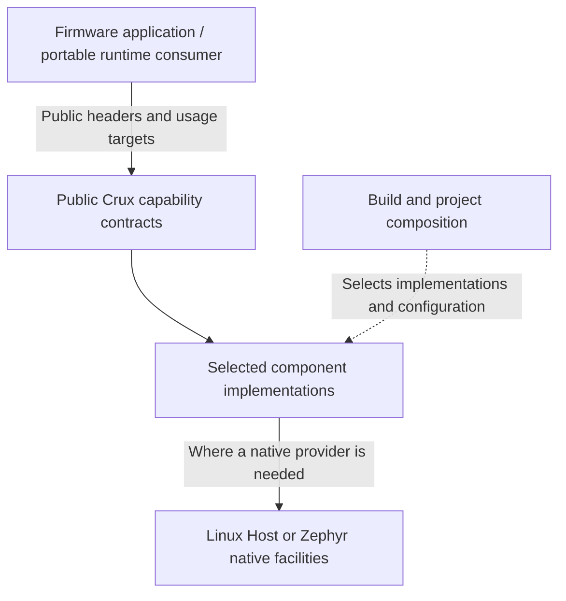

# Crux Pilot architecture

This document explains the architecture implemented in `crux-pilot` so that developers can understand the component boundaries and extend the code without access to a separate planning repository. It is an implementation overview, not a complete product architecture or a replacement for individual API contracts.

For setup and initial builds, start with the [README](../README.md). For contribution rules, use [CONTRIBUTING](../CONTRIBUTING.md). Current supported behaviour is defined by the public headers, adopted capability contracts, and recorded validation evidence. Historical proposals do not override implemented contracts.

## Scope and support boundaries

Crux is a reusable embedded software platform built from small, capability-owned C17 components. It aims to let portable firmware and runtime-adapter code reuse the same selected interfaces across supported environments while native operating systems retain responsibility for their kernels, drivers, and board support.

The current development environments are a Linux Host build and Zephyr, including `native_sim` and the documented RT1060-EVKB Rev B QSPI configuration. Linux Host is a development and test environment, **not** a qualified Embedded Linux product variant. An EVKB cross-build is not proof of physical operation. A component is supported on a given environment only to the extent stated by its contract and validation record. Do not infer that every component has a Zephyr provider or has passed physical qualification.

The repository is an evolving pilot. Consult its [GitHub milestones](https://github.com/wonny-labs/crux-pilot/milestones), issues, and merged PRs for current delivery status. In particular, later board and independent-consumer qualification work must not be treated as complete merely because a component builds.

## Architecture model



The diagram shows responsibilities, not a mandatory extra abstraction layer. Some capabilities contain only portable logic. The approved Sockets capability deliberately exposes a bounded standard API profile rather than a new Crux socket wrapper. A native port is introduced only when the capability needs one.

| Role | Owns | Must not take ownership of |
| --- | --- | --- |
| Application or portable runtime consumer | Application policy, state, workflows, calls to supported public contracts | Crux private headers, provider selection, board identifiers, unqualified native OS APIs |
| Public capability | Consumer-visible declarations or an approved standard API profile, usage target, semantics and errors | Native Zephyr/NXP types in its public API |
| Component implementation | Shared mechanisms, private resource state, optional native ports | Application-specific policy or a generic OSAL |
| Final composition | Selected implementations, OS/toolchain requirements, board/project configuration and native linkage | Changes to portable consumer source just to switch supported environments |
| Native OS and board support | Kernel services, drivers, hardware resource bindings | Portable application contracts |

Portable C or C++ consumers include public headers under `<crux/...>` and use supported public CMake targets where applicable. The [native-free consumer policy](native-interface-policy.md) describes the precise permitted standard APIs, native restrictions and enforcement limits. Native fixture or sample code can use OS APIs where its declared role requires them. This does not make those dependencies acceptable in reusable consumer code.

## Component ownership and source layout

Each component owns its public contract, common sources, private helpers, build declarations and any necessary OS-specific implementation:

```text
components/<capability>/
  include/crux/          # Public C declarations, when needed
  src/                   # Common code and private interfaces
  ports/<os>/            # Optional, genuine OS-specific implementations
  CMakeLists.txt         # Component-owned Host build integration, where applicable
```

Public paths in the shared `crux/` include namespace must remain unique across components. Private headers and native requirements must not be exported to portable consumers.

Use actual OS names such as `linux` and `zephyr` for native ports. The term **Host** describes a development or test composition, not an operating system. An OS-independent memory implementation is not automatically a Linux port. Empty port directories, central backend registries, duplicated public headers and uniform test subdirectories are not required for consistency.

For a concrete example, [Time](time-contract.md) owns a controlled memory implementation separately from its native Zephyr RTC port. The final composition must select an appropriate implementation rather than silently falling back to a test provider.

Thread and Sync are now separate component-owned capabilities. `<crux/thread.h>` and `crux::thread` provide bounded joinable worker lifecycle operations. `<crux/sync.h>` and `crux::sync` provide nonrecursive mutexes and counting semaphores. Sync uses native OS execution identity to check mutex ownership, without depending on Crux Thread. Each component owns its private metadata protection and deadline handling in its Linux and Zephyr ports. See the [adopted Thread/Sync contract](execution-contract-proposal.md) and [validation limits](execution-validation.md).

Tests remain under top-level `tests/`, grouped by capability or validation purpose. Samples and reference applications remain under `samples/`. A sample-owned helper is not automatically part of the Crux public API.

## Build and native composition

The root `CMakeLists.txt` supports the Linux Host development build. The `zephyr/` directory provides out-of-tree module integration, with Zephyr Kconfig and application/project configuration selecting supported native facilities. The `west.yml` manifest pins the relevant Zephyr dependency baseline.

Public targets such as `crux::time`, `crux::thread` and `crux::sync` are consumer-facing usage contracts. Internal native targets, their private include paths, and link dependencies belong to the selected composition. **A public target is not necessarily a standalone installed SDK package, nor does every component currently use an identical provider-linkage pattern.** Follow the current component build files and its verified consumer contract. Do not manually add private provider paths to an application to bypass a missing integration capability.

Host and Zephyr may compose providers differently. For example, a Host Time composition uses a controlled memory provider, while the Zephyr image registers its selected RTC implementation independently. This difference must not change the portable Time API.

Thread and Sync can be selected independently with `CRUX_BUILD_THREAD` and `CRUX_BUILD_SYNC` in Host builds, or `CONFIG_CRUX_THREAD` and `CONFIG_CRUX_SYNC` in Zephyr builds. The old `crux::execution` usage target and `CONFIG_CRUX_EXECUTION*` selections have been removed. Consumer code should depend only on the capabilities it uses.

The README documents established development commands. Detailed, independently verified instructions for creating a new out-of-tree application should be added only when its supported source-tree consumer integration contract is settled and tested. Do not assume `find_package(Crux)`, an installable package, or an arbitrary OS/board combination is supported.

## Engineering and validation boundaries

Crux uses complementary forms of evidence:

| Validation | What it demonstrates | What it does not prove |
| --- | --- | --- |
| Linux Host builds, tests and sanitizers | Portable behaviour and selected Host implementation paths | Zephyr or physical board behaviour |
| Independent C/C++ consumer builds and negative dependency checks | Selected public usage, source and build boundaries | Every possible API/ABI combination or product integration |
| Zephyr `native_sim` and Twister | Relevant native integration under simulated conditions | Target peripheral timing or physical persistence |
| EVKB firmware cross-builds | A selected target configuration compiles and links | Boot, Flash safety or real peripheral behaviour |
| Identified physical board tests | Only the documented hardware scenario and limits | Broad production readiness, other boards or endurance |

Run tests proportionate to the change. Preserve existing contract and boundary protections, including negative tests. Avoid repeating unrelated full test suites solely for a documentation change. Physical programming, reset and Flash operations require task-specific approval and verified target setup.

Evidence and historical qualification records must retain their original source, board and toolchain identity. Earlier Time Pilot M0–M5 records in [implementation status](implementation-status.md) are **not** the same milestones as the current platform roadmap.

## Extending Crux

Before adding or significantly changing a capability:

1. Identify the real consumer requirement and check whether an existing capability or qualified standard API is sufficient.
2. Define the minimum public contract and clarify ownership, errors, lifetime, concurrency and execution-context limits.
3. Keep consumer-facing declarations native-free. Add common implementation logic and optional OS ports only as justified by the contract.
4. Define the public usage target, explicit native composition, and supported environment selection without leaking private dependencies.
5. Add focused Host/Zephyr and independent consumer evidence for the actual claim. Record unsupported configurations rather than masking missing providers.

Use [CONTRIBUTING](../CONTRIBUTING.md) for code, PR and review requirements and [AGENTS.md](../AGENTS.md) for AI execution boundaries. Material API and architecture decisions require the applicable review or approval. This overview does not authorise a new capability or a hardware operation.

## Further reading

- [Time capability contract](time-contract.md)
- [Thread and Sync contract](execution-contract-proposal.md)
- [Thread and Sync validation](execution-validation.md)
- [Messaging and monotonic timing contract](messaging-contract.md)
- [Qualified networking profile](networking-contract.md)
- [File capability contract](file-contract.md)
- [Configuration capability contract](configuration-contract.md)
- [Native-free consumer policy](native-interface-policy.md)
- [Test organisation and commands](../tests/README.md)
- [Reference controller and supported scenarios](../samples/controller/README.md)

Capability-specific implementation and validation documents provide details beyond this overview. Treat any proposal or past validation record as historical where a later merged contract has superseded it.
