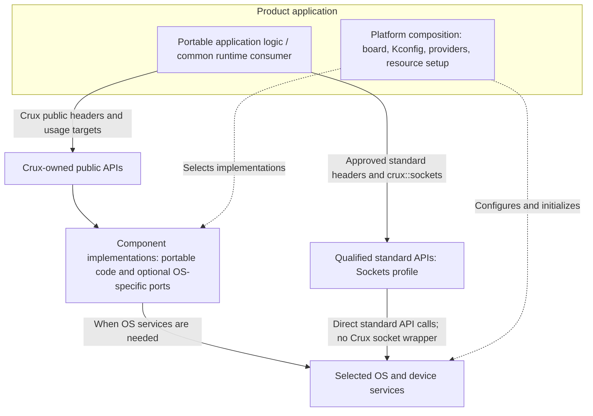
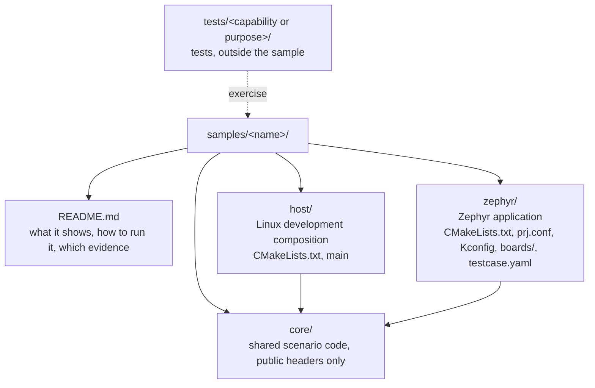
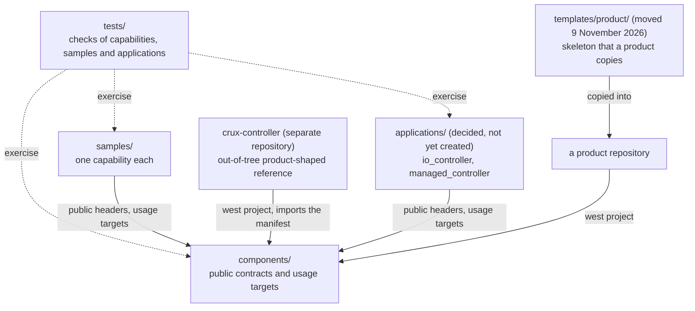

# Crux Pilot architecture

This document explains the architecture implemented in `crux-pilot` so that developers can understand the component boundaries and extend the code without access to a separate planning repository. It is an implementation overview, not a complete product architecture or a replacement for individual API contracts.

For setup and initial builds, start with the [README](../README.md). For contribution rules, use [CONTRIBUTING](../CONTRIBUTING.md). Current supported behaviour is defined by the public headers, adopted capability contracts, and recorded validation evidence. Historical proposals do not override implemented contracts.

## Scope and support boundaries

Crux is a reusable embedded software platform organised around small, component-owned capabilities, primarily using C17. A capability may instead qualify a standard API where that is the more appropriate boundary. It aims to let portable firmware and runtime-adapter code reuse the same selected interfaces across supported environments while the underlying operating systems retain responsibility for kernels, drivers and board support.

The current development environments are a Linux Host build and Zephyr, including `native_sim` and the documented RT1060-EVKB Rev B QSPI configuration. Linux Host is a development and test environment, **not** a qualified Embedded Linux product variant. An EVKB cross-build is not proof of physical operation. A component is supported on a given environment only to the extent stated by its contract and validation record. Do not infer that every component has a Zephyr provider or has passed physical qualification.

The repository is an evolving pilot. Consult its [GitHub milestones](https://github.com/wonny-labs/crux-pilot/milestones), issues, and merged PRs for current delivery status. In particular, later board and independent-consumer qualification work must not be treated as complete merely because a component builds.

## Architecture model



**Platform composition** is the board/project-specific configuration, initialisation and linkage that select OS-specific implementations and bind device resources. An application may contain both portable logic and platform composition code. These are responsibilities, not mandatory directories or additional abstraction layers. Here, **native** refers to OS-, SoC-, board- or vendor-specific APIs, resources and implementations, not a separate Crux architecture layer. The **native-free boundary** applies to portable application logic and common runtime consumers, not to platform composition.

The diagram distinguishes two supported consumer paths. Crux-owned APIs use component implementations, some of which need no OS-specific port. A qualified standard API instead calls the selected OS facilities directly: Sockets uses its bounded POSIX profile and `crux::sockets` usage target, without an intervening Crux socket implementation. Neither path authorizes arbitrary native APIs in portable logic.

| Role | Owns | Boundary |
| --- | --- | --- |
| Product application | Application policy and assembly of portable logic with platform composition | Declare which code is portable and which belongs to platform composition |
| Portable application logic / common runtime consumer | Policy, state, workflows and calls to supported public contracts | No Crux private headers, provider selection, board identifiers or unqualified native OS APIs |
| Public capability | Crux-owned declarations or an approved standard API profile, usage target, semantics and errors | No OS-, SoC-, board- or vendor-specific declarations in Crux-owned public headers. Approved standard API use stays within its qualified profile |
| Component implementation | Shared mechanisms, private resource state and optional OS-specific ports | No application-specific policy or generic OSAL |
| Platform composition | Board/project configuration, provider selection, OS and device initialisation, toolchain requirements and linkage | Keep unqualified native requirements and private implementation paths out of portable consumer usage |
| OS and board support | Kernel services, drivers and hardware resource bindings | Does not define portable application policy |

Consumers of Crux-owned APIs include `<crux/...>` headers and use their public CMake targets. Sockets consumers instead include the [qualified standard headers](networking-contract.md#socket-profile) and link `crux::sockets`. The [native-free consumer policy](native-interface-policy.md) defines the permitted standard APIs, native restrictions and enforcement limits. Platform-specific samples, test fixtures and product composition code may use OS APIs where their roles require them; that permission does not extend to reusable portable logic.

## Component ownership and source layout

Each component owns its applicable public contract, common code, private helpers, build definitions and optional OS-specific implementations:

```text
components/<capability>/
  include/crux/          # Public C declarations, when needed
  src/                   # Common code and private interfaces
  ports/<os>/            # Optional, genuine OS-specific implementations
  CMakeLists.txt         # Component-owned Host build integration, where applicable
```

Public paths in the shared `crux/` include namespace must remain unique across components. Implementation headers and native requirements remain private, except for the narrowly approved usage-profile/toolchain requirements described by the native-free consumer policy.

Use actual OS names such as `linux` and `zephyr` for OS-specific ports. The term **Host** describes a development or test composition, not an operating system. An OS-independent memory implementation is not automatically a Linux port. Empty port directories, central backend registries, duplicated public headers and uniform test subdirectories are not required for consistency.

New platform-specific composition targets use `crux::<capability>_<os>` (for example,
`crux::queue_linux`); their implementation targets use `crux_<capability>_<os>`.
Reserve `host` for the development/test role. An API-family name such as `posix`
requires a separately verified support contract; POSIX calls alone do not establish
cross-OS support. These names do not imply production qualification.

A composition target is not a portable usage target: the native-free consumer check rejects it, and only platform
composition code or a final application executable links it. `crux::file_zephyr` is the Zephyr example, the binding of a mounted directory to the File
provider; see [File root binding](file-composition-interface.md).

For a concrete example, [Time](time-contract.md) owns typed clocks, optional [CPU Busy-wait](time-busy-wait.md) and authority state, with a controlled memory realtime implementation separately from Linux/Zephyr system realtime and an optional Zephyr RTC adapter. The final composition must select an appropriate implementation rather than silently falling back to a test provider.

Thread and Sync are separate component-owned capabilities. `<crux/thread.h>` and `crux::thread` provide bounded joinable workers; `<crux/sync.h>` and `crux::sync` provide nonrecursive mutexes and counting semaphores. Sync uses native OS identity without depending on Crux Thread. Each owns its private metadata protection and deadline handling. The [Thread/Sync contract](thread-sync.md) defines current usage, Timeout, Ownership, Lifetime and provider limits, with links to historical decisions and validation evidence.

Tests remain under top-level `tests/`, grouped by capability or validation purpose. Samples, and the reference controller with them, are under `samples/` today, and no `applications/` folder exists yet. The owner decided on 9 November 2026 that the maintained integrated applications get their own top-level folder, [`applications/`](#applications-proposed), beside `samples/`. The folder does not exist yet, and `samples/controller` would move into it. That move is not scheduled. A sample-owned helper is not automatically part of the Crux public API. The [proposed layout and naming of samples](#layout-and-naming-of-samples-proposed) awaits the owner's decision, except that the owner decided the folder and the first two names of the applications on 9 November 2026.

### Layout and naming of samples (proposed)

**Status: proposed, for the owner's decision**, except for the folder and the first two names of the [applications](#applications-proposed), which the owner decided on 9 November 2026. It is a structure decision, so no rule here is adopted yet, and no existing sample was moved
for it. It is the third step of the owner's review of 8 November 2026 (Refs #243). Once adopted, new samples follow it, and the
samples that do not are listed below for the owner to move, or to leave, one by one.

A sample is a small composition that shows one capability, one framework or one scenario through Crux's public contracts. It is
not part of the platform API, and Crux does not maintain it as a product template. The product template, formerly `product_template`, is `templates/product`, outside `samples/` since 9 November 2026, and the rows below that name `product_template` describe the state before the move. A maintained integrated image is not a sample but an [application](#applications-proposed).

| # | Rule | Why |
| --- | --- | --- |
| 1 | A sample is one folder, `samples/<name>`. When a family has two or more samples, they sit under one folder for the family, `samples/<family>/<name>`. | One place to find a sample, and the web samples already do it |
| 2 | `<name>` is lowercase `snake_case` and says what the sample is about: a capability (`networking`), a framework (`preact`, `angular`) or a purpose (`product_template`). It never carries `reference`, `minimal`, `poc`, `demo`, `example` or `sample`. | A word about how finished or how big a sample is goes stale and forces a rename. It belongs in the README, which changes without one. |
| 3 | Each sample has a `README.md` that says what it shows, how to build and run it, and which evidence it has: Host, `native_sim` and physical results, each on its own, and what it does not show. | A reader cannot tell a sample's limits from its sources |
| 4 | The compositions sit in folders of their own: `host/` for the Linux development composition, and `zephyr/` for a Zephyr application with its `CMakeLists.txt`, `prj.conf`, `Kconfig`, `boards/` and overlays. The sample's root holds neither composition's build files. | A Host change cannot reach a Zephyr build, and a board choice stays in one folder |
| 5 | Scenario code that both compositions share sits in `core/` and includes only public Crux headers, the C standard library and a standard-API profile that this document qualifies, such as the sockets profile. A Zephyr, board or vendor header appears only under `zephyr/`. A sample may keep other folders that tests or scripts build or check, such as `include/`, and the rules govern its compositions. | The portable part stays portable, as the engineering approach requires, and the documented POSIX subset is allowed there |
| 6 | Tests stay under `tests/`. A Twister `testcase.yaml` is the one test file beside a Zephyr application, because Twister looks for it there. | One place for tests, as the layout above already says |
| 7 | A framework sample of the web is one folder per framework under `samples/web/`, built by that framework's own tools or by the shared `web/tools/build.ts`. What the web samples share, the specification, the client, the mock server and the browser tests, stays in `web/`. A sample with C sources that a C build names stays outside `samples/web/`. | No C build may name `samples/web` or the web tools. `web/tools/c-boundary.ts` counts that as a use of Node.js, and only the specification file `web/api/openapi.yaml` is allowed. |
| 8 | A sample's helper is not Crux public API | Already the rule above |



How a name is chosen:

| The sample is about | The name is | Example |
| --- | --- | --- |
| A framework | The framework, in a family folder when it is one of several of a kind | `samples/web/preact`, `samples/web/angular` |
| A capability | The capability, and a variant joins a family folder | `samples/networking`, `samples/storage/sd`, `samples/storage/emmc` |
| A purpose that is neither | A short noun for the purpose | none now: the product template moved to `templates/product` |

#### Existing samples that do not follow it

Nothing is moved by this proposal. A rule number refers to the table above.

| Sample | What differs | Rule |
| --- | --- | --- |
| `controller` | Follows it: a README, `core/`, `host/` and `zephyr/`. It is the application `io_controller` that the owner decided on 9 November 2026 (see [Applications](#applications-proposed)), and it stays here until a move that is not scheduled. | |
| `web/angular` | Follows it: a README, named by its framework, with the tools it shares in `web/` | |
| `web/preact` | No README of its own. Its commands and flows are in the [web guide](../web/README.md). | 3 |
| `networking` | No README. `host/` and `zephyr/` are separate, but both build `client.c` from the sample's root, outside `core/`, and it includes the sockets headers of the qualified profile. | 3, 5 |
| `time` | No README. The Zephyr application's `CMakeLists.txt`, `prj.conf`, `boards/` and `src/` sit in the sample's root beside `host/`, the shared `src/time_command.c` and `include/` are outside `core/`, and `src/time_shell.c` includes a Zephyr header outside `zephyr/`. | 3, 4, 5 |
| `logging`, `serial` | No README, and no composition folder: `controller.c` and `controller.h` are scenario sources that `tests/logging_consumer` and `tests/serial_consumer` build | 3, 4 |
| `messaging` | Has a README of eight lines with no Host, `native_sim` or physical evidence, and the same shape as the two above: `controller.c` is built by `tests/messaging_consumer` | 3, 4 |
| `storage_emmc`, `storage_sd`, `storage_sd_probe` | No README. A Zephyr application sits in the root with no `zephyr/` folder, so its Zephyr headers are outside `zephyr/`. The names belong to one storage family but are not grouped. | 1, 3, 4, 5 |
| `storage_sd_interrupt`, `storage_sd_replace` | The same, and `host/` holds a Python capture helper and its test, not a Host composition | 1, 3, 4, 5, 6 |
| `flash_safety_poc` | `poc` in the name, no README (`docs/flash-safety-poc.md` describes it), and the Zephyr application in the root | 2, 3, 4, 5 |
| `product_template` | Has a README of 32 lines that says how to start a product and has no evidence section. Its Zephyr application is in `app/`, beside a west manifest, because it is a repository skeleton that a product copies. It is better treated as outside rules 3 and 4 than renamed. | 3, 4 |
| `web_project` | Has a README. It is a page and a route with C sources, named for the web. The owner kept it in place on 8 November 2026, and it cannot move under `samples/web/`, because the Host test `tests/web/project_sample` names it in a C build and the boundary check counts any `samples/web` path there as a use of Node.js. It holds sources and a reviewed route list, with no composition of its own. No image packages it, and its README says so. | 4 |

Choices for the owner:

| # | Question | Recommendation |
| --- | --- | --- |
| 1 | Adopt the rules for new samples, as written? | Yes, after the owner reads rules 2 and 4: they are the ones that existing samples break most |
| 2 | Move or rename any existing sample? | No move now. Each move touches scripts, tests and documents that name its path, so take them one at a time, when a sample is next changed. |
| 3 | Treat `product_template` as a separate kind of folder, outside rules 3 and 4? | Yes, since a product copies it as it is |
| 4 | Group the storage samples under `samples/storage/`? | Only with a move of its own, because four scripts, ten documents and eighteen files under `tests/` name a storage sample folder |

#### Applications (proposed)

**Status.** The owner decided the folder `applications/` and the names `io_controller` and `managed_controller` on 9 November 2026. The definition, the admission conditions and the limit below are proposed text, and like the rest of this section they bind only once adopted. The folder does not exist yet. **The move of `samples/controller` into `applications/io_controller` is not scheduled**, for the reasons in [the status of the move](#status-of-the-move).

An application is a maintained, integrated image of Crux. A sample shows one capability, one framework or one scenario and makes none of the promises below.

| Kind | Where | What it is | What is promised |
| --- | --- | --- | --- |
| Application | `applications/<name>` | An integrated image that composes several capabilities into one working whole | Built in CI on every code change. A `README.md` that states its supported configurations, its evidence for Host, `native_sim` and physical results, each on its own, and what it does not show. A named maintenance responsibility |
| Sample | `samples/<name>` | One capability, framework or scenario through the public contracts | None of these. The rules above apply |
| Test | `tests/` | A check of a claim | An application's or a sample's run does not replace tests. Tests stay under `tests/` |
| Project template | `templates/product/` | A repository skeleton that a product copies | Not part of this proposal; it moved there from `samples/product_template` on 9 November 2026 |
| Out-of-tree reference | The separate `crux-controller` repository | A product-shaped repository that consumes Crux as a west project | It is not an application of this repository and stays outside it |

**A new application is admitted only when all three conditions hold:**

| # | Condition | Why |
| --- | --- | --- |
| 1 | Its purpose is one that no existing application can serve. A different configuration of an existing application is preferred to a new application. | Each application is a promise that someone keeps |
| 2 | It meets the definition above: CI on every code change, the README with its separate evidence and its limits, and a named maintenance responsibility | An image without the promise is a sample |
| 3 | It stays within the limit of three applications for now. A fourth needs the owner's decision to raise the limit. | The CI and the evidence of each application cost upkeep |

The two applications decided so far:

| Name | Purpose | Today |
| --- | --- | --- |
| `io_controller` | The basic integrated application: periodic work, I/O, networking, diagnostics and health supervision | `samples/controller`, unchanged |
| `managed_controller` | The same, plus secure remote management over HTTPS, SSH and SFTP | Not started as an application: it is the work of milestones M10 to M12. Its parts are the management components in the [capability inventory](#current-capability-integration), and the [integrated image](ssh-integrated-image.md) is a `native_sim` image built from `tests/native/management_ssh`, not this application |

**Names.** A name says what the application is for. It follows the rule for samples (rule 2): lowercase `snake_case`, and never `reference`, `minimal`, `poc`, `demo`, `example` or `sample`. Its internal layout is not decided here: `samples/controller` has `core/`, `host/` and `zephyr/` today, and this proposal does not change that.

**Boot and update are configurations.** Boot (milestone M8, "Boot platform foundation and verified boot") and update (milestone M9, "Secure firmware update and recovery") are configurations of these two applications, selected as the configurations of `samples/controller` are today. They are not applications of their own, so they do not use up the limit.



**Why `applications/` and not `apps/`.** `apps/` was considered. The name `applications/` was chosen because the Zephyr-based SDK that separates the two kinds uses that name, and because this project's documents already say "reference applications" ([CONTRIBUTING](../CONTRIBUTING.md#testing-and-validation), the [native-free consumer policy](native-interface-policy.md)). The native-free checker, `scripts/check-native-interfaces.py`, already lists `applications` as a designated portable root.

Other platforms, as checked on 8 November 2026:

| Platform | What it does | Source |
| --- | --- | --- |
| nRF Connect SDK | Keeps `applications/` and `samples/` side by side. Its applications include a fully integrated software stack, and its samples each show a single feature or library. | [Applications](https://nrfconnectdocs.nordicsemi.com/ncs/latest/nrf/applications.html) |
| Zephyr | Its repository has `samples/` and `tests/` and no applications folder. Its sample guideline says that running a sample must not replace the tests. | [Sample definition and criteria](https://docs.zephyrproject.org/latest/samples/sample_definition_and_criteria.html) |
| Pigweed | Its Sense showcase repository uses `apps/`. | No link recorded |

#### Status of the move

The folder and the names are decided. The move is not, and nothing is moved by this proposal.

| # | Why the move waits | What it needs |
| --- | --- | --- |
| 1 | It waits for the first board run of the S2 image (see the [board image profiles](board-image-profiles.md)) | That run |
| 2 | Eight files under `scripts/` and `.github/workflows/host.yml` name `samples/controller`, and all of them are protected paths | The owner's explicit approval of those changes. Among them, `scripts/check-native-interfaces.py` already treats `applications` as a portable root, so the Host and Zephyr compositions of a moved application need a deliberate classification, as `samples/controller/host` and `samples/controller/zephyr` have today |
| 3 | Under `docs/evidence/`, 99 files cite `samples/controller`, as of this revision | They stay unchanged, as retained evidence |
| 4 | `samples/controller` is the source of the accepted normal board image (the restore image): `scripts/test-controller-integration.sh` builds it from `samples/controller/zephyr`, and the [stage 1 evidence](evidence/networking-physical-stage1/README.md) records it as the normal image for entry and recovery | Proposed: until the move it stays where it is, and its contents are frozen except for fixes. The freeze is part of this proposal, not an owner decision |

### Current capability integration

This is a source/integration inventory, not a qualification matrix. “Host” means the Linux development configuration; Zephyr support is limited to the selected native_sim/board profiles in the linked records. Presence of portable code does not imply an adopted production backend or physical qualification. For each component's Host provider, Zephyr composition, strongest recorded evidence, gaps and provisional stability tier in one table, see [Component readiness](component-readiness.md).

| Capability | Purpose | Current integration and limits | Reference |
| --- | --- | --- | --- |
| Base | Common status declarations | Header-only usage in Host and Zephyr; no OS provider | [Public header](../components/base/include/crux/status.h) |
| Time | Typed monotonic/realtime, authority, calendar and optional CPU Busy-wait | Explicit Memory or Linux system realtime; Zephyr system realtime without RTC, optional RTC storage; no implicit fallback | [Contract](time-contract.md) |
| Thread | Bounded joinable workers | Independent Linux pthread and Zephyr providers | [Current headers/targets](#build-and-platform-composition), [contract](thread-sync.md) |
| Sync | Nonrecursive mutexes and bounded semaphores | Independent Linux and Zephyr providers; no Crux Thread dependency | [Current headers/targets](#build-and-platform-composition), [contract](thread-sync.md) |
| Queue | Bounded copy messaging | Linux and Zephyr ports with composition-selected native providers | [Messaging contract](messaging-contract.md) |
| Netif | Read-only primary-interface status | Linux selected-interface and Zephyr network integration | [Networking contract](networking-contract.md) |
| Sockets | Qualified IPv4 client standard-API profile | Linux libc and selected Zephyr POSIX facilities; no Crux wrapper or separate stack | [Qualified profile](networking-contract.md#socket-profile) |
| Configuration | Scalar and bounded string validation, explicit save/load and encoding | Portable core with deterministic Host test provider, a selectable no-provider port and simulator-only Zephyr Settings/NVS integration; no EVKB persistence qualification | [Host contract and validation](configuration-validation.md), [simulator validation](configuration-native-validation.md) |
| File | Bounded synchronous file operations | Linux Host provider and simulator-only Zephyr VFS/LittleFS provider; an optional Reliance Edge provider (GPLv2 west group, simulator tests, RT1060 link only); no EVKB writable-storage qualification | [Contract](file-contract.md), [Host validation](file-validation.md), [simulator validation](file-native-validation.md), [microSD composition](microsd-composition.md), [eMMC composition](emmc-reliance-composition.md) |
| Serial | Bounded synchronous UART/TTY byte transfer | Linux PTY/TTY and selected Zephyr UART emulator/EVKB compositions; explicit binding and exclusive UART ownership; no physical qualification | [Contract](serial-contract.md), [validation](serial-validation.md) |
| GPIO | Synchronous input on one statically composed logical line | Host simulation and Zephyr native GPIO driver; no output or interrupt API, no physical qualification | [Contract](gpio-contract.md) |
| Logging | Validated bounded text records and filtering | Linux stderr and selected Zephyr deferred UART logger compositions; explicit UART ownership/configuration checks; no physical qualification | [Contract](logging-contract.md), [validation](logging-validation.md) |
| System | Service observations, reset diagnostics and single-owner watchdog | Linux watchdog simulation and selected Zephyr HWINFO/watchdog/reset composition; normal Host reset/cause unsupported; physical acceptance pending | [Approved contract](superpowers/specs/2026-10-24-system-health-design.md), [validation](system-validation.md) |
| I2C | Synchronous 7-bit transfers with one statically composed controller | Host loopback fixture and Zephyr native I2C driver; no bus handle, deadline or Crux lock; no physical qualification | [Contract](i2c-contract.md) |
| SPI | Synchronous full-duplex byte exchange with one statically composed peripheral | Host loopback fixture and Zephyr native SPI driver; no handle, deadline or Crux lock; held chip select rejected at build time; no physical qualification | [Contract](spi-contract.md) |
| Access | Accounts, roles, sessions and permission checks for management channels | Portable core with Host fake ports, merged in #210 for Issue #177. PSA ports for derivation, random and keyed hash, which a composition lists, run on Host and `native_sim` in the [management composition](native-management-composition.md). The root build has no PSA and `crux::access` links no port provider, so an image links only through a composition. No product composition exists | [Contract](access-contract.md), [proposal](plans/access-contract-proposal.md) |
| Command line | Permission-aware command registry and the serial console's login, over a narrow session transport | Portable core with Host fakes and a Linux pseudo-terminal, merged in #238 for Issue #181; RT1060-EVKB LPUART3 wiring is compile only. Its event provider and its core run in the [`native_sim` services image](native-composition-242.md) of Issue #242 over a test transport, and the serial console is not composed there. Over SSH it runs on `native_sim` in the [integrated image](ssh-integrated-image.md) (see the row below) | [Contract](cli-contract.md) |
| File service | Declared file areas with permissions, limits, direct writes and managed uploads for management channels | Portable core with the Host fake File provider, and on FatFs with its event provider in the [`native_sim` services image](native-composition-242.md) of Issue #242; not atomic across power loss | [Contract](file-service-contract.md) |
| Credential store | One sealed image in two slots for accounts, device keys and certificates, with its protection basis declared | Portable core over File, with test-only fake ports and a device-ID PSA provider that a composition lists, merged in #235 for Issue #178, which stays open. The provider runs on Host and `native_sim` on libraries qualified under Issue #142 ([management composition](native-management-composition.md)). The root build has no PSA, no product composition exists, and the store is not confidential on the planned pilot basis | [Contract and design](credential-store.md) |
| Security events | Bounded records of management activity with stable identifiers and counted loss, through Logging | Portable core and Access provider on Host, merged in #234 for Issue #182; on `native_sim` in the [management composition](native-management-composition.md) and the [services image](native-composition-242.md), no persistence | [Contract](security-event-contract.md) |
| Configuration service | Per-parameter permissions, one parser for text forms and a polled lock, above Configuration | Portable core on Host fakes and `native_sim` Sync, merged in #237 for Issue #180; its event provider runs in the `native_sim` [management composition](native-management-composition.md) and the [services image](native-composition-242.md), with no save provider until Issue #16, and no product image links it; accepted is not applied, and sensitive is write-only and not encrypted | [Services contract](status-configuration-services.md) |
| Status service | Permission-filtered status items and their JSON form, with a rate-limited snapshot of System and clock sources | Portable core with thin System, Time and Netif providers, on Host and `native_sim`, merged in #237 for Issue #180; timing and its effect on control threads unmeasured | [Services contract](status-configuration-services.md) |
| Network settings service | Static IPv4 address, prefix length and optional gateway, checked, saved through the Configuration service behind a check key and a `use_saved` flag, and decided at boot with a fallback to the defaults | Portable core with a private apply port and Host fakes, with the `GET` and `PUT /api/v1/network` routes and a serial recovery command, merged in #287 for Issue #213; composed with its routes and the no-op apply port in the `native_sim` [services image](native-composition-242.md), which applies nothing to an interface; no Zephyr apply port, no product composition, and no saving until Issue #16 | [Service design](network-settings-service.md) |
| Reboot service | A restart that an authorised user requests and the application can refuse: `system.reboot`, a policy that the composition must state and that is asked again before the reset, and a bounded wait for events and saves | Portable core with private ports for the reset, the sleep, the event record and the pending events, Host fakes, and `GET` and `POST /api/v1/system/reboot`, merged in #290 for Issue #214; **no image composes it**, not even the [services image](native-composition-242.md), so there is no `native_sim` run and no real reset | [Service design](reboot-service.md) |
| Web | Project routes with a mandatory access class, enforced before a handler runs, on a private adapter over the Zephyr HTTP server | Portable core on Host fakes, and the adapter on `native_sim`: over HTTPS on both TLS profiles with real login and sessions, the status, configuration and network routes and a packaged folder in the [services image](native-composition-242.md), and over plain HTTP in test images. Entropy there is test-only, and no target has run it | [Contract](web-contract.md), [sessions](web-session.md), [status, configuration and account APIs](web-management-apis.md), [web examples' configuration flow](web-config-flow.md), [every management service on `native_sim`](native-composition-242.md), [the web examples end to end on `native_sim`](e2e-native-220.md) |
| TLS certificate | The device's ECDSA P-256 key and self-signed certificate at first boot, certificate requests, and an operator's replacement checked for format and key match only, behind `tls.manage` | Portable core on Host fakes and the real credential store, and its PSA ports on TF-PSA-Crypto on Host with OpenSSL checking the output, merged in #284 for Issue #190. Runs on `native_sim` in the [services image](native-composition-242.md), with `psa_sign_hash` on TF-PSA-Crypto and wolfPSA. No route; its key and certificate are not registered with the listener, which serves the declared test certificate while decision B of #190 is open; no target run | [Design](tls-certificate.md) |
| SSH provider (private) | The interface that keeps SSH library types out of the CLI, SFTP and access adapters; not a public capability | Host fake provider, and the provider's checks on client input fuzzed and mutated on the Host. wolfSSH provider for Issue #192: OpenSSH and the conformance cases on `native_sim` with test Access ports, and a host key generated and kept by the credential store on its PSA ports across restarts; compile only for RT1060-EVKB; no board evidence | [Contract](ssh-provider-contract.md), [provider](ssh-wolf-provider.md) |
| Command line over SSH | The shell and `exec` entry points of the command line on the SSH provider, with the session's access adapter | Merged in #267 for Issue #193: Host through a fake provider, and OpenSSH on `native_sim`. The [integrated image](ssh-integrated-image.md) of #313 composes it with HTTPS and SFTP on real PSA providers and the real Access core, selected by `CONFIG_CRUX_SSH` and `CONFIG_CRUX_SSH_CLI`. The `ssh.*` security events are never emitted (Issue #317), and no command or web route registers a user key, and only test compositions call `crux_access_account_add_key` (Issue #318). Its own test image compiles for RT1060-EVKB; the integrated image is not built for a board; nothing ran on one | [Design](cli-over-ssh.md), [integrated image](ssh-integrated-image.md) |
| SFTP | File transfer over SSH on the file service, with direct writes only and no times | Merged in #264 for Issue #194: Host, OpenSSH on `native_sim`, two recorded WinSCP 6.7 runs (#303, #308) against a `native_sim` image, and the [integrated image](ssh-integrated-image.md) of #313 with `CONFIG_CRUX_SSH_SFTP`. The SFTP compile checks cover RT1060-EVKB; the integrated image is not built for a board; nothing ran on one | [Design](sftp-design.md), [integrated image](ssh-integrated-image.md) |

A product team that consumes the secure management components as a west module finds the steps, the Kconfig symbols, the boot order, the limits, the tested clients and browsers, what CI covers and the open owner decisions in [Secure management in a product](management-in-a-product.md).

## Build and platform composition

The root `CMakeLists.txt` supports the Linux Host development build. The `zephyr/` directory provides out-of-tree module integration, with Zephyr Kconfig and application/project configuration selecting supported OS facilities. The `west.yml` manifest pins the relevant Zephyr dependency baseline.

Public targets such as `crux::time`, `crux::thread` and `crux::sync` are consumer-facing usage contracts. OS-specific implementation targets, their private include paths and link dependencies belong to the selected composition. **A public target is not an installed SDK package, nor does every component use an identical provider-linkage pattern.** Follow the [supported source-tree consumer contract](build.md#external-linux-application-using-crux-source). Do not manually add private provider paths to an application to bypass a missing integration capability.

Host and Zephyr may compose providers differently. For example, a controlled Host Time composition uses memory, an explicitly selected Linux composition uses CLOCK_REALTIME, and Zephyr uses system realtime with optional independent RTC source/storage. This difference must not change the portable Time API.

Thread and Sync are independently selectable in Host and Zephyr builds. Thread depends on Time for typed monotonic sleep; Host compositions explicitly select Time and its provider, while Zephyr Thread selects Time without an RTC requirement. The [contract's build selection and provider limits](thread-sync.md#build-selection-and-provider-limits) document their component-owned switches and resource settings. Consumer code should depend only on the capabilities it uses.

See the [Build and Integration Guide](build.md) for supported Linux Host and Zephyr build paths, external application examples, provider selection and troubleshooting. These workflows do not establish an installed SDK or general OS, board or toolchain compatibility.

### Representative static resource bindings

The following bindings describe the current software composition, not universal
device discovery or physical qualification:

| Logical role | Composition selection | Ownership and limits |
| --- | --- | --- |
| Serial port 0 | Zephyr `crux-serial0` Devicetree alias; the current provider admits the `native_sim` UART emulator and RT1060-EVKB LPUART3 profile | One exclusive owner. Missing, unsupported, or known conflicting UART selections, including the EVKB LPUART3/CSI pin conflict, fail during configuration/build. See the [Serial contract](serial-contract.md) and [composition validation](evidence/m5-serial/composition-validation.md). |
| Logging output | One UART selected by Zephyr `zephyr,log-uart`; the current provider admits the `native_sim` UART emulator and RT1060-EVKB LPUART1 profile at 115200 8N1 | Native deferred Logging owns output. Unsupported UART modes and known Console, Shell, Serial, management, and Bluetooth conflicts fail during configuration/build, subject to the documented RT1060 Logging-only Console prerequisite. See the [Logging contract](logging-contract.md). |
| Primary network interface | Zephyr's configured `net_if_get_default()` selection | NetIf observes this interface; Zephyr composition owns interface/device selection and startup. Crux does not select a physical Ethernet device or provide a network service registry. See the [networking contract](networking-contract.md). |
| GPIO line 0 | Zephyr `crux-gpio0` Devicetree alias to a node with a `gpios` property; compositions today are the `native_sim` GPIO emulator and RT1060-EVKB (the user button, or Arduino header D2 through an overlay) | One statically selected input. Missing, disabled or malformed selections fail the provider build. See the [GPIO contract](gpio-contract.md). Compile and link evidence only on the board |
| I2C controller 0 | Zephyr `crux-i2c0` Devicetree alias to the controller node; the target address is supplied per call | One controller; no handle, deadline or Crux lock. Composition is checked on `native_sim` only. See the [I2C contract](i2c-contract.md) |
| SPI peripheral 0 | Zephyr `crux-spi0` Devicetree alias to the peripheral node (frequency, mode, bit order and chip select come from the node) | One peripheral; held chip select, half-duplex and TI frame format are rejected at build time. Composition is checked on `native_sim` only. See the [SPI contract](spi-contract.md) |
| Storage | No target-storage binding is added by this section | The current target-storage decision is recorded in [Issue #14](https://github.com/wonny-labs/crux-pilot/issues/14) and is unchanged here. The simulator-only `native_sim` File provider is not evidence for a target Flash layout or permission to enable target storage. |

The Serial consumer composition uses the same runtime consumer sources with
separate `native_sim/native/64` and `mimxrt1060_evk@B//qspi` overlays; its runner
also builds the Host consumer. `scripts/test-serial.sh` runs these software
checks, including the build-time composition rejection cases, as a cross-build
only, with no hardware operation. The Logging runner similarly
builds its Host consumer, tests the native_sim provider, and cross-builds the
RT1060-EVKB consumer (`scripts/test-logging.sh`). A successful cross-build
demonstrates configuration and linkage only; it does not establish peripheral
operation on a board. These are bounded examples of static composition, not a
claim that every component supports every listed environment. Roles not listed in the table have no representative binding in this section.

## Engineering and validation boundaries

Crux uses complementary forms of evidence:

| Validation | What it demonstrates | What it does not prove |
| --- | --- | --- |
| Linux Host builds, tests and sanitizers | Portable behaviour and selected Host implementation paths | Zephyr or physical board behaviour |
| Independent C/C++ consumer builds and negative dependency checks | Selected public usage, source and build boundaries | Every possible API/ABI combination or product integration |
| Zephyr `native_sim` and Twister | Selected Zephyr integration under simulated conditions | Target peripheral timing or physical persistence |
| EVKB firmware cross-builds | A selected target configuration compiles and links | Boot, Flash safety or real peripheral behaviour |
| Identified physical board tests | Only the documented hardware scenario and limits | Broad production readiness, other boards or endurance |

Run tests proportionate to the change. Preserve existing contract and boundary protections, including negative tests. Avoid repeating unrelated full test suites solely for a documentation change. Physical programming, reset and Flash operations require task-specific approval and verified target setup.

Evidence and historical qualification records must retain their original source, board and toolchain identity. Earlier Time Pilot M0–M5 records in [implementation status](implementation-status.md) are **not** the same milestones as the current platform roadmap.

### Status of a hypothesis or exit criterion

This applies to a hypothesis, such as H1 to H4 of [ADR-0001](decisions/0001-application-boundary-and-api-stability.md#decision-5-crux-value-and-the-evidence-that-would-show-it), and to an exit criterion of a milestone, an issue or a decision record. It governs how new or edited records state a status. It does not restate any existing record, and it adds no approval: the gates in [AGENTS.md](../AGENTS.md#scope-and-authorisation) are unchanged.

A criterion has one of four statuses: **Validated**, **Open**, **Blocked** or **Failed**.

- **Open**: no result yet, or results that cover only part of what the criterion says.
- **Blocked**: a recorded limitation stops the central claim from being tested or shown. The status names the limitation.
- **Failed**: a result tested the central claim and contradicted it.
- **Validated**: a result covers the criterion as worded, and no recorded limitation blocks its central claim.

The rule:

1. **A result that proves only a narrow slice stays labelled as that slice.** The label names the slice: the component, environment, configuration, board, client and revision. It travels with the result when another document cites it.
2. **A recorded limitation that blocks the central hypothesis keeps the criterion Open, Blocked or Failed.** It is not counted as validated, whatever else passed.
3. **A narrow success never closes a broader criterion.** A result for one environment does not close a criterion worded for another, and the [evidence kinds above](#engineering-and-validation-boundaries) do not imply one another. For example, a `native_sim` run of a management service is a `native_sim` result, and a criterion worded for a board stays Open or Blocked.
4. **Limits are written next to the result they limit**: in the same row, paragraph or status line, not only in another document or a later section. A limitation found after a result was recorded is added next to that result in the maintained document that cites it, with a link to the evidence. Accepted evidence records stay unchanged, as `AGENTS.md` requires.

Do not close an issue or a milestone on a criterion that is not Validated ([AGENTS.md](../AGENTS.md#autonomous-work-and-review-boundaries)). The [component readiness table](component-readiness.md) applies the same reading to each component's evidence.

## Extending Crux

Before adding or significantly changing a capability:

1. Identify the real consumer requirement and check whether an existing capability or qualified standard API is sufficient.
2. Define the minimum public contract and clarify ownership, errors, lifetime, concurrency and execution-context limits.
3. Identify the trust boundary. State whether the capability accepts data or control from outside the image, such as network, serial, storage or inter-process input, and whether a security function depends on it. Scale input validation, negative tests and review depth to that boundary and usage. Security decisions reject missing, invalid or ambiguous values rather than silently replacing them. Operational fault response remains application policy. Keep development-only entry points identifiable and removable or disabled in production configurations.
4. Keep consumer-facing declarations native-free. Add common implementation logic and optional OS ports only as justified by the contract.
5. Define the public usage target, explicit platform composition, and supported environment selection without leaking private dependencies.
6. Add focused Host/Zephyr and independent consumer evidence for the actual claim. Record unsupported configurations rather than masking missing providers.

Use [CONTRIBUTING](../CONTRIBUTING.md) for code, PR and review requirements and [AGENTS.md](../AGENTS.md) for AI execution boundaries. Material API and architecture decisions require the applicable review or approval. This overview does not authorise a new capability or a hardware operation.

## Further reading

The [capability inventory](#current-capability-integration) links to component-specific API contracts and validation records. For cross-cutting information, use:

- [Build and Integration Guide](build.md)
- [GPIO contract](gpio-contract.md)
- [Native-free consumer policy](native-interface-policy.md)
- [Test organisation and commands](../tests/README.md)
- [Reference controller and supported scenarios](../samples/controller/README.md)

## Private execution context

`components/interrupt/src/interrupt.h` declares the shared private
`crux_is_in_isr()` query. Linux and Zephyr implementations are selected internally;
there is no public Interrupt header or `crux::interrupt` usage target. Time,
Thread, Sync, Queue and System use this mechanism while retaining their own
eligibility policy (including System's pre-kernel rejection). Non-ISR context
alone is not a general API eligibility or POSIX signal-safety guarantee. Base
remains header-only and OS-independent; Time never depends on Thread or Sync.
