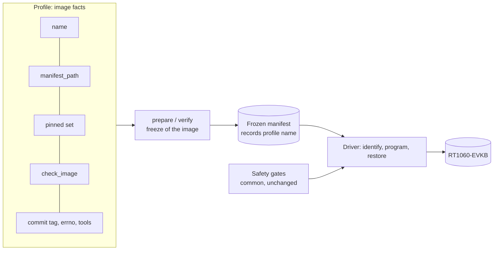

# Image profiles for the RT1060-EVKB program and restore path

Status: **proposed**, software only. M5 and S2 (see below) are the registered profiles. A third, the RT1060-EVKB management bench image, is built but **not registered** ([below](#the-bench-profile-built-not-registered)). Since the capture change a profile also says whether and for how long the `program` mode records the UART of the image it starts ([UART capture in `program` mode](#uart-capture-in-program-mode)). This document and its code change nothing about what may be done on the board. No programming, reset, cable operation or merge is authorised by it. Every physical use of a new image still needs its own approval, reviewed plan and the root mount guard described in [the physical preparation](networking-physical-preparation.md).

## Why

The reviewed freeze (`tests/target/prepare_m5_network.py`) and driver (`tests/target/program_m5_image.py`) were written for one image, the M5 network test image. Other images, such as a product image built from a separate repository, need the same safe path. Copying the tools per image would copy the safety gates too and let them drift. A **profile** separates what differs between images from the gates that must not.

## What a profile holds, and what it cannot hold

| Belongs to the profile (image facts) | Stays common and unchanged (safety gates) |
|---|---|
| `name`, recorded in the frozen manifest | Guard check before every probe command |
| `manifest_path`, the west path of the manifest repository | UART and probe ownership inventory, exclusive board lock |
| `pinned` and `pinned_paths`, the exact dependency set | Target and probe identity, target voltage |
| `check_image`, the image checks (Kconfig, stacks, geometry) | Bounded commands, series budget, no retry |
| `commit_tag`, whether the source commit is embedded in the binary | Identity-only probe first, entry-image verify before a change |
| `errno_suffix`, the source file of the errno evidence, or none | Pinned image hashes, manifest re-verification before a load |
| `tool_scripts`, the extra frozen scripts of the tool repository | One use per mode and evidence directory, restore of the accepted normal image |
| `modules` and `module_paths`, the build modules of an image built by west module discovery (none for M5) | The rule that no other project is accepted under module discovery lives in `frozen_inputs`, not in the profile |
| `capture` (`none` or `raw`) and `capture_seconds`, the bounded window of the passive UART capture of `program` (`none` and 0 for M5) | The port, the board lock and the ownership inventory (`acquire`, `preconditions`); the capture only reads what the driver already owns |

A profile is a frozen dataclass of data and one checking function. `Driver`, `check_identity`, `consume` and the precondition functions do not take a profile, so a profile has no way to relax a gate. The one profile setting that reaches the driver is the capture, and `Driver` receives it as a bounded `CaptureSpec`, not as the profile; a test pins the exact field list of `ImageProfile` and the exact parameter list of `Driver`, so a new way to influence a gate shows up as a failing test in the same reviewed change. A profile does control how strictly an image is checked (its checks, its pinned set, whether a commit tag or errno evidence is required), so a weak profile is possible. The control is that a profile only exists as a registered entry in `PROFILES`, which is a reviewed code change with its own plan review, and that the driver accepts registered names only.



## What is built

| Change | Where |
|---|---|
| `ImageProfile` dataclass; since the S2 change it also holds `modules` and `module_paths` and refuses an inconsistent profile (a project both pinned and a module, a module revision that is not a full commit, two projects or the manifest checkout that share or contain a path) | `tests/target/image_profile.py` |
| `frozen_inputs`, `prepare`, `verify` and `default_tools` take a `profile`; without one they use the M5 profile, built from the unchanged M5 constants | `tests/target/prepare_m5_network.py` |
| `PROFILES` registry and `profile_named`; unknown names are refused | `tests/target/prepare_m5_network.py` |
| `--profile` and `--tool-repo` options of the freeze command (`prepare`, `verify`), restricted to registered names, default M5. Before the S2 change the command could only freeze the M5 image | `tests/target/prepare_m5_network.py` |
| `--profile` option of the driver, restricted to registered names, default `m5-network-physical`; `bind_profile` gives the selected profile and the one manifest verification that `main` uses for both the first load and the re-verification before each load | `tests/target/program_m5_image.py` |
| `profile_named` refuses a registered factory whose profile name differs from its key | `tests/target/prepare_m5_network.py` |
| `prepare(..., tool_repo=...)`: the image source and the frozen tooling may live in different repositories | `tests/target/prepare_m5_network.py` |
| Tests of the mechanism | `tests/build/test_m5_image_profile.py` (13 cases) |
| The S2 profile `s2-controller-physical`: factory `s2_profile` in `PROFILES`, `S2_*` constants (manifest path, pins, modules), `s2_check_image` (the S2 checks plus the firmware identity) | `tests/target/prepare_m5_network.py` |
| The S2 image checks (Kconfig, stack objects, geometry through the shared M3 check) | `tests/target/s2_image.py` (new) |
| The module-discovery rule in `frozen_inputs` (see below) | `tests/target/prepare_m5_network.py` |
| S2 tests: 36 cases | `tests/build/test_m5_s2_image.py`, `tests/build/test_m5_s2_profile.py` |
| S2 fixtures: the real resolved configuration (normalised) and the measured facts with hashes | `tests/build/fixtures/s2-controller/` |

The M5 behaviour is unchanged: the existing M5 and M3 tests pass without modification, and an M5 manifest, plan and approval are used exactly as before.

| Change of the capture work | Where |
|---|---|
| Profile fields `capture`, `capture_seconds`, validated (`none` has no window, `raw` has a whole number of seconds from 1 to 300) | `tests/target/image_profile.py` |
| S2 registers `capture='raw'` with a 180 s window (`S2_CAPTURE_SECONDS`); M5 keeps the default `none` | `tests/target/prepare_m5_network.py` |
| `RawCapture`, `CaptureSpec`, the pure `line_view` and `analyse`: exact raw bytes, a timestamped line view, classification | `tests/target/uart_raw_capture.py` (new) |
| `Driver(capture=...)`, the `before` hook of `Driver.run`, `Driver.program_captured`, `capture_spec(profile, mode)`; `main` passes the profile's spec to the driver | `tests/target/program_m5_image.py` |
| Capture tests (28 cases) and driver and profile tests (30 cases) | `tests/build/test_m5_raw_capture.py`, `tests/build/test_m5_program_capture.py` |
| A real capture as fixture, copied unchanged from `docs/evidence/networking-physical-stage1-run3/.../restore/normal-capture` with hashes | `tests/build/fixtures/program-capture/` |

## Behaviours the tests pin

| Rule | Reason |
|---|---|
| A manifest verifies only under the profile named in it | A manifest of another image must never pass these gates |
| The workspace context must name the profile's own manifest path | A product workspace is built from its own manifest repository |
| No other west project may sit in, contain or equal that path | Same overlap rule as for the M5 manifest checkout |
| The commit tag is required only when the profile says so | A product binary may not embed the platform commit tag |
| The errno role exists only when the profile names a source file | The errno evidence is specific to the M5 transaction code |
| Source snapshot follows the source repository, frozen tools follow the tool repository | The image source and the board tooling are different repositories for a product image |

## The S2 profile and module discovery

The crux-controller product repository builds an image called S2. Its facts were **measured in a local build by the crux-controller session; nothing has run on a board** and the first real freeze is the first real contact of this profile with a real ELF.

| Fact | Value in the profile |
|---|---|
| Manifest repository (west path) | `crux-controller`; the platform repository is an ordinary west project of that workspace, not the manifest |
| Dependencies | the same four pins at the same west paths as M5 (zephyr, cmsis, cmsis_6, hal_nxp), repeated as `S2_PINNED` so that an M5 change cannot move the S2 image |
| Build modules | crux-pilot, picolibc, fatfs and littlefs at exact full commits (`S2_MODULES`). The profile expects crux-pilot at `37c92b18b44b7dfb95c2109f036f23d00f05cb4c`, the module pin of crux-controller `main` at `c36f00c1ca6da08ac8559b7a1260f0d133b141d4` (see "The crux-pilot pin" below) |
| Commit tag in the binary | none (`commit_tag=False`); 0 hits for the 12-character prefixes of the product, platform and Zephyr commits. The identity is the image SHA-256 plus the firmware identity |
| Errno evidence | none |
| Frozen tool scripts | `record-build-provenance.py`. The product's own build script is not frozen by this profile: its name and place are unknown here |
| Firmware identity | `s2_check_image` computes it with the recorder's own functions (algorithm `crux-firmware-identity-v1`, target `mimxrt1060_evk@B//qspi`) and the manifest records it in `image`. It is recomputed at verification and compared with the recorded one; it is not pinned to a value in the profile, so the image is identified, as for M5, by the digest of the approved manifest |

**The crux-pilot pin.** The profile accepts exactly one crux-pilot commit, the one the product manifest pins. The first measured build used `db5adca28bd313caaf3899e959920fac4d508699`; the product has since moved its pin to `37c92b18b44b7dfb95c2109f036f23d00f05cb4c` (crux-controller `main` `c36f00c1ca6da08ac8559b7a1260f0d133b141d4`, which also pins picolibc at `01254932e8e81085817ed61fd858648584ffe37c` as before). The profile expects the new pin because a freeze of a build from that `main` records the new commit and would otherwise be refused. The product manifest imports the west manifest of crux-pilot (`import: true`), and that file is identical at the two commits (an empty `git diff` of `west.yml`), so the four dependency pins, fatfs and littlefs are unchanged. `facts.json` keeps the measured build's `build_modules` (with the older pin) as history and records the update in `west.pin_updates`; the profile tests take the new pin from an independent constant and check that only crux-pilot differs from the measured modules. The crux-controller session reports that the image SHA-256 (in `facts.json`) and the firmware identity (below) are unchanged by the bump; this repository has not recomputed them, since it has no build of the new image. The older pin is now refused by the profile. Every product bump of the crux-pilot pin needs a change of `S2_MODULES`: see the open question in the pull request that made this change.

**Why a module field.** M5 names its modules explicitly in the build (`-DZEPHYR_MODULES`), so the rule "another west project is recorded but never part of the image" holds. S2 uses west module discovery: its `zephyr.meta` lists crux-pilot, picolibc, cmsis, cmsis_6, fatfs, hal_nxp and littlefs as modules of the build. Module discovery builds every active west project that carries Zephyr module metadata (a `zephyr/module.yml`, or `zephyr/CMakeLists.txt` and `zephyr/Kconfig`); zephyr itself is an active project and is not in that list. The freeze records west projects and cannot see which of them carry such metadata, so a project that west lists and nobody pinned might be built into the image unseen. The profile therefore pins each discovered module exactly (`modules`, `module_paths`), and for such a profile `frozen_inputs` refuses every west project that is not pinned. For a profile with no `modules`, which includes M5, the code path is the one it had before; the tests keep an explicit pair, the same extra project accepted under M5 and refused under S2.

**What the S2 image check covers.** `s2_image.check_image` reads the BIN, the ELF and the resolved `.config`:

- the shared geometry check of the M3 images (`m3_image.check_image_bytes`: boot header, ELF sections against the BIN, gap fill);
- `-Os`, the board and flash lines, XIP, the boot header, no heap, the 4096-byte main stack, the stack guard, the network and socket sizes of the S2 build, the static IPv4 configuration (board address 192.168.77.2, mask 255.255.255.0, no gateway, through the `NET_CONFIG_*` options), the S2 workload lines (peer address and port, worker stack and thread count), and Crux Logging in deferred mode, which the M5 check forbids;
- none of the M5-only debug options is required (`INIT_STACKS`, `PRINTK_SYNC`, `CONSOLE_GETCHAR`, `CONSOLE_SUBSYS`, `NET_BUF_POOL_USAGE`), and storage, `WATCHDOG`, `SHELL`, IPv6, DHCPv4 and MCUboot stay refused;
- stack objects: `z_main_stack` 4160 bytes, `worker_stacks` 33,024 bytes, no `m5_observer`.

The stack sizes come from the crux-controller session's reading of the real ELF, which this repository has not seen. The tests check them against a **synthetic** ELF whose symbols were set to those values. If the real ELF differs, the first freeze refuses it; that is the check working or the measurement being wrong, and it is not a defect of the board path.

**Expected consequences of the first real freeze (not yet seen).** (1) A module whose revision in the product manifest is a branch or tag name is refused: the recorder keeps the manifest's revision string, and the freeze requires it to equal the resolved commit and the pin. (2) The workspace must list exactly the four dependencies and four modules; any other active project is refused, even one without module metadata. (3) The platform repository is a pinned module at the revision above, which need not contain this profile. The freeze and driver therefore run from a separate platform checkout that does (`--tool-repo` for the freeze), not from the workspace's module checkout.

**Cross-check of the fixtures.** The committed configuration (normalised the way the recorder normalises it) and the recorded image SHA-256 reproduce the recorded firmware identity `8493243091295c6d9ec305b6e5b097df738ee226550394a5ab0fdac388f73164`; a test recomputes it. The BIN itself is not committed (103,180 bytes); its hash is in `facts.json`. The real BIN was read once by hand when the facts were collected: its size, the `FCFB` header and the pinned IVT bytes match what `check_image_bytes` requires of a BIN. That is not a test and is not repeated by one.

## UART capture in `program` mode

Software only. Nothing here ran on a board, and nothing here authorises a programming, reset or any other board step: a first physical use of an S2 profile with a capture still needs its own approval, reviewed plan and the root mount guard.

### Is the product session's reading right?

Yes, for every claim that was checked. Line numbers are those of `origin/main` at `abfd1879`, before this change.

| Claim | Verdict | Where |
|---|---|---|
| Every mode acquires the exclusive UART | Right | `Driver.__enter__` calls `acquire` whenever one is given, `program_m5_image.py:92`; `acquire` takes the board lock and the exclusive port (`:323-343`) |
| `program` holds the port and reads nothing | Right | `Driver.program` (`:159-166`) only calls `run`; `self.port` is not used in it. Only `restore` reads it: `capture = observe(self.port)` (`:175`) |
| `restore` reads it through `Observation` and checks the normal image's boot banner | Right | `Observation.finish` requires `*** Booting Zephyr` and the `M3_BOOT source=...` line (`:203-205`) |
| `capture_m5_network.py` is the M5 phase protocol | Right | its `capture` subcommand needs an approved reduced or full M5 plan, `--perform-approved-reset` and `--boot`, and "never programs, restores, or switches a cable" (`capture_m5_network.py:1-7, 489-497`) |
| A reused `Receiver` stops on a cut final line, a non-ASCII byte and a poll gap | Right | `capture_m3.py:135` (`Incomplete final serial line`), `:133` (strict ASCII decode), `:118` (`Serial reader discontinuity` above 0.25 s) |
| For an image with no phase runner the boot and the first seconds would be lost | Right, with two additions found while reading | (a) `capture_m3.drain`, which `Observation` calls first, raises `Unable to drain before fresh reset` unless the line is quiet for 50 ms within 3 s (`:157-167`). A continuously logging entry image can fail that before anything is loaded, so the new capture does not drain. (b) The load, verify, reset and go are **one** Commander run (`capture_m3_network.py:226-231`), so a capture can open before that run but never between its reset and its go, and the stream holds the entry image's last output, then silence, then the new image |
| Under A1 the step's `done` marker must be written before the window | Holds by construction | `Driver.run` notes `done` when the Commander run returns (`:141`); the window runs afterwards in `program_captured` |

### Decisions

| # | Decision | Why, and the alternative that was rejected |
|---|---|---|
| 11 | The capture is a **profile property**: `capture` (`none` or `raw`) and `capture_seconds`. M5 stays `none`, S2 is `raw`. The driver is not changed for everybody: without a capture `Driver.program` runs the original lines | M5 behaviour stays byte for byte (the unchanged M5 tests pass, and a test compares commands, checks and re-verifications with and without a capture). Rejected: a driver-wide capture, which would change the reviewed M5 run |
| 12 | The gates stay in `Driver` and take nothing from the profile. `Driver` gets a `CaptureSpec(seconds, factory)`, never the profile. Tests pin the field list of `ImageProfile`, the parameter lists of `Driver.__init__` and `Driver.run`, that an unknown gate keyword is a `TypeError` for `ImageProfile` (for `Driver` the exact parameter set is pinned instead), and that every registered and extreme profile produces identical commands, checks and re-verifications | A profile must not be able to relax a gate. The one setting it does carry can only add a read |
| 13 | The capture **opens inside `Driver.run`, through an optional `before` hook, after the guard check, the ownership inventory, both budget checks, the image hash check and the manifest re-verification of the load step, and before the load command** (the one probe command of the step for a 30 s image; the first of the three runs of decision 25 for a split image). It never opens for the identity-only or the entry-image step. A refusal by any gate that runs before the command (guard, ownership inventory, both budget checks, image hash, manifest re-verification, the window budget, a missing port) leaves no capture and no capture directory. The identity and voltage check reads the output of the command itself, so it runs after the open: when it refuses, the capture is aborted and its directory stays as evidence. A capture counts as open only after its reader completed a first read, so a port that cannot be read stops the run before the load | The capture must not exist in front of a gate, and it must be in place before the reset. Rejected: opening it before the guard checks (it would record while a gate is still deciding), and opening it in `__enter__` (it would also run through steps that cannot start the image). The hook runs the callable after the last check and cannot skip one. It adds at most the reader start (a bounded 1 s) between the last check and the command |
| 14 | For an image whose limit is 30 s (M5, S2, the normal image, anything up to 262,144 B) the load, verify, reset and go stay the **single** command `image_commands(binary, True)`, exactly as before. **Limited by decision 25:** a larger image is split | Owner decision of 2026-11-10 (relayed by the coordinator: "추천대로 진행해줘"): the reviewed and board-run single-run path stays for the existing images; the split is used only where one 30 s run cannot fit |
| 15 | The window is `capture_seconds` **after the start command has returned and its `done` marker is written** (the single run, or the start run of a split image). It is a whole number of seconds from 1 to 300 (`MAX_CAPTURE_SECONDS`, at most about 3.8 MB at 115200 baud), part of the registered profile, and must fit the series budget, checked before the load: `now + 30 s (the Commander limit) + window < series end` for a single run, and for a split image `now + command_seconds(image) + (120 s + extra) + 120 s + window < series end` (decision 31). S2 registers 180 s | Open-ended capture is refused by construction. 180 s is the crux-controller plan's proposal (the workload starts only after a network init wait of up to 30 s); the owner decides the number. The window is bound to an approved manifest through the frozen tool hashes (`image_profile.py`, `prepare_m5_network.py`, the driver), as every other profile fact, when the freeze ran from the executing checkout. The M5 plan schema has no field for it, so the written approval text must name it |
| 16 | **No drain, no discard.** Every byte the port delivers from the open on is raw evidence. Bytes that were already buffered when the capture opened come first and are the entry image's | `capture_m3.drain` can raise on a noisy line, and discarding bytes is a loss. The `opened` mark and the quiet periods let the offline analysis separate old and new |
| 17 | Recorded exactly: `uart-rx.bin` (every chunk goes into memory first, then into the file before any record about it, and is flushed; `analysis.json` gives the bytes in memory and on disk, so a write failure shows as a difference), `receive.jsonl` (time, raw offset, hex), `poll.jsonl`. The line view decodes **latin-1**, which maps every byte to one character without loss, keeps ESC and control bytes, and each row carries `offset` and `length` into the raw bytes. `analysis.json` classifies and decides nothing | The raw bytes are the evidence. The accepted `Receiver` decodes strictly and strips ANSI, which loses information for an unknown image. The acceptance analysis stays an offline replay, as for `restore` |
| 18 | A cut final line, non-ASCII bytes and poll gaps are **classified, never fatal** (table below). Only a real failure stops the reader: the port raising on a read, or a file that cannot be written | The reader of an unknown continuously logging image must survive what it records. A poll gap is an observation about the reader, not a verdict on the image |
| 19 | A capture that **cannot open** stops the run before the load: nothing in flash changes. A capture that **fails afterwards** never restarts or retries the image (below) | The purpose of the capture is the evidence of the first start; an unrecorded start is not worth the risk of an unreviewed image. There is no loop in the driver, and no path leads from a capture event to a probe command |
| 20 | A start command that fails, or whose output lacks `Verify successful` (for a split image: a load, read-back or start run that fails, a read-back without `Verify successful`, or a gate that refuses a later run), **aborts** the capture at once instead of waiting the window, and the primary error is kept. A failure of the abort is attached as `capture_failure`, as in `restore` | The run has stopped, the operator needs the port back, and a long wait changes nothing about the state. `restore` waits its window even after a failed start; the program step does not, because its window is minutes, not 15 s |
| 21 | No capture oracle and no expected output for S2 | No capture of the S2 image exists. Any expectation would be unverified; the first real capture is the input of that work |
| 22 | Labels (`program-m5`, `M5_PROGRAMMED_VERIFIED_STARTED`) and the plan shape stay as they are | Renaming touches approved plan wording; unchanged from decision 10 |
| 23 | The capture works on the port object that `acquire` returned and never opens, closes, configures or writes it, and takes no lock | Ownership, `TIOCEXCL`, the board lock and the lsof check keep one owner; `Driver.__exit__` closes the port after the capture has stopped (the capture joins its reader before it returns) |

### Bounded split runs of `program` (blocker B1, row C7)

Software only: host unit tests on real Commander transcripts, nothing ran on a board. The approval for doing this change is the owner's quote "1-8까지 너의 추천대로 진행해줘", relayed by the Crux Secure Communication session on 2026-11-09, which the owner's review of the draft is to confirm; it is not an approval to merge or to run anything on the board, and the first measured load of the bench image is a board operation that needs its own approval document.

| # | Decision | Why, and the alternative that was rejected |
|---|---|---|
| 25 | **Only for an image whose limit exceeds 30 s** (above 262,144 B, today the bench image; owner decision of 2026-11-10), `program` runs the image step as **three** Commander runs, each started once: `03-program-m5-load` (`loadfile`, `q`), `04-program-m5-verify` (`verifybin`, `q`), `05-program-m5-start` (`r`, `g`, `q`). The start runs only after the read-back printed `Verify successful`. Each run has its own guard check, ownership inventory, budget checks and identity check; the load and read-back also check the image hash and re-verify the manifests. A 30 s image keeps the single run of decision 14, with main's labels (`03-program-m5`), check count, re-verification count and reserves | One run of the 562,232 B image would need about 23 s for the load (extrapolated) **and** about 19 s for the read-back (extrapolated from the real 107,872 B read-backs, about 3.7 s each without the host checks), far beyond 30 s. Rejected: one run with a longer limit (about 50 s or more in one uninterruptible step, and nothing between the load and the start could stop it); load and read-back in one run as in `restore` (about 42 s, which leaves no 2x margin under the 80 s ceiling) |
| 26 | Limit of a run that loads or reads back an image: `command_seconds(size) = max(30, 10 + 10 x ceil(size / 131072))`, refused above `capture_m3.MAX_COMMAND_SECONDS` = 80 s. The identity, entry-image (for an image of up to two ranges) and start runs keep 30 s; `restore` keeps 30 s for each run. `identify` gives each candidate's read-back its own `command_seconds` and refuses a candidate above the ceiling before its first command. The ceiling lives in the one accepted wrapper, which refuses any other value before it starts a process. **The guard time required at each step's check grows with the limit** (decision 32) | The real stage 1 loads took at most 4.52 s per 128 KiB range for compare, erase, program and the loader's verify, plus 2.49 s fixed; the real read-backs took at most about 4.9 s per 128 KiB including the host checks. 10 s per range and 10 s fixed keep at least twice that, and a test checks this against the copied transcripts. M5 (97,544 B), S2 (103,180 B) and the normal image (107,872 B) get exactly 30 s per run, as before; nothing is looser for them. The bench image gets 60 s per load or read-back |
| 27 | Both series reserves (120 s before the checks, 45 s after them) grow by what a run's limit exceeds 30 s | A 60 s run must not start with the margin of a 30 s one |
| 28 | For a split image, the capture opens where it opened before, after the load step's checks and before the load command, and stays open through the read-back and the start; the window follows the start run. A reader that has already failed when the start step's checks pass stops the mode before the reset, with the image loaded and verified but not started by the driver | J-Link may start the core when it disconnects after the load run (the `Could not start CPU core` diagnostic shows it tries), so the first run of the new image can be before the start run; opening only before the start would miss it. Decision 19 (a capture that cannot open stops before the load) is unchanged |
| 29 | The documented disconnect diagnostic stays accepted only after a successful `verifybin` and a bare `q`: the read-back run qualifies, the load run (`loadfile`, `q`) does not | No real transcript of a load-only run exists. If the first real load run prints the diagnostic, the stop is the gate working; widening the rule needs that transcript and its own review. The risk concerns split images only (today the bench image); the single run of a 30 s image ends with `r`, `g`, `q` as before |
| 30 | The load run records the J-Link loader's own report (`flash_download` in `operations.json`: affected bytes, total and part times, or `skipped`; `null` for any other format, which never stops the mode), and every run records `limit_seconds` | The bench load time is an extrapolation. The first real load measures it; the record decides nothing |
| 31 | For a split image, before the load command, the series budget must cover the whole sequence: the load run, the reserve that the read-back step checks before its checks (120 s plus its extra), the start step's 120 s and the capture window. For the bench image that is 330 s plus the window (a 30 s image keeps main's single-run budget) | A budget refusal after the flash changed would leave an image loaded and not started for no reason of its own. It can still happen only if a later step's checks overrun its own reserve |
| 32 | The guard check before each run requires `guard_seconds(limit) = 90 + max(0, limit - 30)` seconds of guard lifetime left: 90 s for every 30 s run (unchanged, so M5, S2 and the normal image require exactly what they did), 120 s for the bench image's 60 s load and read-back, 140 s at the 80 s ceiling. The real wiring also checks the guard deadline again as the very last thing before the run: `now + limit + 2 s < deadline` (the run, its 1 s reap, 1 s for the tool hash check before the process starts); otherwise no probe command | The guard is checked at the start of a step; the ownership inventory, NIC checks (each inventory call up to 10 s), image hash, manifest re-verification and a capture open run after it. With a fixed 90 s an 80 s run would have kept only about 9 s minus those checks, and the guard vetoes DAPLink mass-storage mounts, so a lapse during a flash write is exactly its hazard. 140 s stays below the guard's shortest lifetime (300 s, `m5_mount_guard.MIN_LIFETIME`; default 7,200 s) |

**Failure orders of a split image.** (A 30 s image keeps main's single run and its failure behaviour; decision 32's guard time and pre-run deadline check apply to it too, at 90 s.) In every row the run that failed is the last probe command of the mode (no retry, no further command), `failure.json` is written with `automatic_retry: false`, the port is released, the capture (if any) is aborted, and the board lock is dropped. A timeout kills the Commander process group and writes `<step>.timeout.json` (`PROBE_STATE_UNCERTAIN`, with the limit). The recovery in every row is the unchanged `restore` mode under a new approval and evidence directory: it does not depend on the flash content, since it loads the whole normal image and verifies it twice before it starts it.

| Failure | Flash | Core | What runs next in this mode |
|---|---|---|---|
| Image above the ceiling, unsafe path, guard, ownership, budget (including the whole-sequence budget of decision 31), image hash, manifest re-verification, capture open, or the guard deadline re-check before the load | unchanged (entry image) | entry image, as before the mode (after the entry-image step's `connect` it may be halted) | nothing |
| Load run times out mid-flash (SIGKILL) | **partially erased or written**: not bootable as either image | unknown | nothing |
| Load run exits non-zero or prints any diagnostic | written by the loader, possibly incomplete | halted or running the new image (J-Link may start it at the disconnect) | nothing |
| Load ok; guard, ownership, budget (only if the load step's checks overran its reserve) or the guard deadline re-check refuses the read-back | new image, loader-verified only | halted or running the new image | nothing |
| Read-back mismatch (non-zero exit), timeout, or no `Verify successful` | new image, possibly corrupt | halted or running it | nothing; the image is never reset or started by the driver |
| Read-back ok; a gate refuses the start, or the capture reader failed | new image, fully verified | halted or running it | nothing |
| Start run times out or fails | new image, fully verified | unknown: before or after the reset | nothing |
| Start ok; the capture fails in the window | new image, fully verified | the new image, started once | nothing (decision 19) |

### The read-only `watch` mode (blocker B4, option X)

Software only: host unit tests with fake ports, clocks and probes; nothing ran on a board, and nothing here authorises a capture, a programming or any other board step. **The first physical use of a longer window needs its own approval, reviewed plan and the root mount guard.** The design is [part 2 of the freeze and capture design](rt1060-bench-freeze-and-capture-design.md#part-2-b4-a-capture-window-above-300-s). The owner's decision, in the Crux Pilot main session chat on 2026-11-12 at 21:33:37 UTC (session transcript time; the owner's time zone is not recorded), after the recommendation to implement option X as the design recommends it: "추천대로 진행해줘." (in English: proceed as recommended). It takes the design's recommendation for each of its decisions D1 to D7. It is not an approval to merge or to run anything on the board.

| # | Decision | Why, and the alternative that was rejected |
|---|---|---|
| 33 | A fourth mode, **`watch`** (D1 option X, D7 the name), that reads the UART and **runs no probe command**: no identity probe, no verify, no load, no reset. `Driver.run` refuses in the watch mode before any check, and `main` gives the watch driver a probe that refuses, so no path reaches J-Link by construction. The profile carries the window as one new field, `watch_seconds` (0 = no watch; otherwise 1 to `MAX_WATCH_SECONDS`, whole seconds, and only for a profile whose `program` captures raw). The watch window is a `WatchSpec`, a subclass of `CaptureSpec` with its own cap as a class constant; `CaptureSpec`, its 300 s cap and what it passes to the capture are unchanged, and the parameter lists of `Driver.__init__`, `Driver.run` and `Driver.program` are unchanged. `Driver` refuses a `WatchSpec` in any other mode | The one mode that writes flash stays as reviewed (D1). Rejected: Y2, raising the program window (edits the write path and relaxes a global cap); Z, a reset inside the window (a probe command while a capture is open). The design asked for the cap as a `CaptureSpec` argument; a subclass keeps the pinned `vars(spec)` and the program path byte for byte, at the same review surface |
| 34 | The bench profile watches **2,400 s** (D2); `MAX_WATCH_SECONDS` = 3,600. `capture_seconds` of the bench stays 300, `MAX_CAPTURE_SECONDS` stays 300, and `program` keeps its 900 s series and every assertion | 2,080 s is what the plan's own figures need (design, "What the load run needs"); 2,400 s covers the 35-minute client figure by only 20 s, so **2,700 s is the noted alternative** (one constant, `BENCH_WATCH_SECONDS`). Not measured |
| 35 | The gate sequence of a step is one private method, `Driver._checks`, called by `run` and by `watch`, so the two cannot drift. `run` calls it with exactly its former arguments; the unchanged tests of `run`, `program`, `identify` and `restore` are the proof. The watch step runs: the series reserve before the checks (120 s **plus the whole window**), the `checks` record, the guard check requiring **90 s plus the window** (D3; `preconditions` takes an optional `remaining`, which only the watch passes), the ownership inventory as the owner (this process alone holds the cu node, nobody the tty node, no J-Link, OpenOCD or pyOCD process), the adapter identity, the reserve after the checks (45 s plus the window), and the manifest re-verification. Then, as the last things before the open: the window and the close (5 s, `WATCH_CLOSE_SECONDS`) fit the series, and the guard deadline outlives them: `now + window + 5 s < deadline`, the counterpart of decision 32's re-check before a probe command | Every gate of the current driver that applies stays: approval, clean tree, one use, `exist_ok=False`, the board lock and `TIOCEXCL` from `acquire`, the guard at acquisition (90 s) and at the step, ownership, adapter, budget, re-verification, no retry. The identity and voltage check reads a probe command's output, so with no probe command it cannot apply: that is the design's accepted loss (no probe identity) |
| 36 | **No guard re-check inside the window** (D4). The one check covers the window instead | A re-check could only abort the capture, never protect the image, and adds checks to a window that has none. A guard that dies inside the window is not seen by the watch (table below) |
| 37 | The series of `watch` is **300 s plus the window** (D5): 2,700 s for the bench. `main` passes it; the driver default stays 900 s for every other mode | One check and the acquisition need far less than three Commander steps |
| 38 | **The seam is accepted** (D6), with this procedure: the operator starts **no TCP client before `watch/operations.json` shows `capture-open`**, and the evidence for the judge is the program window's `uart-rx.bin` followed by the watch window's | Derived, not measured: with nothing driving traffic, nothing should print in the gap (the idle report prints once). A test splits real report output (the `native_sim` run of row C2, copied unchanged) at a report boundary into a real program-window capture and a real watch-window capture: the judge's sequence rule reads the concatenation as one stream, finds a report printed in the gap as a lost report, and a report that lost bytes at the seam as broken |
| 39 | A profile without a watch window is refused **before** anything is consumed. The watch uses its own marker (`m5-driver-watch.consumed`), so `program` and `watch` each run once under one evidence parent, each in its own new mode directory; the capture directory is created with `exist_ok=False` | A refusal must not burn the approval's one use; a second watch needs a new approval and directory, like every mode |
| 40 | The bench profile stays **not registered**, the plan schema is unchanged, and the labels stay | Registration needs B2's freeze and its own approval. The approval text must name the profile, both windows (300 s and 2,400 s) and both modes, because the plan schema has no field for them |

**Failure orders of `watch`.** In every row the driver has sent no command to the board: no probe command ran and the capture never writes to the port (opening the port in `acquire` asserts DTR and RTS as in every mode; see the last table). A refusal or a stop writes `failure.json` with `automatic_retry: false`, closes the port and drops the board lock; nothing is retried or reopened. A second watch needs a new approval and evidence directory.

| Failure | The capture | The driver |
|---|---|---|
| No watch window in the profile; unclean tree; documents, manifests or tools differ; mode already used | none | refused; the first three before `consume`, so the mode's one use stays unspent; the last at `consume` |
| Evidence directory exists; acquisition (guard 90 s, ownership, UART identity, board lock busy, port busy under `TIOCEXCL`) | none | refused, port and lock released |
| Series budget before or after the checks; guard check (90 s plus the window); ownership; adapter; manifest re-verification; window budget at the open; guard deadline re-check; no owned port | none, no capture directory | `HardwareStop`, no probe command, port closed |
| The capture cannot open (directory, disk, the reader's first read fails or does not start in 1 s) | nothing left running; a partial directory may stay as evidence | `HardwareStop('UART capture could not be opened; nothing was read')`, cause chained |
| The record of the open cannot be written | aborted at once, files written | the primary error kept, `capture_failure` if the abort failed |
| **The reader fails in the window** (port lost or raising, a file not writable) | reading ends, the bytes so far kept, `reader_failure` in `analysis.json`, the window ends early | `HardwareStop('UART capture reader failed: ...')`, no `capture-closed`, no `result.json`; never reopened |
| An interrupt in the window | stopped, files written | the interrupt propagates, port closed |
| The reader does not stop in 1 s, or the evidence cannot be written at the close | reported | `HardwareStop`; the reader is a daemon thread, the port is closed by `__exit__` |
| **The guard lapses inside the window** (its process dies or is stopped although the open required its deadline to outlive the window) | continues to the end | **not detected** (decision 36). DAPLink mass-storage mounts are vetoed only while the guard lives; the next mode's guard check refuses |
| **Timeout** | the window is the only timer: the capture stops at its end | the series end was checked before the open (window plus 5 s); nothing runs after the window, so an overrunning close starts nothing |

**What a separate watch run does not prove**, compared with a capture inside the program run (the seam):

| Not proved | Why |
|---|---|
| A continuous stream | Bytes printed between the program window's close and the watch's open are lost. The judge sees a lost or broken **report**; a log line or banner outside a report is lost silently |
| That the board behind the UART is the board that was programmed | No probe identity in the watch. The UART's USB serial (`select_uart`) and the adapter identity stay bound; the image identifies itself only offline, by its own UART output |
| That nothing touched the board in the gap | The board lock and the port are released between the two runs. Another driver under another approval, a button press or a power event in the gap is not recorded by either file (a reboot would show as a new `seq=1 reason=boot` report, which the judge allows) |
| That opening the port does not reset the target | `acquire` opens the port as in every mode (pyserial asserts DTR and RTS by default). Whether the EVKB's probe UART bridge forwards them to the target's reset is **not recorded**. If it does, the watch would restart the image at its open, visible as a boot report at the start of the watch file |
| One time base | Both files record their host clock identity (`clock.json`); their times compare only when the two identities are equal |

### Open for the owner

| Question | State |
|---|---|
| The window of S2: 180 s is the crux-controller plan's proposal and what the profile registers | The owner decides; it is one constant (`S2_CAPTURE_SECONDS`, at most 300) |
| Must the root mount guard still hold for the whole window? `guard_check` requires 90 s at the last check; the window runs up to 30 s plus `capture_seconds` after it, with the new image running and the port held but **no probe command** | For `program`, not decided here, and no gate is broken either way (the window has no probe command). The operator should start the guard with a deadline that covers the window, or the owner says it need not. For `watch` it is decided (decision 35, D3): the check requires 90 s plus the window |
| The M5 plan and approval schema has no field for the window | The written approval text must name the profile and the window; a profile-aware plan is a later change |
| The driver labels still say `m5` | Unchanged (decision 22) |

### Where the capture sits

```mermaid
sequenceDiagram
    participant D as Driver.program
    participant G as Gates: guard, owners, voltage, budget, hashes, re-verify
    participant C as RawCapture (reads the owned port)
    participant J as J-Link Commander
    participant B as Board
    D->>G: identity-only step
    D->>G: entry-image step, verifybin, stop if it differs
    D->>G: load step checks
    G-->>D: all passed
    D->>D: window fits the series budget
    D->>C: open (mark opened, reader starts)
    Note over D,J: A 30 s image (M5, S2): loadfile, verifybin, r, g, q in one run, once. A split image:
    D->>J: loadfile, q (run 1, once, limit command_seconds)
    J->>B: halt, program (the core may restart at the disconnect)
    D->>G: read-back step checks
    D->>J: verifybin, q (run 2, once, limit command_seconds)
    D->>G: start step checks, capture reader still alive
    D->>J: r, g, q (run 3, once, 30 s)
    J->>B: reset, go
    B-->>C: entry image output, silence, new image output
    J-->>D: run returned, identity check, done marker written
    D->>C: window (capture_seconds, host steps may run concurrently)
    C-->>D: reader stopped, files written, summary
    Note over D,C: A failure of the run aborts the capture; a failure of the capture stops the mode. Neither starts anything.
    D->>D: port closed after the capture stopped
```

### What is recorded

| File (in `<mode directory>/capture/`) | Content |
|---|---|
| `uart-rx.bin` | every byte, exactly, flushed per chunk |
| `receive.jsonl` | per chunk: `monotonic`, `offset` into the raw bytes, `hex` |
| `poll.jsonl` | per poll: `monotonic`, `gap` (the accepted reader's format) |
| `clock.json`, `config.json` | the host clock identity; window, thresholds, read size, `passive: true` |
| `marks.json` | `opened`, `window-start`, `stopped`, or `aborted` with its reason: each with `monotonic` and `raw_offset` |
| `lines.json` | timestamped rows: `offset`, `length`, `text` (latin-1, no LF, no CR before it), `first_monotonic`, `monotonic`, `complete` |
| `analysis.json` | the classification below, the SHA-256 of the raw bytes, `acceptance: none: the offline analysis of the raw bytes decides` |

| Observation | Classified as | What it does **not** do |
|---|---|---|
| Final line without a terminator | `final_line.state = cut` with its offset, length, text and time (`complete` or `none` otherwise) | stop, hide the line, or fail the capture |
| Any byte above 127 | `non_ascii`: exact count and coalesced ranges with their offsets and the first 16 bytes as hex | decode with a loss, reject a line |
| Time between two polls above 0.25 s | `poll_gaps`: count, maximum, and each with its time and raw offset | end the reader (the accepted one does) |
| Time between two chunks of 1 s or more | `quiet_periods` with the raw offset where output resumed | judge the image |
| First and last byte | `first_byte` (seconds after open), `last_byte` | |

The lists keep the first 100 entries; the counts are exact.

### If the capture fails

| Event | The capture | The driver | The image |
|---|---|---|---|
| The capture cannot open (directory exists, disk full, reader did not start) | nothing is left running | `HardwareStop('UART capture could not be opened; no probe command runs')`, `failure.json`, port closed | not loaded, flash unchanged |
| The load, read-back or start command fails (timeout, identity, verify), or a gate of a later run refuses | aborted at once, files written | primary error kept, `capture_failure` set if the abort failed, no further command | as the failed command left it, state uncertain as for any failed command |
| The read-back lacks `Verify successful` | aborted | `HardwareStop('Complete M5 image verification absent')`; no start run | loaded, not started by the driver |
| The reader failed before the start | aborted | `HardwareStop('UART capture reader failed before the start; ...')`; no start run | loaded and verified, not started by the driver |
| The port raises during the window | reader ends, bytes so far kept, `reader_failure` recorded, the window ends early | `HardwareStop('UART capture reader failed: ...')`; `failure.json`; no `result.json`; the `done` marker of the start step is on record | running; **not restarted, no second `r`/`g`, no retry** |
| An interrupt in the window | stopped, files written | the interrupt propagates, port closed | as above |
| The reader does not stop in 1 s | reported | `HardwareStop`; the thread is a daemon, the port is closed by `__exit__` | as above |

`restore` is the comparison: its `capture.finish()` error also propagates after the start, with the start's own error preferred when both fail. The difference is only that the program capture is raw and never judges the image.

### Interaction with the Commander output, the port and the locks

| Item | Behaviour |
|---|---|
| Commander output | The Commander run writes `NN-program-m5.log` in the mode directory; the capture writes only below `capture/`. They share no file. The UART is not part of the Commander run (SWD only), so the capture adds nothing to its log and its diagnostic rules are unchanged |
| Port ownership | One owner: the `Serial` object that `acquire` returned and `preconditions` checks by `lsof`. The capture reads it from one thread and never opens a second handle. The reader starts after the last ownership check of the load step and no check runs while it is open, because the load step has no later one |
| Lock files | `evkb-<probe>.lock` is held by `acquire` for the whole mode, as before. The capture takes none |
| One use | `consume` still allows one `program` per evidence directory, and the capture directory is created with `exist_ok=False`, so a capture is never overwritten |
| Concurrent host steps | An operator may run read-only host steps (link and address observation) from another terminal during the window. None of them touches the probe, the port or the lock |

## What is not built

- **No capture oracle, no expected UART output.** (The raw capture above records; it judges nothing.) The expected output of S2 (Crux Logging lines, `net: exchange ok cycle=<n>`, failure lines with `result=-2` or `-3`) comes from the crux-controller plan and no capture of the image exists. No oracle or check of it is written; it needs a first real capture. The Ethernet link may not come up at all (static 192.168.77.2/24, no gateway, no DHCP, no MDIO correction): unknown.
- **The capture oracle stays per image.** `m5_network_oracle.py`, `capture_m5_network.py` and the M5 phase protocol are untouched.
- **Driver labels are unchanged.** The step label `program-m5` and the status `M5_PROGRAMMED_VERIFIED_STARTED` still name the M5 image, so the evidence of an S2 program step will say `m5`. S2 is the first profile that needs a neutral label, and the S2 change leaves it open: the labels appear in the plans and approvals that name operations, so renaming them is a decision for the owner and a separate change.
- **`scripts/record-build-provenance.py` is not modified.** It is protected. How it records a product repository (`--repo`) is the input of the later profile PRs.

## Decisions taken for lack of an answer

| # | Decision | Why |
|---|---|---|
| 1 | The profile registry lives in `prepare_m5_network.py` and keeps its name | Renaming the reviewed module is out of scope. Its name is a key in the recorded tool hashes (`inputs.json` `scripts`) and in the plans and evidence that cite it |
| 2 | The default profile is M5 | Existing commands, plans and approvals keep working unchanged |
| 3 | The workspace manifest context path is the profile's `manifest_path` | Inference: a west workspace names its manifest repository by path. To be checked against a real product workspace in the profile PR |
| 4 | `tool_repo` defaults to the source repository | M5 uses one repository for both |
| 5 | A profile with `modules` refuses any unpinned west project; M5 keeps accepting them | Under module discovery an unpinned project can become part of the image |
| 6 | Modules are pinned by full commit, like the dependencies, and the profile refuses a branch or tag name | The recorder records the resolved commit besides the manifest revision, so exact commits are available and a moving name is not an identity |
| 7 | The S2 pins are repeated, not shared with M5 | An M5 pin change must not move the S2 image |
| 8 | The manifest records the firmware identity in `image` | The binary has no commit tag, and the plan and approval need a stable name of the image besides its SHA-256 |
| 9 | The freeze command gains `--profile` and `--tool-repo` | Without them the S2 profile could be registered and never frozen |
| 10 | Capture, expected output and driver labels are left out | No real capture exists; the label rename touches approved plan wording. The raw capture is added later (decisions 11 to 23); the expected output and the labels stay out |
| 24 | The crux-pilot pin of the S2 profile follows the product's `main`; the facts file keeps the measured older pin as history | The profile must accept the image the product builds now; the facts file documents what was measured, and rewriting it would claim a measurement of a build nobody made here |

## What is untested

- Nothing in this change ran on hardware, and none of it can: the tests use synthetic images and temporary directories.
- The profile facts of the real S2 image are exercised only through its real resolved configuration. The BIN and the ELF used by the tests are synthetic layout fixtures and are never flashable. The real ELF was not available: no symbol check has run against it.
- No freeze (`prepare`) has run on a real S2 build. Its inputs file, build provenance and the product's build script are not seen here. How the recorder records the product repository (the product is the source repository, so west's listing omits it, and the platform repository appears as an ordinary project) is read from the code of the recorder, not run.
- `main` itself has no unit test, as before. The profile wiring is the small `bind_profile` helper, which is tested; that `main` passes its result to both `load_inputs` and the re-verification is by reading the code.
- `prepare(..., tool_repo=...)` does not check that the tool repository is clean or committed. The driver already requires a clean tree for itself (`require_clean_tree`); a profile PR that uses a separate tool repository must show how that repository is frozen.
- The raw capture is tested only against fakes: a real capture of stage 1 (a restore of the normal image) replayed through a fake port, and synthetic cut lines, non-ASCII bytes and poll gaps, because the real captures have none. No serial port, no Commander and no board were involved. Whether the reader keeps up at 115200 baud on the Mac, how long the kernel buffers the entry image's bytes before the capture opens, and what S2 actually prints are unknown.
- `main` passes `capture_spec(profile, args.mode)` to the driver: by reading the code and the tested helper, as for `bind_profile`.
- Real errno verification under a non-M5 profile and the exact M5 `default_tools` list are covered only through the M5 tests that were not changed.

## The bench profile: built, not registered

Software only; nothing here ran on a board and nothing authorises a programming, reset or capture. The management bench image of row C8 ([plan](rt1060-bench-image-plan.md), section "The image profile input") has its profile **built and tested but not registered**: `PROFILES` in `tests/target/prepare_m5_network.py` is unchanged, `profile_named('crux-mgmt-bench-rt1060-evkb-b')` refuses the name, and a test asserts it. A registered profile would let a freeze record a Zephyr tree that was never compiled (blocker B2), so the blockers below are settled first. The owner took the decisions among them on 2026-11-09 ([the image plan](rt1060-bench-image-plan.md#decisions-of-2026-11-09)); **taking a decision approves no board stage and no board operation, and registering stays off.**

| Piece | Where |
|---|---|
| `check_image(binary, elf, config)`: the shared geometry check, the Board, declaration and forms, Entropy, Network, Buffers, No card and Report groups, the still-refused list, and the stack symbols of the linked image as a multiset (`worker_stacks` is two symbols of one name). It returns the facts and the firmware identity, and raises `ValueError` on a mismatch. It reads only the BIN, the ELF and the `.config` | `tests/target/bench_image.py` (new) |
| `bench_profile()`: the factory, with the ten pinned projects of the plan, no modules, `commit_tag=False`, no errno evidence, `record-build-provenance.py` as the only tool script (the bench freeze script does not exist), `capture='raw'` | `tests/target/bench_image.py` |
| Tests: one subtest per group, the M5 constants, the identity, the pinned set compared with the table of the plan, not registered, the window | `tests/build/test_bench_image_profile.py` (18 cases) |
| Fixtures: an unchanged 56-line extract of the resolved `.config` of the recorded build and its measured symbol sizes | `tests/build/fixtures/bench-image/` |

The configuration of the bench sets `LOG`, `FILE_SYSTEM`, `DISK_ACCESS` and `WATCHDOG`, which the M5 check forbids, so the bench check does not refuse them (the plan lists them as differences, not as refused features). The ELF and BIN of the tests are synthetic layouts; the real ELF is not committed, and the real build's sizes are in the evidence of row C8.

**Capture window (B4).** `capture_seconds` stays 300, the program window under the unchanged maximum (`MAX_CAPTURE_SECONDS`) and series budget: it covers the first boot and its first report. The rest of the plan's about 2,000 s is the read-only `watch` mode with `watch_seconds` = 2,400 ([decisions 33 to 40](#the-read-only-watch-mode-blocker-b4-option-x)).

### Open blockers, and who decides each

| # | Blocker | What it needs | Decides |
|---|---|---|---|
| B2 | The patched Zephyr copy (two patches since row C11: the TLS socket patch and the fail-closed initial sequence number patch) is not a west project; a freeze that pins stock Zephyr records a tree that was not compiled, and one that sees the copy refuses it as dirty. No bench freeze script exists | Option 1 of the plan (the copy as a git checkout of the pin plus the patch as one local commit, pinned under `zephyr`) option 2 (stock Zephyr as the project, the copy's marker, patch, patched file and a tree hash frozen as extra artefacts and checked against `patched_zephyr` of the bench manifest), or option 3 (wait for #185), then a freeze script and, for option 2, a check in `check_image` | **Decided 2026-11-09: option 2** (the owner, "1-8까지 너의 추천대로 진행해줘", after being shown the recommendation; proceed as recommended), designed for a list of patches ([design](rt1060-bench-freeze-and-capture-design.md#part-1-b2-the-freeze-of-the-patched-zephyr-copy)). The freeze script is still to be written; registration stays off until it, B4 and B1 are settled and reviewed. The Crux Pilot session owns the way out |
| B4 | A window above 300 s | A change of `MAX_CAPTURE_SECONDS` and of the series budget (`series_seconds`), which are driver and gate changes with their own reviewed plan; or a separate read-only capture mode under the same gates | **Decided 2026-11-12: option X** (the owner, "추천대로 진행해줘.", after the recommendation to implement option X as the [design](rt1060-bench-freeze-and-capture-design.md#part-2-b4-a-capture-window-above-300-s) recommends it, with D1 to D7 as recommended). **Implemented in a Draft PR**, software only: the read-only `watch` mode, a 2,400 s window for the bench, the program window and its limits unchanged ([decisions 33 to 40](#the-read-only-watch-mode-blocker-b4-option-x)). The merge is the owner's, after review; no board use is approved |
| B5 | No mode resets the board on its own | A new gated reset mode, or the owner pressing the reset button, which an approval must name. Not in this change | **Decided 2026-11-09 (D-f): the owner presses the reset button**, named in the approval document; no reset mode for now (the owner, "1-8까지 너의 추천대로 진행해줘") |
| B1 | The programmer's 30 s limit (`capture_m3.py:58` before #374, `process.wait(timeout=30)`) against about 23 s extrapolated for the 562,232 B load alone, with the verify read and the reset after it, all in one Commander run | Draft PR #374: an image whose limit is 30 s (M5, S2, the normal image) keeps the single run; only an image above 262,144 B (the bench image) is split into load, read-back and start runs with size-derived limits and a guard time that grows with the limit (decisions 25 to 32). The load time stays unmeasured until a board run with its own approval | **Open.** Approved 2026-11-09 only up to a draft PR by the Crux Pilot session, which the owner reviews first; not a merge, and a measured load of the image is a board operation with its own approval document. The single run for 30 s images is the owner's decision of 2026-11-10 (relayed by the coordinator) |
| D-b | The first account's password is plaintext in the ELF and BIN | Options A, B or C of row C4; the plan recommends C for one run | **Decided 2026-11-09**: option C (plaintext) for the first run, option A (an Access entry for a derived record) later (the owner, "1-8까지 너의 추천대로 진행해줘") |
| D-c | `tcp_init_isn` keeps an all-zero key when `sys_csrand_get` fails | **Decided 2026-11-09: patch the copy** (the owner, "1-8까지 너의 추천대로 진행해줘"; the recommendation was: patch). **Done in row C11**, [`rt1060-isn-fail-closed.md`](rt1060-isn-fail-closed.md). The copy then holds two patches and two markers | Owner (decided) |
| D-d | The judge's margins: 25 percent of the HTTP stack, 80 percent of the arena and pools | Adopt as defaults or change | **Decided 2026-11-09**: adopted as defaults (same quote) |
| D-e | The loaded scope: the reachable subset (one account, three sessions) or a second row | The scope of the run | **Decided 2026-11-09**: the reachable subset; a second row would be needed for the loaded scope (same quote) |
| D-f | The reset mechanism (B5) and whether a commit tag goes into the banner | A reset mode; no tag recommended (a tag would make `commit_tag` true and change the BIN at every commit) | **Decided 2026-11-09**: no commit tag; the reset is the owner pressing the reset button, so no reset mode for now (same quote) |

The plan's other blockers (B3, the refusal in `main()`, B6, B7, B9) and its decision D-a (the place of the entropy line, taken on 2026-11-09 and done in row C10) do not concern the profile itself; B3 matters only for the board run and is listed below for that reason.

**What registering needs.** All of: B2's freeze script written and reviewed (the option is decided); B4's watch mode (decided, designed and approved; implemented in a Draft PR) reviewed and merged; B5 (by the owner's button) and B1 settled if the board run needs them; D-b to D-f (decided 2026-11-09 and recorded in the plan); the profile added to `PROFILES` (one reviewed line, plus the freeze script in `tool_scripts`), with a freeze test on a real build; the lifted image (B3) built, since the image of the record refuses to start; and the approval of the board stage, which this document is not.

