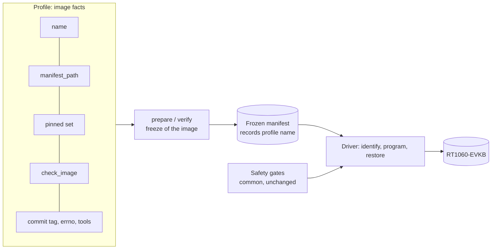

# Image profiles for the RT1060-EVKB program and restore path

Status: **proposed**, software only. This document and its code change nothing about what may be done on the board. No programming, reset, cable operation or merge is authorised by it. Every physical use of a new image still needs its own approval, reviewed plan and the root mount guard described in [the physical preparation](networking-physical-preparation.md).

## Why

The reviewed freeze (`tests/target/prepare_m5_network.py`) and driver (`tests/target/program_m5_image.py`) were written for one image, the M5 network test image. Other images, such as a product image built from a separate repository, need the same safe path. Copying the tools per image would copy the safety gates too and let them drift. A **profile** separates what differs between images from the gates that must not.

## What a profile holds, and what it cannot hold

| Belongs to the profile (image facts) | Stays common and unchanged (safety gates) |
|---|---|
| `name`, recorded in the frozen manifest | Guard check before every probe command |
| `manifest_path`, the west path of the manifest repository | UART and probe ownership inventory, exclusive board lock |
| `pinned` and `pinned_paths`, the exact dependency set | Target and probe identity, target voltage |
| `check_image`, the image checks (Kconfig, stacks, geometry) | Bounded commands, series budget, no retry |
| `commit_tag`, whether the source commit is embedded in the binary | Identity-only probe first, entry-image verify before a change |
| `errno_suffix`, the source file of the errno evidence, or none | Pinned image hashes, manifest re-verification before a load |
| `tool_scripts`, the extra frozen scripts of the tool repository | One use per mode and evidence directory, restore of the accepted normal image |

A profile is a frozen dataclass of data and one checking function. `Driver`, `check_identity`, `consume` and the precondition functions do not take a profile, so a profile has no way to relax a gate.

## What is built

| Change | Where |
|---|---|
| `ImageProfile` dataclass | `tests/target/image_profile.py` (new) |
| `frozen_inputs`, `prepare`, `verify` and `default_tools` take a `profile`; without one they use the M5 profile, built from the unchanged M5 constants | `tests/target/prepare_m5_network.py` |
| `PROFILES` registry and `profile_named`; unknown names are refused | `tests/target/prepare_m5_network.py` |
| `--profile` option of the driver, restricted to registered names, default `m5-network-physical` | `tests/target/program_m5_image.py` |
| `prepare(..., tool_repo=...)`: the image source and the frozen tooling may live in different repositories | `tests/target/prepare_m5_network.py` |
| Tests | `tests/build/test_m5_image_profile.py` (10 cases) |

The M5 behaviour is unchanged: the 264 existing M5 tests pass without modification, and an M5 manifest, plan and approval are used exactly as before.

## Behaviours the tests pin

| Rule | Reason |
|---|---|
| A manifest verifies only under the profile named in it | A manifest of another image must never pass these gates |
| The workspace context must name the profile's own manifest path | A product workspace is built from its own manifest repository |
| No other west project may sit in, contain or equal that path | Same overlap rule as for the M5 manifest checkout |
| The commit tag is required only when the profile says so | A product binary may not embed the platform commit tag |
| The errno role exists only when the profile names a source file | The errno evidence is specific to the M5 transaction code |
| Source snapshot follows the source repository, frozen tools follow the tool repository | The image source and the board tooling are different repositories for a product image |

## What is not built

- **No second profile.** `PROFILES` holds only M5. A product image adds a factory in its own PR with its real facts: pins, Kconfig and stack checks, expected boot output and capture procedure. Each needs a plan review before any hardware step.
- **The capture oracle stays per image.** `m5_network_oracle.py`, `capture_m5_network.py` and the M5 phase protocol are untouched.
- **Driver labels are unchanged.** The step label `program-m5` and the status `M5_PROGRAMMED_VERIFIED_STARTED` still name the M5 image. Renaming them for other profiles is left to the first profile that needs it.
- **`scripts/record-build-provenance.py` is not modified.** It is protected. How it records a product repository (`--repo`) is the input of the later profile PRs.

## Decisions taken for lack of an answer

| # | Decision | Why |
|---|---|---|
| 1 | The profile registry lives in `prepare_m5_network.py` and keeps its name | Renaming a reviewed, frozen module is out of scope; the module hashes are part of past evidence |
| 2 | The default profile is M5 | Existing commands, plans and approvals keep working unchanged |
| 3 | The workspace manifest context path is the profile's `manifest_path` | Inference: a west workspace names its manifest repository by path. To be checked against a real product workspace in the profile PR |
| 4 | `tool_repo` defaults to the source repository | M5 uses one repository for both |

## What is untested

- Nothing in this change ran on hardware, and none of it can: the tests use synthetic images and temporary directories.
- The profile facts of any real product image are not exercised. The tests use a synthetic profile.
- `build_parser` is tested for the profile choice only. `main` is hardware bound and keeps its previous tests.
