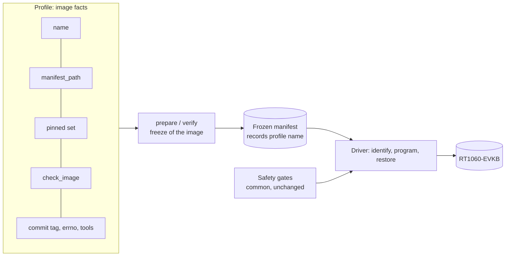

# Image profiles for the RT1060-EVKB program and restore path

Status: **proposed**, software only. M5 and S2 (see below) are the registered profiles. This document and its code change nothing about what may be done on the board. No programming, reset, cable operation or merge is authorised by it. Every physical use of a new image still needs its own approval, reviewed plan and the root mount guard described in [the physical preparation](networking-physical-preparation.md).

## Why

The reviewed freeze (`tests/target/prepare_m5_network.py`) and driver (`tests/target/program_m5_image.py`) were written for one image, the M5 network test image. Other images, such as a product image built from a separate repository, need the same safe path. Copying the tools per image would copy the safety gates too and let them drift. A **profile** separates what differs between images from the gates that must not.

## What a profile holds, and what it cannot hold

| Belongs to the profile (image facts) | Stays common and unchanged (safety gates) |
|---|---|
| `name`, recorded in the frozen manifest | Guard check before every probe command |
| `manifest_path`, the west path of the manifest repository | UART and probe ownership inventory, exclusive board lock |
| `pinned` and `pinned_paths`, the exact dependency set | Target and probe identity, target voltage |
| `check_image`, the image checks (Kconfig, stacks, geometry) | Bounded commands, series budget, no retry |
| `commit_tag`, whether the source commit is embedded in the binary | Identity-only probe first, entry-image verify before a change |
| `errno_suffix`, the source file of the errno evidence, or none | Pinned image hashes, manifest re-verification before a load |
| `tool_scripts`, the extra frozen scripts of the tool repository | One use per mode and evidence directory, restore of the accepted normal image |
| `modules` and `module_paths`, the build modules of an image built by west module discovery (none for M5) | The rule that no other project is accepted under module discovery lives in `frozen_inputs`, not in the profile |

A profile is a frozen dataclass of data and one checking function. `Driver`, `check_identity`, `consume` and the precondition functions do not take a profile, so a profile has no way to relax a gate. A profile does control how strictly an image is checked (its checks, its pinned set, whether a commit tag or errno evidence is required), so a weak profile is possible. The control is that a profile only exists as a registered entry in `PROFILES`, which is a reviewed code change with its own plan review, and that the driver accepts registered names only.

## What is built

| Change | Where |
|---|---|
| `ImageProfile` dataclass; since the S2 change it also holds `modules` and `module_paths` and refuses an inconsistent profile (a project both pinned and a module, a module revision that is not a full commit, two projects or the manifest checkout that share or contain a path) | `tests/target/image_profile.py` |
| `frozen_inputs`, `prepare`, `verify` and `default_tools` take a `profile`; without one they use the M5 profile, built from the unchanged M5 constants | `tests/target/prepare_m5_network.py` |
| `PROFILES` registry and `profile_named`; unknown names are refused | `tests/target/prepare_m5_network.py` |
| `--profile` and `--tool-repo` options of the freeze command (`prepare`, `verify`), restricted to registered names, default M5. Before the S2 change the command could only freeze the M5 image | `tests/target/prepare_m5_network.py` |
| `--profile` option of the driver, restricted to registered names, default `m5-network-physical`; `bind_profile` gives the selected profile and the one manifest verification that `main` uses for both the first load and the re-verification before each load | `tests/target/program_m5_image.py` |
| `profile_named` refuses a registered factory whose profile name differs from its key | `tests/target/prepare_m5_network.py` |
| `prepare(..., tool_repo=...)`: the image source and the frozen tooling may live in different repositories | `tests/target/prepare_m5_network.py` |
| Tests of the mechanism | `tests/build/test_m5_image_profile.py` (13 cases) |
| The S2 profile `s2-controller-physical`: factory `s2_profile` in `PROFILES`, `S2_*` constants (manifest path, pins, modules), `s2_check_image` (the S2 checks plus the firmware identity) | `tests/target/prepare_m5_network.py` |
| The S2 image checks (Kconfig, stack objects, geometry through the shared M3 check) | `tests/target/s2_image.py` (new) |
| The module-discovery rule in `frozen_inputs` (see below) | `tests/target/prepare_m5_network.py` |
| S2 tests: 36 cases | `tests/build/test_m5_s2_image.py`, `tests/build/test_m5_s2_profile.py` |
| S2 fixtures: the real resolved configuration (normalised) and the measured facts with hashes | `tests/build/fixtures/s2-controller/` |

The M5 behaviour is unchanged: the existing M5 and M3 tests pass without modification, and an M5 manifest, plan and approval are used exactly as before.

## Behaviours the tests pin

| Rule | Reason |
|---|---|
| A manifest verifies only under the profile named in it | A manifest of another image must never pass these gates |
| The workspace context must name the profile's own manifest path | A product workspace is built from its own manifest repository |
| No other west project may sit in, contain or equal that path | Same overlap rule as for the M5 manifest checkout |
| The commit tag is required only when the profile says so | A product binary may not embed the platform commit tag |
| The errno role exists only when the profile names a source file | The errno evidence is specific to the M5 transaction code |
| Source snapshot follows the source repository, frozen tools follow the tool repository | The image source and the board tooling are different repositories for a product image |

## The S2 profile and module discovery

The crux-controller product repository builds an image called S2. Its facts were **measured in a local build by the crux-controller session; nothing has run on a board** and the first real freeze is the first real contact of this profile with a real ELF.

| Fact | Value in the profile |
|---|---|
| Manifest repository (west path) | `crux-controller`; the platform repository is an ordinary west project of that workspace, not the manifest |
| Dependencies | the same four pins at the same west paths as M5 (zephyr, cmsis, cmsis_6, hal_nxp), repeated as `S2_PINNED` so that an M5 change cannot move the S2 image |
| Build modules | crux-pilot, picolibc, fatfs and littlefs at exact full commits (`S2_MODULES`) |
| Commit tag in the binary | none (`commit_tag=False`); 0 hits for the 12-character prefixes of the product, platform and Zephyr commits. The identity is the image SHA-256 plus the firmware identity |
| Errno evidence | none |
| Frozen tool scripts | `record-build-provenance.py`. The product's own build script is not frozen by this profile: its name and place are unknown here |
| Firmware identity | `s2_check_image` computes it with the recorder's own functions (algorithm `crux-firmware-identity-v1`, target `mimxrt1060_evk@B//qspi`) and the manifest records it in `image`. It is recomputed at verification and compared with the recorded one; it is not pinned to a value in the profile, so the image is identified, as for M5, by the digest of the approved manifest |

**Why a module field.** M5 names its modules explicitly in the build (`-DZEPHYR_MODULES`), so the rule "another west project is recorded but never part of the image" holds. S2 uses west module discovery: its `zephyr.meta` lists crux-pilot, picolibc, cmsis, cmsis_6, fatfs, hal_nxp and littlefs as modules of the build. Module discovery builds every active west project that carries Zephyr module metadata (a `zephyr/module.yml`, or `zephyr/CMakeLists.txt` and `zephyr/Kconfig`); zephyr itself is an active project and is not in that list. The freeze records west projects and cannot see which of them carry such metadata, so a project that west lists and nobody pinned might be built into the image unseen. The profile therefore pins each discovered module exactly (`modules`, `module_paths`), and for such a profile `frozen_inputs` refuses every west project that is not pinned. For a profile with no `modules`, which includes M5, the code path is the one it had before; the tests keep an explicit pair, the same extra project accepted under M5 and refused under S2.

**What the S2 image check covers.** `s2_image.check_image` reads the BIN, the ELF and the resolved `.config`:

- the shared geometry check of the M3 images (`m3_image.check_image_bytes`: boot header, ELF sections against the BIN, gap fill);
- `-Os`, the board and flash lines, XIP, the boot header, no heap, the 4096-byte main stack, the stack guard, the network and socket sizes of the S2 build, the static IPv4 configuration (board address 192.168.77.2, mask 255.255.255.0, no gateway, through the `NET_CONFIG_*` options), the S2 workload lines (peer address and port, worker stack and thread count), and Crux Logging in deferred mode, which the M5 check forbids;
- none of the M5-only debug options is required (`INIT_STACKS`, `PRINTK_SYNC`, `CONSOLE_GETCHAR`, `CONSOLE_SUBSYS`, `NET_BUF_POOL_USAGE`), and storage, `WATCHDOG`, `SHELL`, IPv6, DHCPv4 and MCUboot stay refused;
- stack objects: `z_main_stack` 4160 bytes, `worker_stacks` 33,024 bytes, no `m5_observer`.

The stack sizes come from the crux-controller session's reading of the real ELF, which this repository has not seen. The tests check them against a **synthetic** ELF whose symbols were set to those values. If the real ELF differs, the first freeze refuses it; that is the check working or the measurement being wrong, and it is not a defect of the board path.

**Expected consequences of the first real freeze (not yet seen).** (1) A module whose revision in the product manifest is a branch or tag name is refused: the recorder keeps the manifest's revision string, and the freeze requires it to equal the resolved commit and the pin. (2) The workspace must list exactly the four dependencies and four modules; any other active project is refused, even one without module metadata. (3) The platform repository is a pinned module at the revision above, which need not contain this profile. The freeze and driver therefore run from a separate platform checkout that does (`--tool-repo` for the freeze), not from the workspace's module checkout.

**Cross-check of the fixtures.** The committed configuration (normalised the way the recorder normalises it) and the recorded image SHA-256 reproduce the recorded firmware identity `8493243091295c6d9ec305b6e5b097df738ee226550394a5ab0fdac388f73164`; a test recomputes it. The BIN itself is not committed (103,180 bytes); its hash is in `facts.json`. The real BIN was read once by hand when the facts were collected: its size, the `FCFB` header and the pinned IVT bytes match what `check_image_bytes` requires of a BIN. That is not a test and is not repeated by one.

## What is not built

- **No capture oracle, no expected UART output.** The expected output of S2 (Crux Logging lines, `net: exchange ok cycle=<n>`, failure lines with `result=-2` or `-3`) comes from the crux-controller plan and no capture of the image exists. No oracle or check of it is written; it needs a first real capture. The Ethernet link may not come up at all (static 192.168.77.2/24, no gateway, no DHCP, no MDIO correction): unknown.
- **The capture oracle stays per image.** `m5_network_oracle.py`, `capture_m5_network.py` and the M5 phase protocol are untouched.
- **Driver labels are unchanged.** The step label `program-m5` and the status `M5_PROGRAMMED_VERIFIED_STARTED` still name the M5 image, so the evidence of an S2 program step will say `m5`. S2 is the first profile that needs a neutral label, and the S2 change leaves it open: the labels appear in the plans and approvals that name operations, so renaming them is a decision for the owner and a separate change.
- **`scripts/record-build-provenance.py` is not modified.** It is protected. How it records a product repository (`--repo`) is the input of the later profile PRs.

## Decisions taken for lack of an answer

| # | Decision | Why |
|---|---|---|
| 1 | The profile registry lives in `prepare_m5_network.py` and keeps its name | Renaming the reviewed module is out of scope. Its name is a key in the recorded tool hashes (`inputs.json` `scripts`) and in the plans and evidence that cite it |
| 2 | The default profile is M5 | Existing commands, plans and approvals keep working unchanged |
| 3 | The workspace manifest context path is the profile's `manifest_path` | Inference: a west workspace names its manifest repository by path. To be checked against a real product workspace in the profile PR |
| 4 | `tool_repo` defaults to the source repository | M5 uses one repository for both |
| 5 | A profile with `modules` refuses any unpinned west project; M5 keeps accepting them | Under module discovery an unpinned project can become part of the image |
| 6 | Modules are pinned by full commit, like the dependencies, and the profile refuses a branch or tag name | The recorder records the resolved commit besides the manifest revision, so exact commits are available and a moving name is not an identity |
| 7 | The S2 pins are repeated, not shared with M5 | An M5 pin change must not move the S2 image |
| 8 | The manifest records the firmware identity in `image` | The binary has no commit tag, and the plan and approval need a stable name of the image besides its SHA-256 |
| 9 | The freeze command gains `--profile` and `--tool-repo` | Without them the S2 profile could be registered and never frozen |
| 10 | Capture, expected output and driver labels are left out | No real capture exists; the label rename touches approved plan wording |

## What is untested

- Nothing in this change ran on hardware, and none of it can: the tests use synthetic images and temporary directories.
- The profile facts of the real S2 image are exercised only through its real resolved configuration. The BIN and the ELF used by the tests are synthetic layout fixtures and are never flashable. The real ELF was not available: no symbol check has run against it.
- No freeze (`prepare`) has run on a real S2 build. Its inputs file, build provenance and the product's build script are not seen here. How the recorder records the product repository (the product is the source repository, so west's listing omits it, and the platform repository appears as an ordinary project) is read from the code of the recorder, not run.
- `main` itself has no unit test, as before. The profile wiring is the small `bind_profile` helper, which is tested; that `main` passes its result to both `load_inputs` and the re-verification is by reading the code.
- `prepare(..., tool_repo=...)` does not check that the tool repository is clean or committed. The driver already requires a clean tree for itself (`require_clean_tree`); a profile PR that uses a separate tool repository must show how that repository is frozen.
- Real errno verification under a non-M5 profile and the exact M5 `default_tools` list are covered only through the M5 tests that were not changed.
