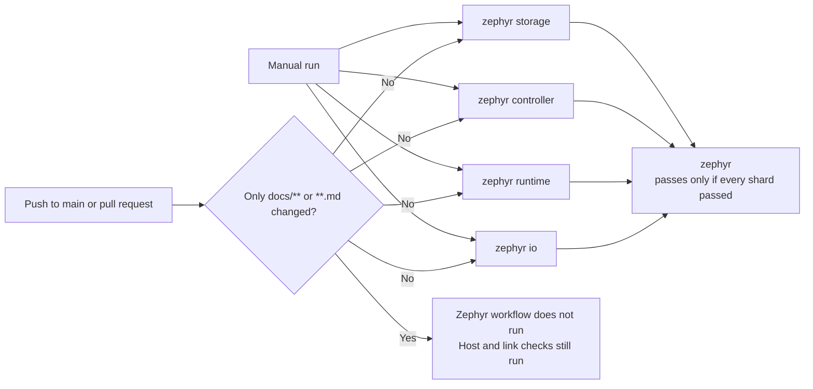

# Zephyr CI shards

The [`zephyr-software` workflow](../.github/workflows/zephyr.yml) runs its check steps in four parallel jobs, called shards. This page explains how they are arranged, how to add a check, and what was measured when the layout was chosen. The change was made in [PR #248](https://github.com/wonny-labs/crux-pilot/pull/248).

## Layout

Each shard is a separate runner with its own checkout, Zephyr workspace and SDK. Shards share nothing, and each uploads its own artifact, named `zephyr-<shard>-<run>-<attempt>`. A failing shard does not cancel the others, so one run reports every failing area. Within a shard, the first failing step still stops the steps after it.

## Shards

Times are medians from 12 runs of the single job, taken before the split. Steps added since are not included in the times.

| Shard | Steps | Minutes |
| --- | --- | ---: |
| `storage` | Patch style, storage simulators, File RT1060 compile, Flash PoC fault paths, Time and EVKB build, product template | 11.5 |
| `controller` | Execution candidates, early controller, controller integration, RT1170 cross-build, M5 integrated smoke | 11.5 |
| `runtime` | Portable execution, Time busy-wait, messaging, out-of-tree consumer, Logging, System | 12.2 |
| `io` | Serial, command line shell rule and serial wiring, command line SSH entry points, GPIO, I2C, SPI, networking, networking physical fixture, web adapter | 12.2, measured before the two command line steps and the web adapter step were added |

Set-up (packages, tools, SDK and workspace) adds about 2.7 minutes to every shard, and the upload 0.1 to 0.2 minutes.

`scripts/test-networking-physical.sh` reads the Picolibc checkout that `scripts/bootstrap-networking-tests.sh` fetches, so these two must stay in the same shard. No other step reads what a step in another shard produces.

## Add a check

1. Add the step to the `shard` job in `zephyr.yml`.
2. Give it a condition such as `if: matrix.shard == 'io'`. Prefer the shard whose work is closest, unless that would make it clearly the longest.
3. Put a step that reads another step's output in the same shard.
4. Add any new output paths to the upload step.

`tests/build/test_zephyr_ci_shards.py` runs in Host CI. It fails in these cases:

| Defect | Why it matters |
| --- | --- |
| A step that runs a command names an unknown shard | The step would be skipped while the run stays green |
| A step that runs a command has no shard condition and is not a set-up step | The step would run in all four shards |
| A shard has no checks | The matrix and the steps have drifted apart |
| The networking steps are in different shards | The fixture step would not find its library |
| Two shards could share an artifact name | The upload would be refused |
| The summary job accepts anything but `success` | A cancelled or skipped shard would look like a pass |
| Anything other than documentation skips the workflow | Code changes would go untested |
| `host.yml` also skips documentation | Nothing would run the tests that read documentation |

The test has two limits. It does not notice a deleted step, so review the comparison with `main` when a change touches `zephyr.yml`. It also cannot tell that a set-up step is still only a set-up step: the steps in `SET_UP_STEPS` (set-up and evidence collection) are exempt by title, and are rejected only if they mention `scripts/`, `python3 ` or `west ` beyond the two set-up scripts. Apart from those, every step that has a `run:` (in any position) or mentions that repository code must name a shard of the matrix, whatever command it runs. Add a step to `SET_UP_STEPS` only if it must run in every shard.

## Documentation-only changes

The workflow does not run when every changed file matches `docs/**` or `**.md`. A pull request that also changes code still runs it. `tests/build/test_product_template.py` is the only Zephyr-side check found to read documentation, and `host.yml` also runs it because that workflow has no such filter.

If `zephyr` becomes a required check, a documentation-only pull request would wait for a check that never reports. `main` has no required checks today, so this needs handling before such a rule is added.

## Measurements

All runs used GitHub-hosted `ubuntu-24.04` runners. Run time is from creation to the last update. Times are in minutes.

| Workflow | Runs | Run time |
| --- | ---: | --- |
| Single job, before the split | 12 | Median 50.8, range 35.7 to 56.9 |
| Four shards | 4 | 16.1, 20.3, 16.1, 26.0, in run order |

The test scope did not change: runs before and after the split had 77 Twister configurations, 67 passes, 43 `west build` configures and 116 Zephyr configures.

| Run | Run time | `storage` | `controller` | `runtime` | `io` |
| --- | ---: | ---: | ---: | ---: | ---: |
| 1 | 16.1 | 13.1 | 14.2 | 13.2 | 15.9 |
| 2 | 20.3 | 15.4 | 15.7 | 11.2 | 20.1 |
| 3 | 16.1 | 15.4 | 15.9 | 12.1 | 15.3 |
| 4 | 26.0 | 15.2 | 15.6 | 16.8 | 24.2 |

The slow runs are not slow checks. In run 2 the `io` job spent 4.8 minutes installing packages and in run 4 it spent 7.7 minutes, against about 0.3 minutes normally. Across 32 shard jobs in 8 measured runs, 5 spent 3.5 to 10.3 minutes in that step, and those 5 lengthened 4 of the 8 runs. All five were `.deb` downloads from the archive mirror. [PR #261](https://github.com/wonny-labs/crux-pilot/pull/261) then added a cache for them. Each shard restores the packages, `scripts/verify-apt-cache.py` removes every file whose SHA-256 differs from the signed index, and apt downloads whatever is missing. In the hosted runs after that change the install step took 0.1 to 0.3 minutes in every job and downloaded nothing. A typical run was not shorter (16.2 to 17.6 minutes against 14.1 to 16.4 in runs without a slow download), so the gain is that a run no longer waits on the mirror. The times in the tables on this page were measured before the cache.

Another stall seen once: the `io` job took 6.2 minutes to fetch the Zephyr workspace in a `-j 4` run.

## Options measured and not adopted

| Option | Run 1 | Run 2 | Finding |
| --- | ---: | ---: | --- |
| Twister `-j 4` instead of `-j 2` | 22.1 | 23.9 | No clear gain. Both runs were lengthened by package downloads (9.6 and 10.3 minutes). The longest shard's checks took 11.6 and 13.4 minutes, against 13.1 to 14.1 with `-j 2`. |
| ccache, both runs cold | 16.4 | 14.1 | Both started empty, because `actions/cache` rejected a path containing `..`. This pair says nothing about re-use. |

A later pair with a working cache, on identical source, gave the second run 99.2% (`storage`), 99.6% (`controller`), 84.7% (`runtime`) and 99.7% (`io`) hits. Its check steps summed to 41.4 minutes. Seven runs without ccache summed to 40.7 to 53.2 minutes. Only 34% to 54% of compiler calls are cacheable, and configuring, linking and running tests do not benefit. This is one warm run and runs on identical source differ by up to 8.9 minutes, so it shows no benefit but does not prove there is none. It was not adopted because it adds a cache and its upkeep for no measured gain.

## Limits

- Total runner time rises because each shard repeats the set-up.
- Each run uses five jobs, so many parallel sessions can reach the account's limit on concurrent jobs and wait for runners.
- The shard sizes come from past timings and will drift. Rebalance them when one shard stays clearly the longest.
