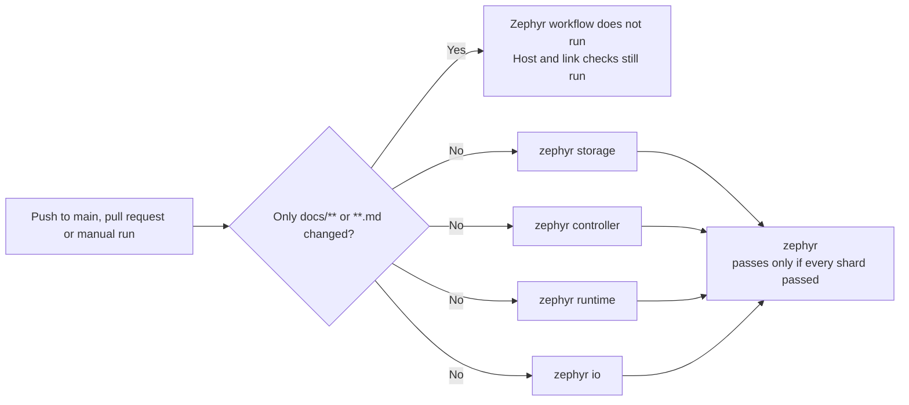

# Zephyr CI shards

The [`zephyr-software` workflow](../.github/workflows/zephyr.yml) runs its check steps in four parallel jobs, called shards. This page explains how they are arranged, how to add a check, and what was measured when the layout was chosen. The change was made in [PR #248](https://github.com/wonny-labs/crux-pilot/pull/248).

## Layout

Each shard is a separate runner with its own checkout, Zephyr workspace and SDK. Shards share nothing, and each uploads its own artifact, named `zephyr-<shard>-<run>-<attempt>`. A failing shard does not cancel the others, so one run reports every failing area. Within a shard, the first failing step still stops the steps after it.

## Shards

Times are medians from 12 runs of the single job, taken before the split.

| Shard | Steps | Minutes |
| --- | --- | ---: |
| `storage` | Patch style, storage simulators, File RT1060 compile, Flash PoC fault paths, Time and EVKB build, product template | 11.5 |
| `controller` | Execution candidates, early controller, controller integration, RT1170 cross-build, M5 integrated smoke | 11.5 |
| `runtime` | Portable execution, Time busy-wait, messaging, out-of-tree consumer, Logging, System | 12.2 |
| `io` | Serial, GPIO, I2C, SPI, networking, networking physical fixture | 12.2 |

Set-up adds about 2.7 minutes and the upload about 0.8 minutes to every shard.

`scripts/test-networking-physical.sh` reads the Picolibc checkout that `scripts/bootstrap-networking-tests.sh` fetches, so these two must stay in the same shard. No other step reads what a step in another shard produces.

## Add a check

1. Add the step to the `shard` job in `zephyr.yml`.
2. Give it a condition such as `if: matrix.shard == 'io'`. Prefer the shard whose work is closest, unless that would make it clearly the longest.
3. Put a step that reads another step's output in the same shard.
4. Add any new output paths to the upload step.

`tests/build/test_zephyr_ci_shards.py` runs in Host CI. It fails in these cases:

| Defect | Why it matters |
| --- | --- |
| A check names an unknown shard | The step would be skipped while the run stays green |
| A check has no shard condition | The step would run in all four shards |
| A shard has no checks | The matrix and the steps have drifted apart |
| The networking steps are in different shards | The fixture step would not find its library |
| Two shards could share an artifact name | The upload would be refused |
| The summary job accepts anything but `success` | A cancelled or skipped shard would look like a pass |
| Anything other than documentation skips the workflow | Code changes would go untested |
| `host.yml` also skips documentation | Nothing would run the tests that read documentation |

The test does not notice a deleted step. Review the comparison with `main` when a change touches `zephyr.yml`.

## Documentation-only changes

The workflow does not run when every changed file matches `docs/**` or `**.md`. A pull request that also changes code still runs it. `tests/build/test_product_template.py` is the only Zephyr-side check found to read documentation, and `host.yml` also runs it because that workflow has no such filter.

If `zephyr` becomes a required check, a documentation-only pull request would wait for a check that never reports. `main` has no required checks today, so this needs handling before such a rule is added.

## Measurements

All runs used GitHub-hosted `ubuntu-24.04` runners. Run time is from creation to the last update.

| Workflow | Runs | Run time in minutes |
| --- | ---: | --- |
| Single job, before the split | 12 | Median 50.8, range 35.7 to 56.9 |
| Four shards | 4 | 16.1, 16.1, 20.3, 26.0 |

The 26.0 minute run waited about 100 seconds for runners. The test scope did not change: runs before and after the split had 77 Twister configurations, 67 passes, 43 `west build` configures and 116 Zephyr configures.

| Shard | Run 1 | Run 2 | Run 3 | Run 4 |
| --- | ---: | ---: | ---: | ---: |
| `storage` | 13.1 | 15.4 | 15.4 | 15.2 |
| `controller` | 14.2 | 15.7 | 15.9 | 15.6 |
| `runtime` | 13.2 | 11.2 | 12.1 | 16.8 |
| `io` | 15.9 | 20.1 | 15.3 | 24.2 |

`io` varied most. The cause was not investigated.

## Options measured and not adopted

| Option | Run 1 | Run 2 | Decision |
| --- | ---: | ---: | --- |
| Twister `-j 4` instead of `-j 2` | 22.1 | 23.9 | Rejected: slower in both runs. The cause was not investigated. |
| ccache, first without and then with a restored cache | 16.4 | 14.1 | Not adopted: two runs do not separate it from runner variation. |

In the first ccache run, 37% to 69% of cacheable compiler calls hit the cache, depending on the shard. In one measured run, a `west build` spent a median of 10.2 seconds configuring and 17.6 seconds compiling and linking, and ccache only helps the second part.

## Limits

- Total runner time rises because each shard repeats the set-up.
- Each run uses five jobs, so many parallel sessions can reach the account's limit on concurrent jobs and wait for runners.
- The shard sizes come from past timings and will drift. Rebalance them when one shard stays clearly the longest.
