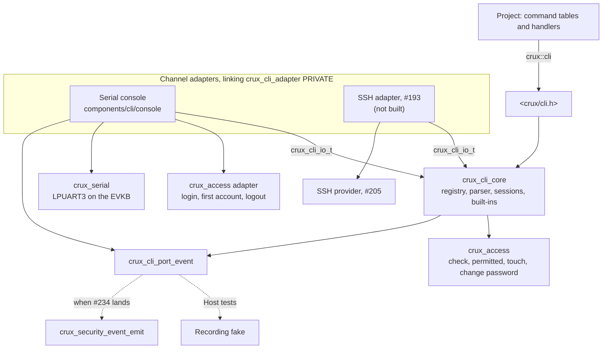
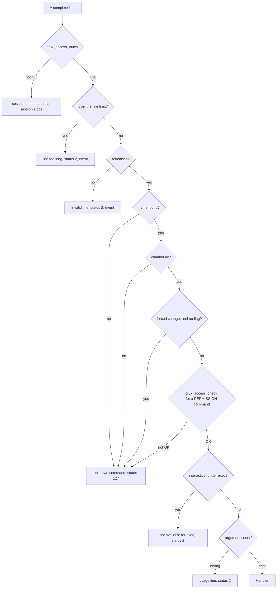
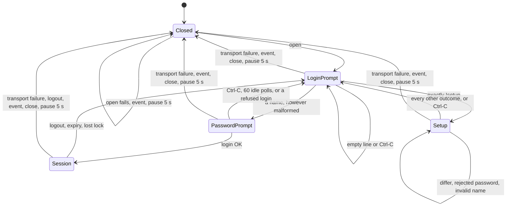
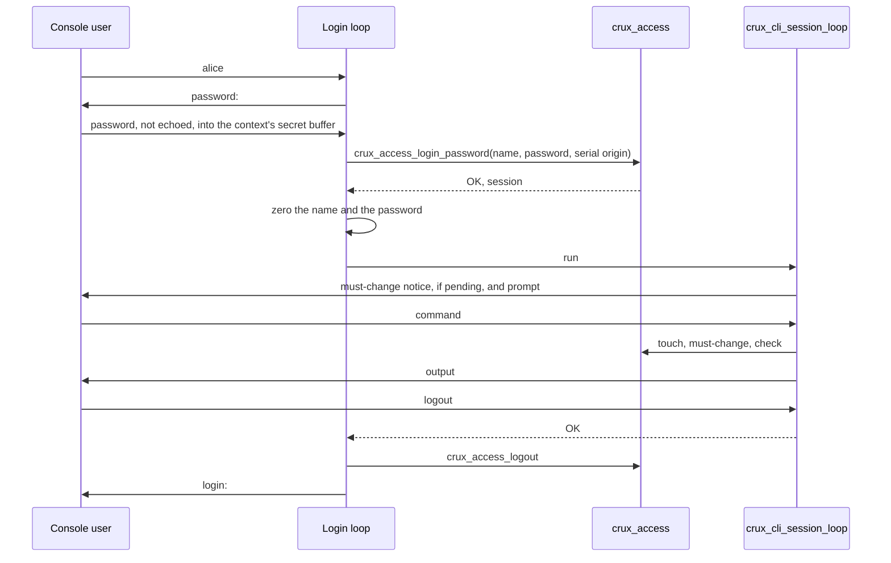

# Command line contract

Status: Host implementation for review under Issue #181, with fake providers and a scripted transport. Not adopted until this review and gate #183 pass. The decisions and reasoning are in
[the accepted proposal](plans/cli-contract-proposal.md), which this document does not repeat. L1 to L6 are accepted and AC2 is declined, as [the gate record, PR #209](https://github.com/wonny-labs/crux-pilot/pull/209) says. Where this document and the proposal differ, the choices below say why.

Owner: `components/cli`.

| Header | Target | Used by |
| --- | --- | --- |
| `<crux/cli.h>` | `crux::cli` | Projects: command tables and handlers |
| `crux_cli_adapter.h` | `crux_cli_adapter`, linked PRIVATE | The serial console, and the SSH adapter of #193 |
| `crux_cli_console.h` | `crux_cli_console` | The composition that owns the console thread |
| `src/cli_port.h` | Private | The provider of the event port |

## What exists

| Item | State | Evidence |
| --- | --- | --- |
| Registry: tables, validation, longest match, permission-aware help | Built | Host |
| Bounded parser and line editor, with no history (L6) | Built | Host, with random input under sanitizers |
| Session entry points `crux_cli_run` and `crux_cli_exec` | Built | Host |
| Transport `crux_cli_io_t`, with `crux_cli_write_terminal` for line ends | Built | Host, for serial and for a transport shaped like #205's |
| Built-in commands `help`, `logout`, `passwd`, `account list` | Built | Host, on a scripted and on the real `crux_access` |
| Serial login loop and first-account setup `!setup` (L4) | Built | Host, on both |
| Serial console over `crux_serial` (L1) | Built | Host: a scripted Serial and the real Linux provider on a pseudo-terminal |
| Security events | Port and recording fake. **The real provider connects when #234 lands**, below. | Host |
| Shell rule (L5) at configuration, at compilation, by script and by image check | Built | Host for the rule's logic. Real builds in `scripts/test-cli.sh --zephyr`, which runs in the Zephyr CI job. |
| LPUART3 wiring | Compile only: `tests/zephyr/cli_serial_compile` | RT1060-EVKB compile and link, in CI. **Never flashed, and not evidence of a console.** |
| `crux_access` on Zephyr | Not available, so nothing links the console into an image | |
| `status`, `config *`, `device fingerprint` | Not built. They need #180 and #178. They register in a table when those land. | |
| Recovery command of #213 | Not built. Its shape is tested, below. | Host |
| SSH shell and exec | Not built. #193 connects as below. | Host, for the transport's shape |
| `native_sim` console over a UART emulator | Not built | |
| Physical serial login, acceptance criterion 3 of #181 | Not done. Hardware was not approved. | |

## Structure



Serial and SSH are two users of one transport. `crux_cli_adapter.h` names no serial or SSH type, and `scripts/check-cli-boundary.py` fails if it does.

## Limits

Defaults, each a build setting: `CRUX_CLI_LINE_MAX` and `CRUX_CLI_TOKENS_MAX` as CMake cache entries, and `CONFIG_CRUX_CLI_LINE_MAX` and `CONFIG_CRUX_CLI_TOKENS_MAX` on Zephyr.

| Limit | Default | When exceeded |
| --- | --- | --- |
| Input line, bytes before the line end | 320 | The rest is discarded, and the whole line is `line too long`, status 2, with nothing run |
| Tokens in the line, counting the command's words | 10 | `invalid line`, status 2, before any lookup |
| Command name | Two words | Longest match, then the remaining tokens are arguments |
| Quoted value | Double quotes, with `\"` and `\\` inside | Anything else is `invalid line`, status 2, before any lookup |
| Escape sequence | 32 bytes | Later bytes are ordinary input again |

A build check refuses a line limit below the 301 bytes that `config set <31-byte name> "<128-byte value>"` needs with every value byte escaped. That size comes from the proposal, because #180 is not merged.

Memory: a `crux_cli_context_t` is about 800 bytes on 64-bit Linux, with the line, the argument pointers and three password buffers, and it belongs to the caller, one per session. Keeping the secrets there rather than on the stack makes "cleared on every path" testable. No session allocates. **Stack use is unmeasured.** `account list` holds up to 8 account records on the stack, about 640 bytes. The component's objects for the RT1060-EVKB hold about 6.5 KB of text and 20 bytes of BSS, compiled against Zephyr v4.4.0 with default options. That is a compile result, not an image's cost.

## Input

Bytes arrive one at a time, through one state machine shared by lines and secrets.

| Input | Line | Secret |
| --- | --- | --- |
| CR, LF, or CR LF, even across reads | Ends the line | Ends the entry |
| Backspace, DEL | Removes a byte | Removes a byte, with no echo |
| Ctrl-U | Clears | Clears, with no echo |
| Ctrl-C | Clears and prompts again | Stops the prompt, and the buffer is zeroed |
| ANSI escape sequence, including one split across reads | Dropped | Dropped |
| Line end or Ctrl-C inside a sequence | Still acts | Still acts |
| Other C0 controls, including NUL and TAB | Dropped | Dropped |
| Bytes above 0x7F | Only inside quotes, or the line is `invalid line` | Kept |

`crux_cli_exec` has no line editing, so a control byte in its line is `invalid line`, not dropped.

The session is checked at each read timeout and every 256 bytes, so a stream with no line end and no timeout cannot outlive the idle and absolute limits. Only a complete line refreshes the idle timer. Finishing a secret prompt does too.

## Dispatch



Rule L3 is the fan-in to `unknown command`: hidden, wrong channel, forced change and unknown give the same words and status 127. Every limit comes before the lookup, so it cannot tell them apart either. Only a command the session can run reaches `not available for exec` or a usage line. Output timing is not equalised, as the proposal says.

| Handler result | Line | `exec` status |
| --- | --- | --- |
| `OK` | None | 0 |
| `FAILED`, `INVALID_ARGUMENT`, or a value outside the enumeration | `command failed` | 1 |
| `DENIED` | `permission denied` | 1 |
| `NOT_READY` | `service unavailable` | 1 |
| `USAGE` | `usage: <name>: <summary>` | 2 |
| `TOO_LONG` | `input too long` | 2 |
| `CANCELLED` | None, because the prompt already wrote `^C` | 1 |
| `OUTPUT` | None. The session stops. | 1 |

| Event | When | Fields |
| --- | --- | --- |
| `cli.line_rejected`, outcome `LIMIT` | Over the line or token limit | Channel, and the session's user. Never the line. |
| `cli.line_rejected`, outcome `INVALID` | Malformed, or an unknown name | The same |
| `cli.line_rejected`, outcome `DENIED` | Wrong channel, or a forced change | The same |
| Access's `permission_denied` | A typed `PERMISSION` command that fails the check | Access's own, with no CLI event on top |
| `cli.console_error`, outcome `FAILED` | A port that will not open, a transport failure, or a failed close | Channel |

`help` uses `crux_access_permitted`, so it leaves no denial, whatever it hides, and `help <hidden>` leaves no event at all.

## Serial console





The proposal's tables, as implemented:

| `crux_access` result at login | Console output |
| --- | --- |
| `OK` | The prompt, and the must-change notice if the session requires it |
| `DENIED`, `INVALID_ARGUMENT`, or anything without a row | `login failed` |
| `RETRY_LATER` | `try again in N s`, rounded up. The console does not sleep. |
| `BUSY` | `busy, try again` |
| `NO_RESOURCES` | `no session available` |
| `NOT_READY` | `login unavailable` |

| First-account setup | Console output | Next |
| --- | --- | --- |
| The two entries differ | `passwords differ`, with no call | Setup prompt |
| `OK` | `account created`, and no session opens | Login prompt |
| `DENIED`, or anything without a row | `setup not available` | Login prompt |
| `PASSWORD_REJECTED` | `password not accepted`, then the rule's text if `crux_cli_set_password_rule` set one | Setup prompt |
| `INVALID_ARGUMENT` | `invalid name` | Setup prompt |
| `STORE` | `could not save, a later boot may use either` | Login prompt |
| `NOT_READY` | `login unavailable` | Login prompt |

A wrong password, an unknown name and a disabled account print the same words. Nothing appears before login. The name is in the line buffer and the password in the context's own buffers, and both are zeroed on every path, which `tests/cli/login.c` and `login_real.c` check by scanning the context.

## What #193 uses

The SSH adapter links `crux_cli_adapter` PRIVATE, and one `crux_cli_context_t` per session. From `crux_cli_adapter.h`:

```c
typedef struct {
    int (*read)(void *transport, void *buffer, size_t length, uint32_t timeout_ms);
    int (*write)(void *transport, const void *buffer, size_t length, uint32_t timeout_ms);
    void *transport;
    bool echo;
} crux_cli_io_t;

crux_cli_result_t crux_cli_run(crux_cli_context_t *context, const crux_cli_io_t *io,
                               crux_access_channel_t channel, crux_access_session_t session);
crux_cli_result_t crux_cli_exec(crux_cli_context_t *context, const crux_cli_io_t *io,
                                crux_access_channel_t channel, crux_access_session_t session,
                                const char *line, size_t length, int *exit_status);
int crux_cli_write_terminal(crux_cli_line_ends_t *state,
                            int (*write)(void *transport, const void *buffer, size_t length,
                                         uint32_t timeout_ms),
                            void *transport, const void *buffer, size_t length, uint32_t timeout_ms);
```

| Provider of #205 | Transport |
| --- | --- |
| `read`: `CRUX_OK` | `*transferred` |
| `read`: `CRUX_ERR_TIMEOUT` | 0 |
| `read`: `CRUX_ERR_NO_DATA`, `CRUX_ERR_IO`, `CRUX_ERR_INVALID_STATE` | -1 |
| `write`: `CRUX_OK` | `*transferred`, which can be short |
| `write`: `CRUX_ERR_TIMEOUT` | 0 |
| `write`: `CRUX_ERR_IO`, `CRUX_ERR_INVALID_STATE` | -1 |

```c
static int cli_shell(void *context, crux_ssh_attachment_t *attachment, crux_ssh_channel_t *channel)
{
    /* transport wraps provider->read and provider->write as in the table. */
    crux_cli_result_t result = crux_cli_run(&cli, &io, CRUX_ACCESS_CHANNEL_SSH, session);
    return result == CRUX_CLI_OK ? 0 : 1;
}

static int cli_exec(void *context, crux_ssh_attachment_t *attachment, crux_ssh_channel_t *channel,
                    const char *command, size_t command_length)
{
    int exit_status = 1;
    (void)crux_cli_exec(&cli, &io, CRUX_ACCESS_CHANNEL_SSH, session, command, command_length,
                        &exit_status);
    return exit_status;
}
```

`tests/cli/ssh_shape.c` runs exactly this mapping against a stand-in with #205's statuses, and shows that permitted and rejected commands print the same as on serial. #205 is not merged, so nothing in this repository names it. I also ran the same callbacks through #205's fake provider and client from its worktree, in a scratch directory, for shell and for each exec status: that check is not repeatable from this branch. The provider applies its own `io_timeout_ms`, so `timeout_ms` goes unused. `crux_access_logout` stays with #192's `connection_closed`, and the CLI calls `crux_access_touch` itself for each complete line. `crux_cli_run` reads one byte per call.

**A gap for #193 and #205.** #205 accepts `pty-req` with no callback, so nothing tells `cli_shell` whether a terminal was requested, and `echo` and the line-end mapping depend on that. The narrow choice is for #205 to pass that fact to `shell`. Until then, #193 can only choose one behaviour for every shell channel.

## What connects when #234 lands

Nothing in `components/cli` changes. A composition adds one file, the thin provider of the port, which translates and holds no state:

```c
#include "cli_port.h"

#include <crux/security_event.h>

void crux_cli_port_event(const crux_cli_event_t *event)
{
    static const crux_security_event_result_t results[] = {
        [CRUX_CLI_EVENT_INVALID] = CRUX_SECURITY_EVENT_INVALID,
        [CRUX_CLI_EVENT_LIMIT] = CRUX_SECURITY_EVENT_LIMIT,
        [CRUX_CLI_EVENT_DENIED] = CRUX_SECURITY_EVENT_DENIED,
        [CRUX_CLI_EVENT_FAILED] = CRUX_SECURITY_EVENT_FAILED,
    };
    const crux_security_event_t record = {
        .id = event->type == CRUX_CLI_EVENT_LINE_REJECTED ? CRUX_SECURITY_EVENT_ID_CLI_LINE_REJECTED
                                                          : CRUX_SECURITY_EVENT_ID_CLI_CONSOLE_ERROR,
        .result = results[event->outcome],
        .channel = event->channel,
        .user = event->user[0] != '\0' ? event->user : NULL,
    };
    crux_security_event_emit(&record);
}
```

The identifiers `cli.line_rejected` and `cli.console_error` exist on that branch, at 0x0500 and 0x0501, and its emit needs no session and does not wait on storage, as the port requires. This file was compiled against that branch's public header at `46ee74e`, in a scratch directory. That is all: #234 is in review, and it can change. Only this file would change with it, because nothing else in `components/cli` names a security event. Its target `crux::security_event` and this file then join the composition, and `Cli.*` can run a further case through the real ring. Until then an image has no provider, and it does not link.

## Registering the recovery command of #213

The registry takes what #213 needs with no change, and `tests/cli/registry.c` tests this shape, which is a two-word serial-only permission command with its own context:

```c
static const crux_cli_command_t recovery[] = {
    CRUX_CLI_COMMAND("network recover", "use the composition's default address at the next boot",
                     CRUX_CLI_PERMISSION("network.write"), 0, 0, CRUX_CLI_CHANNEL_SERIAL,
                     network_recover, &service),
};
```

It needs a session and its permission, so it cannot run before login. It does not exist on SSH, in any form. A forced password change holds it back, and its failed save reaches the user as one fixed line. A command that needs its own wording for a failed save prints it and returns `CRUX_CLI_OK`.

## Zephyr shell rule

| Level | Where | Checks | Tested by |
| --- | --- | --- | --- |
| Configuration | `cmake/CruxManagementShell.cmake`, from `zephyr/CMakeLists.txt` for every image | All three image rows | `tests/build/test_management_shell.py` for the logic, `test_cli_composition.py` on real builds |
| Compilation | `components/cli/ports/zephyr/cli_shell_rule.c` | The management rows | `test_management_shell.py`, compiling it with each symbol |
| Script | `scripts/check-management-shell.py --config` | All three rows on a built `.config` | Both |
| Image | The same script, `--elf` | No shell symbol, the shell's sections empty, and all 8 of their markers present, so a stripped image or an empty listing fails | Saved `nm` output, a real ELF on the Host, stripped and not, and real RT1060 and `native_sim` images |

| Image | `CONFIG_SHELL` | Backends |
| --- | --- | --- |
| Has `CONFIG_CRUX_CLI`, `CONFIG_CRUX_WEB` or `CONFIG_CRUX_SSH`, and no `CONFIG_CRUX_DEVELOPMENT_IMAGE` | Must be `n` | None |
| Has one of those, and is marked | May be `y` | `SHELL_BACKEND_SERIAL` and its options only |
| Has none of those | May be `y` | Anything except the network backends and `MCUMGR_GRP_SHELL` |

The rule reads `CONFIG_CRUX_WEB` and `CONFIG_CRUX_SSH` by name, so it applies as soon as those Kconfig symbols exist. They do not exist yet, so only Host tests cover those two.

Real builds here cannot set `SHELL_BACKEND_WEBSOCKET` or `MCUMGR_GRP_SHELL`, because they need the mbedtls and zcbor modules. The default workspace, which CI uses, fetches neither, so Kconfig drops those symbols. That holds only for the default workspace: `mbedtls` is pinned in the optional `crux-secure-management` group, and a workspace with that group could set the first. `zcbor` is not pinned at all. Host tests cover those two at each level. A real build covers `SHELL`, the dummy backend, Telnet and MQTT. A marked image on `native_sim` also proves that the image check can fail, because it holds a real shell.

## Tests

`scripts/test-cli.sh` runs the suites under `host-debug` and `host-sanitize`, clang-tidy on the CLI sources, the boundary and session-only checks, and the shell rule's Host tests. The root build also runs them as `Cli.*` under `scripts/check-host.sh`. `scripts/test-cli.sh --zephyr` runs the rule on real builds and compiles the wiring.

| Suite | Covers |
| --- | --- |
| `tests/cli/parser.c` | Limits at and over the bound, quotes, escapes, line ends, backspace at the start, Ctrl-U, Ctrl-C, ANSI sequences split across reads, bytes above 0x7F, NUL, embedded controls, an overlong line followed by a good one, the longest `config set`, the line buffer cleared afterwards, the `exec` form |
| `tests/cli/registry.c` | Each refused entry and table, a zero-initialised entry, built-in clashes, not ready, a retried and a repeated init, the recovery command's shape |
| `tests/cli/rejection.c` | L3 on both channels and in both forms: unknown, hidden, wrong channel, with wrong counts, interactive under `exec`, a hidden two-word name beside a visible first word, `help` on each, the limits, and the Zephyr shell's built-in names |
| `tests/cli/permissions.c` | Each class with no session, expired, unpermitted and permitted, a forced change for every class, `help` leaving no event, each handler result, prompts, the output path, a stuck write ended by expiry, `passwd` and `account list` |
| `tests/cli/login.c` | Every row of both tables on a scripted access control, prompts, and each buffer cleared on each path |
| `tests/cli/login_real.c` | Every row again on the real `crux_access` with a fake store, login delay, forced change, permission denial with Access's event, expiry, a lost lock at each point, and known secrets absent from output, events and memory |
| `tests/cli/console.c` | A scripted Serial: open and close, CR LF across short writes, waits, the `IO` latch, a quarantined binding, a refused close, the run loop |
| `tests/cli/console_pty.c` | The real Linux Serial provider on a pseudo-terminal, from login to hang-up |
| `tests/cli/ssh_shape.c` | The transport as #193 will build it, and the same output as serial |
| `tests/cli/fuzz.c` | Random input and every single-byte change of a line, from a fixed seed, through sessions, `exec` and login, asserting that no hidden command runs |
| `tests/cli_consumer`, `scripts/check-cli-boundary.py` | A project can reach neither the adapter nor the port, a command with no access class does not compile, a short line limit does not build, an image with no provider does not link, and a private adapter stays accepted |
| `scripts/check-cli-session-commands.py` | Every session-only command matches the reviewed list in `components/cli/session-only-commands.txt` |

Host tests show contract behaviour. They do not establish behaviour on the wire, timing, or that a production image exists. The fuzz run is a fixed-seed sweep, not coverage-guided fuzzing.

## Choices the proposal left open

| Point | Choice | Reason |
| --- | --- | --- |
| Where the console's types live | `crux_cli_console.h` and target `crux_cli_console`, not the adapter header | The proposal put `crux_serial_config_t` in the adapter header, which would make the SSH adapter depend on Serial and defeat the narrow transport |
| Field order of `crux_cli_command_t` | Pointers first, so a table entry has no padding worth the name. `CRUX_CLI_COMMAND`'s argument order is the proposal's. | The analyser refuses the proposal's order for 9 bytes of padding per entry, and every project goes through the macro |
| Line ends on a terminal | Added `crux_cli_write_terminal` and `crux_cli_line_ends_t` to the adapter header | The proposal says that adapters map line ends, and serial and SSH with a terminal would each repeat the same mapping, including keeping its place across a short write |
| Built-in commands | `help`, `logout`, `passwd` and `account list` are always registered by `crux_cli_init` | A forced change needs `passwd` and `logout` to exist, whatever a project's tables say. `account list` needs only `crux_access`, and gives an image one real permission command. |
| Added result | `CRUX_CLI_ERR_CANCELLED`, for Ctrl-C at a prompt | Nothing in the proposal's list means this, and `FAILED` would print a line |
| Session over, from `crux_cli_run` and `crux_cli_exec` | `CRUX_CLI_ERR_DENIED`, with `session ended` | The proposal's list has no such result. `OUTPUT` would make the console close and reopen a healthy port. |
| Output of a stuck write ended by expiry | `CRUX_CLI_ERR_OUTPUT` | The contract's write has one failure result. The console reopens the port, which is harmless. |
| Words the proposal did not give | `line too long`, `invalid line`, `not available for exec`, `command failed`, `permission denied`, `service unavailable`, `session ended`, `input too long`, `password change required, use passwd`, `password changed`, `password not changed`, and the prompts `login: `, `password: `, `new user: `, `repeat: `, `current password: `, `new password: `, `> ` | Fixed words, open to change |
| "Prompt" for `passwords differ` in the setup table | The setup prompt | A typing mistake is the likely cause, and Ctrl-C leaves |
| The rule's text after `password not accepted` | `crux_cli_set_password_rule`, one setting for setup and `passwd` | The access policy holds a function and no text, and SSH's `passwd` needs it too |
| An empty name at the login prompt | Asks again, with no attempt | It is usually a key press to wake the console, and reveals nothing |
| An empty or overlong name at the setup prompt | `invalid name` at once | The password prompts would be wasted |
| A password over 128 bytes at the login prompt | `crux_access_login_password` with length 129 and a zeroed buffer | Access denies it by length with its own event, so the outcome stays in one place |
| An abandoned password prompt | Gives up after 60 read timeouts, and clears | An unattended console should not hold a partly typed secret. The proposal did not ask for this. |
| One byte per read | Always | No secret sits in a pending-input buffer of the CLI's own, and no read-ahead has to be kept between prompts. The transport's buffers are another matter, under declared limits. A paste can outrun the ring sooner. |
| Session check while reading a stream | Every 256 bytes | Otherwise a client that never pauses outlives the idle limit |
| Writes with no session | Three timed-out attempts, then a transport failure | There is no session limit to end them |
| Retry pause | 5 s, after every cycle, with an event per attempt | "Slow rate" was not given. The ring keeps other events under a persistent failure, and a user waits 5 s after a serial error. |
| A serial close that returns `BUSY` | Keeps the handle and closes it first in the next cycle | Nothing overlaps here, so this should not happen, and opening a second handle would be wrong |
| Compile rule's form | `#if` and `#error`, not `BUILD_ASSERT` | The proposal said `BUILD_ASSERT`. This file has the same effect and can be tested on the Host with no Zephyr headers. |
| Session-only check | Compares with a reviewed list, and fails on a difference | The proposal says "lists for review". A list that nothing compares is easy to miss. |
| `CRUX_CLI_FLAG_FORCED_CHANGE_OK` on a `PERMISSION` command | It still needs its check, and Access denies everything during a forced change | The proposal's order: forced-change rule, then access class |

## Declared limits

- **Clearing covers the CLI's own buffers only.** The context's line and secret buffers are zeroed on every path, and the byte being read too. Typed password bytes also pass through buffers the CLI cannot reach, and they stay there until overwritten. On Zephyr, that is Serial's RX ring, `native.rx_storage` in `components/serial/ports/zephyr/serial_zephyr.c`, which neither `ring_buf_get` nor `ring_buf_reset` clears, and neither does close. It is also the UART driver's FIFO. On Linux, it is the Serial provider's staging buffer and the kernel's TTY queues. On SSH, it is the provider's and the SSH library's buffers. See the follow-up below.
- **A session-only command can set `CRUX_CLI_FLAG_FORCED_CHANGE_OK`.** Nothing refuses that, so a project's such command runs during a forced password change, before the new password is set, without a permission check. Only the review of its name in `session-only-commands.txt` would notice, and that list covers Crux's own code. Access still refuses a service's own check during a forced change, so the handler's service is what stops it.
- All of the proposal's limits stand: the serial wire is not encrypted, a session survives an unplugged cable until the idle limit, a paste beyond the receive ring can latch `IO` and end the session, a quarantined binding keeps the console down until a reset, a sensitive value cannot be set through `exec`, and a project handler's output is its own responsibility.
- A handler that returns success after a failed write still ends the session when it returns, because the failure is remembered.
- Two threads must not share a context. Nothing detects it.
- `crux_cli_init` and `crux_cli_set_password_rule` must return before any session starts. They take no lock.
- `tests/zephyr/cli_serial_compile` does not call the console, so it does not show that the console fits a stack or links with real providers.
- A development image must say so in its identifier and in its evidence, as the proposal requires. Nothing checks that yet, because no image identifier carries the mark.
- `scripts/check-cli-session-commands.py` reads Crux's components and samples, with no preprocessor. It fails on what it cannot read, but a raw table entry whose class is a bare number or a cast is not found.
- The compile rule is a deny list, because the preprocessor cannot iterate over symbols. `tests/build/test_cli_composition.py` fails if Zephyr's shell Kconfig gains a backend that the list does not name.

## Follow-up

- **Zero Serial's RX ring.** Issue #181 does not change Serial, because every Serial consumer shares that code and it has its own [validation record](serial-validation.md). A likely narrow change is to zero `native.rx_storage` at close, and each byte as it leaves the ring. It needs its own contract line and a look at the cost, because the interrupt side shares the ring. It would not cover the driver's FIFO, or a byte still waiting in the ring.
