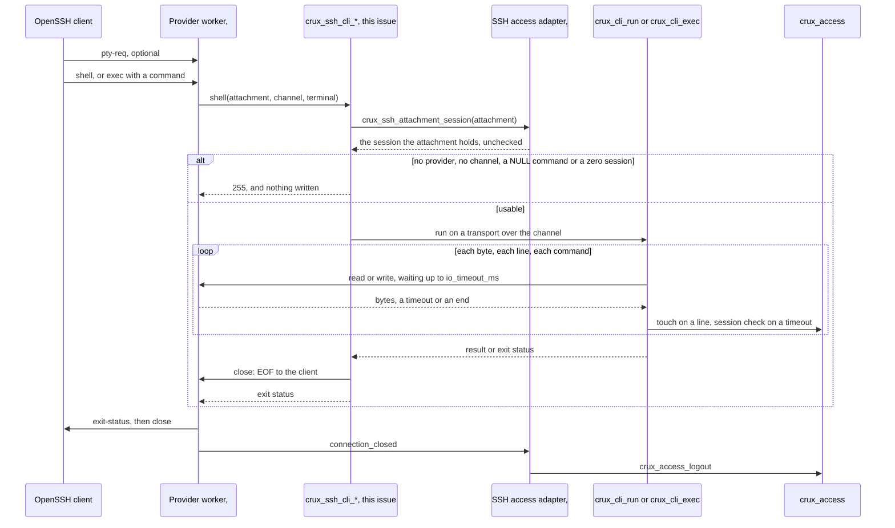

# The command line over SSH

Status: draft for review, Issue #193, approved in advance under gate #183. It connects the provider interface of [the SSH provider contract](ssh-provider-contract.md) to the session entry points of [the command line contract](cli-contract.md). No board was operated, and nothing here is evidence about one.

## What is built, faked and untested

| Part | State | Where |
| --- | --- | --- |
| `crux_ssh_cli_shell` and `crux_ssh_cli_exec`, on `crux_cli_run` and `crux_cli_exec` | **Built** | `components/ssh/cli/crux_ssh_cli.c` |
| `crux_ssh_cli_set_provider` | **Built**, and new. See [decision 1](#decisions-for-review). | `components/ssh/cli/crux_ssh_cli.h` |
| Refusing entry points, for an image with no command line | **Built**, moved from the stand-in | `components/ssh/cli/crux_ssh_cli_refuse.c` |
| SSH provider on the Host | **Fake**: `tests/ssh/fake_provider.c`, on the calling thread, behind a counting shim | `tests/ssh/cli/ssh_cli_harness.c` |
| Provider for the threaded Host suite | **Double**, with a bounded wait | `tests/ssh/cli/concurrency_test.c` |
| Serial console in the comparison | **Real**, on a scripted Serial | `Ssh.cli_session` |
| Access control | **Scripted** in `Ssh.cli_session`. **Real core with fake ports** in the other suites and in the `native_sim` image. | `tests/cli/fake_access.c`, `tests/access/fake_ports.c`, #192's `test_access_ports.c` |
| wolfSSH provider and OpenSSH | **Real** on `native_sim`, from #265, which is not on `main` yet | `tests/ssh/cli/openssh/` |
| Commands in the `native_sim` image | **Test commands**. No product has `probe-read` or `flood`. | `tests/ssh/cli/openssh/src/main.c` |
| Security event provider | **Not connected.** It prints in the image, and records on the Host. | [The contract](cli-contract.md#connecting-the-real-security-events) |
| A product composition | **Not built.** No Kconfig symbol selects SSH yet. | #197 |
| Anything on a board, and stack use on a Cortex-M7 | **Untested.** RT1060 is compile only. | |

## How a session runs

Everything between `shell` or `exec` and its return runs on the worker of one connection. The adapter holds a transport and a `crux_cli_context_t` on that stack, and has no lock and no thread of its own.

## What follows `terminal`

| Client | `pty-req` | Form | Echo | LF on the wire | Example |
| --- | --- | --- | --- | --- | --- |
| `ssh host` from a terminal | Yes | Shell | Yes | CR LF | `> status\r\nran\r\n> ` |
| `ssh -T host` | No | Shell | No | LF | `> ran\n> ` |
| `ssh host command` | No | Exec | No | LF | `ran\n` |
| `ssh -t host command` | Yes | Exec | No | **LF** | `ran\n`. See [limits](#declared-limits). |

CR LF comes from `crux_cli_write_terminal`, the helper the serial console uses, with one state for each session. A short write cannot lose or double a line end.

## Exit status

| Form | Outcome | Status |
| --- | --- | --- |
| Any | No provider, no channel, a zero session, or exec with a NULL command | 255, with nothing read or written |
| Shell | `logout` | 0 |
| Shell | Client EOF, a dropped connection, expiry, or a registry that is not ready | 1 |
| Exec | As `crux_cli_exec` reports: success 0, failed or denied 1, usage or length 2, unknown or hidden 127 | 0, 1, 2, 127 |
| Exec | An empty line, which is a command of no length and not a NULL one | 0, with nothing written |
| Exec | A session lost at the permission check | 127, with `unknown command` and then `session ended`, because the line was refused before the loss was known |

`crux_access_logout` stays with `connection_closed`, so a CLI `logout` ends the shell and the provider then ends the session.

## Mapping onto the provider

This is the table in [the command line contract](cli-contract.md#what-193-uses). The one addition is that `CRUX_OK` with a count of 0 or more than was asked is a provider against its contract, and ends the session. The CLI checks most counts itself, but not that of the CR it writes through `crux_cli_write_terminal`, and a count of 0 would otherwise read as a timeout for as long as the session lasts.

## A slow client

| Situation | What holds | What ends it | Evidence |
| --- | --- | --- | --- |
| Client sends nothing | Its worker, in `read` | The idle limit, seen at a read timeout | `Ssh.cli_real_access`, `an_idle_shell_ends_at_the_idle_limit` |
| Client stops reading, window full | Its worker, in `write` | Its catching up, or the idle limit, seen at each write timeout | `Ssh.cli_session`, `Ssh.cli_real_access`, `a_stuck_client_ends_at_the_idle_limit` |
| Another client during either | Nothing of the first | It runs to its end | `Ssh.cli_concurrency`, `a_slow_client_holds_only_itself` |

A `write` timeout does not refresh the idle timer, so a stuck client cannot keep a session alive. The session is checked at each timeout, and not while bytes are moving, so a slow reader that keeps taking bytes is not stopped at the limits during one command: see [limits](#declared-limits). Output needs no buffer of its own here, because each `crux_cli_write` passes through to the channel and waits on that connection alone. `native_sim` also shows the slot being freed after the provider has drained, for a next client.

## Why the Zephyr shell is not reachable

| Check | What it shows | Result |
| --- | --- | --- |
| `Ssh.cli_session`: 180 generated lines, on a shell with and without a terminal and on exec. Every root command registered under Zephyr's own directories at the pin, every `kernel` and `kernel thread` subcommand, and some lines of the shell's syntax. | `unknown command`, status 127, no handler, an event for each rejected line | Pass |
| `check_zephyr_shell_lines.py`, in `test-compile.sh` | That list equals what the pinned Zephyr registers, so an upgrade has to bring it along | Pass, and an edited list fails |
| The same suite: `help` | Exactly the registry's list, in its order, and Tab and the history keys do nothing | Pass |
| `Ssh.cli_entry_symbols`: `nm` on the entry points' object | They reach only `crux_cli_run`, `crux_cli_exec`, `crux_cli_write_terminal` and `crux_ssh_attachment_session` | Pass |
| `the_zephyr_shell_is_not_reachable` with OpenSSH | 23 of those lines through exec, all 180 through one terminal shell, and no `uart:~$` prompt | Pass |
| `scripts/check-management-shell.py --config --elf` on the running image | `CONFIG_SHELL=n`, no shell symbol, and its sections empty | Pass |

Rule L5 of the command line contract applies once `CONFIG_CRUX_SSH` exists. The image here has `CONFIG_CRUX_CLI`, which the same rule covers.

## Results

Recorded on 5 November 2026, in the Dev Container image under emulation, with OpenSSH 9.6p1, Zephyr v4.4.2 `dccb095`, wolfSSL `3c5eead` and wolfSSH `8221e4e`. The revisions are in the PR.

| Kind | Command | Result |
| --- | --- | --- |
| Host, Clang 18 | `ctest --preset host-debug -R '^Ssh\.cli'` | 7 of 7. `Ssh.cli_session` makes 9,367 checks. |
| Host, ASan and UBSan, GCC 13 | The same on a local build with `CC=gcc`, because the image lacks Clang's sanitizer runtime | 7 of 7, and `Ssh.CallbackTable` |
| Host, clang-tidy 18 | The entry points and `tests/ssh/cli/*.c` | No finding |
| Host, ThreadSanitizer | `tests/ssh/cli/test-thread-sanitizer.sh` | Passes in the Host CI job. It cannot run locally, because it cannot map its shadow memory under emulation. |
| CI, at `91439b1` | `host`, `links`, `psa-crypto` and the four Zephyr shards | All pass, including Clang's ASan and UBSan on `Ssh.cli_*`, and `test-compile.sh` with the list check in the `io` shard. CI does not run the OpenSSH script. |
| `native_sim`, real OpenSSH, real provider from #265 at `800d0af` | `tests/ssh/cli/test-openssh.sh`, on a local merge | 15 of 15 cases |
| RT1060-EVKB, compile and link only, not flashed or run | `tests/ssh/cli/test-openssh.sh --target`, the same image and merge, with #192's `rt1060.conf` | Links: 307,000 B Flash, 703,884 B RAM, which includes the test's 512 KiB arena and 32 KiB main stack. The shell rule passes on the image. |
| `native_sim` and RT1060-EVKB, compile only, no wolfSSH | `tests/ssh/cli/test-compile.sh`, also in the Zephyr CI job | Both build, with the limits' flags on the source, and the shell rule passes on `.config` |

`native_sim` resource use, simulation only and on a 64-bit image: **8,768 B** at most on a worker with a password login, Ed25519 host key, `account list`, `passwd` and 64 KiB of output, and a heap peak of 21,408 B. The figure is for the whole worker, handshake included, and is below #192's 13,808 B, which covers ECDSA too. It does not separate the CLI's part, and it says nothing about a Cortex-M7. The context alone is about 800 B.

### What the tests can catch

The Host suites first ran against a stand-in that refuses everything: `Ssh.cli_session` reported 1,084 failures of 6,286 checks. Each change below was then made to `crux_ssh_cli.c`, and one or more suites failed.

| Change | Caught by |
| --- | --- |
| Line ends ignore `terminal`, or are always mapped | All three |
| Echo never, or always | All three |
| The shell or exec names the serial channel | All three |
| Exec returns 0 always. The shell returns 0 always, or 1 always. | `session`, `real_access`, and `concurrency` for the shell |
| No `close` on the shell or on exec | `session` |
| Zero session, no channel, no provider or a NULL command accepted | `session` |
| `CRUX_OK` with no byte accepted | `session`, as a hang that the CTest limit ends |
| A timeout read as a failure, or a failure as a timeout | All three |
| A provider with no `read` or no `close` accepted, or a bad one leaving the last in place | `session` |
| A lock held around each session | `session` and `concurrency` |
| One context, or one line-end state, for every shell | `concurrency` |
| The first attachment's session used for all | `session`, `real_access` |

Starting the exec status at 0 did not fail, and is equivalent, because `crux_cli_exec` always sets it. Accepting an over-claimed count survived at first, because the CLI checks most counts too. That led to the case for the CR of a line end, which then caught it.

## Found with #192

Running the CLI on the provider found two things that #265 has since fixed, both at `800d0af`. Neither fix is in this PR, so this PR's OpenSSH run needs that revision or later.

| Finding | Effect | Fix in #265 |
| --- | --- | --- |
| `crux_ssh_wolf_provider.c` and `thread_native.c` both defined a global `worker_stacks` | An image with the command line, which needs `crux::thread`, did not link. #192's own image has no `crux::thread`. | `static` on the provider's array |
| The provider's `read` returned `CRUX_ERR_IO` when OpenSSH rekeyed during shell input, seen at `383f0bf` | The session ended, with `SSH worker ended: no error`. The adapter passes that status on, as the contract says. | Its rekey handling. The case `a_rekey_during_input` passes at `800d0af`. |

## Decisions for review

No owner answer was available for these, so each is the narrow choice.

| # | Point | Choice | Reason | Alternative |
| --- | --- | --- | --- | --- |
| 1 | How the entry points reach the provider's `read`, `write` and `close`. The shared table has `.context = NULL`, and the contract does not say. | `crux_ssh_cli_set_provider()`, a private call that a composition makes before `start()`. Until it succeeds, every session gets 255. | Stays in #193's files, and adds nothing to the shared table | Set `.context` in the table, which is a shared file and would bind the table to one provider |
| 2 | An image with no command line, such as the settings probe, links the table and so the entry points | A composition selects the real ones with `CRUX_SSH_CLI_COMMAND_LINE`. Without it `crux_ssh_cli_refuse.c` links, so `Ssh.cli_stub` and #192's images are unchanged. | The same arrangement as #194's `CRUX_SSH_SFTP_FILE_SERVICE`. It fails closed. | Every image links a CLI core, access and an event port |
| 3 | The Host's `crux_ssh_cli` target, which `Ssh.CallbackTable` links | The refusing sources. The real ones are `crux_ssh_cli_sessions`. | The real ones need a CLI core and access core, and the shared test file cannot be changed to add them | Link them from `tests/ssh/cli` into the table's test |
| 4 | Where a session's `crux_cli_context_t` lives | On the worker's stack | No pool, no lock and no second limit to keep equal to `max_connections`. The CLI owns its clearing. Stack cost is above. | A static pool |
| 5 | Keeping the context the size that the core was built with, on Zephyr, where the composition compiles this source with no `crux_cli_adapter` target | `sources.cmake` copies `CONFIG_CRUX_CLI_LINE_MAX` and `CONFIG_CRUX_CLI_TOKENS_MAX` onto the source. `test-compile.sh` checks the flags, and the image raises the limit to 400 and runs a line of that length. | A mismatch overruns memory with no error | The composition's own definitions, which are a shared file |
| 6 | A session that cannot start | 255, and the channel is not touched, not even `close` | The provider ends the connection in any case, and the contract gives 255 to anything out of range | Status 1 with `session ended` |
| 7 | Shell exit status at client EOF | 1, as the contract's snippet has it | Only a logout is clean. `printf 'status\n' \| ssh -T host` therefore reports 1, so scripts should use exec. | 0 |
| 8 | `close` | Called once before returning on every session that started | The contract says that #193 uses it, and EOF then precedes the exit status | Leave it to the provider's end of connection |
| 9 | History, which the issue names | None, as accepted rule L6 says | It cannot hold a secret if it does not exist | |
| 10 | Where the list of Zephyr shell commands comes from | Generated lexically from the pinned Zephyr by `check_zephyr_shell_lines.py`, and checked in the Zephyr job. It covers `subsys`, `drivers`, `kernel`, `lib`, `arch` and `soc`, and not modules outside the Zephyr tree. | A list from memory missed `rem`, `app`, `zyclictest` and most of `kernel`. A macro of another name is still missed, and `Ssh.cli_entry_symbols` and the image check do not depend on the list. | Asking a shell-enabled build, which needs that build in the check |
| 11 | Echo of a byte above 0x7F, including 0x9B, the first of the #181 follow-ups | Declared and pinned as the same as serial. `components/cli` is not in this issue's files. | The bytes are the client's own, and go back to it alone | Refuse them in `cli_input.c`, for both channels, in #181's follow-up |
| 12 | Files outside the contract's list for #193 | This document, the #193 passages of `docs/cli-contract.md`, one row of `docs/ssh-provider-contract.md`, a paragraph in `tests/README.md`, one step each in `zephyr.yml` and `host.yml` | A design document is required. Scripts live under `tests/ssh/cli/`, because `scripts/test-ssh*.sh` belong to #192. | |
| 13 | `tests/cli/ssh_shape.c` and its stand-in | Left alone | Not in this issue's files, and it still tests the transport's shape | Remove it in a later clean-up |
| 14 | OpenSSH case in CI | None. `test-openssh.sh` is local, as #192's script is. | `scripts/check-ssh-boundaries.py` keeps the optional stacks out of default workflows. `test-compile.sh` runs in CI because it needs no wolfSSH. | #247 can add it |
| 15 | `CONFIG_CRUX_CLI_LINE_MAX`, which can reach 4096, and grows a context on a fixed worker stack | `crux_ssh_cli.c` refuses to compile above `CRUX_SSH_CLI_LINE_MAX_ON_STACK`, 1024 by default. A composition raises the worker's stack first, then this. `Ssh.cli_line_at_the_stack_bound` and `Ssh.cli_line_over_the_stack_bound` hold it. | A stack overflow on a target can be silent. The value of 1024 is a judgement, not a measurement, because Cortex-M7 stack use is unmeasured. | Only stating it |
| 16 | A build with the command line that lacks a target these suites need | `tests/ssh/cli/CMakeLists.txt` stops at configuration. A build that deselects the CLI, Serial or Thread says so and carries on. Only the second path has run, with `CRUX_BUILD_CLI=OFF`. | A silent skip would pass having shown nothing, and a deselected build is a supported configuration | Failing both |

## Declared limits

- **`ssh -t host command`.** The exec callback does not say whether a terminal was requested, so the output has LF only, and a raw terminal shows a staircase for a command of several lines. Passing the flag to `exec` changes the shared callback table, and #269 tracks it.
- **`ssh -T` from a real terminal shows `passwd` entries on the user's own screen.** With no `pty-req` the client leaves its terminal's local echo on, and the server cannot turn that off. The server does not echo it. Use `ssh` with a terminal for `passwd`.
- **A slow reader that keeps moving can outlast the limits during one command.** The session is checked at a write timeout, and not after a write that was accepted, so a command with much output runs on while bytes keep moving. The limits apply again at the next prompt, read timeout or stall. A handler's output is bounded by that handler.
- **A longer line needs a larger worker stack**, as decision 15 says. The context is about 470 B plus the line on a 64-bit image, and each token of the limit adds a pointer.
- **Ctrl-D does nothing in a terminal shell**, because the CLI drops C0 controls, as on serial. Use `logout`.
- **A byte above 0x7F is echoed raw**, including 0x9B, as on serial. It goes back only to the client that sent it.
- **Typed bytes pass through the provider's and wolfSSH's buffers**, which the CLI cannot clear, as [the contract declares](cli-contract.md#declared-limits).
- **A stuck client keeps its slot** until the idle limit, 15 minutes in the reference policy. `max_connections` bounds how many can do that.
- **An account holds three sessions by default, and the oldest then ends**, so a fourth `ssh` of one user ends the first with `session ended`. That is Access's rule, and it applies here.
- **`Ssh.cli_concurrency` uses a provider double**, so it shows that the adapter and the CLI share no lock, and says nothing about wolfSSH. `a_slow_client_holds_only_itself` covers that on `native_sim`.

## Not verified

- Anything on a board, timing, or the worker's stack on a Cortex-M7.
- WinSCP, or any SSH client other than OpenSSH 9.6.
- A key login through the CLI: the cases use passwords, and #192 covers keys up to its stand-in sessions.
- A rekey started by the server, or with any client but OpenSSH. Rekeys that OpenSSH starts pass, both during output and while a shell reads, in `a_rekey_during_output` and `a_rekey_during_input`. The independent review measured stack peaks with a rekey of 10,152 B with an Ed25519 host key and 11,232 B with an ECDSA one. Those are its figures, and this PR did not repeat them.
- `window-change` over the wire: the Host covers it through the fake, and it has no effect by contract.
- The real security event provider.
- The OpenSSH and target results on `main`: they ran on a local merge with #265 at `800d0af`, so they need repeating once it has merged.
