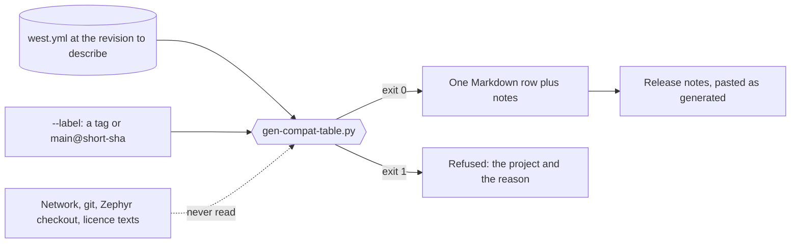
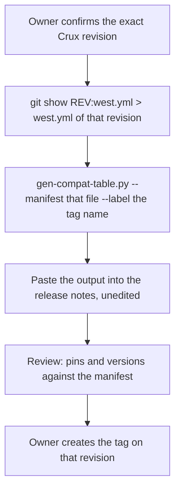

# Compatibility table

Status: **PROVISIONAL, a first shape**, for review in a Draft PR. Refs #301, the `v0.1.0` item. No Crux tag exists. This change creates no tag and no release, and the generator ran on no tagged revision. Nothing here is a compatibility promise.

The table tells a reader which revision of each pinned project a Crux revision was built against. The owner decided on 8 November 2026 that Crux's own release notes carry it, that it is generated from `west.yml` and that nobody writes it by hand. This document records the generator, what it reads and what it does not claim.

## Result

| What | Where | State |
| --- | --- | --- |
| Generator | [`scripts/gen-compat-table.py`](../scripts/gen-compat-table.py) | New, provisional. Python standard library and PyYAML, which west installs |
| Tests | `tests/build/test_compat_table.py` with [fixtures](../tests/build/fixtures/compat_table) | New. Found by the existing `python3 -m unittest discover -s tests/build` step. That step runs on the host CI job, which has no PyYAML, so the cases that parse a manifest skip there ([follow-ups](#follow-ups)) |
| Release notes template, tag, release | | **Not in this change** |

```sh
python3 scripts/gen-compat-table.py --label <label> [--manifest <west.yml>]
```

It prints the table on standard output and exits 0. It exits 1, with a message that names the project, for a manifest that it refuses, and 2 for a usage error. It reads one file and writes nothing.

## What is generated, from what

The input is a west manifest, `west.yml` of this repository by default. The output is one row, for the revision label that the caller gives, and one column for each project that the manifest pins.



| Column | Where it comes from |
| --- | --- |
| Crux revision | The `--label` argument. Letters, digits and `. _ @ / + -` only, so that it cannot break the table |
| `zephyr`, `hal_nxp`, `mbedtls`, `tf-psa-crypto`, `wolfssl`, `wolfssh`, `wolfpsa`, `reliance-edge` | Always present, in this order. A project that the manifest does not hold says `not in this manifest` |
| Any other project that the manifest pins | Added after these, sorted by name |

Each cell holds what the manifest says about that project and nothing more:

| Part of a cell | Source | Rule |
| --- | --- | --- |
| Commit | `revision:` | Shortened to 12 characters. Must be a full 40-character commit in the manifest |
| Version in brackets | The comment at the end of the `revision:` line | Shown only when the whole comment looks like a version: digits with at least one dot, an optional leading `v` and an optional suffix, such as `v4.4.2`, `2.0.1` or `v5.9.4-stable`. A date or a word is not shown. It is the author's comment and is **not checked against the commit** |
| `optional: group ...` | `groups:` of the project and `group-filter:` of the manifest | A project is optional when it has groups and the manifest's `group-filter` turns every one of them off, the last entry for a group winning. This is west's rule for an inactive project |
| `licence class ...` | `userdata:` of the project, key `crux-licence-class` | Shown only when the project declares it. Never read from a comment or from a project's name |
| `imported from ..., not pinned here` | `import: name-allowlist:` of another project | A project that the manifest imports by name and does not pin, such as `hal_nxp` through Zephyr. It gets no commit |

An example, generated from the invented manifest of the tests with `python3 scripts/gen-compat-table.py --manifest tests/build/fixtures/compat_table/manifest.yml --label v0.0.0-fixture`. A test holds this block equal to the generator's output.

| Crux revision | zephyr | hal_nxp | mbedtls | tf-psa-crypto | wolfssl | wolfssh | wolfpsa | reliance-edge | dual-mod | extra-mod |
| --- | --- | --- | --- | --- | --- | --- | --- | --- | --- | --- |
| v0.0.0-fixture | `4edf19ddec5a` (v4.4.2) | imported from `zephyr`, not pinned here | `d64b74f82b92`; optional: group `crux-secure-management` | `6345d9d62a01`; optional: group `crux-secure-management` | `1cced69c0d64` (v5.9.4-stable); optional: group `crux-secure-management` | `11846a9add6b` (v1.6.0-stable); optional: group `crux-secure-management` | `fe2acee1331c` (v5.9.4); optional: group `crux-secure-management` | `b5b4f3413090` (v3.0); optional: group `crux-reliance`; licence class fixture-class | `c1393802f822` | `781276ddcf6c` (2.0.1) |

- Commits are shortened to 12 characters. A version in brackets is the trailing comment of the `revision:` line in the manifest. It is not checked against the commit.
- Optional means inactive unless one of its groups is enabled. The manifest's `group-filter` turns off: `crux-reliance`, `crux-secure-management`.
- `zephyr` imports without a pin here: `cmsis`, `hal_nxp`.

The manifest of this repository gives the same shape with its own commits. Its `hal_nxp` is imported through Zephyr and carries no pin of its own. To put a commit in that column, generate from a frozen manifest of a workspace (`west manifest --freeze`), which pins every project. It carries no trailing comments, so a table built from it shows no version in brackets at all, Zephyr's included. A frozen-style manifest is covered by a test, the generator was not run on real `west manifest --freeze` output for this change, and whether `--freeze` works while the off-by-default projects are not cloned is not verified here.

## What is refused

| Input | Result |
| --- | --- |
| A project whose revision is a branch, a tag, a short commit or a number | Exit 1, naming the project and the revision |
| A project with no `revision:`, even when the manifest has a default revision | Exit 1. The manifest's default revision is not used: a project that names no revision is not a pin |
| A manifest that is not YAML, has no `manifest:` mapping, has no projects, names a project twice, has a project without a name, a malformed `group-filter` or a licence class that is not one plain word | Exit 1 with the reason |
| A label with a space, a pipe character, a backtick, a newline or nothing | Exit 1 |
| A missing file | Exit 1 |
| A missing PyYAML | Exit 1 with a message, no traceback |

The table is deterministic: the projects and the groups are sorted, so reordering the manifest gives the same bytes, and it holds no date, path or host.

## What is not claimed

- **No Zephyr version or licence beyond the manifest.** The Zephyr version in the table is the comment that the manifest carries at its `zephyr` entry. A project without such a comment shows its commit only. The generator does not look up a tag for a commit.
- **No licence statement about any project.** Whether a group's source is under a copyleft licence is not in the table unless a project's `userdata` says so, and the manifest of this repository declares none. That is an [open question](#open-questions) for the owner. Today the manifest's comments describe the two off-by-default groups in prose, and the generator does not read prose.
- **No verification of the pins.** The table says what the manifest names. It does not say that the commit exists, that it matches its comment or that a build or a board test passed with it. `west crux-pins` and the existing checks do their own work.
- **No promise.** A `v0.y.z` release makes no compatibility promise, see the [versions table](product-composition.md#versions).

## How it will be used at a release



Generating before the tag exists is possible because the generator takes a manifest and a label, not a tag. Reading the manifest with `git show <revision>:west.yml` and not from a working tree avoids a table that describes uncommitted edits.

## No tag exists yet

No Crux tag exists, and this change does not create one. `v0.1.0` is decided but is created only after #349 and #350 merge, and **creating it needs the owner's confirmation of the exact revision at that time**. Until then the table can be generated for `main` with a label such as `main@<short sha>`, for a review or a rehearsal. A table labelled that way is not release evidence.

## Open questions

| Question | Recommendation | Why |
| --- | --- | --- |
| Should `west.yml` declare `crux-licence-class` in the `userdata` of the optional projects, so that the table can name a licence class? | Not yet. Decide the wording of the class with the owner, then add one `userdata` entry per optional project | The generator would then name a class that the manifest itself states, and no licence word is written in a script or a document. It changes `west.yml`, which this change does not touch |
| Should the release notes carry one row per tag, or a cumulative table? | One row per tag, as generated | A cumulative table needs the union of the columns across tags and a place to keep earlier rows. Nothing needs it for `v0.1.0` |

## Follow-ups

- **CI.** The host CI job installs no PyYAML, so the manifest cases of `tests/build/test_compat_table.py` skip there, and the job that installs west runs only named suites. Running them needs a workflow change, which is outside this change: install PyYAML on the host job, or add this test to a job that has west. Until then the cases run only where PyYAML is installed.
- **Release notes template.** The release documentation template in `samples/product_template` is a separate item of #301. It can call this generator.
- **A fuller table.** A column for the compiler or SDK version, the CMake or Python tool pins and the Docker image is outside the owner's decision and is not in the generator.
