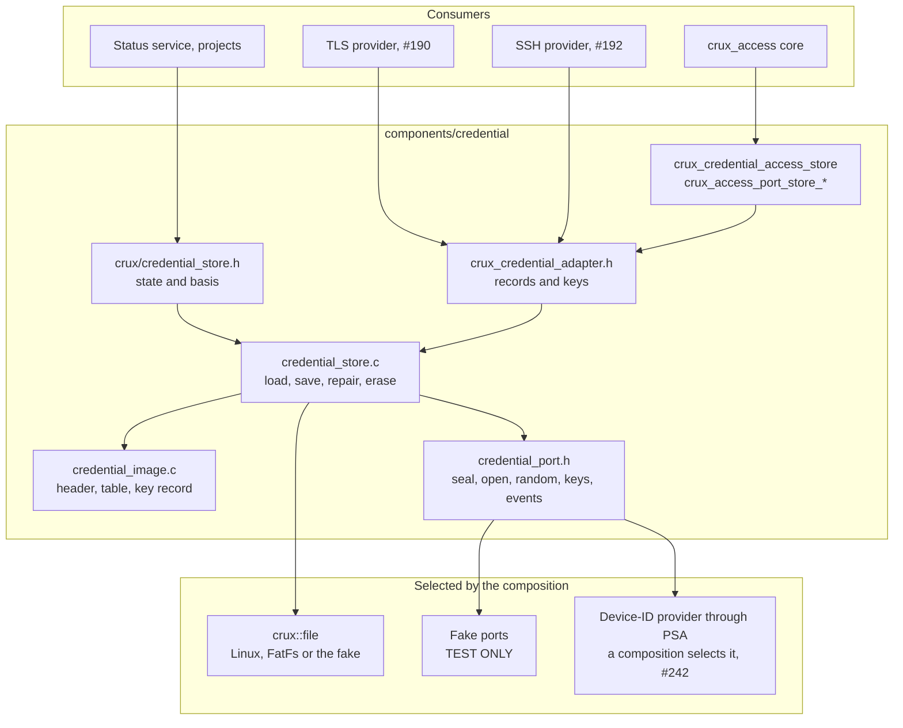
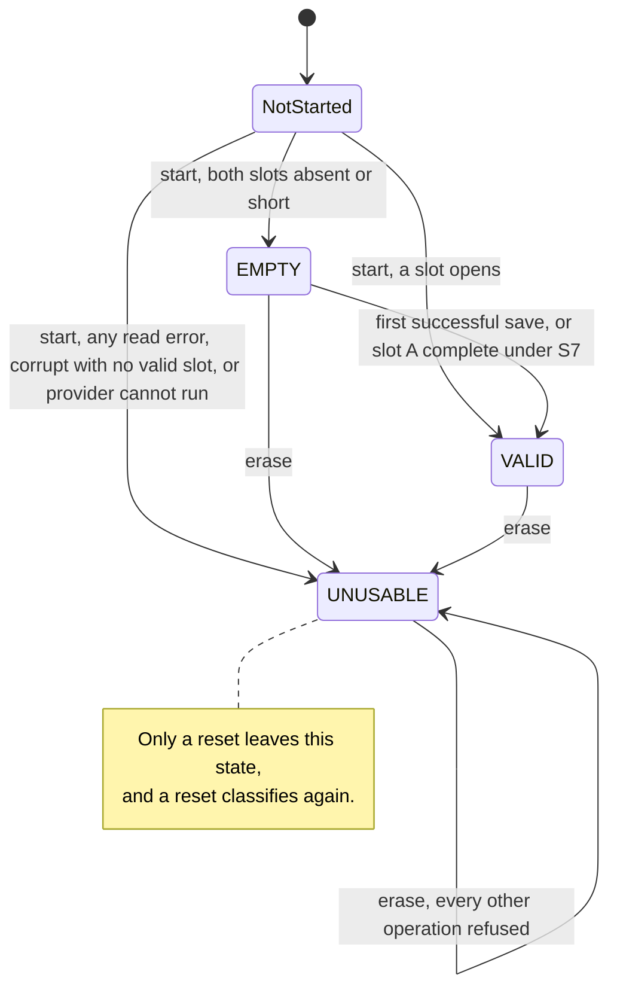
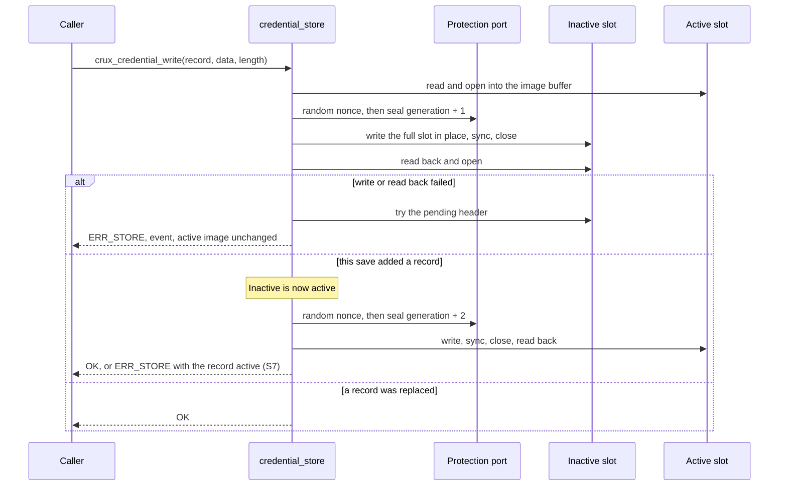

# Credential and key store

Status: merged in [PR #235](https://github.com/wonny-labs/crux-pilot/pull/235) for Issue #178, on Host with test-only protection, and gate #183 has passed. Issue #178 stays open. A device-ID PSA provider runs on `native_sim` in [the management composition](native-management-composition.md). The decisions and reasoning are in the
[accepted proposal](plans/credential-store-contract-proposal.md), which this document does not repeat. S1 to S7 are
accepted, recorded in [the owner's decision of 3 November 2026](https://github.com/wonny-labs/crux-pilot/pull/209#issuecomment-6616400894).

Owner: `components/credential`. Public header `<crux/credential_store.h>`, usage target `crux::credential_store`. Adapter
header `crux_credential_adapter.h`, internal target `crux_credential_adapter`. The private ports are in
`components/credential/src/credential_port.h`.

**This is not secure storage on the pilot.** On the planned pilot basis, someone who can read the card and the chip ID can
read every secret. See [Limits](#limits). Results must state this, and `crux_credential_store_get_info` declares it.

## What exists

| Item | State | Evidence |
| --- | --- | --- |
| Public and adapter contracts | Implemented as proposed, with the changes under [Decisions for review](#decisions-for-review) | C and C++ headers build, boundary check |
| Portable core: slot format, load states, save sequence, repair, keys, erase | Implemented | Host suites below |
| Store port of `crux_access` | Implemented, target `crux_credential_access_store` | The real Access core on the real store, on Host |
| Slot access | Crux File, unchanged | Host on the Linux provider and on the fake. See [native\_sim](#tests) for FatFs. |
| Fake ports | **Test only.** CRC in place of a tag, a keystream that is not encryption, deterministic randomness and key generation | Refuses to compile outside a test composition, and a product core refuses it at start |
| Device-ID protection through PSA | Implemented for a composition, `components/credential/ports/psa`, with the device ID from `hwinfo` in `ports/zephyr`. The root build has no PSA, so no target holds it. | [`tests/psa_ports`](native-management-composition.md#provider-results) on both providers, and [this store on it](native-management-composition.md#composition-results) on a file-backed disk on `native_sim`. No target run. |
| Event identifiers | Six private event types, mapped to the `credential.*` records by `crux_credential_security_events`, which a composition links | `ManagementProviders.events`, and the composition |
| Reserved roots in the file service | `crux_credential_roots` feeds the reserved list of the file service from #232 | `credential_file_service_roots`, on the real service |
| Pilot card layout, target runs | Not implemented. Target and physical work is out of scope and needs separate approval. A Zephyr composition on `native_sim` exists: [management composition](native-management-composition.md). | Gap on a target |

Host tests show contract behaviour. They do not establish confidentiality, entropy quality, or behaviour across real
power loss.

## Structure

| Target | Who links it | What it exposes |
| --- | --- | --- |
| `crux::credential_store` | A project that displays the basis, the status service | The public header only. It links the core, which needs providers, so an image without them does not link. |
| `crux_credential_adapter` | The bridge, TLS and SSH providers, a composition, always `PRIVATE` | The adapter header. `cmake/CruxCredentialBoundary.cmake` rejects any path by which it reaches a consumer. |
| `crux_credential_access_store` | A composition | Nothing. It implements a private port of Access. |
| `crux_credential_test_composition` and `_small` | Only `tests/credential` | Exist only under `CRUX_BUILD_TESTS`. |

### Boot order and calls

| Step | Call | Notes |
| --- | --- | --- |
| 1 | `crux_credential_start(root_a, root_b)` | Once, on every boot path, whether or not the medium mounted, before other threads use the store |
| 2 | `crux_access_init(policy)` | Loads accounts through the bridge. Its `EMPTY` is the absence of the account record. |
| 3 | `crux_credential_key_ensure(record, type)` | For each key the build needs. A failure stops that listener. |
| 4 | `crux_credential_roots(roots)` | Passed to `crux_file_service_start` as the reserved list, which refuses an area on either slot |

## Slot format

Each slot is a file named `store.img`, of `CRUX_CREDENTIAL_SLOT_BYTES`, in its own File root.

| Offset | Size | Field | Rule |
| --- | --- | --- | --- |
| 0 | 4 | Magic | `CXCS`. A pending header is `CXCP` followed by exactly 28 zero bytes, and anything else is corrupt. |
| 4 | 2 | Format | 1, little-endian like the rest. Any other value is corrupt. |
| 6 | 2 | Protection identifier | The provider's declared basis, so 0 for the fake. A mismatch is corrupt. |
| 8 | 8 | Generation | One more per save |
| 16 | 4 | Payload length | The declared end must fit the file and the slot, or the slot is corrupt |
| 20 | 12 | Nonce | Fresh per seal |
| 32 | n | Sealed payload | A count and a zero field of 2 bytes each, then per record an identifier, a zero field and a 4-byte length, then the record bytes |
| 32 + n | 16 | Tag | Covers the payload and the whole header as additional data |
| | to slot size | Padding | Zeros, outside the tag, not checked |

A key record holds a type byte, the public length, the private length and a zero byte, then both parts. `crux_credential_key_parse` splits one.

| Key type | Public part | Private part |
| --- | --- | --- |
| `CRUX_CREDENTIAL_KEY_ECDSA_P256` | 65 B, uncompressed point | 32 B, scalar |
| `CRUX_CREDENTIAL_KEY_ED25519` | 32 B | 32 B, seed |

| Setting | Default | Note |
| --- | --- | --- |
| `CRUX_CREDENTIAL_SLOT_BYTES` | 16,384 | A whole number of 512-byte sectors, or the build fails |
| `CRUX_CREDENTIAL_ACCOUNTS_BYTES_MAX` | 8,192 | Access's record is 4,060 B at its default bounds, and the bridge checks this at build time |
| `CRUX_CREDENTIAL_CERTIFICATE_BYTES_MAX` | 4,096 | |
| `CRUX_CREDENTIAL_KEY_RECORD_BYTES_MAX` | 101 | Every record at its limit fits together at the default slot size, which a test shows |

## Load states

`crux_credential_state` reports `UNUSABLE` before start, when every other operation returns `NOT_READY` and the bridge maps that to `UNUSABLE`.

| Slot A | Slot B | State | Tested |
| --- | --- | --- | --- |
| Absent, under 32 B or pending | Absent, under 32 B or pending | `EMPTY` | `test_load_table`, all pairs in both orders |
| Valid | Any except unreadable | `VALID`, the higher generation if both are valid, slot A on a tie | `test_load_table`, `test_generation_order_and_ties` |
| Corrupt | Absent, short or corrupt | `UNUSABLE` | `test_load_table`, `test_wrong_device_key`, `test_flipped_header_bits` |
| Unreadable, any File result but `OK` or `NOT_FOUND`, or a provider that could not run | Any | `UNUSABLE` | `test_unreadable_root`, `test_read_errors_at_start` |

The table is symmetric. Each corrupt slot produces `credential.slot_invalid`, including next to a valid one.

## Saving

| Case | How the slot is written | Why |
| --- | --- | --- |
| Full-size slot, the other slot valid | In place, in one write, then sync | The other slot is the old image, so a cut leaves old or new |
| Absent or undersized slot | `CREATE_REPLACE`, full size with a pending header, sync, the real header, sync | A cut leaves a slot that reads as short. The other slot's FAT chain is at risk here, a stated limit. |
| Full-size slot, and no valid slot exists | In place, pending header first, real header last | The same reason: a retried first save must still read as `EMPTY` after a cut. See decision 7. |
| The second slot of a first save | The same image, so a tie | No new nonce is needed for identical bytes |
| Repair at start | The newer slot's sealed bytes, unchanged | Needs no key and no nonce, and a tie reads the same |
| `crux_credential_key_ensure` on a key that one slot lacks | The same copy as a repair, before it returns `OK` | `OK` must mean that both slots hold the key. See decision 26. |

The store does not use rename, as the proposal explains.

## Decisions for review

Each of these was taken without the owner, who was unavailable. The narrower, safer choice was taken where there was one.

### Changes to what the proposal states

| # | Decision | Why | Impact if changed |
| --- | --- | --- | --- |
| 1 | `crux_credential_port_seal` takes the nonce as a `const` input, and the core draws it from `crux_credential_port_random` | The proposal's format says the tag covers the nonce as additional data, which needs the nonce before sealing, while its signature has seal return the nonce. Its port table already lists `crux_credential_port_random` for nonces. | One private signature, and the fake |
| 2 | The protection identifier is the declared basis, and there is no separate port for it | The proposal requires an identifier, gives the fake 0 and defines no way to get it. `BASIS_NONE` is 0. | One more port function. Two different hardware-bound providers share an identifier, and their keys tell them apart at the tag. |
| 3 | `crux_credential_port_event` takes a private `crux_credential_event_t`, not `crux_security_event_t` | Issue #182 had not landed then, and Access did the same. Each type names its `credential.*` identifier, and the struct holds no bytes from a record. | `crux_credential_security_events` maps it, so the store's core has no dependency on the event contract |
| 4 | The store has two static buffers, sealed and plain, so about 32 KiB of RAM, not the 16 KiB in the gate record | Sealing and opening in place would rely on overlap behaviour that #142 has not qualified on both providers | Halves the RAM if #142 shows that overlap is safe. Issue #197 measures it. |

### Additions and choices the proposal left open

| # | Decision | Why |
| --- | --- | --- |
| 5 | A key record has a fixed form, stated above, and `crux_credential_key_parse` splits it. `crux_credential_write` refuses a malformed key record. | Consumers need the type, because `key_ensure` keeps an existing key of any type. M11 and M12 convert to the form their stack wants. |
| 6 | Record limits of 8,192, 4,096 and 101 B, in the adapter header | So a consumer can size a buffer at build time |
| 7 | A first save over a full-size pending slot still writes the real header last. The proposal says such a slot is "written in place", and this is in place. | A plain in-place write would put the real header down first, so a cut would read as corrupt, and with no valid slot that is `UNUSABLE`, not "old". `first save over a pending slot` walks this. |
| 8 | A failed second write also tries the pending header. The proposal requires it of the first write. | One path, and a torn slot would otherwise report `slot_invalid` at each boot until the next save |
| 9 | A pending header must be exact, so a stray bit in one is corrupt, not short | A rotted slot can then never read as absent |
| 10 | A payload behind a good tag is still checked, and a repeated, unknown or empty record makes the slot corrupt | The tag proves who wrote it, not that it is well formed |
| 11 | A provider failure that is not a tag failure makes the slot unreadable, not corrupt | A passing glitch must not fall back to an older generation, which the next save makes permanent |
| 12 | A declaration of `NULL` means that the provider cannot run. A claim of confidentiality on any basis but hardware-bound is refused. `get_info` then reports `BASIS_UNDECLARED`. See decision 27. | Meets "if hwinfo is unavailable the store is `UNUSABLE`", including on a blank medium, where no slot would ever fail a tag |
| 13 | A product core refuses `BASIS_NONE` or `EVIDENCE_HOST_FAKE` at start, either one alone, so `UNUSABLE` with no slot touched | The refusal the task asks for, in addition to the fake's own compile guard |
| 14 | Arguments are checked first, then the state. A repeated `crux_credential_start` or equal roots is `INVALID_ARGUMENT`. | Follows Access, and adds no result code |
| 15 | `crux_credential_start` returns `ERR_UNUSABLE` when the state is `UNUSABLE`, and the store has then started | Erase has to work in that state |
| 16 | `crux_credential_key_replace` on an absent key is `NOT_FOUND` | Rotation that silently creates a key would hide a composition mistake |
| 17 | `crux_credential_key_ensure` returns `ERR_READ` when it cannot read the medium, and generates nothing | Absence is unproven |
| 18 | The active slot is read again for every operation, and its generation must match RAM | A medium swapped while running is an error, never a new image |
| 19 | A save at the last generation is refused with `ERR_STORE` | The next value would wrap and lose to every older image |
| 20 | Events run under the store lock, and never under the info lock, so an event may read the state | The gate's lock table allows the ring lock under the store lock. Unlike Access's state lock, nothing fast waits on the store lock. |
| 21 | A failed second write produces `save_failed`, and `key_generated` waits until both slots hold the key: when a retry of `key_ensure`, or the repair at start, finishes the write | The caller was told not to use the key until then, and the event must exist once it is used |
| 22 | `crux_credential_write` can store a well-formed key record, and replacing a key that way also produces `key_replaced` | The proposal's test table asks for a write of each record, and the design says that a host key change is always recorded. Nothing in Crux calls it for a key: M11 and M12 generate theirs. |
| 23 | Swapped slots read normally. The image is not bound to its directory. | A swap is the same two images, so old-or-new still holds |
| 24 | The boundary rule is a new module instead of a change to `cmake/CruxAccessBoundary.cmake` | Avoids conflict with #210, which is still open. Merging the two is a small follow-up. |
| 25 | The File fake gained `crux_file_fake_write_through`, `crux_file_fake_drop_writes` and `crux_file_fake_remove_medium`, in `tests/file` | The proposal asks for a cut at each sector and byte, and the fake had one cut per File operation. Its default is unchanged. |
| 26 | `crux_credential_key_ensure` on an existing key checks the other slot, and writes it unless that slot is valid and holds the key. A failure is `ERR_STORE`. This includes an absent, pending or corrupt slot, not only one that lacks the record. `key_generated` follows if the slot proves the key was never there. A corrupt or unreadable slot proves nothing, so a key whose second write failed and whose slot could not be invalidated goes unannounced. | The proposal's rule is that a record is acknowledged only once both slots hold it, and `OK` is the acknowledgement. It costs one more slot read at each call. It also rewrites a corrupt slot at boot, which the next save would have done. |
| 27 | Two new enumerators, `CRUX_CREDENTIAL_BASIS_UNDECLARED` and `CRUX_CREDENTIAL_EVIDENCE_UNDECLARED`, which `get_info` reports with every claim false when the provider cannot run or its declaration was refused. A provider cannot declare them. | Zero is `BASIS_NONE` and `EVIDENCE_HOST_FAKE`, which would tell a product that it runs on the test fake. Each is additive, and the proposal's values do not change. |

## Limits

These are the proposal's, and each has a test where a Host test can show it.

| Limit | Shown by |
| --- | --- |
| Not confidential on the pilot against the medium and chip ID. The PSA provider declares this: `BASIS_DEVICE_ID_KEY`, with no confidentiality. The fake's cipher is not encryption. | `get_info` carries the declaration, in `test_info_carries_the_declaration`, and `first_boot.test_01_declaration` on the provider |
| Rollback is not detected, including the return of a record's absence | `test_accepted_limits` |
| S6: losing both directory entries reads as `EMPTY` and reopens provisioning | `test_accepted_limits`, `test_lost_directory_entries_reopen_provisioning` |
| A writer without the chip ID can overwrite both headers with an exact pending header, which has no tag, and the store reads `EMPTY` with no event. This is wider than S6's wording, which speaks of a lost directory entry, and it equals blanking the card under limit A7. | `test_accepted_limits` |
| S7: a failed second write returns an error, and the record is active and survives a reset | `test_failed_second_write`, in both the store and Access suites |
| AC8: a failed save can win at the next boot if invalidating also fails | `test_failed_save_and_invalidation`, `test_failed_save_keeps_ram` |
| A corrupt newest slot falls back to the older generation, with an event, and the next save makes that permanent, so a removed account can return | `test_accepted_limits`, `test_rotted_newest_slot_restores_an_account` |
| A card moved to another board reads `UNUSABLE` | `test_wrong_device_key` |
| A cut inside the single header write can leave a corrupt slot, which fails closed and needs local recovery | The byte walks of a first save, which assert that this happens |
| A record whose second write failed is active but not acknowledged, and one slot holds it until a save or the repair at start reaches the other. If that slot rots first, the record reads as absent, which is the old state, because its save returned an error. For an account, which a reset loads and a login can then use, this can reopen provisioning, and it takes a failed second write, the repair at start also failing or no reset yet, and then damage. **A device key cannot be regenerated this way**, because `key_ensure` says `OK` only once both slots hold it. | `test_failed_second_write`, `test_key_used_after_a_failed_second_write` |
| A key can go unannounced. After a failed second write, a save of another record finishes the key's second slot, and `key_ensure` then returns `OK` with `credential.key_generated` never sent, even after a reset. A plain power cut during the second write does the same. This goes against the reason given in decision 21, and a RAM mask of unannounced keys would close the first case. | **Not shown.** Found in the review of #235. |
| `key_ensure` also makes a fallback to the older slot permanent, as the next save does, and with a corrupt newest slot it does so at boot with no save | **Not shown.** Found in the review of #235. |
| The two-slot assumption depends on the medium: a card's mapping can disturb another sector | **Not shown.** A Host fake cannot. |
| Creating a slot writes FAT sectors that can hold the other slot's chain | **Not shown.** A Host fake cannot. |
| The pinned FatFs lacks a range check on its direct-write path that upstream labels `CVE-2026-6685`, and every save uses that path | **Not assessed.** It is for dependency review. |
| Erase does not prove physical erasure | **Not shown.** A Host fake cannot. |
| No unauthenticated wipe (S4). The reference has no command for erase, and the Pilot recovers with a card reader. | By absence: `crux_credential_erase` has no caller in Crux |

## Tests

`scripts/test-credential.sh` runs the suites under the `host-debug` and `host-sanitize` presets, clang-tidy on the
sources, and the boundary check. The root build also runs the suites as `Credential.*` under `scripts/check-host.sh`.

| Suite | Slot | Covers |
| --- | --- | --- |
| `credential_conformance_fake`, `credential_conformance_linux` | 16 KiB | The same cases on each File provider: before start, every pair of the load table, an unbound root, each record's read and write, limits, generation order and ties, a new record in both slots, repair, `UNUSABLE` refusing all but erase, device keys, erase and its interrupted states, the declaration, swapped slots, wrong device key, other formats and providers, malformed payloads behind a good tag, slot size changes, accepted limits |
| `credential_concurrency` | 16 KiB | Writers, a reader and a status poller sharing the store on the Linux provider: every save succeeds, and every read finds a whole value |
| `credential_faults` | 1 KiB | A cut before each File operation, each sector and each byte, with a first save's value longer than a sector and its corrupt cuts counted exactly, of: a first save, a first save over a pending slot, replacing in either direction, adding a record, generating and rotating a key, the repair, erase. Every bit of the header, and each sealed byte. Read errors at start, failed sync and read back with invalidation working and failing, a failed second write at each step, a key used after one, retried and then damaged in either slot, a full File pool, a full medium, an image too large for the slot, a medium that leaves, a status read during a save, a lost lock. |
| `credential_faults_default_slot` | 16 KiB | The same walks at the default size, by File operation and sector |
| `credential_security` | 16 KiB | Nothing plain on the medium, nothing secret in an event, the key event following its save, forged and reused-generation slots, bad tags, a fresh nonce per seal. The fake's cipher is not encryption, so this shows the store's handling only. |
| `credential_production_refuses` | 16 KiB | A product core linked with the test-only ports: `UNUSABLE` with no slot read or written, for either half of a test declaration, a refused claim and no provider, each in its own process, and two real declarations accepted as a control |
| `credential_access_store` | 16 KiB | The real Access core on the real store: AC6, AC8, S6 and S7, a cut at each sector of the first account's save, and what the bridge maps each result to |
| `credential_file_service_roots` | 16 KiB | The real file service, given the store's roots as its reserved list, refuses an area on either slot and accepts another |
| `credential_cpp_headers` | | Public and adapter headers from C++ |

`scripts/check-credential-boundary.py` runs 13 probes of `tests/credential_consumer`: a project and a private service are
accepted, and everything that reaches the adapter or port header is refused. It also checks that a product core defines
no port and no test hook, that the fake refuses to compile outside a test composition, that an image without providers
does not link, and that the headers are free of provider tokens.
The rule has the limits of the Access rule it copies: it cannot see a target that nothing asks it to check, a `-I` option
given as two separate tokens, or a relative path.

`tests/native/credential_fatfs` runs the conformance cases on real Zephyr FatFs over a RAM disk, under
`scripts/test-storage-simulators.sh`, on both `native_sim` widths. It shows the file behaviour and no power loss, and it
still uses the test-only protection. The other suites do not run there: a walk needs the fake.

### What is untested

| Item | Why |
| --- | --- |
| Some of these suites on the real provider | [`conformance_fake`, `security`, `faults_default_slot` and `concurrency`](native-management-composition.md#the-existing-suites-on-the-real-ports) run on TF-PSA-Crypto on Host. The rest, and every suite on wolfPSA, do not. |
| Entropy | It needs the target. `native_sim` random is [test-only](psa-crypto-design.md#what-real-means-on-native_sim). |
| Behaviour across real power loss, on a real card | Target work is out of scope. The fake's model is simpler than FatFs: nothing reorders. |
| FAT chain damage while a slot is created | Needs a real file system under a cut |
| Timing and RAM measurements | Issue #197 |

### Gaps to close before this is usable on a target

1. `samples/storage_sd` checking `secure-a` and `secure-b` through a build setting, and a Zephyr composition.
2. Target runs, under separate approval: cuts during a save on the card, entropy and timing.
