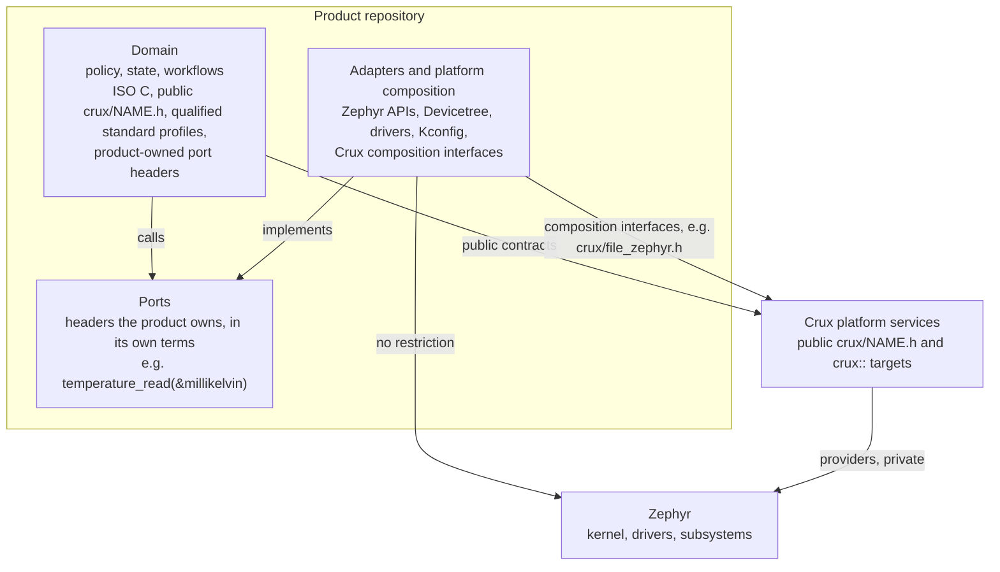

# ADR-0001: Application boundary and public API stability

Status: **Accepted** on 12 November 2026, with D10 limited to phase 1. See [the owner's decision](#the-owners-decision). Proposed: 12 November 2026. Baseline: main `54cc83e`.

This record is documentation only. It changes no code, check, contract or protected path, and nothing in it binds until the owner accepts it. Each decision that it would put into effect needs its own change afterwards, listed under [Follow-up changes](#follow-up-changes). The facts and sources behind it are in the [research note](../research/app-boundary-and-api-stability.md).

## The recommendation in brief

1. **Three layers.**
   - The domain uses Crux services and interfaces that the product defines for itself (ports), and no Zephyr.
   - Adapters that the product owns implement those ports with Zephyr, its Devicetree and its drivers, without restriction.
   - Crux provides platform services.
2. **Zephyr in declared places.** Zephyr appears only in adapters, platform composition, Crux providers, samples' Zephyr folders and tests. Two checks enforce this in a product: a Host build of the domain and an include check. The composition interface, following `crux::file_zephyr`, is the one formal way for composition code to reach a Crux provider.
3. **No device model in Crux.** Crux abstracts no devices and builds no driver model. The I2C, SPI and GPIO APIs are frozen as Experimental and retired in the release after the first tag.
4. **One stability policy.**
   - Zephyr's four lifecycle names, with Crux's own rules.
   - Add rather than change, and zero means default in every options structure.
   - A deprecation window, with contract tests and an out-of-tree consumer build as compatibility evidence.
   - Before `v1.0`, no compatibility promise beyond listed breaking changes, and stated criteria for `v1.0`.
5. **Value is measured, not asserted.** Crux's claim is narrowed to its services, a checked boundary with Host providers, and product composition. A comparison decides whether the boundary earns its cost: an ADS112C04 temperature measurement built as Crux with an adapter, and as a plain Zephyr application.

The [owner decisions](#owner-decisions) at the end list ten items. Eight are "approve the recommendation". Two need the owner's input: D7 asks for a number, and D10 needs hardware and a place to run the experiment.

## Context

**The review.** A colleague reviewed Crux on 12 November 2026. A fact-check against `54cc83e` found the claims largely true:

- Crux is focused on Zephyr, and Linux Host is a development and test environment only.
- The I2C, SPI and GPIO APIs are narrow static bindings with no device model.
- A product IC such as the ADS112C04 needs Zephyr work that the product owns.
- Zephyr composition is uneven. `zephyr/Kconfig` says Access and a provider of the command line's event port have no Zephyr composition. Access is built only by compositions under `tests/`.
- Secure management has never run on a board.
- The Settings integration takes sources from `tests/`.

The colleague's central point: **no general advantage over a well-structured Zephyr application has been shown yet.**

**The owner's concerns.**

- Applications will end up mixing Zephyr and Crux APIs, against the original intent.
- Wrapping drivers loses features and forces constant API changes.
- Frequent interface changes hurt applications.

**The owner's decision of 12 November 2026.** Crux will not be ported to an operating system other than Zephyr for the foreseeable future. The owner's words, in the Crux Pilot main session's chat on 12 November 2026: "Zephyr 외 OS 이식은 당분간 없어" ("no port to an OS other than Zephyr for the time being"). Portability between operating systems is therefore no longer a reason for any Crux API. Linux Host stays a development and test environment. Three reasons remain for Crux to publish an interface:

- It provides a service that Zephyr does not.
- It holds policy that each product would otherwise write again.
- It lets domain logic run and be tested on Linux Host without Zephyr.

**What exists already.**

| Exists | Where |
| --- | --- |
| The native-free consumer policy: portable application logic uses public Crux targets and qualified standard APIs; native providers and platform composition use Zephyr | [Native-free consumer policy](../native-interface-policy.md), adopted under Issue #24 |
| Lexical and build-graph checks of that policy on Crux's own trees | `scripts/check-native-interfaces.py`, `cmake/CruxConsumerBoundary.cmake` |
| Two composition targets: `crux::file_zephyr` (Zephyr) and `crux::queue_linux` (Linux Host). Each has a negative boundary test: `tests/build/test_file_zephyr_boundary.py` and `tests/build/test_consumer_boundary.py:99` | [File root binding](../file-composition-interface.md), [component ownership](../architecture.md#component-ownership-and-source-layout) |
| A product-shaped consumer that already uses three checked trees | `crux-controller`, see [Crux today](../research/app-boundary-and-api-stability.md#crux-today) |
| Version rules before `v1`, and a provisional compatibility table | [Versions](../product-composition.md#versions), [Compatibility table](../compatibility-table.md) |
| `BREAKING CHANGE:` footers, and source compatibility without a binary ABI | [CONTRIBUTING](../../CONTRIBUTING.md#commit-messages), [Coding guidelines](../coding-guidelines.md#public-api-consistency) |

**What is missing.**

- A rule for product code that says where Zephyr goes.
- A stated scope for what Crux will not abstract.
- Stability tiers, a deprecation mechanism and a window.
- Criteria for `v1.0`.

## Decision 1: Three layers

**Options**

| Option | What it means | For | Against |
| --- | --- | --- | --- |
| A. Two roles, as today | Portable logic and platform composition, with no named adapter | Nothing to change | Says nothing about where device code goes, which is exactly the owner's concern |
| **B. Three layers** | Domain, adapters and Crux services, described below | Every Zephyr feature stays reachable, in a declared place. Domain logic stays testable without Zephyr. It refines the existing policy rather than replacing it | Products write and maintain ports and adapters, a little more code than calling Zephyr directly |
| C. Everything through Crux | Crux wraps every device and subsystem a product needs | One API for the application | A second device model on top of Zephyr's: always behind, always changing. The research found this is the route that Mbed and vendor HALs paid for |
| D. No boundary | Applications call Zephyr and Crux wherever they like | Least ceremony | The mixing the owner wants to avoid. Domain logic cannot run on Host |

**Recommendation: B.**

| Layer | Owns | May use | Must not use | Tested by |
| --- | --- | --- | --- | --- |
| Domain | Product policy, state, workflows | ISO C; public `<crux/NAME.h>` headers and `crux::` usage targets; qualified standard profiles such as Sockets; the product's own port headers | Zephyr, board, vendor or Crux private headers; Crux composition interfaces; Devicetree identifiers | Linux Host, with Crux Host providers and product fakes of its ports |
| Adapters and platform composition (product-owned) | The implementation of each port; mounting, Devicetree, Kconfig, device initialisation | Any Zephyr API, Devicetree, drivers and subsystems; Crux public headers; Crux composition interfaces | Crux private headers and `ports/` include paths | `native_sim` with Zephyr emulators where they exist, and the board |
| Crux platform services | Public contracts, usage targets, providers | Inside providers: Zephyr, as today | Product knowledge | Crux's own Host, `native_sim` and board evidence |

A **port** is a header that the product owns, in the domain's tree, written in the product's terms: a temperature, a valve position, a measurement period. It is not written in a device's terms such as a register or a bus. It holds no Zephyr type. An adapter implements it, and a Host fake implements it in tests. Crux publishes no product ports. A port becomes a Crux capability only under the existing rules:

- The [Extending Crux](../architecture.md#extending-crux) steps: a real consumer needs it, and it has a minimum contract that can be tested.
- The rule against pass-through wrappers of native APIs in `AGENTS.md` and [CONTRIBUTING](../../CONTRIBUTING.md#making-changes): Crux must add a mechanism or a policy.

This refines the existing roles in the [architecture](../architecture.md#architecture-model) rather than replacing them:

- The domain is the existing "portable application logic".
- Adapters are a named part of the existing "platform composition".
- The native-free boundary stays where it is.

`crux-controller` already works this way: `workload/`, `app/src` and `app/compose`.

## Decision 2: Where Zephyr is allowed, and how that is enforced

**Where**

| Place | Zephyr allowed |
| --- | --- |
| Product domain | No |
| Product adapters and platform composition | Yes, any Zephyr API, Devicetree, driver or subsystem. A vendor HAL only where Zephyr has no driver |
| Crux public headers `components/<c>/include/crux/` | No, as today |
| Crux composition interfaces `components/<c>/ports/zephyr/include/crux/` | Only where a binding needs a Zephyr type. See the rules below |
| Crux providers `components/<c>/ports/zephyr/` | Yes, as today |
| Crux samples' `zephyr/` folders, and tests | Yes, by role, as today |

**Enforcement options**

| Option | Strength | Cost |
| --- | --- | --- |
| a. Guideline only | Weak: relies on review | None |
| **b. Include check per zone** | Lexical, fast, runs on every PR. `crux-controller`'s `scripts/check_boundary.py` and Crux's own `check-native-interfaces.py` are working precedents | A script per product, maintained. Lexical checks can be bypassed by macros and need review, as the existing policy states |
| **c. Host build of the domain** | Real: a Zephyr header does not exist in a Linux Host build, so a Zephyr include in the domain fails to compile | The domain needs a Host build and Host fakes of its ports, which ports and adapters require anyway |
| d. Separate compile graph inside the Zephyr build | Real. But in a Zephyr build, libraries normally take Zephyr's include paths and toolchain options through one interface target. Separating the two needs build work and evidence. This is interpretation, not tested | High; not attempted |

**Recommendation: b and c together.**

- In Crux nothing changes: its two existing checks stay.
- In a product, the [product template](../../templates/product/README.md) gains an example include check and a Host build of the domain, in a follow-up change. The product owns both and may make them stricter.
- `crux-controller` allows only a listed set of Zephyr headers in its composition zone. That is its own stricter choice. This ADR allows adapters any Zephyr header, because a list per header becomes upkeep as soon as a product has several devices.

**The formal escape hatch.** There are two routes. Neither needs an exception.

1. **A product needs a Zephyr feature that Crux does not offer.** It writes an adapter behind a port. That needs no Crux change and no approval. This is the normal route, not an exception, and it is why Crux need not anticipate Zephyr features.
2. **Composition code must bind a Crux provider to Zephyr resources.** It uses a **composition interface**, which generalises the `crux::file_zephyr` pattern with these rules:

| # | Rule | From `crux::file_zephyr` |
| --- | --- | --- |
| 1 | Target `crux::<capability>_zephyr` and header `<crux/<capability>_zephyr.h>`, under `components/<capability>/ports/zephyr/include/crux/` | Yes |
| 2 | An INTERFACE target that adds the header's include root and links the portable target. It does not link the provider, which Kconfig selects | Yes |
| 3 | The native-free consumer check rejects it by name, and by path where the target has an include root, and a negative test shows that for a direct link, a transitive wrapper and the usage check | Yes |
| 4 | It binds, configures or selects a provider: a root, a device, an instance. It adds no behaviour that the portable contract lacks | Yes, in substance |
| 5 | It may include a Zephyr header or name a Zephyr type, such as `const struct device *`, only where the binding needs one. `<crux/file_zephyr.h>` needs none. | New. Composition code is Zephyr code already, so passing a device is more honest than inventing an identifier |
| 6 | It follows the same stability tiers as any public interface ([Decision 4](#decision-4-api-stability-and-change-policy)). A change forced by a Zephyr baseline move is listed as a breaking change | New |

Rules 3, 4 and 6 also cover the Linux Host composition targets, such as `crux::queue_linux`, which name `linux` in place of `zephyr`. Rule 2 does not. On Linux Host no Kconfig selects a provider, so the composition target is the provider itself: `crux::queue_linux` is an alias of the static provider library `crux_queue_linux`. Its negative test covers the direct link and the transitive wrappers. No test runs the usage check on it, because the identity check rejects it first.

Rule 1 extends the placement that the [File root binding](../file-composition-interface.md#decisions-taken) justified for one header (its decision 5) to every composition interface. [CONTRIBUTING](../../CONTRIBUTING.md#public-headers-and-module-dependencies) places public headers in a component's `include/crux/`. Whether CONTRIBUTING should name this second location is a follow-up. CONTRIBUTING is a protected path, so that change needs the owner's approval.

**Not an escape hatch:**

- Private headers and `ports/` include paths, such as `file_native.h`. A product never uses them.
- A missing composition interface is a Crux gap. It is reported as an issue against `crux-pilot`, as `crux-controller` already does.

## Decision 3: What Crux will and will not abstract

**The test for a Crux interface.** Crux publishes an interface only when all of these hold:

- It adds a mechanism or policy that Zephyr does not provide.
- A real consumer needs it.
- Its contract can be tested on Host and on Zephyr.

A pass-through to a Zephyr driver API fails the first condition.

| Crux will provide | Why |
| --- | --- |
| Management services: Access, command line, web, SSH and SFTP adapters, credential store, security events, the status, configuration, network settings and reboot services | Policy and integration that Zephyr does not provide as a unit, and that each product would otherwise write and secure again |
| Configuration and File service policy, health supervision and watchdog policy, time authority | Policy above Zephyr's mechanisms |
| Time, Thread, Sync, Queue, Logging, File, Configuration with Host providers | Bounded contracts that let domain logic run on Linux Host. These are thin over the Zephyr kernel, so this justification is the one the [experiment](#decision-5-crux-value-and-the-evidence-that-would-show-it) measures |
| Qualified standard profiles, such as Sockets | A documented subset, with no wrapper |
| Composition interfaces | The binding route of Decision 2 |
| Product composition: the importable manifest, `west crux-pins`, the baseline gate, provenance and the release bundle | Delivery tooling that a plain Zephyr application does not have |

| Crux will not provide | Instead |
| --- | --- |
| A device or driver model, or a device registry | Zephyr's device model and Devicetree |
| Bus APIs for product ICs, a sensor framework, a pin registry | Zephyr drivers and the sensor API, in a product adapter or module |
| A HAL or OSAL, or wrappers of Zephyr networking beyond qualified profiles | Zephyr APIs in adapters |
| Board support | Zephyr boards and the product's overlays |

**The future of `<crux/i2c.h>`, `<crux/spi.h>` and `<crux/gpio.h>`.**

Each binds one Devicetree alias. Their only callers are tests and two test fixtures: a TMP117 driver and a JEDEC flash ID read. The I2C and SPI contracts say a real consumer should identify its device contract before the API is expanded. The GPIO contract limits itself to the input that its one reviewed consumer, a button, needs.

| Option | For | Against |
| --- | --- | --- |
| a. Extend into full bus APIs: handles, several controllers, async, 10-bit, target mode, GPIO output and interrupts | One Crux bus API | A second copy of Zephyr's I2C, SPI and GPIO APIs, permanently behind them. This is the owner's churn concern made real |
| b. Keep as they are, heading for Stable | No work now | Promises a shape that no consumer validated, and fixes the one-instance limits into the contract |
| **c. Freeze as Experimental, then retire** | No consumer is harmed: no tag exists and nothing outside tests calls them. Retiring them exercises the deprecation process once before `v1.0` | The Host loopback fixtures let a device driver such as TMP117 run on Host. In the three-layer model, that value moves to a Host fake of the port plus `native_sim` with Zephyr's I2C and SPI emulators, which the `native_sim` tests already use |
| d. Remove now | Simplest | Removal touches protected paths (`scripts/`, `.github/`) and is better done in one reviewed change, with one release of notice |

**Recommendation: c.**

- Freeze them now: no new features.
- Label them Experimental at the first tag.
- The release notes of that tag announce their deprecation.
- They are removed in the next tagged release, with a migration note pointing to `i2c_dt_spec`, `spi_dt_spec` and `gpio_dt_spec` in an adapter.
- If a product consumer appears before the removal and shows a need that an adapter cannot meet, the owner can stop the removal. Nothing here expects that.

Removing a public API needs the owner's explicit approval under `AGENTS.md`, so it is listed as its own decision, D4.

## Decision 4: API stability and change policy

### 4.1 Tiers

| Option | For | Against |
| --- | --- | --- |
| a. No tiers until `v1.0` (today) | Nothing to maintain | Products cannot tell what is likely to stay |
| b. Two tiers, stable and experimental | Simple | No home for a contract that is adopted and used but not yet promised |
| **c. Zephyr's four names, with Crux's own rules** | A Zephyr developer reads the labels the same way. The research found the same shape in Kubernetes, Rust and Pigweed | One more label to keep per interface |

**Recommendation: c.** The tiers apply to every public interface: headers, `crux::` targets, Kconfig symbols, Devicetree aliases such as `crux-i2c0`, and composition interfaces. Private headers, ports and test controls are **Internal**: no promise, as today.

| Tier | Meaning | May change | Notice before removal |
| --- | --- | --- | --- |
| Experimental | Being tried. It may lack a Zephyr composition outside `tests/` | In any release, listed in the release notes | None |
| Unstable | An adopted contract with a consumer and tests | In a minor release, with a release-note entry and a migration note | One tagged release |
| Stable | Covered by the compatibility promise. Only from `v1.0` | Compatible additions only. An incompatible change needs a major release and the deprecation window | The window in 4.3 |
| Deprecated | Still works, with a compiler warning and a named replacement | Not at all, except removal at the stated release | As for its previous tier |

Crux's Unstable differs from Zephyr's in one way. Zephyr may remove an Unstable API without notice. Crux asks for one tagged release of notice, because products build against Crux from separate repositories.

A capability with no Zephyr composition outside `tests/` starts as **Experimental**. Examples:

- Access and the command line's event provider, which `zephyr/Kconfig` says have no Zephyr composition.
- The reboot service, which no image composes.
- The Settings integration while it takes sources from `tests/`.

The assignment of each existing interface is a follow-up change. Nothing is Stable before `v1.0`.

**Where a tier is recorded:**

- One maintained table of public interfaces with their tiers and the release that set each.
- A `Status:` line in each public header's file comment.

Both are follow-ups.

**Promotion to Stable needs all of these:**

- A contract document.
- Host conformance tests run against every provider: the Host fake and the Zephyr provider, the latter on `native_sim`.
- A Zephyr composition outside `tests/`.
- At least one out-of-tree consumer that builds against it in CI.
- No incompatible change in the last two minor releases.

### 4.2 Change rules

These apply to Unstable and Stable interfaces. Experimental interfaces are free to change, but the release notes list the change.

| # | Rule | Why |
| --- | --- | --- |
| 1 | **Add, don't change.** Add a function, an appended enum constant or an options field. Never change a parameter's type, order, unit or meaning in place. A new behaviour gets a new function with a descriptive name, not `_v2` | Old callers keep compiling and keep their meaning. This is libcurl's and Zephyr's practice |
| 2 | **Zero means default, unless zero must mean unset.** This applies to a structure that a caller fills and passes in, such as `crux_thread_options_t` ("Zero stack size uses the provider default; zero priority is LOW"). There, a zero field selects the documented default, for every field now and every field added later, so a new field never changes what an old caller asked for. One exception: where a silent default would weaken a security or safety decision, zero is invalid and is rejected. That follows [Extending Crux](../architecture.md#extending-crux), step 3: security decisions reject missing values rather than replace them. `crux_reboot_config_t` ("a zeroed value is invalid: the policy is unset") and the command line's `CRUX_CLI_ACCESS_INVALID = 0` already work this way. Callers zero-initialise, with designated initialisers or `= {0}`, and new fields are appended. The structures named here already meet this rule. A follow-up checks the others when it assigns tiers | Lets structures grow without breaking source, and keeps fail-closed design where it matters. Crux promises source compatibility only, so no size or version field is needed. Revisit this if a binary ABI is ever promised |
| 3 | **Unknown results are failures.** Callers must treat any negative `crux_status_t` that they do not know as a failure, so adding an error value is compatible. File and Configuration have their own result types, with positive outcomes. For them, callers treat any value they do not know as a failure, so a new positive outcome is a behaviour change under rule 4, not a compatible addition. Changing which result an existing condition returns is also a behaviour change | Lets error sets grow, and makes the hidden break visible |
| 4 | **Documented behaviour is interface.** A change to a documented guarantee, such as a limit, a timing or a context rule, is a change even when the signature stays | Breaks often hide in behaviour, not in signatures |
| 5 | **Kconfig symbols, target names and Devicetree aliases are interface** and follow the same tiers | Products set them in their own repositories |
| 6 | **A Zephyr baseline move does not change a Crux public contract by itself.** Adapters and composition interfaces may need changes. The release notes list the Zephyr deprecations that affect them, with a link to Zephyr's migration guide | Products bear Zephyr's changes in adapters, which Zephyr announces two releases ahead |

Options for growing an options structure (rule 2):

| Option | For | Against |
| --- | --- | --- |
| a. A size or version field in each structure, as Win32's `cbSize` | Binary compatibility | Crux does not promise a binary ABI. Every caller fills one more field |
| **b. Zero means default, with the fail-closed exception** | Source compatible, little ceremony. It matches the existing structures | Each new field needs a safe zero, or an explicit invalid zero |
| c. No rule; each structure decides | No new rule | A new field can silently change old callers |

### 4.3 Deprecation window

| Option | For | Against |
| --- | --- | --- |
| a. One release | Short | Means little while Crux's release cadence is unknown |
| b. Two minor releases | Zephyr's rule | Could be a few weeks if releases come quickly |
| c. Six months | Predictable | Could cover no release at all |
| **d. After `v1.0`: at least two minor releases and at least six months, whichever is longer. Before `v1.0`: one tagged release for Unstable, none for Experimental** | Combines Zephyr's release floor with Kubernetes' time floor | Old code is kept longer |

**Recommendation: d.** The mechanism, a follow-up change:

- A `CRUX_DEPRECATED("use X")` macro on the declaration, using the compiler's `deprecated` attribute.
- An entry in the release notes and in the contract document.
- A migration note.

### 4.4 Compatibility evidence

| Evidence | State | Proposal |
| --- | --- | --- |
| Compatibility table of pins | Exists, provisional | Keep it in every release's notes |
| Contract tests per provider | Exist per component, unevenly | Required for Unstable and Stable. One shared case set runs against each provider |
| An independent consumer build | Exists: `tests/consumer_boundary` | Keep |
| An out-of-tree consumer build | `crux-controller` gates its pull requests on a pinned Crux commit and builds daily against Crux main (`scheduled-main.yml`, information only) | Keep both. Add a build at each Crux tag before release. This is the consumer-driven contract |
| A record of the public surface | None | A generated list of public declarations, targets and Kconfig symbols at each tag, compared with the previous tag in release review. A new script, as a follow-up |
| Release notes sections | Listed breaking changes, and the compatibility table (the owner's decision of 8 November 2026). No release exists yet | Add sections for deprecations and tier changes |

### 4.5 What is promised before `v1.0`

The rule in [Versions](../product-composition.md#versions) stays as it is:

- `v0.y.z` promises a recorded pin set, a stated Zephyr baseline and listed breaking changes.
- It makes no compatibility promise.
- A Zephyr baseline move or a change to a pinned module raises `y`.

[CONTRIBUTING](../../CONTRIBUTING.md#commit-messages) asks for a `BREAKING CHANGE:` footer, which does not by itself set a version.

This ADR adds three rules, which are new commitments:

- Every breaking change, not only a baseline or pin change, raises `y` and carries a migration note.
- Tiers are labelled from the first tag.
- Unstable interfaces get one tagged release of notice.

**Proposed criteria for `v1.0`:**

1. Every public interface has a tier.
2. The Stable set meets the promotion rule in 4.1.
3. A product-shaped consumer ran the Stable set on a physical board, with recorded evidence.
4. The deprecation process has been used at least once. The retirement in Decision 3 would do that.
5. The [experiment](#decision-5-crux-value-and-the-evidence-that-would-show-it) has run, and its result is reflected in the Stable set.

## Decision 5: Crux value, and the evidence that would show it

**Answer to the colleague.**

| Claim | Response |
| --- | --- |
| Crux is focused on Zephyr; Linux Host is development and test only | Agreed, and now decided by the owner. Crux stops presenting operating-system portability as a value |
| The I2C, SPI and GPIO APIs are narrow, with no device model | Agreed. Decision 3 stops Crux competing with Zephyr's driver APIs and retires these three |
| A product IC needs product-owned Zephyr work | Agreed, and that is now the design: Decision 1 puts that work in an adapter |
| Zephyr composition is uneven, and Settings takes sources from `tests/` | Agreed. Decision 4 makes such capabilities Experimental until they have a composition outside `tests/` |
| Secure management has never run on a board | Agreed. It is the largest value claim, and it is unproven until milestones M10 to M12 produce board evidence |
| No general advantage over a well-structured Zephyr application has been shown | **Agreed as of today.** A plain Zephyr application can also be built as ports and adapters, so the boundary alone is not Crux's advantage. What Crux claims, and must show, is H1 to H4 below |

| Hypothesis | What would show it | Evidence today |
| --- | --- | --- |
| H1. Crux's services save a product real work: management, configuration, health, events | A product gets them by composition, with less code and review than writing them | Host and `native_sim` only; no board run |
| H2. Crux's Host providers let domain logic run without Zephyr, faster and more simply than `native_sim` alone | The experiment below | `crux-controller` runs Host tests of its workload in CI, with and without sanitizers. No comparison with `native_sim` exists |
| H3. The boundary keeps Zephyr changes out of domain code | The experiment's change scenarios | None measured |
| H4. Product composition tooling makes releases reproducible and checkable | Pins, the baseline gate and identical images across paths | One recorded check, outside CI ([Limits](../product-composition.md#limits)) |

**Options**

| Option | For | Against |
| --- | --- | --- |
| a. Argue the value in prose | Cheap | Does not answer the colleague |
| **b. Measure it with a comparison experiment** | Evidence either way | Costs one small project, and hardware for its second phase |
| c. Accept the claim now and narrow Crux to services and tooling only | Decisive | Gives up H2 and H3 without testing them |

**Recommendation: b.** If the result refutes H2 and H3, option c becomes the next decision. In that case Crux would keep the services and the tooling, and stop wrapping kernel facilities.

**The experiment: ADS112C04 temperature measurement.**

The requirement is identical for both builds:

- Read a temperature from a TI ADS112C04 over I2C at a configurable period.
- Convert and filter it.
- Raise and clear an alarm at configurable limits.
- Log changes.
- Keep the configuration across a restart.

The ADS112C04 is said to have an internal temperature sensor, which would avoid external parts. Confirm that against the datasheet first. Otherwise use one external sensor channel.

| | Build A: plain Zephyr | Build B: Crux with an adapter |
| --- | --- | --- |
| Device code | A Zephyr ADC driver in a module, or `i2c_dt_spec` code. No upstream ADS112C04 driver was found | The same Zephyr code, in an adapter behind a product port |
| Domain logic | Zephyr kernel, logging and settings, structured as well as the author can | Native-free, on Crux Time, Thread, Logging and Configuration, behind a product port |
| Domain tests | `native_sim` or `ztest` | Linux Host with Crux Host providers and a port fake, plus `native_sim` for the adapter |

Fairness rules:

- Build A is written to Zephyr's own practice, without Crux in mind, and reviewed for idiomatic Zephyr before any comparison.
- Both builds use one shared ADS112C04 emulator on `native_sim`, written once.
- Both builds pin the same Zephyr.

**A limit to settle before phase 1: Configuration on Zephyr.** Crux Configuration has one Zephyr provider, `CONFIG_CRUX_CONFIGURATION_SETTINGS_FILE`. It runs only on Reliance Edge, which is GPLv2, sits in an optional west group, and whose images are for testing and are not distributed. It also takes sources from `tests/`.

- Build B either uses that provider, with its licence and status stated in the result, or keeps its configuration record in a file through Crux File, as `crux-controller` does.
- Build A uses Zephyr Settings.
- The choice is fixed and recorded before phase 1. Either way, this gap counts against Crux in the comparison. It does not count for it.

| Measure | How |
| --- | --- |
| Product-written lines by zone | Domain, adapter and composition, counted the same way in both builds |
| Zephyr references in domain code | Count of Zephyr includes and symbols. Target for B: zero |
| Test turnaround | Time from edit to domain test result, and whether a debugger attaches |
| Change 1: replace the ADC with a part that has an upstream Zephyr driver, such as the ADS1119 | Files and lines changed outside the adapter |
| Change 2: move the Zephyr baseline, such as v4.4.2 to the next LTS when it exists | Files and lines changed in each zone |
| Change 3: read the temperature remotely | B through the Crux status service, A through code the author writes. This tests H1 on a small scale |
| Footprint | Flash and RAM of both builds for the RT1060-EVKB, from the build |
| Features lost | Any Zephyr driver capability that B could not use. Expected none, since the adapter calls Zephyr directly |
| Effort | Hours spent on each build, recorded honestly |

**A proposed decision rule**, to be fixed before the experiment starts so that the result cannot move it. Crux's boundary is confirmed for device-centred products when all of these hold:

- B has no Zephyr references in its domain.
- Changes 1 and 2 touch only B's adapter and composition.
- B's domain tests run on Host.
- B's flash overhead is within 10 % of A's.
- B's effort is within 1.3 times A's.

The boundary is refuted when B needs clearly more code and effort and the change scenarios show no isolation benefit.

The experiment runs in two phases:

- Phase 1 runs on Host and `native_sim` only, needs no hardware, and belongs in a repository of its own, outside `crux-pilot`, because Crux hosts no product ICs.
- Phase 2 runs on the RT1060-EVKB with an ADS112C04 breakout. It needs the part, and the owner's approval for the board under `AGENTS.md`. Where it runs and who runs it are D10.

## Consequences

**Positive**

- Applications never mix Zephyr and Crux in the same zone. They mix them in a declared place, the adapter, which a check can see.
- No Zephyr feature is lost to a wrapper, because adapters call Zephyr directly.
- Crux's public surface shrinks to where it adds value, which lowers churn.
- Products know which interfaces are likely to stay and how much notice they get.
- The colleague's claim gets a measured answer rather than an argument.

**Negative**

- Products write ports, adapters and Host fakes. That is more code than calling Zephyr inline.
- Adapters carry Zephyr's upgrade cost. Crux does not absorb it.
- The I2C, SPI and GPIO tests and fixtures are retired with their APIs.
- Tier tables, deprecation macros and release-note sections are new upkeep.

**Risks**

| Risk | Mitigation |
| --- | --- |
| Lexical checks are bypassed | The Host build of the domain is a real compile check. Review remains |
| Ports drift into device terms and become a product-specific HAL | The definition of a port in Decision 1, and review |
| The experiment is biased towards Crux | Build A is written to Zephyr practice, reviewed for that, and the decision rule is fixed in advance |
| "Experimental" on management services discourages early products | It states the truth until a Zephyr composition outside `tests/` and board evidence exist |

## Follow-up changes

None of these is part of this ADR. Each is its own reviewed change after acceptance, and the ones on protected paths need the owner's approval of that change. None had started when the owner accepted this record. Item 7 covers phase 1 only, as [the owner's decision](#the-owners-decision) records.

1. Update the [architecture](../architecture.md) and the [native-free consumer policy](../native-interface-policy.md) to name the three layers, ports and adapters, and to link this ADR.
2. Write the composition interface rules into the [File root binding](../file-composition-interface.md) document or a short guide, and use them for the next composition interface. If the owner wants it, name the `ports/<os>/include/crux/` location in CONTRIBUTING, a protected path.
3. Add an example include check and a Host build of the domain to the [product template](../../templates/product/README.md).
4. Freeze the I2C, SPI and GPIO APIs now, then deprecate and remove them as Decision 3 describes. The removal touches `scripts/` and `.github/`.
5. Add a tier table, `Status:` lines in public headers, and a `CRUX_DEPRECATED` macro.
6. Add release-note sections, a record of the public surface, and a `crux-controller` build at each Crux tag.
7. Run the experiment, phase 1 first.

## Owner decisions

| # | Decision | Recommendation |
| --- | --- | --- |
| D1 | Adopt the three layers: domain, adapters, Crux services | Approve |
| D2 | Zephyr only in adapters, composition, providers, samples' Zephyr folders and tests. Crux keeps its checks, and products get an include check and a Host build of the domain through the template | Approve |
| D3 | The composition interface rules as the one formal route into Crux providers, including Zephyr types where a binding needs them | Approve |
| D4 | No device or driver model. Freeze the I2C, SPI and GPIO APIs now as Experimental, announce deprecation at the first tag, remove them in the next tagged release. This removes public API, so it needs your explicit yes | Approve |
| D5 | Zephyr's four tier names with Crux's rules, labelled from the first tag. Capabilities without a Zephyr composition outside `tests/` start Experimental. Nothing Stable before `v1.0` | Approve |
| D6 | The six change rules, including "zero means default, unless zero must mean unset" (security and safety fields stay fail-closed) and "unknown results are failures" | Approve |
| D7 | **Deprecation window:** after `v1.0`, at least two minor releases and at least six months; before `v1.0`, one tagged release for Unstable | Approve, or give other numbers |
| D8 | Compatibility evidence: contract tests per provider, `crux-controller` built against main (as today) and at each tag, a record of the public surface, fuller release notes | Approve |
| D9 | The three new rules before `v1.0` in 4.5: every breaking change raises `y` with a migration note, tiers from the first tag, one release of notice for Unstable. Also the five criteria for `v1.0` | Approve |
| D10 | **The experiment:** run phase 1 (Host and `native_sim`, no hardware) in a new repository outside `crux-pilot`. Phase 2 needs an ADS112C04 breakout and board time | Approve phase 1. For phase 2, please decide whether to buy the part and when the board is free. Neither of those authorises the board run: phase 2 needs your explicit authorisation for that run when it happens |

### The owner's decision

The owner accepted the recommendations in the Crux Pilot main session chat on 12 November 2026 at 21:33:37 UTC. The time comes from the session transcript, and the owner's time zone was not recorded. The main session had listed D1 to D10 with the recommendation "D1 to D9 approve, D7 with the recommended numbers, D10 phase 1 only", and had flagged D4 as needing an explicit yes. The owner replied:

> 추천대로 진행해줘. ecc 환경변수도 수정할수 있으면해줘.

The first sentence means "Proceed as recommended". The second is about ECC environment variables and is not part of this record.

| # | Decided |
| --- | --- |
| D1 to D6, D8, D9 | Approved as recommended |
| D7 | Approved with the recommended numbers: after `v1.0`, at least two minor releases and at least six months; before `v1.0`, one tagged release for Unstable |
| D10 | Phase 1 only: the Host and `native_sim` experiment, without hardware, in a new repository outside `crux-pilot`. Phase 2 is **not approved**. Buying the ADS112C04 breakout and the board time stay undecided, and no board run is authorised |

The approval of D4 is read from "추천대로 진행해줘", given after a list that flagged D4 as needing an explicit yes. The removal itself is follow-up change 4, which touches `scripts/` and `.github/` and so needs the owner's approval of that change.

## Record

- Author: Claude Code, model `claude-opus-5-5`, in a session started by the Crux Pilot main session.
- Research: three subagents on the Sonnet model alias (exact model ID not reported), each limited to primary sources.
- Review: the repository's `reviewer` agent; its verdict is recorded in the pull request.
- Acceptance: recorded by Claude Code, `claude-opus-5-5`, from the owner's words as the Crux Pilot main session relayed them. The pull request that records it holds its review.
