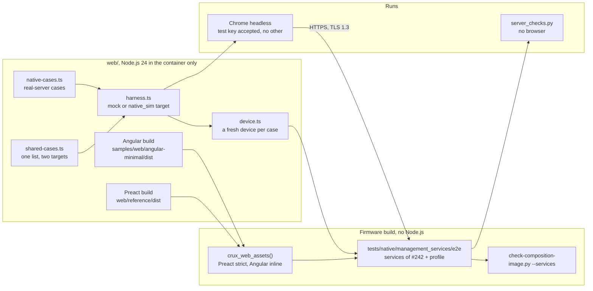
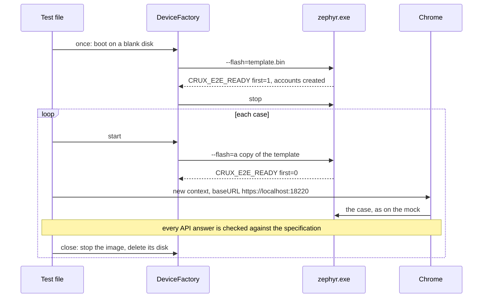
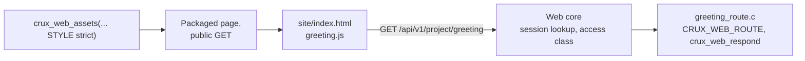

# The web examples end to end on `native_sim`

Status: for review under [Issue #220](https://github.com/wonny-labs/crux-pilot/issues/220), in a Draft PR. Host and
`native_sim` evidence only. **Nothing here ran on a board, and nothing here is device timing, memory or physical
evidence.** Measuring on RT1060-EVKB is separately approved and is not part of this work. Preact and Angular are examples,
and Crux promises no product-ready interface.

The Preact example and the Angular example are built, packaged through the asset packaging of #189 as a product would
package them, Preact under the strict setting and Angular under the inline style setting, into the services image of
#242, and driven over real HTTPS in Chrome with the same browser cases that run on the mock. Cases that only a real
server can show are added: TLS 1.3 only, no plain listener, policy and cache headers on every asset, hash routes with no
deep-link fallback, connection limits, the real session clock, the real `409` and `503`, and page load time.

## What is built, faked and untested

| Item | State | Evidence level |
| --- | --- | --- |
| The browser image, `tests/native/management_services/e2e` | **Built**: the services composition of #242 unchanged, with one example's folder, and a profile of accounts, roles, parameters and status items that mirrors the mock's data | `native_sim`, Mbed and Wolf: [results](#results) |
| The composition's profile hook, `crux_native_management_start_profile()` | **Built** in `tests/native/management_composition/composition`. `NULL` is the reference profile, so #185's, #186's, #242's and #263's images are unchanged. | Built in every image of this PR |
| The services, PSA providers, routes and listener | **Real**, as in #242: `check-composition-image.py --services` passes on each browser image, with exactly the 12 component routes and the folder's | `native_sim` |
| Accounts | **Declared test step**: the first account over serial, then five accounts with the mock's names and the mock's public test password, `newuser` reset by the administrator so that its change is forced | Named in results |
| Session idle limit | **Shortened for this image only**: 30 s, in place of the composition's 15 minutes, so that the real clock can end a session in a test | Declared in `CMakeLists.txt` |
| Response deadline | **The default, 3,000 ms**, in place of the services image's 1,500 ms, because the Angular script does not fit 1,500: [packaging](#packaging-both-examples) | Declared in `e2e.conf`, and a control in the runner |
| Offload shutdown | **Test-only shim**, `src/offload_shutdown.c`: the native socket offload has no shutdown, so the server's inactivity timer does nothing there. A copy of the shutdown part of #184's shim. | Measured with and without, [below](#connection-limits) |
| Listener certificate | **The declared test certificate** of #263, as in #242 | Chrome accepts its key alone, [below](#how-the-browser-trusts-the-test-certificate) |
| Configuration save | **No provider**, decision C6: a save fails with `not_supported`, and a network change gets `501` | The cases that need a successful save are skipped on `native_sim` and say why |
| Reboot | **Not in the image.** #214 is not merged (PR #290 in review). The reboot flow stays mock-only, and results say so. | Skipped with that reason |
| The small example project, `samples/web_project` | **Built**: a page and a project route through the public route contract, with no native header | Host: `Web.project_sample` |
| Firefox, Safari, Edge | **Not run.** Chrome only. | |
| Anything on RT1060-EVKB | **Not run, not compiled here** | |

## Structure

### One case on `native_sim`

Each case gets a fresh device, as each mock case gets a fresh mock. The configuration values are not saved, so every boot
starts from the defaults, and the copied disk restores the accounts, `newuser`'s forced change among them.

## The same cases on two targets

`web/e2e/shared-cases.ts` holds one list. With no target in the `AppConfig` it runs on the mock, as before. With a
`native_sim` target, `harness.ts` starts a device for each case and opens Chrome on it, and:

| What a case uses | On the mock | On `native_sim` |
| --- | --- | --- |
| `requests`, the requests the server saw | The mock's own record | Chrome's same-origin requests, with their headers |
| `expireSessions()` | The mock's control ends every session | The real clock: the case waits the idle limit and 2 s, and `GET` does not refresh it |
| `fixture`: texts on home, a token's fixed value, the least number of polls, whether a save can succeed | The mock's data | The image's data |
| `mock`, the control | Available | **Any use throws**, so a case that needs it and is not marked fails |
| Conformance of every API answer | The mock's answers | **Chrome's real answers**, checked with the same `mock/conformance.ts` against the specification |
| Result line | `target: mock` | `target: native_sim`, with the profile |

A case that needs something a target lacks names its need, and is skipped there with the reason in its result. Nothing is
passed by default.

| Need | Skipped on `native_sim` because | Cases |
| --- | --- | --- |
| `mock-control` | The case forces an answer through the mock's control. Where a real path exists, it is a case of its own [below](#cases-only-a-real-server-shows). | 20 |
| `configuration-provider` | A save that succeeds needs a Configuration provider, and this image has none (decision C6) | 4 |
| `reboot-service` | #214 is not merged and not in this image | 1, Preact |
| `no-configuration-provider` | Runs on `native_sim`, because there it is the real behaviour; on the mock its control sets it | Runs on both |

Changes to the existing cases, none of which weakens a mock assertion:

| Change | Why |
| --- | --- |
| `mock.control.requests` became `requests` | The mock's record on the mock, Chrome's on `native_sim` |
| A token compared with the literal `example-xsrf-token-not-real` is compared with the `XSRF-TOKEN` cookie's value, and on the mock also with that literal | A device draws a new token for each session |
| `polls.length >= 2` became `>= fixture.minPolls`, 2 on the mock | The mock answers pending once. A device may finish the derivation before the first poll. |
| `192.0.2.10` and `0.1.0-mock` became the fixture's texts | The device shows its own versions, and `net.ipv4` has no data on the offload |

## Cases only a real server shows

`web/e2e/native-cases.ts`, in Chrome, and `tests/native/management_services/e2e/server_checks.py`, with no browser.

| Case | Browser | No browser |
| --- | --- | --- |
| TLS 1.3 only | `securityDetails()` reads `TLS 1.3`, subject `localhost` | OpenSSL `-tls1_2` refused with `protocol version` alert 70; `-tls1_3` established and verified against the test certificate |
| No plain listener | | A plain `GET` on the port gets no HTTP answer. The image check finds one HTTP service, and `services.cmake` refuses `CONFIG_CRUX_WEB_PLAIN_HTTP_FOR_TESTS`. |
| Policy header on every asset | Each response of a cold load has the example's exact policy, `nosniff`, `no-referrer` | Every asset of the packager's hash list, with its bytes equal to the listed hash |
| Cache header | Fingerprinted names `max-age=31536000, immutable`, others `no-cache`, and both classes met | The same, by the hash list's class |
| Hash routes | `/config`, `/home`, `/network`, `/signin`, `/index.html/config`: `404`, no index; `/#/config` shows sign-in | The same and `/password`, `/reboot`; `/` serves the index |
| Load time | Three cold loads against the [declared budget](#load-time) | |
| A stalled handshake | A load beside a TCP connection that never starts its handshake | One and two stallers, then a request |
| Every client slot held | A load while three idle keep-alive connections hold the three slots | A fourth client behind three idle ones |
| The real `409` | Another client holds `PUT /api/v1/config/report_interval` with part of a body; the example's update meets the plain `409` and its retry goes through once the holder leaves | The plain `409`, no body, then `200` once freed |
| The real `503 busy` | Four uncollected login results fill the attempt table; the example shows the wait, and a later sign-in works once they expire | `503`, `{"code":"busy"}`, `Retry-After: 1` |
| The real session clock | Four shared cases, through `expireSessions()` | A session polled with `GET` every 5 s ends at 30 s |
| Network settings, Preact only | No running address on the no-op apply port; a change says nothing was saved, on the real `501` | |

## How the browser trusts the test certificate

Chrome starts with `--ignore-certificate-errors-spki-list` holding the base64 SHA-256 of the test certificate's public
key, which `device.ts` computes from `tests/native/tls_offload_probe/credentials/test-server.crt`. Chrome then accepts that
one key and refuses any other certificate. Nothing else turns certificate checking off: the Node.js client of
`native-raw.ts` and the Python client verify against the test certificate as their trust anchor, for the name
`localhost`, with TLS 1.3 as the minimum. Chrome runs headless, as root in the container, so Playwright starts it with
`--no-sandbox`, as earlier reviewers ran it.

## Packaging both examples

| Example | Setting | Files | Served, compressed | Largest asset | Fits 1,500 ms (49,152 B) | Fits 3,000 ms (98,304 B) |
| --- | --- | --- | --- | --- | --- | --- |
| Preact | `strict` | 4 | 23,103 | 21,290 | Yes | Yes |
| Angular | `inline` | 5 | 91,201 | 85,384, `main-W7U54RFG.js` | **No** | Yes |

The services image of #242 runs `CONFIG_CRUX_WEB_RESPONSE_DEADLINE_MS=1500`, shortened from #184, and at the declared
client rate of 32,768 B/s that allows 49,152 bytes for one asset. Angular's script is larger, so the packager refuses it
there. The browser image takes the default 3,000 ms instead, and the runner holds the finding with a control: packaging
Angular at 1,500 ms must fail, and at 3,000 ms must pass. **So the Angular example works once packaged at the default
deadline, and does not fit a deadline of 1,500 ms or less.** That gap belongs to the settings, not to the example, and needs
no issue.

## Load time

**Budget, declared before the first measurement**, from the server's own bounds:

| Bound | Value | Reason |
| --- | --- | --- |
| Each asset | Within 3,000 ms | The response deadline: no asset is cut |
| The page usable, the sign-in form shown | Within 10,000 ms of the navigation | The default inactivity timer, after which a waiting connection would be closed |

RESULT TABLE

## Connection limits

RESULT TABLE

## Results

RESULTS

## The small example project

`samples/web_project` adds a page and an API route of a project's own, with Crux's public contracts and no native
header.

| Part | What it uses | What it does not use |
| --- | --- | --- |
| `site/` | Plain HTML, one script and one style, loaded under the strict policy | No inline script or style, no other origin, no build tool |
| `src/greeting_route.c` | `<crux/web.h>`: `CRUX_WEB_ROUTE`, `CRUX_WEB_SESSION` and `crux_web_respond` | No Zephyr, board, vendor or adapter header |
| `reviewed-routes.txt` | One line for the route and one for the folder | |
| A composition | `crux_web_assets()` and the route source named to `crux_web_routes()` | No change to any component |

| Check | Level | Result |
| --- | --- | --- |
| `Web.project_sample`: the page and its assets served under the strict policy with `no-cache`, the route `401` with no session and `200` JSON with one, `405` for another method, `404` beside it and for a fragment path | Host, real core, fake transport, real Access logins | 33 checks, 0 failures |
| Mutation: the route made public | Host | Caught: `401` expected |
| Mutation: the body cut short | Host | Caught: body length |
| `tests/build/test_project_sample.py`: the sources include only `<crux/web.h>` and the C library, the route is reviewed, the page has no inline content, and each check refuses its mutation | Python | 5 tests pass |
| `native_sim` | Not run | The image check of the services image allows only the components' routes, so this route needs an image of its own, which is more than the issue's scope needs |

## Mutations of the new checks

| Mutation | Caught by |
| --- | --- |
| The other style's policy, a policy with no `frame-ancestors`, scripts with `'unsafe-inline'`, an added `data:` source, no policy | `test_e2e_server_checks.py` |
| A wrong cache class either way, a cache header of `max-age=60` | The same |
| No `nosniff`, no referrer policy, a lost encoding, other bytes, a `404` | The same |
| A plain listener answering HTTP | The same |
| A deep-link fallback: `200` with the index, `404` with the index, `200` empty | The same |
| TLS 1.2 accepted, no TLS 1.3, no verification | The same |
| An API answer with the asset policy, `no-cache`, no `nosniff` | The same |
| All five checks stubbed to pass | Red: 18 failures in 17 tests. Green after: 17 pass. |
| A case that uses the mock's control on `native_sim` without its mark | The harness throws |
| No offload shutdown: the inactivity timer does nothing | Real build: a fourth client's handshake timed out after 30 s behind three idle connections. With the shim: served in RESULT s. |

## Decisions for review

| # | Decision | Why | If changed |
| --- | --- | --- | --- |
| 1 | The browser image is a variant of the services image, in `tests/native/management_services/e2e`, with its composition unchanged and a profile hook added to the composition | The image check of #242 applies unchanged, and its test-code rule already allows that folder, so no protected check changes | A separate image folder, and the check's test-code rule widened |
| 2 | The accounts, parameters and status items mirror the mock's, so that the shared cases run unchanged | One list of cases on two targets, as the issue asks | A second, device-shaped list |
| 3 | A fresh device for each case, from a copied template disk | Each mock case gets a fresh mock, and several cases change state that a save cannot reset | One device for the file, with a reset route, which would be a test route in the image |
| 4 | The idle limit is 30 s in this image | The real clock must end a session within a test. Shorter would end sessions during slow emulated cases. | |
| 5 | The response deadline is the default 3,000 ms | Angular does not fit 1,500 ms | Keep 1,500 and record Angular as not packaged |
| 6 | The offload shutdown shim is copied, shutdown part only, into the image | Without it the inactivity timer does nothing on `native_sim`, and the limit cases would measure an offload artefact. The services image of #242 has the same gap, which no case of #242 met. | Use #184's whole shim, which carries probe code |
| 7 | Chrome accepts the test certificate by its key, not by `ignoreHTTPSErrors` | It accepts one key, so any other certificate still fails | |
| 8 | Cases that force an answer through the mock stay mock-only, and each real `409`, `503` and expiry is a case of its own | The real server produces them only under real conditions | |
| 9 | The load budget is the response deadline per asset and the default inactivity timer for the page | Declared from the server's bounds before measuring. A target budget needs the RT1060 run. | A product's own budget |
| 10 | The e2e modes join `scripts/test-native-composition.sh` as `e2e-mbed` and `e2e-wolf`, and no workflow runs them | The `psa-crypto` job has no pinned Node.js or Angular build, and adding them is a `.github` change that needs approval | A step in `psa-crypto.yml` with `setup-node`, or in `web.yml` with the west workspace |
| 11 | The small example project is tested on Host, not on `native_sim` | The services image's check allows only component routes, and the issue asks for the cheapest test that the precedents allow | Its own `native_sim` image |
| 12 | A lost browser is started again for the next case | A small container can kill Chrome for memory, and the case that met it has already failed | |

## Limits

| Limit | Seen as |
| --- | --- |
| Timing is an emulated amd64 container on an arm64 machine with other sessions running | Not device timing. The figures bound the server's behaviour, not a target's speed. |
| The native socket offload has no shutdown | A test-only shim, declared |
| No Configuration provider | Four shared cases and the save half of the network flow are not shown |
| Reboot | Mock-only until #214 merges |
| W1, #280, on Wolf | Not fixed. A new connection's first request is read up to about 1 s late. The Wolf slack of 2.5 s comes from #185 for that reason. |
| Chrome only | Firefox, Safari and Edge not run |
| The listener's certificate is the declared test certificate | Decision B of #284 is open |
| Entropy is test-only | Declared, and guarded as in #242 |
