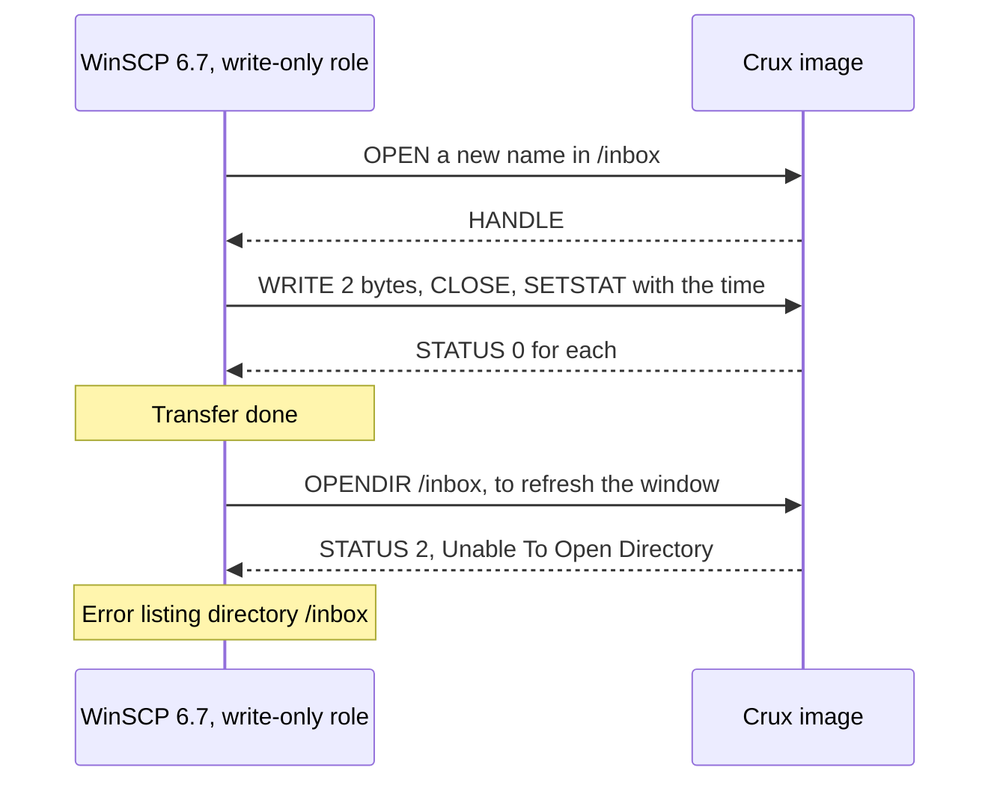
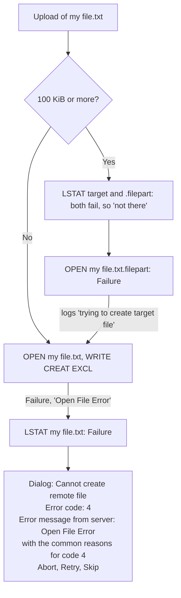

# SFTP: the recorded WinSCP runs (Issue #194)

Evidence record. These sections were moved without change of content from [the SFTP design](../sftp-design.md) (`## WinSCP`, at `f72a1e4`), so that the design keeps a summary and the operator table, and this record keeps what ran. Links that pointed into the design now name it. The logs and screenshots are not published: see the first section.

The summary and what WinSCP shows an operator are in [the SFTP design](../sftp-design.md#winscp). In the moved text, "the table above" is the table of WinSCP behaviours in that design, and "this document" is that design, not this record.

## The first run

**What ran.** WinSCP 6.7 (build 17845) on Windows 11, SFTP, against the `native_sim` SFTP image of `main` (`f15f69a`) over a network. The server had the test accounts `root` (administrator), `vera` (viewer, read-only), `dora` (dropper, write-only, sees only `inbox`), `audit` and `stan`, a limit of 1 MiB per file, 3 MiB per area and 16 entries per area, a RAM disk and test Access ports. Nothing ran on a board. WinSCP's own keepalive was off: the sampled TCP counters showed no packet for the first minutes of the quiet period (see row 12), and `Ping type: Off` is in logs A, B and C, which are other sessions with the same WinSCP configuration. A second, short run on the same image, with keepalive on, is described in [a second run](#a-second-run-with-keepalive-on).

| Evidence | What it covers |
| --- | --- |
| WinSCP 6.7 Debug 1 log, run of 7 November 2026, **log A** | The dropper uploads a 2-byte file to `/inbox` under a name that was already there. The log starts with the tail of an older session and has no earlier `OPEN` of that name. That the name existed rests on the tester's account and on the server log of the run, where an earlier dropper session shows a create event for the same name before the logged session |
| The same, **log B** | The administrator uploads a 2,077,166-byte file to `/data`, past the 1 MiB per-file limit. It ends at `Answer: Abort` |
| The same, **log C** | The dropper uploads a new 2-byte file to `/inbox` |
| The tester's report: what the WinSCP window showed, in screenshots and a chat report | Name refusals, read-only refusals, the dates, the buttons of the error window, that Reconnect works, and that the window kept working after the idle close. **Not a log** |
| Server-side records of the run | The server log (denial and create events, and session and worker-end lines, with no per-line times), a read-back of the stored files as the auditor, an owner-side monitor that polled every 5 s for an established connection to the SSH port, and TCP counters of that connection read inside the container with `ss` |
| The second run (keepalive on, limit 120 s): the owner-side monitor, TCP counters, the server log and the tester's chat report | See [a second run](#a-second-run-with-keepalive-on). **No WinSCP log was captured** |
| The author's investigation, kept as unpublished notes and summarised here | What was tried to reproduce the channel error, and how the code reads. See [the limit](../sftp-design.md#an-upload-past-the-per-file-limit-with-winscp) |

The logs and screenshots are held by the tester, and the notes by the author. **None is published**: the logs hold the tester's account, host and path names. So what this document says about them **rests on the author's reading, and a reader of this repository cannot check it against them**.

| Step | Run | Not run, or not recorded |
| --- | --- | --- |
| Administrator | Connect, list the root, enter an area, upload, download (content identical), rename, delete | A rekey, two clients at once |
| A name outside the rule | A name with a space, and a Korean name | The other characters that [the F4 section](#a-file-name-outside-the-rule-f4) names |
| Read-only role | Upload, rename and remove, all refused | Download, as that role (no file was reported) |
| Write-only role | List `/inbox` (refused), upload a new file, upload a name that exists | **Download and delete.** The role cannot list, so no file could be selected, and the path box could not be edited. A first upload of 100 KiB or more, which takes a different path in the source |
| Idle | One quiet connection, keepalive off, 900 s limit, measured by the owner-side monitor and TCP counters (no WinSCP log). A second run with keepalive on and a 120 s limit | **Still open for keepalive:** no WinSCP log for either run, the keepalive packets were not decoded, one run (two timed connections, and at least one more), one limit value (120 s) with keepalive on |
| Upload past the per-file limit | Twice, with the same result | A retry of the same upload, which would meet the partial file |

## Predicted and observed

Each prediction is from the table above, from the design, or from the rows named. "Matched" means that the run showed what the prediction said. It does not mean the cause was checked.

| # | Predicted | Observed | Verdict |
| --- | --- | --- | --- |
| 1 | Version 3 with no extensions, `REALPATH`, list the root, enter an area | As the administrator, all worked | Matched, from the tester's report |
| 2 | Upload, download, rename and delete work for the administrator | All four worked, and the downloaded content was identical | Matched, from the tester's report |
| 3 | From 100 KiB, `LSTAT` of the target and of `.filepart`, with a refusal read as "not there", then `OPEN` of the `.filepart` | Log B: both `LSTAT`s got status 4, "LSTAT error", and WinSCP went on to `OPEN` | Matched |
| 4 | A name outside the rule is refused as code 4, with the generic dialog | A space and Korean characters: `Error code: 4`, server text `Open File Error`, with WinSCP's generic list of common reasons. This is what the window showed, in the tester's report and screenshots, with server-side checks. No log is cited | Matched, from the tester's report |
| 5 | A read-only session's refusals are `FAILURE` | Upload, rename and remove: status 4, with `Open File Error`, `Rename File Error` and `Remove File Error`. One denial event each in the server log. The refusals are what the window showed, in the tester's report and screenshots. No log is cited | Matched, from the tester's report |
| 6 | The write-only role cannot list, and so cannot navigate | Logs A and C: `OPENDIR /inbox` got status 2, "Unable To Open Directory", and WinSCP showed `Error code: 2` | Matched |
| 7 | A write-only upload of a new file works, and `SETSTAT` is accepted | Log C: `OPEN` gets a handle, one `WRITE` gets 0, `CLOSE` 0, `SETSTAT` 0, and WinSCP logs `Transfer done`. The file is stored complete (read back as the auditor, server side). WinSCP sent `WRITE`, `CLOSE` and `SETSTAT` before the first answer came back | Matched |
| 8 | Not predicted: what WinSCP shows after that upload | It refreshes the directory, `OPENDIR /inbox` gets status 2, and WinSCP shows `Error listing directory '/inbox'` | **New**: see [below](#a-session-with-write-permission-alone) |
| 9 | An existing name: `EXCL` fails, `LSTAT` is tried, a failed `LSTAT` throws the first error (the row for existing files above) | Log A, as the dropper, for a name that the server log shows an earlier session had created: `OPEN` got status 4, "Open File Error", `LSTAT` of the file got status 4, "LSTAT error", and WinSCP reported `Cannot create remote file` with the `OPEN` error | Matches the sequence. **Why the `OPEN` was refused is not yet explained as a decision**: see [below](#a-session-with-write-permission-alone) |
| 10 | No times (F6). The text above this section said that the long name always says "Jan  1 00:00", and that sorting was suspect | Folders and the files in the `data` area show `30/12/1899` on the tester's screen. In logs A, B and C, folders carry `1899-12-30T00:00:00`, which is the zero of WinSCP's date type. `logs/boot.log`, in a read-only area, showed `03/01/0001`. No log lists a file or shows 0001, so that comes from the screenshots and the tester's report. **Why 0001 appears for that one file is not understood** | Matched (no time was sent). **How WinSCP shows it is new**: it is not "Jan  1 00:00" |
| 11 | Rights are never all set, so WinSCP does not read a link (decision 13) | `inbox`, which the write-only role sees, shows as `-wx------` (the listing in log A) | Matched |
| 12 | A quiet session ends at the idle limit | The connection ended 900 s after its last traffic. **Each time has its own source.** The close time, 12:59:02, was recorded by the owner-side monitor, which polled every 5 s whether an established connection to the SSH port existed and saw it disappear then. The server log has the matching session-end and worker-ended lines but **no time**. The last traffic, 12:44:02, was computed from the TCP counters of that connection (time since last send and receive, read with `ss` inside the container) at 12:44:53. **No WinSCP log shows the close or a re-login.** The tester reported that the window kept working after the next click, with no prompt. **No keepalive was sent, for the minutes sampled:** the counters were read every 10 s from 12:45:38 to 12:47:09, with packet counts unchanged and the time since last traffic growing steadily. For the rest of the 15 minutes the only support is `Ping type: Off` in the configuration of logs A, B and C. The close time alone could not have shown a keepalive, because this document claims that WinSCP's `REALPATH` keepalive does not refresh the idle timer | Matched on the server side, for the close. The silent re-login is **new**, and is from the tester's report. A second run with keepalive on is row 13 |
| 13 | A `REALPATH` keepalive does not refresh the idle timer | Run once, keepalive on (30 s, as the tester was instructed), limit 120 s: two timed connections of one run (and at least one more) each ended at the limit while packets reached the server about every 30 s. The packets were not decoded. See [a second run](#a-second-run-with-keepalive-on) | **Consistent, outcome only (server side).** Mechanism not shown by this run: the replay shows it |
| 14 | A write past the per-file limit gets "Write File Error", and the session goes on (the `WRITE` row and the limit row of the tables above) | The refusal came as predicted. **The session then ended**: [the limit](../sftp-design.md#an-upload-past-the-per-file-limit-with-winscp) | **Not matched** |
| 15 | Download and delete as the write-only role | Not run | **Not run** |

## A second run, with keepalive on

A second, short run on 7 November 2026, with WinSCP 6.7 and the same image and accounts. **Two things differ from the first run: keepalive was on, and the idle limit was lowered to 120 s.** Each fact has its own source. All times are UTC: the server log's times are UTC, and the monitor's local clock was GMT (the host's zone is GMT+0).

**Caveats on the setup.** The tester reported turning keepalive on. The menu entry (Advanced, Connection, "Executing dummy protocol commands") and the 30 s interval are as the tester was instructed, and no screenshot or log confirms them. The 120 s limit is the value written to the server's idle setting before a restart, which the server log records at 17:18:15. It is consistent with the ends seen 114 to 125 s after login.

| What | Source | Value |
| --- | --- | --- |
| An earlier short connection | The monitor, and the server log | Absent at 17:23:02, seen at 17:23:07, 17:23:13 and 17:23:18 with the counters unchanged at 1838 sent and 3036 received, absent at 17:23:23. The server log has `end of file` for it, so the client closed it. By the tester's account it was before keepalive was turned on (the monitor and the server log cannot show the setting), and **it is not part of the idle measure** |
| Login of the first timed connection | The owner-side monitor, polling every 5 s with `ss` inside the container, for a connection from the tester's machine | Last poll without it at 17:24:45, first poll with it at 17:24:50 |
| Packets on it | The TCP byte counters of that connection (the server's sent and received) | At 17:24:50: 1838 sent, 3036 received. Changes at 17:25:21 (1918, 3100), 17:25:47 (1998, 3164) and 17:26:18 (2078, 3228): each time 80 more sent and 64 more received, 26 to 31 s apart at 5 s sampling. Unchanged from 17:26:18 to 17:26:44 |
| End of the first timed connection | The monitor, and the server log, which has no times | Last poll with it at 17:26:44, first poll without it at 17:26:49. The server log has an access event with result -4, then "SSH worker ended: I/O callback would read block error" |
| Time from login to end | Computed from the rows above | 114 to 119 s after the 17:24:50 poll, and 114 to 124 s counting the 5 s window around the login: about 120 s |
| The second timed connection | The monitor | Absent at the 17:26:54 poll and first seen at 17:27:00, with a different remote port. Steps of 80 sent and 64 received at 17:27:31, 17:28:02 and 17:28:33, 26 to 31 s apart. Last poll with it at 17:28:54 (2158 sent, 3292 received), first poll without it at 17:28:59. Its login lies between the 17:26:54 and 17:27:00 polls, so it ended 114 to 125 s after login. The server log again has the result -4 event and the same "SSH worker ended" line |
| A third connection | The monitor, and the server log | Absent at 17:29:04, first seen at 17:29:09 with another remote port, and seen again at 17:29:14. **Monitoring stopped after 17:29:14, so its end time was not measured.** |
| The server log, final copy | The server log, which has no times | After the restart: one login that ended with `end of file` (the short connection), then four logins, each followed by the result -4 event and "SSH worker ended: I/O callback would read block error", then **a fifth login, closed by the client** (`end of file`). Its time is not known. In order, the four match the two timed connections, the third and a fourth that was not monitored. That order is the author's inference, and so is any link between the fifth login and the reconnection that the tester reported |
| What the tester saw | The tester's chat report. No screenshot, no time, and the message text was not captured | For the first timed connection: a message that the connection was lost, and a few seconds later it was connected again. Whether the others showed a message is not known. Later: another disconnect, after which the tester "waited 10 s and reconnected". What the 10 s was is not recorded |

What it shows, and what it does not:

- **With packets reaching the server about every 30 s, two timed connections of this run, one after the other, each ended about 120 s after login, at the lowered limit.** That fits the claim that WinSCP's `REALPATH` keepalive does not refresh the idle timer. **The replay `idle_session_ends_and_activity_does_not` is what shows that mechanism.** This run shows the same outcome with a real WinSCP. It does not prove the mechanism.
- **The packets were not decoded.** That they are WinSCP's keepalive is an inference from their size, their regularity (about 30 s) and the setting, and the setting itself is not confirmed.
- **No WinSCP log was captured for this run.** That WinSCP logged in again is inferred from the new connections, which the server log shows as logins as the same account. Whether WinSCP used stored credentials or prompted is not recorded.
- **The counters of the later connections are not understood.** Each was first seen at 1918 sent and 3100 received, which is 80 and 64 above the first login's 1838 and 3036, although it was seen within 6 s of its login (the poll before saw nothing). Why is not explained.
- **The two runs differ in more than one thing.** In the first run (keepalive off, 900 s) the tester reported that the window kept working on the next click, with no prompt. In this run (keepalive on, 120 s) the tester reported a connection-lost message and then a reconnection. Keepalive and the limit both differ, so **the difference is not attributed to either one**. Whether the tester was watching the window at the close in the first run is not recorded.
- It is two timed connections of one run (and at least one more), with one limit value.

## A session with write permission alone

Its `OPENDIR` is refused with `NO_SUCH_FILE`, and only the area itself answers `STAT` (`wire_a_write_only_session_cannot_list_or_stat`). WinSCP's window reads a directory to enter it, so **that role cannot navigate in the WinSCP window**, though it sees the area at the root. The run confirmed that (rows 6 to 8 above), and showed what an upload looks like:

- **The upload succeeded.** The error comes after `Transfer done`. A user can take it for a failed upload, and nothing in the window says otherwise: see [what WinSCP shows an operator](../sftp-design.md#what-winscp-shows-an-operator).
- **Three denials in the server log, one of them for the upload.** The server log showed three denials around one first upload by the write-only role: the listing of `/inbox` before it, wolfSSH's `stat` before `OPEN`, and WinSCP's directory refresh after it. The one denial that [the table of refusals](../sftp-design.md#each-refusal-and-its-event) gives for a successful write-only upload belongs to the upload itself, wolfSSH's `stat`. The other two come from WinSCP's directory reads. The breakdown is the author's inference, since the server log does not say which request caused each denial, and it is consistent with the design.
- **An upload by path was not run.** The run entered `/inbox` from the root and uploaded to it. The sequence above is what WinSCP sent.
- **A name that already exists is refused.** That the name existed is **not shown by log A**, which holds no earlier `OPEN` of it. The basis is the tester's account and the server log, where an earlier dropper session created the name before the logged session. Log A: `OPEN` got status 4, "Open File Error", and so did WinSCP's `LSTAT` of the file, since the role cannot read. The design says two things that fit: a new file below 100 KiB is opened with `WRITE`, `CREAT` and `EXCL` (the table above), and `EXCL` maps to `OPEN_DIRECT_EXCLUSIVE`, which the file service contract defines as "Stat, then `ERR_EXISTS` or create". So the refusal is what an exclusive create gives for a name that exists. **Two things are not established.** Debug 1 does not print the flags of an `OPEN`, so that WinSCP sent `EXCL` here is from its source, not from the log. And the reason the service gave for this refusal was not read from the server's events in this run. **This document does not say that a write-only role may not replace a file, so it is not claimed as a decision.** What the design does show is the consequence: WinSCP's way to an overwrite is `LSTAT`, a confirmation and `TRUNC`, and `LSTAT` is refused to this role. An upload of 100 KiB or more takes a different path in the source (`OPEN` of a `.filepart` with `TRUNC`, then `REMOVE` and `RENAME`) and was not run for this role. Whether a dropper should be able to replace a file is for the owner to decide if it matters.

## A file name outside the rule (F4)

Accepted decision F4 keeps the name rule, which allows **only `[A-Za-z0-9_.-]`, from 1 to 63 characters**. So a space is one case of many: parentheses, `+`, `,`, `~`, accented letters and Hangul all fail the same way, which covers ordinary names such as `report (1).pdf` and any name in Korean. WinSCP cannot upload such a file. From its source, with each request refused as shown in `winscp_name_with_a_space_is_refused_at_every_step`, for `my file.txt`:

- It sends nothing that a retry could change, and there is no automatic replacement: `ReplaceInvalidChars` applies to local names on download only (`CopyParam.cpp`, `ChangeFileName`).
- The way round it is a rename by the user, or a file mask in the transfer settings. Nothing about the dialog says that the name is the cause.
- The session goes on, so a batch with Skip continues with the next file.
- Each refused request records `file.name_rejected` with the area and no text, and the `OPEN` records it twice, because wolfSSH's `stat` before it counts too. See [the table](../sftp-design.md#each-refusal-and-its-event) for the sessions that record something else.
- Such a name that is already on the medium is foreign: it is not listed and cannot be fetched.
- The run confirmed the refusal for a space and for Korean characters (row 4 above). It did not try the other characters named in this section.

