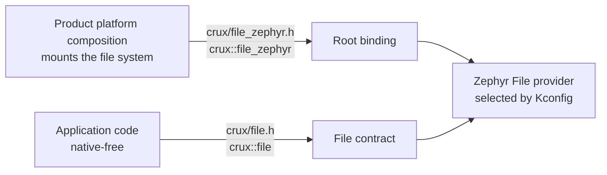

# File root binding: a composition interface for products

Status: **proposed**, software only. It adds a public CMake target and a header for the Zephyr File root binding. It changes no File behaviour and no portable contract, and it authorises no hardware operation.

## The gap

A product must bind a mounted directory to the File provider before File can be used. The binding functions were declared only in `components/file/ports/zephyr/file_native.h`, reachable only by adding the port's source directory as a private include path. Crux's own samples and tests did that. A product with a strict include boundary could not reach the binding at all, and the rules did not say how product composition code should reach it.

## What kind of interface this is

| | Portable contract | Composition interface (this document) |
|---|---|---|
| Header | `<crux/file.h>` | `<crux/file_zephyr.h>` |
| CMake target | `crux::file` | `crux::file_zephyr` |
| Used by | Application code | The product's platform composition, the code that also mounts the file system |
| Names a provider | No | Yes, on purpose |
| Portable to another provider | Yes | No: `crux_file_linux_bind_root` is its Linux counterpart in `file_linux.h` |
| Native header included | None | None |
| Stability | The contract's compatibility rules | Same naming and compatibility rules as any public Crux interface; the signatures are the ones that already existed |

File cannot be used without native code in the composition: Crux never mounts, formats or selects media, so the product's composition mounts the file system with Zephyr's own services and then binds the root. Binding is therefore composition work by nature. A public header makes that work reachable; it does not make it portable.

## What is built

| Change | Where |
|---|---|
| Public header with the three declarations and their ownership, lifetime, context and result documentation | `components/file/ports/zephyr/include/crux/file_zephyr.h` (new) |
| `file_native.h` now only includes that header, so the provider, tests and samples that use the old spelling keep working | `components/file/ports/zephyr/file_native.h` |
| Target `crux::file_zephyr`: an INTERFACE target that adds the include root and links `crux::file`; defined in each provider branch (RT1060 FatFs, Reliance Edge, simulators) | `components/file/ports/zephyr/CMakeLists.txt` |
| Two consumers moved to the public target, without the private include path: the microSD sample and the FatFs `native_sim` test | `samples/storage_sd`, `tests/native/file_fatfs` |
| Host tests | `tests/build/test_file_zephyr_public.py` |

## Decisions taken

| # | Decision | Why |
|---|---|---|
| 1 | The target and header keep `zephyr` in their names | A native-free consumer check rejects any target or path that names Zephyr. That is the intended result: the target is for composition code, and application code must not link it. A neutral name would hide the role. |
| 2 | The target does not link the provider library | The provider is selected by Kconfig and appended to the Zephyr link by the module. The target only gives the header, so a product that selects a provider through Kconfig does not pick a second one by linking. |
| 3 | Only the declarations that already existed are published | No new function, no rename. The Linux names stay in `file_linux.h`. |
| 4 | The private header stays | Renaming every user is a larger change with no consumer benefit. |
| 5 | Management and HTTPS composition are not covered | They need a separate design that also depends on the Zephyr TLS socket route and licence decisions of the owner. |

## What a consuming product needs to do

A product that wants a strict boundary for its application code needs a composition zone: a directory of its own that is allowed to include `<crux/file_zephyr.h>` and Zephyr headers, kept apart from application code. Crux does not decide a product's layout, and the boundary check of a product is the product's. This change gives that zone a stable way in.

## Verification and what is untested

| Check | Where | Status |
|---|---|---|
| Header compiles alone with only the File contract include root and pulls in no native header; the private header declares nothing a second time; the public path is unique; the target definition exposes only the include root | `tests/build/test_file_zephyr_public.py`, Host | run locally and in Host CI |
| Both moved consumers build with the target and without the private include path | Zephyr CI: `scripts/test-file-rt1060-compile.sh` (RT1060 compile check of the sample) and `scripts/test-storage-simulators.sh` (`native_sim`) | **not run locally** (Docker, disk); left to CI |
| A product repository builds against the target | not done; the first product consumer is the evaluation of this interface | open |
| Any run on a board | none | not authorised and not part of this change |
