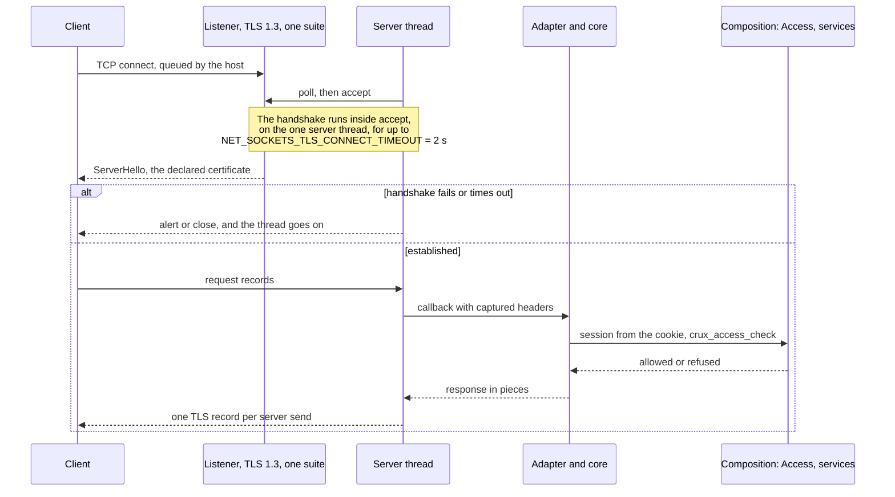
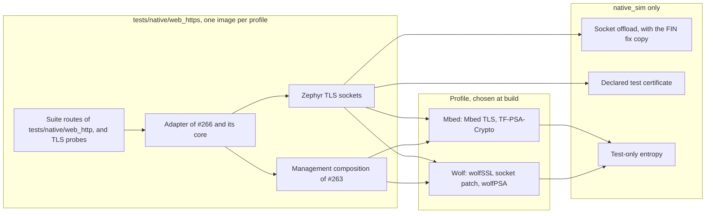

# HTTPS composition on the Wolf and Mbed TLS profiles

Status: merged in [PR #277](https://github.com/wonny-labs/crux-pilot/pull/277) for [Issue #185](https://github.com/wonny-labs/crux-pilot/issues/185). Host and
`native_sim` evidence only, an interim result by decision W18. **Nothing here ran on a board.** RT1060-EVKB results are
compile only, and the handshake time and memory on RT1060 stay open for a separately approved run.

Every timing below is a `native_sim` figure: the host's TCP stack through the native socket offload, the host's CPU
under amd64 emulation, on a loaded machine. It says nothing about a target.

## Acceptance criteria of #185

**Not every criterion is met.** Accepting this pull request with criterion 1 partly met and #280 open, or holding it until
W1 is explained, is the owner's decision, listed under [approvals needed](#approvals-needed).

| # | Criterion | State | Evidence |
| --- | --- | --- | --- |
| 1 | The same conformance suite passes on both profiles, on `native_sim` where the stack allows | **Met on Mbed. On Wolf one case stays open**, `deadline_then_silent_closes_before_inactivity`, on [W1](#w1-wolf-reads-a-new-connections-first-request-late), issue #280. The driver excuses only that case's "not closed within" assertion on Wolf. Any other failure fails the run. | [Suite](#the-conformance-suite-over-tls) |
| 2 | No plain HTTP listener or redirect in the reference configuration | Met on `native_sim`, both profiles | [Listener check](#no-plain-http-listener-and-no-redirect) |
| 3 | Handshake time and memory on RT1060-EVKB, with separately approved physical evidence | **Open.** Compile only. | Needs a separately approved run |
| 4 | A stalled TLS handshake measured and declared on both profiles | Met on `native_sim` | [Stalled handshake](#stalled-handshake) |
| 5 | Whether to halve the sends of a small response is decided | Decided, no, from measurements | [Sends](#sends-of-a-small-response) |
| 6 | `NET_SOCKETS_TLS_CONNECT_TIMEOUT` lowered and declared | 2,000 ms, proposed from `native_sim`. The target value needs criterion 3. | [Stalled handshake](#stalled-handshake) |

## What is built, faked and untested

| Item | State | Evidence |
| --- | --- | --- |
| The adapter of #266 over TLS, through Zephyr's TLS sockets | **Built** | `native_sim`, both profiles |
| Declared TLS profile: TLS 1.3 only, `TLS_AES_128_GCM_SHA256`, on both profiles | **Built**, set on the listener by the adapter | On the wire with OpenSSL's client, both profiles |
| `NET_SOCKETS_TLS_CONNECT_TIMEOUT` 2,000 ms whenever `CRUX_WEB` is on | **Built**, `zephyr/Kconfig` | Measured, both profiles |
| No plain HTTP listener and no redirect | **Built and checked** | Listener check from `/proc`, both profiles |
| The management composition of #263: real Access, store, events, status, configuration, PSA | **Composed**, `tests/native/web_https` | `native_sim` |
| Declared test certificate of #263 | **Declared test input**, in place of #190 | Named in results |
| First account | **Declared test step**, serial provisioning called directly, in place of #181 | |
| Session lookup and CSRF | **Faked in this image only.** A cookie names one of two real sessions that start logs in. #186 implements them, and the sessions run over HTTPS in [the services image](native-composition-242.md). | |
| The offload's FIN fix | **Test image only**: a build-local copy of the driver's host side | `native_sim`, with a control |
| Entropy, key confidentiality | **Test-only**, as [#242 declares](native-management-composition.md#declarations) | |
| Firefox 159.0.1 over TLS | **Run by hand** in the container, not in CI | `native_sim` |
| Results | Retained in [`docs/evidence/https-composition/`](evidence/https-composition/): from `4ed6eb9`, and `*-after-review.json` from `b9c9fbc` plus the review fixes that are in `b197d15` | |
| Wolf profile in CI | **Not run.** A default workflow must not fetch a GPL stack. | Local |
| RT1060-EVKB | Compile and link of `tests/zephyr/web_compile` with the declared profile: Mbed 197,364 B Flash and 209,856 B RAM, Wolf 336,836 B and 213,652 B, from the linker report, so RAM is configured and not used. Handshake time and memory not measured. | Compile |
| Safari, Chromium over TLS | Not run by #185. Chrome ran both examples over HTTPS later: [#220](e2e-native-220.md). Safari was never run. | |

## How a connection runs

## Declared TLS profile

The server asks its socket for `NET_IPPROTO_TLS_1_2`. #242 found that Mbed TLS reads that as a minimum and the wolfSSL
patch as exact, so the same source would give TLS 1.2 and 1.3 on Mbed and TLS 1.2 alone on Wolf. The adapter now
creates the listener itself, through the server's `socket_create` hook, with `NET_IPPROTO_TLS_1_3` and a cipher suite
list. Each accepted socket copies both. Nothing in the server is changed.

| Item | Mbed profile | Wolf profile | How it is held |
| --- | --- | --- | --- |
| Versions | TLS 1.3 | TLS 1.3 | `NET_IPPROTO_TLS_1_3`, a minimum on Mbed and exact on Wolf, so 1.3 alone on both |
| Cipher suites | `TLS_AES_128_GCM_SHA256` | `TLS_AES_128_GCM_SHA256` | `TLS_CIPHERSUITE_LIST` on the listener. RFC 8446 makes this suite mandatory for every TLS 1.3 client. |
| Key exchange groups | P-256 | P-256 and X25519 | What each library offers. Neither socket backend has a group option at this pin. |
| Certificate | Declared test certificate, P-256 ECDSA, `CN=localhost` | The same | `crux_native_management_tls_test_credentials` |
| Peer certificates | Not asked for | Not asked for | Server default, as the design says |
| Record size | 16 KiB in and out | wolfSSL's default | A browser may send 16 KiB records. See limit 6 of #242. |
| HSTS, redirect, plain listener | None | None | The listener check below |

### HelloRetryRequest on Mbed

Browsers send their first key share for X25519, and Chromium sends no P-256 share at all. The Mbed profile has no
X25519, so a browser reaches it only after a HelloRetryRequest for P-256. `case_tls_hello_retry` holds that path with
OpenSSL's client, which sends a share for its first group alone: X25519 first, P-256 second, and the Mbed profile
completes on P-256 while Wolf takes X25519 at once. **No browser test exercises it**: the Firefox check ran on Mbed and
passed, and its key shares were not recorded, so it may not have needed the retry.

### Checked on the wire

`https_driver.py` makes each handshake with `openssl s_client` 3.0.13, which offers exactly one version, suite or group
at a time, and checks that the accepted set equals the declared one.

| Offered | Mbed | Wolf |
| --- | --- | --- |
| TLS 1.0, 1.1, 1.2 | Refused, `protocol_version` alert | Refused, `protocol_version` alert |
| TLS 1.3 | Accepted, `TLS_AES_128_GCM_SHA256` | Accepted, `TLS_AES_128_GCM_SHA256` |
| `TLS_AES_256_GCM_SHA384`, `TLS_CHACHA20_POLY1305_SHA256`, `TLS_AES_128_CCM_SHA256`, `TLS_AES_128_CCM_8_SHA256` alone | Refused, `handshake_failure` | Refused, `handshake_failure` |
| P-256 | Accepted | Accepted |
| P-384, P-521, X448, ffdhe2048 | Refused | Refused |
| X25519 | Refused | Accepted, and chosen when a client offers it first |
| A client that trusts another certificate | Refuses the server | Refuses the server |
| X25519 first, P-256 second, a share for X25519 alone | Completes on P-256, after a HelloRetryRequest | Completes on X25519 |
| Python's client with defaults | TLS 1.3, `TLS_AES_128_GCM_SHA256`, the declared certificate byte for byte | The same |

Before the change, the same cases failed on the Mbed profile: TLS 1.2 was accepted with `ECDHE-ECDSA-AES128-GCM-SHA256`,
and a silent client held the next one for 9.96 s. That red run is retained, as `mbed-before-the-profile.json`.

## No plain HTTP listener and no redirect

| Check | Result, both profiles |
| --- | --- |
| Listening sockets of the image's process, from its descriptors and `/proc/net/tcp*` | One: port 18443. The offload binds IPv6 with IPv4 mapped when the image has both, so it shows in `tcp6`. |
| A plain HTTP request to that port | No byte of HTTP back and no `Location`, then the connection ends when the handshake fails |
| An image started with no certificate under the service's tag | The TLS layer refuses the tag, so **nothing listens** and a connect is refused. No fallback to plain text. |
| Build | `CRUX_WEB_PLAIN_HTTP_FOR_TESTS` depends on `BOARD_NATIVE_SIM`, the HTTPS image does not set it, and `scripts/test-web.sh https` fails if it does |

The listener check is a snapshot: it reads the image's sockets once, after the suite's cases and before the other TLS
cases. It does not watch for a listener opened and closed at another moment. The build checks above hold for all of it.

## The conformance suite over TLS

The 39 cases of `tests/native/web_http/test_driver.py`, the `native_sim` suite of #266, run against the HTTPS image
with each client wrapped in TLS. The driver changes only how a client connects, and an `ssl` end of stream reads as a
plain one. Then 14 more TLS cases run, the Firefox check when a browser is given, and two images that start apart.

| Part | Mbed | Wolf |
| --- | --- | --- |
| Suite cases unchanged | 37 of 37 | 36 of 37, and `deadline_then_silent_closes_before_inactivity` fails on [W1](#w1-wolf-reads-a-new-connections-first-request-late) |
| Suite cases replaced by a TLS variant, below | 2 of 2 | 2 of 2 |
| Other TLS cases, with `hello_retry` added after review | 14 of 14 | 14 of 14 |
| Separate images: no certificate, and the offload without the FIN fix, each now asserting | 2 of 2 | 2 of 2 |
| **Total, `scripts/test-web.sh https both` at `b9c9fbc` plus the review fixes that are in `b197d15`, without Firefox** | **55 of 55** | **54 of 55**, 1 excused on W1's assertion alone |
| Firefox, at `4ed6eb9`, not run again since nothing it uses changed | 1 of 1 | 1 of 1 |
| Earlier total at `4ed6eb9`, with Firefox | 55 of 55, of which `offload_fin_control` only recorded | 54 of 55 |
| CI, PSA workflow, Mbed profile, without Firefox | 53 of 53 at `8e506a2`, 54 of 54 at `0a06de0`, 55 of 55 at `b197d15` | Not run |

Two suite cases measure what one send costs when a reader stops, and that differs over TLS for a reason in the stack,
so the HTTPS driver runs a TLS variant in their place. It holds the same properties and records the mechanism.

| Case | Plain text on the offload | Over TLS | Variant holds |
| --- | --- | --- | --- |
| `slow_reader_small_responses` | Each send waits out its timeout and then goes through, so one small response costs up to about 21 timeouts: 10.2 s measured in #266 | The socket beneath TLS is non-blocking. The TLS layer waits once for room, up to `SO_SNDTIMEO`, then returns `-EAGAIN`, which stops the response. Largest stall 0.52 s on Mbed and 1.0 s on Wolf, with 4 sends returning `-EAGAIN` on each. | Another client waits at least 0.8 and at most 2 send timeouts, and a send returned `-EAGAIN` |
| `slow_reader_with_progress` | The response deadline cuts the response | Here a send's `-EAGAIN` cut it first on both profiles, 10,428 and 4,244 bytes read. On a fast CI runner the plain case passed: the deadline came first. | The response is cut, another client's wait stays within the bound, and one of the two stopped it |

The `-EAGAIN` path is the one #266 had to inject on plain text. Over TLS it happens of itself, and the stalled-reader
cases of the suite, which cover what follows it, pass.

## Negative handshakes

The next request after each case must come within a declared bound per profile: 0.5 s on Mbed, which measured 0.12 to
0.13 s, and 2.5 s on Wolf, a bound the size of [W1](#w1-wolf-reads-a-new-connections-first-request-late), declared
for that reason and to be narrowed when #280 is fixed.

| Case | Mbed | Wolf |
| --- | --- | --- |
| Bad version: a TLS 1.2 client | Refused, then the next request is served in 0.12 s | Refused, next request in 0.86 s, which is W1 |
| Bad cipher: TLS 1.3 offering only AES-256-GCM, or only ChaCha20 | Refused, next request in 0.12 s | Refused, next request in 0.83 and 0.92 s |
| No certificate | No listener, connect refused | No listener, connect refused |
| Untrusted certificate, client side | The client refuses | The client refuses |
| Abrupt close after a request, mid-handshake by FIN, mid-handshake by reset, mid-request | Each: CPU share 0.02 to 0.04 over the next 2 s, next request in 0.12 to 0.13 s. Four such closes, then three clients at once: all served in 0.15 s. | CPU share 0.02, next request in 0.90 to 1.02 s, which is W1. Three clients after four closes: 1.06 s. |

## Measurements and decisions

### Abrupt close and the CPU spin

#242 saw that the offload reports a peer's FIN as `POLLIN` alone, and that Mbed TLS reads the end of the stream as
"a partial record, try again". In `zvfs_poll` the TLS update then asks for another round while the offload's poll signal
stays raised, so `zsock_poll` with no timeout never returns. Python's `ssl` sends no `close_notify` on `close()`, nor do
many browsers, so this is the ordinary end of a connection.

| Run | Mbed | Wolf |
| --- | --- | --- |
| Control, `--no-rdhup`: the offload as it is, one client closes after a request | CPU share 0.63 over 3 s, from 0.02 idle, and **the next client is never served** | CPU share 0.03, from 0.03, and the next client is served in 1.03 s |
| With the fix, the same close | CPU share 0.02, next request in 0.12 s | CPU share 0.02, next request in 1.02 s |

The control is a case of its own, `offload_fin_control`, and it asserts what it shows: on Mbed a CPU share of at least
0.3 and the next client not served, so that the run fails if the limit stops holding and the copy can go; on Wolf the
next client served and a share under 0.5. At `4ed6eb9` it only recorded, and was counted in the totals all the same.

**The fix, test image only.** Zephyr's own TCP reports `POLLHUP` once the peer has closed (`sock_is_eof` in
`sockets_inet.c`), and the server closes a client on `POLLHUP`. `tests/native/web_https/nsos_rdhup.cmake` builds a copy of
the offload's host side, `nsos_adapt.c`, that also asks `epoll` for `EPOLLRDHUP` and reports it as `POLLHUP`: three
edits, each on an anchor that must occur once, after a SHA-256 check of the v4.4.2 file. The West checkout is not
edited, and the plain HTTP image keeps the driver as it is. **This is a `native_sim` limit, not a target one.** It is
worth offering upstream as a one-line change to the driver's map.

### Stalled handshake

The handshake runs inside `accept` on the server thread, on both backends. A client that connects and sends nothing, or
sends part of a ClientHello, holds every other client until the timeout.

| Case | Default 10 s, before | Mbed, 2 s | Wolf, 2 s |
| --- | --- | --- | --- |
| Silent client, then a request | 9.96 s on Mbed. #242 saw 9.6 and 9.5 s on both. | 1.93 s | 2.22 s |
| Half a ClientHello, then a request | | 1.94 s | 2.82 s |
| Two silent clients, then a request | | 3.97 s | 4.85 s |
| The staller | | Dropped by the server | Dropped by the server |

On Wolf each figure also holds up to about 1 s of [W1](#w1-wolf-reads-a-new-connections-first-request-late).

**Declared: `NET_SOCKETS_TLS_CONNECT_TIMEOUT` is 2,000 ms whenever `CRUX_WEB` is on.** Firefox's own timing puts its
handshake here at 45 ms on the Mbed profile and 53 ms on the Wolf profile, under emulation. The value is a proposal from
`native_sim`, for these reasons, until RT1060 evidence:

| Point | Reading |
| --- | --- |
| Compute on RT1060 | Not measured. From public figures for software P-256 on a Cortex-M7 at 600 MHz, an ECDHE and an ECDSA signature should take well under a second on Mbed TLS, and less with wolfSSL's assembly. This is an estimate, and the separately approved run must replace it. |
| Network | One TCP retransmission of 200 ms to 1 s still fits on a local network |
| A browser and a self-signed certificate | The browser aborts that handshake at once and shows its warning. The user's decision is not inside a handshake, and the browser connects again after it. |
| What it bounds | One stalled connection stops every client for at most 2 s, and a client can repeat it, as two stallers show. It is a bound, not a defence, as #268 says for trickled headers. |
| What else it bounds | The `configdefault` in `zephyr/Kconfig` applies to the whole image, so **every outbound TLS connect in an image with `CRUX_WEB` also fails after 2 s**, as a client's handshake does. No Crux component connects out over TLS today. A product that does sets the option itself. |

### Heap and the client limit

Each figure is read over a connection, so the step between rows is one connection.

**The retained JSON of `4ed6eb9` shows `per_client_bytes` 23,275 on Mbed and 3,520 on Wolf.** `5c3a2b5` corrected the formula, which divided by three a total that held the measuring connection too. The right figures are 34,912 and 5,280 B per connection, as below, and later results name the field `per_connection_bytes`.

| Measurement | Mbed: Mbed TLS's own buffer | Wolf: the C library's arena, which wolfSSL allocates from |
| --- | --- | --- |
| One, two and three established connections | 34,928, 69,840 and 104,752 B | 5,296, 10,576 and 15,856 B |
| One connection | 34,912 B: input and output buffers of 16 KiB | 5,280 B: wolfSSL grows its buffers to the records it meets, and these were small |
| Largest, with a handshake beside the held connections | 108,328 B: a handshake takes 3,576 B more | 21,888 B: a handshake takes about 6 to 11 KB more |
| A listener alone | Takes no session buffers | Takes no session buffers |
| A fourth client while three hold their slots | Waits in the host's backlog, since the server stops polling the listener at its limit, and is served when an idle client's slot frees: 3.07 s with the 3 s inactivity timer | 3.05 s |
| A client when the heap is full, by a probe that holds the rest of it | `accept` fails: the client's handshake ends in 12 ms with an end of stream, and no HTTP. The server goes on, and once the heap is free the next request takes 0.13 s. | The same in 11 ms, with a reset, after 254,976 B were held. Next request 0.12 s. |

**Declared for the Mbed profile: `MBEDTLS_HEAP_SIZE` = connections x 34,912 B + 3,576 B for one handshake, plus a margin
for the other PSA users.** For the three clients of `HTTP_SERVER_MAX_CLIENTS` that is 108,312 B, so 120,000 B stays, as
#242 chose, with about 11.7 KB for PSA work beside TLS. The figure is from a 64-bit host, and a 32-bit target's is
somewhat smaller. `tests/zephyr/web_compile/mbedtls.conf` now compiles RT1060 with this heap and 16 KiB records, in place
of the upstream sample's 60,000 B and 2 KiB, which would lose a browser's data.

**Wolf profile:** wolfSSL allocates through `malloc`. With the minimal C library, which the adapter needs for Zephyr's
`fnmatch`, that is the bounded arena of `COMMON_LIBC_MALLOC_ARENA_SIZE`, as on a target, so a limit applies here, unlike
in #242. The measured use is small because wolfSSL sizes its buffers to the records it meets. **A browser's 16 KiB record
would grow a connection's input buffer to about 16 KiB, which was not measured**, so the declaration is the RT1060
compile's 131,072 B arena until #197 measures the integrated image. By estimate, not measured, three connections at 16 KiB
records and a handshake need about 75 KB of it. `NET_SOCKETS_TLS_MAX_CONTEXTS` must hold the listener and the three clients, 4, and the images
keep 6.

### Sends of a small response

The question #184 left: pass the headers in one value, about 9 sends instead of about 21, since over TLS each send is
its own record. Measured on `/probe/raw/split` and `/probe/raw/joined`, two resources that bypass the adapter and send
the same five headers and body, over one kept connection, 60 requests each.

| Variant | Server sends, each a record | TCP sends | Median, Mbed | Median, Wolf | 90th percentile, Mbed and Wolf |
| --- | --- | --- | --- | --- | --- |
| Headers one by one, as now | 21 | 21 | 49.5 ms | 49.3 ms | 52.8 and 52.4 ms |
| Headers in one value | 9 | 9 | 49.7 ms | 49.8 ms | 51.6 and 52.8 ms |
| One by one, with `TCP_NODELAY` on the connection | 21 | 21 | 0.6 ms | 0.8 ms | 0.8 and 1.3 ms |

**Decision: do not halve the sends.**

| For halving | Against, and why it decides |
| --- | --- |
| 12 fewer records, about 264 B less on the wire per response in TLS 1.3 | The latency does not move: the 49 ms is Nagle's algorithm and the delayed acknowledgement, which `TCP_NODELAY` removes, not the number of sends |
| On plain text, the slow-reader bound would fall from 21 to 9 send timeouts | Over TLS the bound is already about one send timeout, because the first send that finds no room returns `-EAGAIN`: 0.52 s on Mbed and 1.0 s on Wolf with a 0.5 s timeout, measured above. HTTPS is the only reference configuration. |
| | It relies on the server writing a header value verbatim, CR LF included, which is a header injection path that a later server version may close, and it hides the other headers from the server's `Content-Type` check |

`TCP_NODELAY` is not set either: Nagle's effect on Zephyr's own TCP stack is not measured, and #197 sizes the integrated
image. If a target shows the same wait, it is one `setsockopt` per client in the adapter, and these figures support it.

### A real browser

Firefox 159.0.1 headless, in the same container as the image, over Marionette, by `https_driver.py --firefox`. Marionette
alone did not accept the self-signed certificate, `acceptInsecureCerts` read back false, so the driver writes the entry
that a user's "accept the risk" leaves in the profile, for `localhost:18443` and the certificate's SHA-256 fingerprint.
The test certificate is `CA:TRUE`, so it cannot be trusted as a server's certificate any other way.

| Check | Mbed | Wolf |
| --- | --- | --- |
| Handshake, Firefox's `connectEnd - secureConnectionStart` | 45 ms | 53 ms |
| Navigation, start of request to end of response | 53 ms | 543 ms, which is W1 |
| Protocol | `http/1.1` | `http/1.1` |
| Header capture over HTTPS, `POST` with the CSRF and poll headers | Cookie 113, Origin 23, Host 15, X-XSRF-TOKEN 43, X-Crux-Request 1, Content-Type 16, Content-Length 1 | The same |
| `GET` | No `Origin` | No `Origin` |
| Eight parallel requests through three slots | All `200` | All `200` |

Over HTTPS `Origin` is `https://localhost:18443`, 23 bytes, one more than over plain HTTP, and inside the 128 the capture
reserves. Chromium and Safari did not run here.

### W1: Wolf reads a new connection's first request late

Found here, measured, **not explained**. On the Wolf profile the server answers a new connection's first request late, by
up to about 1 s, and by about 1 s when the server has just closed another client. Nothing uses the CPU meanwhile, and a
kept connection's later requests are not affected. The Mbed profile shows none of it, on the same composition and
offload.

| Measured by `case_tls_request_after_a_close` | Mbed | Wolf |
| --- | --- | --- |
| A new connection's request, just after a client closed with `close_notify` | 0.13 s | 1.00 s |
| The same, after a client closed without it | 0.13 s | 1.01 s |
| A new connection 1.5 s after the last close | 0.13 s | 0.52 s |
| curl, 15 connections 0.05 s apart, time after its handshake | | 0.78 to 0.85 s each |

A packet capture shows the request arriving and the server silent until the answer, so the wait is in the image, not the
client. Five cheap explanations were ruled out: a CPU cost per connection, the offload's poll interval of 1 ms, data read
ahead during the handshake, the handshake loop's 100 ms wait, and the abrupt close. A system call trace is unreadable under
the emulation used here. It costs the suite one case, `deadline_then_silent_closes_before_inactivity`, whose deadline runs
from a first callback that W1 can delay, so the driver lists it as a known limit on Wolf: it still runs, its result is
recorded either way, and only its "not closed within" assertion is excused. Any other failure in it fails the run, with one
gap: when W1's assertion fires first, the case's two later checks, that the close sends nothing and that the route is
free again (`wait_route_free`, in `tests/native/web_http/test_driver.py`), do not run, so a close that sent data would be
masked in that run. That gap, and Wolf's next-request bound of 2.5 s, loose against the largest wait measured, about 1.0
to 1.07 s, are declared, and both go away when #280 is fixed. Whether W1 exists on a target, or with Zephyr's own TCP, is unknown. New issue
[#280](https://github.com/wonny-labs/crux-pilot/issues/280) tracks it.

## How a product applies the wolfSSL patch

#242 left this to #185. The patch's terms are not confirmed for storing in this public repository, as
[patches/zephyr/README.md](../patches/zephyr/README.md) and the provider decision record, so the choice is bounded by that.

| Option | Fit |
| --- | --- |
| A. A build-time copy, as `scripts/prepare-wolf-tls-zephyr.sh` and `scripts/test-web.sh` make for tests | Works for Host, `native_sim` and target compiles. Fetches the patch at a pinned revision and checks hashes. Not a product build: it downloads at build time. |
| **B. Recommended for a product: the product's own West manifest pins a Zephyr fork with the patch applied**, at the merged tree that `scripts/test-web.sh` checks, `1d00f38` | One reviewed commit, no download at build time, and the licence question stays with the product, which needs a commercial wolfSSL licence anyway |
| C. Zephyr's `west patch` with the patch in a product repository | Fine once its terms are confirmed. Crux cannot hold it here. |

**Decided here: A for every Crux check, and B recorded as the recommendation.** Nothing in this pull request adopts B,
because it is a product decision and the owner's.

## Limits found here

| # | Finding | Effect | Done |
| --- | --- | --- | --- |
| 1 | Over TLS a full socket gives `-EAGAIN` within one send timeout | The slow-reader bound of #266 is about one timeout per response over TLS, not about 21 | Variant cases, above |
| 2 | Nagle and the delayed acknowledgement cost about 49 ms per small response on the offload | A page of several requests feels slow | Recorded for #197 |
| 3 | With the minimal C library, `strpbrk`, `strcasecmp` and `strdup` are implicitly declared in the server and the offload at v4.4.2 | A pointer returned as `int` is cut to 32 bits on a 64-bit host. It works because the buffers are in low static memory. **The plain HTTP image of #266 has the same warnings.** | Recorded. A 32-bit target does not truncate. |
| 4 | Both the TLS 1.3 limit and the cipher list go through socket options that the server does not set | A product that wants other versions changes the adapter, under review | Declared |
| 5 | The Mbed profile in CI covers only one backend, since a default workflow must not fetch wolfSSL | Wolf results are local, as for #242 and #247 | |
| 6 | W1: on Wolf a new connection's first request is read up to about 1 s late | One suite case fails on Wolf, and every first request is slower | Measured, [above](#w1-wolf-reads-a-new-connections-first-request-late), issue #280 |
| 7 | Marionette did not accept the self-signed certificate with `acceptInsecureCerts` | The browser check writes the override a user's acceptance writes | Declared in the driver |

## Approvals needed

| # | Approval | Options |
| --- | --- | --- |
| A1 | **Criterion 1 with one case open on Wolf** | Accept the issue's software result as partly met with #280 open, or have W1 explained first |
| A2 | **TLS 1.3 only**, a security and compatibility decision, below | Keep TLS 1.3 only, the narrower choice and this pull request's default, or the alternative below |
| A3 | How a product applies the wolfSSL patch | [Above](#how-a-product-applies-the-wolfssl-patch) |
| A4 | A separately approved physical run | RT1060 handshake time, memory, and the connect timeout's target value, criterion 3 |

### TLS 1.3 only: who cannot connect

Current browsers, current curl and OpenSSL, WinSCP, Python and Go all have TLS 1.3. These clients do not, from their
published support, not tested here:

| Client | TLS 1.3 |
| --- | --- |
| Windows 10's SChannel, and so on Windows 10: Windows PowerShell 5.1 (`Invoke-WebRequest`), .NET Framework applications, and the inbox `curl.exe`, which uses SChannel | No. Windows 11 and Windows Server 2022 have it. |
| Java before 8u261 | No |
| Android before 10, and applications on its platform TLS | No |
| Embedded clients on old TLS stacks | Varies |

**Alternative:** TLS 1.2 and 1.3 on both profiles. On Mbed that is the server's own `NET_IPPROTO_TLS_1_2`, which Mbed
TLS reads as a minimum. On Wolf it needs the wolfSSL socket patch changed to use a method that allows both versions
with 1.2 as the minimum, which the patch does not offer at this pin. TLS 1.2 would then need its own declared suite,
`ECDHE-ECDSA-AES128-GCM-SHA256`. **This pull request keeps TLS 1.3 only, as the narrower choice**, until the owner decides.

## Decisions for review

| # | Decision | Why | If changed |
| --- | --- | --- | --- |
| 1 | TLS 1.3 only, on both profiles, pending approval A2 | `NET_IPPROTO_TLS_1_2` would give 1.2 alone on Wolf and both on Mbed. 1.3 is the one value that means the same on both, and every current browser has it. Some older clients cannot connect, [listed above](#tls-13-only-who-cannot-connect). A source check, `tls_profile_errors` in `scripts/check-web-boundary.py`, holds the version and suite, since a Mbed run cannot see their loss. | 1.2 and 1.3 on both, with a change to the wolfSSL patch |
| 2 | One suite, `TLS_AES_128_GCM_SHA256` | Mandatory in TLS 1.3, the only one the Mbed profile compiles, and the same on both | Add suites to the list, per profile |
| 3 | Groups are left to each library | No socket option exists at this pin. Both offer only elliptic-curve groups. | A patch, or library configuration |
| 4 | `NET_SOCKETS_TLS_CONNECT_TIMEOUT` 2,000 ms for every `CRUX_WEB` image, outbound connects included | Bounds the one-thread stall, with room for a slow handshake | Set from RT1060 evidence |
| 5 | The FIN fix is a build-local copy of the offload driver, in the HTTPS test image only | The spin is a `native_sim` limit, and the suite cannot run on Mbed without it. The checkout stays clean. | Offer it upstream, and drop the copy when it lands |
| 6 | The suite's two slow-reader cases have TLS variants, with the plain cases unchanged | The stack behaves otherwise over TLS, and the variants hold the same properties and the mechanism | |
| 7 | The composition's roles gain `network.read`, `network.write` and `app.pump.read` | The suite's routes use them, so the real Access core enforces the same rules as #266's double | A separate role table for this image |
| 8 | Sessions are a stand-in: a cookie names one of two real sessions | #186 implements sessions | Replaced by #186 |
| 9 | Do not halve the sends, and do not set `TCP_NODELAY` | Measured above | #197 with target figures |
| 10 | Mbed heap stays 120,000 B for three clients, by the formula above | Measured | Scale with `HTTP_SERVER_MAX_CLIENTS` |
| 11 | RT1060 compile configurations take the declared profile: TLS 1.3 and its suite, 16 KiB records, 120,000 B heap | A compile of the sample's settings would not be the profile this declares | |
| 12 | The wolfSSL patch: a build-time copy for checks, a pinned fork recommended for a product | Its terms keep it out of this repository | Owner's decision |
| 13 | On Wolf, `deadline_then_silent_closes_before_inactivity` is a known limit only for its "not closed within" assertion: it runs and is recorded, and any other failure in it fails the run. When that assertion fires first, the case's later checks, no data on the close and the route free again, do not run in that run. | W1 delays the first callback that its deadline runs from, by an amount that depends on timing | Removed when #280 is fixed, with Wolf's 2.5 s next-request bound |
| 14 | The Wolf arena is declared at the RT1060 compile's 131,072 B, not from a measurement at 16 KiB records | Only small records were measured | #197 |
| 15 | The no-certificate case expects no listener at all | The TLS layer refuses a tag with no credential, so the service does not start. That fails closed, and no plain fallback exists. | |

## What the later work builds on

Written when #186 to #197 were to come. #186, #187, #189 and #190 have merged, so the third column of their rows is history. The facts in the second column still hold.

| Issue | What it has now | What it had to do |
| --- | --- | --- |
| #186, login and sessions | An HTTPS image with the real Access core and the composition behind the adapter, `tests/native/web_https`, and a driver that runs any case over TLS: set `test_driver.TLS`. `https_authenticate` in `src/main.c` is the stand-in to replace. `Origin` over HTTPS is 23 bytes from Firefox. | Real session tokens, CSRF and `Origin` rules, the attempt worker |
| #189, assets | Over TLS a response stops at the first send that cannot finish within the send timeout, so a slow client gets a cut asset sooner than on plain text | Size assets and the response deadline together, as #266 said. Done in the [packager's budget](web-assets.md#budget-and-the-response-deadline), with no TLS run of its own. |
| #190, certificate model | The listener takes whatever certificate is under `CRUX_WEB_TLS_SEC_TAG`, and with none it does not listen at all | Put the stored key and certificate under that tag before `crux_web_start` |
| #197, integrated image | The declared heap formula, the client limit's backlog behaviour, and the Nagle figure | Measure them on RT1060 |
| #268, trickled headers | Each reconnect also costs a handshake on the server thread, bounded at 2 s | |

## Tests

| Command | Level | Covers |
| --- | --- | --- |
| `scripts/test-web.sh https mbedtls` | `native_sim` | Builds the HTTPS image on the Mbed profile, checks its configuration and symbols, runs `https_driver.py`. In CI, in the PSA workflow. |
| `scripts/test-web.sh https wolfssl` | `native_sim` | The same on a patched copy of Zephyr. Local only. |
| `CRUX_WEB_FIREFOX=<binary> scripts/test-web.sh https ...` | `native_sim`, by hand | Adds the Firefox check |
| `scripts/test-web.sh native` | `native_sim` | The plain suite, which keeps its Access double, with the driver's TLS off |
| `scripts/test-web.sh host` | Host | Now also checks the HTTPS image's route review list, the declared TLS profile in the adapter's source, and that check's own negative cases, `tests/build/test_web_tls_profile.py` |
| `scripts/test-web.sh target mbedtls`, `target wolfssl` | RT1060 compile | The declared profile's configuration compiles and links |
