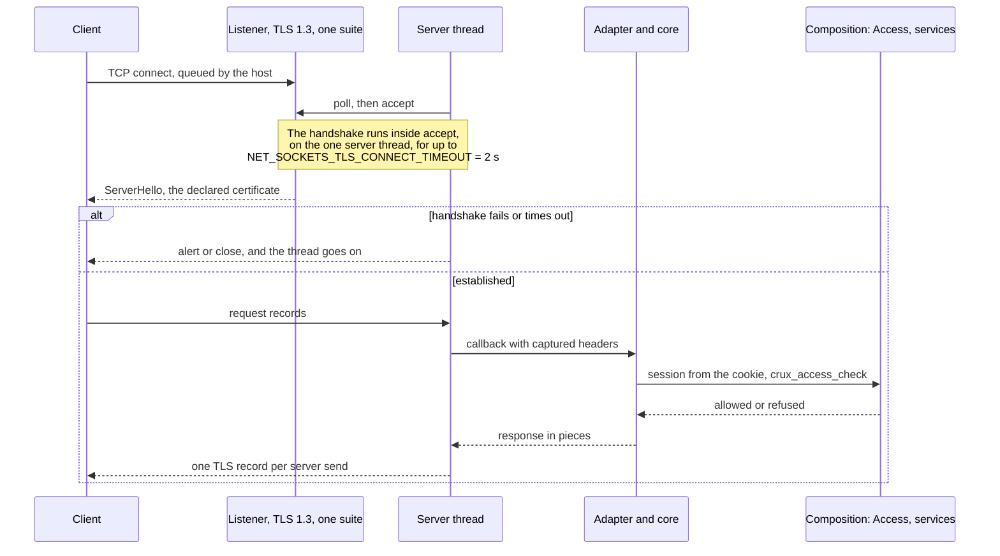
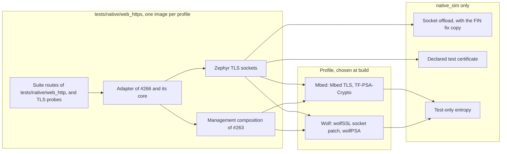

# HTTPS composition on the Wolf and Mbed TLS profiles

Status: for review under [Issue #185](https://github.com/wonny-labs/crux-pilot/issues/185), in a Draft PR. Host and
`native_sim` evidence only, an interim result by decision W18. **Nothing here ran on a board.** RT1060-EVKB results are
compile only, and the handshake time and memory on RT1060 stay open for a separately approved run.

Every timing below is a `native_sim` figure: the host's TCP stack through the native socket offload, the host's CPU
under amd64 emulation, on a loaded machine. It says nothing about a target.

## What is built, faked and untested

| Item | State | Evidence |
| --- | --- | --- |
| The adapter of #266 over TLS, through Zephyr's TLS sockets | **Built** | `native_sim`, both profiles |
| Declared TLS profile: TLS 1.3 only, `TLS_AES_128_GCM_SHA256`, on both profiles | **Built**, set on the listener by the adapter | On the wire with OpenSSL's client, both profiles |
| `NET_SOCKETS_TLS_CONNECT_TIMEOUT` 2,000 ms whenever `CRUX_WEB` is on | **Built**, `zephyr/Kconfig` | Measured, both profiles |
| No plain HTTP listener and no redirect | **Built and checked** | Listener check from `/proc`, both profiles |
| The management composition of #263: real Access, store, events, status, configuration, PSA | **Composed**, `tests/native/web_https` | `native_sim` |
| Declared test certificate of #263 | **Declared test input**, in place of #190 | Named in results |
| First account | **Declared test step**, serial provisioning called directly, in place of #181 | |
| Session lookup and CSRF | **Faked.** A cookie names one of two real sessions that start logs in. #186 implements them. | |
| The offload's FIN fix | **Test image only**: a build-local copy of the driver's host side | `native_sim`, with a control |
| Entropy, key confidentiality | **Test-only**, as [#242 declares](native-management-composition.md#declarations) | |
| Firefox over TLS | **Run by hand**, not in CI | `native_sim` |
| Wolf profile in CI | **Not run.** A default workflow must not fetch a GPL stack. | Local |
| RT1060-EVKB | Compile and link, both profiles. Handshake time and memory not measured. | Compile |
| Safari, Chromium over TLS | Not run | |

## How a connection runs

## Declared TLS profile

The server asks its socket for `NET_IPPROTO_TLS_1_2`. #242 found that Mbed TLS reads that as a minimum and the wolfSSL
patch as exact, so the same source would give TLS 1.2 and 1.3 on Mbed and TLS 1.2 alone on Wolf. The adapter now
creates the listener itself, through the server's `socket_create` hook, with `NET_IPPROTO_TLS_1_3` and a cipher suite
list. Each accepted socket copies both. Nothing in the server is changed.

| Item | Mbed profile | Wolf profile | How it is held |
| --- | --- | --- | --- |
| Versions | TLS 1.3 | TLS 1.3 | `NET_IPPROTO_TLS_1_3`, a minimum on Mbed and exact on Wolf, so 1.3 alone on both |
| Cipher suites | `TLS_AES_128_GCM_SHA256` | `TLS_AES_128_GCM_SHA256` | `TLS_CIPHERSUITE_LIST` on the listener. RFC 8446 makes this suite mandatory for every TLS 1.3 client. |
| Key exchange groups | P-256 | TBD-W | What each library offers. Neither socket backend has a group option at this pin. |
| Certificate | Declared test certificate, P-256 ECDSA, `CN=localhost` | The same | `crux_native_management_tls_test_credentials` |
| Peer certificates | Not asked for | Not asked for | Server default, as the design says |
| Record size | 16 KiB in and out | wolfSSL's default | A browser may send 16 KiB records. See limit 6 of #242. |
| HSTS, redirect, plain listener | None | None | The listener check below |

### Checked on the wire

`https_driver.py` makes each handshake with `openssl s_client` 3.0.13, which offers exactly one version, suite or group
at a time, and checks that the accepted set equals the declared one.

| Offered | Mbed | Wolf |
| --- | --- | --- |
| TLS 1.0, 1.1, 1.2 | Refused, `protocol_version` alert | TBD-W |
| TLS 1.3 | Accepted, `TLS_AES_128_GCM_SHA256` | TBD-W |
| `TLS_AES_256_GCM_SHA384`, `TLS_CHACHA20_POLY1305_SHA256`, `TLS_AES_128_CCM_SHA256`, `TLS_AES_128_CCM_8_SHA256` alone | Refused, `handshake_failure` | TBD-W |
| P-256 | Accepted | TBD-W |
| P-384, P-521, X448, ffdhe2048 | Refused | TBD-W |
| X25519 | Refused | TBD-W |
| A client that trusts another certificate | Refuses the server | TBD-W |
| Python's client with defaults | TLS 1.3, `TLS_AES_128_GCM_SHA256`, the declared certificate byte for byte | TBD-W |

Before the change, the same cases failed on the Mbed profile: TLS 1.2 was accepted with `ECDHE-ECDSA-AES128-GCM-SHA256`,
which is the red result recorded in the pull request.

## No plain HTTP listener and no redirect

| Check | Result, both profiles |
| --- | --- |
| Listening sockets of the image's process, from its descriptors and `/proc/net/tcp*` | One: port 18443. The offload binds IPv6 with IPv4 mapped when the image has both, so it shows in `tcp6`. |
| A plain HTTP request to that port | No byte of HTTP back and no `Location`, then the connection ends when the handshake fails |
| An image started with no certificate under the service's tag | The TLS layer refuses the tag, so **nothing listens** and a connect is refused. No fallback to plain text. |
| Build | `CRUX_WEB_PLAIN_HTTP_FOR_TESTS` depends on `BOARD_NATIVE_SIM`, the HTTPS image does not set it, and `scripts/test-web.sh https` fails if it does |

## The conformance suite over TLS

The 39 cases of `tests/native/web_http/test_driver.py`, the `native_sim` suite of #266, run against the HTTPS image
with each client wrapped in TLS. The driver changes only how a client connects, and an `ssl` end of stream reads as a
plain one. Then 14 TLS cases run, and two images start apart.

| Part | Mbed | Wolf |
| --- | --- | --- |
| Suite cases unchanged | 37 of 37 | TBD-W |
| Suite cases replaced by a TLS variant, below | 2 of 2 | TBD-W |
| TLS cases | 14 of 14 | TBD-W |
| Separate images: no certificate, and the offload without the FIN fix | 2 of 2 | TBD-W |

Two suite cases measure what one send costs when a reader stops, and that differs over TLS for a reason in the stack,
so the HTTPS driver runs a TLS variant in their place. It holds the same properties and records the mechanism.

| Case | Plain text on the offload | Over TLS | Variant holds |
| --- | --- | --- | --- |
| `slow_reader_small_responses` | Each send waits out its timeout and then goes through, so one small response costs up to about 21 timeouts: 10.2 s measured in #266 | The socket beneath TLS is non-blocking. The TLS layer waits once for room, up to `SO_SNDTIMEO`, then returns `-EAGAIN`, which stops the response. Largest stall 0.53 s on Mbed, with 4 sends returning `-EAGAIN`. | Another client waits at least 0.8 and at most 2 send timeouts, and a send returned `-EAGAIN` |
| `slow_reader_with_progress` | The response deadline cuts the response | A send's `-EAGAIN` cuts it first: 0 cut by the deadline, 1 by `-EAGAIN`, 10,430 bytes read | The response is cut, another client's wait stays within the bound, and one of the two stopped it |

The `-EAGAIN` path is the one #266 had to inject on plain text. Over TLS it happens of itself, and the stalled-reader
cases of the suite, which cover what follows it, pass.

## Negative handshakes

| Case | Mbed | Wolf |
| --- | --- | --- |
| Bad version: a TLS 1.2 client | Refused, then the next request is served in 0.12 s | TBD-W |
| Bad cipher: TLS 1.3 offering only AES-256-GCM, or only ChaCha20 | Refused, then served | TBD-W |
| No certificate | No listener, connect refused | TBD-W |
| Untrusted certificate, client side | The client refuses | TBD-W |
| Abrupt close after a request, mid-handshake by FIN, mid-handshake by reset, mid-request | Each: CPU share 0.01 over the next 2 s, next request in 0.11 to 0.12 s. Four such closes, then three clients at once: all served. | TBD-W |

## Measurements and decisions

### Abrupt close and the CPU spin

#242 saw that the offload reports a peer's FIN as `POLLIN` alone, and that Mbed TLS reads the end of the stream as
"a partial record, try again". In `zvfs_poll` the TLS update then asks for another round while the offload's poll signal
stays raised, so `zsock_poll` with no timeout never returns. Python's `ssl` sends no `close_notify` on `close()`, nor do
many browsers, so this is the ordinary end of a connection.

| Run | Mbed | Wolf |
| --- | --- | --- |
| Control, `--no-rdhup`: the offload as it is, one client closes after a request | CPU share 0.66 over 3 s, from 0.01 idle, and **the next client is never served** | TBD-W |
| With the fix | CPU share 0.01, next request in 0.11 s | TBD-W |

**The fix, test image only.** Zephyr's own TCP reports `POLLHUP` once the peer has closed (`sock_is_eof` in
`sockets_inet.c`), and the server closes a client on `POLLHUP`. `tests/native/web_https/nsos_rdhup.cmake` builds a copy of
the offload's host side, `nsos_adapt.c`, that also asks `epoll` for `EPOLLRDHUP` and reports it as `POLLHUP`: three
edits, each on an anchor that must occur once, after a SHA-256 check of the v4.4.2 file. The West checkout is not
edited, and the plain HTTP image keeps the driver as it is. **This is a `native_sim` limit, not a target one.** It is
worth offering upstream as a one-line change to the driver's map.

### Stalled handshake

The handshake runs inside `accept` on the server thread, on both backends. A client that connects and sends nothing, or
sends part of a ClientHello, holds every other client until the timeout.

| Case | Default 10 s, before | Mbed, 2 s | Wolf, 2 s |
| --- | --- | --- | --- |
| Silent client, then a request | 9.96 s on Mbed. #242 saw 9.6 and 9.5 s on both. | TBD-M | TBD-W |
| Half a ClientHello, then a request | | TBD-M | TBD-W |
| Two silent clients, then a request | | TBD-M | TBD-W |
| The staller | | Dropped by the server | TBD-W |

**Declared: `NET_SOCKETS_TLS_CONNECT_TIMEOUT` is 2,000 ms whenever `CRUX_WEB` is on.** A handshake here takes about
0.2 s for OpenSSL's client and TBD-F ms for Firefox, under emulation. The value is a proposal from `native_sim`, for these
reasons, until RT1060 evidence:

| Point | Reading |
| --- | --- |
| Compute on RT1060 | Not measured. From public figures for software P-256 on a Cortex-M7 at 600 MHz, an ECDHE and an ECDSA signature should take well under a second on Mbed TLS, and less with wolfSSL's assembly. This is an estimate, and the separately approved run must replace it. |
| Network | One TCP retransmission of 200 ms to 1 s still fits on a local network |
| A browser and a self-signed certificate | The browser aborts that handshake at once and shows its warning. The user's decision is not inside a handshake, and the browser connects again after it. |
| What it bounds | One stalled connection stops every client for at most 2 s, and a client can repeat it, as two stallers show. It is a bound, not a defence, as #268 says for trickled headers. |

### Heap and the client limit

| Measurement | Mbed | Wolf |
| --- | --- | --- |
| Heap of one established connection | 34,928 B, Mbed TLS's buffer with 16 KiB records both ways | TBD-W, from the C library's arena that wolfSSL allocates from |
| Three connections, and the largest during a handshake | 104,752 B, largest 108,328 B | TBD-W |
| A listener alone | Takes no TLS session buffers | |
| A fourth client while three hold their slots | Waits in the host's backlog, because the server stops polling the listener at its limit, and is served when an idle client's slot frees: 2.95 s with a 3 s inactivity timer | TBD-W |
| A client when the heap is full, by a probe that holds the heap | `accept` fails: the client sees the connection end during its handshake, in 12 ms, and no HTTP. The server goes on serving, and once the heap is free the next request takes 0.12 s. | TBD-W |

**Declared for the Mbed profile: `MBEDTLS_HEAP_SIZE` = connections x 34,928 B + 3,576 B for a handshake, plus a margin for
the other PSA users.** For the three clients of `HTTP_SERVER_MAX_CLIENTS` that is 108,360 B, so 120,000 B stays, as #242
chose, with about 11.6 KB for PSA work beside TLS. The figure is from a 64-bit host, and a 32-bit target's is somewhat
smaller. `tests/zephyr/web_compile/mbedtls.conf` now compiles RT1060 with this heap and 16 KiB records, in place of the
upstream sample's 60,000 B and 2 KiB, which would lose a browser's data.

**Wolf profile:** wolfSSL allocates through `malloc`. With the minimal C library, which the adapter needs for Zephyr's
`fnmatch`, that is the bounded arena of `COMMON_LIBC_MALLOC_ARENA_SIZE`, as on a target, so a limit applies here, unlike
in #242. TBD-W. `NET_SOCKETS_TLS_MAX_CONTEXTS` must hold the listener and the three clients: 4, and the image keeps 6.

### Sends of a small response

The question #184 left: pass the headers in one value, about 9 sends instead of about 21, since over TLS each send is
its own record. Measured on `/probe/raw/split` and `/probe/raw/joined`, two resources that bypass the adapter and send
the same five headers and body, over one kept connection, 60 requests each.

| Variant | Server sends | TCP sends | Median | 90th percentile |
| --- | --- | --- | --- | --- |
| Headers one by one, as now | 21 | 21 | 48.0 ms | 51.4 ms |
| Headers in one value | 9 | 9 | 47.0 ms | 51.7 ms |
| One by one, with `TCP_NODELAY` on the connection | 21 | 21 | 0.3 ms | 0.3 ms |

Wolf: TBD-W.

**Decision: do not halve the sends.**

| For halving | Against, and why it decides |
| --- | --- |
| 12 fewer records, about 264 B less on the wire per response in TLS 1.3 | The latency does not move: the 48 ms is Nagle's algorithm and the delayed acknowledgement, which `TCP_NODELAY` removes, not the number of sends |
| On plain text, the slow-reader bound would fall from 21 to 9 send timeouts | Over TLS the bound is already about one send timeout, because the first send that finds no room returns `-EAGAIN`, measured above. HTTPS is the only reference configuration. |
| | It relies on the server writing a header value verbatim, CR LF included, which is a header injection path that a later server version may close, and it hides the other headers from the server's `Content-Type` check |

`TCP_NODELAY` is not set either: Nagle's effect on Zephyr's own TCP stack is not measured, and #197 sizes the integrated
image. If a target shows the same wait, it is one `setsockopt` per client in the adapter, and these figures support it.

### A real browser

TBD-F

## How a product applies the wolfSSL patch

#242 left this to #185. The patch's terms are not confirmed for storing in this public repository, as
[patches/zephyr/README.md](../patches/zephyr/README.md) and the provider decision record, so the choice is bounded by that.

| Option | Fit |
| --- | --- |
| A. A build-time copy, as `scripts/prepare-wolf-tls-zephyr.sh` and `scripts/test-web.sh` make for tests | Works for Host, `native_sim` and target compiles. Fetches the patch at a pinned revision and checks hashes. Not a product build: it downloads at build time. |
| **B. Recommended for a product: the product's own West manifest pins a Zephyr fork with the patch applied**, at the merged tree that `scripts/test-web.sh` checks, `1d00f38` | One reviewed commit, no download at build time, and the licence question stays with the product, which needs a commercial wolfSSL licence anyway |
| C. Zephyr's `west patch` with the patch in a product repository | Fine once its terms are confirmed. Crux cannot hold it here. |

**Decided here: A for every Crux check, and B recorded as the recommendation.** Nothing in this pull request adopts B,
because it is a product decision and the owner's.

## Limits found here

| # | Finding | Effect | Done |
| --- | --- | --- | --- |
| 1 | Over TLS a full socket gives `-EAGAIN` within one send timeout | The slow-reader bound of #266 is about one timeout per response over TLS, not about 21 | Variant cases, above |
| 2 | Nagle and the delayed acknowledgement cost about 48 ms per small response on the offload | A page of several requests feels slow | Recorded for #197 |
| 3 | With the minimal C library, `strpbrk`, `strcasecmp` and `strdup` are implicitly declared in the server and the offload at v4.4.2 | A pointer returned as `int` is cut to 32 bits on a 64-bit host. It works because the buffers are in low static memory. **The plain HTTP image of #266 has the same warnings.** | Recorded. A 32-bit target does not truncate. |
| 4 | Both the TLS 1.3 limit and the cipher list go through socket options that the server does not set | A product that wants other versions changes the adapter, under review | Declared |
| 5 | The Mbed profile in CI covers only one backend, since a default workflow must not fetch wolfSSL | Wolf results are local, as for #242 and #247 | |

## Decisions for review

| # | Decision | Why | If changed |
| --- | --- | --- | --- |
| 1 | TLS 1.3 only, on both profiles | `NET_IPPROTO_TLS_1_2` would give 1.2 alone on Wolf and both on Mbed. 1.3 is the one value that means the same on both, and every current browser has it. | Mbed and Wolf could offer 1.2 and 1.3 only with a change to the wolfSSL patch, or 1.2 alone on both |
| 2 | One suite, `TLS_AES_128_GCM_SHA256` | Mandatory in TLS 1.3, the only one the Mbed profile compiles, and the same on both | Add suites to the list, per profile |
| 3 | Groups are left to each library | No socket option exists at this pin. Both offer only elliptic-curve groups. | A patch, or library configuration |
| 4 | `NET_SOCKETS_TLS_CONNECT_TIMEOUT` 2,000 ms for every `CRUX_WEB` image | Bounds the one-thread stall, with room for a slow handshake | Set from RT1060 evidence |
| 5 | The FIN fix is a build-local copy of the offload driver, in the HTTPS test image only | The spin is a `native_sim` limit, and the suite cannot run on Mbed without it. The checkout stays clean. | Offer it upstream, and drop the copy when it lands |
| 6 | The suite's two slow-reader cases have TLS variants, with the plain cases unchanged | The stack behaves otherwise over TLS, and the variants hold the same properties and the mechanism | |
| 7 | The composition's roles gain `network.read`, `network.write` and `app.pump.read` | The suite's routes use them, so the real Access core enforces the same rules as #266's double | A separate role table for this image |
| 8 | Sessions are a stand-in: a cookie names one of two real sessions | #186 implements sessions | Replaced by #186 |
| 9 | Do not halve the sends, and do not set `TCP_NODELAY` | Measured above | #197 with target figures |
| 10 | Mbed heap stays 120,000 B for three clients, by the formula above | Measured | Scale with `HTTP_SERVER_MAX_CLIENTS` |
| 11 | RT1060 compile configurations take the declared profile: TLS 1.3 and its suite, 16 KiB records, 120,000 B heap | A compile of the sample's settings would not be the profile this declares | |
| 12 | The wolfSSL patch: a build-time copy for checks, a pinned fork recommended for a product | Its terms keep it out of this repository | Owner's decision |

## What later issues can use

| Issue | What it has now | What it must still do |
| --- | --- | --- |
| #186, login and sessions | An HTTPS image with the real Access core and the composition behind the adapter, `tests/native/web_https`, and a driver that runs any case over TLS: set `test_driver.TLS`. `https_authenticate` in `src/main.c` is the stand-in to replace. `Origin` over HTTPS is TBD-F. | Real session tokens, CSRF and `Origin` rules, the attempt worker |
| #187, status and configuration APIs | The same image and driver, with the status and configuration services already started | Its routes, and fitting a status response in 4 KiB |
| #189, assets | Over TLS a response stops at the first send that cannot finish within the send timeout, so a slow client gets a cut asset sooner than on plain text | Size assets and the response deadline together, as #266 said |
| #190, certificate model | The listener takes whatever certificate is under `CRUX_WEB_TLS_SEC_TAG`, and with none it does not listen at all | Put the stored key and certificate under that tag before `crux_web_start` |
| #197, integrated image | The declared heap formula, the client limit's backlog behaviour, and the Nagle figure | Measure them on RT1060 |
| #268, trickled headers | Each reconnect also costs a handshake on the server thread, bounded at 2 s | |

## Tests

| Command | Level | Covers |
| --- | --- | --- |
| `scripts/test-web.sh https mbedtls` | `native_sim` | Builds the HTTPS image on the Mbed profile, checks its configuration and symbols, runs `https_driver.py`. In CI, in the PSA workflow. |
| `scripts/test-web.sh https wolfssl` | `native_sim` | The same on a patched copy of Zephyr. Local only. |
| `CRUX_WEB_FIREFOX=<binary> scripts/test-web.sh https ...` | `native_sim`, by hand | Adds the Firefox check |
| `scripts/test-web.sh native` | `native_sim` | The plain suite, which keeps its double and the unmodified driver |
| `scripts/test-web.sh host` | Host | Now also checks the HTTPS image's route review list |
| `scripts/test-web.sh target mbedtls`, `target wolfssl` | RT1060 compile | The declared profile's configuration compiles and links |
