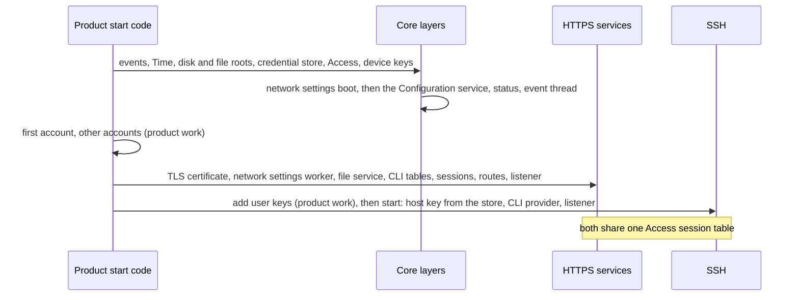

# Secure management in a product

Status: a guide for a product team that uses Crux as a west module and wants HTTPS web management, the SSH command line and SFTP, without reading the code. It adds no behaviour and no decision. Each statement cites a document or a file, and says whether it is **real**, **faked** or **untested**. It was written against `origin/main` at `e1023e7`.

**Nothing in this guide has run on a board.** Every result is Host, `native_sim` or a compile for RT1060-EVKB. `native_sim` uses the host's TCP stack and a test entropy source, so a result there shows that protocols and algorithms run, and not that anything is fast, small or safe on a device. See [what "real" means on `native_sim`](psa-crypto-design.md#what-real-means-on-native_sim).

The terms are in [the glossary](management-glossary.md). How to read the tables:

| Word | Meaning here |
| --- | --- |
| **Real** | The code that a product links ran, with real cryptography and a real client, on `native_sim`. |
| **Host** | Ran in a Host test, usually on fakes of the layers around it. |
| **Faked** | A test double stands in. A product must supply the real thing. |
| **Untested** | No run exists. |
| **Not built** | The code does not exist. |
| "must" | The build or the program enforces it. A product team cannot choose otherwise without changing Crux. |

## What you get, and what is not built

| Part | What it gives a product | Evidence | Where |
| --- | --- | --- | --- |
| Access core | Accounts, roles, permissions and sessions that every channel shares. 8 session slots, slot 0 reserved for serial. | Real on `native_sim` with the PSA ports. Host on fakes. | [Access contract](access-contract.md) |
| Credential store | Accounts, device keys and certificates in two sealed slots. Protection basis is a device ID, and the store is **not confidential**. | Real on `native_sim`. Entropy is test-only there. | [Credential store](credential-store.md) |
| Security events | Bounded records of management activity, through Logging. No persistence. | Real on `native_sim`. | [Security event contract](security-event-contract.md) |
| HTTPS adapter | The Zephyr HTTP server behind a route table with a mandatory access class. TLS 1.3 only, one suite, no plain listener. | Real on `native_sim`, both TLS profiles. | [HTTPS composition](https-composition.md), [web contract](web-contract.md) |
| Login, sessions, CSRF and `Origin` checks | Cookie sessions, a synchronizer token, `Origin` verification and a custom header on the login poll. | Real over HTTPS on `native_sim`. | [Web session](web-session.md) |
| Status, configuration, account routes | `GET /api/v1/status`, the configuration list, read, update and save. | Real over HTTPS on `native_sim`. A configuration save has no provider, so none succeeds. | [Management APIs](web-management-apis.md) |
| Network settings routes | `GET` and `PUT /api/v1/network`. | Real over HTTPS on `native_sim` with a no-op apply port. Nothing is applied to an interface, and nothing can be saved. | [Network settings](network-settings-service.md) |
| Reboot routes | `GET` and `POST /api/v1/system/reboot`. | **Host only. No image composes it**, and nothing calls a real reset. | [Reboot service](reboot-service.md) |
| Packaged web assets | A built frontend folder, compressed, hashed and served as public `GET` routes, with a content policy and a size budget. | Real on `native_sim`. Chrome loaded both examples over HTTPS. | [Web assets](web-assets.md) |
| TLS certificate model | A P-256 key and a self-signed certificate made at first boot, requests, and checked uploads. | Real on `native_sim` on both PSA providers. **The listener of every `native_sim` composition still serves the declared test certificate**, whose key is public. The RT1060 bench image registers a generated one in code that is compile-only: the image refuses to start and has not run on a board. | [TLS certificate](tls-certificate.md) |
| Command line, serial | Registry, login, first-account setup `!setup`. | Host. The serial console is **composed in no image**. LPUART3 wiring compiles for RT1060-EVKB. | [Command line contract](cli-contract.md) |
| Command line over SSH | `shell` and `exec` entry points on the wolfSSH provider. | Real on `native_sim` with OpenSSH 9.6. | [Command line over SSH](cli-over-ssh.md), [integrated image](ssh-integrated-image.md) |
| SFTP | File transfer on the file service, direct writes only, no times. | Real on `native_sim` with OpenSSH 9.6. Two recorded WinSCP 6.7 runs. | [SFTP design](sftp-design.md) |
| Example frontends | A Preact and an Angular example, and a mock server. Examples, not a product interface. | Mock in CI. Chrome over HTTPS on `native_sim`. | [Web guide](../web/README.md), [end to end](e2e-native-220.md) |

What is **not built**, and so is the product's work or an open decision:

| Item | State | Where it is tracked |
| --- | --- | --- |
| **Host key holding.** The provider borrows the key's bytes until `stop()`. | The test images keep it in a static buffer that is never wiped. A product must define how to hold and wipe it. There is no command to replace the key or to print its fingerprint. | [wolfSSH provider](ssh-wolf-provider.md) decision 24, [integrated image](ssh-integrated-image.md#the-test-image-declaration) |
| **First account.** | The test images provision it in code. The serial `!setup` loop exists on Host, and the serial console is composed in no image. **A product creates its first account in that serial setup step, from a password a person types, with nothing in the image.** The RT1060-EVKB bench image instead embeds a password from a file as plaintext, a test form accepted under its bench declaration only. | [Command line contract](cli-contract.md), [bench first account](rt1060-bench-first-account.md#what-a-product-does-instead) |
| **User key registration.** | No command or web route registers an SSH user key. Only test code calls `crux_access_account_add_key`. | [Issue #318](https://github.com/wonny-labs/crux-pilot/issues/318) |
| **Certificate registration.** | No composition registers the device certificate with the listener, and no web route exists for it. No decision about how a product does this is recorded. | [TLS certificate](tls-certificate.md) (status line, and "Registration with Zephyr's TLS credentials") |
| **A frontend.** | The product builds its own. Crux serves a built folder. | [Web guide](../web/README.md) |
| **Interface binding.** | Which interface a listener binds is the composition's. Both listeners can be bound to one IPv4 address: `CONFIG_CRUX_WEB_BIND_ADDRESS` and `CONFIG_CRUX_SSH_BIND_ADDRESS`, empty by default, which keeps every address. The RT1060-EVKB bench image sets both. Zephyr's HTTP server falls back to every address for a text that is not an address, so a composition that sets it checks the text. | [Integrated image](ssh-integrated-image.md#what-a-consumer-uses-and-what-is-test-only), [RT1060 report](rt1060-management-image-feasibility.md#listeners-d10) |
| Persisting a configuration or network change | No provider until Issue #16. A save answers `not_supported`. | [Management APIs](web-management-apis.md) |
| `GET /api/v1/events`, web file upload and download, a browser console | Not built. | [Security event contract](security-event-contract.md), [Issue #188](https://github.com/wonny-labs/crux-pilot/issues/188), [Issue #204](https://github.com/wonny-labs/crux-pilot/issues/204) |
| A board | Nothing ran on one. | Every document above |

## Steps

The numbers follow the order of a first integration. Steps 1 to 3 are the same for HTTPS and SSH.

1. **Import Crux and fetch the optional stacks.** Import `crux-pilot` in your west manifest, as the [product template](../templates/product/west.yml) does, and enable the group that holds the TLS and SSH libraries: `west config manifest.group-filter -- +crux-secure-management`, then `west update`. The group is off by default. See [product composition](product-composition.md).
2. **Choose a TLS profile.** The Mbed profile gives HTTPS only. The Wolf profile gives HTTPS and SSH, because wolfSSH needs wolfSSL, and `CONFIG_CRUX_SSH` is refused with Mbed at configuration. The Wolf profile also needs a Zephyr patch for its TLS socket backend that this repository does not store, and the route a product takes is an open owner decision (option B, a Zephyr fork in your own manifest, is recommended): [HTTPS composition](https-composition.md#how-a-product-applies-the-wolfssl-patch). The public wolfSSL and wolfSSH are offered under GPL-3.0-or-later or a commercial licence: [product composition](product-composition.md), licence bullet.
3. **Set the Kconfig symbols.** The table [below](#kconfig) lists the web and SSH symbols that Crux defines. `zephyr/Kconfig` has others, such as `CRUX_CLI` and `CRUX_DEVELOPMENT_IMAGE`, which the command line contract describes. The network, TLS credentials, PSA and file system symbols come from the profile files that the test images use, which are the reference: [`tests/native/management_composition/profile-psa.conf`](../tests/native/management_composition/profile-psa.conf), [`tests/native/web_https/mbed.conf`](../tests/native/web_https/mbed.conf) or [`wolf.conf`](../tests/native/web_https/wolf.conf), and [`tests/native/management_services/prj.conf`](../tests/native/management_services/prj.conf). **For SSH** the reference list is the one in [`tests/native/management_ssh/CMakeLists.txt`](../tests/native/management_ssh/CMakeLists.txt): it adds [`tests/native/tls_offload_probe/wolf.conf`](../tests/native/tls_offload_probe/wolf.conf) and [`components/ssh/ports/zephyr/wolf-ssh.conf`](../components/ssh/ports/zephyr/wolf-ssh.conf). The module refuses `CONFIG_CRUX_SSH` unless `CONFIG_WOLFSSH_SETTINGS_FILE` is `crux_wolfssh_settings.h`, which `wolf-ssh.conf` sets.
4. **Name the routes and the frontend in CMake.** See the snippet below.
5. **Write the composition.** Start the layers in the [boot order](#boot-order). A product writes this code. The test composition is [`tests/native/management_composition/composition`](../tests/native/management_composition/composition), and it is **test-only**: it refuses to build outside a declared `native_sim` test image.
6. **Provide what is not built**: the host key, the first account, user keys, the certificate, the frontend, the interface binding. See the table above.
7. **Review the route list.** `crux_web_routes(... REVIEWED <file>)` fails the build for a public or session-only route that is not on your reviewed list. Start from [`components/web/reviewed-routes.txt`](../components/web/reviewed-routes.txt), and add the one line `public GET @assets` if you package a folder, as [`tests/native/management_services/reviewed-routes.txt`](../tests/native/management_services/reviewed-routes.txt) does.

The snippet below shows the Crux part of a product's `CMakeLists.txt` and `prj.conf`. `CRUX_DIR` is the directory of the `crux-pilot` project in your workspace, and the product sets it. The test images compute their own from the location of their `CMakeLists.txt`.

```cmake
# CMakeLists.txt of the product, after find_package(Zephyr) and project()
include(${CRUX_DIR}/cmake/CruxWebAssets.cmake)
include(${CRUX_DIR}/cmake/CruxWebRoutes.cmake)

# The module does not include these files for you: a product's CMake must, as the test composition does
# in tests/native/management_composition/composition/services.cmake. Each sets the variables below.
include(${CRUX_DIR}/components/web/session/sources.cmake)
include(${CRUX_DIR}/components/web/management/sources.cmake)

# The route sources of the Crux services you compose. Leave out a service to leave out its routes.
set(route_sources
    ${CRUX_WEB_SESSION_ROUTES}               # session routes, including the password change, 5
    ${CRUX_WEB_MANAGEMENT_ROUTES}            # status and configuration, 5
    ${CRUX_WEB_MANAGEMENT_NETWORK_ROUTES}    # network settings, 2
    # ${CRUX_WEB_MANAGEMENT_REBOOT_ROUTES}   # reboot: composed in no image yet
    src/my_routes.c)                         # your own CRUX_WEB_ROUTE() uses
target_sources(app PRIVATE ${route_sources})

# Your built frontend folder, with index.html at its top. Call it before crux_web_routes().
crux_web_assets(app FOLDER ${CMAKE_SOURCE_DIR}/frontend/dist STYLE strict)
crux_web_routes(app SOURCES ${route_sources} ZEPHYR_RESOURCES REVIEWED ${CMAKE_SOURCE_DIR}/reviewed-routes.txt)

# SSH, Wolf profile only (CONFIG_CRUX_SSH=y). It builds the entry points, the file port and the provider.
include(${CRUX_DIR}/components/ssh/ports/zephyr/wolf_ssh_settings.cmake)
crux_ssh_wolf_settings()
```

```kconfig
# prj.conf of the product: only the symbols that Crux defines. The rest comes from the profile files.
CONFIG_CRUX_WEB=y
CONFIG_CRUX_WEB_PORT=443

CONFIG_CRUX_SSH=y            # Wolf profile only
CONFIG_CRUX_SSH_CLI=y
CONFIG_CRUX_SSH_SFTP=y
CONFIG_CRUX_SSH_PORT=22
```

**The snippet is not complete.** The route sources also need their `CRUX_WEB_SESSION_SOURCES`, `CRUX_WEB_SESSION_PSA_PORT`, `CRUX_WEB_MANAGEMENT_SOURCES` and `CRUX_WEB_MANAGEMENT_NETWORK_SOURCES` added to `app`, the adapter linked, and the services started, which `services.cmake` and `crux_native_management_services.c` show for the test image. A product writes this part.

**Which snippets were compiled or run.** None was compiled or run as written. The names and arguments were checked by reading `cmake/CruxWebAssets.cmake`, `cmake/CruxWebRoutes.cmake`, `components/ssh/ports/zephyr/wolf_ssh_settings.cmake`, `zephyr/Kconfig`, the `sources.cmake` files that set the four `CRUX_WEB_*_ROUTES` variables, and the two test images `tests/native/management_services` and `tests/native/management_ssh`, which use the same calls and ran. A product's own paths, `src/my_routes.c`, and a product build were **not** tried. No Dev Container and no west build ran for this guide.

## Boot order

The order below is the one the SSH image runs, and the services image runs the same order without the last two SSH steps: [services image](native-composition-242.md#boot-order), [integrated image](ssh-integrated-image.md#boot-order). The network settings boot must run before the Configuration service starts, because the service owns the parameters.



## Kconfig

The web and SSH symbols are in [`zephyr/Kconfig`](../zephyr/Kconfig), and so are others that this table leaves out, such as `CRUX_CLI`, `CRUX_CLI_LINE_MAX` and `CRUX_DEVELOPMENT_IMAGE`: see the [command line contract](cli-contract.md). "Read by" says who uses the value.

| Symbol | Default | What it sets | Read by |
| --- | --- | --- | --- |
| `CRUX_WEB` | off | The web adapter. Selects the Zephyr HTTP server with header capture, wildcard resources and status phrases. Needs `NETWORKING`. | Module |
| `CRUX_WEB_PORT` | 443 | Listening port, or 0 for an ephemeral one | Adapter |
| `CRUX_WEB_BACKLOG` | 4 | Connections the listening socket queues | Adapter |
| `CRUX_WEB_BIND_ADDRESS` | empty | The one IPv4 address to listen on, empty for every address | Adapter |
| `CRUX_WEB_TLS_SEC_TAG` | 1 | TLS security tag of the credentials | Adapter, composition |
| `CRUX_WEB_BODY_BUFFER` | 1024 | Bytes of request body held per client | Adapter |
| `CRUX_WEB_SEND_TIMEOUT_MS` | 250 | Longest wait of one socket send, on the server thread | Adapter |
| `CRUX_WEB_RESPONSE_PIECE` | 1024 | Bytes of a response body passed to the server at a time | Adapter |
| `CRUX_WEB_RESPONSE_DEADLINE_MS` | 3000 | Longest time one response may keep the server thread. It also sizes the largest asset: a different value in `crux_web_assets` fails the build. | Adapter, packager |
| `CRUX_WEB_REQUEST_DEADLINE_MS` | 5000 | Whole-request deadline, from the headers to the last body byte | Composition, in `crux_web_config_t` |
| `CRUX_WEB_PLAIN_HTTP_FOR_TESTS` | off | Plain HTTP on loopback. `native_sim` only, for adapter tests. | Module |
| `HTTP_SERVER_VERSION_2` | n | Set to `n` when `CRUX_WEB` is on (`configdefault`) | Zephyr |
| `HTTP_SERVER_MAX_HEADER_LEN`, `_CAPTURE_HEADER_COUNT`, `_CAPTURE_HEADER_BUFFER_SIZE`, `_STACK_SIZE` | 512, 7, 1024, 4096 | Defaults that Crux sets when `CRUX_WEB` is on (`configdefault`). The header sizes fit the two cookies and the custom header. | Zephyr |
| `NET_SOCKETS_TLS_CONNECT_TIMEOUT` | 2000 | Default when `CRUX_WEB` is on. **A client that opens a connection and sends nothing stops every client for this long**, and it also bounds every outbound TLS connect of the image. | Zephyr |
| `CRUX_ACCESS` | off | **Experimental** ([ADR-0004](decisions/0004-product-composition-of-management-services.md), phase 0). Builds Access, the credential store and the security events, which are wired to each other, and registers them with the Zephyr link. **Selects** `CRUX_CREDENTIAL`, `CRUX_SECURITY_EVENT`, `CRUX_THREAD`, `CRUX_SYNC` and `CRUX_TIME`, so a product's `prj.conf` names this one symbol (ADR-0004 C6). Starts nothing and adds no `crux::` target or public header. The configuration is refused unless it has the Mbed profile of PSA Crypto with its locks, a Crux File provider, `CRUX_LOGGING` and `HWINFO`. | Module |
| `CRUX_CREDENTIAL`, `CRUX_SECURITY_EVENT` | off | **Experimental.** Selected by `CRUX_ACCESS` and with no prompt: the three cannot be linked apart. | Module |
| `CRUX_CONFIG_SERVICE` | off | **Experimental** (ADR-0004 phase 0, slice 2). Builds the Configuration service and the Configuration core. Needs `CRUX_ACCESS`. **Selects** `CRUX_CONFIGURATION_CORE` and `CRUX_SYNC` (Access already brings Thread and Time). Starts nothing, adds no `crux::` target or public header. Without the Settings File selection there is no save provider: a save returns `CRUX_CONFIG_SERVICE_ERR_STORE` with `CRUX_CONFIG_ERR_NOT_SUPPORTED` in the report's `failed_result`. | Module |
| `CRUX_MGMT_STATUS` | off | **Experimental** (slice 2). Builds the status service and its System, Time, network, credential and event sources. Needs `CRUX_ACCESS`, and the configuration refuses an image without `CRUX_SYSTEM` or `CRUX_NETIF`. **Selects** `CRUX_CONFIGURATION_CORE`, `CRUX_SYNC` and `CRUX_TIME`. | Module |
| `CRUX_CONFIGURATION_CORE` | off | **Experimental.** Selected by the two above, with no prompt. With `CRUX_CONFIGURATION_SETTINGS_FILE` on it builds nothing. | Module |
| `CRUX_NETWORK_SETTINGS` | off | **Experimental** (ADR-0004 phase 0, slice 3). Builds the network settings service and its check. Needs `CRUX_ACCESS` and `CRUX_CONFIG_SERVICE`. **Selects** `CRUX_THREAD` and `CRUX_SYNC`. The apply port is the application's (ADR-0004 C3): an image without one does not link, unless the next symbol is set. Builds no serial command. | Module |
| `CRUX_NETWORK_SETTINGS_NO_APPLY` | off | **Experimental.** The apply port that applies nothing and reports no running values, for `native_sim` and for an image whose application applies nothing. Do not set it where the application implements the port. | Module |
| `CRUX_TLS_CERTIFICATE` | off | **Experimental** (slice 3). Builds the TLS certificate module, its X.509 encoder and its PSA ports. Needs `CRUX_ACCESS`. **Selects** `CRUX_SYNC`. Registers nothing with Zephyr's TLS credentials: the application does (ADR-0004 C4). | Module |
| `CRUX_FILE_SERVICE` | off | **Experimental** (slice 3). Builds the file service core. Needs `CRUX_ACCESS`. **Selects** `CRUX_SYNC`. | Module |
| `CRUX_REBOOT` | off | **Experimental** (slice 3). Builds the reboot service, its sleep and its reset over `crux_system_reset()`. Needs `CRUX_ACCESS`, and the configuration refuses an image without `CRUX_SYSTEM`. **Selects** `CRUX_CONFIGURATION_CORE`, `CRUX_THREAD` and `CRUX_SYNC`. The policy is the application's. | Module |
| `CRUX_SSH` | off | The wolfSSH provider and the access adapter. Needs wolfSSH, IPv4 and sockets, and **refuses the Mbed profile**. A dependency that is not met only warns in Zephyr, so the symbol silently becomes `n`: check it in your CMake. | Module |
| `CRUX_SSH_CLI` | on, with SSH | The real shell and `exec` entry points. Off: every shell and `exec` is refused with status 255. | Module |
| `CRUX_SSH_SFTP` | on, with SSH | The real SFTP entry points. Off: every SFTP request is refused. | Module |
| `CRUX_SSH_PORT` | 22 | Listening port, or 0 | Composition, in `crux_ssh_config_t` |
| `CRUX_SSH_BIND_ADDRESS` | empty | The one IPv4 address to listen on, empty for every address | Composition, in `crux_ssh_config_t.bind_address` (NULL for empty: the provider refuses an empty text) |
| `CRUX_SSH_MAX_CONNECTIONS` | 4, range 1 to 4 | Connections at once, authenticated or not. Each has a worker thread and a static stack. | Composition |
| `CRUX_SSH_MAX_AUTH_ATTEMPTS` | 3 | Failed attempts on one connection | Composition |
| `CRUX_SSH_AUTH_TIMEOUT_MS` | 30000 | Time to log in, from accept | Composition |
| `CRUX_SSH_IO_TIMEOUT_MS` | 200 | Longest that one read or write of a session waits | Composition |
| `CRUX_SSH_WORKER_STACK_BYTES`, `_LISTENER_STACK_BYTES`, `_WINDOW_BYTES` | 16384, 4096, 16384 | Provider sizes. The worker stack is **not measured on a target**. | Module |

With `CRUX_ACCESS` set, `CRUX_SYNC_MUTEX_COUNT` defaults to 16 instead of 8, because the management services take one or more mutexes each, and a product's configuration then need not name it (ADR-0004 C6). An image that leaves `CRUX_ACCESS` off keeps 8.

Sizes of the Access table are compile-time constants, not Kconfig: `CRUX_ACCESS_SESSION_MAX` 8 and `CRUX_ACCESS_SESSIONS_PER_ACCOUNT` 3 in `components/access/src/access_port.h`.

## Limits at a glance

Every figure is a `native_sim` or source figure, unless the row says otherwise. None is a target figure.

| Limit | Value | Evidence |
| --- | --- | --- |
| Network session slots, **shared by HTTPS and SSH** | **7**: 8 slots, slot 0 reserved for serial. With four SSH connections, three are left for the web. A full table refuses the eighth session on either channel: web answers `503 busy`, SSH refuses the login. | Real on `native_sim`: [session limits](ssh-integrated-image.md#session-limits-when-both-listeners-are-busy) |
| Sessions per account | **3**, both channels. A fourth ends the oldest. | The same record |
| Abandoned web session | Holds its slot until the idle limit, 15 minutes in the reference policy. Absolute limit 8 hours. | [Web session](web-session.md#what-is-not-verified): Host only |
| HTTP clients served at once | 3 (`HTTP_SERVER_MAX_CLIENTS`). A fourth waits up to one inactivity period. | [Web contract](web-contract.md#bounds-and-measurements) |
| SSH connections | 4, `CRUX_SSH_MAX_CONNECTIONS` | [SSH Kconfig](ssh-integrated-image.md#selecting-ssh-the-kconfig-symbols) |
| One login verification at a time | A second `POST /api/v1/session` gets `503 busy` | [Web session](web-session.md#rules) |
| Response document | 4 KiB (`CRUX_WEB_RESPONSE_MAX`) | [Web contract](web-contract.md) |
| Configuration list | At most 27 parameters of 30-character names, 31 of 12 characters | [Management APIs](web-management-apis.md) |
| Request body | 512 B per route by default, up to the 1 KiB per-client buffer (`CRUX_WEB_BODY_BUFFER`) | [Web contract](web-contract.md) |
| Request headers | 7 captured, 512 B for any one value, `Cookie` up to 511 B. A longer one gets `400` for every route until the browser's cookies are cleared. | [Web contract](web-contract.md#header-capture) |
| Largest packaged asset | 98,304 B at the default 3,000 ms deadline and 32,768 B/s client rate. Preact: 4 files, 23,208 B served. Angular: 5 files, 97,952 B served, largest file 92,064 B. | [Web assets](web-assets.md), [end to end](e2e-native-220.md#packaging-both-examples) |
| Mbed TLS heap for three clients | 120,000 B, by a formula measured on `native_sim` | [HTTPS composition](https-composition.md) |
| Handshake stall | One silent client stops every client for up to 2 s, and can repeat it | [HTTPS composition](https-composition.md) |
| Four silent SSH clients | Hold every SSH slot for `auth_timeout_ms`. A real SSH user is refused meanwhile. HTTPS is not affected. | [Provider decision 20](ssh-wolf-provider.md#decisions-for-review) |
| TLS | TLS 1.3 only, `TLS_AES_128_GCM_SHA256`. Clients without TLS 1.3 cannot connect: Windows 10's SChannel, Java before 8u261, Android before 10 (by their published support, not tested). | [HTTPS composition](https-composition.md) |
| First connection on the Wolf profile | About 1 s late for a new connection in the first request, **unexplained**: [Issue #280](https://github.com/wonny-labs/crux-pilot/issues/280) | [HTTPS composition](https-composition.md) |

## Routes

[`web/api/openapi.yaml`](../web/api/openapi.yaml) is the authority for paths, schemas and status codes. The table lists what Crux itself defines. Access classes: **public** needs no session, **session** needs a session and the service decides what it sees, and any other class is a permission string compared exactly by Access.

| Method and path | Access class | Source variable | Served by an image |
| --- | --- | --- | --- |
| `POST /api/v1/session` | public | `CRUX_WEB_SESSION_ROUTES` | Services image |
| `GET /api/v1/session/attempt/{id}` | public, needs `X-Crux-Request: 1` | `CRUX_WEB_SESSION_ROUTES` | Services image |
| `DELETE /api/v1/session` | session | `CRUX_WEB_SESSION_ROUTES` | Services image |
| `GET /api/v1/session/me` | session | `CRUX_WEB_SESSION_ROUTES` | Services image |
| `POST /api/v1/session/me/password` | session | `CRUX_WEB_SESSION_ROUTES` | Services image |
| `GET /api/v1/status` | session, filtered per item | `CRUX_WEB_MANAGEMENT_ROUTES` | Services image |
| `GET /api/v1/config`, `GET` and `PUT /api/v1/config/{name}` | session, per parameter | `CRUX_WEB_MANAGEMENT_ROUTES` | Services image |
| `POST /api/v1/config/save` | permission `config.save` | `CRUX_WEB_MANAGEMENT_ROUTES` | Services image. No save provider: it answers `202`, and the list then shows `"save":{"state":"failed","code":"not_supported"}`. |
| `GET` and `PUT /api/v1/network` | permissions `network.read`, `network.write` | `CRUX_WEB_MANAGEMENT_NETWORK_ROUTES` | Services image. A change answers `501`. |
| `GET` and `POST /api/v1/system/reboot` | permission `system.reboot` | `CRUX_WEB_MANAGEMENT_REBOOT_ROUTES` | **No image** |
| One `GET` per packaged file, and `/` | public | `crux_web_assets` | Services image |

No route exists for the TLS certificate, events, file upload or download. The services image holds exactly the 12 component routes above plus the packaged folder: [services image](native-composition-242.md#boot-order). The reviewed list is [`components/web/reviewed-routes.txt`](../components/web/reviewed-routes.txt).

**What a custom frontend must send.** A route that a product defines with `CRUX_WEB_ROUTE()` and a session class gets the session lookup on every method, and the `Origin` check, the CSRF token check and the idle refresh on every method but `GET`, from `crux_web_session_authenticate` of the session module. The frontend must:

| Send | Value | Why |
| --- | --- | --- |
| Cookies | `crux_session` (HttpOnly) and `XSRF-TOKEN`, both `Secure; SameSite=Strict`, set by the login | [Web session](web-session.md#rules) |
| Header `X-XSRF-TOKEN` | The `XSRF-TOKEN` cookie's value, unchanged: base64url with no `%` and no quotes | Angular's `HttpClient` decodes percent escapes, which the token rules make harmless |
| Header `Origin` | Added by the browser. Must equal the request's scheme, `://` and own `Host` exactly, unless the composition gives an exact list. | [Web session](web-session.md#rules) |
| Header `X-Crux-Request: 1` | On the login attempt poll | Rejected with `403 csrf_rejected` otherwise |
| Hash routing, no secrets in the bundle | The server has no deep-link fallback, and the bundle loads before login | [Web guide](../web/README.md#how-a-product-builds-its-own-interface-or-starts-from-an-example) |

## Errors and events

**Status and code.** The authority is the common forms table of the specification. `Retry-After` is `1` on every `503` that the core builds (`components/web/src/web_response.c`).

| Situation | Answer | Retry | Source |
| --- | --- | --- | --- |
| Malformed request, header dropped by the capture, `Transfer-Encoding: chunked`, a body on `GET` | `400 bad_request`, connection closed | No | [Web contract](web-contract.md#answering-early) |
| Field errors on an update | `400 invalid_field` with a field and a reason | No | [Management APIs](web-management-apis.md) |
| No valid session | `401 unauthorized` | Log in | [Web session](web-session.md) |
| No permission, a rejected CSRF token or `Origin`, a poll without `X-Crux-Request` | `403 permission_denied`, `csrf_rejected` or `origin_rejected` | No | [Web session](web-session.md) |
| Unknown or hidden item | `404 not_found` | No | [Web contract](web-contract.md) |
| Body over the route's limit | `413 payload_too_large`, closed | No | [Web contract](web-contract.md#answering-early) |
| Login attempt inside a delay window | `429 retry_later` on the poll, with `Retry-After` | After `Retry-After`, with a new attempt | [Web session](web-session.md) |
| No provider for a network change | `501 not_supported` | No | [Network settings](network-settings-service.md) |
| No provider for a configuration save | `202` with `"state":"pending"`, then `GET /api/v1/config` shows `"save":{"state":"failed","code":"not_supported"}` | No | [Management APIs](web-management-apis.md) |
| Reboot refused by the application | `423 reboot_refused` | No | Specification |
| Busy, or not ready | `503 busy` or `not_ready`, with `Retry-After` | Yes | [Web contract](web-contract.md) |
| **Server-generated, before any Crux code**: no resource, wrong method, another client holds the path, malformed request, `Upgrade` | Plain `404`, `405`, `409` (no body, connection closed), `500`, `426`. No JSON and no security header. | `409`: on a new connection | [Web contract](web-contract.md#responses-from-the-server-declared) |
| A client that sends under 24 bytes | No answer until the inactivity timer | | [Web contract](web-contract.md#responses-from-the-server-declared) |
| SSH: no provider, no channel, a NULL command | Exit status 255, nothing read or written | | [Command line over SSH](cli-over-ssh.md) |
| SSH: a command the account may not see, or that is unknown | `unknown command`, exit status 127. A failed or denied command exits 1, and a usage or length error 2. | | [Command line over SSH](cli-over-ssh.md) |

**Events.** `C` is a change record, which is admitted while routine records are dropped. `R` is routine. Records have a stable identifier and counted loss, and nothing persists across a reset. The table lists the families that an image emits and the ones that are **missing**.

| Family | Identifiers | Emitted by | State |
| --- | --- | --- | --- |
| `access.*` | login success and failures, `delayed`, `login_busy`, `permission_denied`, `session_invalid`, `logout`, `session_expired`, account and key changes | Access | Real on `native_sim` |
| `credential.*` | state, slot, save, key generated and replaced, erased | Credential store | Real on `native_sim` |
| `config.*`, `network.*` | updated, rejected, saved, save failed; network changed, save failed, saved ignored | Services | Real on `native_sim` |
| `file.*`, `cli.*` | file created, removed, renamed, refused; `cli.line_rejected`, `cli.console_error` | File service, command line | Real on `native_sim` |
| `web.certificate_*` | replaced, rejected, unusable | TLS certificate model | Real on `native_sim` |
| `system.reboot_*` | requested, refused, failed | Reboot service | **Host only** |
| **`web.tls_failed`, `web.csrf_rejected`** | Defined | **Nothing emits them.** A refused CSRF token or `Origin` leaves no event: [Issue #319](https://github.com/wonny-labs/crux-pilot/issues/319). | Missing |
| **`ssh.auth_limit`, `ssh.host_key_missing`** | Defined | **Nothing emits them**: [Issue #317](https://github.com/wonny-labs/crux-pilot/issues/317). A refusal before a callback leaves no event. | Missing |
| File operations refused with no identifier | | | [Issue #270](https://github.com/wonny-labs/crux-pilot/issues/270) |

The authority is the [identifier table](security-event-contract.md#what-exists).

## SSH

**Algorithms offered**, from `components/ssh/ports/zephyr/crux_ssh_wolf_provider.c` and confirmed by the OpenSSH cases of the [provider record](ssh-wolf-provider.md#results):

| Kind | Offered | Refused, and shown to be refused |
| --- | --- | --- |
| Key exchange | `curve25519-sha256`, `ecdh-sha2-nistp256`. `mlkem768x25519-sha256` only if built with `CRUX_SSH_WOLF_OFFER_MLKEM`, **off by default**. Strict key exchange is on. | `diffie-hellman` groups |
| Ciphers | `aes128-gcm@openssh.com`, `aes256-gcm@openssh.com`, `aes128-ctr`. No `chacha20-poly1305`. | `aes128-cbc`, `aes256-cbc`, `3des-cbc` |
| MAC | `hmac-sha2-256` | `hmac-sha1` |
| User keys | `ssh-ed25519`, `ecdsa-sha2-nistp256` (P-256 only). **No RSA**, by owner decision. | `ssh-rsa` and `rsa-sha2-256` (refused by OpenSSH in the cases), P-384 and P-521 (refused by the Host wire checks). Access accepts P-384 and P-521 keys that SSH never offers: [Issue #316](https://github.com/wonny-labs/crux-pilot/issues/316). |
| Host key | Ed25519 or ECDSA P-256 | |

**Clients that ran.**

| Client | What ran | Source |
| --- | --- | --- |
| OpenSSH 9.6 | Every case of the provider, CLI and SFTP records, in a container, against `native_sim`. Rekeys that the client starts. | [Provider record](ssh-wolf-provider.md#results) |
| OpenSSH 9.9 | `mlkem768x25519-sha256`, `curve25519-sha256` and `ecdh-sha2-nistp256` each log in by key, on the development machine | [Provider record](ssh-wolf-provider.md#results) |
| WinSCP 6.7 on Windows 11 | Two recorded SFTP runs against a `native_sim` image, one with keepalive on | [SFTP design](sftp-design.md#winscp) |
| PuTTY, interactive | **None.** PuTTY 0.81 `psftp` ran in the author's attempts to reproduce the per-file-limit failure, and a `psftp -sshrawlog` run was requested from the tester. | [SFTP design](sftp-design.md#winscp) |
| Any other client, OpenSSH 10.1 | **Not run** | [Provider record](ssh-wolf-provider.md#what-was-not-verified) |

**Licence.** wolfSSL and wolfSSH are offered under GPL-3.0-or-later or a commercial licence. Check their terms before enabling the optional group: [product composition](product-composition.md). The Mbed profile avoids wolfSSL, and then has no SSH.

## Browsers

| Browser | What ran | Not shown |
| --- | --- | --- |
| Chrome (headless, through Playwright) | **Both examples end to end over HTTPS** on `native_sim`, both TLS profiles: 38 of the 65 shared cases, on each example. | A successful configuration save (no provider). Reboot (not composed). Timing is emulated. [End to end](e2e-native-220.md) |
| Chromium 152 (in an Electron host) | Header capture over plain HTTP on `localhost`, by hand. The `Secure` cookies were kept. | HTTPS |
| Firefox 159.0.1 | Header capture over plain HTTP, by a script, and over HTTPS by hand, in a container | Loading a packaged folder. Not in CI. [Web contract](web-contract.md#header-capture), [HTTPS composition](https-composition.md) |
| **Safari** | **Never run against firmware.** One observation on 2026-11-08, by hand, **on the mock server of the web examples only**: a `Secure` cookie set over plain HTTP did not work in Safari. Firmware over HTTPS in Safari was not run. | Everything else. The 825-day rule for TLS server certificates is untested: [TLS certificate](tls-certificate.md), decision A. [Web session](web-session.md#decisions-taken-without-an-answer) |
| **Edge** | **Never run** | |

## Security assumptions

| Assumption | State | Source |
| --- | --- | --- |
| The test certificate `tests/native/tls_offload_probe/credentials/test-server.crt` has a public key and is a `CA:TRUE` certificate. **It must never ship in a product.** The listener of every `native_sim` composition serves it today. The RT1060 bench image does not: the test certificate's header (`test_tls_credentials.h:10`) refuses every build but `native_sim`, and the bench image's code generates a certificate and registers it with Zephyr's TLS credentials before the listener starts. That image is compile-only, refuses to start in `main()` and has never run on a board. | A product must install its own. [TLS certificate](tls-certificate.md) step 6 describes the hand-off. No `native_sim` composition does it, and the bench image does it only in code that has compiled, refuses to start and has not run on a board. | [TLS certificate](tls-certificate.md), [services image](native-composition-242.md), [bench image](rt1060-management-image-feasibility.md) |
| First connection to a device: the product's user checks the SHA-256 fingerprint by hand, which is trust on first use. | Procedure written. The composition must print the fingerprint. | [TLS certificate](tls-certificate.md#the-first-connection) |
| The private key of the device certificate sits in RAM as PKCS #8 for the life of the program. | By design. The store's confidentiality basis applies to the stored copy only. | [TLS certificate](tls-certificate.md) |
| The credential store is **not confidential** on the planned pilot basis, and entropy on `native_sim` is test-only, so no token or key strength is shown. | Declared | [Credential store](credential-store.md), [PSA design](psa-crypto-design.md) |
| The shell rule (L5): an image that has `CONFIG_CRUX_CLI`, `CONFIG_CRUX_WEB` or `CONFIG_CRUX_SSH` and is not marked as a development image must have no Zephyr shell. | Checked at configuration for every image. Whether it ran on the integrated image is not recorded in a document. An image that selects SFTP alone still selects `CONFIG_CRUX_SSH`. | [Command line contract](cli-contract.md#zephyr-shell-rule) |
| No HSTS and no CORS header. Plain HTTP is not offered, and no redirect exists. | Real on `native_sim` | [Web session](web-session.md#rules) |
| TLS 1.3 only. | Declared, an owner decision (A2) | [HTTPS composition](https-composition.md) |
| A listener accepts on its interface. Which interface is the product's. | Not built | [Integrated image](ssh-integrated-image.md) |
| Trickled headers and silent clients hold server resources: a bound, not a defence. | Declared | [Issue #268](https://github.com/wonny-labs/crux-pilot/issues/268), [Web contract](web-contract.md) |
| SSH emits no `ssh.*` event, and a refused CSRF token or `Origin` emits none. | Missing | See the events table |

## What CI covers

"CI" means the workflows under `.github/workflows` on a pull request. A row marked local ran only on a developer's machine, and its result is recorded in the cited document.

| Area | In CI | Only local |
| --- | --- | --- |
| Web adapter, Host | `host.yml`: `scripts/test-web.sh host`, Access, command line, the command line over SSH under ThreadSanitizer | |
| Web adapter on `native_sim` | `zephyr.yml`: plain HTTP (`scripts/test-web.sh native`) and packaged assets (`scripts/test-web-assets.sh native`) | |
| HTTPS, Mbed profile | `psa-crypto.yml`: the management composition, and the adapter over HTTPS. Login and sessions run there over plain HTTP. The services image runs in the same Mbed mode. | |
| HTTPS, **Wolf profile** | | Local only. A default workflow must not fetch a GPL stack. |
| SSH on `native_sim` (provider, CLI, SFTP, integrated image) | CLI entry points compile for `native_sim` and RT1060-EVKB in `zephyr.yml`. | **OpenSSH runs on `native_sim`**: `scripts/test-ssh-provider.sh`, `scripts/test-ssh-sftp-native.sh`, `scripts/test-ssh-integrated.sh` |
| Module integration of Access, the store and the events (`CRUX_ACCESS`, Experimental) | `host.yml` runs all of `tests/build`, so the static checks of `test_management_module.py`, for Access, the store, the events, the Configuration service and the status service. Existing `zephyr.yml` and `psa-crypto.yml` steps still build and pass with the module's symbols unset. | `scripts/test-management-module.sh` (the `native_sim` fixture `tests/native/management_module`, the four refusals and the default-off check) has no workflow step yet, because adding one edits `.github/`. Ran on native arm64 Linux for this change. |
| Browser cases against firmware (`e2e-mbed`, `e2e-wolf`) | | **Local only.** No workflow runs them. |
| Browser cases on the mock, the Angular example, the specification lint | `web.yml` | |
| Firefox and Chromium header capture, WinSCP | | By hand |
| RT1060-EVKB | Compiles in CI for some parts (the web adapter on Mbed, the PSA ports) | Nothing runs on a board |

## Open owner decisions

Decisions that need the owner, with where each is recorded. Nothing here is decided by this guide.

| Decision | Recorded in | State |
| --- | --- | --- |
| How a product applies the wolfSSL patch (option B recommended) | [HTTPS composition](https-composition.md#how-a-product-applies-the-wolfssl-patch), approval A3 | Open |
| Criterion 1 with one case open on Wolf | [HTTPS composition](https-composition.md#approvals-needed), approval A1, [Issue #280](https://github.com/wonny-labs/crux-pilot/issues/280) | Open |
| TLS 1.3 only | [HTTPS composition](https-composition.md#approvals-needed), approval A2 | Open |
| A separately approved physical run on RT1060-EVKB | [HTTPS composition](https-composition.md#approvals-needed), approval A4 | Open |
| A server deadline for trickled headers | [Issue #268](https://github.com/wonny-labs/crux-pilot/issues/268) | Open |
| Certificate validity, the private key as PKCS #8 in RAM, `psa_sign_hash` outside the qualified subset, event identifiers | [TLS certificate](tls-certificate.md#owner-decisions-needed-before-adoption), decisions A to D | Open |
| Which user key types Access accepts and SSH offers | [Issue #316](https://github.com/wonny-labs/crux-pilot/issues/316) | Open |
| Emitting the SSH security events | [Issue #317](https://github.com/wonny-labs/crux-pilot/issues/317) | Open |
| How a product registers an SSH user key | [Issue #318](https://github.com/wonny-labs/crux-pilot/issues/318) | Open |
| Events for a refused CSRF token or `Origin` | [Issue #319](https://github.com/wonny-labs/crux-pilot/issues/319) | Open |
| Events for file operations refused with no identifier | [Issue #270](https://github.com/wonny-labs/crux-pilot/issues/270) | Open |
| Passing the terminal flag to the SSH `exec` callback | [Issue #269](https://github.com/wonny-labs/crux-pilot/issues/269) | Open |
| Replacing the host key and printing its fingerprint | [wolfSSH provider](ssh-wolf-provider.md#decisions-for-review), decision 24 | Not built |
| Safari: no issue tracks running firmware in it | [Web contract](web-contract.md#header-capture) | No issue yet |

## Where the evidence is

| Question | Document |
| --- | --- |
| What ran, and how | [Services image](native-composition-242.md), [integrated image](ssh-integrated-image.md), [end to end](e2e-native-220.md) |
| What each component promises | The contracts linked in the first table |
| The API | [`web/api/openapi.yaml`](../web/api/openapi.yaml) |
| The capability inventory | [Architecture](architecture.md#current-capability-integration) |
