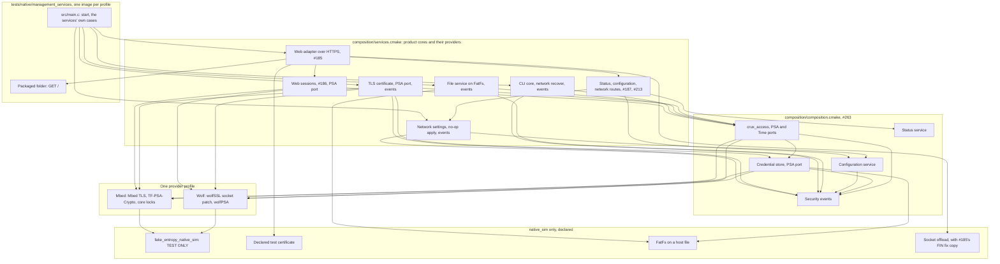
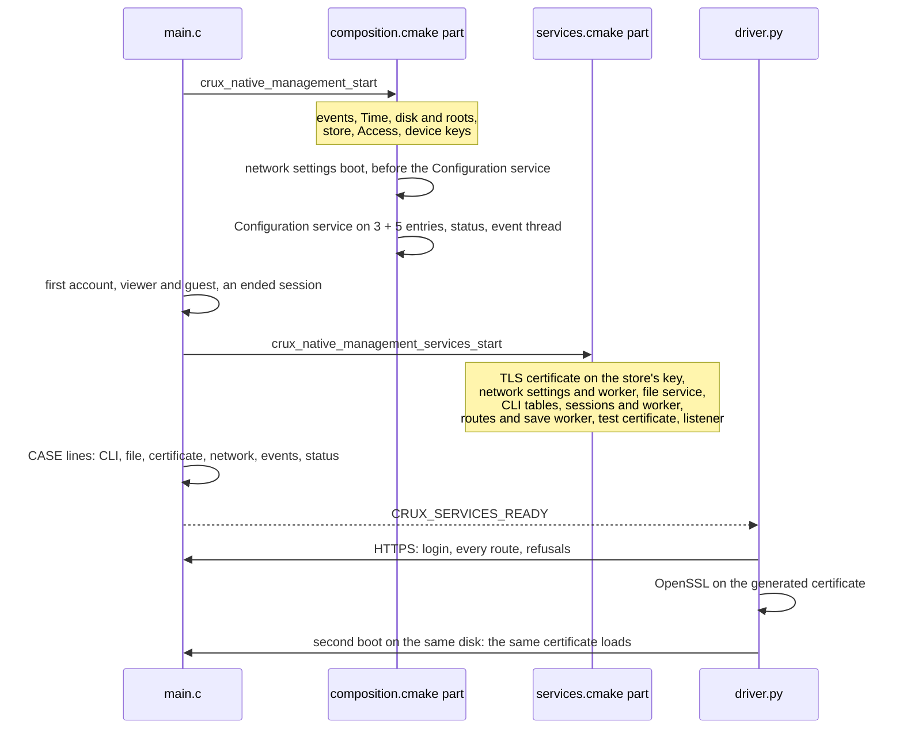

# Every management service on `native_sim`

Status: for review under [Issue #242](https://github.com/wonny-labs/crux-pilot/issues/242), in a Draft PR. This is the
second part of #242. The first, merged in #263, composed Access, the credential store, security events, status and
configuration on real PSA providers, and is described in [the management composition](native-management-composition.md).
This part composes every other management service on the same providers, behind the HTTPS listener of #185, in one
image per TLS profile: `tests/native/management_services`.

**Nothing here is physical evidence, and nothing ran on a board.** `native_sim` uses the host's TCP stack through the
socket offload, and the simulator's clock, memory and entropy. [Real here means](psa-crypto-design.md#what-real-means-on-native_sim)
that the protocols and the algorithms run for real. It does not mean that any secret is safe.

## What is built, faked and untested

| Item | State | Evidence level |
| --- | --- | --- |
| One image with every management service: web, sessions, status, configuration, CLI, security events, file service, TLS certificate, network settings, and the packaged web folder | **Built**, `tests/native/management_services`, from `composition/services.cmake` beside `composition.cmake` | `native_sim`, both profiles: [results](#results) |
| PSA ports: Access, store, web sessions, TLS certificate | **Real**, the qualified providers: TF-PSA-Crypto on the Mbed profile, wolfPSA on the Wolf profile | Image check reads each from its source |
| Event providers of the command line and the file service | **Built here**, `crux_cli_security_events` and `crux_file_service_security_events`, [mapped](security-event-contract.md#from-the-command-line-and-file-service-ports) like the existing providers | Host against the recording fake, `native_sim` end to end |
| Network settings apply port | **No-op provider** of #287, `network_settings_no_apply.c`. Nothing is applied to an interface, and no Zephyr `net_if` port is written. | `native_sim` |
| Configuration and network saves | **No provider**, decision C6 until #16. A configuration save reports `not_supported`, and a network change gets `501 not_supported`, as #281 and #287 define. | `native_sim` |
| Listener certificate | **The declared test certificate** of #263, as in #185's image. The TLS certificate module's own certificate is generated and checked, and **not handed to the listener**: see [how #242 relies on #284](#how-this-relies-on-the-tls-certificate-decisions). | Named in results |
| First account | **Declared test step**: serial provisioning called directly, in place of the console of #181 | Named in results |
| Command line transport | **Test transport**: `crux_cli_exec` on the serial channel into a buffer. The serial console over Crux Serial is not composed on `native_sim`, as the [CLI contract](cli-contract.md) records. | `native_sim` |
| Entropy | **Test-only**, `fake_entropy_native_sim`, now refused by a guard in any build that has not declared itself a `native_sim` test image | `native_sim`, [guards](#entropy-guards) |
| Routes | **Exactly the components' routes**: 12 from three route sources, and the packaged folder. No test route. | Image check, driver |
| SSH, SFTP | **Not composed**: not in the list of #242's services, and wolfSSH is not in this image | |
| Anything on RT1060-EVKB | **Not run, not compiled here** | |

## Structure

### Boot order

The network settings boot has to run before the Configuration service starts, because the service owns the parameters
afterwards. The composition therefore takes its five entries when `CRUX_NATIVE_MANAGEMENT_SERVICES` is defined, which
only `services.cmake` defines. The images of #185, #186 and #263 build the composition as before, with the same
role table and the same three entries.

## Services and their cases

Every case runs on the real cores and real PSA ports. "Permitted", "unauthenticated" and "unpermitted" are the three
cases #242 asks for. An unauthenticated session is one that was valid and has ended, as a client holds after a logout,
or no cookie over the web.

| Service | Reached through | Permitted | Unauthenticated | Unpermitted |
| --- | --- | --- | --- | --- |
| Sessions | HTTPS | Two-request login, `session/me` | `401 unauthorized` | |
| Status | HTTPS | Every item, with the event counts | `401` | The guest: `{"items":[]}` |
| Configuration | HTTPS | Update and read back | `401` | The viewer: refused, and an empty list. No CSRF token: `403 csrf_rejected`. |
| Configuration save | HTTPS | `202`, then `"save":{"state":"failed","code":"not_supported"}` | | `403 permission_denied` |
| Network settings | HTTPS, and C | Read with `network.read`. A change: `501 not_supported`. | `401`, `SESSION_INVALID` | `403 permission_denied`, `DENIED` |
| TLS certificate | C: no route exists | Get, fingerprint, copy | `SESSION_INVALID` | The viewer: `DENIED` |
| Command line | C, `crux_cli_exec` | `account list` | `ERR_DENIED` | The viewer: exit 127, the command hidden |
| Network recover command | C, `crux_cli_exec` | "nothing can be saved on this device", exit 0 | | The guest: exit 127 |
| File service | C: no route exists | Managed write and commit | `SESSION_INVALID` | The viewer reads and may not write. The guest does not see the area. |
| Security events | C | `config.updated` with its user and parameter, `cli.line_rejected`, `file.created` | | |
| Packaged folder | HTTPS | `GET /` | Public | |

Other checks: a configuration update raises `security.events_emitted` over HTTPS, nothing is dropped, an ended web
session is `401` on every route, a plain HTTP request gets no HTTP answer, and paths that only test images serve, such
as `/probe/echo`, are `404`.

## Routes

The image names only the components' route sources to `crux_web_routes()`, and `--services` holds the linked table to
exactly their routes, read from the image.

| Source | Routes | Access classes |
| --- | --- | --- |
| `components/web/session/web_session_routes.c`, #186 | 5 | 2 public, 3 session |
| `components/web/management/web_management_routes.c`, #187 | 5 | 4 session, 1 `config.save` |
| `components/web/management/web_management_network.c`, #213 | 2 | `network.read`, `network.write` |
| The packaged folder, #189 | One per file | Public `GET`, one review line `public GET @assets` |

`reviewed-routes.txt` of the image is `components/web/reviewed-routes.txt` line for line plus the folder's line, and
`tests/build/test_composition_image.py` compares them.

## Entropy guards

A real PSA provider here is TF-PSA-Crypto or wolfPSA, the providers #142 qualified, fed by the entropy driver. On
`native_sim` the only driver is `fake_entropy_native_sim`, which stays declared test-only. These guards keep that from
reaching any other build.

| Guard | Where | Refuses | Control |
| --- | --- | --- | --- |
| Test entropy outside a declared test image | `services.cmake`, at configuration | `CONFIG_FAKE_ENTROPY_NATIVE_SIM` without `CRUX_NATIVE_MANAGEMENT_TEST_IMAGE`, which only the image's `CMakeLists.txt` sets | `check_cmake_guard.py`, and the real mutation below |
| The same in C | `composition/entropy_guard.h` | The same, and any board but `native_sim` with the mark | `check_cmake_guard.py` compiles it with five settings |
| Zephyr's test random generator | Both of the above | `CONFIG_TEST_RANDOM_GENERATOR`, in any build of the services composition | The same |
| A board build | The PSA ports of #263, #186 and #190, unchanged | A test generator on any board | `scripts/test-native-composition.sh target-*` |
| The random path in the image | `check-composition-image.py --services` | A symbol from any `subsys/random` source but `random_entropy_device.c`, a missing entropy driver, and on Mbed a PSA random source other than Zephyr's `zephyr_entropy.c` | Python mutations |
| Plain HTTP | `services.cmake` | `CONFIG_CRUX_WEB_PLAIN_HTTP_FOR_TESTS`, or no `CONFIG_CRUX_WEB` | `check_cmake_guard.py` |

## Mutations of the wiring

Each was applied, built for real on the Mbed profile, checked, and reverted, by a script kept out of the repository.
The Python rows hold the check itself to synthetic images, in `tests/build/test_composition_image.py`.

| Mutation | Caught by |
| --- | --- |
| A missing service: the file service's source left out | The link |
| A missing service, synthetic: each of the 14 entry points removed | Image check |
| A fake port: an apply port under `tests/` in place of the no-op provider | Image check: from test code, not its source |
| A fake port, synthetic: four service ports from their test fakes | Image check |
| The wrong PSA provider: the Mbed image checked as the Wolf profile | Image check |
| The wrong PSA provider, synthetic: PSA from wolfPSA in an Mbed image | Image check |
| Test entropy accepted on a non-test build: the image's test mark removed | Configuration fails, `services.cmake` |
| A test random generator, synthetic: three `subsys/random` sources | Image check |
| Route table: the network routes left out | Image check: two routes missing |
| Route table, synthetic: a test route added, a route moved to test code, a generated route that is not the folder's | Image check |
| The packaged folder left out | The build: the reviewed line `public GET @assets` has no route |
| The check itself: services skipped, routes skipped, random sources skipped, extra routes allowed, the test-code rule off | The Python suite, each |

## How this relies on the TLS certificate decisions

#284's owner decisions A to C are open, and nothing here changes them.

| Decision of #284 | What this image does | Relies on it how |
| --- | --- | --- |
| A, the reference validity to 9999-12-31 | Starts the module with `CRUX_TLS_CERTIFICATE_DEFAULT_NOT_BEFORE_S` and no expiry, the reference options | Uses the reference as it stands. OpenSSL reads `Not After : Dec 31 23:59:59 9999 GMT`. |
| B, the private key as PKCS #8 bytes handed to Zephyr's TLS credentials | **Does not hand it over.** The listener keeps the declared test certificate. | Not relied on. Registering the module's material with the listener waits for B. |
| C, `psa_sign_hash` outside #142's subset | Signs the self-signed certificate at first boot with the module's PSA port | **Relied on**: the port ran here on TF-PSA-Crypto and on wolfPSA, and OpenSSL verified both certificates. A run is not a qualification, and #142's subset is unchanged. |

## Results

Host, `native_sim` and physical evidence stay apart. No physical claim is made.

Run in the Dev Container image on `native_sim/native/64`, by `scripts/test-native-composition.sh mbed` and `wolf` at
`2d22c54`, which the later commits change only in documents and retained results. Retained in
[`docs/evidence/native-services/`](evidence/native-services/). CI's `psa-crypto` workflow runs the Mbed mode, and so the
services image, with no workflow change. The Wolf profile is local only, as for #263 and #185.

| Check | Mbed profile | Wolf profile |
| --- | --- | --- |
| The services image builds, with every service and the profile's TLS stack and PSA provider | Yes, TF-PSA-Crypto and Mbed TLS | Yes, wolfPSA and the wolfSSL socket backend, on the patched copy of #185 |
| `check-composition-image.py --services`: 50 listed symbols from their sources, no test double, the random path, and exactly the 12 component routes and the folder's | Pass | Pass |
| The services' own cases, 17 a boot, on two boots of one disk | 34 of 34 | 34 of 34 |
| Web cases over HTTPS, TLS 1.3 `TLS_AES_128_GCM_SHA256`, the declared test certificate | 35 of 35 | 35 of 35 |
| A configuration update over HTTPS, and `security.events_emitted` before and after | 30 then 32 | 31 then 33 |
| TLS certificate module: generated at first boot through `psa_sign_hash`, and loaded at the second with the same fingerprint | Yes, on TF-PSA-Crypto | Yes, **on wolfPSA**, a run and not a qualification |
| OpenSSL 3.0.13 on that certificate: version 3, `ecdsa-with-SHA256`, P-256, `DNS:localhost, IP Address:127.0.0.1`, no expiry, self-signed verify for the server purpose, the device's fingerprint text | Pass | Pass |
| The existing parts of the mode, unchanged: the PSA ports on Twister, and the composition of #263 on three boots | Pass, 1 of 1 and three boots | Pass, 1 of 1 and three boots |
| Whole mode | 9 min 49 s | 11 min 9 s |

| Host check | Result |
| --- | --- |
| `ManagementProviders.events` with the two new providers, red on stubs that emit nothing, then green | Red: 250 checks, 29 failures. Green: 320 checks, 0 failures. |
| `tests/build/test_composition_image.py` | 24 tests pass. Five mutations of the check itself, each caught. |
| `check_cmake_guard.py`, with the services' three refusals and the C guard's five settings | Pass. Red first: the C guard's header did not exist. |
| `check-cli-boundary.py`, `check-credential-boundary.py`, `check-security-event-boundary.py`, `check-access-boundary.py`, `check-mgmt-services-boundary.py`, `check-web-routes.py`, `check-native-interfaces.py`, `check_docs.py` | Pass |
| clang-format 18 on every changed C file | Pass |
| The full Host presets, sanitizers and clang-tidy | **Not run locally.** CI's Host workflow runs them. |

Not run: `native_sim/native`, the 32-bit width; any browser; the serial console; a save provider; RT1060 compile of this
image; anything physical.

## Limits

| Limit | Seen as |
| --- | --- |
| The listener serves the declared test certificate, not the module's | Decision B is open |
| The CLI runs over a test transport, not the serial console | No `native_sim` console exists |
| No save provider, so network and configuration changes cannot persist | Decision C6, until #16 |
| The apply port applies nothing, and `GET /api/v1/network` reports no running address | #287 wrote no `net_if` port |
| Entropy is test-only: keys, tokens and nonces repeat for a seed | Declared, and guarded |
| Timing, connection limits and memory are the host's and the simulator's | Not device evidence |
| A race in a provider cannot show: a `native_sim` thread that does not sleep is never preempted | As #263 records |
| `native_sim/native`, the 32-bit width, was not run | Not run |

## Decisions for review

| # | Decision | Why | If changed |
| --- | --- | --- | --- |
| 1 | The services compose in a second CMake function, `services.cmake`, beside #263's, and the base composition takes the network settings entries only under `CRUX_NATIVE_MANAGEMENT_SERVICES` | The images of #185, #186 and #263 keep their exact role table and configuration table | One function for all |
| 2 | The listener keeps the declared test certificate, and the TLS certificate module's material is not registered with it | Decision B of #284 is open, and #185's image does the same | Register it once B is accepted |
| 3 | The event providers of the command line and the file service are new component targets, mapped onto existing identifiers and fields | An image with either service does not link without one, and #263 added its providers the same way. No identifier or field is added. | A different mapping, by the owner |
| 4 | `file.recovery_needed` is `FAILED`, and `file.storage_failed` is `LIMIT` for a full medium | The contract gave no result for them. The record's result follows what happened, as for `credential.*`. | Per the owner |
| 5 | The file service's records carry the area as subject and never a file name | A file name is client input, and the port's own comment keeps refused names out | |
| 6 | Permissions `file.read`, `file.write` and `tls.manage` are added to the composition's roles only in the services image | The file area and the certificate need them, and the other images stay unchanged | |
| 7 | A guard refuses test entropy unless the image declares itself a `native_sim` test image, and refuses Zephyr's test random generator outright | The task asks for a guard on a non-test build, and `native_sim` has no other entropy driver | A product composition sets neither |
| 8 | The command line runs through `crux_cli_exec` on a test transport | No `native_sim` serial console exists, and the CLI's own checks are what #242 needs | Compose the console on a UART emulator |
| 9 | The checks join the existing family: `check-composition-image.py --services`, `scripts/test-native-composition.sh` mbed and wolf, `check_cmake_guard.py`, `tests/build/test_composition_image.py`, `tests/management_providers` | The task asks for it, and CI's PSA workflow already runs `test-native-composition.sh mbed`, so no workflow changes | |
| 10 | The image reuses #185's offload FIN fix copy | Without it a client that closes TCP without `close_notify` spins the Mbed server | Drop it when the driver is fixed upstream |
| 11 | The follow-ups of the re-check on #242 are done in the documents: the clock exception in the access contract, the CPU share, the iteration mutation, and the composition directory's exemption | Small, and in the documents this change touches | |
