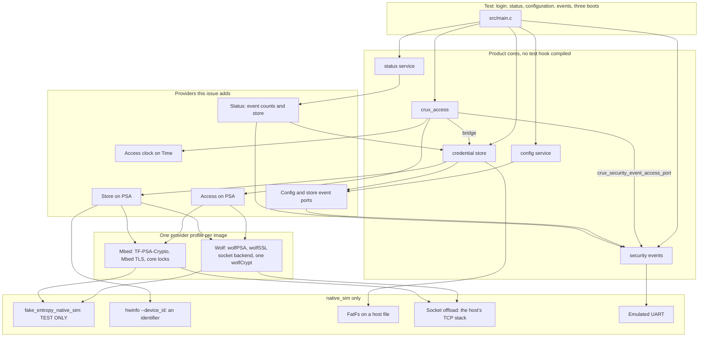
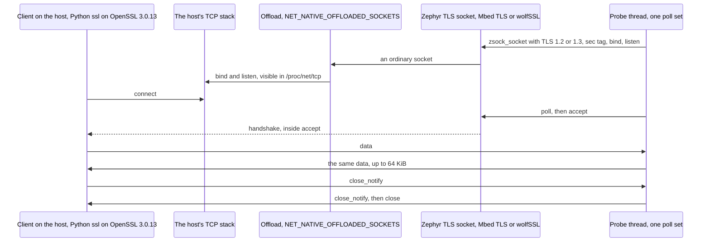
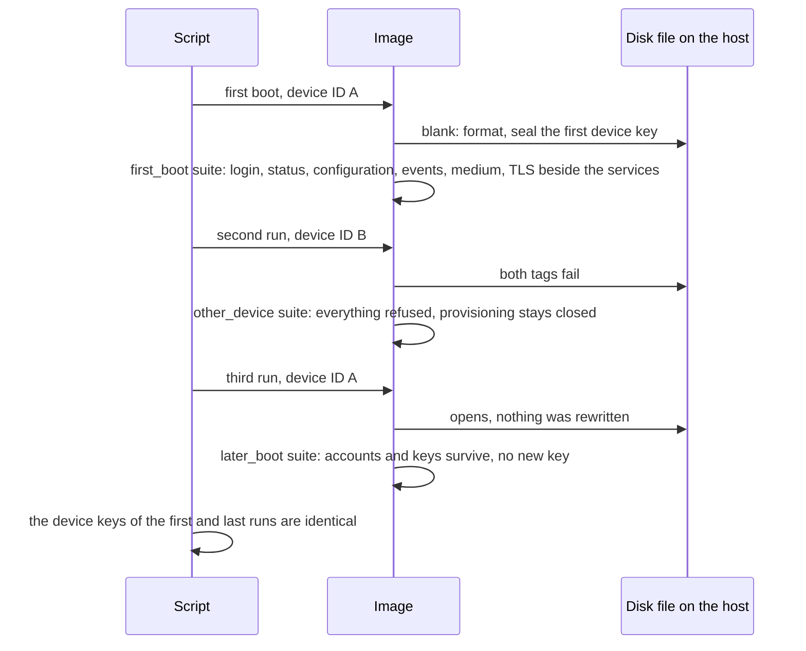

# `native_sim` management composition

Status: for review under [Issue #242](https://github.com/wonny-labs/crux-pilot/issues/242), in a Draft PR. Decision W17 makes PSA a prerequisite of real HTTPS on `native_sim`, and W18 makes Host and `native_sim` completion an interim result, with physical evidence tracked apart.

Nothing here is physical evidence. `native_sim` results use the host's TCP stack, and the simulator's clock, memory and entropy. They say nothing about a device. [Real here means](psa-crypto-design.md#what-real-means-on-native_sim) that the protocol and the algorithms run for real, and it does not mean that any secret is safe.

## What is built, faked and untested

| Item | State | Evidence level |
| --- | --- | --- |
| Access ports for derive, random, keyed hash | **Built**, on PSA, `components/access/ports/psa` | Host: TF-PSA-Crypto. `native_sim`: both providers. RT1060: compile. |
| Access clock, `crux_access_port_now_ms` | **Built**, on Crux Time, `crux_access_time_clock` | Host, `native_sim` |
| Store ports for declaration, seal, open, key generation, random | **Built**, on PSA, `components/credential/ports/psa`, with the device ID from `hwinfo` | As the Access ports |
| Event providers: `crux_config_service_port_event`, `crux_credential_port_event`, `crux_mgmt_status_port_security_events`, and the existing `crux_security_event_access_port` | **Built** | Host against a controlled answer, `native_sim` end to end |
| Status of the store, `crux_mgmt_status_port_credential` | **Built**. The issue did not list it, and the status document named it for this point. | The same |
| Composition | **Built**, `tests/native/management_composition`, on both profiles | `native_sim` |
| TLS socket over the offload | **Probed** on both profiles | `native_sim` with a host client |
| First credential | **Declared test step**: serial provisioning called directly, in place of the console of #181 | Named in results |
| TLS certificate | **Declared test certificate**, in place of #190 | Named in results |
| Entropy, confidentiality | **Declared test-only** and simulation, below | |
| Configuration save | **No provider**, `configuration_no_provider`, by decision C6 until #16. A save returns `ERR_STORE` with `NOT_SUPPORTED`. | `native_sim` |
| Logging | The Crux provider on an **emulated UART**: a line counts as delivered when `crux_log_write` returns `CRUX_OK`, and nothing reads the wire | `native_sim` |
| Reset causes, watchdog | Real System on `native_sim`. `system.watchdog_state` reads `not_supported`. | `native_sim` |
| HTTPS listener, login routes, TLS certificate from the store | **Not built here**: #185, #186, #190 | |
| Access and credential suites on the real ports | **Run on Host, on TF-PSA-Crypto**: 10 suites, [below](#the-existing-suites-on-the-real-ports). Not on wolfPSA, and not on `native_sim`. | Host |
| A race in a provider | **Untested and untestable here**: a `native_sim` thread that does not sleep is never preempted | |
| Anything on RT1060-EVKB beyond the ports compiling | **Not run.** No board was touched. | |

## TLS probe

**Result: a TLS server socket works over the native socket offload on both profiles, on TLS 1.2 and TLS 1.3, and wolfPSA runs on `native_sim` beside the wolfSSL socket backend.** One limit, on the Mbed profile, affects the HTTP server: see [What #185 needs to know](#what-185-needs-to-know).

### Results

Run by `scripts/test-tls-offload-probe.sh all` in the Dev Container image at `68adea7`, on `native_sim/native/64`. Retained in [`docs/evidence/tls-offload-probe/`](evidence/tls-offload-probe/). CI also runs the Mbed profile, with the same result, and only that one, because a default workflow must not fetch the wolf stacks.

| Step | Mbed profile | Wolf profile |
| --- | --- | --- |
| Builds on `native_sim/native/64` over the offload | Yes | Yes, on a [patched copy of Zephyr](#how-the-wolf-profile-gets-its-socket-backend) |
| PSA provider beside TLS: init, random, SHA-256 known answer | TF-PSA-Crypto passes | **wolfPSA passes** |
| TLS 1.2: handshake, 16 B, 4 KiB and 64 KiB both ways, close | Pass. `ECDHE-ECDSA-AES128-GCM-SHA256`. | Pass. `ECDHE-ECDSA-AES256-GCM-SHA384`. |
| TLS 1.3: the same | Pass. `TLS_AES_128_GCM_SHA256`. | Pass. `TLS_AES_256_GCM_SHA384`. |
| `close_notify` from the server, on both versions | Yes | Yes |
| Control: a client that trusts another certificate | Refused | Refused |
| Control: plain text on the TLS port | No answer, connection reset | No answer, connection reset |
| Eventfd, listeners and clients in one poll set, as Zephyr's HTTP server uses them | Works | Works |
| 20 connections in a row | Pass, no leak | Pass, no leak |
| A client that closes TCP with no `close_notify`, seen through `poll` | **No, see below** | Yes |

### Configuration

| Setting | Mbed profile | Wolf profile |
| --- | --- | --- |
| Input | [Declared test certificate](../tests/native/tls_offload_probe/credentials/README.md): self-signed P-256, with its private key committed | The same |
| Entropy | `fake_entropy_native_sim`, [test-only](psa-crypto-design.md#what-real-means-on-native_sim) | The same |
| Files | `prj.conf`, `mbed.conf` in `tests/native/tls_offload_probe` | `prj.conf`, `wolf.conf` |
| TLS library | Mbed TLS module `a3e190f`, heap 120,000 B, `MBEDTLS_SSL_MAX_CONTENT_LEN` 16,384 | wolfSSL v5.9.4-stable, on the module's Kconfig, with no settings file |
| PSA provider | TF-PSA-Crypto `dc575a2`, `CONFIG_PSA_CRYPTO_PROVIDER_MBEDTLS` | wolfPSA v5.9.4, `CONFIG_PSA_CRYPTO_PROVIDER_CUSTOM`, `CONFIG_WOLFPSA_THREAD_SAFE` |
| Sockets | `NET_SOCKETS_OFFLOAD`, `NET_NATIVE_OFFLOADED_SOCKETS`, `NET_SOCKETS_TLS_MAX_CONTEXTS` 6, `ZVFS_OPEN_MAX` 24, `ZVFS_POLL_MAX` 16 | The same |

The issue asked because `NET_SOCKETS_SOCKOPT_TLS` selects Mbed TLS and PSA only `if NET_NATIVE`. That did not get in the way: `CONFIG_NET_NATIVE` stays `y` in these images, and the profile files name what they need anyway.

### Limits found

Connection limits, timing and memory here come from the host's stack and the simulator, so none is device evidence.

| # | Limit | Profile | Seen as |
| --- | --- | --- | --- |
| 1 | **A TCP close with no `close_notify` is invisible to `poll`.** A host socket reports a peer's FIN as `POLLIN` alone, where Zephyr's native sockets add `POLLHUP`. `mbedtls_ssl_read` turns the end of the stream into a length of 0, which the TLS layer reads as "a partial record, try again". So `zsock_poll` with no timeout returns 0, at once and every time, for as long as that client stays. | Mbed | `raw_poll_after_abrupt_close`: the server never saw the close, and the image's CPU share rose from about 0.02 to between 0.59 and 0.86 across runs, locally and in CI. In a debugging trace, not retained, the simulated clock also stopped while this ran, because a `native_sim` thread that never sleeps stops it. A `recv` finds the end of the stream at once, which is how the probe's server gets past it: `abrupt_closes` passes. |
| 2 | wolfSSL peeks instead, and reports it | Wolf | The same step: the close is seen, and CPU stays at 0.01 |
| 3 | The handshake runs inside `accept`, on the caller's thread, for non-blocking sockets too. A client that connects and says nothing holds a one-thread server for `NET_SOCKETS_TLS_CONNECT_TIMEOUT`, default 10 s. | Both | `stalled_client`: a second client waited 9.6 s and 9.5 s, and then worked |
| 4 | A 120,000 B Mbed TLS heap held 3 connections at a 16 KiB record size. **The fourth `accept` fails with `EINVAL`**, not `ENOMEM`. The socket layer maps a failed certificate parse to it, which fits a full heap, and heap use was not measured. Held connections keep working, and later ones work once these close. | Mbed | `concurrent_connections`, and `PROBE accept ... errno=22` |
| 5 | wolfSSL allocates from the host's `malloc` on `native_sim`, so **no memory limit applied**. The bound here was `NET_SOCKETS_TLS_MAX_CONTEXTS`: 2 listeners and 4 clients, then `ENOMEM`. | Wolf | `concurrent_connections`, and `errno=12` |
| 6 | A smaller record size than 16 KiB loses a browser's data unless the server negotiates less, so the probe holds 16 KiB. Nothing here tested a smaller value. | Mbed | Configuration choice |
| 7 | The negotiated suites differ, because neither profile restricts them here. #185 declares them. | Both | The table above |
| 7a | `NET_IPPROTO_TLS_1_2` differs between the backends. **Mbed TLS takes it as a minimum, and a newer client gets TLS 1.3. wolfSSL takes it as exact.** | Both | `tls1.2_port_newer_client` |
| 8 | `native_sim/native` (32-bit) was not tried. | Both | Not run |

### What #185 needs to know

| Point | Consequence |
| --- | --- |
| Both profiles can run, so **#185 does not need to drop a profile on `native_sim`** | The same suite can run on both |
| Limit 1 reaches Zephyr's HTTP server on the Mbed profile. `http_server_core.c` treats a poll result of 0 as "poll again", and finds a dead client only through `POLLHUP` or `POLLERR`. | A client that drops TCP without `close_notify` can leave the server thread spinning, and its inactivity timer needs a clock that this stops. #185 has not run that, and should test it first. curl and OpenSSL's clients send `close_notify` on a normal exit, and a browser may not. |
| The offload could report it instead: its `poll` mapping has no `EPOLLRDHUP` | **A one-line fix in Zephyr's driver, not tried here.** It would need a build-local copy, or an upstream report. Limit 1 is `native_sim` only: it does not apply to Zephyr's native sockets, on a target. |
| Limit 3 applies to the HTTP server, which accepts on its one thread | A stalled client stalls every client for up to the timeout, on both profiles, and the design's rule on bounded handlers cannot help. This one is not specific to `native_sim`, from the source, and was not run on a target. |
| Limit 4 ties the heap to the connection limit, on the Mbed profile | #185 sizes the Mbed TLS heap from its connection count, and expects `EINVAL` from `accept` when it runs out |

### How the Wolf profile gets its socket backend

The backend is a patch on Zephyr, which stays out of this repository: [patches/zephyr/README.md](../patches/zephyr/README.md) holds its source and terms. How a product composition applies it stays with #185. For a test, `scripts/prepare-wolf-tls-zephyr.sh` makes a copy:

| Step | Detail |
| --- | --- |
| Checks | The west checkout is at the pin, the patch has the recorded SHA-256, no hunk was rejected, and `sockets_tls.c` has the recorded SHA-256 afterwards |
| Method | `git archive` of the tree without its documents, samples and tests, about 323 MB, then `patch`, with three hunks needing fuzz. `git apply --3way` against v4.4.1 gives the same four files we compared, including `sockets_tls.c`. |
| Used by | `ZEPHYR_BASE` for that build only. The west checkout is not edited. |
| Not used | The optional `-mbedtls-decoupling` patch. The image compiles with `CONFIG_MBEDTLS=n` without it. |

## Provider results

`tests/psa_ports` runs the providers alone, through a device ID that a test controls.

| What | Host, TF-PSA-Crypto, ASan and UBSan | `native_sim`, TF-PSA-Crypto | `native_sim`, wolfPSA | RT1060-EVKB |
| --- | --- | --- | --- | --- |
| Derive, keyed hash: known answers from the qualification, including 128-byte and empty passwords | Pass | Pass | Pass | Compile |
| A stored verifier of another kind, a zero cost: `false` and no output that could match | Pass | Pass | Pass | Compile |
| Seal and open against a vector from independent code, Python `hashlib` and OpenSSL `libcrypto` | Pass | Pass | Pass | Compile |
| Tag, ciphertext, additional data or nonce changed: `ERR_UNUSABLE`, and plain text wiped | Pass | Pass | Pass | Compile |
| Another device ID: `ERR_UNUSABLE`. No device ID: `ERR_READ` and a `NULL` declaration | Pass | Pass | Pass | Compile |
| A whole slot's payload, 16,336 B | Pass | Pass | Pass | Compile |
| P-256 generation: forms, and the scalar gives the exported point | Pass | Pass | Pass | Compile |
| **Ed25519 generation** | `ERR_ENTROPY` and buffers wiped, as declared | `ERR_ENTROPY`, as declared | **Pass**, and the seed gives the exported key | Compile |
| 40 rounds of each port, seal included, with no key slot left behind | **Cannot detect a leak**: slots grow here | **Pass, and detects one**: 16 static slots. Removing `psa_destroy_key` from seal fails it. | **Cannot detect a leak**: a list | Compile |
| What seal reports for a provider failure: `ERR_ENTROPY` for `INSUFFICIENT_ENTROPY`, otherwise `ERR_STORE` | Pass, over a stub | | | |
| Control: a provider that supports nothing, and one that accepts everything | Both fail, 279 and 104 checks | | | |
| Control: a board build with a test random generator | Each PSA file refuses, with either setting | | | Refuses to compile, on both providers |

The Host run is on GCC locally and Clang in CI. RT1060 is compile only, and nothing was flashed, reset or run. TF-PSA-Crypto compiled locally and in CI, and wolfPSA locally only.

### What each port maps

The mapping is [the design's](psa-crypto-design.md#what-each-port-calls), and these are the choices it left.

| Port | Choice |
| --- | --- |
| `crux_access_port_now_ms` | A clock that fails, or reads negative, gives 0, because the port has no way to report a failure. `crux_monotonic_now` fails only for a NULL argument, in an ISR or on a provider error. Sessions from before the fault expire, and a bucket with a window stays closed. **Two limits**, which `tests/access/clock_fault.c` holds: a login during the fault succeeds, and that session stays valid while the clock is broken. A failure during the fault dates its bucket to 0 and shrinks its window, so once the clock returns past the quiet period the bucket clears, however recent its real failures were, and the free attempts come back. **Follow-up:** a port that can report a failure would let the core return `NOT_READY`, which is safer, and it changes the contract, so it is not done here. |
| Device key | Derived for each call, and its slot goes at once, because a slot is scarce and shared with TLS on the Mbed profile. This costs a hash and an import per seal or open. |
| Declaration | `BASIS_DEVICE_ID_KEY`, `EVIDENCE_SOFTWARE`, not confidential, forgery detected without the ID, no rollback detection. `NULL` if the ID or PSA cannot run. It is the same on `native_sim` as the design states for a target. |
| `crux_credential_port_seal` failure | `ERR_ENTROPY` for `PSA_ERROR_INSUFFICIENT_ENTROPY`, otherwise `ERR_STORE`, which the store reports as a failed save |
| Test generator on a board | `access_psa.c` and `credential_psa.c` each refuse to compile if `CONFIG_FAKE_ENTROPY_NATIVE_SIM` or `CONFIG_TEST_RANDOM_GENERATOR` reaches any board but `native_sim`, so a composition with its own device ID cannot get past it. The composition's CMake, and `test_tls_credentials.h`, also refuse any board but `native_sim`. Each has a control. |

### The existing suites on the real ports

`scripts/test-native-composition.sh host` runs them on TF-PSA-Crypto on Linux Host, through `tests/psa_ports/suites`. Each port runs the fake first, for its counters, hooks and faults, and then the real provider. Only `-DCRUX_TEST_SUITES_ON_PSA=ON` builds this, so the root build still holds no PSA.

| Suite | Result | What stays fake |
| --- | --- | --- |
| Access `conformance`, `accounts`, `security`, `keys`, `secrets`, `events` | Pass | Random, because some cases place names in delay buckets by it. The clock, store and events. |
| Credential `conformance_fake`, `security`, `faults_default_slot`, `concurrency` | Pass | The declaration, which they assert, and Ed25519, which TF-PSA-Crypto lacks |
| Access `faults` | **Left out.** It needs a derive quicker than a change to the account. With real PBKDF2 and a thread making changes, its concurrent logins are all refused, at `ok > 0`. | |
| Credential `faults` on a 1 KiB slot, `credential_access_store`, the production refusal | Not run on real ports | |

| Mutation, each tried once | Caught by |
| --- | --- |
| The core reuses a zero nonce | 3 of these credential suites, and the composition's check that the two slots' nonces differ |
| The stored cost is 1 PBKDF2 iteration | `test_07_stored_verifier_is_real` in the composition, which also recomputes the stored verifier. Not by these suites. |
| Seal ignores its additional data | `credential_conformance_fake` here |
| Seal keeps its key slot | `ports_leave_no_key_slot`, on TF-PSA-Crypto on `native_sim` only |

## Composition results

`scripts/test-native-composition.sh` runs one image three times on one disk file, as separate processes, each with its own seed. Retained in [`docs/evidence/native-composition/`](evidence/native-composition/), from a local run at `68adea7`. CI runs the Mbed profile, and the Wolf profile is local only.

| Check, on `native_sim/native/64` | Mbed profile | Wolf profile |
| --- | --- | --- |
| Builds, with the TLS stack and the PSA provider in one image | Yes | Yes, on the patched copy |
| No fake linked: 25 listed ports and contracts, each exactly from its real source under the repository, read from the image with `nm -l`. PSA from its module, and no other test code. This reads names and sources, and it shows nothing about what they do. | Yes | Yes |
| Device keys generated at start | P-256 | P-256 and Ed25519 |
| Ed25519 asked for | `ERR_ENTROPY`, and no record | Generated |

Each row is the same on both profiles, and each runs on the real services, ports and FatFs:

| Service | Permitted | Unauthenticated | Unpermitted |
| --- | --- | --- | --- |
| Access | `crux_access_check` is `OK` | `SESSION_INVALID` | `DENIED` |
| Login | A session from a web origin | Wrong password and unknown name: `DENIED`, with `access.login_failed` | |
| Status | The report, with the store's words and the event counts | `INVALID_STATE`, which an adapter sends as `401` | `{"items":[]}`: everything hidden |
| Configuration | Update, read back. A sensitive value is `WRITE_ONLY`. | `SESSION_INVALID` | `NOT_FOUND`, for a read and an update. A save without `config.save` is `DENIED`. |
| Events | Read back with `config.updated`, its user, its channel and its source | `SESSION_INVALID` | `DENIED` |

| Other check | Result |
| --- | --- |
| **A configuration update records its event, and status reports the counts** | `config.updated` reads back, and `security.events_emitted` is at least the count. `emitted` 31 and 32, `delivered` the same, `dropped` 0, `log_errors` 0, `high_water` 9, on the two profiles. |
| A slot on the medium | `CXCS`, protection identifier 1, 16,384 B, no account name or password in it, and the two slots' nonces differ. This shows sealing and nothing about confidentiality against someone with the device ID. |
| The stored verifier | Cost 10,000, the stated placeholder, and the real provider gives the stored value from the password and stored salt |
| TLS beside the services, in one image: a server and client over the offload, with peer verification, and a login and an account change while connected | Pass |
| After a restart | Provisioning stays closed, the password logs in, the wrong one does not, and no key is generated |
| Another device ID | The store is `UNUSABLE`, login is `NOT_READY`, provisioning is `DENIED`, key generation refused, and the next boot with the right ID opens the same files |
| Status report on the first boot | [Retained](evidence/native-composition/mbed/status.json), with `system.clock` `unset` and `net.ipv4` `no_data`, since the offload interface has no address |

The same run does not show: a client over HTTP, power loss, a real card, or entropy.

### Declarations

| Point | Declaration |
| --- | --- |
| Entropy | **Test-only.** `fake_entropy_native_sim`, which `composition.cmake` requires, so that a change needs review. Any key here repeats for the same seed. The private keys these runs generate are test keys, and they appear only in the file on the host. |
| Credential confidentiality | **Simulation.** The device key comes from a 4-byte identifier that `--device_id` or `gethostid()` sets. It is not secret on `native_sim`, and it is not secret on a target either. `status` reports `device_id_key`, `software`, not confidential. |
| The disk | A file on the host, and it belongs to the test, so the composition formats a blank one. The pilot's composition does not: a blank card reads `UNUSABLE`. |

### Locks on the Mbed profile

The design asks #242 to make the providers safe beside TLS threads on TF-PSA-Crypto, or to record that it cannot, and says that serialising Crux's calls is not enough.

| Point | Finding |
| --- | --- |
| The way through | Zephyr's module has no Kconfig for it, and it does read `CONFIG_TF_PSA_CRYPTO_USER_CONFIG_FILE`. `composition/tf_psa_threading` turns on `MBEDTLS_THREADING_C` and `MBEDTLS_THREADING_ALT` there, and gives the core locks on `k_mutex` and `k_condvar` before the module's own start. |
| What this covers | The core's own key table and random source, for Mbed TLS and the Crux providers alike, because they take the same locks |
| Shown | It builds and runs, and the core took 203,361 locks on one first boot, from a login, TLS and the store |
| **Not shown** | That no race remains. A `native_sim` thread that does not sleep is never preempted, so a race cannot show here. It has not compiled for a target, its overhead is unmeasured, and #185 still has to adopt it for a product composition. |
| Wolf profile | `CONFIG_WOLFPSA_THREAD_SAFE` is on. wolfSSL's own use of its one Hash-DRBG beside wolfPSA is equally unshown. |

### Limits of the composition

Each is a statement about `native_sim`, and none is device evidence.

| Limit | Seen as |
| --- | --- |
| The simulated clock does not count a thread's computing, so no duration here means anything for a device | Before the setting below, `test_03_login`, with real PBKDF2, reported 0 ms |
| The drain runs at low priority, and a thread that never sleeps lets nothing else run. A burst with no pause fills the ring. | The first run: `stats.dropped` was not 0, until the test paused between steps. A real client's requests leave room. |
| Stack, heap and memory are the host's. wolfSSL's allocation is the host's `malloc`. | No figure is recorded |
| CI runs the Mbed profile only, because a default workflow must not select the wolf stacks. The Wolf profile's results are local, and [#247](https://github.com/wonny-labs/crux-pilot/issues/247) now covers the probe, port cases and composition too. | The `psa-crypto` workflow |
| **A Ztest image over the offload needs `CONFIG_NATIVE_SIM_SLOWDOWN_TO_REAL_TIME`.** Its simulated clock otherwise runs as fast as it can, while the host's TCP stack keeps real time. | Twice in CI, on a fast runner and not locally: the server's handshake timed out at 10 simulated seconds, `-110`, with the client connected. A delayed ACK is the likely cause and was not traced. The setting cleared it. #185 and #186 must keep it. |
| `native_sim/native`, the 32-bit width, was not run | Not run |

## What #142 asked of this issue

| # | Piece, from the [design](psa-crypto-design.md#what-the-next-issue-must-supply) | Where it went |
| --- | --- | --- |
| 1, 1a | Provider selection on each profile | `tests/native/tls_offload_probe/mbed.conf`, `wolf.conf`, `tests/native/management_composition/profile-psa.conf` |
| 2 | `WOLFSSL_AESGCM_STREAM` | `composition.cmake`, from the qualification's list |
| 3, 4 | The providers | `components/access/ports/psa`, `components/credential/ports/psa` |
| 5 | The label on what `native_sim` proves | This document, and `composition.cmake` requires the test source |
| 6 | Seed choice | Each run has its own `--seed`, because repeating one repeats every nonce on the same device key. A seed still chooses a fixed sequence. |
| 7 | A guard for product images | `access_psa.c` and `credential_psa.c`, with controls |
| 8 | Provider tests | `tests/psa_ports`, the composition, and [the existing suites](#the-existing-suites-on-the-real-ports) on Host |
| 9 | The Mbed profile's limits | [Locks](#locks-on-the-mbed-profile). No Ed25519, as shown. Slots: `ports_leave_no_key_slot` shows that the providers hold none between calls, on TF-PSA-Crypto on `native_sim`, and it cannot see a leak on Host or wolfPSA. How many TLS takes from the 16 was not measured. |

## What later issues can use

| Issue | What it has now | What it must still do |
| --- | --- | --- |
| #184, HTTP adapter | `tests/native/management_composition/composition`: `crux_native_management_start`, sessions from `crux_native_management_login`, and real status and configuration services behind the adapter's routes. Link with `composition.cmake`. | Its own routes. The composition starts no listener. |
| #185, HTTPS | The [probe's result](#what-185-needs-to-know), both profile configurations, the patched tree for a test, the declared certificate through `crux_native_management_tls_test_credentials`, and the core locks | Decide how a product applies the Wolf patch. Declare versions and suites. Test an abrupt client close on the Mbed profile. |
| #186, login and sessions | Real PBKDF2 verifiers, the real session table, and a PSA provider to draw attempt identifiers and tokens from | Entropy stays test-only here, so a token's strength is not shown |
| #190, certificate model | `crux_credential_key_ensure(CRUX_CREDENTIAL_RECORD_TLS_KEY, P256)` generates and persists a key at start, and survives a restart. The event port is real. | Connect a stored key and certificate to the TLS credentials. The composition's TLS still uses the declared certificate, not this key. |
| #192, SSH provider | On the Wolf profile: a persisted Ed25519 host key, one wolfCrypt with the wolfSSH definitions beside the TLS backend and wolfPSA, and real Access for keys and passwords | wolfSSH is not in this image, so it has not been built with these. |
| #187, #193, #220 | The same services on real ports | |

## Decisions for review

| # | Decision | Why | If changed |
| --- | --- | --- | --- |
| 1 | The test certificate and its private key are committed, under `tests/native/tls_offload_probe/credentials`, and the image refuses any board but `native_sim` | The issue asks for a declared certificate. A fixed one needs no tool at build time, and #185 can reuse it. A secret scanner may flag the key. | Generate it at build time |
| 2 | The Wolf profile's test uses a patched copy of the tree, and not an edit of the checkout | The rule is that the checkout stays clean, and #185 still owns the product answer | #185 replaces the script |
| 3a | A clock that fails reads as 0, with [two limits](#what-each-port-maps) | The port has no error result, and changing the Access contract is out of scope here | The follow-up above |
| 3 | The probe's server reads every client when a poll returns nothing, and a message from the driver turns this off to show the limit | The rest of the steps would otherwise hang on the Mbed profile, and the limit stays recorded and pinned: the script fails if it stops holding | None for a product |
| 4 | The PSA providers are source files that a composition lists, and they have no CMake target in the root build | Decision 1 of the PSA design: the root build holds no PSA | Add targets when a Host composition needs them |
| 5 | The device ID goes through one small function, `crux_credential_psa_device_id`, and `hwinfo` stays in `ports/zephyr` | The provider then runs on Host under sanitizers, and it keeps `hwinfo` out of portable code | None for a composition |
| 6 | The composition lives under `tests/native`, and not in a component or the Zephyr module | Nothing yet says what a product's composition is, and the Kconfig integration has no owner. Later issues include its CMake. | Move it when a product composition exists |
| 7 | The composition has no save provider, so `config.save` gives `ERR_STORE` with `NOT_SUPPORTED` | Decision C6, until #16. The Settings backends need a patched backend on this pin. | Add a provider when #16 decides |
| 8 | Port cases, and also [the existing suites through a shim](#the-existing-suites-on-the-real-ports) on Host only, behind an option that the root build leaves off | The shim keeps the fakes' hooks, and so leaves these suites' assertions unchanged. wolfPSA and `native_sim` would need their suites ported. | Run them on `native_sim` |
| 9 | The core locks are test composition code, under `tests/native`, and only the Mbed profile links them, and `composition.cmake` refuses that profile without them | The design asks for a way, and a product adopting one is #185's. The probe stays without them, on one thread. | Move them when a product composition adopts them |
| 10 | A role, `guest`, holds a permission no service names | So that "unpermitted" can be shown on status, where every other role holds `status.read` | None |
| 11 | The status provider for the store, and splitting `source_no_security.c`, were added though the issue does not list them | The status document lists both as what connects next, and the composition has a store, so leaving its items out would misstate it | One provider less |
| 12 | The Wolf copy of Zephyr leaves out documents, samples and tests, about 323 MB | Disk | None for a build |
