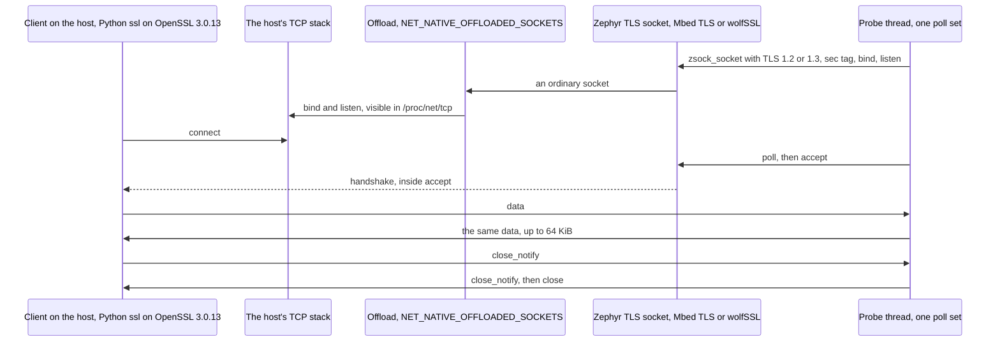

# `native_sim` management composition

Status: for review under [Issue #242](https://github.com/wonny-labs/crux-pilot/issues/242), in a Draft PR. This document starts with the TLS probe, because it decides how [#185](https://github.com/wonny-labs/crux-pilot/issues/185) proceeds. The composition follows in this PR.

Nothing here is physical evidence. `native_sim` results use the host's TCP stack, and the simulator's clock, memory and entropy. They say nothing about a device.

## TLS probe

**Result: a TLS server socket works over the native socket offload on both profiles, on TLS 1.2 and TLS 1.3, and wolfPSA runs on `native_sim` beside the wolfSSL socket backend.** One limit, on the Mbed profile, affects the HTTP server: see [What #185 needs to know](#what-185-needs-to-know).

### Results

Run by `scripts/test-tls-offload-probe.sh all` in the Dev Container image at `85520c4`, on `native_sim/native/64`. Retained in [`docs/evidence/tls-offload-probe/`](evidence/tls-offload-probe/). CI runs the Mbed profile only, because a default workflow must not fetch the wolf stacks.

| Step | Mbed profile | Wolf profile |
| --- | --- | --- |
| Builds on `native_sim/native/64` over the offload | Yes | Yes, on a [patched copy of Zephyr](#how-the-wolf-profile-gets-its-socket-backend) |
| PSA provider beside TLS: init, random, SHA-256 known answer | TF-PSA-Crypto passes | **wolfPSA passes** |
| TLS 1.2: handshake, 16 B, 4 KiB and 64 KiB both ways, close | Pass. `ECDHE-ECDSA-AES128-GCM-SHA256`. | Pass. `ECDHE-ECDSA-AES256-GCM-SHA384`. |
| TLS 1.3: the same | Pass. `TLS_AES_128_GCM_SHA256`. | Pass. `TLS_AES_256_GCM_SHA384`. |
| `close_notify` from the server, on both versions | Yes | Yes |
| Control: a client that trusts another certificate | Refused | Refused |
| Control: plain text on the TLS port | No answer, connection reset | No answer, connection reset |
| Eventfd, listeners and clients in one poll set, as Zephyr's HTTP server uses them | Works | Works |
| 20 connections in a row | Pass, no leak | Pass, no leak |
| A client that closes TCP with no `close_notify`, seen through `poll` | **No, see below** | Yes |

### Configuration

| Setting | Mbed profile | Wolf profile |
| --- | --- | --- |
| Input | [Declared test certificate](../tests/native/tls_offload_probe/credentials/README.md): self-signed P-256, with its private key committed | The same |
| Entropy | `fake_entropy_native_sim`, [test-only](psa-crypto-design.md#what-real-means-on-native_sim) | The same |
| Files | `prj.conf`, `mbed.conf` in `tests/native/tls_offload_probe` | `prj.conf`, `wolf.conf` |
| TLS library | Mbed TLS module `a3e190f`, heap 120,000 B, `MBEDTLS_SSL_MAX_CONTENT_LEN` 16,384 | wolfSSL v5.9.4-stable, on the module's Kconfig, with no settings file |
| PSA provider | TF-PSA-Crypto `dc575a2`, `CONFIG_PSA_CRYPTO_PROVIDER_MBEDTLS` | wolfPSA v5.9.4, `CONFIG_PSA_CRYPTO_PROVIDER_CUSTOM`, `CONFIG_WOLFPSA_THREAD_SAFE` |
| Sockets | `NET_SOCKETS_OFFLOAD`, `NET_NATIVE_OFFLOADED_SOCKETS`, `NET_SOCKETS_TLS_MAX_CONTEXTS` 6, `ZVFS_OPEN_MAX` 24, `ZVFS_POLL_MAX` 16 | The same |

The issue asked because `NET_SOCKETS_SOCKOPT_TLS` selects Mbed TLS and PSA only `if NET_NATIVE`. That did not get in the way: `CONFIG_NET_NATIVE` stays `y` in these images, and the profile files name what they need anyway.

### Limits found

Connection limits, timing and memory here come from the host's stack and the simulator, so none is device evidence.

| # | Limit | Profile | Seen as |
| --- | --- | --- | --- |
| 1 | **A TCP close with no `close_notify` is invisible to `poll`.** A host socket reports a peer's FIN as `POLLIN` alone, where Zephyr's native sockets add `POLLHUP`. `mbedtls_ssl_read` turns the end of the stream into a length of 0, which the TLS layer reads as "a partial record, try again". So `zsock_poll` with no timeout returns 0, at once and every time, for as long as that client stays. | Mbed | `raw_poll_after_abrupt_close`: the server never saw the close, and the image's CPU share rose from 0.02 to 0.64. In a debugging trace, not retained, the simulated clock also stopped while this ran, because a `native_sim` thread that never sleeps stops it. A `recv` finds the end of the stream at once, which is how the probe's server gets past it: `abrupt_closes` passes. |
| 2 | wolfSSL peeks instead, and reports it | Wolf | The same step: the close is seen, and CPU stays at 0.03 |
| 3 | The handshake runs inside `accept`, on the caller's thread, for non-blocking sockets too. A client that connects and says nothing holds a one-thread server for `NET_SOCKETS_TLS_CONNECT_TIMEOUT`, default 10 s. | Both | `stalled_client`: a second client waited 9.6 s and 9.5 s, and then worked |
| 4 | Each connection costs about 33 KiB of Mbed TLS heap at a 16 KiB record size, plus what a handshake takes, so a 120,000 B heap held 3 connections. **The fourth `accept` fails with `EINVAL`**, not `ENOMEM`, because the socket layer maps a failed certificate parse to it. Held connections keep working, and later ones work once these close. | Mbed | `concurrent_connections`, and `PROBE accept ... errno=22` |
| 5 | wolfSSL allocates from the host's `malloc` on `native_sim`, so **no memory limit applied**. The bound here was `NET_SOCKETS_TLS_MAX_CONTEXTS`: 2 listeners and 4 clients, then `ENOMEM`. | Wolf | `concurrent_connections`, and `errno=12` |
| 6 | A smaller record size than 16 KiB loses a browser's data unless the server negotiates less, so the probe holds 16 KiB. Nothing here tested a smaller value. | Mbed | Configuration choice |
| 7 | The negotiated suites differ, because neither profile restricts them here. #185 declares them. | Both | The table above |
| 8 | `native_sim/native` (32-bit) was not tried. | Both | Not run |

### What #185 needs to know

| Point | Consequence |
| --- | --- |
| Both profiles can run, so **#185 does not need to drop a profile on `native_sim`** | The same suite can run on both |
| Limit 1 reaches Zephyr's HTTP server on the Mbed profile. `http_server_core.c` treats a poll result of 0 as "poll again", and finds a dead client only through `POLLHUP` or `POLLERR`. | A client that drops TCP without `close_notify` can leave the server thread spinning, and its inactivity timer needs a clock that this stops. #185 has not run that, and should test it first. curl and OpenSSL's clients send `close_notify` on a normal exit, and a browser may not. |
| The offload could report it instead: its `poll` mapping has no `EPOLLRDHUP` | **A one-line fix in Zephyr's driver, not tried here.** It would need a build-local copy, or an upstream report. Limit 1 is `native_sim` only: it does not apply to Zephyr's native sockets, on a target. |
| Limit 3 applies to the HTTP server, which accepts on its one thread | A stalled client stalls every client for up to the timeout, on both profiles, and the design's rule on bounded handlers cannot help. This one is not specific to `native_sim`, from the source, and was not run on a target. |
| Limit 4 fixes the heap for the connection limit, on the Mbed profile | #185 sizes the Mbed TLS heap from its connection count, and treats `EINVAL` from `accept` as a full heap |

### How the Wolf profile gets its socket backend

The backend is a patch on Zephyr, which stays out of this repository: [patches/zephyr/README.md](../patches/zephyr/README.md) holds its source and terms. How a product composition applies it stays with #185. For a test, `scripts/prepare-wolf-tls-zephyr.sh` makes a copy:

| Step | Detail |
| --- | --- |
| Checks | The west checkout is at the pin, the patch has the recorded SHA-256, no hunk was rejected, and `sockets_tls.c` has the recorded SHA-256 afterwards |
| Method | `git archive` of the tree without its documents, samples and tests, about 323 MB, then `patch`, with three hunks needing fuzz. `git apply --3way` against v4.4.1 gives the same four files we compared, including `sockets_tls.c`. |
| Used by | `ZEPHYR_BASE` for that build only. The west checkout is not edited. |
| Not used | The optional `-mbedtls-decoupling` patch. The image compiles with `CONFIG_MBEDTLS=n` without it. |

## Decisions for review

| # | Decision | Why | If changed |
| --- | --- | --- | --- |
| 1 | The test certificate and its private key are committed, under `tests/native/tls_offload_probe/credentials`, and the image refuses any board but `native_sim` | The issue asks for a declared certificate. A fixed one needs no tool at build time, and #185 can reuse it. A secret scanner may flag the key. | Generate it at build time |
| 2 | The Wolf profile's test uses a patched copy of the tree, and not an edit of the checkout | The rule is that the checkout stays clean, and #185 still owns the product answer | #185 replaces the script |
| 3 | The probe's server reads every client when a poll returns nothing, and a message from the driver turns this off to show the limit | The rest of the steps would otherwise hang on the Mbed profile, and the limit stays recorded and pinned: the script fails if it stops holding | None for a product |
