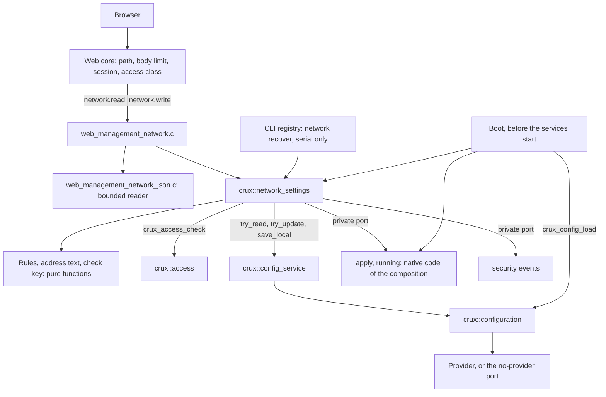
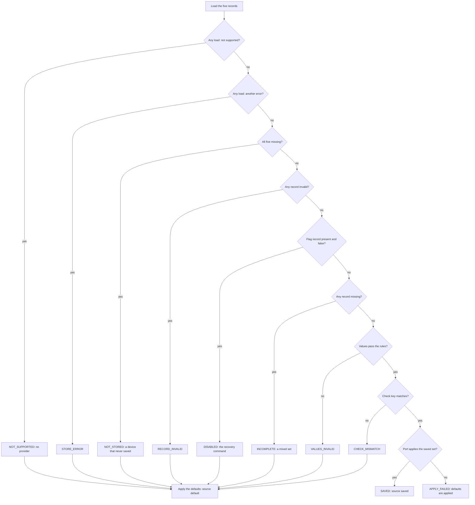
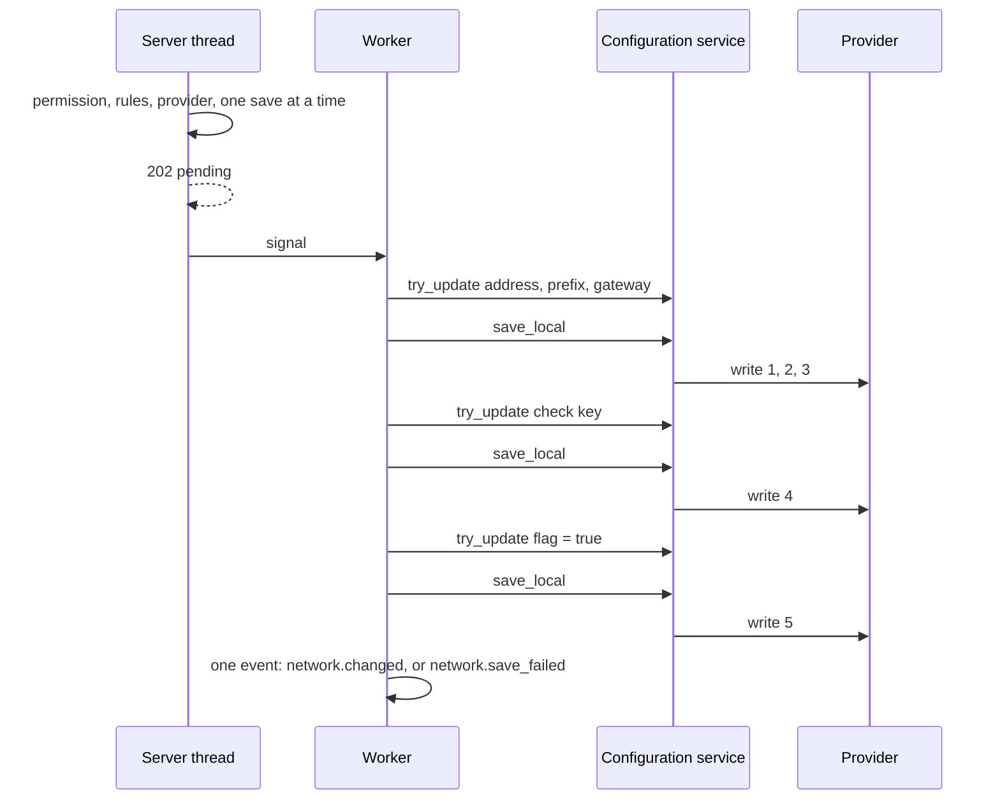
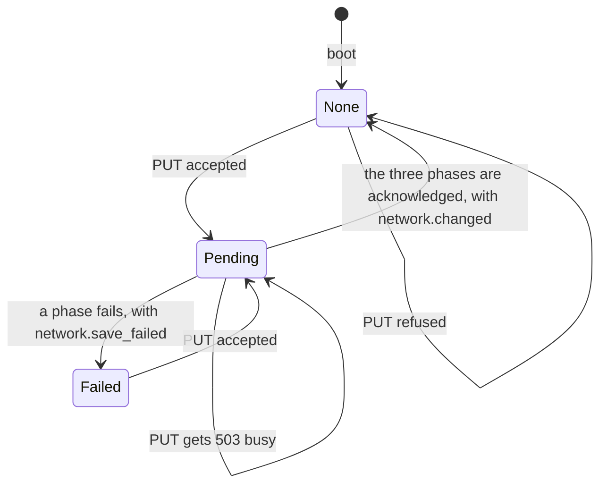

# Network settings service

Status: merged in [PR #287](https://github.com/wonny-labs/crux-pilot/pull/287) for Issue #213. Host results, and the routes run over HTTPS on `native_sim` in [the services image](native-composition-242.md) with a no-op apply port. Nothing here has run on a board, and nothing applies an address to a real interface. Host and `native_sim` results are interim
results, and physical evidence stays tracked apart. Decisions W5 to W8 and W14 of [the frontend foundation
design](plans/web-frontend-foundation-design.md#network-settings) and [the owner's approval on #183](https://github.com/wonny-labs/crux-pilot/issues/183#issuecomment-6637976084)
are the basis.

Owner: `components/network_settings`. Public header `<crux/network_settings.h>`, usage target `crux::network_settings`.
The routes are in `components/web/management/web_management_network.c` and are described in
[`web/api/openapi.yaml`](../web/api/openapi.yaml). The recovery command is `<crux/network_settings_cli.h>`.

## What is built, faked and untested

| Part | State | Evidence |
| --- | --- | --- |
| The checks of the specification, the address text and the check key | **Built** | Host, with vectors shared with the TypeScript client, an oracle, and 250,000 random pairs of sets |
| Boot: load, decide, apply through a private port, fall back | **Built** | Host, on the real Configuration mechanism and the fake provider |
| The service: state, request, save in three phases, recovery, events | **Built** | Host, on the real Access core and the real Configuration service |
| A save cut by a power loss between any two writes | **Built as a test**, with the fake provider | Host: 4 starting states, 6 cut points, 2 ways of cutting |
| Another session's `config.save` landing in the middle of a set | **Built as a test** | Host, through a wrapped `try_update` |
| `GET` and `PUT /api/v1/network` | **Built** | Host, on the real Web core, session module and services |
| A bounded reader of the `PUT` body | **Built** | Host, with generated and mutated input |
| The routes' answers against the specification | **Built** | `Web.network_openapi`: real answers, with negative controls |
| Serial recovery command `network recover` | **Built** | Host, on the real registry and the scripted access control of the command line suites |
| The mock and the TypeScript client | **Changed, small** | Node.js unit tests, including the shared vectors |
| Apply port: Host fake, and a no-op provider for a composition that applies nothing | **Built** | The fake is used by every suite. The no-op is linked by no suite. |
| Apply port on Zephyr, over `net_if` | **Not built.** [Decision 17](#decisions-taken-without-an-answer). | |
| A composition that serves the routes, links the service or owns the table | **Not in #213.** [The services image](native-composition-242.md) of #242 does, with a no-op apply port. | `native_sim` |
| `native_sim` | **Not run by #213.** Run later in [the services image](native-composition-242.md): the read, and a change that answers `501 not_supported` because nothing can be saved. | `native_sim` |
| RT1060 compile | **Not run.** | |
| Saving on the target | **No provider** until #16: [what the target does](#what-the-target-does-until-16) | |
| Applying saved values on RT1060-EVKB | **Not run.** It needs separately approved physical evidence. | |

## Structure

`crux_netif` stays read-only and no native type reaches a public header. The apply port is
`components/network_settings/src/network_settings_port.h`, which no consumer includes.

## The five parameters

They are `U32` and `BOOL` parameters of the Configuration contract. They sit in the composition's table for the Configuration
service, under the permission `network.private`, which no role holds, so no session lists or changes one through the
configuration routes. `crux_network_settings_entries()` returns them, and the composition copies them into its table.

| Order | Key | Type | Holds | Default |
| --- | --- | --- | --- | --- |
| 1 | `net.address` | U32 | The address, as a number | 0 |
| 2 | `net.prefix` | U32 | The prefix length | 0 |
| 3 | `net.gateway` | U32 | The gateway, and 0 for none | 0 |
| 4 | `net.check` | U32 | The check key over the three above | 0 |
| 5 | `net.use_saved` | BOOL | Whether the next boot may apply the set | false |

The defaults mean "nothing saved". They are not the composition's address, which `crux_network_settings_boot()` takes
separately, so an empty store can never look like a saved set.

The check key is a 32-bit mix of a fixed tag and the three values: FNV-1a, then the finaliser of MurmurHash3. It catches a set made
of parts of two sets, which is its whole purpose. It is not a defence against anyone who can write the store, who can also
write a matching key.

## Rules

One definition, `crux_network_settings_validate()`, decides. The web routes, the command line and the boot all call it, and
`tests/network_settings/validation-vectors.tsv` holds the TypeScript client to the same lines.

| Rule | Finding | Notes |
| --- | --- | --- |
| The text of an address is four decimal octets of 0 to 255, no leading zero, no sign, no space | `400` `bad_request` | The reader refuses the body, so no field is named. The mock does the same. |
| The address is of unicast class: first octet not 0 or 127, and below 224 | `not_unicast` | Leaves out 0.0.0.0/8, loopback, multicast, the reserved range and the all-ones address |
| With a usable prefix length, the address is not the subnet's network or broadcast address | `not_unicast` | |
| The prefix length is 1 to 30 | `prefix_not_usable` | A negative or very large number is a value and gets this code, not `bad_request` |
| A gateway is not 0.0.0.0 | `gateway_outside_subnet` | Leaving the member out is how to say no gateway |
| A gateway is not the address | `gateway_outside_subnet` | |
| A gateway is of unicast class | `gateway_outside_subnet` | A client check could not tell this from the subnet rule. A subnet such as 100.1.1.1/2 reaches the loopback range. |
| With a usable prefix length, a gateway is inside the address's subnet and is not its network or broadcast address | `gateway_outside_subnet` | |
| A gateway is checked without a usable prefix length only for class, 0.0.0.0 and equality | | There is no subnet to compare with |

The specification has one code for a gateway, so every refusal of one uses it, as the mock already did. The client keeps its own
`gateway_not_usable` and `not_ipv4` for better text, and the shared test maps them.

Link-local addresses (169.254.0.0/16) are accepted, as the client accepted them. A prefix length of 31 or 32 is refused, as the specification's schema says.

## Boot

`crux_network_settings_boot()` runs before the Configuration service starts, because after that the service owns the
parameters and no thread loads one. It loads the five parameters, decides, and applies through the port.

| Reason | What it means | What the device runs |
| --- | --- | --- |
| `SAVED` | Every check passed | The saved set |
| `NOT_STORED` | Nothing was ever saved | Defaults |
| `NOT_SUPPORTED` | No Configuration provider: the target until #16 | Defaults |
| `STORE_ERROR` | A record could not be read | Defaults |
| `RECORD_INVALID` | A record is torn or of another type | Defaults |
| `DISABLED` | The flag is false: `network recover` ran | Defaults |
| `INCOMPLETE` | Some records exist and others do not | Defaults |
| `VALUES_INVALID` | The values fail the rules, as another firmware's might | Defaults |
| `CHECK_MISMATCH` | The check key is not that of the values | Defaults |
| `APPLY_FAILED` | The port refused the saved set | Defaults, and the set stays saved |

If the port refuses the defaults too, nothing applies, the report says so (`applied` false), and `GET` shows no running
values. `crux_network_settings_boot_report()` returns the decision for the composition to log. No security event is recorded at
boot: the identifiers of the contract name a change, a failed save and a recovery, and no session exists.

## Save

A `PUT` is checked and queued on the server thread, and a worker saves it. The save has three phases, each a save of its own
through `crux_config_service_save_local()`, so each is a point where the power can fail. The check key and the flag are
updated in memory and written only after the phase before has been acknowledged, **whatever the order of the composition's
table**.

What makes a mixed set unbootable is the check key, whichever record is written when. The order has two jobs. A stored set can only
match its check key once everything the key covers is written. And the flag, which the recovery command saves false, comes back true
only after a whole set: an interrupted save after `network recover` must not turn the old set back on.

### Cut by a power loss

The suite cuts a save after each number of writes from 0 to 5, in two ways: the next write fails and changes nothing, or it
lands and its acknowledgement is lost. From four starting states it asks the boot's own decision what the store now holds.

| Store before | 0 writes | 1 to 3 writes | 4 writes | 5 writes |
| --- | --- | --- | --- | --- |
| Empty | Not stored | Incomplete: defaults | Incomplete: defaults | New set |
| Old set, flag true | Old set | Check mismatch: defaults | **New set**, whole | New set |
| Old set, flag false (recovered) | Disabled: defaults | Disabled: defaults | Disabled: defaults | New set |
| Only the flag, false | Disabled: defaults | Disabled: defaults | Disabled: defaults | New set |

A boot is never given a mixed set. A cut at 1 to 3 writes from an old set uses the defaults, and not the old set: the records are
overwritten in place, so the old set is already gone. This is a limit, and it is the safe side of it.

### Another session's save

`crux_config_service_save` writes every parameter that something marked unsaved. A session holding `config.save` can therefore
save part of a set between two of this service's `try_update` calls. The check key catches that exactly as it catches a power
loss, and the suite lands a foreign save after each of the five updates, with and without a cut after it. The converse also
holds: `save_local` writes any mark that another part of the image made, so **a network save also saves other pending
configuration**. That is the Configuration service's design, and its document states it. Three effects follow, and none is
hidden by the routes:

| Effect | Where it shows |
| --- | --- |
| A session holding only `network.write` can cause another session's pending configuration changes to be persisted, without `config.save` | A change that an administrator made and had not yet saved |
| `save_local` records no `config.saved` event, so those parameters are persisted with only `network.changed` (or `network.save_failed`) in the log, which does not name them | The security event log |
| The `unsaved` markers that `GET /api/v1/config` shows for those parameters are cleared by a network save | The configuration list. The mock does not model this: its `unsaved` follows only configuration saves. |

A composition that cannot accept the first effect has to keep configuration changes and network changes apart in time, which
the service cannot enforce.

### State after a failure

After a failed save the service shows no saved set and `save: failed`: stored bytes may have changed, so it cannot say that the
stored set is whole.

A failed phase leaves marks behind. Without more, the next save of any session would write them: the check key of the set that
failed is among them, and a write of it would complete a set that the display calls failed. So after a failed save the worker
updates the check key in memory to **zero**, which is never a valid key. Every later save then writes a zero, which cannot match
any set. The recovery command does the same first when the last save failed, so that a power loss after its first write cannot make
the failed set bootable. Both are best effort: the update waits for a busy Configuration service for the same bounded time as a
save, and gives up after it. The next accepted `PUT` replaces the zero with the key of its own set.

The consequence is one more way to lose the old set: after a failed save, a save by anyone of the pending marks writes a zero, and
the old set, which a failure at the first write left whole, stops booting. That is the safe side. The display already says that
no set is saved.

`NetworkSettings.power_loss` fails a save at each of the five keys, runs the recovery command, and cuts it after 0 to 3 writes, in
both ways. What boots is the old set, or the new set only when the flag, the last write, was the one that failed. Without the zero,
a failure at the check key and a cut after the first write of the recovery boots the new set.

## Recovery

| Item | Rule |
| --- | --- |
| Command | `network recover`, on the serial channel only, with `network.write`, no arguments. It exists in no form on SSH and is hidden from a session without the permission. |
| Effect | Saves `net.use_saved` as false, alone, and records `network.saved_ignored`. The saved values stay stored and unused. |
| Undo | The next successful save sets the flag back to true as its last record. |
| Failure | One fixed line, `not saved, run the command again`, `network.save_failed`, and the session goes on. The flag may or may not be stored. |
| With a save queued or running | `busy, try again` |
| After a failed recovery | `GET` still shows the saved set, the opposite of a failed save: the flag may or may not be stored, the command told the operator to run it again, and the saved set is the state before it ran |
| With no provider | `nothing can be saved on this device` |

It waits on storage, so it runs on the console's own thread and never on the server thread. A composition with no serial console
needs another recovery path, or a wrong address needs service access.

## Routes

| Route | Access class | Success | Refusals |
| --- | --- | --- | --- |
| `GET /api/v1/network` | `network.read` | `200`, the state | `401`, `403`, `503` |
| `PUT /api/v1/network` | `network.write` | `202` `{"state":"pending"}` | `400`, `401`, `403`, `413`, `501`, `503` |

The access class is a permission, so the core enforces it before the handler and records a denial. The service checks it again.
Neither route is on `components/web/reviewed-routes.txt`, which lists session-only and public routes.

The answers of `PUT`, in the order they are decided:

| Order | Condition | Answer |
| --- | --- | --- |
| 1 | The body is over 256 bytes | `413` `payload_too_large`, from the core, before any session lookup |
| 2 | The content type is not `application/json`, or the body is not one object of `address`, `prefix_length` and an optional `gateway`, or an address is not a dotted quad | `400` `bad_request` |
| 3 | A rule fails | `400` `invalid_field`, with a field for each finding, in the order address, prefix length, gateway |
| 4 | There is no Configuration provider | `501` `not_supported` |
| 5 | A save is queued or running, or a recovery is | `503` `busy`, with `Retry-After` |
| 6 | None of these | `202` |

The connection closes after every answer to a `PUT`, as after every update of the other management routes. Nothing here is a
secret, so nothing needs wiping.

`GET` shows what the specification holds:

| Member | When | Meaning |
| --- | --- | --- |
| `running` | The port reports an IPv4 address | What the port reports, which is what the boot applied |
| `saved` | The next boot would apply a saved set | The stored, checked set |
| `source` | Always | `saved` or `default`: what the boot applied |
| `reboot_required` | Always | The next boot would apply values other than the running ones. False while `running` is absent. |
| `save` | Pending, or failed | `pending` from the request until the worker ends, `failed` until the next accepted request |

Applying nothing live is W7: a change cannot cut off the user's own session. `reboot_required` tells a client that the saved
values wait for a reset. This service does not reboot: the [reboot service](reboot-service.md) does, and its wait for pending saves asks `crux_network_settings_save_pending()`, which is true while a save or a recovery is queued or running.

## Security events

| Event | When | Result | Fields |
| --- | --- | --- | --- |
| `network.changed` (0x0800) | A save ends and the whole set is stored | OK | User and channel from the session that asked |
| `network.save_failed` (0x0801) | A save or a recovery fails | FAILED | The same |
| `network.saved_ignored` (0x0802) | The recovery command saved the flag false | OK | The same |

An event carries no address, no prefix length and no subject. A refused request leaves no event of this service: Access records the
denial, and a refusal for a rule is not a change. Every accepted request ends in exactly one event. A session that ended before
the worker ran leaves the event with no origin and no user, as the configuration service does.

## Limits

| Limit | Consequence |
| --- | --- |
| **Saved values apply at any later reset**, a power cut included, and not only after the reboot that the user meant | `GET` and the network screen show the difference. An unintended reset can still apply a wrong address. |
| A composition with no serial console | It needs another recovery path, or service access |
| Nothing is applied live, and DHCP is not offered | W7 and W8 |
| An address change can invalidate a certificate that names the old address | #190 states how the certificate model behaves |
| The records are overwritten in place | A save cut in the middle uses the defaults and not the old set |
| A network save also saves other marks, and a session's `config.save` also writes this service's marks | The Configuration service's design. The check key covers the second. The first persists other sessions' pending changes without `config.save` and without a `config.saved` event, and clears their `unsaved` markers: [Another session's save](#another-sessions-save) |
| After a failed save the display says `saved` is absent until the next `PUT` | [State after a failure](#state-after-a-failure) |
| The five parameters belong to this component's storage | One instance for the program. A second table cannot hold them. |
| No role may hold `network.private` | A role that held it would list and edit the five parameters through the configuration routes, without the check key |
| `crux_network_settings_recover` waits on storage, up to the Configuration service's 5 s and this service's own bounds | Never on the server thread |
| The mock accepts `24.0` and `2.4e1` as 24, and the device refuses them | Its parser is `JSON.parse`. The difference is known and the specification says integer. |
| Timing, stack of the worker, and the time of the handlers on the target | Not measured |

## What the target does until #16

There is no Configuration provider on the target. A composition selects `crux_configuration_no_provider`, and then:

| Operation | Result |
| --- | --- |
| Boot | Every load returns not supported. The defaults apply, reason `NOT_SUPPORTED`. |
| `GET` | `200` with `source` `default` and no `saved` |
| `PUT` | `400` for a body or a rule, otherwise `501` `not_supported`. Nothing is queued. |
| `network recover` | `nothing can be saved on this device` |

`NetworkSettings.no_provider` and `Web.network_no_provider` run exactly this on the Host.

## What a composition needs

| Item | Where |
| --- | --- |
| Boot order: Access, the Configuration provider, `crux_network_settings_boot()`, `crux_config_service_start()` on a table that holds `crux_network_settings_entries()`, `crux_network_settings_start()`, `crux_network_settings_start_worker()` | `crux/network_settings.h` |
| A provider of the apply port: `crux_network_settings_port_apply` and `_port_running`. `crux_network_settings_no_apply` for a composition that applies nothing, whose `GET` then shows no running values. | `network_settings_port.h`, private |
| A provider of the event port: `crux_network_settings_security_events` | The same |
| `network.read` and `network.write` in the roles that may see and change the address, and no role with `network.private` | The product's policy |
| `crux_cli_init()` with `crux_network_settings_cli_commands()`, on a serial console | `crux/network_settings_cli.h` |
| Compile `CRUX_WEB_MANAGEMENT_NETWORK_SOURCES` with the management sources, and name `CRUX_WEB_MANAGEMENT_NETWORK_ROUTES` to `crux_web_routes(... SOURCES ...)` | `components/web/management/sources.cmake` |
| Link `crux::network_settings`, `crux::config_service`, `crux::sync` and `crux::thread` | The composition |

An apply port on Zephyr maps `apply` to the interface's IPv4 address, netmask and gateway, with DHCP off, and `running` to what
the interface holds. It is native code, so it stays out of every public header. It is not written here, because it cannot be
compiled in this environment, and shipping code that no check has built would be worse than saying so.

## Tests

`scripts/test-network-settings.sh` runs these under the debug and sanitizer presets, with clang-tidy and the interface policy.
`scripts/test-web.sh host` runs the `Web.network_*` ones, and the root host build runs all of them.

| Suite | Cases | Covers |
| --- | --- | --- |
| `NetworkSettings.validation` | 7 | Every line of the shared vectors, the address text and its formatter, each rule at each edge, 200,000 random settings against an oracle written as arithmetic, 100,000 random strings, and every mix of 80 sets and of 250,000 random pairs against the check key |
| `NetworkSettings.boot` | 6 | Every row of the decision, a first boot, saved values, each fault, a refused apply, bad arguments |
| `NetworkSettings.service` | 21 | Not ready, start, both permissions with every kind of session, the state, validation, the save and its write order, each of five failed writes, a refused write, an ended session, other marks, recovery |
| `NetworkSettings.power_loss` | 77 | The table above, again with the table in the opposite order, a failed save at each key followed by the recovery cut after any write, a failed save at each key followed by another session's `config.save`, a failure at the first value that leaves the old set whole whatever the table's order, a torn record in each key at each length, and the 14 mixes of two stored sets |
| `NetworkSettings.foreign_save` | 20 | A foreign `config.save` after each update, with and without a cut |
| `NetworkSettings.busy` | 3 | A short hold waited out, a long hold failing the save with nothing half done, and a server thread that never waits |
| `NetworkSettings.concurrency` | 1 | Three requesters, two readers and the worker, with consistent states and one event for each accepted request |
| `NetworkSettings.lock_faults` | 2 | The state's lock, and the worker's lock, failing to come in time |
| `NetworkSettings.no_provider` | 1 | The target's behaviour above |
| `NetworkSettings.cli` | 6 | The table through the real registry, serial and not SSH, hidden without the permission, a failed save, a save in progress |
| `Web.network_routes` | 18 | Both routes for success, no session, no permission, the forgery checks, each rule, 39 malformed bodies, content type, size, methods, one save at a time, a failed save, the closed connection, an ended session |
| `Web.network_short_reads` | 1 | The same bodies, with the core handing them over 1, 2, 3, 7, 16, 255 and 256 bytes at a time through a wrapped `crux_web_read_body`, and the same answers |
| `ManagementProviders.events` | | Now also the real event provider of this service: the three identifiers, their results, the user and channel of the session, no subject, and an ended session |
| `Web.network_fuzz` | 4 | 20,000 generated bodies with every cut, 60,000 mutated bodies, 40,000 random byte strings, and 3,000 bodies through the route |
| `Web.network_no_provider` | 1 | The `501` |
| `Web.network_openapi` | 1 | 27 real answers against the merged specification, with 17 negative controls |
| Node.js | | The shared vectors, the client's gateway class rule, and the mock's order of answers, within `npm run test:unit` |

The fuzz is deterministic: every stream has a fixed seed. For each body it checks that an accepted body re-encodes to one that reads
the same, that every cut of a body is refused, that text after the object is refused, and that through the route nothing is
written without a `202`.

### Mutations

Each was applied alone to the committed source, the suites above were built and run, and the source was restored. A mutation that
no test fails on is listed with its reason.

| Mutation | Caught by |
| --- | --- |
| the decision ignores the check key | `NetworkSettings.boot`, `NetworkSettings.power_loss` |
| the check key ignores the gateway | `NetworkSettings.validation` |
| the check key ignores the prefix length | `NetworkSettings.boot`, `NetworkSettings.power_loss`, `NetworkSettings.validation` |
| the check key ignores the address | `NetworkSettings.validation` |
| the flag is saved first | `NetworkSettings.power_loss`, `NetworkSettings.service` |
| the check key is saved with the values and the flag with it | `NetworkSettings.busy`, `NetworkSettings.concurrency`, `NetworkSettings.foreign_save`, `NetworkSettings.lock_faults`, `NetworkSettings.power_loss`, `NetworkSettings.service`, `Web.network_fuzz`, `Web.network_openapi`, `Web.network_routes` |
| the check key is never saved | `NetworkSettings.busy`, `NetworkSettings.concurrency`, `NetworkSettings.foreign_save`, `NetworkSettings.lock_faults`, `NetworkSettings.power_loss`, `NetworkSettings.service`, `Web.network_fuzz`, `Web.network_openapi`, `Web.network_routes` |
| the flag is never set true | `NetworkSettings.busy`, `NetworkSettings.concurrency`, `NetworkSettings.foreign_save`, `NetworkSettings.lock_faults`, `NetworkSettings.power_loss`, `NetworkSettings.service`, `Web.network_fuzz`, `Web.network_routes` |
| recovery saves the flag as true | `NetworkSettings.cli`, `NetworkSettings.service` |
| the decision ignores the flag | `NetworkSettings.boot`, `NetworkSettings.power_loss`, `NetworkSettings.service` |
| a request needs no permission | `NetworkSettings.no_provider`, `NetworkSettings.service` |
| GET needs no permission | `NetworkSettings.service` |
| GET checks write and not read | `NetworkSettings.service`, `Web.network_routes` |
| recovery needs no permission | `NetworkSettings.no_provider`, `NetworkSettings.service` |
| the broadcast address is accepted | `NetworkSettings.validation`, `Web.network_routes` |
| the network address is accepted | `NetworkSettings.validation`, `Web.network_routes` |
| a gateway equal to the address is accepted | `NetworkSettings.boot`, `NetworkSettings.validation`, `Web.network_routes` |
| a gateway of 0.0.0.0 is accepted | Equivalent: 0.0.0.0 is also refused by the class rule, which every gateway meets |
| the gateway may be a subnet's broadcast address | `NetworkSettings.validation`, `Web.network_routes` |
| the gateway may be outside the subnet | `NetworkSettings.validation`, `Web.network_openapi`, `Web.network_routes` |
| a gateway of loopback class is accepted | `NetworkSettings.validation` |
| a prefix length of 31 is usable | `NetworkSettings.validation`, `Web.network_openapi`, `Web.network_routes` |
| a prefix length of 0 is usable | `NetworkSettings.validation`, `Web.network_routes` |
| multicast is unicast | `NetworkSettings.boot`, `NetworkSettings.service`, `NetworkSettings.validation`, `Web.network_no_provider`, `Web.network_openapi`, `Web.network_routes` |
| an address may have a leading zero | `NetworkSettings.validation`, `Web.network_routes` |
| an address may have four digits in an octet | Equivalent: a fourth digit is refused by the range check and by the leading-zero rule |
| a failed save keeps the stored set shown as saved | `NetworkSettings.power_loss` |
| a failed save is reported as saved | `NetworkSettings.busy`, `NetworkSettings.foreign_save`, `NetworkSettings.power_loss`, `NetworkSettings.service`, `Web.network_openapi`, `Web.network_routes` |
| a save that finds the Configuration service busy does not wait | `NetworkSettings.busy`, `NetworkSettings.concurrency` |
| a second request is queued over a running one | `NetworkSettings.busy`, `NetworkSettings.concurrency`, `NetworkSettings.service`, `Web.network_openapi`, `Web.network_routes` |
| a recovery runs beside a save | `NetworkSettings.cli`, `NetworkSettings.service` |
| the boot does not fall back when the port refuses the saved values | `NetworkSettings.boot` |
| a save with no provider is queued | `NetworkSettings.no_provider`, `Web.network_no_provider`, `Web.network_openapi` |
| reboot_required is always true | `NetworkSettings.no_provider`, `NetworkSettings.service`, `Web.network_no_provider`, `Web.network_openapi`, `Web.network_routes` |
| the saved set is hidden when the flag is false but shown | `NetworkSettings.service` |
| a successful save records no change | `NetworkSettings.concurrency`, `NetworkSettings.power_loss`, `NetworkSettings.service`, `Web.network_routes` |
| a failed save records no event | `NetworkSettings.busy`, `NetworkSettings.power_loss`, `NetworkSettings.service`, `Web.network_routes` |
| the web PUT leaves the connection open | `Web.network_fuzz`, `Web.network_routes` |
| the web PUT accepts any content type | `Web.network_routes` |
| no provider is a 503 | `Web.network_no_provider`, `Web.network_openapi` |
| busy is a 409 body | `Web.network_openapi`, `Web.network_routes` |
| the PUT route is for network.read | `Web.network_routes` |
| the GET route is for network.write | `Web.network_routes` |
| the saved set is shown to GET when there is none | `Web.network_no_provider`, `Web.network_openapi`, `Web.network_routes` |
| a failed save is shown as pending | `Web.network_openapi`, `Web.network_routes` |
| a refused value reports no field | `Web.network_fuzz`, `Web.network_no_provider`, `Web.network_openapi`, `Web.network_routes` |
| the reader accepts a repeated member | `Web.network_routes` |
| the reader accepts another member | `Web.network_routes` |
| the reader accepts text after the object | `Web.network_fuzz`, `Web.network_routes` |
| the reader accepts a missing prefix length | `Web.network_routes` |
| the reader accepts a fraction | Equivalent: the character after a fraction or exponent is refused by the object's own grammar, so this is a second line of defence |
| the reader accepts a leading zero in the prefix length | `Web.network_routes` |
| the reader accepts a NUL in a key | `Web.network_routes` |
| a negative prefix length reads as a large one | Equivalent: both values are not usable, and both give the same `prefix_not_usable` |
| the check key is saved in the first phase, with a reversed table | `NetworkSettings.power_loss` |
| a failed save leaves its check key marked | `NetworkSettings.power_loss` |
| the body of the `PUT` is read once | `Web.network_short_reads` |
| the real event provider maps a change to a failure | `ManagementProviders.events`, `Web.network_fuzz`, `Web.network_openapi` |
| the real event provider drops the user | `ManagementProviders.events` |
| the real event provider swaps two identifiers | `ManagementProviders.events` |

60 mutations: 56 caught, and 4 equivalent. The last six were added with the review's findings. Mutations of the Web core, the session module and the Configuration service were not tried: they belong to earlier changes.

## Results

Local runs in container `crux-213`, image `crux-pilot-devcontainer:local` under amd64 emulation, at the revision of the pull request. CI results are in the pull request.

| Check | Level | Result |
| --- | --- | --- |
| `NetworkSettings.*`, 10 suites with 144 cases, `Web.network_*`, 5 suites, and `ManagementProviders.events`, debug preset, clang 18 | Host | Pass |
| The same CTest entries on GCC 13 with `-fsanitize=address,undefined -fno-omit-frame-pointer -Wno-format-truncation` | Host, sanitizer | Pass. The local clang has no sanitizer runtime, so `host-sanitize` itself was **not** run locally, and CI's host workflow runs it. |
| The whole host build and `ctest`, 294 tests of which 15 are this change's | Host | Pass, with the new suites included |
| clang-tidy 18 on the component, the web sources and every new suite | Host | No finding after six fixes |
| `clang-format` 18 on every changed C and C++ file | Host | Clean |
| `check-native-interfaces.py`, `check-web-routes.py`, `check-web-boundary.py`, `check-mgmt-services-boundary.py`, `check-cli-boundary.py` | Host | Pass |
| `scripts/check-management-api.sh` (Spectral 6.16.3, Node.js 24.22.2) and `python3 -m unittest discover -s tests/management_api` | Node.js | Pass |
| `npm run check:types`, `typecheck`, `check:pins`, `check:dom`, and the unit tests of the client, the mock, the type generator and the build tools (556 tests), regenerated types | Node.js | Pass. Run in the container, on a copy of `web/` and `.github/` in its own file system. |
| `node --test tools/test/boundary.test.ts` in `web/`, on the repository itself | Node.js | Pass, 43 of 43. The shared vectors moved out of `web/api` for it: [decision 22](#decisions-taken-without-an-answer). |
| First run of the service suites against a stub of every function | Host, red | boot 6 of 6 cases failed, service 21 of 21, power loss 50 of 50, foreign save 20 of 20, no provider 1 of 1, concurrency 1 of 1. After the review, the recovery cut and the foreign save after a failed save failed on the code without the zero check key (the failed key 3 in each), and passed with it. Validation crashed the stub and busy hung it, so neither printed a total. The web, fuzz and command line suites were written after the code they test, and the mutations above are their check. |
| 54 mutations | Host | 50 caught, 4 equivalent, as above |
| `native_sim`, RT1060 compile, `host-sanitize` with clang, a browser against the routes, any board | | **Not run** |

## Decisions taken without an answer

| # | Decision | Narrower choice | Alternative |
| --- | --- | --- | --- |
| 1 | The check key is a 32-bit mix of a tag and the three values | It needs no table or library, and the suites hold it against every mix of 80 sets and 250,000 random pairs | A CRC, or a longer key over a second record |
| 2 | A save is three phases, each its own `save_local`, whatever the table's order | The ordering guarantee must not depend on a composition copying five entries in the right order | One `save_local` over a table in order, which `crux_network_settings_entries()` also provides |
| 3 | The parameters sit in the Configuration service's table under `network.private` and are saved with `save_local` | The service's own document names this, and a second user of the provider would break its serialisation | A private provider call, which the service forbids after start |
| 4 | `use_saved` defaults to false, and a missing flag with other records is `INCOMPLETE` | An empty or half-written store must not apply anything | Default true |
| 5 | A malformed address is `400` `bad_request`, and a prefix length that is a plain integer of any sign or size is `prefix_not_usable` | The mock did the same, and the specification has no field code for malformed text | A field code for malformed addresses, which is a specification change |
| 6 | Every refusal of a gateway is `gateway_outside_subnet`, and a gateway of non-unicast class is refused | The specification has one code, and the mock already did this. The class rule closes a gap that a small prefix length opens. | A new code, which changes the specification and the generated types |
| 7 | 169.254.0.0/16 is accepted | The client accepted it, and the issue lists the checks | Refuse link-local |
| 8 | After a failed save, no saved set is shown, and the check key is updated to zero so that no later save can complete it | The stored bytes may have changed, and the specification's example agrees. The zero closes the one way that a later save, or an interrupted recovery, made a failed set bootable. | Re-read the store, which the Configuration service does not offer after start |
| 9 | `network.changed` is recorded when the save ends, not when the request is accepted | The contract names a change, and an accepted request that never saves is not one. Every accepted request ends in one event. | Record at acceptance as well |
| 10 | No event at boot | There is no session, and no identifier names it | A new identifier, which is a change to the contract's table |
| 11 | The service owns its worker thread, and `crux_network_settings_work_once()` is public | The command line and a Host test can use the same step | The web module owns the worker, as for the configuration save |
| 12 | No provider is detected from the boot's loads, and answers `501` after the rules | No flag for a composition to get wrong, and the mock's order made the same | A setting |
| 13 | The mock's `501` moved after the rules and before `busy` | The device decides in that order, and the specification now says so | Change the device to answer `501` first |
| 14 | `PUT` closes the connection after every answer | The convention of the other management updates | Close only after a refusal |
| 15 | The content-type check and the body read loop are repeated in the network source | #187's file stays unchanged | Move them to a shared file |
| 16 | The network routes are separate sources, so a composition without them compiles none of this | They need `crux::network_settings`, which the other routes do not | Add them to the existing list |
| 17 | No Zephyr apply port | It cannot be compiled here, and the last criterion needs separately approved physical evidence anyway | Write it untested |
| 18 | `scripts/test-web.sh` gains the targets and the tidy path of the new suites, and `scripts/test-network-settings.sh` is new | A protected path, edited only to add targets and a source directory, as the test runner of a component that this change adds. No suite, board, option or warning flag is removed. | Leave the suites to the full host preset alone |
| 19 | `tests/configuration/fault_provider.c` gains a log of the written keys | Additive, and the only way to see the order of the writes | A provider of its own |
| 20 | The top-level `CMakeLists.txt` gains the option `CRUX_BUILD_NETWORK_SETTINGS`, on by default as the other components are | The component list | None |
| 21 | The web network sources include `web_management_internal.h`, which includes the status header | The writer functions are there, and `crux_mgmt_status_api` is headers only | Split the writer out |
| 22 | The shared validation vectors are in `tests/network_settings/validation-vectors.tsv`, and the client's Node.js test reads them there | A C build may name `web/api/openapi.yaml` and no other file of `web/api`, and the rule is `web/tools/c-boundary.ts`. A frontend test reading a firmware test-data file breaks no rule. | Extend the rule to this one file, which is the owner's decision to take |

## Acceptance criteria

| Criterion of #213 | Where |
| --- | --- |
| The service decides and specifies the checks of the client | [Rules](#rules), the vectors, `NetworkSettings.validation`, and the vectors test in Node.js |
| Host cases: permission, invalid values, save failure, a mixed set after an interrupted save, fallback, recovery | `NetworkSettings.service`, `.power_loss`, `.foreign_save`, `.boot`, `.cli`, and the web suites |
| The limits are declared | [Limits](#limits) |
| `crux_netif` read-only, no native type in the public header | Unchanged, and `check-native-interfaces.py` |
| Saving on the target depends on #16, and what the target does until then | [What the target does until #16](#what-the-target-does-until-16) |
| Applying saved values on RT1060-EVKB shown with separately approved physical evidence | **Not met here.** No hardware was operated. |

## What is not verified

- `native_sim`, a composition, the apply port on any real interface, and a board.
- The worker's stack and time, the handlers' time on the server thread, and how long a save takes on a target.
- Safari, and a browser against the real routes: the Preact screen was not run against them.
- A real Configuration provider. Every power loss here is the fake provider's.
- `host-sanitize` with clang: the local clang has no sanitizer runtime, so the local sanitizer run is on GCC.
- The Zephyr build of any of this.
