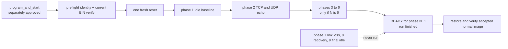
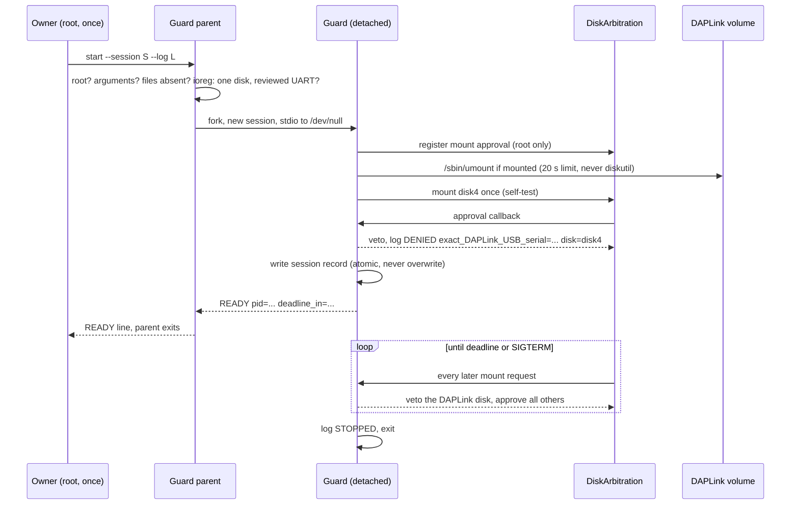
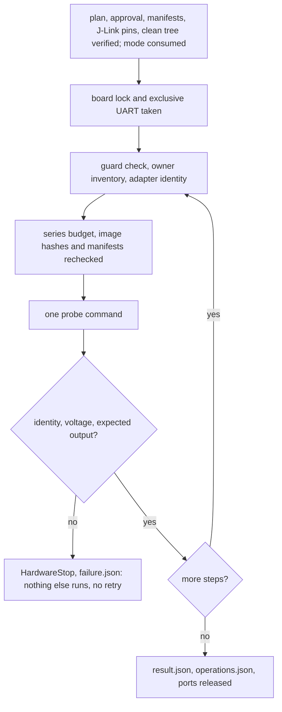

# Issue #28 physical networking preparation

Status: software preparation only. No physical result, programming, reset, cable operation, merge or Issue closure is authorised by this document. Baseline is merged PR #38 (`df52a62c0475fe87e67bde1fa50c49090a146936`). The approved BSD/POSIX client profile and read-only primary-interface contract remain unchanged.

## Test composition and evidence scope

`tests/networking_physical` is a dedicated composition, not a production application. `transaction.c` uses only the approved standard profile. Native context/pool/stack observation, static address setup and the observer thread belong to this composition. Existing `samples/networking/client.[ch]` and runtime-port consumers remain unchanged. Physical results would qualify this private M5 consumer; they would not demonstrate physical execution of those unchanged consumers.

M5N1 requests are exactly 32 bytes: ASCII `M5N1`, nonzero nonce32, phase16, protocol16 (TCP=1, UDP=2), transaction32, and 16 bytes `crux-m5-echo-v1\0`; integers use network byte order. Each response echoes the complete request. M3 application frames and M3 physical results are not M5 evidence. Shared clock/image/UART safety helpers retain their separate purpose.

Three fresh boots must have distinct externally selected nonces, one boot banner each, and the exact identified source. Each boot runs the following sequence with no intervening reset:

| Phase | Command | Peer | Pairs |
|---|---|---|---:|
| 1 | I | initial full idle baseline | 0 |
| 2 | P | TCP/connected UDP echo | 10 |
| 3 | P | receive request, remain silent | 1 |
| 4 | P | echo after timeout | 1 |
| 5 | P | TCP closes after complete request; UDP echoes | 1 |
| 6 | P | echo after early close | 1 |
| 7 | L | silent TCP, approved manual disconnect; UDP attempted while down | 1 |
| 8 | P | echo after confirmed link and route restoration, same boot | 1 |
| 9 | I | final full idle baseline | 0 |

This is 16 sequential TCP/UDP pairs per boot, 48 pairs and 96 calls total. Only one command may be outstanding. A fresh target readiness ticket is consumed before every non-ARM command and issued after completion and RX drain. Queued, stale or malformed input stops application traffic. There is no automatic application traffic at boot or after failure.

## Fixed acceptance proposal

These values are proposed short-test criteria requiring explicit physical approval; they are neither measured RT1060 results nor worst-case guarantees.

| Quantity | Criterion |
|---|---|
| Functional connect/send/receive budget | 2,000 ms, single monotonic deadline |
| Observed complete call latency | record entry, functional completion before close, and return; >2,500 ms requires review and stops qualification |
| External host liveness | 10,000 ms command-to-BEGIN and BEGIN-to-END receipt; unrelated records do not renew it |
| Per-command / series absolute supervision | 150,000 ms / 1,800,000 ms; no interactive extension |
| Operator input window | at most 90 s, clamped to remaining absolute budget |
| Link restoration observation | within 15 s after acknowledged reconnect; timeout is inconclusive and cannot authorise reset |
| Resource settling | within 5,000 ms after return, three complete snapshots at least 1,000 ms apart |
| Idle resources | contexts 0; packet RX/TX free 16/16; data buffers free 32/32 |
| Capacity | contexts/connections 4/4; packets 16/16; data buffers 32/32; no capacity increase |
| Main usable stack | 4,096 bytes; unused >=1,024 bytes |
| Observer usable stack | 2,048 bytes; unused >=512 bytes |
| Observer interval | nominal 50 ms; actual timestamps are evidence, not guaranteed edge precision |

The 2,000 ms functional deadline does **not** establish a 2,100 ms whole-call return bound. Cleanup and scheduling latency are measured separately. The 2,500 ms threshold is an observed acceptance threshold. External liveness expiry means ABORT/INCONCLUSIVE: the target may still be executing, and host timeout does not cancel it. No reset or retry follows automatically.

There are no application workers beyond main and the identified observer. Stack watermark observations describe this finite trial, not all future executions. Native network/kernel workers retain the pinned Zephyr configuration; this slice does not claim comprehensive system WCET or stack qualification.

## Link event and recovery procedure

The peer must first record a complete M5 phase-7 TCP request. The operator may then receive a disconnect cue for that exact nonce/phase/transaction. Capture the cue, operator acknowledgement, dedicated host NIC carrier DOWN and target primary-interface DOWN. The target DOWN timestamp must fall between TCP entry and functional completion. Missing confirmation or a late DOWN is **INCONCLUSIVE**, even when a timeout occurs. Do not extend the functional deadline to accommodate human reaction.

This stage qualifies TCP in-flight loss and a subsequent UDP attempt while the link is already down. It does **not** qualify UDP in-flight loss. If independent UDP in-flight loss is required, prepare and approve a separate stage rather than relabel this evidence.

After phase 7 ends and settles, separately authorised cable reconnection must be acknowledged. Require host carrier UP, exact isolated route, and target primary-interface UP before phase 8. Phase 8 uses fresh sockets in the same nonce/boot with no reset. A recovery requiring reset is a distinct, nonqualifying outcome for this resetless criterion; reset requires its own approval and new evidence series.

UART main and observer streams share a record lock, but observation timestamps precede output. Do not require globally increasing timestamps across threads. Main lifecycle and observer sequence each retain order. Host receipt times and target monotonic times are separate domains; use explicit event correlation, never direct clock subtraction across devices.

## Topology and safety gates

Use the accepted M3 isolated topology only after fresh verification: RT1060 EVKB revision B, QSPI image base `0x60000000`, 8 MiB geometry; board `192.168.77.2/24`, dedicated AX88179 peer `192.168.77.1/24`, TCP 42420 and UDP 42421. The unchanged M3 overlay gives GPIO1.9 exclusively to PHY reset, uses fixed test MAC `02:43:52:55:58:03`, and polls the PHY every 500 ms with its IRQ path excluded. The host adapter, route and USB identities must match the approved inventory. No alternate interface, default route, bridge, Internet path, DHCP or runtime address change is part of this test. Netif status observes the configured primary interface; it neither binds sockets nor proves routing or peer reachability. Host peer composition explicitly owns SIGPIPE policy; reusable consumer code changes no process policy.

Before any physical operation, bind written approval to the final source and runner revision, independently verified manifest hash, exact ELF/BIN/configuration hashes and the identified normal entry/recovery images. Obtain fresh target/probe/UART ownership, root USB mount guard, isolated interface/route checks and exclusive debugger/serial ownership using the accepted M3 procedures. Preserve J-Link executable/DLL hashes, probe serial `602003106`, firmware-update disabling, explicit selection and bounded process handling. Unknown firmware maintenance, transport, mount or ownership state is a hard stop.

Each operation needs explicit authorisation:

1. Read-only inventory, guard and ownership checks; probe connection and full entry-image verification are separately enumerated physical access.
2. Program the exact M5 image using the accepted M3 loader/verify sequence. Account for the loader's implicit reset/start in this permission; capture this prefix separately from qualification boots.
3. For each boot, separately enumerate the read-only qualification preflight (identity-only probe connection and full current M5 BIN verification) and one fresh qualification reset. The preflight must pass before reset. No automatic retry or unlisted reset.
4. Each phase-7 disconnect and reconnect on the dedicated cable, with matching boot nonce and phase.
5. Any reset-based recovery, if later needed, under new approval; it cannot satisfy resetless recovery.
6. Final restoration and full verification of one exact accepted normal image, plus its accepted normal-behaviour checks. Missing entry/recovery artefacts or uncertain state blocks execution.

Historical integrated normal BIN `ad729684749181f0c26853828550187a2c3e60dbb28cf3ee2194a7984141e02f` (107,872 bytes, source `ec94fbe`) is a reference identity, not evidence of current board contents or sufficient restoration authority. Resolve the actual accepted manifests and complete artefacts before execution approval.

No writable native Flash/storage is activated; no production partition/layout is changed. Known functional failure may permit only the specifically preapproved normal restoration while all safety gates remain valid. Unknown target/probe state permits no further hardware changes. Preserve incomplete raw records and classify them, rather than deleting or treating absence as success.

## Software evidence and exact artefacts

The final evidence index and manifest identify executed checks, build inputs, source identity, ELF/BIN/configuration hashes and independent review. Software tests use Host loopback or Zephyr native simulation; RT1060 cross-build proves compilation and image structure only. Physical acceptance remains pending.

## Prepared runner workflow

`capture_m5_network.py plan` generates the three-boot operation/command plan and an unauthorised approval template. It does not execute that plan. `check-approval` checks exact document bindings and individual operation flags; this is not a live ownership/guard check. `replay` requires retained raw UART bytes and continuous receive/poll records, rather than trusting embedded parsed UART data.

The transport-independent `Supervisor`, bounded `run_boot`, and concrete `m5_capture_adapter.py` handle exact raw UART input/output, peer subprocess launch/stop/reap, operator receipt files and asynchronous dedicated-NIC/route observations. Software tests inject fake UART, NIC, processes, guard and Commander; they never open the physical devices. Buffered source-event times remain in raw evidence while dispatch time controls live supervision.

The hardware-gated `capture` subcommand verifies exact M5/entry/recovery manifests and runner/adapter hashes before device acquisition. The accepted M3 lease then checks fresh root guard, probe/UART ownership, exact UART USB identity and isolated NIC/service/route. It starts the continuous receiver and drains stale input before the separately approved preflight and fresh reset. Identity-only `q` and exact current M5 `verifybin` must pass before `r/g/q`; wrong or unknown identity, voltage or image blocks reset. Reset requires **both** `--execute-hardware` and `--perform-approved-reset`, plus the exact `qualification_preflight_N` and `qualification_reset_N` approvals. The same lease owner invokes the accepted M3 `r/g/q` Commander sequence with identity/voltage checks and 120-second pre-guard/45-second post-guard series reserves. This avoids a competing programmer/UART owner. There is no automatic reset retry, programming, restoration or cable control. No such invocation was made during preparation.

Native reads/writes and subprocesses are bounded. Guard checks complete before a fresh deadline check immediately before each UART write. Unknown/absent/ambiguous carrier status is an error, not DOWN. Startup and shutdown failures independently attempt receiver, peer, serial, NIC and lease cleanup; unknown target state grants no reset or restoration authority. A persistent session record prevents three separate CLI invocations from silently restarting the 1,800-second series budget.

After L7 DONE/READY8, stop and reap its silent peer before reconnect or binding the recovery peer. The loss peer intentionally expects only TCP on the wire, since UDP is attempted with carrier down. UART receipt can lag peer request timestamps; correlation uses the exact command write, matching identities, target lifecycle and END receipt. It must not infer target execution order solely from host receipt order.

Resource acceptance checks full native pools after every operation and explicit application descriptor ownership. It does not claim sampled native packet/buffer peak usage, sustained-throughput limits or whole-system timing bounds.


Software-only commands (safe preparation/replay):

```sh
python3 tests/target/capture_m5_network.py plan --manifest <M5-manifest> \
  --entry-manifest <accepted-entry-manifest> --recovery-manifest <accepted-normal-manifest> \
  --nonces <N1> <N2> <N3> > operation-plan.json
python3 tests/target/capture_m5_network.py check-approval \
  --plan operation-plan.json --approval <separately-approved-document>
python3 tests/target/capture_m5_network.py replay --series <raw-bundle-index.json> \
  --source <12-digit-image-source> --abi <symbolic-errno-values.json>
```

`plan` emits `{plan, approval_template}` with all physical flags false. A completed approval document is not present in this preparation. The gated `capture` command is reserved for a later explicitly approved operation; its required arguments identify the plan, approval, all three manifests, current guard session, boot number and new evidence directory. It is not included in software/CI scripts. Programming and normal restoration remain separate accepted M3 operations and require their own fresh safety verification.

Each retained boot directory contains exact `uart-rx.bin`, `receive.jsonl`, `poll.jsonl`, `writes.jsonl`, `controls.jsonl`, `peer-stops.jsonl`, phase peer JSONL and operation/safety records. The raw bundle index supplies each boot's reset(operation, monotonic), nonce, `uart_directory`, `writes_file`, `controls_file`, `peer_stops_file` and `peer_files` keyed by phases 2–8. Paths are relative to the index. Operator receipts are only the two acknowledged cable operations, stamped with the shared `m3_clock` CLOCK_MONOTONIC helper. They describe actions actually performed under approval; writing a receipt never performs an action. Do not fabricate records or copy M3 physical records into the M5 bundle.

Operator annotation helper, used only after the separately approved physical action actually occurred:

```sh
PYTHONPATH=tests/target python3 -c 'from m5_capture_adapter import record_operator_receipt; record_operator_receipt("/absolute/current/boot-dir", "cable_disconnect_receipt", confirmed=True)'
```

Use `cable_connect_receipt` only after the separately approved reconnect. The helper records shared-clock acknowledgement, performs no hardware action and cannot replace native host/target witnesses. Passive UART before the approved fresh reset is retained with exact byte range and SHA-256; a reset cut and one fresh source banner delimit qualifying evidence. Unknown prefix activity or extra boots fail. A shared host-boot identity binds the nonrenewable series clock across all three captures.

Expected functional outcomes are fixed: echo returns 0; silent peers return symbolic `ETIMEDOUT`; TCP early close returns `ECONNRESET` while its UDP partner returns 0. Link-loss calls may return `ETIMEDOUT`, `ENETDOWN`, `ENETUNREACH` or `ECONNRESET`. Other outcomes fail this proposal and require investigation rather than automatic criterion expansion. The actual compiler-derived errno map supplies numeric values.

The frozen input model retains west's clean manifest-checkout record as workspace bootstrap context, separately from the built worktree commit/snapshot. The target compiles explicit worktree/module paths and exactly four pinned dependency revisions; the manifest checkout's source is not substituted for the worktree. A mismatched input model was found during the first freeze attempt and corrected with actual five-record input tests before the final candidate was rebuilt.

## Historical candidate and independent review (superseded)

The following is retained historical software evidence, superseded by the integrated candidate identified below. Historical candidate source is `2f7e6486a1c3bf67a341b9e97bf0c0575bbd2076`.
The subsequent PR documentation/evidence commit does not change executable inputs.
This identifies a cross-built candidate for later approval, not a physically qualified image.

| Artifact | Bytes | SHA-256 |
|---|---:|---|
| BIN | 97,376 | `e27f65e37107d40d0018135c13a6fbc8c2ccb7518ca6b1f68e1229bf3d5b0913` |
| ELF | 2,211,560 | `97a4cc502d1e3f8aa00f3424d79b00b7b804124d9d7058df1043c96187ee8ba8` |
| Configuration | 43,230 | `f2c969e39807202febc936b3eb8c41fd4a4928e85aaf8c7ecbf0e44b7afda3e1` |

Private image manifest SHA-256 is `a32a955550658ee1acfe612466b81b5c2e6db4aaeb10c580fe6321de7c1764d7`,
under `build/evidence/m5-preparation/frozen-2f7e6486a1c3/image-manifest.json`.
The [public evidence index](evidence/m5-physical-preparation.json) records every image/configuration/provenance role,
public log hash, retained private original hash, and normalization/excerpt rule.
Private originals contain absolute paths and are retained locally; they are not published.
The 367-file clean source snapshot has SHA-256
`fd2cb1204e59c80722fd547550dc41fbacbc58d4d8bee2258919210340b9ba69`.

Executed Linux checks: Host debug 71/71 and ASan/UBSan 71/71; build tooling 253/253
(including M5 70/70); existing embedded-libc Zephyr networking 3/3; private native
fixture 1/1; RT1060 reference and dedicated candidate cross-builds; format,
scoped dependency checks and configured Host analysis. The private C analyzer
reported no diagnostics. Configured clang-tidy suppressed non-user warnings.
The private native ztest was invoked directly; no Twister report is claimed.
Native idle snapshots returned contexts 0, packets 16/16 and buffers 32/32;
its test-thread/observer unused observations were 4056/2008 bytes. These are
native software observations, not physical target stack results.

Candidate linker use is FLASH 97,376, RAM 34,332 and DTCM 13,936 bytes. The ELF
contains 4160/2112-byte guarded main/observer allocations for usable 4096/2048-byte
stacks. All 51 frozen artifacts and 28 tools, complete eight-artifact build
provenance, exact ELF/BIN agreement, disabled writable storage and compiler/header
bound errno values were independently verified. Pinned errno values include
ETIMEDOUT 116, ENETDOWN 115, ENETUNREACH 114 and ECONNRESET 104.

An independent Reviewer and a separate Challenger both issued **PASS** at the
candidate source after inspecting actual source, contracts/boundaries, tests,
procedure and frozen evidence. Both independently ran manifest verification and
70 M5 tests. Findings corrected before PASS included record bool/phase/receipt
ordering, in-flight loss and UDP-down proof, peer reap, complete capture adapter,
unknown NIC rejection, failure cleanup, post-guard deadlines, canonical approval
permissions, pre-reset identity/current-image verification, passive raw prefix
separation, host-boot clock origin and workspace/source provenance distinction.
Neither review executed hardware or independently repeated all cross-builds.
Their PASS is confined to software preparation and the proposed procedure.

Excluded acceptance remains TCP servers, unconnected UDP, IPv6/DNS, multiple
interface management, runtime address changes, UDP in-flight physical loss,
concurrent/sustained-load capacity, active native-pool peaks and worst-case timing.
Issue #28 remains open. Actual entry/recovery manifests and artifacts, fresh
per-operation approvals, physical three-boot results and accepted normal
restoration/full verification/behavior are still required before physical acceptance.

## Independent review follow-up and integrated candidate policy

The external review of PR HEAD `a0e0e11` identified two confirmed tooling gaps.
The adapter now verifies actual direct-route output at initial acquisition and
reconnection: exact numeric lookup, interface, destination/mask, UP flags and
absence of a next-hop gateway, rejecting reject/blackhole/unknown forms. It
accepts the isolated connected `/24` or an on-link host route. Source address is
extracted from a fresh, validated dedicated-interface observation; it is not
presented as a source address obtained from `route get`. Route fields and their
source basis are retained with the original inventory output. This is an
observation at a named checkpoint, not socket binding or a route lock.

The narrow output model follows Apple's [route implementation](https://github.com/apple-oss-distributions/network_cmds/blob/main/route.tproj/route.c)
and [route manual](https://github.com/apple-oss-distributions/network_cmds/blob/main/route.tproj/route.8):
`print_getmsg` labels destination, mask, interface and flags, and prints a gateway
for a gateway route. Tests use synthetic network/host-route output and injected
processes; no actual interface/route command was run during preparation. Unknown
output fails closed and requires investigation under a separately approved trial.

The full canonical plan, including `procedure` and `evidence`, must match current
tooling. Approval additionally binds `plan_sha256`, the SHA-256 of the complete
plan serialized as sorted-key compact JSON. Operating notes belong in a separate
file and cannot override the approved plan. Old generated plans/approval
proposals must be regenerated; no physical approval has been granted here.

Replay PASS is explicitly labelled `communication_sequence_only`, with
`physical_acceptance=false`. Final physical acceptance separately requires the
actual approvals, guard/ownership, programming/entry verification, per-boot
preflight/reset records and normal restoration/full verification/behavior.
Automating that broader acceptance audit is outside this slice.

Latest main `5206909` was integrated, including `eaed2a0` Execution and native-free
consumer boundaries; both Execution and M5 CI/test/artifact configuration are
retained. The current candidate was regenerated from the integrated source with
corrected tooling, rather than reusing the old `2f7e648` image. Historical image
outputs and public logs remain unchanged. Historical tool bytes are recoverable
from their recorded Git source; the current checkout contains the revised tools,
so it is not an unchanged tool bundle for re-verifying the old manifest. All timing/resource thresholds,
client-only scope and physical operation gates remain as proposed; a late manual
disconnect remains INCONCLUSIVE rather than extending the functional deadline.


## Integrated candidate — current approval proposal

Candidate source is `22c2815154837322129f16124d5dc7bad8d2f682`, including main
`5206909e0d8d54df2d690226b06b3eb44c5c71e9`. Subsequent publication changes only
documentation/evidence. CI rebuilds may embed the publication HEAD; they do not
replace these frozen approval artifacts. The old `2f7e648` candidate is superseded for this proposal;
its artifacts and public evidence remain historical records.

| Artifact | Bytes | SHA-256 |
|---|---:|---|
| BIN | 97,376 | `c8848b910e06a65333439b35a93bb1bfd3d59838305dde83d9adb09e383bf890` |
| ELF | 2,211,748 | `197b268bef5d18f8b0fd86d4c1019a8999b8e3a421520853fc46121ff84864db` |
| Configuration | 43,265 | `603b9c0936c711d2e431a3103c6ee86baeceab4c9a64fb828cd653872dbfc9e8` |

Private manifest SHA-256 is
`9bf5f014e76d89499e12ae93ecb1ea4769ddf2fd84368986121a9cab4069d47a`,
under `build/evidence/m5-preparation/frozen-22c281515483/image-manifest.json`.
The clean 496-file snapshot SHA-256 is
`b86233d663ef5b6a384a2fa9b43b1c1b935e8c49eeda83e2a3c06bd464eecd29`.
The [integrated public evidence index](evidence/m5-physical-integration.json)
identifies public bytes, retained private originals, full image roles and dependencies.

Linker use remains FLASH 97,376, RAM 34,332 and DTCM 13,936 bytes. Main and
observer usable stacks remain 4,096 and 2,048 bytes. The configuration differs
from the historical candidate only by explicit `CONFIG_CRUX_EXECUTION` disabled;
no production Flash layout or writable-storage setting changed. Existing public
components and networking consumers match integrated main unchanged.

Independent integration review caught a test-only omission: the native-interface
checker's temporary repository lacked the three physical consumer files. The
fixture now includes them; dependency enforcement is retained. The failure and
corrected result are preserved with the route, approval and replay TDD evidence.

Executed integrated-source checks: Linux Host debug 76/76 and ASan/UBSan 76/76;
Python tooling 292/292 without skips, including M5 76/76; qualified embedded-libc
Zephyr networking 3/3 and dedicated native fixture 1/1; RT1060 reference and
candidate cross-builds; portable Execution Host consumers 2/2, Zephyr two
configurations/15 cases and both RT1060 consumer builds. Format, scoped dependency
checks and configured Host analysis pass. The analysis log retains suppressed
non-user warnings; it is not a claim of warning-free third-party code.

Reviewer and separate Challenger both issue **PASS** for software preparation and
the proposed procedure at the exact frozen source. Each independently ran the
manifest verifier and checked all 51 artifacts/28 tools. They inspected actual
image bytes, provenance, stack allocations, disabled storage and tool identities;
M5 76/76 was independently repeated. The integration Reviewer also repeated all
13 native-interface tests after the fixture fix. They did not independently
repeat every Linux build or operate hardware. The full canonical plan binding,
fresh validated direct route and explicit sequence-only Replay result resolve
the external review findings. Native idle stack observations remain 4056/2008
bytes, not RT1060 measurements. All physical timing/resource criteria above are
unchanged proposals requiring separate approval.

Physical acceptance remains pending. Before execution, separately approve the
full canonical plan hash and exact manifest/ELF/BIN/configuration/tool identities,
resolve accepted entry and normal recovery artifacts, and grant each enumerated
inventory/probe, programming (including implicit reset/start), three per-boot
preflight/reset, cable disconnect/reconnect and final restoration operation.
Safety gates must remain valid at each operation. Reset-based recovery requires
new approval and cannot satisfy phase-8 recovery without reset. Replay PASS alone
cannot establish physical acceptance. Issue #28 remains Open; this preparation
performs no hardware operation, merge or Issue closure.

## Stage 1 bench identity and reduced one-boot run (software only)

Status: software preparation. This section authorises no physical operation. It records
two changes to the M5 tooling that the first attempt to use it on the current bench
required, and what the guard check expects. Nothing here was run on hardware.

### Why the runner needed a change

The prepared runner pinned the accepted M3 bench: interface `en5`, adapter MAC
`00:0a:cd:41:89:cc`, UART `/dev/cu.usbmodem11302`. The bench was rewired. A read-only
host inventory on 2026-11-07 (`uhubctl` listing, `system_profiler`, `ifconfig`,
`networksetup`, `ls /dev/cu.*`; no probe connection, no UART open, no power change)
found the following, so every identity gate failed closed.

| Identity | Accepted M3 bench | Current bench (inventory 2026-11-07) | Owner approval needed |
| --- | --- | --- | --- |
| Host interface | `en5` | `en13` | yes, before first use |
| Adapter MAC | `00:0a:cd:41:89:cc` | `00:24:9b:6e:f7:7f` | yes |
| macOS service name | `AX88179` | `AX88179 3` (static `192.168.77.1/255.255.255.0`, no router) | yes |
| UART device | `/dev/cu.usbmodem11302` | `/dev/cu.usbmodem11402` | yes |
| DAPLink USB serial | `0229…9905` | unchanged | no |
| J-Link probe serial | `602003106` | unchanged | no |
| Board, image base, addresses, ports | EVKB rev B, `0x60000000`, `192.168.77.2/24`, TCP 42420, UDP 42421 | unchanged | no |

The adapter USB serial (`0000249B6EF77F`, hub `0-2.1` port 3) was seen in the inventory but is not used by any gate and is not recorded in the code. The service name is a label that macOS can renumber. Duplicate stale services named
`AX88179` and `AX88179 2` also exist. The service check therefore requires the adapter
MAC in the `networksetup -getinfo` output as well, and now also requires
`Manual Configuration`; a service with another MAC, DHCP or a router stops the run.

### What changed

| Change | Where | Effect on gates |
| --- | --- | --- |
| One reviewed identity block | `tests/target/m5_bench.py`, read by the runner, adapter, lease and series replay | None removed. Plan, approval and the lease bind `uart_device` and the service name in addition to interface and MAC. |
| Selectors on shared M3 helpers | `capture_m3_network.guard_check(..., uart=)` and `check_route(..., interface=, mac=)` | Defaults stay the accepted M3 values, so the M3 runners behave exactly as before. The M5 lease passes the reviewed identity explicitly. |
| Reduced run `--through-phase N` (2 to 6) | `capture_m5_network.py` `plan`, `capture`, `Supervisor` | New, separately labelled plan. The full plan changes only by the new identity values and two added identity fields, `uart_device` and `nic.service`; its operations, commands, procedure and evidence are unchanged. |

### Reduced run

A reduced run is one fresh boot, phases 1 to `N`, with no cable operation. It is
**non-qualifying**: it cannot satisfy the three-boot M5 series, the link event criteria,
the recovery criterion or the final idle baseline.



| Property | Reduced run | Full series |
| --- | --- | --- |
| Boots / nonces | 1 / exactly 1 | 3 / 3 distinct |
| Operations bound by the approval | 9, listed exactly: `establish_usb_mount_guard`, `acquire_exclusive_probe_uart_and_nic`, `verify_entry_image`, `program_and_start`, `qualification_preflight_1`, `qualification_reset_1`, `restore_identified_normal_image`, `verify_normal_image`, `normal_acceptance_capture` | 19 |
| Cable disconnect / reconnect | none; any operator receipt aborts the run | six, with matching boot and phase |
| Finished when | the READY for phase `N+1` is received | the READY for phase 10 is received |
| Per-phase checks | the same functional, latency, liveness and resource oracle, applied online at each DONE | same, plus replay |
| Plan status / result status | `SOFTWARE_PREPARED_REDUCED_NON_QUALIFYING_…` / `REDUCED_BOOT_PROTOCOL_COMPLETE_NON_QUALIFYING` with `qualifying=false`, `satisfies_m5_series=false` | unchanged |
| Approval | binds the `reduced` block and the nine operations; a 19-operation approval, a reduced approval on the full plan, extra or missing operations, and a changed `reduced` block are all refused | unchanged |
| `replay` | refuses any bundle with a `reduced` marker | unchanged |
| Session record | `reduced` marker; boot 1 only; a reduced session never starts or continues a full series | unchanged |

What a reduced run can show: the idle baseline and the TCP and connected-UDP echo
phases on the real board, with exact raw UART bytes retained (`uart-replay` works on its
boot directory). What it cannot show: link loss and recovery, three-boot repeatability,
the final idle baseline, or anything about the management stack.

### Guard session: exactly what the check expects

The capture needs a guard that keeps macOS from mounting the DAPLink virtual drive.
The M3 `guard11` program is not in the repository and its source was not found; the
"Replacement mount guard" section below describes the program that writes this record.
The check (`capture_m3_network._guard_check`)
reads a JSON file given as `--guard-session` (its path is not fixed) and requires:

| Field | Required content |
| --- | --- |
| `clock` | `clock_gettime(CLOCK_MONOTONIC)` |
| `serial` | `02290000325182c300000000000000000000000097969905` |
| `disk` | the DAPLink drive device, `/dev/diskN`; the same `diskN` must be the only disk below the DAPLink USB device in `ioreg` |
| `boot_session_uuid` (preferred) or `boot_identity` | equal to `sysctl -n kern.bootsessionuuid` or `kern.boottime` now, so a guard from before a reboot is refused |
| `executable`, `sha256` | file hash must still match at every check |
| `deadline` | CLOCK_MONOTONIC seconds; must exceed now plus the reserve the caller asks for: 0.25 to 10 s for a UART write, 90 s for the lease acquisition and each preflight or reset probe command (which also need 120 s and 45 s of whole-series budget), more for some M3 entry checks |
| `pid`, `process_identity` | the process must be alive and its `ps -p <pid> -o pid=,comm=,lstart=` output must equal `process_identity` exactly |
| `log` | a file that contains `DENIED exact_DAPLink_USB_serial=<serial> disk=<diskN>` and never the text `STOPPED` |

Also checked on every operation: the DAPLink USB device (vendor `0x0d28`, product
`0x0204`, that serial) exposes exactly one `IOCalloutDevice`, equal to the reviewed UART
device, and no partition of `disk` appears in `mount`. The code does **not** verify that
the guard process is owned by root or that it really vetoes a mount; that remains the
owner's procedure. A missing, expired, rebooted or unmatched guard stops every
operation before any owner query, probe command or UART write.

### Decisions and open points for review

| # | Decision or finding | Reason |
| --- | --- | --- |
| 1 | Identity values come only from the Phase A inventory and are listed above for approval | The owner required it; no value was guessed |
| 2 | M3 helpers keep their defaults | Their accepted evidence and tests stay valid |
| 3 | Reduced mode is limited to phases 2 to 6, one boot | Phases 7 to 9 need the cable and cannot be cut short |
| 4 | Reduced mode has no offline replay of its own | The full replay needs three boots; per-phase oracles run online and the raw bytes are retained |
| 5 | No programming or restoration driver exists for an M5 image | The runner never programs by design; the accepted M3 loader sequence (`loadfile`, `verifybin`, `r`, `g`) is wired only into the M3 network runner. Needs a decision before the plan can be executed |
| 6 | Full plan has 19 operations, not 28 | Counting error in an earlier planning note; the code and tests use 19 |

Not verified: everything here is host-side. No hardware, no guard, no real `ifconfig`,
`networksetup` or `route` output of this bench was run through the checks.

## Replacement mount guard (`tests/target/m5_mount_guard.py`)

Status: software preparation. Nothing here ran as root and no mount was vetoed yet; the
first real start is the first test of the approval path. The M3 `guard11` program is not
in the repository and its source was not found, so this guard replaces it. It writes
exactly the record and log described in "Guard session: exactly what the check expects".

### What it does



| Property | Behaviour |
| --- | --- |
| Needs | Root, `/usr/bin/python3` (3.9 from the Command Line Tools), and the macOS frameworks DiskArbitration, CoreFoundation and IOKit through `ctypes`. Nothing is installed or downloaded. |
| Deny rule | The exact USB serial of the DAPLink (serial alone is enough; vendor `0x0d28` and product `0x0204` are what the probe reports). A disk that reports USB but whose serial cannot be read is also denied, so a USB stick without a readable serial is blocked while the guard runs. Every other disk, including objects without I/O media, is approved untouched. An internal error while judging a request is denied. |
| Already mounted | The guard registers the veto first, then unmounts with `/sbin/umount` (20 s limit). It never calls `diskutil`, which stalls on some hosts. If the volume is busy it stops with a message, nothing else changed, and nothing keeps running. |
| Veto evidence | After the unmount it asks DiskArbitration for one read-only, hidden (`rdonly`, `nobrowse`) mount of the disk and requires the mount completion to report the veto and its own approval callback to have logged it. Only then is the session record written. If the volume mounted anyway, the guard unmounts it again, checks that, and the failure message says whether the volume is **still mounted**; it also fails if no answer arrives within 20 s. |
| Record and log | Mode `0644` regardless of umask, never overwritten, session record linked atomically; a temporary file is removed when the write fails. The `executable` is the guard script itself; the record also holds the interpreter and its hash, which no check reads. |
| Lifetime | Default 7200 s, allowed 300 to 14400 s. At the deadline, on SIGTERM or on SIGINT it logs `STOPPED` and exits; the repository check then refuses the guard. |
| Stop | `sudo kill <pid>` (the pid is printed and is in the record). |
| Never | Write to the volume, program, touch the probe, change any system setting, or mount, unmount or write any other disk. It only vetoes mount requests for other disks that are USB with an unreadable serial. |

### Non-root probe

`python3 tests/target/m5_mount_guard.py probe` reads the I/O registry, the mount table and
every disk DiskArbitration reports, and prints the decision the guard would take for each,
without root and without vetoing anything. On 2026-11-08 it identified the DAPLink disk
(`disk4`, USB, exact serial, vendor 3368, product 516) as `deny:exact`, found exactly one
disk and the reviewed UART below it, and showed the volume mounted. The repository's own
guard check, run against a hand-made record on the same host, passed the identity,
ancestry and boot checks and refused only because the volume was mounted.

### Tests and what they do not show

`tests/build/test_m5_mount_guard.py` uses a fake DiskArbitration, a fake host and fake
records; it needs no root. It checks the start order, each refusal before any side effect,
each start failure, the decision table, retirement, the record against the repository's
real `guard_check` with one refusal test per check (retired, no veto line, wrong disk or
serial in the log, changed file, deadline, boot session, process identity, disk, UART,
mounted, clock), and the non-root refusal through the real command line.

Not shown: the real approval callback body (its fail-closed handlers and the callback-lifetime list), the fork itself (`start_detached`; its readiness logic is tested without fork in `run_child` and `read_report`), that macOS passes a `DADiskMount` self-test and a real re-enumeration through
the approval callback of a root process on this macOS version (an `fskit` msdos mount), the
detach and readiness handshake, signal handling in a real run, and the `umount` of the
real volume. The first root start exercises all of these; its log and the printed `READY`
or `FAILED` line are the evidence. A failed start retires the log with `STOPPED`, removes a record this run wrote and exits; a failure to deliver the `READY` report does the same. If the self-test mount did succeed, the failure message says whether the unmount worked.

### Limits and operating requirements

| Item | Detail |
| --- | --- |
| Coverage | DiskArbitration vetoes mounts requested through it. A mount made directly by root (`mount_msdos`, `mount(2)`) or a raw write to `/dev/disk4` is not covered. |
| Trust | The owner starts it as root from a checkout only the owner can write. `sys.path[0]` is that directory, so `m3_clock.py` and `m5_bench.py` are imported unhashed, and the record binds the hash of the script only. This is acceptable for an owner-only machine and is stated, not mitigated. |
| Process identity | `ps` text depends on locale, time zone and terminal width. The guard runs it with `LC_ALL=C`, a fixed `PATH`, no `TZ` and no `COLUMNS`; run the capture with `LC_ALL=C` and with `TZ` and `COLUMNS` unset, or the repository check refuses the guard (it fails closed). |
| Slow host commands | The run loop is pumped between registration, unmount and the self-test. The unmount can still block for up to 20 s; whether `diskarbitrationd` stops consulting a slow approver is not known. |
| Reporting | The caller waits at most 90 s for `READY` or `FAILED` (a slow start can exceed this: `ioreg` alone may take 30 s). After a timeout it prints the child's pid. A child that reports later finds the pipe closed, removes its record, retires and exits. |
| Known small leaks | One CoreFoundation string per veto and one `DADisk` per start; bounded by the lifetime. |


## Programming and restoration driver (`tests/target/program_m5_image.py`)

Status: software preparation. It ran against no device. The runner never programs by
design, and the accepted M3 loader sequence was wired only into the M3 network runner, so
the stage 1 run had no way to program an M5 image or restore the normal image inside the
gate. This driver does that and nothing else.

Every mode needs `--execute-hardware`, a clean committed tree, and the complete approval of
its plan (the runner's approval check requires **every** operation of the plan to be true,
whichever mode runs). It takes the board lock and the exclusive UART before its first probe
command and holds both to the end, and it runs once per evidence parent directory.

| Mode | Probe commands, in order |
| --- | --- |
| `identify` | `q` (identity only), then `verifybin` + `IsHalted` of each candidate image, until the first one that does not match (a mismatch ends the run). It changes no flash and starts no reset, but may leave the core halted |
| `program` | `q`; `verifybin` + `IsHalted` of the identified entry image, **stop if it differs**; then `loadfile` + `verifybin` + `r` + `g` of the exact M5 BIN |
| `restore` | `q`; `loadfile` + `verifybin` of the exact normal BIN (no start); a second read-only full `verifybin`; the UART capture opens; `r` + `g` (the only start) |



| Property | Behaviour |
| --- | --- |
| Reuses | `capture_m3.commander` (pinned `JLinkExe` and DLL hashes, probe `602003106`, firmware-update guard, 30 s limit), `capture_m3_network.image_commands`, `guard_check`, `check_owners`, `select_uart`, `verify_manifest`, `prepare_m5_network.verify`, the runner's approval check, and the lease's owned-port inventory |
| Before every probe command | fresh guard check; ownership inventory (before the UART is taken: nobody owns it; afterwards: only this process owns it and no debugger runs); the dedicated adapter's MAC and static address (carrier **not** required, since the running firmware may have the Ethernet down); at least 120 s of series budget; for a step that uses an image: the file hash against the approval and a full manifest reverification; exact image-path validation before the first command |
| After the guard | at least 45 s of series budget remain, as in the accepted wrappers |
| After every probe command | core, debug port, probe serial and 3.0 to 3.6 V target voltage must match; `Verify successful` is required where a step programs or verifies |
| Records | `inputs.json` (commit, driver hash, every `tests/target` tool hash, plan, approval and manifest hashes), `operations.json` (each step logged before its checks and after its outcome), `failure.json` on any failure, `result.json`, one log per probe command |
| Never | retry, erase, touch fuses or option bytes, issue a second command after a failed one, run without `--execute-hardware`, run on an uncommitted tree, or reuse an evidence directory or a mode |
| Verify mismatch | A verify that finds different bytes makes Commander exit non-zero, and `capture_m3.commander` reports every such exit as one generic `HardwareStop`. The driver treats it as a fault like any other: the run ends after that command. There is no "clean mismatch" path (an earlier version had one; the independent check showed it could never match the real wrapped error, so it was removed as unreviewable dead logic) |
| Restoration evidence | the exact BIN is programmed and fully verified twice before it starts; a passive UART capture of the fresh boot (raw bytes kept, drained first) must show the normal image's `M3_BOOT source=<12 hex> profile=integrated commands=0 fault_default=off`. Only the `integrated-normal` role is accepted for restoration. The accepted baseline checks (unarmed status, idle resources, queue-zero checkpoint) are a separate **offline replay** with the accepted oracles |

Open points: the accepted normal image BIN (107,872 bytes, SHA-256 `ad729684…1e02`, source
`ec94fbe`) is not stored with the M3 evidence archives. It must be rebuilt and its hash compared, or
supplied, before `restore` can name it. The firmware now on the board is unknown; `identify` compares it
only against images that are supplied. Whether the driver's own hash belongs in the plan and approval
schema is an owner decision; it is bound by the clean-tree check and recorded in `inputs.json`, as in the
accepted M3 runners. Not shown on a device: real Commander output for a verify mismatch, whether
`connect` halts a running core, and `loadfile` duration against the 30 s limit for the image sizes.

## Frozen inputs and other west projects

The image manifest of the M5 image froze the west workspace as exactly the four pinned dependencies
(zephyr, cmsis, cmsis_6, hal_nxp). Since then `west.yml` has made more projects active (littlefs and fatfs in
the default groups), and the provenance recorder lists every active project, so a real freeze on current `main`
was refused with "Unexpected/missing/duplicate dependencies". Owner decision, relayed from the owner's chat
of 2026-11-08 (Korea time): "방안 A승인".

| Rule in `prepare_m5_network.frozen_inputs` | Before | Now |
| --- | --- | --- |
| The four pinned dependencies | exactly these four by name, exact revision, clean | each present once with exactly the fields `name`, `path`, `revision`, `git_commit`, `dirty`; revision and commit equal to the pin; `dirty` is `False`; `path` equal to the directory the build compiles (`zephyr`, `modules/hal/cmsis`, `modules/hal/cmsis_6`, `modules/hal/nxp`) |
| Any other west project | refused | accepted and recorded only if: the same five fields; clean; a lowercase 40-hex commit; a revision that is not empty or `HEAD` and, when it is a 40-hex commit (any case), equals the commit; a unique name; a relative path with no `..`, no `.` segment, no backslash; and a path that is not, does not contain and is not inside the manifest checkout or any pinned path |
| Workspace manifest context | optional, canonical | unchanged |

A tag or branch name as an extra project's revision is accepted because the recorder, not this check, resolves
it: `scripts/record-build-provenance.py` refuses any project whose `HEAD` differs from `rev-parse <revision>`
or that is dirty. This check repeats only the dirty flag, the commit format and the commit-equals-revision rule
on the stored record at every verification. The extra projects do not enter the image: the build passes
`-DZEPHYR_MODULES` with the repository, cmsis, cmsis_6 and hal_nxp, and Zephyr then skips west module
discovery. The environment variables `ZEPHYR_EXTRA_MODULES` and `EXTRA_ZEPHYR_MODULES` would still add modules;
the freeze must run with both unset (the recorded `compile_commands.json` and the manifest hash do not refuse
an added module by themselves). Not shown: a real `west list` against a relocated project.

### First real run: a wedged volume, and arm mode

The first root start (`guard-1`, 2026-11-08 Korea time, 21:46 GMT on 2026-11-07) failed closed: `APPROVAL_REGISTERED`, then `UNMOUNT`, then 20 s later
`START_FAILED host command timed out: /sbin/umount /Volumes/RT1060-EVK` and `STOPPED reason=start_failed`. No
record was written and no guard was left running. Read-only `ps` and a mount-table read afterwards showed:

| Observation | Meaning |
| --- | --- |
| `/sbin/umount` and, started after it, three `mount` listings in state `U` for minutes | They wait inside the kernel; `SIGKILL` cannot end them. The guard's own first `/sbin/mount` listing, just before its `umount`, did return and showed the volume; the listings hung only once the unmount was pending. |
| `com.apple.fskit.msdos` (the user-space FAT driver of the DAPLink volume) running since the volume was mounted, state `Us`, about 39 % CPU on average | The file system is served by that process, and `unmount(2)` waits on it. The busy driver predates the guard (the owner had already seen `diskutil` stall on this volume); that the guard's own `umount` request then made later `statfs` calls of the mount block is the observed order, not something shown to be independent of it. |
| `getfsstat64(MNT_NOWAIT)` returned in 0.05 s and listed `/dev/disk4 on /Volumes/RT1060-EVK (msdos)` | The kernel's cached mount list can be read without asking the wedged file system. `/sbin/mount` asks each file system, and it blocked once the unmount was pending. |

Consequences and changes:

| Question | Answer / change |
| --- | --- |
| Can the guard's own mount-table reads hang the same way? | They could: the first version ran `/sbin/mount`. `SystemHost.mounts()` now reads the table with `getfsstat64(MNT_NOWAIT)` in a short-lived `python3 -I -S` child (10 s limit, killed and not waited for). The repository's own `_guard_check` still runs `mount`, so while a wedged mount exists every operation is refused (fail closed, after its 10 s limit); the volume must be gone before a capture. |
| What does the guard do on a hung `umount`? | It stops at once, does not read the mount table again, and says: unplug the DAPLink USB, wait for the mount to disappear, then start with `--arm`. |
| Is there a way that avoids unmounting? | Yes: `start --arm`. The DAPLink is unplugged first (this powers the board off). The guard checks that the DAPLink is absent, registers the veto and prints `ARMED`. The owner plugs the DAPLink in; macOS asks to mount the new volume; the guard vetoes that real request (`DENIED exact_DAPLink_USB_serial=… disk=…`, the evidence), waits up to 20 s for the disk and the reviewed serial port to show in the I/O registry (exactly one disk, the vetoed one, and exactly one callout device), checks that nothing is mounted, and writes the record (`evidence`: `armed_replug_veto`, `mode`: `arm`). No self-test mount and no unmount happen. |
| Progress | The parent prints `ARMED …` as soon as the veto is registered, then `READY …` or `FAILED …`; it waits at most the arm wait (default 600 s, allowed 60 to 1800) plus 90 s. |
| Names | A failed start leaves its root-owned log. A new start needs new `--session` and `--log` names; the guard never overwrites. |

Not shown on a device: that macOS asks for the mount of a replugged DAPLink through the approval callback of a
root process before any other program mounts it, that the serial port keeps the name `usbmodem11402` after the
replug, and the real `getfsstat64` reader on a wedged mount (it ran once, read-only, and answered in 0.05 s).

The arm wait and the ancestry wait are approximate: one `ioreg` call can take up to 30 s, during which the run loop does not answer DiskArbitration (as in the normal start), and the deadline is checked after each call. In arm mode the lifetime counts from `READY`, so `deadline_in` is the real time left. The mount-table reader allocates room for 16 more mounts than the first call counted and fails if the table still overflows it.

## Host-output parsers against real output (2026-11-08)

The first real run of the driver (`identify`, read-only, before any probe command) stopped on `Exclusive UART ownership changed`. Two differences between the tests' fakes and the real `lsof` caused it: `lsof -Fp` prints an `f<fd>` line after each `p<pid>` line, and `lsof` exits 1 when any file it is asked about is not open (the driver opens `/dev/cu.usbmodem11402` and never the `tty` node). The driver and the capture adapter now ask for the two nodes one by one: the `cu` node must be held by this process alone (exit 0, empty stderr), the `tty` node by nobody (exit 1, no output). Both answers are written next to the other evidence files (`<label>-owners-cu.txt`, `<label>-owners-tty.txt`).

`tests/build/fixtures/host-2026-11-08/` keeps real output of every read-only host command that the driver, the capture adapter and the guard check parse, and `tests/build/test_m5_host_output.py` runs the parsers on it:

| Parser (file) | Real input | Result |
| --- | --- | --- |
| UART owner check after the port is open (`program_m5_image.py`, `m5_capture_adapter.py`) | PROXY: `lsof -Fp` of a scratch file held open by the capturing process (the UART was never opened for the capture) and the real, unopened `tty` node | two mismatches found and fixed (above) |
| UART owner check before acquisition (`capture_m3.check_owners`) | `lsof` of the unowned pair, `ps -axo pid=,comm=,args=` | accepted as it is; ran on the real run |
| Debugger scan (`ps` text, regex for `JLink`, `openocd`, `pyocd`) | `ps -axo pid=,comm=,args=` (trimmed) | no false match |
| Guard session and ancestry (`capture_m3_network._guard_check`, `usb_association`) | `sysctl -n kern.bootsessionuuid`, `ps -p PID -o pid=,comm=,lstart=`, `ioreg -p IOService -l -w0 -a` (the DAPLink subtree, stored as XML), `mount` | accepted as it is; ran on the real run |
| Port mapping (`capture_m3.select_uart`) | `serial.tools.list_ports` entry of the DAPLink | accepted as it is |
| Adapter identity and service (`program_m5_image.check_nic_identity`) | `ifconfig en13` (link down), `networksetup -getinfo "AX88179 3"` | accepted as it is |
| Interface observation (`m5_capture_adapter.parse_interface`) | `ifconfig en13` with the link down | **mismatch found and fixed**: the real link-down output has no `inet` line (macOS shows the manual address only while the link is up); the parser demanded it, so a cable pull (phase 7) would have stopped the capture instead of recording `host_down`. An active link still needs exactly the static address |
| Route and carrier check (`check_route`, `parse_direct_route`) | proxies: real `ifconfig` and `route -n get` of the active host interface, the connected-network form and the cloned host-route form, with the bench identity substituted | accepted as it is |
| J-Link Commander wrapper, identity and verify text (`capture_m3.commander`, `check_identity`, `Verify successful`) | real V9.86a transcripts of this probe and target: the repository's `microsd-card-states-stack` logs and a redacted `loadfile`/`verifybin`/`r`/`g` transcript from the owner's local backups (2026-11-05); the diagnostic regex was also run over every Commander transcript (`.log` and `.out`, 188 files, 170 distinct) in the owner's local backups, which are not in the repository: 9 files match it and all 9 are real failures (`Failed to power up DAP`, `Could not connect`, `Could not read memory`), none is a false stop | accepted as it is |

After this change the prepared plan of the stage 1 run is void (the plan binds `adapter_sha256`): it has to be prepared and approved again from the merged source, and the M5 image rebuilt, because the image carries the 12-character commit tag.

Not covered, because it needs a probe command or a carrier: the real Commander output of `IsHalted` (the pinned `JLinkExe` contains the texts `CPU is halted.` and `CPU is not halted.`; no transcript exists; the text is only checked by the generic diagnostic regex, and an unknown command would also stop the run), the exit status of `JLinkExe` on success as the wrapper sees it, the real output of `verifybin` that finds different bytes, and the real `ifconfig` and `route` output of an active dedicated adapter (only the proxies above).

### First real restore: the disconnect diagnostic after a verified load (2026-11-08)

The first `restore` on the bench (identity probe, then the load over unknown flash content) wrote and verified the normal image (`Verify successful.`), and then stopped: after `q`, J-Link Commander V9.86a printed `****** Error: Could not start CPU core. (ErrorCode: -1)` and exited 0. The repository already documents this message for a similar command file (`docs/m2-physical-verification.md` describes a `Could not start CPU core` diagnostic printed after the post-verify quit although the exit status was zero; that file ran `r`, `h`, `loadfile`, `verifybin`, `q`), and `tests/target/capture_execution.py` accepts it only after `J-Link>q`. The driver's load step ends with a bare `q` after `verifybin`; the message appeared in the one real run so far, and the accepted M3 wrapper stops on every diagnostic (`tests/build/test_m3_capture.py` lists this message as one that must stop the M3 wrapper: the M3 wrapper and that test are unchanged, and only the M5 driver departs from it, narrowly). The tests had faked the Commander text, so they could not show it.

`program_m5_image.accepted_disconnect_diagnostic` now accepts this one message, and only when: the wrapper stopped for a diagnostic after exit 0 (any other wrapper failure is never reinterpreted); the command file has a `verifybin` and nothing after the last one but `q` or `IsHalted` and `q` (so never a start with `r`, `g`, and never the `program` load step, whose `r` and `g` follow the verify); the last `verifybin` printed `Verify successful.` before the quit; the line is the only `****** Error:` line, with exactly that text; it is the last non-blank line of the log; and no other line of the log matches the wrapper's diagnostic words. The acceptance is recorded next to the log (`<step>.diagnostic-accepted.json`). The real log of the first restore is kept as a fixture (`tests/build/fixtures/host-2026-11-08/jlink-loadfile-verifybin-quit-diagnostic.log`, image path redacted). Real transcripts of the identify steps of the same day are kept too (identity only, a matching `verifybin` with `IsHalted` printing `CPU is halted (PC = ...)`, and a mismatching `verifybin`, which exits non-zero). Still unknown: whether the core has started after such a disconnect. The read-only `identify` that followed showed the program counter inside the normal image, so the core had been running it; the `restore` mode starts the image itself with its later `r` and `g`, and the `program` mode does not use this acceptance at all.
