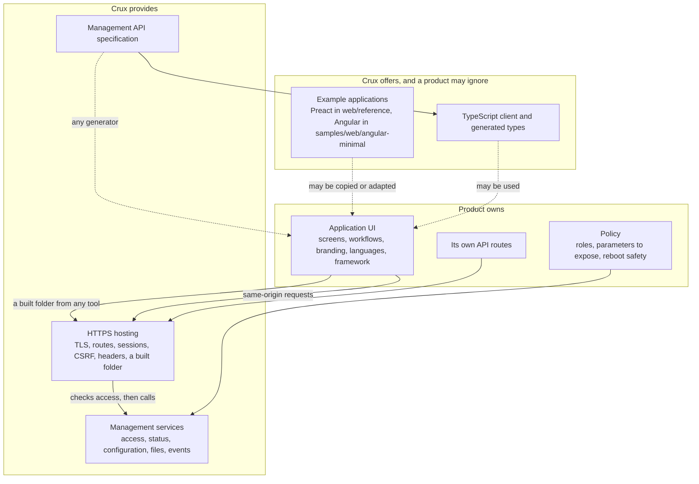

# Web frontend foundation design

Status: decisions W1 to W18 accepted by the owner, milestone M13. W13 replaces W3 and W6, which stay below as history.
It refines the [web design](secure-management-web-design.md), and it withdraws that document's page set and reference
technology where they differ. Nothing here authorises implementation, dependency adoption or hardware operations.

## Outcome

Crux provides management services, APIs and HTTPS hosting. The product owns its application UI, in a framework that
it chooses. Two example applications, in Preact and in Angular, show how a product-owned UI uses the API on a small
shared core. Crux promises no common pages, no product-ready interface, no design system and no feature parity between
the examples.



The server checks every operation, so hiding a control in a UI is not a security control, and moving a screen to an example
changes no service or its tests.

## Decisions

| ID | Decision | State |
| --- | --- | --- |
| W1 | The reference interface starts with Preact and TypeScript | Owner, 3 November 2026 |
| W2 | Angular should also be supported where that is possible | Owner, 3 November 2026 |
| W3 | The first screens are a home screen, network settings and reboot | Owner, 3 November 2026. Replaced by W13, kept as history. |
| W4 | Sign-in and forced password change are added to W3, because the other screens cannot be reached without them | Owner, 3 November 2026 |
| W5 | Frontend work has its own milestone, M13, and the existing M11 and M12 keep their numbers | Owner, 3 November 2026 |
| W6 | Angular support means the API, packaging and security settings work with it, shown by a minimal sample in CI and once packaged on `native_sim`. Crux ships no Angular components. | Owner, 3 November 2026. Replaced by W13, kept as history. |
| W7 | Network settings are saved and take effect at the next boot. There is no live apply. | Owner, 3 November 2026 |
| W8 | Static IPv4 comes first, and DHCP is a separate later item | Owner, 3 November 2026 |
| W9 | A composition must state its reboot policy explicitly | Owner, 3 November 2026 |
| W10 | Crux's own frontend tooling is `tsc`, esbuild and a small mock server, and it does not use Vite | Owner, 3 November 2026 |
| W11 | Frontend work with a mock server may run alongside M7 and before gate #183. This departs from the secure management design's default of planning only. | Owner, 3 November 2026 |
| W12 | Each fixed API route and asset is its own registered server resource, a route with a path parameter is one registered wildcard resource, and applications use hash routing | Owner, 3 November 2026 |
| W13 | Crux provides management services, APIs and HTTPS hosting, and the product owns its application UI. Common pages are withdrawn as a promise. Preact and Angular are examples. The five Preact screens and their tests stay. This replaces W3, W6 and the common pages in D1. *Author's means, not the owner's words: a shared core and optional advanced flows, with reboot and network settings labelled advanced examples, as listed in the Core and Advanced table.* | [Owner, 4 November 2026](https://github.com/wonny-labs/crux-pilot/issues/183#issuecomment-6637976084), except the part in italics |
| W14 | The network settings service (#213) follows the HTTPS core, #184 to #190. Its specification and screen stay. | Owner, 4 November 2026 |
| W15 | Angular gains its core scenarios after the configuration API exists, as one small issue, #243 | Owner, 4 November 2026 |
| W16 | Filesystem-hosted assets leave M11 for a separate proof of concept. *Author's means, not the owner's words: it is tracked in #244, and W12's generation of one resource per asset is limited to firmware.* | Owner, 4 November 2026, except the part in italics |
| W17 | PSA (#142) is a prerequisite of real HTTPS on `native_sim`. *Author's means, not the owner's words: it is delivered through the composition in #242.* | Owner, 4 November 2026, except the part in italics |
| W18 | Host and `native_sim` functional completion is an explicit interim result. Physical evidence stays tracked separately and is not waived. | Owner, 4 November 2026 |

How the earlier rows read after W13:

| Row | Effect |
| --- | --- |
| W1 | The framework choice stands. "The reference interface" now means the Preact example, which is the larger of the two. The folder keeps its name, `web/reference`. |
| W2 | Angular is an example, and it stays in CI. |
| W3 | Replaced by the Core and Advanced table below. All three screens stay. |
| W4 | Stands. Sign-in and forced password change are core. |
| W5 | Stands. The milestone keeps its title. |
| W6 | Replaced. Two parts carry on: Crux ships no Angular components, and the Angular example runs in CI and is packaged on `native_sim` in #220. |
| W7, W8, W10, W11 | Stand. |
| W9 | Stands for a composition that includes the reboot service. *Author's reading:* W13 classes reboot as Advanced, so a composition may leave the service out, and then it has no policy to state. |
| W12 | Stands. *Author's reading of W16:* its per-asset generation applies to firmware-embedded assets, which is the only source W12 had in view. |

W1 changes the plain HTML reference in the web design. A framework is justified here because hand-written DOM code
is where cross-site scripting mistakes occur as a screen grows, while Preact escapes output by default. It adds one
package with no runtime dependencies, in metadata read on 3 November 2026.

## Responsibilities

| Item | Crux | Product |
| --- | --- | --- |
| HTTPS, sessions, permissions, response headers | Provides, in M11 | Sets policy and limits |
| Management services and API, with its specification | Provides | Adds its own routes with `CRUX_WEB_ROUTE`, and may use any client |
| TypeScript API client | Offers, with no framework dependency | Uses it, or generates its own from the specification |
| Asset packaging into firmware | Provides. The asset table stays private. | Supplies a built folder from any tool |
| Reboot and network settings | Services with policy, #214 and #213 | Decides the safety policy and whether to use them |
| Example applications | Offers as examples, not as a maintained product interface | May copy, adapt or ignore |
| Application UI: screens, workflows, branding, languages, roles | Nothing promised | Owns |
| Files, accounts, certificates and firmware screens | APIs only, each from its own issue. No screen is promised. | Builds its own |
| Angular components, or a UI component library | Not provided | Owns |

The firmware build needs no Node.js. It takes a built folder. A project that uses no web interface pays for none of this.

## Core and Advanced flows

Core flows appear in both examples and in the shared browser cases. Advanced flows appear in the Preact example, with service
tests underneath. Neither kind is a product promise, and a new API does not by itself need two new screens.

| Flow | Kind | Crux service | Preact example | Angular example |
| --- | --- | --- | --- | --- |
| Sign-in and sign-out | Core | Sessions, #186 | Built | Built |
| Session expiry | Core | Sessions, #186 | Built | Built |
| Forced password change | Core | Accounts, #186 and #187 | Built | A notice only. The screen is in #243. |
| Status | Core | Status, #180 and #187 | Built, as home | Built, as home |
| Simple configuration update | Core | Configuration, #180 and #187 | In #243 | In #243 |
| Network settings | Advanced | #213, after the HTTPS core | Built. The advanced label is in the documents only, not on the screen. | Not planned |
| Reboot | Advanced | #214, optional and policy-controlled | Built. The advanced label is in the documents only, not on the screen. | Not planned |
| Browser console | Optional follow-up in M13 | Endpoint in #204 | No page | No page |

The state above covers the mock only. The evidence for each flow is in the
[implementation design](web-frontend-implementation.md#core-and-advanced-evidence).

## Structure

```text
Application UI             owned by the product, in any framework
Example applications       web/reference (Preact), samples/web/angular-minimal (Angular)   M13
TypeScript client          web/client, session, login polling, CSRF        M13
API specification          OpenAPI file, shared by both sides              M11
Asset packaging            folder to firmware data, headers, budgets       M11
crux_web and services      routes, sessions, status, configuration         M11
Optional services          network settings, reboot                        M11, after the core
```

A change to the specification is one reviewed PR that both tracks rebase onto, like any other shared contract.

## Example screens

Permission names are proposals. The status response follows the status service proposal, in which that route is
session-only and the service filters items by permission.

| Screen | Kind | API | Permission | Backend state |
| --- | --- | --- | --- | --- |
| Sign-in | Core | `POST /api/v1/session`, attempt polling, `DELETE`, `GET /api/v1/session/me` | Public for login | #186 |
| Forced password change | Core | Change own password | Session-only route, with the account service authorising the change, as AC5 in the gate record recommends | #186, #187 |
| Home | Core | `GET /api/v1/status` | Session-only, filtered per item | #187, with the status service from #180 |
| Configuration | Core | Routes to be added to the specification by #187 | Per parameter, checked by the service | #187, then #243 |
| Network settings | Advanced | `GET`, `PUT /api/v1/network` | `network.read`, `network.write` | #213, after the HTTPS core |
| Reboot | Advanced | `POST`, `GET /api/v1/system/reboot` | `system.reboot` for both | #214 |

The built interface itself is public, because a browser must load it before login. It must hold no secret or device data, and every API still checks access. This extends `CRUX_WEB_PUBLIC`, which the web design reserves for login and sign-in assets, to the whole bundle. A public bundle does reveal which screens exist.

Account, file, certificate, firmware and console screens are not promised, and a product builds its own. An optional example
console page is M13 follow-up work, after the endpoint in #204. Account management in the examples stays on the CLI. The first
credential stays on the serial console, as the access contract requires.

## Network settings

W14 places this service after the HTTPS core, and it does not block #184 to #190. Until then the screen and its browser cases
are shown on the mock only. The `crux_netif` contract is read-only, and that stays. Samples set their IPv4 address in native code, with DHCP
disabled, so writing settings is a new capability.

| Topic | Proposal |
| --- | --- |
| Values | IPv4 address, prefix length and optional gateway, stored with the existing `U32` Configuration type. Zero means no gateway, as the samples use today. |
| Integrity | The Configuration contract saves one key at a time and loads each with its own fallback, so a mixed set could boot. A fourth key holds a check over the other three and is saved last. A mismatch uses the defaults. |
| Validation | Unicast address, a usable prefix, and a gateway inside the subnet when one is given. Reject with field errors. |
| Apply | Saved only. The composition reads them at boot and applies them in private native code. |
| Display | `GET /api/v1/network` returns running values, saved values and their source, saved or default, with a notice that a reboot is needed |
| Recovery from a wrong address | A serial command, delivered with the service in #213 on the #181 registry. Configuration has no clear operation, so it saves a `use_saved` flag as false. The next successful save through the service sets the flag back to true, after the check key, so that later changes still apply. It needs a composition with a serial console. |
| Events | A change is a security event, with no secret involved |

W7 avoids a live change that would cut off the user's own session and leave the device unreachable with no way to
confirm. A confirm-or-revert apply can be added later.

**Dependencies and limits.**

- Saving on the target needs a Configuration provider, which Issue #16 has not decided. Until then, this works only on
  the Host and `native_sim`, and the target returns not supported.
- An address change can invalidate a certificate naming the old address, so the certificate work in #190 must state how
  this behaves.
- DHCP is disabled in the Crux network samples today and has no evidence, which is why W8 defers it.
- Saved values take effect at any later reset, including a power cut, and not only after the reboot that the user intended. `GET /api/v1/network` and the network screen show the difference, but an unintended reset can still apply a wrong address.
- A product with no serial console needs its own recovery path, or must accept that a wrong address needs service access.

## Reboot

W13 classes reboot as Advanced, so this is an optional service with no required screen, #214. W9 applies to a composition that
includes it, which must state its policy. `crux_system_reset` exists, and its contract says that it does not flush storage, drain logs or perform safe-state
actions. A web request therefore goes through a service.

1. Check `system.reboot` and the composition's reboot policy.
2. Record the event and reply `202`, so that the browser gets an answer.
3. After a short delay on a worker, give events and pending saves a bounded time to finish, and check the policy again, because the machine may have started in the meantime.
4. Call `crux_system_reset`. If it returns, record the failure and report it through `GET /api/v1/system/reboot`, which returns none, pending, refused or failed.
5. The browser polls. The running device also answers, so an answer alone is not success. Success is a session that is no longer valid, because sessions do not survive a reset, and the browser then shows sign-in. If nothing changes before a time limit, it says that the restart was not confirmed.

Its contract says a native failure may hang, and in that case only a watchdog or an operator can recover.

**Policy (W9).** Rebooting a controller while it runs a machine is a safety matter that only the application can judge. A composition must therefore either register a callback that can refuse, or select an explicit always-allow option. It cannot simply leave this unset. A refusal returns `423` with a reason. The screen asks for confirmation, but that is a usability step and not a security control, since the server checks everything.

On the Host, `crux_system_reset` returns not supported, so tests observe the service's steps with a fake.

## What the web foundation must do for Angular

These change M11 issues and they also help any other framework. Angular facts are from its security guide, and none has
been tested here yet.

| Topic | Fact | Requirement |
| --- | --- | --- |
| Response headers | A Zephyr static resource has no custom headers, while a dynamic response does | Serve assets as dynamic resources, with headers and `Content-Encoding` set by the adapter |
| Style policy | Angular inserts styles at run time, so it needs a per-request nonce or `'unsafe-inline'` in `style-src`. Its guide ties `script-src` needs to critical CSS inlining and subresource integrity, which the sample disables. | A composition setting with two values: strict, or inline styles allowed. Scripts stay `'self'` and `frame-ancestors 'none'` stays in both, and no free-form policy string is offered. |
| Login CSRF | The attempt poll sets the session cookies on a public `GET`, and a top-level navigation could otherwise collect another account's session | The poll requires `X-Crux-Request: 1`, which a navigation cannot send and a cross-site `fetch` could send only after a preflight that the server does not answer. A poll without it gets `403` and leaves the attempt as it was. Adopted on the owner's advance approval, for review in the morning. |
| CSRF | `HttpClient` by default reads a JavaScript-readable `XSRF-TOKEN` cookie and sends `X-XSRF-TOKEN` on state-changing requests | Use those names. The session cookie stays `HttpOnly`. The token cookie is `Secure`, `SameSite=Strict` and readable, holds a value independent of the session token, and is compared per session in constant time. The TypeScript client does the same. |
| Deep links | A browser reload on an application path would need `index.html` | Hash routing, which Angular offers with `withHashLocation`, so the server sees only `/` and asset paths. Path-based routing is not supported at first. |
| Connections | Lazy loading creates many files, and the server default is three clients | A packaging budget for file count and compressed size, failing the build when exceeded |
| Header capture | Two cookies and more headers exceed the 128-byte, three-header default | Size them against real browsers, as #184 already requires |

The strict setting is the default. Choosing the inline style setting weakens only style injection, which can still restyle a page to mislead a user, and a project should record that choice. A nonce would need server-side templating, which the web design excludes.

**Example.** `samples/web/angular-minimal` holds sign-in and home using the generated types, and is built in its own CI job
with its own lockfile. #243 adds the rest of the core after the configuration API exists. It does not reach feature parity,
and Angular versions move only when that example is updated. It
also gives the first measured comparison with Preact: compressed size, file count, policy violations and production
package count.

## Server resource model

The Zephyr HTTP server allows one in-flight request per dynamic resource, recorded in a `holder` field, and it answers a second client with a bare `409`. When a client disconnects, the server releases holders only on registered resources, and it does not walk the service fallback resource. A single catch-all resource would therefore serialise every request, and a client that disconnected mid-request would leave it held until a later complete request happened to use the same client slot.

W12 follows from this:

- The build generates one registered resource for each fixed API route and asset, from the route table and the packaging step. The fallback resource is not used, which replaces the web design's catch-all and the fallback candidate in #184.
- Registered matching is exact, so a route with a path parameter, such as `GET /api/v1/session/attempt/{id}` or `/api/v1/config/{name}`, gets one registered wildcard resource such as `/api/v1/session/attempt/*`. This needs `HTTP_SERVER_RESOURCE_WILDCARD`, which selects `POSIX_C_LIB_EXT`. Exact matches are tried first, and all requests under one wildcard share one holder. This has not been built here, so #184 must prove it on the provider profiles. If it cannot, path parameters become query parameters, which exact matching already accepts, in one reviewed change to the specification.
- With that option, the server's `FNM_LEADING_DIR` flag lets any route also match deeper paths, so `/api/v1/status/x` reaches the status route, and a trailing `*` crosses `/`. The adapter therefore compares the whole path with the route table before it checks access, and answers `404` to anything else.
- The wildcard pass takes the first match in section order, which is sorted by name, so `/api/v1/session` could capture `/api/v1/session/attempt/x`. The generator must place wildcard resources first, or the parent resource must accept the method.
- The server always sends `Transfer-Encoding: chunked` on a dynamic HTTP/1.1 response, so no route uses `204`. A path with no registered resource gets the server's plain `404`, and a wrong method its plain `405`, neither with JSON or security headers.
- #184 implemented and measured this model. See the [web contract](../web-contract.md), which also records two limits of `native_sim` found there: the host's C library reads the server's `fnmatch` flags differently, and the native socket offload has no `shutdown`, which the inactivity timer uses.
- Hash routing removes the need for a deep-link fallback.
- A `GET` completes in one server pass, while a `POST` or `PUT` whose body spans several reads holds its route until the body completes or the connection closes.
- The client treats a `409` with no JSON body as busy and retries. A refused reboot therefore uses `423`, so that the two cannot be confused.

**Limit.** Anyone who can reach the port can hold a route by sending a partial request without logging in, including the login route. The inactivity timeout, 10 seconds by default, restarts on every receive, so a client that keeps sending a few bytes holds the route past it. This can keep network login busy while it lasts, like the login delay limit in the access contract, and the serial console is not affected.

The adapter's callback runs on each body chunk and a negative return closes the connection, so #184 adds a whole-request deadline there. Headers run no callback, so the adapter cannot close a client that trickles them. Such a client holds a client slot up to the parser's 80 KB header limit, and three of them at the default client limit block the whole web interface. #184 must measure this, then either add a server-side deadline, which is a Zephyr patch for the owner to decide, or declare the limit. A slow reader also stalls the single server thread, which bounded send timeouts must limit, and #184 measures that too.

## Tooling and supply chain

Build tools do not ship in the product, but they do produce what ships. The aim is few packages that are easy to review.

| Rule | Detail |
| --- | --- |
| Pinned | Node.js version and a committed lockfile, installed with `npm ci` |
| Scripts | `--ignore-scripts` if esbuild's platform package works without its install step, which needs checking |
| Build | `tsc` for types and esbuild for the bundle. esbuild has no runtime dependencies, whereas Vite with its Preact preset adds more packages. |
| Runtime | Preact only. Routing and state are small local code at first. |
| Assets | No external script, style or font, enforced by a browser test and the content policy |
| DOM | No `innerHTML` or `dangerouslySetInnerHTML` in the Preact example, checked by a script |
| SBOM | A CycloneDX record for production packages, plus the packager's list of asset hashes |
| Advisories | `npm audit` for production packages in CI, reviewed and not blindly auto-upgraded |

The bundled assets sit in the firmware image, so they are covered by image signing. Fixing a frontend vulnerability needs a
firmware update, and the product's support plan has to include these packages. No long-term support policy was found for
Preact, so a product should expect to patch a pinned version itself if needed.

Crux keeps no built output in the repository. A firmware composition names a built folder. If it asks for assets and
the folder is missing, configuration fails. The asset table stays private, so firmware-embedded data is not a public
application contract. Filesystem-hosted assets are a separate proof of concept, #244, with the conditions in the
[web design](secure-management-web-design.md#application-ui-and-asset-hosting).

## Testing

| Level | Covers | Needs |
| --- | --- | --- |
| Client unit tests | Login polling, CSRF, error mapping, retry timing | Node.js |
| Specification check | The mock server and the firmware adapter both conform to the OpenAPI file | M11 for the firmware side |
| Browser tests on the mock | Each screen, a denied permission, an expired session and the reboot wait | A browser, in CI |
| Browser tests on `native_sim`, core | The shared cases on both examples against real TLS and real sessions, and policy violations | #184, #185, #186, #187, #189, #142, #242 and #243, #190 or a declared test certificate, and the first credential through #181 or a declared test step, in #220 |
| Browser tests on `native_sim`, advanced | Network settings and reboot on the Preact example, with service tests underneath | #213 and #214, in #220 |
| Packaging tests | Headers, encodings, budgets and a missing folder | M11 |
| Angular example | The core under the inline style setting, on the mock and once packaged on `native_sim` | Separate CI job, which needs owner approval like every new workflow under `.github/` |
| Target, separately approved | Load time, connections, Flash and RAM on RT1060-EVKB | One board, one session at a time |

Mock, Host, `native_sim` and physical evidence are recorded separately, and none stands in for another. W18 makes Host and
`native_sim` functional completion an interim result. It closes neither M11 nor M13, because the physical evidence stays
tracked and is not waived.

## Parallel work

Frontend work needs the specification and not the firmware, so W11 lets it begin before gate #183. It uses a mock server until the real one is available.

| Session | Work | Starts when |
| --- | --- | --- |
| Frontend | M13 | #212 is reviewed |
| HTTPS | M11 | After gate #183. #212 is done first, by the frontend session. |
| SSH | #192, #193 | Gate #183 and #205 |
| SFTP | #194, then #195 | Gate #183, #205 and #179 |

The frontend session owns `web/` and `samples/web/`, and it does not touch `components/`. End-to-end browser tests need M11's
first issues, so they come last. Limited RAM and disk on one development machine mean that the four sessions should not all run
Zephyr builds at once. Frontend builds are light, and Zephyr builds are the expensive ones.

## Why a separate milestone

M12 already holds the CLI and SFTP work, so renumbering it would break existing references. Numbers do not set the order, so
M13 can finish before M12. A separate milestone fits because the toolchain, evidence and likely owner differ, and because M11 can
then exit on the backend alone. Asset packaging stays in M11 because it is firmware work.

## Open questions, with working defaults

| Question | Default |
| --- | --- |
| Languages | English text in one table, ready for translation |
| Browsers | Current Chrome, Edge and Firefox |
| Separate npm packages for the client and the Preact example | Same repository at first, not published |
| Status refresh | Polling every few seconds, kept low because of the single server thread |
