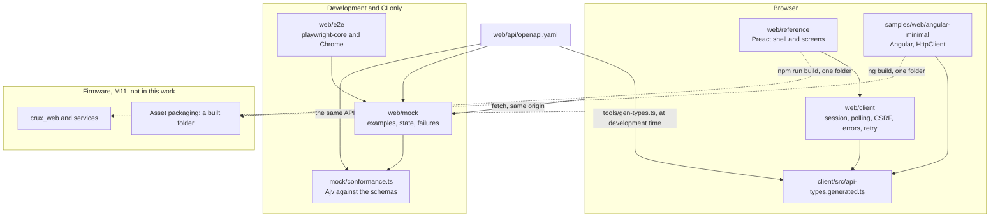
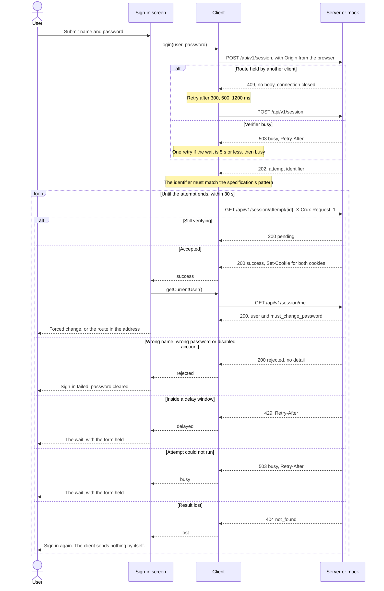
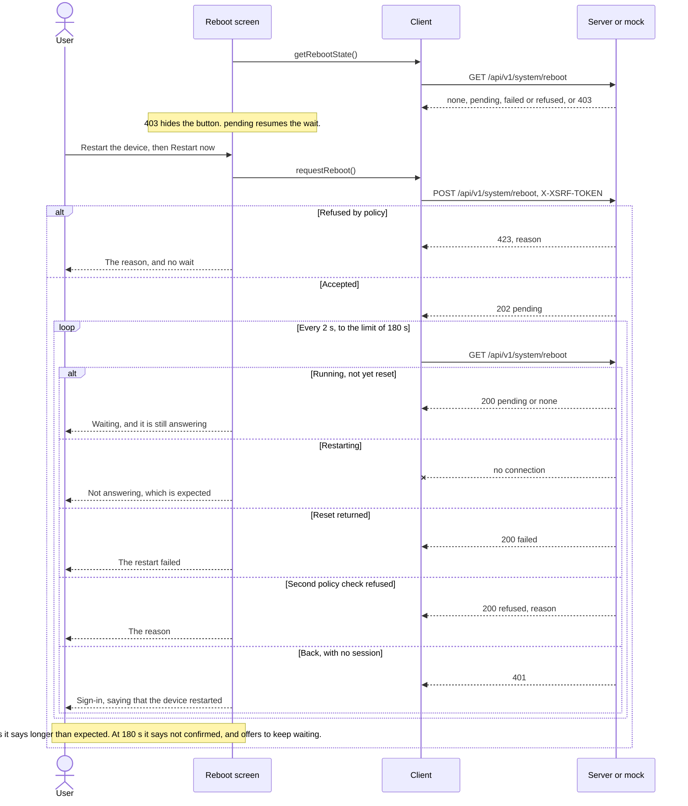
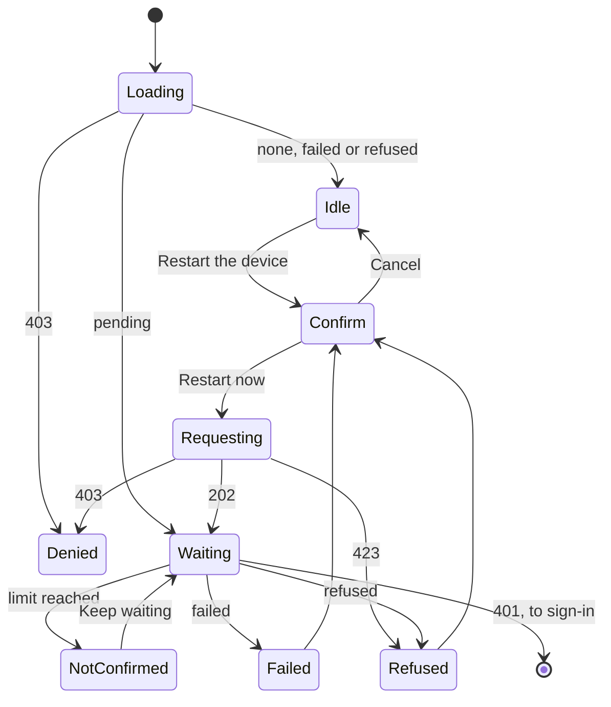

# Web frontend implementation, M13

Status: draft for review, issues #215, #216, #217, #218 and #219. Issue #220 needs firmware and is not started. It
follows the [web frontend foundation design](web-frontend-foundation-design.md), whose decisions W1 to W12 are accepted,
and the [management API specification](../../web/api/openapi.yaml). The approval is the owner's comment on
[#183](https://github.com/wonny-labs/crux-pilot/issues/183#issuecomment-6617722497). It covers no hardware, and nothing
here was run on a board.

## What is built, faked and untested

| State | Item |
| --- | --- |
| Built | `web/client`: a framework-free client for login polling, CSRF, error mapping and retry timing |
| Built | `web/reference`: Preact screens for sign-in, forced password change, home, network settings and reboot |
| Built | `web/mock`: a mock server from the specification, and a conformance check that M11 can reuse |
| Built | `web/tools`: type generation, the build, the packaging budget, source rules and pin checks |
| Built | `samples/web/angular-minimal`: sign-in and home, with the generated types |
| Built | `.github/workflows/web.yml`: the specification lint, `tests/management_api`, web checks, browser tests and the Angular job |
| Faked | The whole device. The mock runs on the loopback address over plain HTTP, and it holds one session at a time |
| Untested | TLS, real sessions, connection limits, the Zephyr server's real `409`, timing, load time, Flash and RAM. All are in #220 |
| Untested | Firefox and Edge. The browser tests ran on Chrome only, because playwright-core cannot drive a stock Firefox |
| Untested | A screen reader. Accessibility is checked through roles, labels, focus and the keyboard |

## Structure

The firmware takes a built folder, and nothing below the dashed line needs Node.js.

### Client responses

The client turns every answer into one result form. It never throws for an HTTP or network failure.

| Answer | Result | Behaviour |
| --- | --- | --- |
| `2xx` with JSON | `{ ok: true, value }` | A body that is not JSON is `unexpected` |
| Logout `200` | `{ ok: true }` | The body is empty, and it is not parsed |
| `409`, with no body | Retry | The request was not processed. It goes again after 300, 600 and 1200 ms, plus up to a quarter of jitter, then `busy` |
| `503` `busy` with `Retry-After` of 5 s or less | Retry once | It waits exactly that long, then reports `busy` with the wait |
| `503` `busy` with a longer wait, or `not_ready` | Reported | With `retryAfterSeconds` |
| Plain `404` | `no_route` | Told apart from the JSON `404` by its content type |
| JSON `404` | `not_found` | While polling, it means that the result is lost |
| Plain `405` | `method_not_allowed` | |
| `401` | `unauthorized` | Calls `onSessionLost`, unless the call is quiet. The reboot wait and the first probe are quiet. |
| Other JSON errors | The error's `code` | With `fields` and `reason`. A code that the specification does not hold is `unexpected`. |
| Thrown `fetch` | `network`, or `aborted` | |

| Request | Header |
| --- | --- |
| Attempt poll | `X-Crux-Request: 1` |
| Logout, password change, network save, reboot | `X-XSRF-TOKEN`, the raw value of the `XSRF-TOKEN` cookie, read again for each try |
| Login | Neither. A stale token cookie is ignored. |

Every request uses `credentials: same-origin`, `redirect: error` and `cache: no-store`.

### Timing

Each default can be changed through the client's `timing` option. A project with a slow boot sets a longer restart limit.

| Value | Default | Why |
| --- | --- | --- |
| Attempt poll | 250 ms, growing by half to 1 s | The first answer can be quick, and the server has one thread |
| Attempt limit | 30 s | Attempts expire quickly on the server, so this only ends a wait that went wrong |
| Consecutive failed polls | 3 | A short network failure does not lose an attempt |
| Status poll | 5 s, none while the page is hidden | The design's "every few seconds", kept low for the single server thread |
| Reboot poll | 2 s | |
| Reboot flagged as overdue | 60 s | Assumption: no boot time has been measured yet, which #220 does |
| Reboot limit | 180 s | Assumption, as above |
| Save poll and limit | 1 s and 15 s | Assumption: the save time on the target is unknown until #16 |

### Login polling

### Reboot wait

The running device also answers, so an answer is never success. Success is a session that is no longer valid.

## How a project replaces or reuses the reference interface

The reference is a folder of static files that calls only the API, so changing it changes no firmware logic.

| Need | What the project does | Changes to Crux files |
| --- | --- | --- |
| A new status item on home | Registers the item in firmware. Home shows it by its name, with no frontend change. | None |
| A label, section and format for that item | Passes `homeItems` to `mountReferenceInterface` in its own entry file | None |
| Different text or another language | Passes `text`, which is laid over the English table | None |
| A longer restart limit | Passes `client: { timing: { rebootLimitMs } }` | None |
| Fewer screens, or its own screens | Passes its own `screens` list. A screen is a route, a title, a link and a component. | None |
| Different styling | Imports its own stylesheet in its own entry file | None |
| Its own framework, using the client | Imports `web/client/src/index.ts`, which has no framework dependency | None |
| Its own framework and client | Generates types from the specification, as `web/tools/gen-types.ts` or any generator does, and follows the same rules for the poll header, CSRF and plain answers | None |

To replace it entirely, a project builds any folder and names it to the asset packaging in its firmware composition, which
is M11's. The folder must meet four conditions:

1. It runs under the content policy that the composition selects, strict or inline styles, with no external asset.
2. It uses hash routing, because the server has no deep-link fallback.
3. It stays within the packaging budget, because the server has few clients.
4. It holds no secret or device data, because the bundle is public: a browser must load it before login.

`e2e/fixtures/project-entry.tsx` is a working example of the reuse rows, and a browser test runs it. **Limit:** a project
cannot add a route to the reference's navigation without an entry file of its own, which is the intended seam, and the
reference code is not published as a package, so a project copies or vendors the folder. #220 adds a small reference project.

## Screens

| Screen | Permission handling | Failure handling |
| --- | --- | --- |
| Sign-in | Public | Rejected, delay, busy and lost are each shown. The wait holds the form, and the count sits outside the live region. |
| Forced password change | Holds the session on this screen, whatever the route. The server also enforces it. | Field errors, failed save, delay and busy. A lost result asks the device through `GET /api/v1/session/me`, and an `incorrect` after a lost result says that the earlier change may have taken effect. It never reports success from that. |
| Home | The server filters, and an empty list shows "nothing to show" | One failed source shows as unavailable. A failed read keeps the last values and says how old they are. |
| Network settings | A `403` on the read says so and leaves the form, because a session may be able to write but not read | Client checks before a warning, field errors from the server, failed and unconfirmed saves, and `501` |
| Reboot | A `403` on the read says so and hides the button | Refused, late refusal, failed reset, never restarts and stays away |

**A target with no Configuration provider.** Reading works, and `source` is `default`. A save returns `501`, and the screen
says that the device has no Configuration provider, that nothing was changed, and that the running address stays in use
until new firmware changes it. This holds on the target until #16 is decided.

**Accessibility.** Each input has a label, each error is tied to its input and focus moves to the first bad field. Errors
use `role="alert"` and progress uses `role="status"`. A route change moves focus to the heading and updates the title.
Confirmation steps focus Cancel. Colours are set for WCAG AA contrast in both schemes, by calculation and not by a tool.

**First credential.** No web path sets one. The specification has no such operation, the client has no such call, and a
browser test shows that a device with no account only ever gets login requests and a pointer to the serial console.

## Packaging budget

The design requires a budget for file count and compressed size, which fails the build when exceeded, and it states no
numbers. These are this work's numbers, in `web/reference/budget.json`, for review. Compressed size is gzip at level 9, file
by file.

| Limit | Value | Measured |
| --- | --- | --- |
| Files | 4: index, one script, one style, one icon | 4 |
| Compressed bytes | 32768 | 20131 |

The reference's parts, in bytes then compressed bytes: script 53673 and 18410, style 3465 and 1214, index 548 and 348, icon 174
and 159.

## Supply chain

| Item | Record |
| --- | --- |
| Node.js | 24.22.2, pinned exactly in `web`, `web/api/lint` and the Angular sample, and checked by `tools/check-pins.ts` |
| Production packages | One: `preact` 11.1.1, with no dependencies |
| Development packages | `typescript` 6.0.3, `esbuild` 0.28.2, `playwright-core` 1.64.1, `ajv` 8.20.0, `yaml` 2.9.1, `@types/node` 24.19.2, and what they need |
| Lockfile | `web/package-lock.json`, installed with `npm ci` |
| Lifecycle scripts | `npm ci --ignore-scripts` works. esbuild runs from its platform package without its install step. |
| SBOM | `npm run sbom` gives CycloneDX 1.5 with one component, and CI keeps it as an artifact |
| Advisories | `npm run audit:prod` in CI |
| Browser | playwright-core downloads nothing. It uses Chrome from the machine, which GitHub's Ubuntu image has. |

**Move off Node.js 20.** It is past its end of life, and current Angular needs `^22.22.3 || ^24.15.0 || >=26.0.0`. The move was
one line in `web/api/lint/package.json`. The Spectral lock did not change, the lint and `tests/management_api` pass on
24.22.2, and `scripts/check-management-api.sh` needed no edit. **Effect:** that script fails with a clear message under any
other version, so a machine with Node.js 20 needs 24.22.2 on its path before it runs the lint. The Dev Container has no
Node.js.

**TypeScript 6.0.3, not 7.** Version 7 is the latest, but it adds a native package for each platform, and Angular 22 requires
`>=6.0 <6.1`. Version 6 is one package with no dependencies, and both builds then use one compiler.

## Angular comparison

Measured with `node tools/compare.ts` on built folders. Compressed bytes are gzip at level 9, file by file. A production
package is a lockfile entry that is not marked development. Violations are counted by a browser test that walks through
sign-in, home and sign-out, in `e2e/angular-policy.test.ts`.

| Build | Files | Bytes | Compressed bytes | Production packages | Locked packages |
| --- | --- | --- | --- | --- | --- |
| Preact reference, all five screens | 4 | 57860 | 20131 | 1 | 38 |
| Preact reference, sign-in and home | 4 | 47671 | 17663 | 1 | 38 |
| Angular sample, sign-in and home | 5 | 249379 | 76695 | 7 | 362 |

The two-screen Preact build still holds the forced password change, which the shell needs, and the Angular sample does
not, so the comparison slightly favours Angular. The fifth Angular file is `3rdpartylicenses.txt`, at 4822 compressed bytes,
which the build writes by default, so the sample's code and style are 71,367 compressed bytes. The Preact build writes no
licence file, so a product takes its notices from the SBOM. Installed tools measured 55 MB, 13 packages and 1,252 files for
`web`, and 237 MB, 240 packages and 16,245 files for the sample, on macOS arm64.

The production packages are, for Preact, `preact`; and for Angular, `@angular/common`, `@angular/compiler`, `@angular/core`,
`@angular/platform-browser`, `@angular/router`, `rxjs` and `tslib`.

| Policy, on the same walk | Violations |
| --- | --- |
| Preact reference, strict | 0 |
| Preact reference, strict with Trusted Types | 0 |
| Angular sample, inline styles | 0 |
| Angular sample, inline styles with Trusted Types | 0 |
| Angular sample, strict | 1, `style-src-elem`, the component style that Angular inserts. No script was blocked. |

What this shows, on the mock only:

| Question | Result |
| --- | --- |
| Does Angular work with the web foundation? | Yes, on these two screens, with the same browser cases as the reference. |
| Compressed size against Preact on the same screens | About 4.3 times: 76,695 against 17,663 bytes. Excluding the licence file, 4.1 times. |
| File count | No lazy loading is used, so one script and one style, as for Preact. |
| CSRF | `HttpClient`'s default names work with no configuration, shown by the sign-out case. |
| Hash routing | `withHashLocation` works, and the server sees only API and asset paths. |
| Generated types | A type-only import from `web/client/src/api-types.generated.ts` compiles under the Angular build, and adds nothing to the bundle. |
| What Angular needs that the foundation lacks | Nothing new. The style policy setting and the budget are in #189, and header capture is in #184. One line for #186 is listed under the findings below. |

**The owner reviews this, and confirms or changes the Preact default.** On these numbers the recommendation is to keep Preact,
because the reference then needs the strict setting and one production package.

## Tests

Results are in the PR, for the revision that it names.

| Level | Where | Covers |
| --- | --- | --- |
| Client unit tests | `client/test` | Login polling, expired sessions, CSRF, retry timing, error mapping, reboot wait, save wait and IPv4 checks, with a scripted `fetch` and a clock that moves only when the client sleeps |
| Client against the mock | `client/test/against-mock.test.ts` | The real client over HTTP, with every answer checked against the specification |
| Conformance | `mock/test/conformance.test.ts` | Every named example of every response is served as written. The check itself is shown to reject wrong answers. |
| Mock behaviour | `mock/test/behaviour.test.ts` | The stateful flows, with every answer passing through the conformance check |
| Tools | `tools/test` | The generator refuses unknown schema forms, the source rules catch their targets, a build over budget fails, the pins and the C-build boundary |
| Browser | `e2e/reference-*.test.ts` | Each screen, on Chrome. A test fails on a policy violation, a page error, a request to another origin or a mock answer outside the specification. |
| Shared browser cases | `e2e/shared-cases.ts` | One list, run on both the reference and the Angular sample, finding elements only by role and label |

Tests went first where that could work: generator, client, mock, tools and browser cases each failed before their code
existed, because the module or the build was missing. The client-against-mock tests, the boundary test and the policy
measurement came after the code that they exercise, so they first ran green. To check that the client tests can fail, ten deliberate
faults were each put into a copy of the client, such as dropping the poll header or treating any reboot answer as a restart,
and every one made tests fail.

Faults that this found on the way:

| Fault | Found by |
| --- | --- |
| The generator lost the grouping of a union inside `allOf` | Reading its output, then a test |
| The IPv4 check called an address not unicast when the prefix was unusable, because two empty values compared equal | Client test |
| The heading took focus from the first field on sign-in | Browser test |
| The client kept a reference to `Date.now`, so a replaced clock did not apply to it | Browser test |
| A wait message inside a live region changed every second, which a screen reader would repeat | Reading the code, then a browser test |
| Two test helpers: a reused `Response` body, and an order that assumed sorted file names | The test failing for the wrong reason |

The mock has no idle timer, session cap or real delay window, so those paths are forced and not modelled.

## Findings for the firmware track

| Finding | For |
| --- | --- |
| Angular's `HttpClient` passes the `XSRF-TOKEN` cookie through `decodeURIComponent` before it sends the header, and strips surrounding quotes, while the Crux client sends it raw. Read in `@angular/common` 22.2.4. The token must therefore hold no `%` and no quotes, or the two would send different values. An unreserved alphabet such as base64url avoids this. #186 does not say so yet. | #186 |
| The mock's `Secure` cookies work on `http://127.0.0.1` in Chrome. Nothing here shows the behaviour on HTTPS with a self-signed certificate. | #220 |
| A browser can repeat a `GET` on a dropped connection, so a device going away may show up one poll later than the reset. The wait does not depend on this. | #220 |
| `tools/check-dom.ts` and `mock/conformance.ts` can run against a built folder and against the adapter, in the packaging and adapter tests. | #184, M11 packaging |
| The reboot screen reads `GET /api/v1/network` to warn about a saved address. A session without `network.read` then causes a denial event on each visit. If that floods the ring, the screen should drop this read. | #182, #213 |

## Decisions for review

Each was taken for lack of an answer, as the narrower choice.

| Decision | Reason |
| --- | --- |
| One PR with one commit for each issue | The issues build on each other and PRs must be based on `main` |
| A small local type generator, not `openapi-typescript` | Keeps the package count low, and it refuses schema forms it does not know. Any project can still use another generator. |
| `ajv` for the conformance check | A real validator is worth five development packages here, because a home-made one could hide a fault |
| Exact budget numbers, and a raw limit of 300 kB in the sample's `angular.json` | The design gives none |
| Reboot and save time limits | No measurement exists, so they are assumptions and can be changed through an option |
| No automatic new attempt after a `429`, a `503` on the poll or a `404` | The specification says that the client starts a new attempt, and the safer reading is that the user asks for it. The password is not sent again without a user action, and nothing keeps it after the form. |
| Forced change only, with no general change-password link | Account management stays on the CLI, as the design says |
| A malformed address gets `bad_request` from the mock, because the field codes have no format error | The specification does not say. #213 decides for the real service. |
| The client's IPv4 checks also refuse a subnet's network and broadcast addresses, reported as `not_unicast` | The design says "unicast address". If #213 allows these, the client check must follow. |
| Node.js 24, not 26 | Both are long-term support, and 24 has been in use longer. All the tools here accept either. |
| The Angular job is in `web.yml` | The approval names the web checks, and #219 asks for a job. It is a separate job, so it can be removed alone. |
