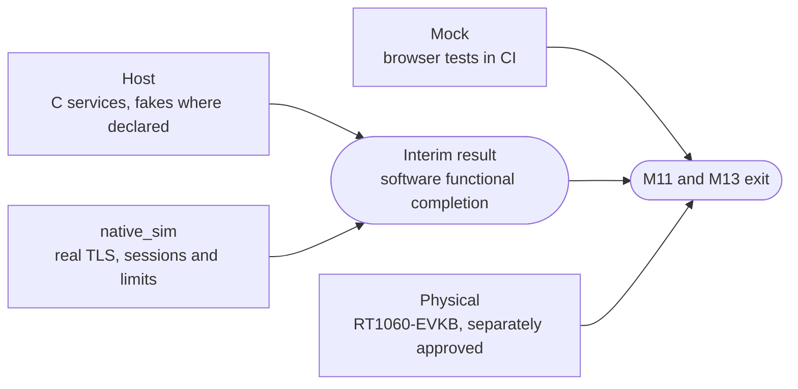
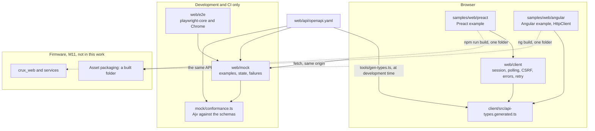
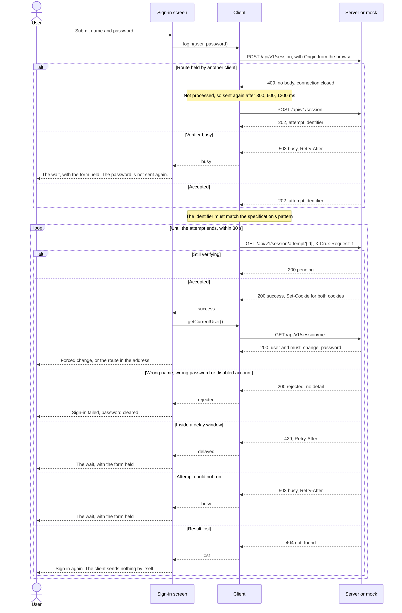
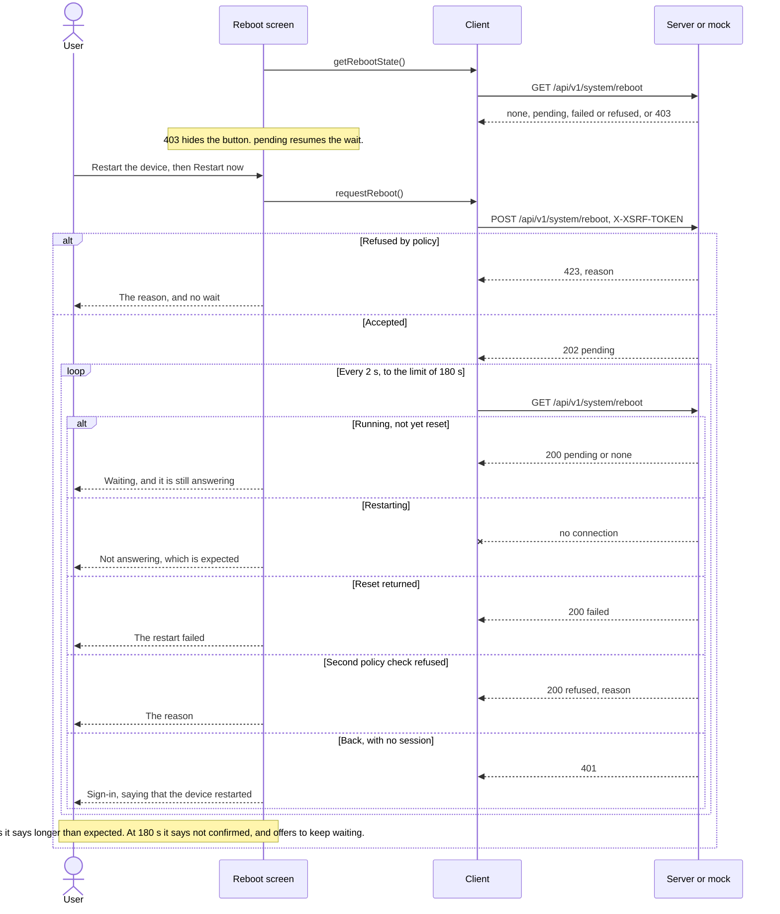
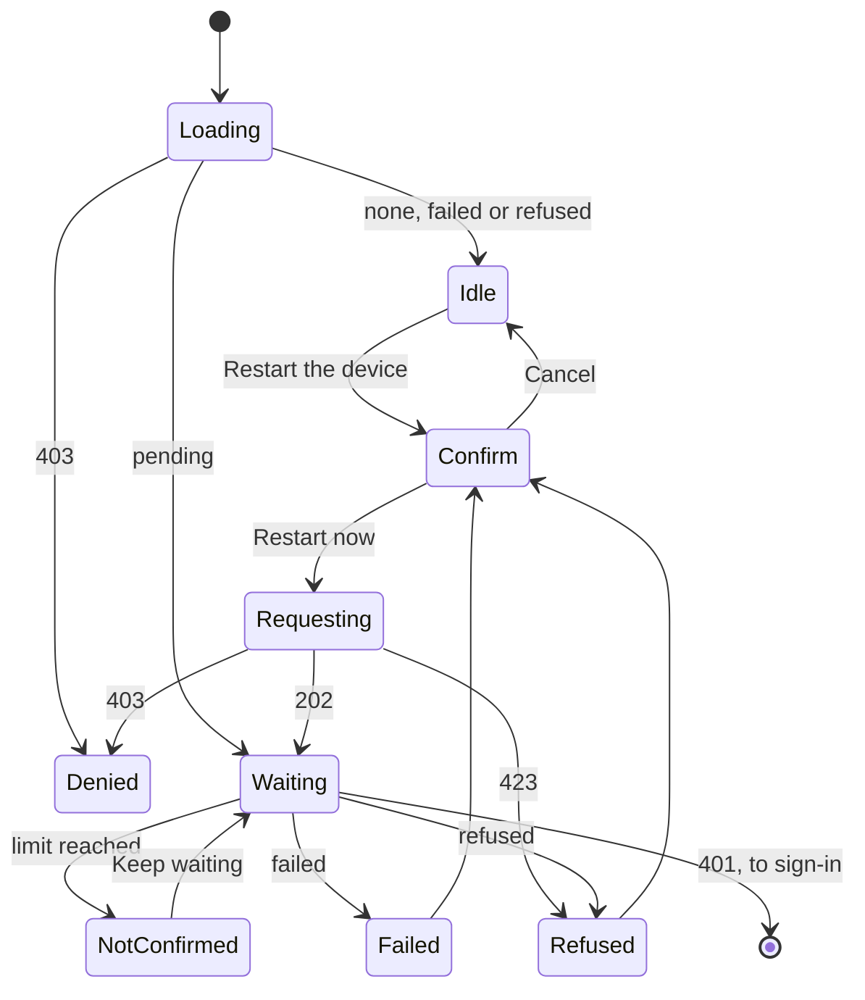
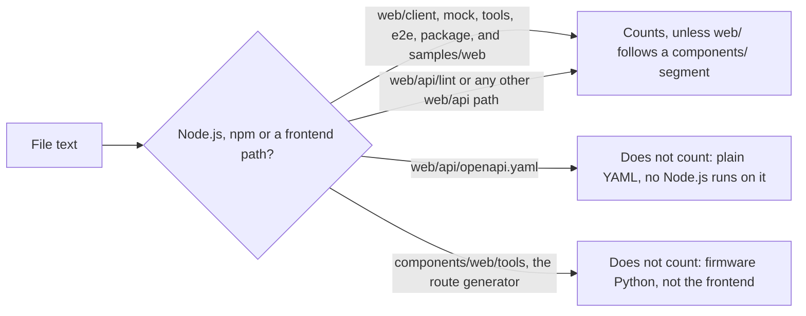

# Web frontend implementation, M13

Status: merged in #228 for issues #215, #216, #217, #218 and #219, and shown on the mock only. Issue #220 runs both examples on `native_sim` over HTTPS, in a Draft PR: see
[the web examples end to end](../e2e-native-220.md). It
follows the [web frontend foundation design](web-frontend-foundation-design.md), whose decisions W1 to W18 are accepted,
and the [management API specification](../../web/api/openapi.yaml). Since
[the owner's decision of 4 November 2026](https://github.com/wonny-labs/crux-pilot/issues/183#issuecomment-6637976084), W13, Preact and Angular are examples and the product owns its application UI.
Since the owner's review of 8 November 2026 (Refs #243), the Preact example is in `samples/web/preact` and the Angular example in
`samples/web/angular`, with the test files named `preact-*` and the function `mountPreactInterface`. The M13 work's approval is the owner's comment on
[#183](https://github.com/wonny-labs/crux-pilot/issues/183#issuecomment-6617722497), with its
[correction](https://github.com/wonny-labs/crux-pilot/issues/183#issuecomment-6619502432) that M13 other than #220 is not
behind the gate. It covers no hardware, and nothing here was run on a board.

## What is built, faked and untested

| State | Item |
| --- | --- |
| Built | `web/client`: an optional framework-free client for login polling, CSRF, error mapping and retry timing |
| Built | `samples/web/preact`: the Preact example, with sign-in, forced password change and home as core screens, and network settings and reboot as advanced examples |
| Built | `web/mock`: a mock server from the specification, and a conformance check that M11 can reuse |
| Built | `web/tools`: type generation, the build, the packaging budget, source rules and pin checks |
| Built | `samples/web/angular`: the Angular example, with sign-in, the forced password change, home and configuration, using the generated types |
| Built | The core configuration flow in both examples, on the mock only, in #243: see [the configuration flow](../web-config-flow.md) |
| Built | `.github/workflows/web.yml`: the specification lint, `tests/management_api`, web checks, browser tests and the Angular job |
| Faked | The whole device. The mock runs on the loopback address over plain HTTP, and it holds one session at a time |
| Untested | Flash, RAM and timing on a target. TLS, real sessions, connection limits, the server's real `409` and load time on `native_sim` are in [#220](../e2e-native-220.md) |
| Untested | Firefox and Edge. The browser tests ran on Chrome only, because playwright-core cannot drive a stock Firefox |
| Untested | A screen reader. Accessibility is checked through roles, labels, focus and the keyboard |

## Core and Advanced evidence

Each evidence state is recorded on its own, and none stands in for another. Core and advanced flows run on both examples on
the mock, since #243 added network settings and restart to the Angular example, with service tests underneath. Host here means
the C services, which have no web route yet.

| Flow | Kind | Mock | Host | `native_sim` | Physical |
| --- | --- | --- | --- | --- | --- |
| Sign-in and sign-out | Core | Both examples | Access contract. Web sessions in #186. | Both examples over HTTPS, [#220](../e2e-native-220.md#results) | Not run |
| Session expiry | Core | Both examples | Access contract. Web sessions in #186. | Both examples over HTTPS, [#220](../e2e-native-220.md#results) | Not run |
| Forced password change | Core | Both examples | Access contract. Web route in #187. | Both examples over HTTPS, [#220](../e2e-native-220.md#results) | Not run |
| Status | Core | Both examples | Service in #180. Web route in #187. | Both examples over HTTPS, [#220](../e2e-native-220.md#results) | Not run |
| Simple configuration update | Core | Both examples | Service in #180. Web route in #187. | Both examples over HTTPS, [#220](../e2e-native-220.md#results) | Not run |
| Network settings | Advanced | Both examples | Service in #213 | Preact over HTTPS: read, and a change refused as not saved with no Configuration provider, [#220](../e2e-native-220.md#results). The Angular case is written and **NOT RUN**. | Not run |
| Reboot | Advanced | Both examples | Service in #214 | Mock only: #214's service is merged but not composed in the services image, [#220](../e2e-native-220.md) | Not run |

| Rule | Detail |
| --- | --- |
| Prerequisites | Real HTTPS on `native_sim` needs PSA (#142), the management composition in #242, #190 or a declared test certificate, and the first credential through #181 or a declared test step. #142 and #242 are not criteria of gate #183. |
| Interim result | Host and `native_sim` functional completion is recorded as an interim result, and mock results are not part of it. It closes no milestone. |
| Physical | Physical evidence stays tracked separately and is not waived. It needs its own approval. |
| Limits | A limit of a TLS profile on `native_sim` is recorded with its evidence, and it is not replaced by a mock result. |

## Structure

The firmware takes a built folder, so it needs no Node.js. The dotted lines are not exercised in this work.

### Client responses

The client turns every answer into one result form. It never throws for an HTTP or network failure.

| Answer | Result | Behaviour |
| --- | --- | --- |
| `2xx` with JSON | `{ ok: true, value }` | A body that is not JSON is `unexpected` |
| Logout `200` | `{ ok: true }` | The body is empty, and it is not parsed |
| `409`, with no body | Retry | The request was not processed. It goes again after 300, 600 and 1200 ms, plus up to a quarter of jitter, then `busy`. This is the only case where a password is sent again without a user action. |
| `503` `busy` with `Retry-After` of 5 s or less, on a route that holds no password | Retry once | It waits exactly that long, then reports `busy` with the wait |
| `503` on the login or password change route, or on the poll | Reported | At once, with `retryAfterSeconds`. A password is never sent again after one. |
| `503` `busy` with a longer wait, or `not_ready` | Reported | With `retryAfterSeconds` |
| Plain `404` | `no_route` | Told apart from the JSON `404` by its content type |
| JSON `404` | `not_found` | While polling, it means that the result is lost |
| Plain `405` | `method_not_allowed` | |
| `401` | `unauthorized` | Calls `onSessionLost`, unless the call is quiet. The reboot wait and the first probe are quiet. |
| Other JSON errors | The error's `code` | With `fields` and `reason`. A code that the specification does not hold is `unexpected`. |
| Thrown `fetch` | `network`, or `aborted` | |

| Request | Header |
| --- | --- |
| Attempt poll | `X-Crux-Request: 1` |
| Logout, password change, configuration update, configuration save, network save, reboot | `X-XSRF-TOKEN`, the raw value of the `XSRF-TOKEN` cookie, read again for each try |
| Login | Neither. A stale token cookie is ignored. |

Every request uses `credentials: same-origin`, `redirect: error` and `cache: no-store`.

### Timing

The status poll is set through the Preact example's `timing` option, and every other default through the client's `timing` option,
which the Preact example takes as `client: { timing }`. A project with a slow boot sets a longer restart limit.

| Value | Default | Why |
| --- | --- | --- |
| Attempt poll | 250 ms, growing by half to 1 s | The first answer can be quick, and the server has one thread |
| Attempt limit | 30 s | Attempts expire quickly on the server, so this only ends a wait that went wrong |
| Consecutive failed polls | 3 | A short network failure does not lose an attempt |
| Status poll | 5 s, none while the page is hidden | The design's "every few seconds", kept low for the single server thread |
| Reboot poll | 2 s | |
| Reboot flagged as overdue | 60 s | Assumption: no boot time has been measured yet, which #220 does |
| Reboot limit | 180 s | Assumption, as above |
| Save poll and limit | 1 s and 15 s | Assumption: the save time on the target is unknown until #16 |

### Login polling

### Reboot wait

The running device also answers, so an answer is never success. Success is a session that is no longer valid.

## How a product builds its own interface or starts from an example

The product owns its application UI. The Preact example is a folder of static files that calls only the API, so changing it changes no firmware logic, and a product may reuse, copy or ignore it.

| Need | What the project does | Changes to Crux files |
| --- | --- | --- |
| A new status item on home | Registers the item in firmware. Home shows it by its name, with no frontend change. | None |
| A label, section and format for that item | Passes `homeItems` to `mountPreactInterface` in its own entry file | None |
| Different text or another language | Passes `text`, which is laid over the English table | None |
| A longer restart limit | Passes `client: { timing: { rebootLimitMs } }` | None |
| Fewer screens, or its own screens | Passes its own `screens` list. A screen is a route, a title, a link and a component. | None |
| Different styling | Imports its own stylesheet in its own entry file | None |
| Its own framework, using the client | Imports `web/client/src/index.ts`, which has no framework dependency | None |
| Its own framework and client | Generates types from the specification, as `web/tools/gen-types.ts` or any generator does, and follows the same rules for the poll header, CSRF and plain answers | None |

To use none of it, a product builds any folder and names it to the asset packaging in its firmware composition, which
is M11's. The folder must meet four conditions:

1. It runs under the content policy that the composition selects, strict or inline styles, with no external asset.
2. It uses hash routing, because the server has no deep-link fallback.
3. It stays within the packaging budget, because the server has few clients.
4. It holds no secret or device data, because the bundle is public: a browser must load it before login.

`e2e/fixtures/project-entry.tsx` is a working example of the reuse rows, and a browser test runs it. **Limit:** a project
cannot add a route to the Preact example's navigation without an entry file of its own, which is the intended seam, and the
example's code is not published as a package, so a project copies or vendors the folder. #220 adds a small example project.

## Screens

| Screen | Kind | Permission handling | Failure handling |
| --- | --- | --- | --- |
| Sign-in | Core | Public | Rejected, delay, busy and lost are each shown. The wait holds the form, and the count sits outside the live region. A login followed by a `401` on the current user says that the session was not there on the next request, and names both causes: the browser refusing the cookie, which is what real HTTPS would show, and the device ending the session. |
| Forced password change | Core | Holds the session on this screen, whatever the route. The server also enforces it. | Field errors, failed save, delay and busy. A lost result asks the device through `GET /api/v1/session/me`. An `incorrect` after a lost, failed or timed-out poll says that the earlier change may have taken effect, and it never reports success from that. |
| Home | Core | The server filters, and an empty list shows "nothing to show" | One failed source shows as unavailable. A failed read keeps the last values and says how old they are. |
| Configuration | Core | The server filters the list. A write-only parameter shows no value, a sensitive one is never read, and a read-only one has no form. A `403` on an update or a save is shown as such. | Field errors from the device's codes, a busy or not ready answer with its wait, and a save shown as pending, saved or failed. [Details](../web-config-flow.md) |
| Network settings | Advanced | A `403` on the read says so and leaves the form, because a session may be able to write but not read | Client checks before a warning, field errors from the server, failed and unconfirmed saves, and `501` |
| Reboot | Advanced | A `403` on the read says so and hides the button | Refused, late refusal, failed reset, never restarts and stays away |

**A target with no Configuration provider.** Reading works, and `source` is `default`. A save returns `501`, and the screen
says that the device has no Configuration provider, that nothing was changed, and that the running address stays in use
until new firmware changes it. This holds on the target until #16 is decided.

**Accessibility.** Each input has a label, each error is tied to its input and focus moves to the first bad field. Errors
use `role="alert"` and progress uses `role="status"`. A route change moves focus to the heading and updates the title.
Confirmation steps focus Cancel. Colours meet WCAG AA in both schemes, by calculating each text and background pair from the stylesheet: the lowest is 6.8 to 1 in the light scheme and 7.4 to 1 in the dark one. A disabled button is lighter, which WCAG exempts. No audit tool was run.

**First credential.** No web path sets one. The specification has no such operation, the client has no such call, and a
browser test shows that a device with no account only ever gets login requests and a pointer to the serial console.

## Packaging budget

The design requires a budget for file count and compressed size, which fails the build when exceeded, and it states no
numbers. These are this work's numbers, in `samples/web/preact/budget.json`, for review. Compressed size is gzip at level 9, file
by file.

| Limit | Value | Measured |
| --- | --- | --- |
| Files | 4: index, one script, one style, one icon | 4 |
| Compressed bytes | 32768 | 23302 |

The Preact example's parts, in bytes then compressed bytes: script 64419 and 21371, style 3931 and 1307, index 548 and 347, icon 174
and 159, as measured before the move to `samples/web/preact`. The configuration screen of #243 added 2,729 compressed bytes, and the
budget is unchanged. The build on `origin/main` before this change and the build after it both measured 69,583 bytes and 23,301 to
23,302 compressed bytes here (the last byte follows the hashed file names), so 9,466 bytes remain. The earlier record of 23,184
is older than that.

## Supply chain

| Item | Record |
| --- | --- |
| Node.js | 24.22.2, pinned exactly in `web`, `web/api/lint` and the Angular example, and checked by `tools/check-pins.ts` |
| Production packages | One: `preact` 11.1.1, with no dependencies |
| Development packages | `typescript` 6.0.3, `esbuild` 0.28.2 with its 26 platform packages, `playwright-core` 1.64.1, `ajv` 8.20.0, `yaml` 2.9.1 and `@types/node` 24.19.2, and what they need: `fast-deep-equal`, `fast-uri`, `json-schema-traverse`, `require-from-string` and `undici-types`. 38 locked in all, and 13 installed on one platform. |
| Lockfile | `web/package-lock.json`, installed with `npm ci`. `tools/check-pins.ts` compares each lockfile's root with its manifest. |
| Lifecycle scripts | Off through `.npmrc` in `web` and the Angular example, and `check-pins` requires that. `npm ci` works without them: esbuild runs from its platform package without its install step, and `npm run` still runs its named script. |
| Browser storage | None. A source rule refuses `localStorage`, `sessionStorage`, `indexedDB` and a cookie written by script, and a browser case shows that no password reaches them. |
| SBOM | `npm run sbom` gives CycloneDX 1.5 with one component, and CI keeps it as an artifact. It names the licence and holds no copyright notice, so it does not replace a product's notices. |
| CI actions | Pinned to full commits in `web.yml`, and `tools/check-pins.ts` requires that. The existing workflows still use tags. |
| Advisories | `npm run audit:prod` in CI |
| Browser | playwright-core downloads nothing. It uses Chrome from the machine, which GitHub's Ubuntu image has. |

**Move off Node.js 20.** It is past its end of life, and current Angular needs `^22.22.3 || ^24.15.0 || >=26.0.0`. The move was
the pin in `web/api/lint/package.json` and the matching root entry of `web/api/lint/package-lock.json`. No package changed,
the lint and `tests/management_api` pass on 24.22.2, and `scripts/check-management-api.sh` needed no edit. **Effect:** that script fails with a clear message under any
other version, so a machine with Node.js 20 needs 24.22.2 on its path before it runs the lint. The Dev Container has no
Node.js. `AGENTS.md` treats a major toolchain upgrade as an escalation, so this is flagged for the owner at merge. It goes
ahead under the owner's advance approval, because Node.js 20 is past its end of support.

**TypeScript 6.0.3, not 7.** Version 7 is the latest, but it adds a native package for each platform, and Angular 22 requires
`>=6.0 <6.1`. Version 6 is one package with no dependencies, and both builds then use one compiler.

## Angular comparison

Measured with `node tools/compare.ts` on built folders. Compressed bytes are gzip at level 9, file by file. A production
package is a lockfile entry that is not marked development. Violations are counted by a browser test that walks through
sign-in, home, configuration with an update and a save, and sign-out, in `e2e/angular-policy.test.ts`. #243 added the configuration step to the walk, so the Angular strict count below changed with it.

| Build | Files | Bytes | Compressed bytes | Production packages | Locked packages |
| --- | --- | --- | --- | --- | --- |
| Preact example, all six screens | 4 | 69583 | 23302 | 1 | 38 |
| Preact example, core screens: sign-in, forced change, home and configuration | 4 | 59212 | 20874 | 1 | 38 |
| Angular example, all six screens | 5 | 326609 | 97941 | 7 | 362 |

Before #243 the Angular row held sign-in and home alone, at 249403 bytes and 76710 compressed, against 48485 and 17922 for
Preact, and then the four core flows, at 298780 bytes and 91197 compressed, against 58709 and 20761. Those earlier rows do not
compare with these. Both builds now hold all six screens: the four core flows, network settings and restart. Network settings and
restart added 27,829 bytes and 6,744 compressed bytes to Angular, which is 308.94 kB raw and 81.68 kB transferred for its initial
bundle, over the former 300 kB limit. The limit in `angular.json` is now 320 kB, which leaves 11.06 kB, and that change is the owner's
call: see [the advanced flows](../web-advanced-flows.md). The fifth Angular file is `3rdpartylicenses.txt`, at 4,849 compressed bytes,
which the build writes by default, so the example's code and style are 93,092 compressed bytes. The Preact build writes no
licence file, and the SBOM names Preact's MIT licence but holds no copyright notice. MIT requires that notice in copies, so
this build alone does not meet it, and a product must add the text of Preact's `LICENSE` to its own notices. Installed tools measured 55 MB, 13 packages and 1,252 files for
`web`, and 237 MB, 240 packages and 16,245 files for the Angular example, on macOS arm64.

The production packages are, for Preact, `preact`; and for Angular, `@angular/common`, `@angular/compiler`, `@angular/core`,
`@angular/platform-browser`, `@angular/router`, `rxjs` and `tslib`.

| Policy, on the same walk | Violations |
| --- | --- |
| Preact example, strict | 0 |
| Preact example, strict with Trusted Types | 0 |
| Angular example, inline styles | 0 |
| Angular example, inline styles with Trusted Types | 0 |
| Angular example, strict | 3 or 4, and it varies from run to run, all `style-src-elem inline`, the component style that Angular inserts. Four runs of `e2e/angular-policy.test.ts` on main at 47ff265 showed 4 each. A reviewer's five runs (x86 Chrome 157, emulated on arm64) showed 4 three times and 3 twice. The test asserts only that the count is above 0. It was 1 on the shorter walk of sign-in and home. Why it varies was not examined. No script was blocked. |

What this shows, on the mock only:

| Question | Result |
| --- | --- |
| Does Angular work with the web foundation? | Yes, on these two screens, with the same browser cases as the Preact example. |
| Compressed size against Preact on the same screens | About 4.2 times on all six screens: 97,941 against 23,302 bytes. Excluding the licence file, 4.0 times. On the core screens alone it was 4.4 and 4.2 times, and on sign-in and home alone 4.3 and 4.0 times. |
| File count | No lazy loading is used, so one script and one style, as for Preact. |
| CSRF | `HttpClient`'s default names work with no configuration, shown by the sign-out case. |
| Hash routing | `withHashLocation` works, and the server sees only API and asset paths. |
| Generated types | A type-only import from `web/client/src/api-types.generated.ts` compiles under the Angular build, and adds nothing to the bundle. |
| What Angular needs that the foundation lacks | Nothing new. The style policy setting and the budget are in #189, and header capture is in #184. #186 holds the rule on the token's value. |

**The owner kept Preact on 4 November 2026, in #219,** on the recommendation that it needs the strict setting and one
production package. Since W13 this makes Preact the larger of the two examples, and it sets no default that a product has
to follow.

## Tests

Results are in the PR, for the revision that it names.

| Level | Where | Covers |
| --- | --- | --- |
| Client unit tests | `client/test` | Login polling, expired sessions, CSRF, retry timing, error mapping, reboot wait, save wait and IPv4 checks, with a scripted `fetch` and a clock that moves only when the client sleeps |
| Client against the mock | `client/test/against-mock.test.ts` | The real client over HTTP, with every answer checked against the specification |
| Conformance | `mock/test/conformance.test.ts` | Every named example of every response is served as written, and every operation answers with no forced response. The check covers bodies, headers and cookies, and it is itself shown to reject wrong answers. |
| Mock behaviour | `mock/test/behaviour.test.ts` | The stateful flows, with every answer passing through the conformance check |
| Tools | `tools/test` | The generator refuses each schema form and combination outside its list, the source rules catch their targets, a build over budget fails, the pins and lockfiles agree, and the C-build boundary catches its fixtures. Tests remove their temporary folders. |
| Browser | `e2e/preact-*.test.ts` | Each screen, on Chrome. A test fails on a policy violation, a page error, a request to another origin or a mock answer outside the specification. |
| Shared browser cases | `e2e/shared-cases.ts` | One list, run on both the Preact example and the Angular example, finding elements by role, label and visible text. It covers sign-in, home, the forced password change and the configuration flow, which [its own document](../web-config-flow.md) lists. |
| Preact configuration cases | `e2e/preact-config.test.ts` | Focus, title, keyboard use, the policy with Trusted Types, and device text shown as text |

Tests went first where that could work: generator, client, mock, tools and browser cases each failed before their code
existed, because the module or the build was missing. The client-against-mock tests, the boundary test and the policy
measurement came after the code that they exercise, so they first ran green. To check that the client tests can fail, fifteen deliberate
faults were each put into a copy of the client, and every one made tests fail:

1. Dropping the poll header.
2. Decoding the CSRF cookie.
3. Treating any reboot answer as a restart.
4. Parsing the logout body.
5. Not retrying a `409`.
6. Retrying a `503` on the poll.
7. Reporting a lost attempt as a success.
8. Reporting a lost session during the reboot wait.
9. Confirming a save without comparing values.
10. Sending the token on login.
11. Sending a password again after a `503`.
12. Reading the token only once.
13. Never resetting the failed poll count.
14. Confirming a save while it is pending.
15. Ending an attempt on a poll `409` that outlasts its retries.

Faults that this found on the way:

| Fault | Found by |
| --- | --- |
| The generator lost the grouping of a union inside `allOf` | Reading its output, then a test |
| The IPv4 check called an address not unicast when the prefix was unusable, because two empty values compared equal | Client test |
| The heading took focus from the first field on sign-in | Browser test |
| The client kept a reference to `Date.now`, so a replaced clock did not apply to it | Browser test |
| A wait message inside a live region changed every second, which a screen reader would repeat | Reading the code, then a browser test |
| Focus moved in a deferred effect, so for a moment after a screen changed it was on nothing, and a key pressed then was lost. It now moves in a layout effect, in the same step as the change. | CI, on a faster machine than the local one, and then reproduced locally |
| An uptime value that was not a number took the whole page down | Reading the code, then a browser test |
| Home could send one more read after it had gone, because Preact 11 runs a passive effect's cleanup after paint. The cleanup now runs in a layout effect. | CI |
| The independent review found these, among others: a password was sent again after a `503`, which this document said did not happen; the generator accepted combinations of schema keywords and read them wrongly; a login followed by a `401` showed nothing; a status item named `constructor` lost its label; and tests that could not fail, now fixed | Independent review |
| Two browser cases raced with the page, and installing the test clock during a login hung one CI run. That hang did not reproduce locally in six tries and its cause is not known, so no case installs the clock mid-flow any more. | CI |
| Two test helpers: a reused `Response` body, and an order that assumed sorted file names | The test failing for the wrong reason |

The mock has no idle timer, session cap or real delay window, so those paths are forced and not modelled. It records every request, including assets, so a test can say which paths the server saw.

### The C-build boundary rule

`tools/test/boundary.test.ts` holds every CMake, Kconfig, preset and component file to one rule: no C build needs
Node.js. `tools/c-boundary.ts` decides what counts as a use. The web workflow runs it only when a path under `web/`
changes, so firmware PRs that name a frontend path were not checked until the next `web/` change. Two kinds of
firmware file then broke it, and the matcher is narrowed for exactly these two.

| Text | Counts | Reason |
| --- | --- | --- |
| `components/web/tools/web_routes.py`, in `cmake/CruxWebRoutes.cmake` and the generated header | No | The firmware component `components/web` has its own `tools`. The old pattern matched the `web/tools` inside that path. A path segment named exactly `components` exempts it. `mycomponents/`, `xcomponents/` and `.components/` do not. A scan cannot tell `src/components/` from `${DIR}/components/`, and the repository has no nested components directory, so `src/components/web/...` is taken as the firmware tree. |
| `web/api/openapi.yaml`, in component comments and `tests/mgmt_status/CMakeLists.txt` | No | The specification is the contract between firmware and frontend, and firmware tests read it as data with Python. A path that goes on from the file name (`openapi.yaml/../lint`, `openapi.yaml/`, `openapi.yaml.orig`) still counts. |
| `web/api/lint`, `web/api` as a directory, any other file in `web/api` | Yes | The lint tools need Node.js. |
| `web/tools`, `web/client` and the rest, in any path whose `web/` does not follow a `components/` segment | Yes | Unchanged. `components/web/../../web/tools` still counts. |
| `redocly lint web/api/openapi.yaml`, `spectral lint web/api/openapi.yaml` | **No, a known gap** | A Node.js tool run on the specification by its bare path is no longer caught by the path rule. This is the accepted cost of exempting the file. The npm and npx rules still catch `npx spectral`. A fixture pins the gap. |

The test gained fixtures for each row, including the cases that must still count. A scan of the repository with a new
tracked offending file in `cmake/` and in `components/web/` fails, as before.

## Findings for the firmware track

| Finding | For |
| --- | --- |
| Angular's `HttpClient` passes the `XSRF-TOKEN` cookie through `decodeURIComponent` before it sends the header, and strips surrounding quotes, while the Crux client sends it raw. Read in `@angular/common` 22.2.4. The token must therefore hold no `%` and no surrounding quotes, or the two would send different values. An unreserved alphabet such as base64url avoids this. #186 requires it, and `mock/conformance.ts` checks it. | #186 |
| The mock's `Secure` cookies work on `http://127.0.0.1` in Chrome. Nothing here shows the behaviour on HTTPS with a self-signed certificate. | #220 |
| A browser can repeat a `GET` on a dropped connection, so a device going away may show up one poll later than the reset. The wait does not depend on this. | #220 |
| `tools/check-dom.ts` and `mock/conformance.ts` can run against a built folder and against the adapter, in the packaging and adapter tests. | #184, M11 packaging |
| The reboot screen reads `GET /api/v1/network` to warn about a saved address. A session without `network.read` then causes a denial event on each visit. If that floods the ring, the screen should drop this read. | #182, #213 |

## Decisions for review

Each was taken for lack of an answer, as the narrower choice.

| Decision | Reason |
| --- | --- |
| One PR with one commit for each issue | The issues build on each other and PRs must be based on `main` |
| A small local type generator, not `openapi-typescript` | Keeps the package count low, and it refuses schema forms it does not know. Any project can still use another generator. |
| `ajv` for the conformance check | A real validator is worth five development packages here, because a home-made one could hide a fault |
| Exact budget numbers, and a raw limit of 300 kB in the Angular example's `angular.json` | The design gives none |
| Reboot and save time limits | No measurement exists, so they are assumptions and can be changed through an option |
| No automatic new attempt after a `429`, a `503` or a `404` | The specification says that the client starts a new attempt, and the safer reading is that the user asks for it. The only time a password is sent again without a user action is after a `409`, which the server did not process, so no verification ran. Nothing keeps a password after the form. |
| Forced change only, with no general change-password link | Account management stays on the CLI, as the design says |
| A malformed address gets `bad_request` from the mock, because the field codes have no format error | The specification does not say. #213 decides for the real service. |
| The client's IPv4 checks also refuse a subnet's network and broadcast addresses, reported as `not_unicast` | The design says "unicast address". If #213 allows these, the client check must follow. |
| The client refuses a gateway of `0.0.0.0`, the address itself and the subnet's network and broadcast addresses, with a client-only reason. The mock reports these as `gateway_outside_subnet`. | The specification rules out `0.0.0.0` and has one code for a gateway. #213 decides for the real service. |
| Node.js 24, not 26 | Both are long-term support, and 24 has been in use longer. Only 24 was run. |
| The Angular job is in `web.yml` | The approval names the web checks, and #219 asks for a job. It is a separate job, so it can be removed alone. |
