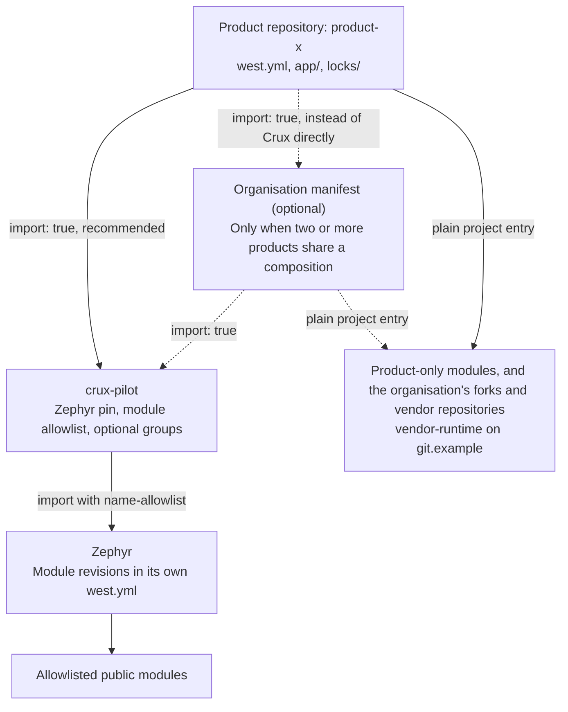
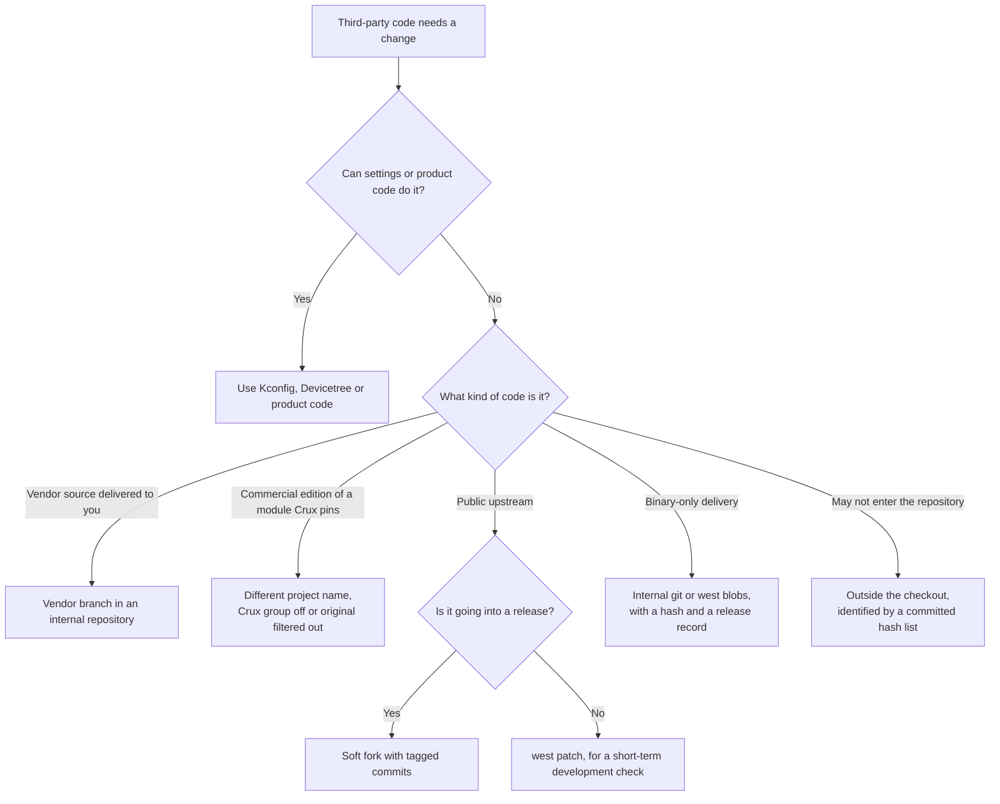
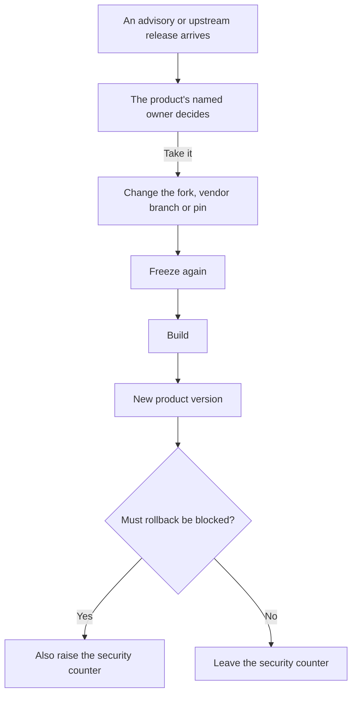
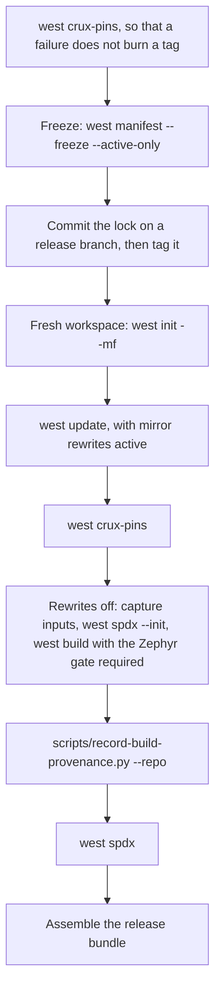

# Product Composition Guide

**Status: adopted practice, 2026-11-04.** The routes below are provisional until the first products have tried them. No Crux release tag exists yet: the first tag waits for that trial. The release bundle is a convention. A first schema and checker exist in a product repository, and Crux has adopted neither. The baseline gate warns by default until consumers reach the baseline. This guide records how a product on Crux can compose, check, version and release its firmware, and what was run to support that. See [Limits](#limits).

Use it with the [product template](../samples/product_template/README.md), a small directory you copy to start a product repository. For other ways to consume Crux, see the [Build and Integration Guide](build.md).

## Who owns what

Dependencies run one way: product to Crux to Zephyr. Crux knows nothing about any product.

| Concern | Crux provides | The product owns |
| --- | --- | --- |
| Composition | An importable [`west.yml`](../west.yml): the Zephyr pin, the module allowlist and optional groups | Its own `west.yml`: the Crux revision, extra modules and overrides |
| Code | Public `crux::` usage targets and `<crux/...>` headers | Application code, Kconfig, Devicetree and board choices |
| Checks | `west crux-pins`, the Zephyr baseline gate and `scripts/record-build-provenance.py` | Running them in its own CI and keeping the results |
| Third-party changes | Only what Crux itself needs | The route it takes and the pin in its manifest. The organisation, not a product, owns each fork and vendor repository, its tags, its `-acmeN` counter and its carried-changes list |
| Versions | Its own tags, once they exist | The product version and its security counter |
| Release | No adopted bundle schema or checker, and no signing or SBOM reduction tool | The release branch, the lock file, signing and what goes outward. A public product repository publishes hashes only, see [Release bundle](#release-bundle) |
| Commercial modules | Nothing. Crux's manifest names only public modules | Their names, URLs and licences, in product or organisation manifests |

## Structure

The optional organisation manifest is a shared layer. Add it only when two or more products share a composition.



## Composition

The product uses west's T2 topology: the product repository is the manifest repository, and Crux and Zephyr are projects in its workspace.

The active part of the [template manifest](../samples/product_template/west.yml), with the comments of its `crux-pilot` entry:

```yaml
manifest:
  version: "1.2"
  remotes:
    - name: crux
      url-base: https://github.com/wonny-labs
  projects:
    - name: crux-pilot
      remote: crux
      # No Crux tag exists yet, so this follows main. For a release,
      # pin a tag or SHA here and freeze the manifest. See the guide in README.md.
      revision: main
      import: true
  self:
    path: product-x
```

This resolves Zephyr and every allowlisted module at the revisions Crux pins. The product repeats no revision. Importing is recommended, not required. See [Pinning by hand](#pinning-by-hand).

- **First definition wins.** West uses the first definition of a project name. Entries in the product manifest beat anything imported.
- **Optional groups are off by default.** Crux keeps its secure management stacks in the `crux-secure-management` group. An ordinary workspace does not fetch them. A second group, `crux-reliance`, holds the Reliance Edge file system source, which is GPLv2 only, and is off for the same reason. The wolfSSL TLS backend of those stacks needs a [Zephyr patch](../patches/zephyr/README.md#wolfssl-tls-socket-backend) that is not stored in this repository. How a product applies it is the owner's open decision under Issue #185: [HTTPS composition](https-composition.md#how-a-product-applies-the-wolfssl-patch) recommends that the product's own manifest pin a Zephyr fork with the patch applied (option B), and adopts nothing. Crux keeps MCUboot in the `crux-boot` group, at the revision in Zephyr's own manifest at Crux's Zephyr pin. It is Apache-2.0, so the group is off only to keep the fetch small. A product that builds a bootloader enables it with `group-filter: [+crux-boot]`, and does not add a plain `mcuboot` entry of its own. A `name-allowlist` entry would not do, because an imported project cannot be given a group and MCUboot would then be fetched in every workspace.
- **A filter only narrows.** A product `name-allowlist` on the Crux import can remove what Crux allows. It cannot add what Crux left out.

| Goal | What to write | `west crux-pins` reports |
| --- | --- | --- |
| Use what Crux pins | `import: true` | `OK` |
| Enable an optional set | `group-filter: [+crux-secure-management]` or `[+crux-reliance]`, with no revision | `OK` |
| Enable the boot loader source | `group-filter: [+crux-boot]`, with no revision | `OK` |
| Add a product-only module | A plain project entry with its revision | `PRODUCT` |
| Replace a project Crux pins | An entry with the same name, its path, and `userdata: crux-override` | `OVERRIDE` |
| Use fewer modules | `import: name-allowlist: [...]` on `crux-pilot`, including `zephyr` | `OK` for what remains |
| Add a Zephyr module Crux did not allow | A plain project entry with its revision | `OK` at the revision in Zephyr's manifest. Another revision needs `crux-override` |
| Add such a module and own the module list | Redefine `zephyr`, with your own allowlist | `OK` while the Zephyr revision and modules match the contract |
| Import nothing | [Plain entries](#pinning-by-hand) for Crux, Zephyr and each module | `OK` while the pins match the contract |
| Import Zephyr only | [Crux as a plain entry](#pinning-by-hand), and `zephyr` with your own allowlist | `OK` while the pins match the contract |

Redefining `zephyr` drops Crux's Zephyr import. The product then owns the allowlist, and must repeat the Zephyr SHA and every module it needs.

### Pinning by hand

A product may pin Crux and Zephyr itself, with no `import`:

```yaml
  projects:
    - name: crux-pilot
      remote: crux
      revision: <Crux SHA>
      west-commands: scripts/west-commands.yml
    - name: zephyr
      remote: zephyrproject-rtos
      revision: <the SHA that Crux pins>
      west-commands: scripts/west-commands.yml
    - name: hal_nxp
      remote: zephyrproject-rtos
      revision: <the SHA in Zephyr's manifest at that pin>
      path: modules/hal/nxp
```

- **Commands.** With no import, west loads no commands from these projects. Without the `west-commands` line on `crux-pilot`, `west crux-pins` does not exist. Zephyr's own commands, such as `west build`, need the same line on `zephyr`.
- **The contract is unchanged.** `west crux-pins` still reads it from Crux at the pinned revision and from Zephyr at Crux's pin. Another Zephyr gives `MISMATCH`. A Zephyr module outside Crux's allowlist counts as `OK` if it matches Zephyr's manifest at Crux's pin.
- **The name `zephyr` is required.** Under any other name the command stops with `no zephyr project is pinned`.
- **Only what the workspace holds is reported.** A module the product left out gives no line.

A variant imports Zephyr only, with the product's own allowlist, and pins Crux as a plain entry:

```yaml
  projects:
    - name: crux-pilot
      remote: crux
      revision: <Crux SHA>
      west-commands: scripts/west-commands.yml
    - name: zephyr
      remote: zephyrproject-rtos
      revision: <the SHA that Crux pins>
      import:
        name-allowlist: [hal_nxp, <a module Crux did not allow>]
```

The contract is the same. Matching pins pass, and a module outside Crux's allowlist reports `OK` when it matches Zephyr's manifest at Crux's pin. Another Zephyr gives `MISMATCH`. Crux's optional projects are not in this workspace.

An older Crux revision has no `west crux-pins`, so such a product must first move its Crux pin to a revision that holds the command. The contract then comes from that revision.

## Checks

West itself does not reject a mismatched Zephyr. It accepts a manifest that picks another release without a warning. Two Crux checks make that visible.

### `west crux-pins`

This compares the workspace with the contract: the `west.yml` of the Crux repository that holds the command, plus the `west.yml` of Zephyr at the revision Crux pins. It reads Crux at the pinned revision when Crux is a project, under any name, and from the working tree when Crux is the manifest repository. A lock passed with `--mf` is never the contract.

It compares commits resolved by git, so a tag and its commit are equal. The workspace side is each project's `HEAD`, which must be what `west update` fetched (`manifest-rev`). Inactive projects are not reported.

| Output | Meaning | Exit |
| --- | --- | --- |
| `CONTRACT name sha` | The Crux project: where the contract came from. `(working tree)` follows when Crux is the manifest repository | 0 |
| `OK name sha` | Same commit as the contract | 0 |
| `OVERRIDE name sha (contract sha): reason` | Differs, with a declared `crux-override` reason | 0 |
| `PRODUCT name sha` | Not part of the contract | 0 |
| `MISMATCH name sha (contract sha)` | Differs, with no declared reason | Non-zero |
| `MISMATCH name sha: why` | The checkout is not what the manifest pins: `HEAD` left `manifest-rev`, or a SHA or tag in the manifest is not what west fetched. Run `west update`. No `crux-override` excuses this | Non-zero |

A contract revision that cannot be resolved is an error, never `OK`, and `crux-override` does not excuse it. So a fork must contain the commit that Crux pins.

A branch revision is checked through `manifest-rev` alone, because west keeps no ref for it and a local branch of that name proves nothing. So a manifest edited to name another branch, with no `west update` after it, is not detected. The command uses no network, so it cannot see an upstream branch that moved after the last `west update`. A tag not yet fetched is treated the same way.

Matching is by project name, so a module replaced under a new name reports `PRODUCT`. `OK` describes `HEAD` only, so a change applied to the checkout without a commit still reports `OK`; the build record refuses that checkout.

Declare a difference in the product manifest:

```yaml
userdata:
  crux-override: "fix for acme issue 123, drop when upstream has it"
```

### Zephyr baseline gate

The Crux Zephyr module compares the release numbers of the Zephyr in use with the release Crux was verified on, currently 4.4.2. A difference, or a version it cannot read, gives a CMake warning and the build continues. Crux evidence does not apply to that build. A fork with an `EXTRAVERSION` suffix stays quiet, because its release numbers are unchanged.

`-DCRUX_REQUIRE_VERIFIED_ZEPHYR=ON` turns the warning into an error that stops the build.

The gate runs while `CONFIG_CRUX_PILOT_MODULE` is on, so an application that sets it to `n` turns the gate off with the module.

## Modifying third-party code

Use settings or product code if they can do it. Otherwise choose the route by the kind of code. These routes are provisional. See [Limits](#limits).



| Kind of code | Route | `west crux-pins` | What it costs |
| --- | --- | --- | --- |
| Vendor source delivered to you, not a public upstream | [Vendor branch](#vendor-branch) in an internal repository | `PRODUCT` | Each delivery is a merge, and a hash list to keep |
| Commercial edition of a module that Crux pins publicly | [Different project name](#commercial-editions) in the product manifest, with the Crux group off or the original filtered out | `PRODUCT` | The product tracks that edition itself |
| Public upstream the product must change, such as `zephyr` or `hal_nxp` | [Soft fork](#soft-forks) with tagged commits. Provisional until it is compared with patch files on a fresh workspace | `OVERRIDE` | SBOM identity, and the allowlist if the fork is `zephyr` |
| Binary-only delivery | Internal git or `west blobs`, with a hash and a release record | `PRODUCT` if in git | The `west blobs` HTTP fetcher passes no credentials. The library appears in no SBOM document at v4.4.2 |
| Delivery that may not enter the repository | Keep it outside the checkout, identified by a committed hash list | Nothing | The build record does not cover it, so the release must record it separately |

### Vendor branch

Keep one vendor branch and one working branch per delivery line. Import each delivery unmodified on its line's vendor branch, tag it and keep local changes as commits on the working branch. Merge each delivery into its line's working branch and pin the merge commit's SHA in `west.yml`.

A fix delivery for an older line stays on that line. On one linear vendor branch it would drag the current tree back. Use branch names that git allows beside each other, such as `vendor-1.x` and `work-1.x`, never `vendor/1.x` beside a branch `vendor`.

```sh
# The first delivery of line 1.x, in a new internal repository.
git switch -c vendor-1.x
# Unpack delivery 1.0.0 here, as received.
git add -A -f
git commit -m "vendor: import delivery 1.0.0"
git tag -a vendor/1.0.0 -m "delivery 1.0.0"
git switch -c work-1.x
# Commit local changes here, tagged as for a soft fork.

# A later delivery of that line. Removing the files first drops what the vendor dropped.
git switch vendor-1.x
git rm -rq .
# Unpack delivery 1.1.0 here, as received.
git add -A -f
git commit -m "vendor: import delivery 1.1.0"
git tag -a vendor/1.1.0 -m "delivery 1.1.0"
git switch work-1.x
git merge vendor/1.1.0

# A new line, from the delivery and the working branch before it.
git switch -c vendor-2.x vendor/1.1.0
git rm -rq .
# Unpack delivery 2.0.0 here, as received.
git add -A -f
git commit -m "vendor: import delivery 2.0.0"
git tag -a vendor/2.0.0 -m "delivery 2.0.0"
git switch -c work-2.x work-1.x
git merge vendor/2.0.0

# A fix delivery for line 1.x: the later-delivery steps again, on vendor-1.x and work-1.x only.
```

- **Durable refs.** Delivery tags stay. Each released SHA also gets a durable ref, as for a fork. Use a tag outside `vendor/*`, such as `work/1.0.1-acme1`, so that `git describe` below still names the delivery.
- **History of local commits.** `git log --no-merges vendor/1.1.0..HEAD`, naming the last delivery merged, lists them. A local commit stays listed after a later delivery absorbs it.
- **What is actually carried.** `git diff vendor/1.1.0 HEAD` states it, including what a conflict resolution changed.
- **Delivery identity.** The build record holds only the commit of each west project and names no delivery. `git describe --tags --match 'vendor/*' HEAD`, run in the project, names the last delivery merged, as in `vendor/1.1.0-2-g1a2b3c4`. The `2` counts commits since that tag, merges included, so it is not a count of local changes. `--abbrev=0` prints the tag alone. `release-manifest.json` must list, per vendor project, that delivery tag and the hash of its hash list.
- **SBOM.** A plain delivery appears in the SBOM only if it is a Zephyr module. That case was not built.
- **Import.** `-f` stops a `.gitignore` in the delivery from dropping files, but it also takes any stray file left in the directory, and line-ending settings can change what git stores. So check each delivery tag against its hash list.

Keep a hash list of each delivery as received, outside the vendor branch, so that the branch stays the delivery:

```sh
# In an empty directory, with delivery 1.1.0 unpacked as received.
find . -type f -exec sha256sum {} + | LC_ALL=C sort -k 2 > ../delivery-1.1.0.sha256
```

Then check the tag. Any output is a difference. A symlink in the delivery always shows as one, so check that by hand.

```sh
# In the repository. git cat-file gives the stored bytes, with no line-ending filter.
git -c core.quotePath=false ls-tree -r --name-only vendor/1.1.0 | while IFS= read -r file; do
    printf '%s  ./%s\n' "$(git cat-file blob "vendor/1.1.0:$file" | sha256sum | cut -d ' ' -f 1)" "$file"
done | LC_ALL=C sort -k 2 | diff - ../delivery-1.1.0.sha256
```

### Commercial editions

Give the edition a different project name, so that it reports `PRODUCT`.

- **Group or filter.** With the Crux group off, the original is inactive but still holds its path, and west rejects a second project on it. Use another path. To keep the path, or to enable the group for its other projects, filter the original out with `name-allowlist` on the Crux import.
- **Record.** The original gets no line of its own and the new name reports `PRODUCT`, with no stated reason. So list each replaced module in `release-manifest.json`.
- **Name.** Do not reuse the name unless the repository contains the commit Crux pins, because `west crux-pins` errors otherwise.
- **Licence.** A public edition's licence may not suit a closed product. For example, the public wolfSSL and wolfSSH are offered under GPL-3.0-or-later or a commercial licence, so check [their terms](../patches/zephyr/README.md#wolfssl-tls-socket-backend) before enabling `crux-secure-management`. The public Reliance Edge source is GPLv2 only, so check its licence in the same way before enabling `crux-reliance` in a product that distributes a binary.

### Soft forks

Tag each carried commit in its subject and add an `Upstream-Status` trailer.

| Tag | Meaning | Example trailer |
| --- | --- | --- |
| `[acme fromtree]` | Cherry-picked from upstream | `Upstream-Status: Backport abc123` |
| `[acme fromlist]` | Proposed upstream, not merged yet | `Upstream-Status: Submitted <link>` |
| `[acme noup]` | Not going upstream | `Upstream-Status: Inappropriate product-specific` |

Generate the carried-changes list from the fork:

```sh
git log --reverse --format='%h %s%n    %(trailers:key=Upstream-Status,valueonly)' v4.4.2..v4.4.2-acme3
```

- Pin a SHA in the manifest, with the tag in a comment.
- Keep a durable ref on each released fork SHA. `west update` fails on a SHA that no ref reaches.
- Declare the fork with `crux-override`, so that `west crux-pins` reports it with its reason.

The costs:

- Redefining `zephyr` drops Crux's Zephyr import, so the product restates the allowlist.
- A tag such as `v4.4.2-acme3` never gives the SBOM version or CPE. Only an exact `vX.Y.Z` tag does.
- An `ssh://` URL also loses the purl. Use `https://` URLs where possible, and see [SBOM](#sbom) for what a reduction must then remove.

### NXP code

Follow the `hal_nxp` revision that Zephyr's manifest pins. Do not mix in MCUXpresso SDK deliveries. A needed NXP fix goes into a `hal_nxp` fork as a cherry-pick. Which MCUXpresso release a `hal_nxp` revision corresponds to is not known.

### `west patch`

Use it for short-term development checks only. At Zephyr v4.4.2:

- Applying leaves the checkout modified, and a second apply fails.
- The build record refuses the patched checkout.
- After `git am`, `west update` exits 0 and drops the patch, with only a git warning.
- The boot banner stays at the upstream version.
- There is no `reverse` subcommand. The subcommands are `apply`, `clean`, `gh-fetch` and `list`.
- With `git apply`, a pin move that does not touch the file carried the diff across, and one that touches it failed.

### Sources replaced in this repository

This public repository replaces some Zephyr sources in the build without editing the Zephyr checkout. Three are single-file corrections in [patches/zephyr](../patches/zephyr/README.md): NXP ENET MDIO, Mbed TLS entropy and MMC cache flush. The fourth case is the Settings File backend: `zephyr/CMakeLists.txt` generates corrected copies of three Settings sources through `tests/native/configuration_settings_file/candidate.cmake`, with patches under `tests/native/configuration_settings_file` and `tests/native/settings_error`, when `CONFIG_CRUX_CONFIGURATION_SETTINGS_FILE` is set, apart from one `native_sim` test fixture, so a product build reaches a file under `tests/`. For each, a script checks the original against the pinned Zephyr source and patches a temporary copy, and CMake replaces only those sources in the build. This suits a few files. For anything larger, use the routes above.

## Versions

| What | Form | Example | Notes |
| --- | --- | --- | --- |
| Crux | `v0.y.z`, SemVer | None yet | No tag exists yet |
| Fork | `v<upstream>-<org><n>` | `v4.4.2-acme3` | The upstream release, then a counter the organisation owns |
| Vendor delivery | `vendor/<delivery>` | `vendor/1.0.0` | The delivery as received, on its line's vendor branch |
| Released vendor-branch commit | `work/<delivery>-<org><n>` | `work/1.0.1-acme1` | A durable ref on the released SHA of a working branch |
| Product | `major.minor.patch+build` | `1.2.3+45` | Fits MCUboot's 8, 8, 16 and 32-bit fields |
| Security counter | A separate integer | `7` | Raised on its own schedule, not derived from the version |

The field widths limit the product version to major and minor up to 255, patch up to 65535 and build up to 4294967295. MCUboot is only an example. A product with another boot loader records its own image identity.

`v0.y.z` promises a recorded pin set, a stated Zephyr baseline and listed breaking changes. It makes no compatibility promise before `v1`. A Zephyr baseline move or a change to a pinned module is listed in the release notes and raises `y`.

## Upgrades and security fixes



- **Owner.** Each product names one owner.
- **Maintenance branch.** A released product is maintained on a maintenance branch from its release tag.
- **Support period.** Each product must set its own. This guide gives no number.

### Taking a Zephyr patch release

A Zephyr patch release such as 4.4.3 trips both checks until Crux moves its baseline.

- **`west crux-pins`.** It reports `MISMATCH` on `zephyr` and on each module whose pin moved with it.
- **Baseline gate.** The [gate](#zephyr-baseline-gate) compares exact release numbers, so the build warns, and `-DCRUX_REQUIRE_VERIFIED_ZEPHYR=ON` stops it. A required build then needs the option dropped, or Crux's baseline moved first.

To take the release in the product:

1. Redefine `zephyr` at the new revision, with `crux-override`.
2. Restate the allowlist under its `import`, because redefining `zephyr` drops Crux's.
3. Add an entry with `crux-override` for each module the new manifest moved, with its name, path and new revision. Each `MISMATCH` still reported names one.

```yaml
    - name: zephyr
      url: https://github.com/zephyrproject-rtos/zephyr
      revision: <the SHA of the patch release>
      import:
        name-allowlist: [<each module you need>]
      userdata:
        crux-override: "zephyr patch release, drop when Crux moves its baseline"
    - name: hal_nxp
      url: https://github.com/zephyrproject-rtos/hal_nxp
      revision: <the SHA in that release's manifest>
      path: modules/hal/nxp
      userdata:
        crux-override: "follows the zephyr patch release"
```

Then `zephyr` and each moved module report `OVERRIDE`, and the rest `OK`. Each commit Crux pins must stay reachable, or the command stops with an error that no override excuses. For a SHA pin, `west update` fetches every branch and tag of the remote, so the commit Crux pins need not be an ancestor of the new pin. `west update --narrow` fetches only the pin's history, so there it must be one.

## Release

Release from a fresh workspace and a frozen manifest. West does not update a project's git remote when a manifest URL changes, so a reused workspace can record an old location.



Freeze with `--active-only`, because plain `--freeze` fails when a declared optional project is not cloned.

```sh
west crux-pins
mkdir -p product-x/locks
west manifest --freeze --active-only > product-x/locks/west.frozen.yml
git -C product-x switch -c release/1.2
git -C product-x add locks/west.frozen.yml
git -C product-x commit -m "build: lock the manifest for 1.2.3"
git -C product-x tag -a product-x-1.2.3 -m "product-x 1.2.3"
git -C product-x push origin release/1.2 product-x-1.2.3
```

Build in a fresh workspace. Replace `<board>` with your board target.

```sh
west init -m https://git.example/scm/acme/product-x --mr product-x-1.2.3 \
    --mf locks/west.frozen.yml release-1.2.3
cd release-1.2.3

# Mirror rewrites, if you use them, are active for this one command.
GIT_CONFIG_GLOBAL="$HOME/mirror.gitconfig" west update
west crux-pins

python3 crux-pilot/scripts/record-build-provenance.py --repo product-x --workspace . \
    --capture-inputs product-x/build/inputs.json
west spdx --init -d product-x/build/app
west build -b <board> -d product-x/build/app product-x/app -- -DCRUX_REQUIRE_VERIFIED_ZEPHYR=ON
west build -d product-x/build/app -t rom_report
west build -d product-x/build/app -t ram_report
python3 crux-pilot/scripts/record-build-provenance.py --repo product-x --workspace . \
    --build-dir product-x/build/app --target <board> --inputs product-x/build/inputs.json
west spdx -d product-x/build/app
```

- **Zephyr gate.** On its own the [baseline gate](#zephyr-baseline-gate) warns and the build continues. A release passes `-DCRUX_REQUIRE_VERIFIED_ZEPHYR=ON`, so another Zephyr release or an unreadable version stops the build. A release that uses another Zephyr on purpose leaves the option out and records why.
- **Mirror rewrites.** `url.<base>.insteadOf` rules belong in a separate Git configuration file that is used only for `west update`. If the rules are active at build time, modules are marked `-off` and the SBOM records the mirror location.
- **Pinned workspace.** The build record resolves each project's revision in its checkout, so it fails on a workspace that follows `revision: main`. Run it on the frozen workspace.
- **Build directory.** The record refuses a build directory outside `--repo`. The template's `.gitignore` keeps `build/` out of the source tree the record hashes.
- **Container recipe.** `--devcontainer DIR` names the recipe. By default the record uses `<repo>/.devcontainer` if present, otherwise Crux's own. It records a recipe only for a build inside a container. A build of Crux itself, with neither `--repo` nor `--devcontainer`, stops without its recipe and writes no record.
- **Lock file.** The record's `west_manifest_sha256` is the hash of `west.yml`, not of the lock. The lock is covered by the source snapshot, and `west_projects` lists each commit.
- **Toolchain.** West has no field for it. Pin it through the SDK version and container image recorded in the bundle.

### Release bundle

This is a convention. A first schema and checker exist in a product repository. Crux has adopted neither.

| Item | Source | Audience |
| --- | --- | --- |
| Firmware image | `build/app/zephyr/zephyr.bin` | Outward to customers through a private delivery channel only. In a public product repository, publish only its SHA-256, in the release manifest. Never attach the image, `.elf` or `.map` as a release asset or CI artefact |
| `licences/` | The licence texts of what the image contains | Outward |
| Outward SBOM | Reduced by the product from the full set | Customers |
| `release-manifest.json` | Product version, security counter, release tag, SDK version, container image, hashes of the bundle's items. Per vendor project, its delivery tag and the hash of its hash list. Each module replaced under a new name. Any other delivery the build record does not cover | Internal |
| Build record | `build/app/provenance.json` | Internal |
| Lock file | `locks/west.frozen.yml` at the release tag | Internal |
| Pin report | Output of `west crux-pins` | Internal |
| Carried-changes list | For each fork and vendor branch, the history of local commits, `git log --no-merges <last-delivery-tag>..HEAD`, and what is actually carried, `git diff <last-delivery-tag> HEAD`. A fork names its upstream tag in place of the delivery tag | Internal |
| Full SBOM | `build/app/spdx/` | Internal. Authorities receive it on request |
| Debug files | `build/app/zephyr/zephyr.elf` and `zephyr.map` | Internal only |

A public product repository publishes hashes only. This is the owner's binaries policy for product repositories: the firmware image, `.elf` and `.map` are never a release asset or a CI artefact, and customers receive the image through a private delivery channel. The rule is not a Crux-wide rule. The CI of crux-pilot itself uploads test and sample images built from public source (ELF, BIN and map files, kept 14 days) as provenance checks and board-test evidence, an exception the owner accepted.

Repairing identity and adding prebuilt libraries applies from the first release, also for the internal set. See [SBOM](#sbom). The reduction tool waits until an SBOM first goes outward.

## Identity

`firmware_identity` in `provenance.json` is for comparing builds across workspaces. It holds the build target, the hash of `zephyr.bin` and the hash of `.config` with its comment lines removed. Lines of the form `# CONFIG_X is not set` stay, because they carry meaning.

One real measurement backs the table. The template application, built from one frozen manifest at two workspace paths on a GitHub runner, gave the same `firmware_identity` and the same `zephyr.bin`. Its `build_id`, `.elf` and whole-file `.config` differed. One application is not a general proof. See [Limits](#limits).

| Value | Compare across workspace paths? | Why |
| --- | --- | --- |
| `firmware_identity` | Yes | Comes from the image and the decided configuration |
| `build_id` | No | Hashes `.elf`, `.map`, the whole `.config` and tool paths |
| `.elf`, `.map` | No | Hold absolute paths |
| Whole-file `.config` | No | Its comment lines hold absolute paths |

Signing was not tested. Whether identity is taken before or after signing is undecided.

## SBOM

At Zephyr v4.4.2:

- `west spdx` needs `CONFIG_BUILD_OUTPUT_META`, which the template sets. Run `west spdx --init -d <build>` before the build and `west spdx -d <build>` after it.
- It emits SPDX 2.2 or 2.3. It does not support `native_sim`.
- A default set exposes file names, copyright text and internal URLs. Reduce it before giving it outward.
- Prebuilt libraries declared in `module.yml` appear in no document. A release step must add them.
- `zspdx/walker.py` `_build_purl` accepts only `git@` and `http(s)://` URLs, so a fork on an `ssh://` URL gets no purl.
- Only an exact `vX.Y.Z` tag gives the package version and the CPE, so a fork tag such as `v4.4.2-acme1` does not. A release step can add the upstream base identity back. A fork on an `https://` URL was not tested.
- A repair step must cover each modified package, including the module dependency records in `modules-deps.spdx`, whose references come from `module.yml` and not from the fork.
- `_build_purl` on an `https://` URL gives a purl that carries the host and path, so a reduction must remove it for an internal host. The host without its last label becomes the purl type, and the tag, when one is passed, follows `@`. `https://git.example/scm/acme/zephyr` gives `pkg:git/scm/acme/zephyr`, and `@v4.4.2` is appended for that tag.
- The walker builds a purl for each tag on the Zephyr commit, so an organisation string in a fork tag on an `https://` URL appears in the outward SBOM unless it is removed.

A real product must scan its own image for private strings. `.elf` and `.map` stay internal.

## Linux

Linux products are not covered yet. There is no Yocto layer, and none is planned before a real consumer exists.

## Limits

**What was run**

- A throwaway proof of concept built one small application that links `crux::time`. It used Zephyr v4.4.2, west 1.4.0 and SDK 1.0.1, in the amd64 Dev Container image under emulation. It was a cross-build only, for the current EVKB target. Nothing ran on a board. It exercised the composition, fork, `west patch`, SBOM, frozen-manifest and two-path image comparisons. Its copy of the application is not byte-for-byte the template's.
- That proof of concept ran prototype versions of the pin check and the gate, not the ones in this repository. Its `.config` comparison across paths also removed `# CONFIG_X is not set`, which `firmware_identity` keeps.
- `tests/build/test_product_template.py` runs the template manifest through real west 1.4.0, `west crux-pins`, the frozen-manifest flow and input capture for the build record. West 1.4.0 is the version that the Zephyr workflow and the Dev Container pin, and the Host CI job has no west and skips the tests that need it. The tests use local throwaway repositories in place of every remote and build nothing with Zephyr.
- A one-off check on a GitHub runner followed the release flow in this guide through the template's own manifest, against the real upstream repositories. It used the tools in this repository, with `-DCRUX_REQUIRE_VERIFIED_ZEPHYR=ON`, at two workspace paths. `west crux-pins` reported `OK`, the build record passed, and `firmware_identity` and `zephyr.bin` were identical. Builds with `-DBUILD_VERSION` set were also byte-identical across the two paths. With Zephyr v4.4.0 in the manifest, `west crux-pins` failed on `zephyr` and `hal_nxp`, a default configure warned and continued, and the required option stopped it. That check is not part of CI.
- `scripts/test-product-template.sh <board>` runs in one shard of the Zephyr workflow, `storage`, and that workflow does not run for [documentation-only changes](ci-zephyr-shards.md#documentation-only-changes). It runs the west-based tests, runs `west crux-pins` on Crux's own workspace and cross-builds `app/`.
- `tests/build/test_product_template.py` also takes these routes through real west 1.4.0 and `west crux-pins`: a vendor branch across two deliveries, delivery lines with a fix on the older one, the hash-list check, a commercial edition under a new project name, a reused project name that must fail, a hand-pinned manifest with no import or with a Zephyr-only import, and the steps for a Zephyr patch release. All of these used invented local repositories. None of these routes built anything with Zephyr.
- `tests/build/test_crux_pins.py` runs `west crux-pins` through real west 1.4.0 on local throwaway repositories, and `tests/build/test_zephyr_baseline.py` evaluates the gate in `zephyr/CMakeLists.txt` with a mock Zephyr. Neither uses a real Zephyr build.

**What was not run**

- A regular CI build through the template's own manifest. `scripts/test-product-template.sh <board>` runs in the `storage` shard of the Zephyr workflow, but it builds inside Crux's own workspace.
- A real hosted git server. Local repositories stood in for it, so server behaviour, authentication and clone URL forms are untested.
- A real commercial module or vendor delivery. `vendor-runtime` was an invented stand-in. A vendor merge with a conflict was not tried.
- The comparison of a soft fork with patch files on a fresh workspace.
- `west blobs`, or a delivery kept outside the checkout. What this guide says of `west blobs` comes from reading its source at v4.4.2.
- Signing, a physical board, or a baseline upgrade through a fork.
- A real Zephyr patch release, or the baseline gate on one. The steps above ran on fake repositories only.
- A vendor project built as a Zephyr module. What this guide says of its place in the SBOM, and of a purl on an `https://` URL, comes from reading `zspdx/walker.py` at v4.4.2.
- More than one application or SDK. Image comparison across paths holds for that one case, on each machine it ran on.
- Linux, Yocto or any other build system.
