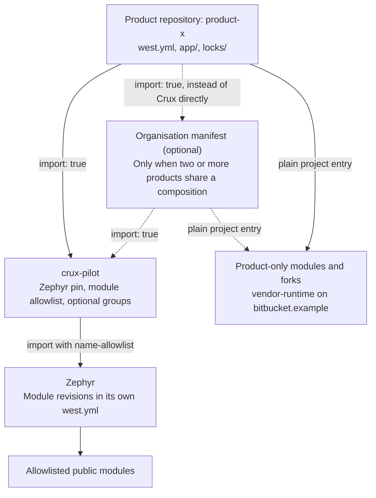
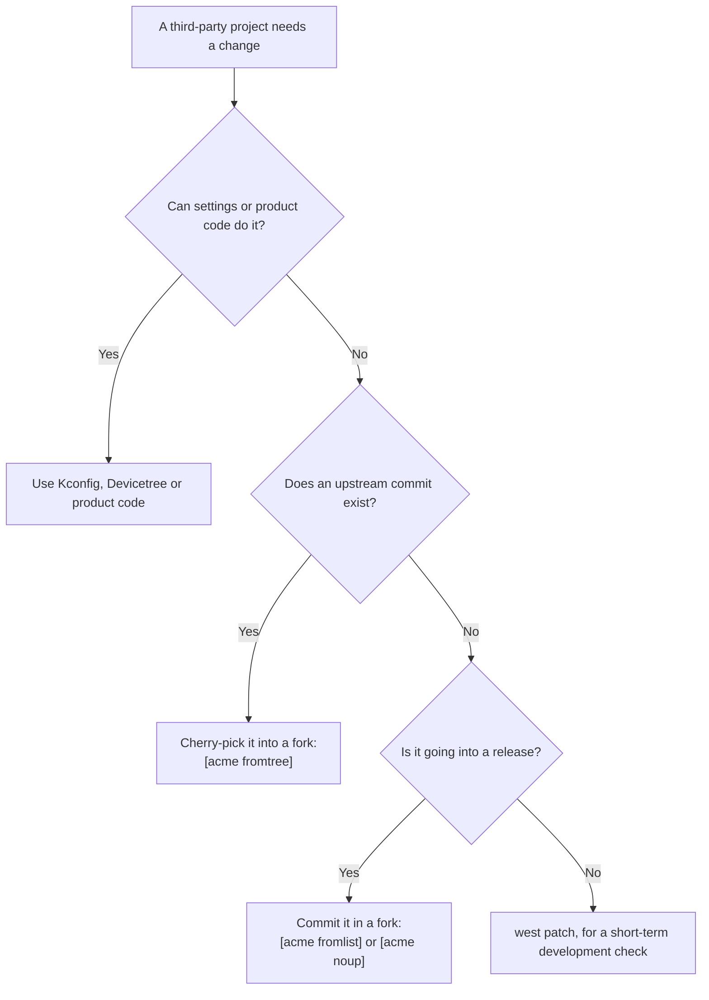
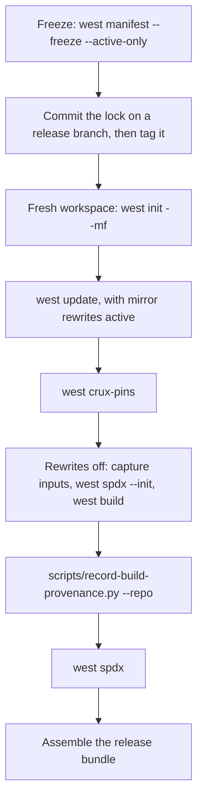

# Product Composition Guide

**Status: proposed practice.** No Crux release tag exists yet. This guide is not an adopted decision. It records how a product on Crux can compose, check, version and release its firmware, and what was run to support that. See [Limits](#limits).

Use it with the [product template](../samples/product_template/README.md), a small directory you copy to start a product repository. For other ways to consume Crux, see the [Build and Integration Guide](build.md).

## Who owns what

Dependencies run one way: product to Crux to Zephyr. Crux knows nothing about any product.

| Concern | Crux provides | The product owns |
| --- | --- | --- |
| Composition | An importable [`west.yml`](../west.yml): the Zephyr pin, the module allowlist and optional groups | Its own `west.yml`: the Crux revision, extra modules and overrides |
| Code | Public `crux::` usage targets and `<crux/...>` headers | Application code, Kconfig, Devicetree and board choices |
| Checks | `west crux-pins`, the Zephyr baseline gate and `scripts/record-build-provenance.py` | Running them in its own CI and keeping the results |
| Third-party changes | Only what Crux itself needs | Forks, their tags and the carried-changes list |
| Versions | Its own tags, once they exist | The product version and its security counter |
| Release | No bundle, signing or SBOM reduction tool | The release branch, the lock file, signing and what goes outward |
| Commercial modules | Nothing. Crux's manifest names only public modules | Their names, URLs and licences, in product or organisation manifests |

## Structure

The optional organisation manifest is a shared layer. Add it only when two or more products share a composition.



## Composition

The product uses west's T2 topology: the product repository is the manifest repository, and Crux and Zephyr are projects in its workspace.

The active part of the [template manifest](../samples/product_template/west.yml):

```yaml
manifest:
  version: "1.2"
  remotes:
    - name: crux
      url-base: https://github.com/wonny-labs
  projects:
    - name: crux-pilot
      remote: crux
      revision: main # No Crux tag exists yet. Pin a tag or SHA for a release.
      import: true
  self:
    path: product-x
```

This resolves Zephyr and every allowlisted module at the revisions Crux pins. The product repeats no revision.

- **First definition wins.** West uses the first definition of a project name. Entries in the product manifest beat anything imported.
- **Optional groups are off by default.** Crux keeps its secure management stacks in the `crux-secure-management` group. An ordinary workspace does not fetch them.
- **A filter only narrows.** A product `name-allowlist` on the Crux import can remove what Crux allows. It cannot add what Crux left out.

| Goal | What to write | `west crux-pins` reports |
| --- | --- | --- |
| Use what Crux pins | `import: true` | `OK` |
| Enable an optional set | `group-filter: [+crux-secure-management]`, with no revision | `OK` |
| Add a product-only module | A plain project entry with its revision | `PRODUCT` |
| Replace a project Crux pins | An entry with the same name, its path, and `userdata: crux-override` | `OVERRIDE` |
| Use fewer modules | `import: name-allowlist: [...]` on `crux-pilot`, including `zephyr` | `OK` for what remains |
| Add a Zephyr module Crux did not allow | A plain project entry with its revision | `OK` at the revision in Zephyr's manifest. Another revision needs `crux-override` |
| Add such a module and own the module list | Redefine `zephyr`, with your own allowlist | `OK` while the Zephyr revision and modules match the contract |

Redefining `zephyr` drops Crux's Zephyr import. The product then owns the allowlist, and must repeat the Zephyr SHA and every module it needs.

## Checks

West itself does not reject a mismatched Zephyr. It accepts a manifest that picks another release without a warning. Two Crux checks make that visible.

### `west crux-pins`

This compares the workspace with the contract: the `west.yml` of the Crux repository that holds the command, plus the `west.yml` of Zephyr at the revision Crux pins. It reads Crux at the pinned revision when Crux is a project, under any name, and from the working tree when Crux is the manifest repository. A lock passed with `--mf` is never the contract.

It compares commits resolved by git, so a tag and its commit are equal. The workspace side is each project's `HEAD`, which must be what `west update` fetched (`manifest-rev`). Inactive projects are not reported.

| Output | Meaning | Exit |
| --- | --- | --- |
| `CONTRACT name sha` | The Crux project: where the contract came from. `(working tree)` follows when Crux is the manifest repository | 0 |
| `OK name sha` | Same commit as the contract | 0 |
| `OVERRIDE name sha (contract sha): reason` | Differs, with a declared `crux-override` reason | 0 |
| `PRODUCT name sha` | Not part of the contract | 0 |
| `MISMATCH name sha (contract sha)` | Differs, with no declared reason | Non-zero |
| `MISMATCH name sha: why` | The checkout is not what the manifest pins: `HEAD` left `manifest-rev`, or a SHA or tag in the manifest is not what west fetched. Run `west update`. No `crux-override` excuses this | Non-zero |

A contract revision that cannot be resolved is an error, never `OK`. So a fork must contain the commit that Crux pins.

A branch revision is checked through `manifest-rev` alone, because west keeps no ref for it and a local branch of that name proves nothing. So a manifest edited to name another branch, with no `west update` after it, is not detected.

Declare a difference in the product manifest:

```yaml
userdata:
  crux-override: "fix for acme issue 123, drop when upstream has it"
```

### Zephyr baseline gate

The Crux Zephyr module compares the release numbers of the Zephyr in use with the release Crux was verified on, currently 4.4.2. A difference stops the build. A fork with an `EXTRAVERSION` suffix passes, because its release numbers are unchanged.

`-DCRUX_ALLOW_UNVERIFIED_ZEPHYR=ON` turns the error into a warning. Crux evidence does not apply to that build.

## Modifying third-party code

Choose the lightest route that fits.



### Forks

Tag each carried commit in its subject and add an `Upstream-Status` trailer.

| Tag | Meaning | Example trailer |
| --- | --- | --- |
| `[acme fromtree]` | Cherry-picked from upstream | `Upstream-Status: Backport abc123` |
| `[acme fromlist]` | Proposed upstream, not merged yet | `Upstream-Status: Submitted <link>` |
| `[acme noup]` | Not going upstream | `Upstream-Status: Inappropriate product-specific` |

Generate the carried-changes list from the fork:

```sh
git log --reverse --format='%h %s%n    %(trailers:key=Upstream-Status,valueonly)' v4.4.2..v4.4.2-acme3
```

- Pin a SHA in the manifest, with the tag in a comment.
- Keep a durable ref on each released fork SHA. `west update` fails on a SHA that no ref reaches.
- Declare the fork with `crux-override`, so that `west crux-pins` reports it with its reason.

### `west patch`

Use it for short-term development checks only. At Zephyr v4.4.2:

- Applying leaves the checkout modified, and a second apply fails.
- The build record refuses the patched checkout.
- `git am` followed by `west update` silently drops the patch.
- The boot banner stays at the upstream version.
- There is no `reverse` subcommand. The subcommands are `apply`, `clean`, `gh-fetch` and `list`.

### One file in this repository

This public repository carries one replaced Zephyr source as a [build-local replacement](../patches/zephyr/README.md). A script checks the original hash and patches a temporary copy, and CMake swaps exactly that one source in the build. It never edits the Zephyr checkout. This suits a single file. For anything larger, the flow above leads to a fork.

## Versions

| What | Form | Example | Notes |
| --- | --- | --- | --- |
| Crux | `v0.y.z`, SemVer | None yet | No tag exists yet |
| Fork | `v<upstream>-<org><n>` | `v4.4.2-acme3` | The upstream release, then a local counter |
| Product | `major.minor.patch+build` | `1.2.3+45` | Fits MCUboot's 8, 8, 16 and 32-bit fields |
| Security counter | A separate integer | `7` | Raised on its own schedule, not derived from the version |

The field widths limit the product version to major and minor up to 255, patch up to 65535 and build up to 4294967295.

## Release

Release from a fresh workspace and a frozen manifest. West does not update a project's git remote when a manifest URL changes, so a reused workspace can record an old location.



Freeze with `--active-only`, because plain `--freeze` fails when a declared optional project is not cloned.

```sh
west manifest --freeze --active-only > product-x/locks/west.frozen.yml
git -C product-x switch -c release/1.2
git -C product-x add locks/west.frozen.yml
git -C product-x commit -m "build: lock the manifest for 1.2.3"
git -C product-x tag -a product-x-1.2.3 -m "product-x 1.2.3"
git -C product-x push origin release/1.2 product-x-1.2.3
```

Build in a fresh workspace. Replace `<board>` with your board target.

```sh
west init -m https://bitbucket.example/scm/acme/product-x --mr product-x-1.2.3 \
    --mf locks/west.frozen.yml release-1.2.3
cd release-1.2.3

# Mirror rewrites, if you use them, are active for this one command.
GIT_CONFIG_GLOBAL="$HOME/mirror.gitconfig" west update
west crux-pins

python3 crux-pilot/scripts/record-build-provenance.py --repo product-x --workspace . \
    --capture-inputs product-x/build/inputs.json
west spdx --init -d product-x/build/app
west build -b <board> -d product-x/build/app product-x/app
west build -d product-x/build/app -t rom_report
west build -d product-x/build/app -t ram_report
python3 crux-pilot/scripts/record-build-provenance.py --repo product-x --workspace . \
    --build-dir product-x/build/app --target <board> --inputs product-x/build/inputs.json
west spdx -d product-x/build/app
```

- **Mirror rewrites.** `url.<base>.insteadOf` rules belong in a separate Git configuration file that is used only for `west update`. If the rules are active at build time, modules are marked `-off` and the SBOM records the mirror location.
- **Pinned workspace.** The build record resolves each project's revision in its checkout, so it fails on a workspace that follows `revision: main`. Run it on the frozen workspace.
- **Build directory.** The record refuses a build directory outside `--repo`. The template's `.gitignore` keeps `build/` out of the source tree the record hashes.
- **Container recipe.** `--devcontainer DIR` names the recipe. By default the record uses `<repo>/.devcontainer` if present, otherwise Crux's own.
- **Lock file.** The record's `west_manifest_sha256` is the hash of `west.yml`, not of the lock. The lock is covered by the source snapshot, and `west_projects` lists each commit.

### Proposed release bundle

This is a convention. No tool assembles it yet.

| Item | Source | Audience |
| --- | --- | --- |
| Firmware image | `build/app/zephyr/zephyr.bin` | Outward |
| Build record | `build/app/provenance.json` | Internal |
| Lock file | `locks/west.frozen.yml` at the release tag | Internal |
| Pin report | Output of `west crux-pins` | Internal |
| Carried-changes list | The `git log` command above, for each fork | Internal |
| Full SBOM | `build/app/spdx/` | Internal |
| Reduced SBOM | Made by the product from the full set | Outward |
| Debug files | `build/app/zephyr/zephyr.elf` and `zephyr.map` | Internal only |

Signing was not tested. It is undecided whether identity is taken before or after signing.

## Identity

Use `firmware_identity` from `provenance.json` to compare builds across workspaces. It holds the build target, the hash of `zephyr.bin` and the hash of `.config` with its comment lines removed. Lines of the form `# CONFIG_X is not set` stay, because they carry meaning.

| Value | Compare across workspace paths? | Why |
| --- | --- | --- |
| `firmware_identity` | Yes | Comes from the image and the decided configuration |
| `build_id` | No | Hashes `.elf`, `.map`, the whole `.config` and tool paths |
| `.elf`, `.map` | No | Hold absolute paths |
| Whole-file `.config` | No | Its comment lines hold absolute paths |

## SBOM

At Zephyr v4.4.2:

- `west spdx` needs `CONFIG_BUILD_OUTPUT_META`, which the template sets. Run `west spdx --init -d <build>` before the build and `west spdx -d <build>` after it.
- It emits SPDX 2.2 or 2.3. It does not support `native_sim`.
- A default set exposes file names, copyright text and internal URLs. Reduce it before giving it outward.
- Prebuilt libraries declared in `module.yml` appear in no document. A release step must add them.
- `zspdx/walker.py` `_build_purl` accepts only `git@` and `http(s)://` URLs, so a fork on an `ssh://` URL gets no purl.
- Only an exact `vX.Y.Z` tag gives the package version and the CPE, so a fork tag such as `v4.4.2-acme1` does not. A release step can add the upstream base identity back. A fork on an `https://` URL was not tested.

A real product must scan its own image for private strings. `.elf` and `.map` stay internal.

## Linux

Linux products are not covered yet. There is no Yocto layer, and none is planned before a real consumer exists.

## Limits

**What was run**

- A throwaway proof of concept built one small application that links `crux::time`. It used Zephyr v4.4.2, west 1.4.0 and SDK 1.0.1, in the amd64 Dev Container image under emulation. It was a cross-build only, for the current EVKB target. Nothing ran on a board. It exercised the composition, fork, `west patch`, SBOM, frozen-manifest and two-path image comparisons. Its copy of the application is not byte-for-byte the template's.
- `tests/build/test_product_template.py` runs the template manifest through real west 1.4.0, `west crux-pins`, the frozen-manifest flow and input capture for the build record. It uses local throwaway repositories in place of every remote and builds nothing with Zephyr.
- `scripts/test-product-template.sh` is configured in the Zephyr CI workflow to cross-build `app/` for the current EVKB target. It builds inside Crux's own workspace, not through the template's manifest.

**What was not run**

- A real Bitbucket server. Local repositories stood in for it, so server behaviour, authentication and clone URL forms are untested.
- A real commercial module. `vendor-runtime` was an invented stand-in.
- Signing, a physical board, or a baseline upgrade through a fork.
- More than one application, SDK or container image. Image comparison across paths holds for that one case.
- Linux, Yocto or any other build system.
