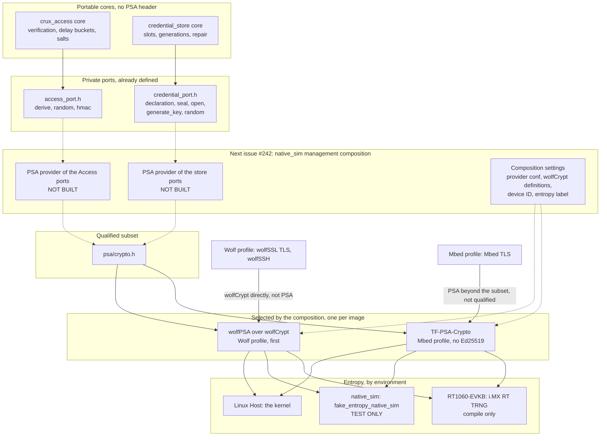

# PSA Crypto for `crux_access` and the credential store

Status: design for review under [Issue #142](https://github.com/wonny-labs/crux-pilot/issues/142). The qualification
results, provider declarations and decisions are in [the qualification record](psa-crypto-qualification.md). The declared API
subset is in [the native-free consumer policy](native-interface-policy.md#qualified-psa-crypto-subset).

This issue qualifies the provider. It adds no PSA code to a Crux component. This document says how the components will reach
a provider and what the next issue, [#242, the `native_sim` management composition](https://github.com/wonny-labs/crux-pilot/issues/242), has to supply.

## What is built, faked and untested

| Item | State |
| --- | --- |
| Conformance cases, 45, against both providers | Built and run: Linux Host, `native_sim` |
| Provider selection in a composition | Built for the test compositions in `tests/psa_crypto/` |
| Host dependency, `cmake/CruxPsaCrypto.cmake` | Built. Used by the Host test composition, and the root build does not call it. |
| Manifest and module arrangement | Adopted. The `crux-secure-management` group already holds the projects. |
| PSA provider of the `crux_access` ports | **Not built.** `tests/access` still uses fakes. |
| PSA provider of the credential store ports | **Not built.** `tests/credential` still uses fakes. |
| A consumer calling a real provider | **Untested.** The cases call PSA directly, in the way this document says a provider will. |
| TLS over PSA on the Mbed profile | **Not qualified.** Mbed TLS calls PSA itself, beyond this subset, in the same provider. See below. |
| TLS and SSH on the Wolf profile | Not through PSA. They call wolfCrypt directly. |
| RT1060-EVKB | Compile only. Nothing was flashed, reset or run. |

## How a consumer reaches a provider

Only provider files see `<psa/crypto.h>`. The portable cores stay as they are, so the header stays out of every public header,
and a composition chooses the provider at build time.

Dashed lines do not exist yet.

How TLS reaches the provider depends on the profile, and the subset covers neither route:

| Profile | TLS and SSH | What follows |
| --- | --- | --- |
| Wolf | wolfSSL TLS and wolfSSH call wolfCrypt directly, not PSA. They share its one Hash-DRBG with wolfPSA. | The entropy declaration covers them too, and the conformance cases do not. |
| Mbed | Mbed TLS calls PSA itself, for example `library/ssl_msg.c:1043`, `library/ssl_tls.c:6044` and `library/ssl_tls13_keys.c:179` at `a3e190f`. It shares one TF-PSA-Crypto core, one key table and one random source with the Crux providers. There is no SSH. | TLS uses PSA **beyond this subset, unqualified here**, including key agreement, key derivation and AEAD. The entropy declaration covers it. The limits below on locking and key slots apply to it. |

## What each port calls

Each row uses only the [qualified subset](native-interface-policy.md#qualified-psa-crypto-subset), and a named case runs that exact sequence.

| Port | Calls | Result mapping | Cases |
| --- | --- | --- | --- |
| `crux_access_port_derive` | `psa_key_derivation_setup` with `PSA_ALG_PBKDF2_HMAC(PSA_ALG_SHA_256)`, `_input_integer` for the cost, `_input_bytes` for the 16-byte salt then the password, `_output_bytes` for 32 bytes, `_abort` | Any failure is `false`. The core does the constant-time comparison, so `psa_key_derivation_verify_bytes` is not needed. | `pbkdf2_longest_password_known_answer`, `pbkdf2_empty_password_known_answer`, `pbkdf2_hmac_sha256_known_answer_*` |
| `crux_access_port_random` | `psa_generate_random` | Any failure is `false` | `random_*` |
| `crux_access_port_hmac` | `psa_import_key` as `PSA_KEY_TYPE_HMAC`, 256 bits, `PSA_KEY_USAGE_SIGN_MESSAGE`, `psa_mac_compute`, `psa_destroy_key` | Any failure is `false` | `hmac_*` |
| `crux_credential_port_seal` | `psa_aead_encrypt_setup`, `_set_lengths`, `_set_nonce`, `_update_ad`, `_update`, `_finish` | `OK`, or an error other than `ENTROPY` | `aes256_gcm_multipart_separate_tag_known_answer`, `aes256_gcm_slot_image_known_answer` |
| `crux_credential_port_open` | `psa_aead_decrypt_setup`, `_set_lengths`, `_set_nonce`, `_update_ad`, `_update`, `_verify` | `PSA_ERROR_INVALID_SIGNATURE` is `ERR_UNUSABLE`, a corrupt slot. Anything else is another error, an unreadable slot. | `aes256_gcm_tampering_is_invalid_signature` |
| `crux_credential_port_generate_key` | `psa_generate_key`, `psa_export_key`, `psa_export_public_key`, `psa_destroy_key` | Any failure is `ERR_ENTROPY`, as the port states | `p256_generate_export_forms`, `ed25519_generate_export_forms`, and the `signs_and_verifies` cases |
| `crux_credential_port_random` | `psa_generate_random` | Failure is `ERR_ENTROPY` | `random_*` |
| Device key, inside the store provider | `psa_hash_compute` over a fixed label and the `hwinfo` ID, then `psa_import_key` as AES, 256 bits, `PSA_ALG_GCM`, encrypt and decrypt | The provider cannot run without an ID: its declaration is `NULL` | `sha256_*`, `aes256_*` |

### What a provider must take care of

| Point | Why |
| --- | --- |
| Use the multipart AEAD calls, and not the one-shot ones | The port hands over the tag apart from the payload, and it does not promise that the tag follows the payload in memory. |
| Allow `psa_aead_update` to hold back part of the payload, and write the rest from `_finish` or `_verify` | The API allows it, and the cases accept it. Its output size is not the input size. |
| Wipe `plain` after a failed `_verify` | The multipart path has already written unauthenticated bytes to `plain` by then. |
| Report only `INVALID_SIGNATURE` as a corrupt slot | A passing failure must not fall back to an older generation. This is decision 11 of the [credential store](credential-store.md#decisions-for-review), and the tampering case holds both providers to it. |
| Keep the two store buffers apart | The port says `plain` and `sealed` do not overlap. Overlap is **not** qualified, so decision 4 of the store stands, with about 32 KiB of RAM. |
| Call `psa_crypto_init` before first use | It is idempotent on both providers, and neither provider's boot call is relied on. |
| Destroy a key and zero its exported bytes once they are copied | Volatile key slots are limited. TF-PSA-Crypto has 16 static slots in the `native_sim` configuration, and on the Mbed profile TLS handshakes take slots from the same table. Nobody has measured how many, so 16 is not a figure for the Crux providers alone. |
| Do not treat a successful import of a public key as validated | wolfPSA imports an off-curve point and only refuses it at use. See [deviations](psa-crypto-qualification.md#provider-deviations). |
| On the Mbed profile, do not ask for an Ed25519 key | TF-PSA-Crypto has no Ed25519, and the port reports any key generation failure as `ERR_ENTROPY`. So the request surfaces as an entropy error, which is misleading, and `crux_credential_key_ensure` fails. The design already refuses CLI and SFTP on that profile. |
| On the Mbed profile, a lock in a Crux provider is not enough | Zephyr's module offers no `MBEDTLS_THREADING_C` at this pin, so the PSA core has no lock. TLS threads call the same core, and a lock in a Crux provider cannot cover them. |

## What the next issue must supply

[#242](https://github.com/wonny-labs/crux-pilot/issues/242) already lists the ports and the event providers. These are the parts that come from what this issue found. Nothing else is
missing from PSA, so the composition can start from this PR, and no small piece was added to a component here.

| # | Piece | Detail |
| --- | --- | --- |
| 1 | Provider selection, Wolf profile | `CONFIG_PSA_CRYPTO=y`, `CONFIG_PSA_CRYPTO_PROVIDER_CUSTOM=y`, `CONFIG_WOLFSSL=y`, `CONFIG_WOLFSSL_CURVE25519=y`, `CONFIG_ENTROPY_GENERATOR=y`, and the `PSA_WANT` symbols in [`prj.conf`](../tests/psa_crypto/zephyr/prj.conf). |
| 1a | Provider selection, Mbed profile | `CONFIG_PSA_CRYPTO=y`, `CONFIG_PSA_CRYPTO_PROVIDER_MBEDTLS=y`, and the same `PSA_WANT` symbols, plus whatever TLS needs, which this issue did not qualify. |
| 2 | One more wolfCrypt definition, Wolf profile | `WOLFSSL_AESGCM_STREAM`, on the module's `wolfSSL` target with those in `wolf_ssh_settings.cmake`. Without it, multipart GCM reports `NOT_SUPPORTED`, and the module's Kconfig has no option for it. |
| 3 | PSA provider of the Access ports | `crux_access_port_derive`, `_random`, `_hmac`, as above. `_now_ms` is not PSA and also has no provider outside the tests, as #242 notes. |
| 4 | PSA provider of the store ports | `crux_credential_port_seal`, `_open`, `_generate_key`, `_random` and `_declaration`, declaring `BASIS_DEVICE_ID_KEY`, `EVIDENCE_SOFTWARE` and no confidentiality. It needs `CONFIG_HWINFO=y`: see the device ID below. |
| 5 | The label on what `native_sim` proves | The composition's documents and results state that its random values are test-only. See [What "real" means](#what-real-means-on-native_sim). |
| 6 | Seed choice in tests | A test that needs values to differ between runs passes `--seed-random`. The default seed repeats every value in every run. |
| 7 | A guard for product images | A build for a real board must fail if `CONFIG_FAKE_ENTROPY_NATIVE_SIM` or `CONFIG_TEST_RANDOM_GENERATOR` is set. `scripts/test-psa-crypto.sh target` checks both for the conformance image. |
| 8 | Provider tests | Run the existing Access and credential suites on the real providers where a Host or `native_sim` composition allows it. Their fakes stay for fault injection. |
| 9 | The Mbed profile's limits | #242 runs each TLS profile that can run the ports. On the Mbed profile the store's provider has P-256 and no Ed25519, the TLS key slots come from the same table, and #242 has to find a way to make the Access and store providers safe beside TLS threads, or record that it cannot. Serialising Crux's own calls is not enough. |

#242 says that wolfPSA has been built only for RT1060. This issue changes that: wolfPSA now runs the cases on `native_sim`, without a TLS socket backend. Whether it runs alongside the offloaded TLS socket stays with #242's probe.

The device ID on `native_sim` comes from `HWINFO_NATIVE`: 4 bytes, from the host's `gethostid()` or `--device_id`. It is an
identifier and is not secret, as on the target, so the provider's declaration is the same.

## What "real" means on `native_sim`

The owner made PSA a prerequisite of real HTTPS on `native_sim`. **Real here means the protocol and the algorithms run for real. It
does not mean that any secret is safe.** A later composition must not claim more.

`native_sim` entropy is **declared test-only**. It is not proven otherwise, and the source says the opposite:

- Zephyr's driver is named `fake_entropy_native_sim`, its help text says that it "does not generate real entropy", and it prints a warning at boot.
- It uses the host's `random()`, a non-cryptographic generator. With no option it uses a fixed seed, `--seed` picks another fixed sequence, and `--seed-random` draws only a 32-bit seed, which it also prints.
- [`scripts/test-psa-crypto.sh zephyr`](../scripts/test-psa-crypto.sh) shows it for each provider on every run: two default runs give the same bytes, and two runs with one seed give the same bytes. It fails if that stops holding, so that the declaration gets reviewed.

| A `native_sim` management result can show | It cannot show |
| --- | --- |
| A real TLS handshake with a real client, and a real SSH session, using the real provider code | Unpredictable keys: with the default seed, every generated key, nonce, salt and token repeats in every run |
| Verifiers, sealed slots and device keys in their real formats, through the real algorithms | Confidentiality: a repeated seed also repeats AES-GCM nonces between runs on one device key |
| That the PSA subset is enough for the composition | Entropy quality, or anything about the target's TRNG |
| Host and `native_sim` software completion, as an interim result | Physical evidence, which stays tracked separately |

So a private key that a `native_sim` run generates is a test key, and it must not be reused anywhere.

## Evidence levels by environment

| Environment | Cases | Entropy | Next step |
| --- | --- | --- | --- |
| Linux Host | Run | The kernel, and two processes differ. Quality is the host's. | PSA providers, Host tests |
| `native_sim` | Run | Test-only, as above | Management composition |
| RT1060-EVKB | Compile only | TRNG, from sources and compile only | Needs separate hardware approval |

## Decisions for review

Each was taken without asking the owner, as the task instructs, and the narrower choice was taken where there was one.

| # | Decision | Why | If changed |
| --- | --- | --- | --- |
| 1 | The root build does not include PSA. Only `tests/psa_crypto/host` calls `cmake/CruxPsaCrypto.cmake`. | The default build stays free of cryptography, and Host CI keeps its current downloads. | A later Host provider test calls the module. |
| 2 | Linux Host defaults to TF-PSA-Crypto, by archive, and wolfPSA on Host is a test built from the west workspace | A Host consumer can then build with no GPL stack and no west. The Wolf profile still runs on Host in this workflow. | A consumer that needs Ed25519 on Host uses the west path. |
| 3 | Keep the projects in the `crux-secure-management` group and do not add them to `name-allowlist` | The record's earlier proposal predates #202, which put them in the group. An ordinary workspace fetches no cryptography. | One line per project in `west.yml`. |
| 4 | Two provider results are declared deviations rather than passes. Each covers one assertion and one named status. | See [deviations](psa-crypto-qualification.md#provider-deviations). Both fail safe. The review of `00db0bf` found that a deviation hid every failure in its case, so the cases were split and the classifier narrowed. What each assertion expects did not change. | Remove the declaration when a provider changes, and the harness fails until that is done. |
| 5 | `psa_key_derivation_verify_bytes` is outside the subset | TF-PSA-Crypto does not implement it, and the Access core already compares in constant time. This closes the record's open point. | None for consumers. |
| 6 | One new workflow, and not a step in `zephyr.yml` | It leaves the existing workflows untouched. | The steps move into `zephyr.yml`. |
| 7 | **CI runs TF-PSA-Crypto only, and wolfPSA stays out of default CI** | `scripts/check-ssh-boundaries.py` and its test forbid a default workflow from selecting the secure management stacks. Changing a protected check goes beyond the approval for a workflow, so it is unchanged, and the workflow does not hide the group's name. It selects `mbedtls` and `tf-psa-crypto` by `manifest.project-filter`, which fetches no GPL stack, the rule's stated purpose. | wolfPSA in CI needs the owner to approve a change to that rule. The script is ready: `scripts/test-psa-crypto.sh all`. |
| 8 | The workflow uploads logs and reports, and never binaries | Kept as the rule, so that widening it later cannot publish a program linked with a GPL stack by accident. | None. |

## Not verified

- Any consumer calling a provider. The port mappings above are designs, checked only by cases that make the same calls.
- Concurrency. The cases run on one thread. wolfPSA has a global lock by default (`CONFIG_WOLFPSA_THREAD_SAFE`). Zephyr's module offers no `MBEDTLS_THREADING_C` for TF-PSA-Crypto at this pin, so its core has no lock, and on the Mbed profile TLS threads call it too. How that profile is made safe is open for #242.
- TLS over PSA on the Mbed profile, which goes beyond the subset.
- wolfPSA and the wolfSSL TLS socket backend in one `native_sim` image, with the socket patch. The test image holds the TLS layer but no socket backend.
- Stack, heap and timing. The verifier cost is still the placeholder, and Issue #197 measures memory.
- Entropy quality, TRNG health checks and start-up on a board.
- `psa-arch-tests`, which stays a reference only.
