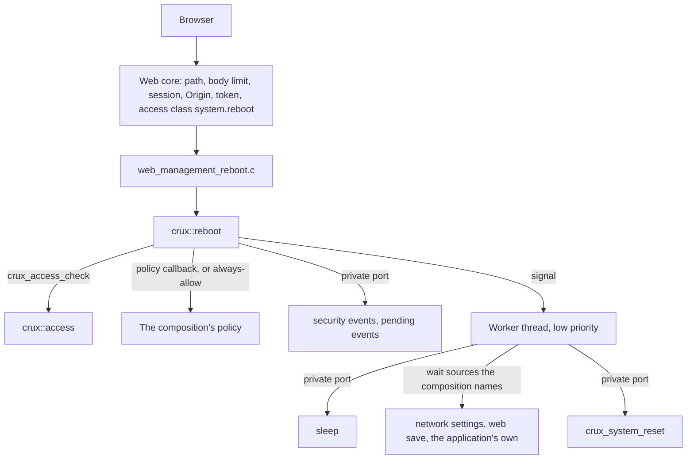
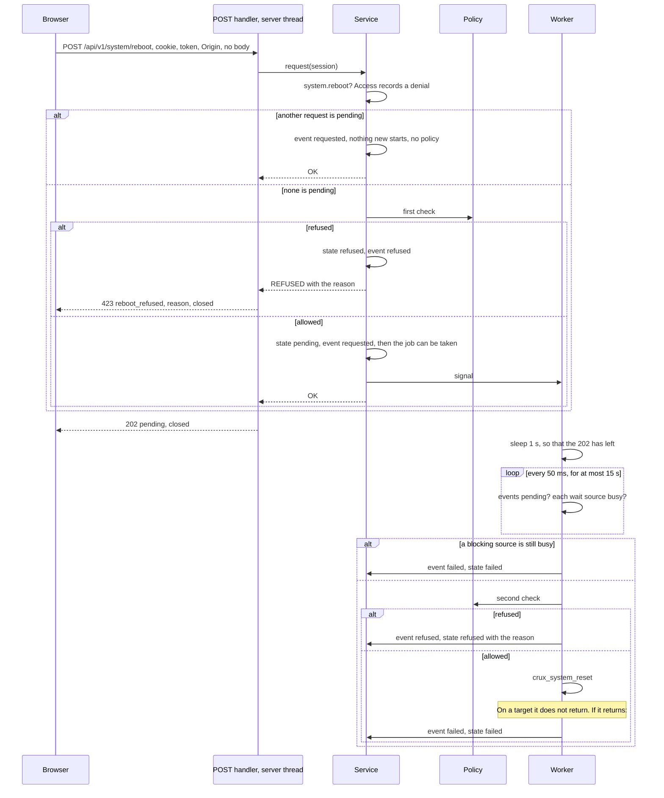
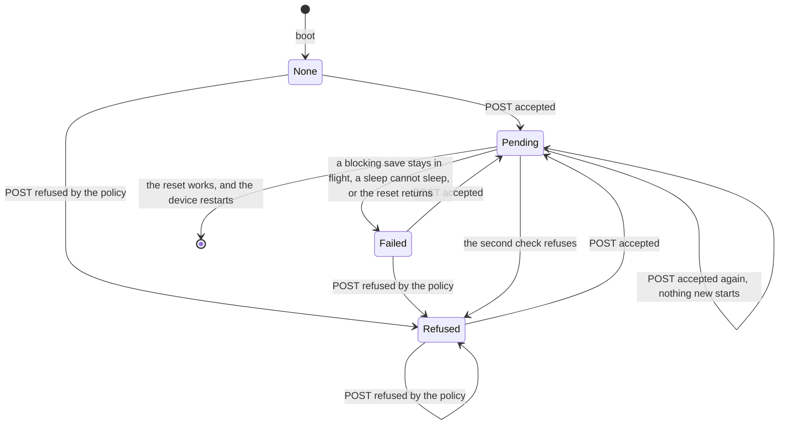
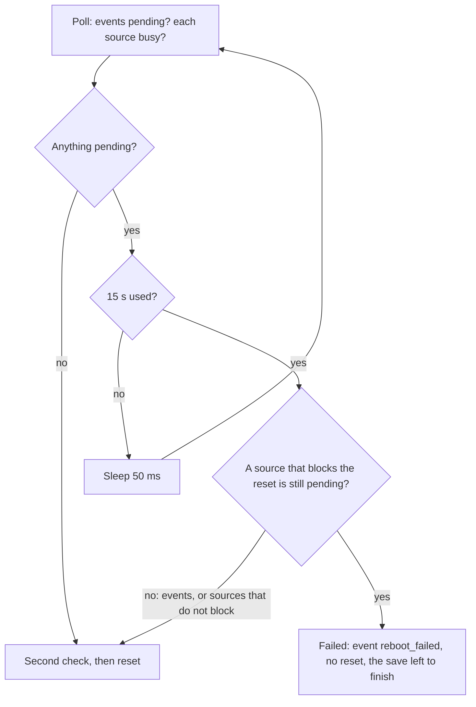

# Reboot service

Status: merged in [PR #290](https://github.com/wonny-labs/crux-pilot/pull/290) for Issue #214. Host only. Nothing here has run on a board, **no image composes this service, not even [the services image](native-composition-242.md)**, so no image serves these routes, and nothing here calls a real reset. Host results are interim results, and physical
evidence stays tracked apart. Decision W9 and the reboot section of [the frontend foundation
design](plans/web-frontend-foundation-design.md#reboot), and [the owner's approval on #183](https://github.com/wonny-labs/crux-pilot/issues/183#issuecomment-6637976084)
(W13: reboot is Advanced and optional) are the basis.

Owner: `components/reboot`. Public header `<crux/reboot.h>`, usage target `crux::reboot`. The routes are in
`components/web/management/web_management_reboot.c` and are described in [`web/api/openapi.yaml`](../web/api/openapi.yaml), which
this change does not edit.

`crux_system_reset()` does not flush storage, drain logs or perform safe-state actions: its contract says so, and a native failure
may hang. A restart that a person asks for over the network therefore goes through this service, which checks who asks, lets the
application refuse, records the request, gives events and saves a bounded time, asks the application again, and only then resets.

## What is built, faked and untested

| Part | State | Evidence |
| --- | --- | --- |
| The service: permission, policy, state, request, worker steps, events | **Built** | Host, on the real Access core, with fake ports |
| The policy statement: a callback, or the always-allow option by name, and a start that fails when neither is given | **Built** | `Reboot.service` |
| The order of the steps: event, answer, delay, bounded wait, second check, reset | **Built as a test**, with a virtual sleep | `Reboot.steps`, `Web.reboot_routes` |
| The bounded wait, with sources that the composition names, and events | **Built** | `Reboot.steps` to the exact poll, `Reboot.pending` on real saves |
| A refusal text that reaches a client only if it follows the character rule | **Built** | `Reboot.reason`: 26 named vectors and 60,000 generated texts against an oracle |
| Two requests at the same time, a request or a read while the worker waits, the real worker thread | **Built** | `Reboot.concurrency` |
| `GET` and `POST /api/v1/system/reboot` | **Built** | `Web.reboot_routes`, on the real Web core, session module and services |
| A composition without the service has no reboot route | **Built as a test** | `Web.reboot_no_service`: the route table, and a request that finds nothing |
| The routes' answers against the specification | **Built** | `Web.reboot_openapi`: 25 real answers, with 12 negative controls |
| Event provider over the security events, and the pending-events question | **Built** | `ManagementProviders.events`, with the real mapping and the fake of the contract |
| Probes of other components' saves | **Built, small** | `crux_network_settings_save_pending()` and `crux_web_management_save_pending()`: [decision 15](#decisions-taken-without-an-answer) |
| A sleep that cannot sleep ends the request as failed, and `crux_reboot_start()` cannot be ignored | **Built** | `Reboot.steps`, `Reboot.nodiscard` |
| Reset port over `crux_system_reset()`, and the sleep port over Sync | **Built, thin**, linked by no suite | The Host `crux_system_reset()` returns not supported |
| A composition that serves the routes, links the service or states a policy | **Not here.** | |
| `native_sim` | **Not run.** There is no composition, so there is nothing to run. | |
| RT1060 compile | **Not run.** | |
| A real reset on RT1060-EVKB | **Not run.** It needs separately approved physical evidence. | |
| The mock and the TypeScript client | **Unchanged.** They already follow this behaviour: [Specification, mock and client](#specification-mock-and-client). | |

## Structure

The ports are `components/reboot/src/reboot_port.h`, which no consumer includes. A provider of each is an object target that a
composition links by name.

| Port | Provider | Host suites |
| --- | --- | --- |
| `crux_reboot_port_reset` | `crux_reboot_system_reset`, over `crux_system_reset()` | A fake that records the call and returns a chosen status |
| `crux_reboot_port_sleep` | `crux_reboot_sleep`, on a Sync semaphore that is never given | A virtual clock that adds the time and returns |
| `crux_reboot_port_events_pending` | `crux_reboot_security_events`, from the counts of `crux_security_event_get_stats()` | A fake that answers for a chosen number of polls |
| `crux_reboot_port_event` | `crux_reboot_security_events` | A recording fake |

## The policy (W9)

A composition that includes the service states its policy in the configuration that it gives `crux_reboot_start()`.

| `policy_kind` | Needs | Result of the start |
| --- | --- | --- |
| `CRUX_REBOOT_POLICY_UNSET`, which is zero, so a zeroed configuration | | `CRUX_REBOOT_ERR_NO_POLICY`. The service does not run. |
| `CRUX_REBOOT_POLICY_CALLBACK` | `policy` set | Starts. With `policy` NULL: `ERR_NO_POLICY`. |
| `CRUX_REBOOT_POLICY_ALWAYS_ALLOW` | `policy` NULL | Starts. With a callback beside it: `ERR_INVALID_ARGUMENT`, because it is two statements. |
| Any other value | | `ERR_NO_POLICY` |

A refused start leaves a service that is not there: a request, a read and the worker all answer not ready, which the routes show
as `503` `not_ready`. The failure is at start and not at build, because the build cannot see a value that a composition computes. A
test shows each row, and a mutation that lets an unset policy start is caught.

The callback `bool (*)(void *context, crux_reboot_refusal_t *refusal)` returns true to allow. To refuse it returns false and may
write a reason. It runs on the server thread for a request and on the worker thread for the second check, so it must be thread-safe
and quick, and must not call the service. It is not given the session: whether a machine may restart does not depend on who asks,
and the permission already decided that.

The reason is shown to a client in the `423` and in `GET`, so it is held to the same rule as a status text value: one to 63 bytes
of well-formed UTF-8 with no control character, ended inside the 64-byte buffer. Anything else, including empty text and text with
no terminator, is replaced by `Refused by the application`, so that a refusal never shows nothing and a callback's mistake never
reaches a client.

## One request, from the browser to the reset

The answers of `POST`, in the order they are decided:

| Order | Condition | Answer |
| --- | --- | --- |
| 1 | The request has any body | `413` `payload_too_large`, from the core, before any session lookup. The route takes none. |
| 2 | No valid session | `401` `unauthorized` |
| 3 | The forgery checks fail | `403` `csrf_rejected` or `origin_rejected`, from the core |
| 4 | The session lacks `system.reboot`, or is under a forced password change | `403` `permission_denied`. The core records the denial, and nothing else runs. |
| 5 | The service is not started | `503` `not_ready`, with `Retry-After` |
| 6 | Another request is pending | `202` `{"state":"pending"}`. No policy runs, and nothing new starts. |
| 7 | The policy refuses | `423` `{"code":"reboot_refused","reason":"..."}` |
| 8 | A lock did not come in 20 ms | `503` `busy`, with `Retry-After`, and nothing changed |
| 9 | None of these | `202` `{"state":"pending"}` |

The connection closes after every answer to a `POST`, as after every update of the other management routes. The `423` is not a
`409`, so that a client that retries a bare `409` as busy cannot mistake a refusal for it.

## State

`GET` needs `system.reboot` as well, because the reset can return an error after the `202`. A `200` means that the device is still
running, so an answer alone is never success: success is a session that is no longer valid, because sessions do not survive a reset.

| State | `GET` body | Meaning |
| --- | --- | --- |
| None | `{"state":"none"}` | No request since this boot |
| Pending | `{"state":"pending"}` | Accepted, and the reset has not happened. Also while the worker waits. |
| Refused | `{"state":"refused","reason":"..."}` | The policy refused, at either check. The state stays until the next accepted request. |
| Failed | `{"state":"failed"}` | The restart did not happen. No text: the operator's detail stays on the device. |

A refusal never cancels a request that was accepted meanwhile: a policy that changes its mind between two requests leaves the
earlier one to its own second check. The state of a finished request stays until the next accepted request replaces it.

## The worker, and the bounded wait

The order is a rule, and tests hold it to the step.

| Step | What the worker does | Bound |
| --- | --- | --- |
| 1 | Sleeps `CRUX_REBOOT_DELAY_MS`, so that the `202` has left the device. A sleep that cannot sleep ends the request as failed, with no reset. | 1,000 ms |
| 2 | Polls events and every wait source, then sleeps `CRUX_REBOOT_POLL_MS`, until none is pending | At most `CRUX_REBOOT_SETTLE_WAIT_MS`, 15,000 ms **of sleep**, in steps of 50 ms: 301 polls. The bound counts sleep time and not the time of the polls: [Wall time](#limits). A sleep that cannot sleep ends the request as failed, with no reset. |
| 3 | If a source that blocks the reset is still pending, ends the request as failed. The reset is not called, and the work is left alone. | |
| 4 | Asks the policy again, and ends the request as refused if it refuses | |
| 5 | Calls the reset. Whatever it returns is a restart that did not happen, and ends the request as failed. | |

The worker holds no lock while it sleeps, polls, asks the policy, or calls the reset. A request and a read made during any of these
get an answer at once, which `Reboot.concurrency` shows from inside each of the worker's sleeps.

| Constant | Value | Why | Measured |
| --- | --- | --- | --- |
| `CRUX_REBOOT_DELAY_MS` | 1,000 | The answer of the request has to leave the device, on a server that answers one request at a time | No |
| `CRUX_REBOOT_SETTLE_WAIT_MS` | 15,000 | Longer than one Configuration save, which waits up to 5 s for its own lock and then writes. A network save is up to three of those in a row, so a slow one can be cut: it then stops the reset. | No |
| `CRUX_REBOOT_POLL_MS` | 50 | A save ends in milliseconds, and a poll is a few lock reads | No |
| `CRUX_REBOOT_LOCK_WAIT_MS` | 20 | The longest a server-thread call waits for the state's lock, which is held only to copy. The same as the other management routes. | No |
| `CRUX_REBOOT_WORKER_WAIT_MS` | 1,000 | The worker's wait for its signal. A request also signals, so this is only a missed-signal bound. | No |

A composition can override each at build time. The suites pin the first three to these values, so that a change is a change to this
document too.

### What "pending saves" means

The service cannot see saves by itself, so the composition names what to wait for. Events need no entry: the service records them,
and it always asks the event port.

| Source | Pending while | Provided by | Blocks the reset at the bound |
| --- | --- | --- | --- |
| Security events | Recorded events have not been handed to Logging, by the counts of `crux_security_event_get_stats()` | The event port | No. The ring is RAM and a reset loses it anyway. This waits so that the lines of the request are written, which is not guaranteed. |
| A network settings save or recovery | Queued or running | `crux_network_settings_save_pending()` | Chosen by the composition, in `crux_reboot_wait_source_t.blocks_reset`. Recommended: yes. |
| A configuration save from the web routes | Queued or running | `crux_web_management_save_pending()` | Chosen by the composition. Recommended: yes. |
| The application's own save, or anything else | Whatever the composition's function says | The composition | Chosen by the composition |

These are **not** wait sources, and the service does not see them. A composition that wants the reset to wait for one writes a source
for it, and a reset that comes while one runs can cut it.

| Writer | Why it is not seen |
| --- | --- |
| The credential store's saves, with the accounts, keys and certificates | It holds its own lock across storage, and nothing here asks it |
| The TLS certificate's install and regeneration | Its lock is held across the save of the store, and nothing here asks it |
| The file service's writes and managed uploads | A file write in progress has no probe |
| A configuration save that a CLI session or the application starts, rather than the web route | Only the web routes' queue is asked. A save that is running holds the Configuration service's lock, which no probe polls, and one that is not queued by a route is not queued at all. |

**Never lose a save in flight without saying so.** A save that ends during the wait is whole when the reset is called, and
`Reboot.pending` shows it for a network save, a configuration save, and one that is accepted while the wait is running. A save that
does not end stops the reset, and `GET` and the event say so: the restart did not happen. The save is only asked about, so it is
still queued and still completes whole, which `Reboot.pending` shows too. What this does not cover is said in the [limits](#limits),
and the first of them is a save that is accepted after the last poll.

## Routes

| Route | Access class | Success | Refusals |
| --- | --- | --- | --- |
| `GET /api/v1/system/reboot` | `system.reboot` | `200`, the state | `401`, `403`, `503` |
| `POST /api/v1/system/reboot` | `system.reboot` | `202` `{"state":"pending"}` | `401`, `403`, `413`, `423`, `503` |

The access class is a permission, so the core enforces it before the handler and records a denial, and the service checks it again.
Neither route is on `components/web/reviewed-routes.txt`, which lists session-only and public routes. A session under a forced
password change holds no permission, so it gets `403`. An unknown path under the route is `404`, and another method is the server's
plain `405`. `GET` is not closed after its answer.

A composition that includes the service names `CRUX_WEB_MANAGEMENT_REBOOT_ROUTES` to `crux_web_routes(... SOURCES ...)`. A
composition that does not has **no reboot route at all**. `Web.reboot_no_service` builds a core from the same sources except that
one, starts the service all the same, and shows that the generated route table holds no such path and that a request from a session
that holds the permission finds nothing: no policy call, no event, no job.

## Security events

The three identifiers already exist in the contract and the identifier table, so no identifier is added.

| Event | Class | When | Result | Fields |
| --- | --- | --- | --- | --- |
| `system.reboot_requested` (0x0900) | Change | An accepted request, including one made while another was pending. Recorded before the answer and before the job can be taken. | OK | User and channel from the session that asked |
| `system.reboot_refused` (0x0901) | Routine | The policy refused, at the request or at the check before the reset | DENIED | The same |
| `system.reboot_failed` (0x0902) | Change | The restart did not happen: the reset returned, a blocking save stayed in flight, or a sleep could not sleep | FAILED | The same |

The classes are the contract's, and they are right for these uses. A request that can restart the machine is a change, so it is
still admitted when the ring is nearly full. A refusal changes nothing, so a flood of them must not push a change out. A failure is a
change because a reset that was dispatched may have partly acted, and an operator needs the record. An event carries no subject and
no reason: the reason is the application's text and stays in `GET` and the `423`. A denial of `system.reboot` is Access's
`access.permission_denied` and nothing here. The state of a request is set after its event is recorded, so a state that a client
reads has its record behind it. A session that ended before the worker ran leaves the event with no origin and no user.

## Concurrency and ordering

| Case | Result | Shown by |
| --- | --- | --- |
| Two `POST`s at the same time, 200 rounds | Both `202`, one job, one reset per round, two `requested` events | `Reboot.concurrency` |
| A `POST` while the worker sleeps or polls | `202`, no policy call, no new job, one event, one reset in all | `Reboot.concurrency` |
| A `GET` while the worker sleeps or polls | `200` `pending`, at once | `Reboot.concurrency` |
| A `POST` that the policy would now refuse, while one is pending | `202`: the pending request's own second check decides | `Reboot.service`, `Web.reboot_routes` |
| Three requesters, two readers and the real worker thread, 900 requests or more, until an acceptance and a refusal were both seen | Only states that exist, a reason only with `refused`, one worker at a time, every accepted request recorded once, every job ending in one event. The readers pause between reads and the policy refuses every third call for ever, so that a loaded machine cannot starve a requester's 20 ms wait or leave a run with no refusal. | `Reboot.concurrency`: 0 failures in 100 runs in a row, and in 200 runs eight at a time. Before the change it failed 14 of 100 runs four at a time. |
| A worker that comes by while the `requested` event is being recorded | Finds nothing: the job is taken only after its event | `Reboot.steps` |
| A session that ends, or loses its role, before the worker runs | The request is **not** cancelled: [decision 8](#decisions-taken-without-an-answer) | `Reboot.steps` |

## Limits

| Limit | Consequence |
| --- | --- |
| A save that is accepted after the last poll is not waited for | The second policy check, a callback, runs after the last poll, and the reset follows at once. A save queued in that gap is cut, or stays queued and is lost with the RAM. Nothing blocks new saves while a reboot is pending. `Reboot.pending` pins this. |
| The wait is a bound and not a guarantee about events | The counts say that Logging was handed the lines, not that a backend wrote them. A lost-records report counts as a line and can make the count read low. A backend that buffers is not seen. |
| A save that outlives 15 s stops the reset | A slow Configuration save can be waited out and a slower one cannot. The request fails, says so, and can be made again. No timing was measured on a target. **A save that hangs for ever leaves only a power cycle or the watchdog.** There is no override, and no CLI `reboot` command ([decision 16](#decisions-taken-without-an-answer)), so every later request fails the same way. This is the price of decision 7, which the owner should weigh with it. |
| A source that does not block lets the reset cut its work | The composition's choice, in `blocks_reset`. The application's own save needs its own entry, or it is not seen. |
| `crux_system_reset()` does not flush storage, drain logs or run safe-state actions | This service only gives events and the named saves a bounded time. Anything else is the application's, in its policy callback. |
| A native reset failure may hang | Only a watchdog or an operator recovers it. No state can be reported. |
| The policy callback runs on the server thread | A slow callback stalls every other client. It must be quick. |
| A reason is shown to anyone with `system.reboot` | It is the application's text, held to a character rule and a length and not to a meaning. |
| Saved network values apply at any later reset | A reboot applies them, which is what the network screen warns about: [network settings service](network-settings-service.md#limits). |
| The worker has no stop or join | `crux_reboot_start()` resets the state and is safe only before the worker starts. |
| Wall time from the request to the reset is 1 s plus up to 15 s of sleep, and more | The bound counts the time that the service sleeps, not the time of the polls. Each probe may wait up to 20 ms for its lock, so with two wait sources 301 polls can add 301 x 2 x 20 ms, about 12 s, and a sleep may return late. On a machine that must restart within a deadline, the policy decides, not this service. |
| A holder of `system.reboot` can fill the event ring with `system.reboot_requested` | Each accepted request is recorded, a duplicate while another is pending included, and the event is of the change class, so it is admitted into the ring's reserve. A flood of them can push other change events out, `system.reboot_failed` included, and they then show as `event.lost`. It is limited by one TLS handshake per `POST`, because the connection closes after every answer, and by the need for a valid session, the token and the permission: an unauthenticated flood never reaches the handler and records only what the core records. [Decision 5](#decisions-taken-without-an-answer). |
| The service adds two semaphores, a mutex and a thread | The state's mutex, the worker's signal and the sleep provider's semaphore, and one worker thread at low priority. The gate resource table does not record them, as it does not record those of the network settings service. |
| The `409` the server sends for a busy registered path | The server's own, with no body. No code here produces it. |

## Specification, mock and client

| Item | State |
| --- | --- |
| `web/api/openapi.yaml`: both operations, the `423` with its reason, `RebootState`, `RebootAccepted`, and the pending `POST` that runs no policy | **Unchanged.** It already holds everything above. `Web.reboot_openapi` holds the real answers to it. |
| The `413` of a `POST` with a body | Not listed for this operation, as the common forms table covers it. The route takes no body, and the client sends none. |
| `web/mock/server.ts` | **Unchanged.** It already refuses at the request with `423`, shows `refused` with the reason, answers `202` to a request while pending without the policy, and ends in `refused` or `failed`. |
| `web/client` and `samples/web/preact` | **Unchanged.** |
| Where the device and the mock differ | The mock's states follow polls and the device's follow the worker. The device never shows a `reason` outside `refused`. |

## What a composition needs

| Item | Where |
| --- | --- |
| A statement of the policy: a callback that can refuse, or `CRUX_REBOOT_POLICY_ALWAYS_ALLOW`. Nothing else starts the service. | `crux/reboot.h`, [the policy](#the-policy-w9) |
| Boot order: Access, the security events, `crux_reboot_start()`, `crux_reboot_start_worker()` | `crux/reboot.h` |
| The wait sources: the network settings and web save probes where those services run, the application's own save, and whether each blocks the reset | [What pending saves means](#what-pending-saves-means) |
| A provider of the reset: `crux_reboot_system_reset`. On a build that must never reset, the Host provider of `crux_system_reset()` returns not supported, so the same provider is a no-op that reports `failed`. | `components/reboot/CMakeLists.txt` |
| A provider of the sleep: `crux_reboot_sleep`. A provider of the event port and of the pending-events question: `crux_reboot_security_events`. | The same |
| `system.reboot` in the roles that may restart the device, and no other role | The product's policy |
| `CRUX_WEB_MANAGEMENT_REBOOT_ROUTES` named to `crux_web_routes(... SOURCES ...)`, and `crux::reboot` linked. Leave both out for no reboot route. | `components/web/management/sources.cmake` |

No `native_sim` composition is built here. A composition that wants the web flow to run without restarting a simulator links the
Host reset provider, and then every request ends in `failed`, which is the documented no-op. Whether `sys_reboot()` restarts or
exits a `native_sim` image was not checked.

## Tests

`scripts/test-reboot.sh` runs these under the debug and sanitizer presets, with clang-tidy and the interface policy.
`scripts/test-web.sh host` runs the `Web.reboot_*` ones, and the root host build runs all of them.

| Suite | Cases | Covers |
| --- | --- | --- |
| `Reboot.service` | 13 | Each row of the policy statement, wait sources checked at start, nothing before start, the permission of a request and of a read for every kind of session, the state, the first check and what a refusal leaves, a refusal that comes after another request was accepted, a request that is overtaken while the policy is asked, a request while pending |
| `Reboot.steps` | 22 | The order of the steps to the exact step, the delay, the wait to the exact poll and millisecond, a source that frees on the last poll and one poll later, blocking and non-blocking sources, events alone, the second check and its refusal, a reset that returns each status, a request after a failure, an ended session, an event recorded before the job can run, a blocking source that a later non-blocking one must not hide, the end event recorded before the state changes for each way a request ends, and a sleep that cannot sleep at the delay and in the wait |
| `Reboot.concurrency` | 3 | Two posts at once for 200 rounds, 900 requests with readers and the real worker thread, a post, a get and a second worker from inside each sleep of the worker |
| `Reboot.reason` | 2 | 26 named vectors, and 60,000 generated texts against an oracle written apart from the rule that the service uses |
| `Reboot.lock_faults` | 4 | The state's lock failing to come in time: the server-thread calls say busy and change nothing, also after the policy was asked, and the worker keeps its job and ends it |
| `Reboot.nodiscard` | 1 | A call that throws away the result of `crux_reboot_start()` must not build under `-Werror=unused-result`. The test builds it and passes only if the output names `warn_unused_result`, so a build that fails for another reason does not pass. A sibling object that uses the result does build. |
| `Reboot.sleep_provider` | 1 | The sleep provider with Sync's take wrapped: only a take that times out is a sleep, and an error, or a take that got the semaphore, is not |
| `Reboot.pending` | 9 | The two probes, a network save and a configuration save waited for, a save accepted during the wait, a save that never ends for each kind, a save started while the policy is asked at the request, the save queued after the last poll, and probes whose lock is late |
| `Web.reboot_routes` | 17 | Both routes for success, no session, no permission, the forgery checks, a refusal, escapes in the reason, a refusal at the second check, a failed reset, a second post while pending, bodies, other methods, a service not started, a lock that is late, the table |
| `Web.reboot_no_service` | 2 | The route table without the source, and a request that finds nothing |
| `Web.reboot_openapi` | 1 | 25 real answers against the merged specification, with 12 negative controls |
| `ManagementProviders.events` | | Now also the real event provider of this service: the three identifiers, their results, the user and channel of the session, no subject, an ended session, and nine rows of the pending-events question, wrap-around included. `tests/management_providers/CMakeLists.txt` returns early when a provider target is missing, so with `CRUX_BUILD_REBOOT=OFF` the whole suite silently drops out, as it does for `CRUX_BUILD_NETWORK_SETTINGS=OFF` since #287. |

The reason fuzz is deterministic: a fixed seed. For each text it checks that what is shown is exactly what the oracle says, that
it follows the rule, and that it fits. There is no other parser: the `POST` takes no body.

### Mutations

Each was applied alone to the committed source, the suites above were built and run, and the source was restored.

| Mutation | Caught by |
| --- | --- |
| a request needs no permission | `Reboot.service` |
| a read needs no permission | `Reboot.concurrency`, `Reboot.service` |
| the permission is that of another service | `Reboot.concurrency`, `Reboot.reason`, `Reboot.service`, `Reboot.steps`, `Web.reboot_openapi`, `Web.reboot_routes` |
| the first policy check is skipped | `Reboot.concurrency`, `Reboot.pending`, `Reboot.reason`, `Reboot.service`, `Reboot.steps`, `Web.reboot_openapi`, `Web.reboot_routes` |
| a refusal at the request leaves no state | `Reboot.reason`, `Reboot.service`, `Web.reboot_routes` |
| a refusal at the request records no event | `Reboot.service`, `Web.reboot_routes` |
| a refusal cancels a pending request | `Reboot.service` |
| the second policy check is skipped | `Reboot.pending`, `Reboot.steps`, `Web.reboot_routes` |
| a refusal at the second check ends as failed | `Reboot.steps`, `Web.reboot_routes` |
| the second check runs before the wait | `Reboot.pending`, `Reboot.steps` |
| the reset comes before the wait | `Reboot.concurrency`, `Reboot.pending`, `Reboot.service`, `Reboot.steps`, `Web.reboot_routes` |
| there is no delay | `Reboot.concurrency`, `Reboot.pending`, `Reboot.steps`, `Web.reboot_routes` |
| the delay is after the wait | `Reboot.concurrency`, `Reboot.pending`, `Reboot.steps`, `Web.reboot_routes` |
| the wait is one step too long | `Reboot.pending`, `Reboot.steps` |
| the wait is one step too short | `Reboot.pending`, `Reboot.steps` |
| the wait does not step | `Reboot.pending`, `Reboot.steps` |
| events are never asked about | `Reboot.pending`, `Reboot.steps` |
| pending events block the reset | `Reboot.steps` |
| every source blocks the reset | `Reboot.steps` |
| no source blocks the reset | `Reboot.pending`, `Reboot.steps` |
| a source still busy at the bound does not stop the reset | `Reboot.pending`, `Reboot.steps` |
| only the first source is asked | `Reboot.pending`, `Reboot.steps` |
| a duplicate request runs the policy | `Reboot.concurrency`, `Reboot.service`, `Web.reboot_routes` |
| a duplicate request starts a second job | `Reboot.concurrency` |
| a duplicate request is not recorded | `ManagementProviders.events`, `Reboot.concurrency`, `Reboot.service`, `Web.reboot_routes` |
| the job can run before its event is recorded | `Reboot.steps` |
| an accepted request records no event | `Reboot.concurrency`, `Reboot.service`, `Reboot.steps`, `Web.reboot_routes` |
| a reset that returns leaves the request pending | `Reboot.concurrency`, `Reboot.steps`, `Web.reboot_openapi`, `Web.reboot_routes` |
| a failed reset is recorded as refused | `Reboot.concurrency`, `Reboot.steps`, `Web.reboot_openapi`, `Web.reboot_routes` |
| a save left in flight is not reported | `Reboot.pending`, `Reboot.steps` |
| the reason is not checked | `Reboot.reason`, `Web.reboot_openapi`, `Web.reboot_routes` |
| an unterminated reason is shown | `Reboot.reason` |
| an empty reason is shown | `Reboot.reason` |
| an unset policy starts the service | `Reboot.concurrency`, `Reboot.service` |
| a callback beside always-allow starts the service | `Reboot.service` |
| a callback kind with no callback starts the service | `Reboot.service` |
| more than eight wait sources start the service | `Reboot.service` |
| the state lock is not released by a read | `Reboot.concurrency`, `Reboot.pending`, `Reboot.reason`, `Reboot.service`, `Reboot.steps`, `Web.reboot_openapi`, `Web.reboot_routes` |
| the reason is shown with every state | `Reboot.concurrency` |
| the post route needs another permission | `Web.reboot_openapi`, `Web.reboot_routes` |
| the get route needs another permission | `Web.reboot_openapi`, `Web.reboot_routes` |
| the post route takes a body | `Web.reboot_routes` |
| the post leaves the connection open | `Web.reboot_routes` |
| a refusal is answered 409 | `Web.reboot_openapi`, `Web.reboot_routes` |
| a refusal is answered without its reason | `Web.reboot_openapi`, `Web.reboot_routes` |
| the reason is not escaped | `Web.reboot_openapi`, `Web.reboot_routes` |
| an accepted request is answered 200 | `Web.reboot_openapi`, `Web.reboot_routes` |
| the state of a refusal shows no reason | `Web.reboot_openapi`, `Web.reboot_routes` |
| a failed state is shown as none | `Web.reboot_openapi`, `Web.reboot_routes` |
| a busy service is answered not_ready | `Web.reboot_openapi`, `Web.reboot_routes` |
| the network probe never reports a save | `Reboot.pending` |
| the network probe ignores a recovery | `Reboot.concurrency` |
| the network probe reads a lock that failed as idle | `Reboot.pending` |
| the configuration probe never reports a save | `Reboot.pending` |
| the configuration probe ignores a queued save | `Reboot.pending` |
| the event provider maps a request to a failure | `ManagementProviders.events` |
| the event provider swaps a refusal and a failure | `ManagementProviders.events` |
| the event provider records a refusal as ok | `ManagementProviders.events`, `Web.reboot_openapi` |
| the event provider drops the user | `ManagementProviders.events` |
| the event provider keeps the origin of an ended session | `Reboot.concurrency` |
| pending events are read as the opposite | `ManagementProviders.events` |
| pending events ignore log errors | `ManagementProviders.events`, `Reboot.concurrency` |
| pending events read the difference as unsigned | `ManagementProviders.events` |
| a late lock at the end of a request is taken as success | `Reboot.lock_faults` |
| a late lock when the worker takes the job loses it | `Reboot.lock_faults` |
| the blocking flag is overwritten by the last source | `Reboot.steps` |
| the state changes before the end event | `Reboot.steps` |
| a sleep that cannot sleep is ignored at the delay | `Reboot.concurrency`, `Reboot.pending`, `Reboot.steps`, `Web.reboot_routes` |
| a sleep that cannot sleep is ignored in the wait | `Reboot.concurrency`, `Reboot.pending`, `Reboot.steps` |
| the failure of a lost timer is reported as a save in flight | `Reboot.steps` |
| the start result is not marked | `Reboot.nodiscard` |
| a request that was overtaken during the policy callback is judged by the snapshot taken before it (the state is not read again under the lock) | `Reboot.service` |
| the sleep provider says that it slept when the take failed at once | `Reboot.sleep_provider` |
| the failure of a refusal is shown | **Equivalent.** A refusal always stores no failure, so the mutated read returns the same bytes. |
| the worker gives up its job when the lock is late at the end | **Not caught.** The lock guards a copy, and without it a single thread still stores the same state. Only a second thread could see the difference, and the retry loop is shown by `Reboot.lock_faults` to take the failing wait once. |

75 mutations: 73 caught, 1 equivalent and 1 not caught, which is explained in its row. Mutations of the Web core, the session module, Access and the security events were not tried: they belong to earlier changes. Eight mutations first broke the build, with an unused variable under `-Werror`, or were not caught. That led to `Reboot.lock_faults`, the nested refusal case, the nested worker in `Reboot.concurrency`, the busy answer of the routes and the late-lock probe case, and the eight were run again and caught. An independent review then found three more gaps. First, a blocking flag that a later source overwrote, and a state that changed before the end event: `Reboot.steps` holds both. Second, an acceptance that trusted the unlocked snapshot of the state taken before the policy was asked, and not the state read again under the lock: a request that overtook it during the policy callback was then taken over by the first one, which overwrote its session. `Reboot.service` holds that with a case in which the callback's first call makes a second request: two `requested` events, one job, one reset, and the end event for the session that was accepted first. It failed on the mutant and passes on the real code. A separate case in `Reboot.pending`, a save started during the first check, shows that such a save is waited for. It is not that gap. A later re-check added the sleep provider's answer, shown red before the fix by `Reboot.sleep_provider`. The mutations were run by the author, and are not an independent review.

## Results

Local runs in container `crux-214`, image `crux-pilot-devcontainer:local` under amd64 emulation, at the revision of the pull request. CI
results are in the pull request.

| Check | Level | Result |
| --- | --- | --- |
| `Reboot.*`, 7 suites with 54 cases and the build test `Reboot.nodiscard`, `Web.reboot_*`, 3 suites, and `ManagementProviders.events`, debug preset, clang 18 | Host | Pass |
| The same CTest entries, with `NetworkSettings.service` and `Web.network_routes`, on GCC 13 with `-fsanitize=address,undefined -fno-omit-frame-pointer -Wno-format-truncation` | Host, sanitizer | Pass, 12 of 12. The local clang has no sanitizer runtime, so `host-sanitize` itself was **not** run locally, and CI's host workflow runs it. |
| The whole host build and `ctest`, 311 tests of which 9 are this change's suites and `ManagementProviders.events` also covers it | Host | Pass, with the new suites included |
| clang-tidy 18 on the component, the route source and every new suite | Host | No finding in this change's files. `tests/management_providers/events.c` has one finding of `bugprone-easily-swappable-parameters` in `credential_event_row`, which is not this change's and which no existing script runs tidy on. |
| `clang-format` 18 on every changed C and C++ file | Host | Clean |
| `check-native-interfaces.py`, `check-web-routes.py`, `check-web-boundary.py`, `check-mgmt-services-boundary.py` | Host | Pass |
| `scripts/check_docs.py`, links and anchors | Host | Pass |
| First run of the component suites against a stub of every function | Host, red | service 10 of 11 cases failed, steps 15 of 15, concurrency 3 of 3, reason 2 of 2. The one that passed asks for the answers of a service that is not started. |
| First run of the route suites with every route answering `503 not_ready` | Host, red | routes 11 of 16 cases failed and the specification check failed. `Web.reboot_no_service` passed, because with no route there is nothing for it to see. The routes source existed in the worktree before the first run, and was swapped for that placeholder to record the red. |
| The cases of `Reboot.lock_faults`, the nested refusal, the nested worker, the busy answer of the routes and the late-lock probe | Host | Written after the first mutation run, which showed that nothing caught the mutations they now catch. They were green when first run. |
| 75 mutations | Host | 73 caught, 1 equivalent and 1 not caught, as above |
| `scripts/check-management-api.sh`, `npm run check`, the mock and the client | | **Not run, and not needed:** `web/` is unchanged |
| `native_sim`, RT1060 compile, `host-sanitize` with clang, a browser against the routes, any board | | **Not run** |

## Decisions taken without an answer

| # | Decision | Narrower choice | Alternative |
| --- | --- | --- | --- |
| 1 | A new component `components/reboot` and option `CRUX_BUILD_REBOOT` | The service has its own policy, worker and ports, as the network settings service has | Put it in `components/system`, which `mgmt_status` links and which has no Access dependency |
| 2 | An unset policy fails `crux_reboot_start()`, not the build | A value that a composition computes cannot be seen at build time. A test shows it, and a refused start leaves nothing that answers. | A compile-time macro that a composition must define |
| 3 | The callback is not given the session | Whether a machine may restart does not depend on who asks | Pass the session, so a policy can name a user |
| 4 | A refusal at the request shows as `refused` on `GET` | The mock does, and the client's reboot screen reads it on arrival | Show nothing for a refusal that was answered |
| 5 | A request made while another is pending runs no policy, and is recorded | The specification says so for the policy. Recording it keeps the log of who asked. **The cost is that a holder of the permission can flood the ring with change events: [limits](#limits).** | Record only the first request of a pending one, or coalesce duplicates into one event with a count. Not done: it changes what the log says, and the owner should decide it. |
| 6 | Wait sources are named by the composition, with a `blocks_reset` flag each. Events are always waited for and never block. | The service cannot see saves, and a generic registry is not wanted | The service reads the Configuration and web components itself |
| 7 | **At the bound, a blocking save that is still in flight stops the reset, and the request fails.** A non-blocking source and pending events do not. | A reset that cuts a save is the one outcome that loses data without saying so. A failed request can be made again. **A save that hangs for ever then leaves only a power cycle or the watchdog, because there is no override and no CLI command.** | Reset anyway at the bound, and say so in the event. Both are one flag per source. |
| 8 | A session that ends or loses its role before the worker runs does not cancel the request | To a browser, a lost session reads as a restart. A cancelled request behind it would be reported as done to nobody. The policy is the second check. | Re-check the permission on the worker |
| 9 | The identifiers already exist, so no new identifier. The result of a refusal is `DENIED`, and an event has no subject. | The contract's table already lists them, with their classes | New identifiers, which change the contract's table |
| 10 | The state is set after the event is recorded, and the job is taken only after its `requested` event | A state that a client reads has its record behind it, and nothing the worker records can come before the request | State first, as the network settings service does |
| 11 | A reset that returns is a failure, whatever it returns, `CRUX_OK` included | `crux_system_reset()` never returns success, and a device that still runs did not restart | Trust a returned success |
| 12 | A reason that breaks the rule is replaced by a fixed default, not refused | The application's mistake must not become a `5xx` for a client | Fail the request |
| 13 | `crux_reboot_start()` returns OK on a second call and changes nothing | As the network settings service does | Reset the state |
| 14 | The reboot routes have a small JSON writer of their own, and need none of the management sources | The reason has been held to a rule that leaves the quote and the backslash as the only escapes. A composition then needs no Configuration service for the reboot route. | Link the management writer |
| 15 | `crux_network_settings_save_pending()` and `crux_web_management_save_pending()` are added | Read-only, session-free and additive. Without them the wait could not see a queued save. A lock that does not come in time reads as pending. | Read the services' state through test hooks, or wait on the Configuration service's lock, which does not see a queued save |
| 16 | No CLI command, and no spec change | The issue asks for neither | A serial `reboot` command |
| 17 | The reset provider is `crux_system_reset()`, and there is no separate no-op | The Host provider already returns not supported, which is the documented no-op | A provider that returns at once |
| 18 | `tests/network_settings/net_test.c` gives the administrator `system.reboot` | `Reboot.pending` takes that fixture, which already boots every service that it waits for | A second fixture that boots them again |
| 19 | `scripts/test-web.sh` gains the targets and the tidy path of the new suites, and `scripts/test-reboot.sh` is new | A protected path, edited only to add targets and a source directory, as the test runner of a component that this change adds. No suite, board, option or warning flag is removed. | Leave the suites to the full host preset alone |
| 20 | The top-level `CMakeLists.txt` gains the option `CRUX_BUILD_REBOOT`, on by default as the other components are | The component list | None |
| 21 | The delay, the wait and the poll are 1 s, 15 s and 50 ms | They are assumptions, as the client's reboot limits are. No boot or save time was measured. | Measure first, which needs a target |
| 22 | A sleep that cannot sleep fails the request, with the failure `NO_TIMER`, and the reset is not called | The sleep provider creates its semaphore at the first sleep, which is the first request. A take that returns without timing out is not counted as a sleep either. If that failed, the delay and the wait would return at once and the reset would follow with nothing waited for. | Create the semaphore at start, which needs one more port |
| 23 | `crux_reboot_start()` is marked `warn_unused_result`, with a macro in the header for C and C++ | A composition that ignores the result ignores an unset policy. The codebase has no such macro yet. `Reboot.nodiscard` builds a call that discards the result and expects the build to fail. | Leave it to the reader of the header |

## Acceptance criteria

| Criterion of #214 | Where |
| --- | --- |
| A service that takes a session and checks `system.reboot` | `crux_reboot_request()` and `crux_reboot_get()`, `Reboot.service` |
| A callback that can refuse, or an explicit always-allow option, and unset fails at build or start | [The policy](#the-policy-w9), `Reboot.service` |
| The policy is checked again just before the reset | `Reboot.steps`: the second check, after the wait and before the reset |
| `POST` records the event, replies `202`, then resets from a worker after a short delay with a bounded wait for events and pending saves | [One request](#one-request-from-the-browser-to-the-reset), `Reboot.steps`, `Reboot.pending`, `Web.reboot_routes` |
| A refused request returns `423` with a reason | `Web.reboot_routes`, `Web.reboot_openapi` |
| `GET` reports none, pending, refused or failed, and needs `system.reboot` | [State](#state), `Web.reboot_routes` |
| Host cases with a fake: permission, refusal, refusal at the second check, a failed reset, the order of steps, the bounded wait | `Reboot.service`, `Reboot.steps`, `Reboot.pending` |
| A missing policy is rejected in a composition that includes the service, shown by a test | `Reboot.service`: `an unset policy fails the start` |
| A composition without the service has no reboot route, shown by a test | `Web.reboot_no_service` |
| A real reset on RT1060-EVKB shown with separately approved physical evidence | **Not met here.** No hardware was operated. |

## What is not verified

- `native_sim`, a composition, the reset provider on any real target, and a board. A real reset has not happened.
- The worker's stack and time, the handlers' time on the server thread, and how long the wait takes on a target.
- A browser against the real routes: the Preact screen was not run against them.
- A real Configuration provider. The saves of `Reboot.pending` are the fake provider's.
- Whether the security events reach a log before a reset: the pending-events answer is a count.
- `host-sanitize` with clang: the local clang has no sanitizer runtime, so the local sanitizer run is on GCC.
- The Zephyr build of any of this.
