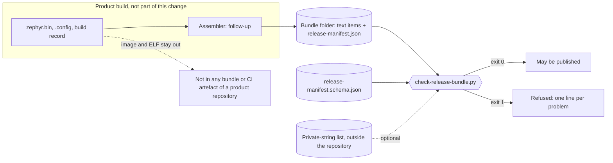

# Release bundle schema and checker

Status: **PROVISIONAL, a first shape**, for review in a Draft PR. Refs #301, item 1. The schema and the checker are not frozen before a product's first real release, and nothing here is a compatibility promise. This change authorises no tag, no publication, no release and no hardware operation, and nothing ran on a board or in a Zephyr build.

The [product composition guide](product-composition.md#release-bundle) describes the release bundle as a convention. This document records the first schema and the first checker for it. The checker is adapted from the one that the public consumer repository `wonny-labs/crux-controller` already uses (`release/check_bundle.py` at commit `f03dc79`, Apache-2.0), so that the platform and its consumers do not carry two checkers.

## Result

| What | Where | State |
| --- | --- | --- |
| Manifest schema, version 1 | [`docs/schemas/release-manifest.schema.json`](schemas/release-manifest.schema.json) | New, provisional |
| Checker | [`scripts/check-release-bundle.py`](../scripts/check-release-bundle.py) | New, provisional |
| Tests | `tests/build/test_release_bundle.py`, run by the existing `python3 -m unittest discover -s tests/build` step of the Host workflow | New |
| Assembler, `west crux-pins` output as a bundle item, template step | | **Not in this change** ([follow-ups](#follow-ups)) |
| The guide's release table | [`product-composition.md`](product-composition.md#release-bundle) | **Unchanged**: it still says "convention" |

Run the checker on a bundle folder:

```sh
python3 scripts/check-release-bundle.py <bundle-dir> [--private-strings <file>] [--schema <file>]
```

It exits 0 for a bundle that may be published, 1 for a refused bundle (one line per problem on standard error) and 2 for a usage error. It only reads.

## The bundle and where the checker stands

A bundle is a folder of text items and one `release-manifest.json` that lists the hash of each other item. It holds hashes and identities, never an image. The checker is the last step before an item leaves the repository.



The assembler is dashed because it does not exist in this repository yet. Today a product writes its own bundle, as the controller does.

## The manifest

`additionalProperties` is `false` everywhere except inside `extensions`, so a typo is refused and a product cannot add a top-level field without a schema change.

| Field | Required | Form | Note |
| --- | --- | --- | --- |
| `schema_version` | Yes | The integer `1` | A change that an older checker would misread raises it |
| `identity_algorithm` | Yes | `crux-firmware-identity-v1` | The name that `scripts/record-build-provenance.py` records. A test holds the two equal |
| `product_version` | Yes | SemVer 2.0, pre-release and build metadata allowed | `+N` is allowed and not required |
| `release_tag` | Yes | Letters, digits, `.`, `_`, `-` | Not tied to `vX.Y.Z`: the guide's own example tag is `product-x-1.2.3` |
| `sdk_version` | Yes | `X.Y.Z` | |
| `build_image` | Yes | A container or runner image name, tag or digest | Never a path. Renamed from the controller's `runner_image` |
| `target` | Yes | Board target, for example `board@rev//variant` | **No default** |
| `bundle_hashes` | Yes | Path inside the bundle to SHA-256 | Every item except the manifest |
| `image_sha256` | Yes | SHA-256 | The image is not in the bundle. Renamed from `zephyr_bin_sha256` |
| `firmware_identity` | Yes | SHA-256 | Of the canonical JSON of the identity record that `identity_algorithm` defines |
| `vendor_deliveries` | No | List of `project`, `delivery_tag`, `hash_list_sha256` | The guide's per-vendor-project record |
| `replaced_modules` | No | List of `original`, `replacement` | The guide's "module replaced under a new name" |
| `extensions` | No | Any object | The only place for a product's own fields, such as a security counter. The checker does not look inside it, except for paths and private strings, as for the rest of the file |

Left out on purpose: a support-period field (the wording is an open owner question), `security_counter` and the `+N` build suffix (product extensions), and any default target.

## What the checker refuses

The default and only mode is **hashes only**: the bundle never holds an image.

| Refusal | How | Source |
| --- | --- | --- |
| Missing, unreadable or non-object manifest; a schema violation | Subset validator against the schema | Ported, extended |
| A schema that uses a keyword the validator does not apply | The keyword is named and the bundle is refused, so a schema cannot promise more than is checked | **New** |
| An unreadable or missing `--schema` file, or a missing bundle folder | A message, not a traceback | **New** |
| A file with one of `.elf .map .bin .hex .srec .s19 .uf2 .img`, in any case, at any depth | Suffix | Ported |
| A file that starts with the ELF magic | First four bytes | Ported |
| A file whose bytes are the image | SHA-256 equals `image_sha256` | Ported |
| An archive (zip, gzip, bzip2, xz, 7z, zstd) | Leading magic | Ported, zstd new |
| A file that is not UTF-8, or holds a NUL byte | Decoding, then a NUL search | Ported, NUL new |
| Intel HEX or S-record text | Line pattern | Ported |
| A symbolic link, or a file that is not a regular file | `lstat`, no links followed | **New** |
| An absolute path of a build machine | Regular expression, see [heuristics](#what-is-faked-or-heuristic) | Ported, one fix |
| A string from the private-string list | Case-insensitive substring | Ported |
| An item not listed, a listed item that is absent, a hash that differs | `bundle_hashes` against the folder | Ported |

The private-string list is optional. Without it the checker prints a warning on standard error and still exits 0, as the controller's does.

## What changed from the controller's checker

| Point | Controller (`f03dc79`) | Here |
| --- | --- | --- |
| Required fields | 9, including `security_counter` and a `+N` version | 10, none product-specific |
| Schema version, algorithm name | None | `schema_version` and `identity_algorithm` |
| Default target | `mimxrt1060_evk@B//qspi` in the assembler and the comparison script | None: `target` is required |
| Unknown top-level field | Refused | Refused, and product fields have `extensions` |
| Schema location | Fixed next to the script | `--schema`, default `docs/schemas/` |
| Schema keywords | Unknown keywords skipped without notice | Unknown keywords refused. `const`, `enum`, `items` added |
| Compiler-flag form of the path scan | `(?<=-[A-Za-z])` matched the end of a name such as `product-x/build/app` | Must start a word. `product-x/build/app` passes. This is a false positive that the controller's pattern has, found by a test here. It was **not** reported or changed there |
| Symbolic links | Followed | Refused |

Not ported: the assembler (`assemble_bundle.py`, which imports a budget collector and defaults the target), the rebuild comparison (`rebuild_compare.py`) and the controller's workflow. The controller's manifests do **not** pass this schema as they are (no `schema_version` or `identity_algorithm`, product fields at the top level, other names). That follows from reading both schemas. It was not run, and nothing was changed in the controller.

## Decisions

| Decision | By | Reason |
| --- | --- | --- |
| Hashes only is the default, and there is no flag for an "included" mode | Owner, public repositories carry no image, `.elf` or `.map` | A mode that allows images is added when a private product needs it, with its own review |
| No support-period field | Owner | The wording is open |
| `security_counter` and the `+N` suffix are product extensions | Owner | A product, not the platform, decides them |
| The private-string list stays optional, with a warning | Owner | As in the controller |
| Schema and checker are provisional | Owner | Not frozen before a product's first real release |
| `release_tag`, `product_version` and `build_image` are looser than the controller's | Author | The guide's example tag is not `vX.Y.Z`, and a container image is not a runner name. Recorded for review |
| `extensions` is an unconstrained object | Author | The smallest way to keep the top level strict. Its content is not validated |
| `schema_version` and `identity_algorithm` are fixed values, not ranges | Author | One version exists. A checker that does not know a value refuses it |
| `firmware_identity` is the digest, not the record | Author | The record's `image_sha256` is already a field, and the digest is what `firmware_digest` in the build record script gives |
| Refuse symbolic links and NUL bytes | Author | Every item is text, and a link could pull in a file from outside the folder |

## What is built

- The schema, the checker and the tests that are listed under [Result](#result). The tests write their bundles by hand and take the firmware identity from the real `firmware_identity` and `firmware_digest` functions of `scripts/record-build-provenance.py`.
- The tests were written first. They failed against a missing script (one import error), then against a stub that accepted every bundle (94 failures and 6 errors across 57 tests), and passed against the checker. The PR records the commands and counts.

## What is faked or heuristic

- **The path scan is a pattern, not a proof.** It looks for a fixed list of system roots after a slash at the start of a word or after a compiler flag, for Windows drive and UNC paths and for `file://`. Measured on this checker, these forms **pass**: `/Applications/x/y`, `/Library/x/y`, `/System/x/y`, `/lib/x/y`, `/bin/x/y`, `/work/app/src`, `/workspace/app/x`, `/runner/work/x`, `/sdk/zephyr/x`, `~/work/app/x`, `C:Users\x`, `//Users/x/y`, `/Users\x\y`, a lower-case `/users/x/y` and a percent-encoded path. A path with only the root and no further part, such as `/home`, passes too.
- **Hashes show integrity, not origin.** The manifest is not signed. Anyone who can edit the folder can edit the manifest and the hashes together. Signing is not part of this change.
- **The identity is not recomputed.** The image is not in the bundle, so the checker only checks that `firmware_identity` has the form of a SHA-256. Recomputing it needs the build directory, as the controller's comparison script does.
- **The "no image" rules are structural.** An image that is valid UTF-8 without a NUL byte, is not byte-equal to `image_sha256`, and has no listed suffix passes. So does an image that is encoded as text, for example in base64. The path and private-string scans read text only.
- **The schema validator is a subset.** It applies `type` (object, string, integer, array), `required`, `properties`, `additionalProperties`, `pattern`, `minimum`, `const`, `enum` and `items`. It is not a JSON Schema implementation. `pattern` uses Python regular expressions. The SemVer pattern accepts leading zeros, which SemVer does not.
- **Nothing checks that `vendor_deliveries` names are unique** or that a `replaced_modules` replacement exists in the lock file.

## What is untested

- A real product bundle. The tests use invented items. A real build record, SBOM or licence set may contain a form that the path scan refuses or a text that the private-string list matches, and none was tried.
- Windows (symbolic links and path forms), and Python versions other than 3.9 and 3.12 on macOS. The Host workflow has not run these tests for this change yet.
- Large items: the checker reads each item into memory.
- Whether the guide's table and this checker agree for a private product: see [open questions](#open-owner-questions).

## Follow-ups

| Follow-up | Needs |
| --- | --- |
| Change the guide's "Release bundle" section from "convention" to a link to this document, and say that the hashes-only mode refuses the table's firmware image and debug-file rows | Owner decision on the next row |
| An assembler that writes this manifest, with no budget import and a required `--target`, adapted from the controller's | Approval |
| `west crux-pins` output and the build record as bundle items, and a bundle step in `samples/product_template` | Approval |
| The controller calls this script by a pinned commit once it is merged, and moves its product fields under `extensions` | The controller's owner. Nothing was posted or changed there |
| An "included" mode for a private product, if one needs the image inside its bundle | A private product and its own review |
| Recompute `firmware_identity` from a build directory (the controller's `rebuild_compare.py` is the model) | Approval |
| Widen the path roots and make the match case-insensitive, with a measured false-positive check on a real bundle | A real bundle |
| A CI step that checks a sample bundle in a product's workflow | A workflow change under `.github/`, which this change does not make. The unit tests already run in the Host workflow |

## Open owner questions

1. **The guide's table and hashes only.** The guide lists the firmware image as outward and `zephyr.elf` and `zephyr.map` as internal-only debug files, in the same bundle table. Under hashes only, a public product repository keeps none of the three in a bundle. Should the guide's table be split into "public product repository" (hashes only) and "private product" (the current table), and when does the second need a checker mode?
2. **The support-period wording**, left out of the schema as decided.
3. **Whether `release_tag` should be fixed to one form.** It is loose here. A fixed form such as `vX.Y.Z` would reject the guide's own `product-x-1.2.3`.
