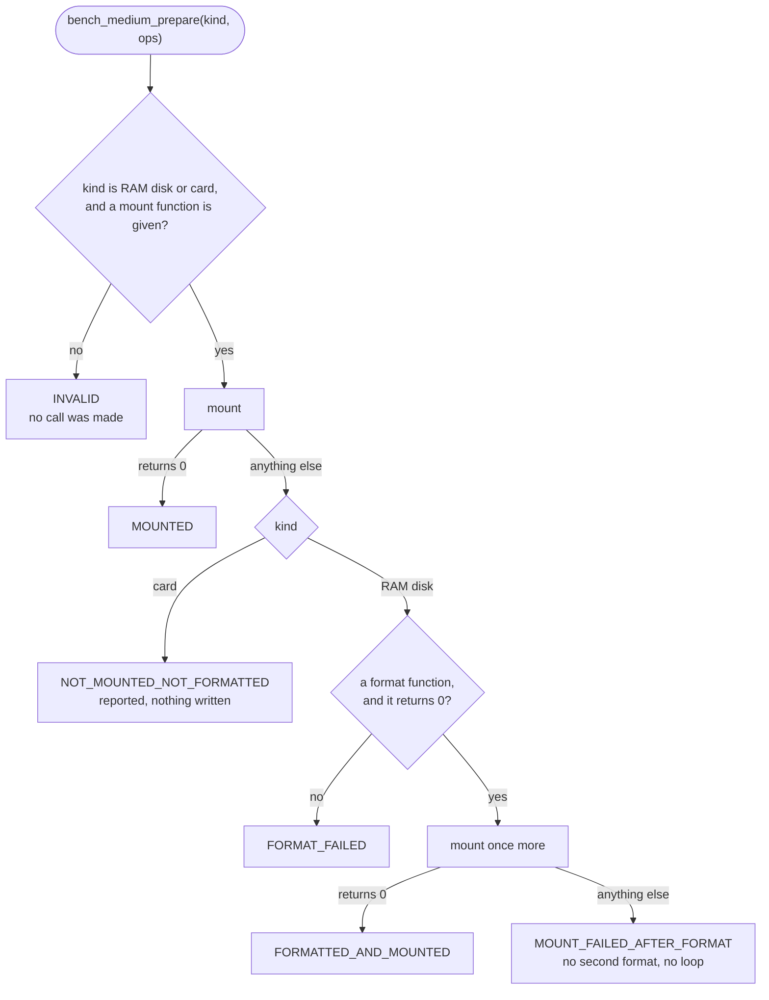
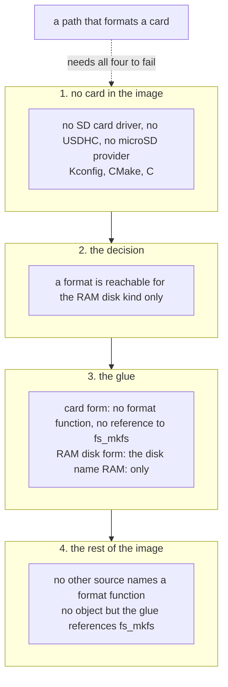

# The file backend of the RT1060-EVKB bench image: a RAM disk, and a mount rule that never formats a card

Status: **row C3 of stage 2** of [the RT1060-EVKB feasibility report](rt1060-management-image-feasibility.md), for review in a Draft PR. Refs #197. Decision D2 of that report, taken by the owner on 2026-11-08 ("추천대로 진행해주고"): **a RAM disk for the first board run, no card, no format risk; microSD in a later run.**
It authorises no hardware operation, and **nothing here ran on a board or on a card**: the results are host tests with fake devices, a `native_sim` run of the real FatFs on the board's RAM disk geometry, and a compile and link for `mimxrt1060_evk@B//qspi`. The image still refuses to start (row C1's switch is untouched).

## Result

| Question | Answer |
| --- | --- |
| What is the file backend of the bench image? | **A RAM disk of 524,288 B in the SDRAM**, named `RAM`, mounted at `/RAM:`, under FatFs. The declared form is `ram_disk` (state `selected` in `bench_declaration.json`). |
| Can any path of the image format a card? | **No.** Four independent barriers, each shown by a test that breaks it: [the barriers](#the-barriers). The image has **no card driver at all** (no SD card driver, no USDHC host, no microSD provider), so there is no card to mount, and the only function that names `fs_mkfs` is compiled in the RAM disk form only. |
| What persists across a reset? | **Nothing.** Accounts, keys, the certificate and the events are lost, and every boot is a first boot: [what persists](#what-persists-and-what-does-not). |
| How big, and what does it cost? | **524,288 B of SDRAM** for the disk, @RAM_DELTA@ more than the C1 image in the linker's RAM figure. The bench needs about 300 KB at the worst: [the sizing](#sizing). |
| Is the microSD provider still there? | **Yes, as a second declared state** (`microsd_card`, `reserved`), that a later run takes by changing the declaration. It is not selectable in this image until then: [the two states](#the-two-declared-states). |
| Can the image run? | **No**, as before. [What still blocks a board run](rt1060-management-image-feasibility.md#what-still-blocks-a-board-run). |

```mermaid
flowchart LR
    decl["bench_declaration.json<br/>ram_disk: selected<br/>microsd_card: reserved"] --> kc["Kconfig.bench<br/>CRUX_BENCH_FILE_RAM_DISK needs the RAM disk driver and no SD driver"]
    kc --> cm["bench_guard.cmake<br/>exactly one backend, provider and drivers agree, no card"]
    cm --> ch["bench_guard.h<br/>the same, at every compile"]
    ch --> prov["File provider<br/>CRUX_FILE_FATFS_RT1060_RAM_DISK<br/>excludes every card driver"]
    prov --> glue["bench_medium_fs.c<br/>mount, and fs_mkfs for the RAM disk only"]
    glue --> core["bench_medium.c<br/>the decision, no Zephyr"]
    core --> ram[("RAM disk RAM:<br/>blank at every boot")]
```



## The mount and format rule

One sentence: **the RAM disk may be formatted, and a card never is.** A RAM disk is memory that every boot finds blank, so a failed mount is answered with one format and one more mount. A card holds somebody's data, so a failed mount is the end: it is reported on the UART and nothing is written.



The previous composition did the opposite for every medium. `medium_ready()` of the copy of `crux_native_management.c` (the file of the native images) called `fs_mkfs` after any failed mount, which on a card **would format it**. The stage 0 report found that call still linked in the vehicle; row C1 pinned it with the copy test. C3 removes it: the copy now calls `bench_medium_mount()`, and the copy test pins that edit instead.

| File | What it does | Zephyr in it? |
| --- | --- | --- |
| `src/bench_medium.c`, `.h` | The decision above: `bench_medium_prepare()` with its two function pointers, and the result codes | No. A host test runs it. |
| `src/bench_medium_fs.c` | The glue: the mount structure (`FS_MOUNT_FLAG_NO_FORMAT`, so the file system layer does not format either), the mount point of the form, the format function **for the RAM disk form only**, and one `BENCH file-medium` line on the UART | Yes |
| `ram_disk.overlay` | The `zephyr,ram-disk` node: disk name `RAM`, 1,024 sectors of 512 B | Devicetree |
| `check_mkfs_callers.py` | Reads the object files of a build and says which reference a format function | No |

## The barriers

A card is kept from a format by four independent barriers. Each has a test that breaks it alone and shows that the others still stand or that the break is seen.

| # | Barrier | Where | Shown by |
| --- | --- | --- | --- |
| 1 | **There is no card in the image.** The File provider of the RAM disk (`CRUX_FILE_FATFS_RT1060_RAM_DISK`) depends on `!DISK_DRIVER_SDMMC`, its CMake and `file_native.c` refuse a build with the SD card driver, the USDHC host, a flash disk or the microSD provider, and so do the bench guards at three levels | Kconfig, CMake, C | `check_bench_guard.py`: 12 CMake and 8 C refusals for these settings, each for its reason, and the mutants of the guards killed |
| 2 | **The decision never passes a card to a format.** `bench_medium_prepare()` calls `format` only for the RAM disk kind, and refuses any other value of the kind before any call | `src/bench_medium.c` | `test_bench_medium.c`: every mount error value for a card, a fake card that a format would cure, every kind value from -1000 to 1000 and every power of two: a format is reached for the RAM disk kind alone |
| 3 | **The glue has no format function for a card.** In the microSD form `BENCH_MEDIUM_FORMAT` is `NULL`, and the identifier `fs_mkfs` does not occur in the object. In the RAM disk form the call names the disk `"RAM:"` and no other | `src/bench_medium_fs.c` | The glue built for each form against a fake file system layer with a fake `RAM:` and a fake `SD:`; `nm` on both objects; a weakened glue that offers a card format function is seen by the object check and still stopped by barrier 2 |
| 4 | **Nothing else names a format function.** `fs_mkfs`, `f_mkfs`, `fatfs_mkfs` and `CONFIG_FS_FATFS_MOUNT_MKFS` occur in no other source of the image, and `CONFIG_FS_FATFS_MOUNT_MKFS` is refused at every level | Every source of the image | `test_management_bench_medium.py` scans the 95 sources of the image (comments removed), and `check_mkfs_callers.py` reads the linked objects of the real build: @CALLERS@ |



## The two declared states

The declaration carries the file backend as two forms, and the guards accept exactly one of them.

| Form | Symbol | State now | What it is |
| --- | --- | --- | --- |
| `ram_disk` | `CRUX_BENCH_FILE_RAM_DISK` | **selected** | This image. Needs `CONFIG_DISK_DRIVER_RAM`, the RAM disk provider, and **no** SD card driver. |
| `microsd_card` | `CRUX_BENCH_FILE_MICROSD` | **reserved**, row "a later run" | The existing microSD provider (`CRUX_FILE_FATFS_RT1060`) with the SD card driver and no RAM disk. Refused here: a build that sets it fails at the CMake level with `is reserved and nothing implements it`. |

A later run changes the declaration to `ram_disk: reserved` and `microsd_card: selected`, and sets the card's symbols in `target.conf`. `check_bench_guard.py` runs that state as a second control: **the guard accepts the microSD state with the card's provider and driver, and refuses the RAM disk's settings under it.** Even then a mount that fails is reported and the card is never formatted: barriers 2 to 4 hold in that form too. What the card run needs besides this (the M4 microSD tools, the mount guard, a prepared card) is not part of this row.

## What persists and what does not

The RAM disk is the `.bss` of the RAM disk driver, in the SDRAM. Zephyr clears `.bss` at every boot, and the board brings the SDRAM up before that, so the disk is zero at every boot and `fs_mount` fails on it. That is the trigger of the format above.

| Item | Where it lives | After a reset |
| --- | --- | --- |
| Accounts (the credential store, slot files `secure-a` and `secure-b`) | RAM disk | **Lost.** The first account is provisioned again at every boot. |
| The SSH host key and the TLS key (credential store records) | RAM disk | **Lost.** Both are generated again from the TRNG. |
| The listener certificate | Generated at boot from the key | **Lost and generated again.** |
| Security events, and every `file.*` event | The ring in RAM, and Crux Logging to the UART | **Lost** from the device. The UART capture is the record. |
| Files of the File service (`files` area) | RAM disk | **Lost.** |
| Configuration saved by the Configuration service | RAM disk | **Lost.** Defaults again. |
| The image | QSPI Flash | Kept. Flash holds only the image. |

So **every boot is a first boot**, a client sees a **new SSH host key fingerprint and a new certificate fingerprint after every reset**, and a client that remembered the old ones will warn. That is expected. **The changed fingerprints show that the entropy source varies from one boot to the next, which is all they show. They are not a statement on the quality of the entropy**: that needs a test of the generator, which no row of the plan is.

The same text is in the bench manifest (`file_backend` in `bench-manifest.json`: `persists_across_reset: false`, `lost_at_reset`, and the note) and on the UART at boot (`BENCH file-medium ram-disk ... nothing persists across a reset`).

## Sizing

What the disk must hold, from the limits of the image's own File service area (`src/mgmt_services.c`, the SSH composition's area) and of the credential store:

| Item | Limit | Source |
| --- | ---: | --- |
| One file in the area | 65,536 B | `max_file_bytes` |
| The area, partial and temporary files included | 262,144 B | `max_area_bytes` |
| Entries in the area | 16 | `max_entries` |
| The credential store | 2 slot files of 16,384 B = 32,768 B | `CRUX_CREDENTIAL_SLOT_BYTES` |
| Directories | 3 (`secure-a`, `secure-b`, `files`) | `src/mgmt_start.c` |

The File service reserves bytes against `max_area_bytes` before it writes, so the area can never hold more than that, and the disk can only be filled by something that bypasses the service. **The numbers in the owner's brief (1 MiB per file, 3 MiB per area, 16 entries) are the design limits of [the SFTP design](sftp-design.md#limits), and the image does not declare them**: the image declares 64 KiB, 256 KiB and 16 (the native composition's own area, which the bench copy is pinned to). The disk is sized for what the image declares, and the table below says what the design limits would need.

The method: the pinned FatFs (`modules/fs/fatfs` at the `west.yml` pin) with the bench image's options (long names on the stack, 127 characters, code page 437) and Zephyr's `fs_mkfs` options (one FAT, 512 root entries, automatic cluster size), on a RAM disk of a given number of 512 B sectors. The worst case is built in the order that leaves the least room: **the area full first, the store's two slots after it.** Two patterns: four files of 64 KiB, and 16 entries with 63-character names, each one byte over a cluster boundary where the limit allows it (the most slack and the most directory entries).

| Disk | File system | Data clusters | After the worst case: free | Share free |
| --- | --- | ---: | ---: | ---: |
| **512 KiB, 1,024 sectors (this image)** | FAT12, 512 B clusters | 987 (505,344 B) | **208,896 B** (pattern A), **205,824 B** (pattern B) | **41 %** |
| 1 MiB, 2,048 sectors (for comparison) | FAT12, 512 B clusters | 2,008 (1,028,096 B) | 731,648 B, 728,576 B | 70 % |
| 4 MiB, 8,192 sectors, with the **design** limits (1 MiB per file, 3 MiB per area, 16 entries) | FAT12, 2,048 B clusters | 2,038 (4,173,824 B) | 989,184 B, 987,136 B | 24 % |

| Quantity | Value |
| --- | ---: |
| The most the image's limits can put on the disk (pattern B, directories, both slots) | **299,520 B** (505,344 B of data minus 205,824 B free) |
| What the limits sum to before the file system's own use | 262,144 B + 32,768 B = 294,912 B |
| The file system's own use (FAT, three directories, cluster slack) | about 4,600 B |
| The disk of this image | **524,288 B**, which is 1.78 times the 294,912 B of the limits (a unit test requires at least 1.25 times) |
| A disk filled by something that bypasses the File service | refuses with a plain error after 8 files of 64 KiB (the host run: result `FR_DENIED`), no hang |

**What the bench needs: about 300 KB at the worst, so 512 KiB.** It is also the size of the partition that the native composition has always run this File service on, so no new size is introduced. The bench's SFTP put and get (step 5 of the plan) are files of at most 64 KiB, the image's per-file limit, so a disk larger than this buys nothing the limits would let a client use. **If the area limits were raised to the design's 1 MiB and 3 MiB, the disk would need about 3.2 MiB, and a 4 MiB disk (8,192 sectors) leaves 24 %**; that is a change of the copy of `mgmt_services.c`, which the copy test pins to the native file, and of `ram_disk.overlay`, and it is not made here.

| RAM cost | Value | Source |
| --- | ---: | --- |
| The disk | **524,288 B** (512 KiB) | `ram_disk.overlay`, the `.bss` of the RAM disk driver, in the SDRAM |
| Share of the SDRAM | 1.6 % of 32 MB | |
| ITCM, DTCM, OCRAM | 0 B | The disk is in SDRAM with everything else, as the linker's report of C1 shows for the image |
| The RAM figure of the image | @RAM_FIGURE@ | The linker's report of the target build ([the build](#the-target-build)) |


## What was and was not run

@CHECKS@

## Decisions taken in C3

Taken without the owner, each the narrower choice.

| # | Decision | Why |
| --- | --- | --- |
| C3-1 | The RAM disk has its own File provider selection, `CRUX_FILE_FATFS_RT1060_RAM_DISK`, in `zephyr/Kconfig` and the provider's CMake, and it excludes the SD card driver | The existing RT1060 provider needs the card driver, and the simulator provider needs `native_sim`. The exclusion makes "no card in the image" a property of the build, not a habit. It is the only shared file that changed, and no other image selects it. |
| C3-2 | The mount and format decision is a separate source with no Zephyr in it, plus a thin glue | A host test can then run the decision against fake devices, including a fake card that must never be formatted |
| C3-3 | The copy of the start source is edited, and the copy test pins the new edit | Row C1 said C3 does this. The native file keeps its `fs_mkfs` fallback, which is right for a test disk on `native_sim`. |
| C3-4 | The microSD provider is kept as a second declared form, `reserved`, with its own Kconfig form and its own CMake and C refusals | The task asks for it behind a different declared state; the guards then cannot be satisfied by selecting it |
| C3-5 | A format that fails, or a mount that fails after a format, ends the attempt: no retry, no loop | A RAM disk that cannot be formatted is a fault to see on the UART, not to hide |
| C3-6 | The disk size is the smallest that holds the declared worst case with a stated margin | 512 KiB holds the worst case of the image's own limits (about 300 KB) with 41 % free, and is the size the native composition has always used. A larger disk buys nothing the limits let a client use, and costs SDRAM. |
| C3-7 | `bench_limits.h` of the sizing test is a copy of the image's area limits, compared with `mgmt_services.c` by a unit test | The test links no Crux component, and drift fails a test |
| C3-8 | The new files are separate from the other rows' files wherever possible: this document, `bench_medium*`, `ram_disk.overlay` | Rows C2, C4 and C5 edit the same directory in parallel |

## Reproduce

```bash
python3 tests/zephyr/management_rt1060_compile/check_bench_guard.py --verbose
python3 -m unittest tests/build/test_management_bench_medium.py tests/build/test_management_bench_declaration.py tests/build/test_management_target_lists.py
```

The sizing test and the target build need the Dev Container and the workspace of the [feasibility report](rt1060-management-image-feasibility.md#reproduce): `tests/native/management_rt1060_ram_disk` on `native_sim/native/64`, and `tests/zephyr/management_rt1060_compile` for `mimxrt1060_evk@B//qspi`. The commands that ran are in [the evidence record](evidence/rt1060-management-image-feasibility/ram-disk-c3/README.md).
