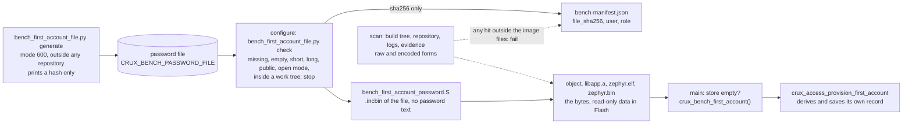
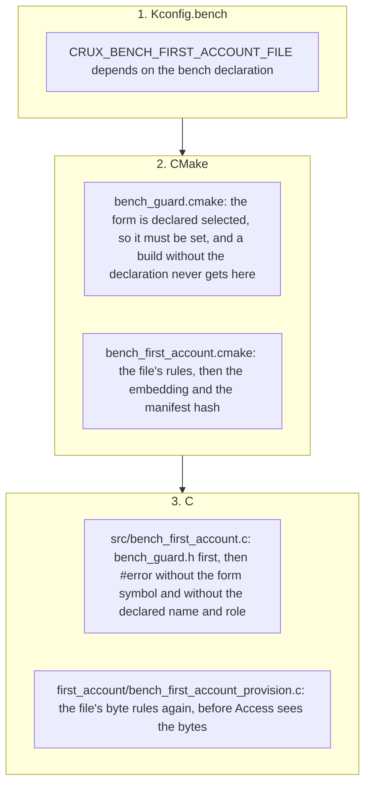

# The first account of the RT1060-EVKB bench image (row C4, decision D3)

Status: **stage 2 row C4** of [the RT1060-EVKB feasibility report](rt1060-management-image-feasibility.md), for review in a Draft PR. Refs #197 and #318. **Nothing here ran on a board.** Every result is a Host test, a host script, a configure-only run, or a compile and link for `mimxrt1060_evk@B//qspi`, and the image still refuses to start (the switch of C1 is untouched). The owner took D3 on 2026-11-08, as recommended: *"the first account on a reachable board comes from a password in an untracked file, hashed into the manifest"* ("추천대로 진행해주고", [decisions](rt1060-management-image-feasibility.md#owner-decisions)). This row does not approve any board stage.

## Result

| Question | Answer |
| --- | --- |
| Where does the password come from? | A file **outside the repository**, named by the environment variable `CRUX_BENCH_PASSWORD_FILE`. One line, 16 to 128 printable ASCII characters, no space, mode 600, outside every git work tree. `bench_first_account_file.py generate` makes one from the system's random source and prints only its hash. |
| What does a build with a missing, empty or short file do? | **It stops at configuration**, with a reason that names what is wrong with the file and never what is in it. Checked on the real image in [four configure-only runs](#configure-only-refusals), and in script mode for each kind of defective file. |
| Which account? | `admin`, role `administrator`, created on the serial origin that Access requires, as the native images do. Name and role are in `bench_declaration.json` (`first_account`), which CMake, the C definitions and the manifest read, and a Python test ties to the Host suite's names. |
| Is the plaintext in the linked image? | **Yes, because the supported entry takes it.** `crux_access_provision_first_account()` takes a plaintext password and derives its own record inside Access, so no pre-derived form can be handed to Access. A way around that exists ([option B](#why-the-plaintext-is-in-the-image)) and is a choice for the owner, not made here. The bytes are embedded by an assembler `.incbin` of the file: [what the image holds](#what-the-image-holds). |
| Where is it **not**? | In the repository, the configuration, any generated source or header, `.config`, the link map, the listings, the build and configure logs, the manifest, the UART lines and the evidence. `bench_first_account_file.py scan` fails on any of them: [the scan](#the-scan). |
| What does the manifest record? | The account name and role, the environment variable's **name**, and the **SHA-256 of the file**. Never the password, and never the file's path. |
| The public test password | Still **0 times** in the linked ELF. The tool also refuses it as a password file. |
| Does a build without the declaration hold it? | **No.** The form exists only under `CRUX_MANAGEMENT_BENCH_IMAGE` (Kconfig, CMake and C), and the one source that names the bytes stops at compile time without it. [Where it is refused](#where-it-is-refused). |



## What the image holds

| Question | Answer |
| --- | --- |
| Why plaintext? | See [the options](#why-the-plaintext-is-in-the-image). Access has one entry that creates the first account, and it takes the password. Its record (`access_record.c`, version 1: name, role, flags, algorithm, iterations, salt, derived) is internal and written only by Access. |
| Where is it in the image? | **Read-only data in QSPI Flash**, in the section `.rodata.crux_bench_first_account`, symbols `crux_bench_first_account_password` (the file's bytes, with the newline) and `crux_bench_first_account_password_size`. It is read in place and never copied to RAM by this code. In the linked image: `crux_bench_first_account_password` is 25 bytes (24 characters and the newline) at `0x6007f798` in the output section `rodata`, which the linker places in the `FLASH` region (the symbol type is `R`, read-only), and `zephyr.elf` and `zephyr.bin` each hold the bytes **exactly once** ([evidence](evidence/rt1060-management-image-feasibility/first-account-c4/build/first-account-symbol-sections.txt)). |
| Who can read it? | Anyone who can read the board's QSPI Flash (a probe, or the programmer file) or who has `zephyr.elf` or `zephyr.bin`. The RT1060 has no readout protection set here. **It is the same exposure as the test host key's static buffer, and unlike it the bytes are chosen by the owner and fixed.** |
| What limits the harm | The password is made for this one image and for nothing else (the generator); the image answers on one dedicated link (`192.168.77.2`, D10); the file system is a RAM disk (D2, row C3, [the file backend](rt1060-bench-file-backend.md)), nothing persists, and every boot makes the account again with the same password; the account is an administrator **only on the bench image**; and the image refuses to start until a reviewed change after the approval. **Not a protection:** encoding, XOR or splitting the bytes in the image, which hides nothing from anyone who reads Flash and is refused here as theatre. |
| `.config`, map, listings | The resolved `.config` holds `CONFIG_CRUX_BENCH_FIRST_ACCOUNT_FILE=y` and nothing about the password. The link map holds the two symbol names and no contents. This build produced no listing. The scan of the build directory, of the repository and of the logs found no plaintext and no encoding outside the image files, and in a scan with no allowance it lists exactly the five files that are the image: `libapp.a`, the object of the assembler file, `zephyr.bin`, `zephyr_pre0.elf` and `zephyr.elf` ([scan](evidence/rt1060-management-image-feasibility/first-account-c4/host/scan-bench.txt)). |
| What the next product build must not do | Carry the form. `CONFIG_CRUX_BENCH_FIRST_ACCOUNT_FILE` depends on the bench declaration in Kconfig, is refused by the CMake guard without it, and its source stops at compile time without it. |

### Why the plaintext is in the image

| Option | What it needs | Verdict |
| --- | --- | --- |
| **A. Pre-derived record**: derive salt and PBKDF2 on the host, embed only the record, create the account from it | A **new entry in Access** (`crux_access_provision_first_account_derived` or similar) that takes a derived verifier, with its own tests and contract text in `access-contract.md` | **Not available.** It is a security-sensitive change to a shared component's adapter interface, which `AGENTS.md` says to escalate, and it is not in the row. **The better design, proposed below as a follow-up.** |
| B. Write the record into the credential store before `crux_access_init()` | Host code that builds Access's internal record (format, iteration count, salt and derived sizes) and the store's save call | **Not chosen, and a real alternative.** It **would keep the plaintext out of the ELF**: only a salt and a PBKDF2 output would be in Flash. Against it: it bypasses provisioning (no `provisioned` event, `provisioning_open` is not closed by the step), it ties a host script and the image to Access's internal record (version 1, the iteration count, the salt and derived sizes), it calls an internal store path that is not a contract, every boot would reuse one salt, and a stale or wrong record fails silently at the first login. It is a security-sensitive design choice, so it is **put to the owner in the PR** with this row's choice (C) as the default. |
| **C. Plaintext embedded from the file** (chosen) | Nothing in Access | **Chosen, the least bad form.** One bench-only source names the bytes, they are read in place and not copied, and the scan keeps them out of everything else. |
| D. The serial setup step (`!setup`) | A serial console composed into the image, which no image has (`management-in-a-product.md`) | The product's way. More work, and on a RAM disk it needs a person at the console on every boot. A later run, as D3 says. |
| E. A random password printed on the UART at each boot | Printing a secret | Refused: the password would be in every capture. |

**Follow-up proposed, not done:** a derived-record entry in Access (option A) would take the plaintext out of the ELF. It needs a decision on the adapter interface and the same tests as `crux_access_provision_first_account`. It is a candidate for a row of its own, and nothing here depends on it: the day it exists, the glue and the CMake file change and the file's rules stay.

## The password file

| Rule | Why | Checked by |
| --- | --- | --- |
| Named by `CRUX_BENCH_PASSWORD_FILE`, no default | A default location is a file the build might use by accident. The variable is not stored in CMake's cache. | `check`, CMake |
| A regular file, not larger than 4,096 bytes | Read before any other test, so that a huge file costs nothing | `check` |
| Mode with no group or other bits (600 or 400) | A file others can read is not private | `check` |
| Not inside any git work tree (a `.git` folder or file in a parent) and not inside the repository named by the build | It cannot be committed by `git add -A` | `check`, and `.gitignore` (below) |
| One line of printable ASCII 0x21 to 0x7e, with one optional newline | No space, tab, control byte, NUL, CR or second line, so that the embedded bytes are the password and one newline that the step removes | `check`, and again in C |
| 16 to 128 characters, at least 8 distinct | Access takes 12 to 128 bytes. A password of 16 or more makes the hash in the manifest a poor target for guessing, and 128 is Access's maximum. | `check`, and again in C |
| Not the native test images' public password | It is public in this repository | `check` (holds the hash only) |
| The path has no quote, backslash or line break | CMake writes it into an assembler string | `check` |

`.gitignore` gains `bench-first-account.password` and `*.bench-password`. The file belongs outside the repository, so the rule is a net for a copy made by mistake and not the protection.

The hash in the manifest is the SHA-256 of **the file's bytes, newline included**. Anyone who has the manifest can test guesses against it offline, which is why the password is long and random and is made by the generator. Do not publish the manifest of a bench build with a chosen password.

## Where it is refused



| Build | Result |
| --- | --- |
| Without `CRUX_MANAGEMENT_BENCH_IMAGE` (any native image, the normal image) | The form does not exist (Kconfig), CMake refuses before it, and `bench_first_account.c` stops with the guard's `#error`. No password is embedded, and the scan with no allowance finds none. |
| The bench image, form unset | `bench_guard.cmake` refuses: the declaration says `selected`. |
| The bench image, form set, no or a bad file | `bench_first_account.cmake` refuses at configuration. |
| The bench image, form set, a good file | Configures, embeds, records the hash. |

`check_bench_guard.py` (C1) now covers the new C and CMake lines: both new `#error` lines in the glue, the name and role definitions, the manifest's refusal to be written without a checked file, and **40 of 40 mutants** (each guard weakened in turn, which includes the new ones) are killed.

## The scan

`bench_first_account_file.py scan` takes the password file and the places to search, and prints a path and a kind for each hit and **never what it searched for**. It exits 1 on a hit, 2 when it could not run.

| Searched | In a bench build | In a build without the declaration |
| --- | --- | --- |
| The build directory: logs, `.config`, map, listings, `autoconf.h`, JSON, `build.ninja`, generated sources, the manifest | **Must not hold** the password or any form below | Same |
| Objects, archives, `*.elf`, `zephyr.bin` (`--allow-in-image`) | **May hold the raw bytes** and no other form | Must not hold anything (no `--allow-in-image`) |
| `zephyr.hex`, `zephyr.s19` | May hold a run of hex digits (they are hex text), and never the raw text | Must not hold anything |
| The repository, `docs/evidence`, UART captures, logs (`--repo`, `--also`) | Must not hold any form **and not the file's path** (a personal path) | Same |
| `--expect-in-image` | The linked image must hold the raw bytes **exactly once**, which proves the scan can see what it looks for | Not used |
| `--manifest` | `first_account.file_sha256` must equal the file's hash | |

Forms searched, each made independently of the tool in its tests: raw, reversed, hex (both cases), C escapes (`\x..`), C arrays (`0x.., 0x..`, with and without spaces), UTF-16, percent-encoding, JSON escaping, and base64 and base64url at all three alignments (only the characters that do not depend on the neighbouring bytes). It does not follow links, skips `.git`, and cannot search a git history: the file is outside the repository, so the history never held it.

## Tests

| Layer | Where | What it shows | Result |
| --- | --- | --- | --- |
| Access, on the real core and fake ports (Host) | `tests/bench_first_account/first_account.c`, ctest `BenchFirstAccount.provision` | The account has the right name and role, can manage accounts, holds no key and need not change its password; the stored record does not contain the password; a file with or without its newline gives the same account; a wrong, shorter, longer or newline-ended password and an unknown name are refused; **a boot with an empty store creates it again, three times in a row; a boot that kept the store does not, and the changed password is the one that works**; a password outside the file's rules (short, 12 characters, long, a space, tab, control byte, NUL, CR, a second newline) never reaches Access (no derivation); null arguments, an unknown role and a role without `access.manage` are refused; an unusable store never opens provisioning; a failed save leaves it open | **156 checks, 0 failures**, and the same under ASan and UBSan (which found an overflow of a buffer in the test itself, fixed). Nine of eleven mutants of the step are killed. The two that are not change nothing that can be seen: the step's upper length limit and its null-user test repeat what Access checks itself (`CRUX_ACCESS_PASSWORD_MAX` and `crux_access_name_valid`), so they are defence in depth that no result can show. |
| The file rules and the scan | `tests/build/test_bench_first_account_file.py` | 51 cases, every password made at run time | 51 pass, and **13 of 13 mutants of the tool are killed** (run on a copy) |
| The CMake level, the declaration, the sources | `tests/build/test_bench_first_account_build.py` | The check refuses each defective file in script mode, the assembler file holds no password, five weakened copies of the CMake file are noticed, and the limits agree between the declaration, the tool and the header | 24 pass |
| The guards | `check_bench_guard.py` | The C1 guards and the new lines, 40 of 40 mutants | **40 of 40 mutants killed**, 61 refusals shown. With the other two files: 89 Python tests pass on the host and in the CI-like container. |
| A real configure and build for the board | Dev Container | [below](#target-build) | Linked, Flash 601,744 B, RAM 837,804 B |

Every password in these tests is generated at run time from the system's random source and lives in memory or in a temporary folder outside the repository. A failing assertion names a line, not a value.

## Target build

`mimxrt1060_evk@B//qspi`, the Dev Container (Zephyr SDK 1.0.1, GCC 14.3.0, linux/amd64 under emulation, `-j2`, one build), the pins and the build-local Zephyr copy of C1, the Wolf profile. The password file was a random 24-character file made by the generator, outside the repository, mounted read-only. Built once from `75f0f5ed`, then reconfigured and rebuilt incrementally from the committed tree **`304206cc`** (clang-format 18 and a test fix; the manifest says `source_tree_modified: false`), with a **new** password file, which also shows that a changed file is embedded again and hashed again.

| Item | C1 (`a47c159`) | C4 |
| --- | ---: | ---: |
| FLASH (`0x60000000`, 8 MB) | 601,004 B (7.16 %) | **601,744 B** (7.17 %), **740 B more**: the step, the byte rules, the embedded 25 bytes and two lines of text |
| RAM = SDRAM | 837,804 B (2.50 %) | **837,804 B**, unchanged |
| `size`: text, data, bss | 596,504, 4,480, 833,254 | 597,244, 4,480, 833,254 |
| Steps, warnings | 551, 3 | 553, **the same 3**, all in wolfSSH `wolfsftp.c` |
| `crux_bench_first_account_password` | not in the image | 25 bytes, `rodata`, Flash, once in `zephyr.elf` and once in `zephyr.bin` |
| The public test password in `zephyr.elf` (`strings -a`) | 0 times | **0 times** |
| `bench-manifest.json` | no first account | `first_account`: `admin`, `administrator`, the environment variable's name, `file_sha256`, `plaintext_in_image: true`; `test_forms.first_account_file.set: true`; `source_commit` is the committed tree and `source_tree_modified` is false |

The ELF and binary hashes depend on the password file, so they are in the evidence record and not here. The image still refuses to start: `run_refused` is true in the manifest.

### Configure-only refusals

Four real configurations of the bench image, with the environment variable unset, naming an empty file, naming a file of 8 characters, and naming a file that does not exist. Each stops at configuration, before anything is compiled, and the reason names the file's fault and not its content:

| Run | CMake's message |
| --- | --- |
| unset | `set CRUX_BENCH_PASSWORD_FILE to its path. Make one with: python3 .../bench_first_account_file.py generate --file <path outside any repository>` |
| empty file | `the password file is refused. refused: the password file is empty` |
| 8 characters | `the password file is refused. refused: the password is too short: at least 16 characters` |
| no such file | `the password file is refused. refused: the password file does not exist` |

[Excerpts](evidence/rt1060-management-image-feasibility/first-account-c4/build/configure-refusals.txt). Script mode adds the rest (a long file, a group-readable file, a file in a work tree or in the repository, the public password, one line too many, a space), and the tests above cover each.

## What a product does instead

| Need | The product's way |
| --- | --- |
| The first account | A **serial setup step**: the Command line contract's `!setup` loop ([cli-contract.md](cli-contract.md)) creates it from a password a person types at the console. It exists on Host and is composed in no image yet ([management-in-a-product.md](management-in-a-product.md)). Nothing is in the image. |
| A user's access without a shared password | **User public keys** for SSH (Ed25519 and ECDSA), which no command or route registers yet: [Issue #318](https://github.com/wonny-labs/crux-pilot/issues/318). |
| Never | A password, derived or not, in the image, the repository or a log. `CONFIG_CRUX_BENCH_FIRST_ACCOUNT_FILE` is a **bench test form** under the declaration of C1, accepted on this board and this bench only, like the test host key. |

## Decisions taken in C4

Taken without the owner, each the narrower choice. D3 itself is the owner's.

| # | Decision | Why |
| --- | --- | --- |
| C4-1 | The plaintext is embedded, from the file, by `.incbin` | Access takes a plaintext password. `.incbin` keeps it out of any generated C file, header, `.inc` hex dump or CMake variable. |
| C4-2 | Access is **not** changed, and a derived-record entry is proposed, not built. Option B (the record written into the store) is not built either, and is put to the owner. | A security-sensitive change to a shared component's adapter, or a script tied to its internal record, outside the row |
| C4-3 | The file is named by an environment variable with no default, and its path is not recorded | A default is a file used by accident, and the path may be personal |
| C4-4 | The manifest holds the file's SHA-256, and says the plaintext is in the image | The owner asked for a hash. A manifest that did not say where the plaintext is would mislead. |
| C4-5 | Minimum 16 characters, where Access takes 12, and a generator | The hash of a guessable password in the manifest is a guess target |
| C4-6 | The file must be private, outside every git work tree, and not the public test password | A file that others can read or `git add` can leak |
| C4-7 | The step's source (`first_account/bench_first_account_provision.c`) holds no test form and has no guard, so that the Host suite can compile it. The bench-only glue has the guard. | One source cannot be both guarded for the board and built on Host. It holds no secret and no form. |
| C4-8 | The bench declaration gains `first_account` and the form is `selected` | Name, role and limits are read from one file, as for the rest of C1 |
| C4-9 | `check_bench_guard.py` was extended, and C1's guard code was not weakened | The new `#error` lines and the manifest refusal need mutants |
| C4-10 | `.gitignore` gets two rules | A net for a copy made by mistake |
| C4-11 | No `native_sim` run in this row | The step is the same Access call that the native management composition runs; its new lines are the byte rules and a wrapper, which the Host suite covers. A native image of the step would be a second copy of a guarded source, which the guards exist to prevent. |

## What is not covered

| Item | Why |
| --- | --- |
| Anything on a board: the boot, the account's creation on the real TRNG and PBKDF2 timing, a login | No hardware in this stage |
| The real PBKDF2 for this step | The Host suite uses Access's fake ports. The real verifier is covered by the native management composition and the integrated images, which call the same entry. |
| `native_sim` | [C4-11](#decisions-taken-in-c4) |
| That the embedded bytes are the file's at run time | The ELF holds them once and the linker places them in Flash: checked in the linked image. Reading them from a board is a stage 3 step. |
| That a person keeps the file private | The tool checks its mode and place, and a person can still copy it |
| Git history | Never held the file. The scan cannot look inside a pack. |

## How to use it

Outside the repository, once:

```bash
python3 tests/zephyr/management_rt1060_compile/bench_first_account_file.py generate --file <folder outside any repository>/first-account.password
```

Build with the file named in the environment (the build never prints it), then scan what the build left:

```bash
CRUX_BENCH_PASSWORD_FILE=<that file> <the bench build of the report>
python3 tests/zephyr/management_rt1060_compile/bench_first_account_file.py scan \
    --password-file <that file> --build <build directory> --repo . --also <log and UART capture folders> \
    --allow-in-image --expect-in-image <build directory>/zephyr/zephyr.elf --manifest <build directory>/bench-manifest.json
```

The build checks the file again whenever the file changes. **Pointing `CRUX_BENCH_PASSWORD_FILE` at another file does not by itself reconfigure an existing build directory**: run CMake again (or use a new build directory), or the image and the manifest stay on the old file, which they still agree on. With the RAM disk of row C3 every boot is a first boot, so a rebuilt image with a changed file creates the account again from that file at its next boot. A later run on the microSD card, where the store persists, would create it at the first boot only.

Scan a build **without** the declaration (a native image, the normal image) without `--allow-in-image`. The owner reads the password from the file when logging in, and the UART never shows it.
