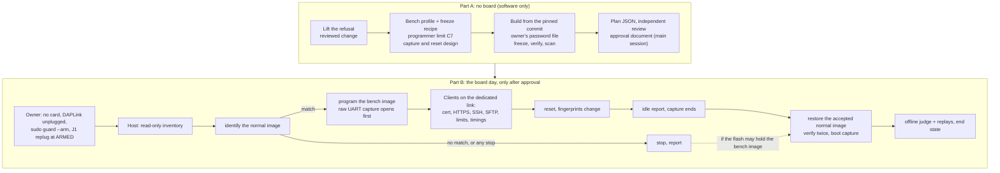
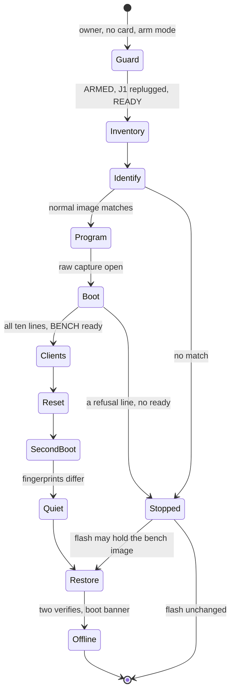

# The bench image plan: manifest, profile input and the board-run plan (row C8)

Status: **row C8 of stage 2** of [the RT1060-EVKB feasibility report](rt1060-management-image-feasibility.md), for review in a Draft PR. Refs #183. **This is a plan and not an approval.** It authorises no hardware operation, it quotes no owner approval and claims none, and the approval documents are the main session's and are not written here. **Nothing here ran on a board**: the only runs are one cross-build for `mimxrt1060_evk@B//qspi`, host reads of the merged source and of that build, and a few host-only client checks against a local test server ([evidence](evidence/rt1060-management-image-feasibility/image-plan-c8/README.md)). The image that was built **refuses to start** (row C1's switch), so it is not the image that a board run would program.

## Result

| Question | Answer |
| --- | --- |
| What does this record hold? | (1) One real cross-build of `origin/main` at `9882ebdf` with every bench form set, and its manifest. (2) The **image profile input** for the `Crux Pilot` session: what a bench-image profile must supply, with this image's values. (3) The **plan for the board run** on the stage 1 pattern, expanded from the 8-step outline, with commands, expected output, stop conditions and the restoration of the accepted normal image. |
| Can the stage run today? | **No.** [The table](#what-blocks-the-plan-today) has nine rows: B1, B2, B4 and B5 are code in `tests/target/`, B3 is the refusal in `main()` (the refused image prints its banner and the entropy line, then stops; the image of this record, built before C10, printed the banner only), B6 and B8 are owner decisions, B9 is the approval, and B7 is settled here by changing the plan. |
| The image built | `zephyr.bin` **562,232 B**, SHA-256 `1ec8f217137b66a4d3641d9a7948c7145b8b11821a8a55aa5b2c01211255fcd4`; Flash 562,232 B of 8 MB (6.70 %), RAM 2,172,076 B of the 32 MB SDRAM (6.47 %); built twice from the clean tree with the same throwaway password file and **byte-identical** both times. [Values and which are illustrative](#the-image-that-was-built). |
| What did the work find that the outline did not say? | (a) The existing freeze and image checks do not fit this image: the M5 check refuses it, the freeze needs a build tree inside the repository, `rom.json`, `ram.json`, a west workspace with the crypto group on, and **cannot see the patched Zephyr copy** ([B2](#what-blocks-the-plan-today)). (b) The profile capture is at most **300 s** and the driver's series is **900 s**, and no mode only resets the board: the traffic steps cannot be recorded ([B4, B5](#what-blocks-the-plan-today)). (c) The bench has **one account**, `admin`, and Access allows **3 sessions per account across both channels**, so "four SSH shells and three web logins" cannot be held, and the outline's "viewer's refusal" has no account to run with ([B6](#what-blocks-the-plan-today)). (d) The file service caps one SFTP file at **65,536 B**, so the "at least 1 MiB" transfers of the row C6 list become rounds of 64 KiB ([B7](#what-blocks-the-plan-today)). |
| What stays the owner's and the main session's? | The approval documents, the root mount guard (the owner's own sudo, in arm mode), the physical steps, the merge, and every decision in [the list](#what-blocks-the-plan-today). |



## What blocks the plan today

Each row says who owns the way out. A row marked **decision** needs the owner and is recommended, not taken.

| # | Blocker | Why (source) | Owner of the way out | State |
| --- | --- | --- | --- | --- |
| B1 | **The programmer's limit (row C7, D11).** One Commander run is cut at 30 s (`capture_m3.py`, `process.wait(timeout=30)`), and `image_commands` puts `loadfile`, `verifybin`, `r`, `g` and `q` in **one** run. The bench image is 562,232 B, which J-Link rounds to five 128 KiB ranges (640 KiB, 5 times the 131,072 B of the M5 load, which took 6.5 s): about 23 s for the load by extrapolation, then the verify read and the reset. | [feasibility, programming time](rt1060-management-image-feasibility.md#programming-time-and-the-stage-1-tool) | `Crux Pilot` (`tests/target/` is not touched here) | Not done |
| B2 | **The bench image profile and its freeze recipe.** `m5_image.check_image` refuses this image: [what differs](#a-the-checks-of-the-image). The freeze (`prepare_m5_network.py prepare`) needs: a build directory inside the repository, `rom.json`, `ram.json`, `zephyr.stat`, `zephyr.dts`, `zephyr.map` and `compile_commands.json`; a west workspace whose `west list` shows the five crypto modules (their group, `crux-secure-management`, is off by default); and clean pinned checkouts. **The patched Zephyr copy of D8 is not a west project** (a copy without a `.git`): a freeze that pins stock Zephyr at `dccb0959` would record a tree that was not compiled, and one that sees the copy refuses it as dirty. No bench freeze script exists. | `prepare_m5_network.py` (`frozen_inputs`, `prepare`), `record-build-provenance.py` (`workspace_inputs`, `main`), `west.yml`, `bench_declaration.json` (`patched_zephyr`) | `Crux Pilot`, with a **decision** on the copy: [options](#b-the-manifest-source-and-the-pinned-set) | Not done |
| B3 | **The refusal in `main()`.** `CRUX_BENCH_RUN_REFUSED` is `ON` in `CMakeLists.txt`, a unit test pins it, and the manifest says `run_refused: true`. The image of this record (built from `main` before row C10) prints the banner and `BENCH refusing to start: this image is not approved to run` and returns. **Since C10** a refused image prints the banner, then the `CRUX-ENTROPY` line (D-a), then the refusal line, and nothing else: no address, no store, no HTTPS, no SSH (a failed first read prints `first-read=failed` and its own refusal line instead). A fresh build of `main` prints the lines in that order, so the record's `strings` list of the BIN predates the move. Lifting it is one reviewed change **after** the approval of the stage, and it changes the image: **the bytes a board run programs are not the bytes of this record.** | `src/main.c`, `CMakeLists.txt`, `tests/build/test_management_bench_declaration.py` | The main session, after the owner's approval | Stays, by design |
| B4 | **No tool records the UART across the traffic steps.** The profile's capture runs inside `program`, for `capture_seconds`, **at most 300 s** (`MAX_CAPTURE_SECONDS`), and the driver's own series budget is 900 s (`series_seconds`), including the identity and entry-image steps. The clients, the reset and an idle report need about 20 to 35 minutes, and the report prints only at boot, after a burst and at idle: **a client whose report is not captured leaves no figure.** | `image_profile.py`, `program_m5_image.py` (`Driver`, `program_captured`) | `Crux Pilot`: a longer window with a longer series budget, or a separate read-only capture mode that holds the port under the same gates | Not done |
| B5 | **No mode resets the board on its own.** (`program` and `restore` reset only as the end of a load.) The driver has `identify`, `program` and `restore`. `capture_m5_network.py capture` resets with `r`, `g`, `q`, but it is the M5 phase protocol. The reset step of the outline (new fingerprints after a reset) has no tool. | `program_m5_image.py` (`MODES`) | `Crux Pilot` (a reset mode with the same gates), or the owner presses the board's reset button during the capture, which is a physical operation the approval must name | Not done |
| B6 | **One account, and a cap of three sessions.** The bench creates `admin` only (row C4), no CLI command or route creates another, and `CRUX_ACCESS_SESSIONS_PER_ACCOUNT` is 3 **across both channels** (the oldest ends). The 7 network slots of D9 can therefore never be filled by sessions, and a viewer cannot be made. | `rt1060-bench-first-account.md`, `ssh-integrated-image.md` (sessions per account), `cli-contract.md` (built-in commands) | **Decision:** run the reachable subset ([below](#what-the-bench-can-and-cannot-load)), or add a row that makes more bench accounts. Recommended: the reachable subset first. | Open |
| B7 | **The file service caps a file at 65,536 B and the area at 262,144 B** (`mgmt_services.c`: `max_file_bytes`, `max_area_bytes`). The row C6 list asks for an SFTP put and get "of at least 1 MiB". | `tests/zephyr/management_rt1060_compile/src/mgmt_services.c` | The plan changes: rounds of 64 KiB. No code change. | Settled here |
| B8 | **Owner decisions not yet taken** (below). | | Owner | Open |
| B9 | The owner's approval of the board stage, the root mount guard, an independent review of this plan, and CI. | `AGENTS.md`, the stage 1 pattern | Owner, main session | Not given |

Open decisions (B8), each with the recommendation of the row that raised it:

| # | Decision | Raised by | Recommendation |
| --- | --- | --- | --- |
| D-a | Where the first-read entropy line stands in `main()`. C5 put it **after** the refusal, so the refused image never printed it. | [C5, decision 5](rt1060-wolf-entropy.md#decisions-for-review) | **Taken 2026-11-09** by the owner ("1-8까지 너의 추천대로 진행해줘"), on the recommendation to move it ahead of the refusal. **Done in row C10**: the check now runs right after the banner and before the refusal and before every key, address and listener, and a test pins that order. The lifting change keeps it there. |
| D-b | The first account's password is **plaintext in the ELF and BIN** (read-only data in Flash). Options A (a derived-record entry in Access), B (write the record into the store) and C (plaintext embedded, merged). | [C4, why the plaintext is in the image](rt1060-bench-first-account.md#why-the-plaintext-is-in-the-image) | C for this one run, since the password is made for this image, the link is dedicated and nothing persists; A as its own row |
| D-c | `tcp_init_isn` ignores a failed `sys_csrand_get` and keeps an all-zero key for the rest of the boot. Patch the build-local Zephyr copy, add a check in the composition, or accept it for a bench with a dedicated link. | [C5, follow-up](rt1060-wolf-entropy.md#follow-up) | Accept for the first run and record it in the approval, since a read that fails **after** the boot check passed is what a board run can show |
| D-d | The margins that the judge applies: 25 percent of the HTTP stack (C2-1), 80 percent of the arena and of each pool (C2-10, C6). | [C2](rt1060-management-image-feasibility.md#decisions-taken-in-c2) | Adopt as defaults |
| D-e | The loaded scope (B6): the reachable subset, or a second row. | this record | The reachable subset |
| D-f | The reset mechanism (B5) and whether a commit tag goes into the banner ([profile, c](#c-whether-a-commit-tag-is-embedded)). | this record | A reset mode; no tag |

## What must be true before an approval document can be written

The approval documents are the main session's. This list is what this record says must hold first, so that an approval binds exact things. It is not the approval and it does not say that any item will be approved.

| # | Condition | Checked by |
| --- | --- | --- |
| 1 | B1 done and merged: the programmer limit raised for a load of about 562 KB and `loadfile` split from `verifybin`, with an independent PASS and CI | `Crux Pilot`, main session |
| 2 | B2 done: the profile registered with its pins, a freeze recipe that is run once on a clean tree, the manifest verifying under `--profile`, and the decision on the patched Zephyr copy taken | `Crux Pilot` |
| 3 | B4 and B5 done, or the plan revised to what the tools can record | `Crux Pilot`, this plan's next revision |
| 4 | B3: the lifting change reviewed and merged, and **its commit pinned**. The image to approve is built from that commit | main session |
| 5 | The owner's password file made with C4's generator at a path the owner keeps, outside every git work tree; the image built with it; only its SHA-256 is recorded; the scan of the build, the repository and the logs clean ([the scan](#what-a-board-image-rebuilds)) | the owner, the builder |
| 6 | B8 decisions D-a to D-f taken and written into the approval's text | owner |
| 7 | The accepted normal image's artefacts present and verified: BIN SHA-256 `ad729684749181f0c26853828550187a2c3e60dbb28cf3ee2194a7984141e02f` (107,872 B), its manifest, the J-Link tool hashes of `jlink-tools.json`, the guard script's hash | the approval's checks |
| 8 | This plan reviewed independently, revised to the tools as they then are, and its plan JSON generated (`plan_sha256`) | main session |
| 9 | The bench identities re-read read-only on the day (adapter, service, UART path, hub port) and equal to `m5_bench.py` | the host, at B0 |
| 10 | Free disk above 5 GB, one build at a time, no other session holding the probe or the port | the host |

## The image that was built

The recipe is C1 to C6's: the Dev Container image `crux-pilot-devcontainer:local` (linux/amd64 under emulation, `--memory 2g --cpus 2`, `-j2`), C1's patched Zephyr copy at `/ws/zephyr-wolf` and the module trees read-only, `west.yml`'s pins, a **clean detached checkout** of the commit mounted read-only, one build at a time under the machine's build lock. The password file was made by C4's generator outside every git work tree under a path unique to this run, mounted read-only, and **deleted afterwards with the build directories**. Commands: [`commands/`](evidence/rt1060-management-image-feasibility/image-plan-c8/commands/build.sh).

| Item | Value |
| --- | --- |
| Source commit | `9882ebdfe2f30e0dc3b5b4373a2e1bafff291239` (`origin/main`, after the merge of C6). The manifest says `source_tree_modified: false`. |
| Source snapshot (the recorder's own function) | 4,146 files, SHA-256 `7ac9269169bcef7b4302dbd48bb08f1ebee19a5608d5e57e832c99f8900b5d28`, `west.yml` SHA-256 `cd4a6a5b24679a1a7a64195c6bb4acee3ab3cf8d3a2b234d3747c38a1c27912a` |
| Target, toolchain | `mimxrt1060_evk@B//qspi`, Zephyr SDK 1.0.1, GCC 14.3.0 |
| `zephyr.bin` | **562,232 B**, SHA-256 `1ec8f217137b66a4d3641d9a7948c7145b8b11821a8a55aa5b2c01211255fcd4` |
| `zephyr.elf` | 9,643,900 B, SHA-256 `1dd491a2ef9072adcc47d1805dc18249d7f541150065cb73f311ea6e8f7ae6a7` |
| Firmware identity (`crux-firmware-identity-v1`, from `record-build-provenance.py`'s functions) | `de26ca4d9705cecfb8021e3c713aa7ee4d534cab616f13687c37c1549286af15`, over the BIN hash above and the normalised configuration hash `fd2f0bb0b3a5c6d4fb923cc90cf4c0a9ca3cc79e16f36b1d749390175d671427` |
| FLASH | 562,232 B of 8 MB (6.70 %) |
| RAM (all in the 32 MB SDRAM) | 2,172,076 B (6.47 %); ITCM, DTCM, OCRAM, OCRAM2 empty. It is mostly configuration: the 1 MiB arena, the 512 KiB RAM disk, the network pools and the stacks. |
| `size` | text 557,864, data 4,348, bss 2,167,650 |
| Steps, warnings | 556 steps, **4 warnings**: three in wolfSSH `wolfsftp.c`, one in wolfPSA `psa_key_storage.c` (unused after the RSA trim), all outside `-Werror` as before. The device tree also warns about the duplicate unit address of `usbd` and `usbh`, which is Zephyr's. |
| Configure | The guards ran and passed. The line `Bench network buffers meet the declared load: rx buffers 1024 (need 915), tx buffers 768 (517), rx packets 192 (173), tx packets 32 (18), window 5840, arena 1048576 (694208)`, `Bench first account: password file checked, sha256 aef550eca33bbe1bb9a01d245402b908985d024d2cffd65f58a2f16498c2cb95`, and the manifest. |
| RSA check | `check_bench_rsa_symbols: 5554 defined symbols, none of them RSA code` |
| Manifest (`bench-manifest.json`, as the build wrote it) | Declaration `CRUX_MANAGEMENT_BENCH_IMAGE`, image `crux-mgmt-bench-rt1060-evkb-b`, address `192.168.77.2/24`, peer `192.168.77.1`, **`run_refused: true`**, 65 resolved settings, the four test forms, the RAM disk record, the first account (`admin`, `administrator`, `file_sha256`, `plaintext_in_image: true`), the patched Zephyr block, 18 configuration files and 96 sources with their SHA-256 |
| Password in the image (C4's scan) | The throwaway password occurs **exactly once** in `zephyr.elf` and in `zephyr.bin`, and the scan with `--allow-in-image` of the build, the repository and the logs is **clean**. Without the allowance it lists exactly the five image files (`libapp.a`, the assembler object, `zephyr.bin`, `zephyr_pre0.elf`, `zephyr.elf`). Not in the manifest, `.config`, the map or any log. |
| Public test password | **0 times** in the ELF and in the BIN |
| Commit tag in the image | **0 times** (the 12-character prefix of the commit is in neither the BIN nor the ELF): see [profile, c](#c-whether-a-commit-tag-is-embedded) |
| Reproducibility | Two builds from the same clean tree with the same file gave the same `zephyr.bin` and `zephyr.elf` SHA-256 and the same manifest ([run 2](evidence/rt1060-management-image-feasibility/image-plan-c8/build/sha256.txt), [run 1](evidence/rt1060-management-image-feasibility/image-plan-c8/build/sha256-run1.txt), [the manifests' hashes](evidence/rt1060-management-image-feasibility/image-plan-c8/build/manifest-sha256.txt)). The first run's scan stopped on a false positive (C6's command file happens to hold the same in-container path as the password file's), so the file moved to another path and the build ran again. |

### What a board image rebuilds

A board image **is built again** by whoever runs the stage, from a **pinned commit** that has the refusal lifted (B3) and the freeze recipe (B2), with the **owner's own password file**. The values in the table above are therefore illustrative where the second column says so.

| Value | Binding for the stage, or illustrative | Why |
| --- | --- | --- |
| `zephyr.bin` and `zephyr.elf` size and SHA-256, the firmware identity digest | **Illustrative.** Rebuild and re-hash. | The refusal lifted changes the code, and the owner's password bytes are embedded in the BIN and the ELF |
| `first_account.file_sha256` of the manifest | **Illustrative.** The owner's file has its own hash. | It is the hash of the file's bytes |
| `source_commit`, the source snapshot hash and file count, the 96 source hashes of the manifest, `run_refused` | **Illustrative.** `run_refused` is `false` in the stage image. | A new commit, new files, the lifted switch |
| Flash and RAM, the 4 warnings | Illustrative as numbers, expected within a few hundred bytes: the switch is a `volatile const` read that keeps all the code linked, so lifting it does not remove code | Row C1's design |
| The settings, the guards' output, the RSA check, the 0 occurrences of the public password, the scan procedure, the two-build reproducibility | **A procedure to repeat**, with the results expected to hold | They do not depend on the bytes |
| The frozen image manifest (`image-manifest.json`), its SHA-256 digest, `plan_sha256`, the approval | **Produced then**, for the stage image | The approval binds them |

What must be redone for the stage image, in order: build on the pinned commit; scan (the password file, the build directory, the repository, the logs); record only the file's hash; freeze under the bench profile; `verify` with the digest; hash `zephyr.bin`, `zephyr.elf` and `.config`; compare the BIN with the normal image's entry in the plan; generate the plan and check the approval.

## The image profile input

For the `Crux Pilot` session, which owns `tests/target/`. The mechanism is [`docs/board-image-profiles.md`](board-image-profiles.md): a profile holds image facts and cannot hold a gate. Every string below is taken from the merged source (`tests/zephyr/management_rt1060_compile/`, `tests/zephyr/entropy_boot/`, `components/ssh/`), and the read-only probe [`host/profile-facts.py`](evidence/rt1060-management-image-feasibility/image-plan-c8/host/profile-facts.py) ran the existing checks on the built image ([output](evidence/rt1060-management-image-feasibility/image-plan-c8/host/profile-facts.out)).

| Field of `ImageProfile` | Value for this image | Section |
| --- | --- | --- |
| `name` | `crux-mgmt-bench-rt1060-evkb-b`, the image id of the declaration and of the banner. `profile_named` requires the registry key to equal it. | |
| `manifest_path` | `crux-pilot` | [b](#b-the-manifest-source-and-the-pinned-set) |
| `pinned`, `pinned_paths` | ten projects: Zephyr, three HAL modules, FatFs, five crypto modules | [b](#b-the-manifest-source-and-the-pinned-set) |
| `modules`, `module_paths` | empty. The build names its modules (`-DZEPHYR_MODULES`), as M5 does. | |
| `check_image` | the bench's own, returning the firmware identity | [a](#a-the-checks-of-the-image) |
| `commit_tag` | `False` | [c](#c-whether-a-commit-tag-is-embedded) |
| `errno_suffix` | `None` | |
| `tool_scripts` | `record-build-provenance.py`, and the bench's freeze script once it exists | [b](#b-the-manifest-source-and-the-pinned-set) |
| `capture`, `capture_seconds` | `raw`, and a window that the tools allow: [e](#e-the-capture-procedure) | [e](#e-the-capture-procedure) |
| (not in the profile) the expected UART | [d](#d-the-expected-boot-banner-and-the-lines-in-order) | |

### a. The checks of the image

`check_image(binary, elf, config)` runs on the frozen bytes, and must not trust the build tree. What the declaration and the manifest already guarantee at build time is not enough for a freeze, which re-reads bytes. **The M5 constants cannot be reused**: the shared geometry check passes on the bench image (562,232 B, boot header, ELF sections against the BIN, gap fill), and both existing profile checks refuse it:

| M5 constant | The bench image |
| --- | --- |
| `CONFIG_MAIN_STACK_SIZE=4096`, `z_main_stack` 4,160 B | 16,384; `z_main_stack` is 16,448 B |
| `CONFIG_NET_MAX_CONTEXTS=4`, `CONFIG_NET_MAX_CONN=4` | 32 and 32 |
| `CONFIG_NET_PKT_RX_COUNT=16`, `_TX_COUNT=16` | 192 and 32 |
| `CONFIG_NET_BUF_RX_COUNT=32`, `_TX_COUNT=32` | 1,024 and 768 |
| `CONFIG_PRINTK_SYNC=y`, `CONFIG_CRUX_SOCKETS=y`, `CONFIG_CONSOLE_GETCHAR=y`, `CONFIG_CONSOLE_SUBSYS=y` | not set |
| Forbidden: `FILE_SYSTEM`, `DISK_ACCESS`, `WATCHDOG`, `LOG` | all four are `y` (RAM disk and Crux Logging) |
| Symbol `m5_observer` of 2,112 B | none |
| Still forbidden and still not set | `FLASH`, `FLASH_MAP`, `NVS`, `SETTINGS`, `SHELL`, `NET_IPV6`, `NET_DHCPV4`, `BOOTLOADER_MCUBOOT` |

17 of the 28 M5 required lines hold. The proposed bench check:

| Group | What the check requires | Guaranteed at build time by |
| --- | --- | --- |
| Geometry | `m3_image.check_image_bytes`, `check_optimization` | |
| Board | `CONFIG_BOARD_REVISION="B"`, `CONFIG_BOARD_TARGET="mimxrt1060_evk@B/mimxrt1062/qspi"`, `CONFIG_FLASH_BASE_ADDRESS=0x60000000`, `CONFIG_FLASH_SIZE=8192`, `CONFIG_FLASH_LOAD_OFFSET=0`, `CONFIG_XIP=y`, `CONFIG_NXP_IMXRT_BOOT_HEADER=y`, `CONFIG_MPU_STACK_GUARD=y`, `CONFIG_THREAD_STACK_INFO=y` | Kconfig, CMake and C guards (`bench_guard.cmake`, `Kconfig.bench`, `bench_guard.h`) |
| The declaration and its forms | `CONFIG_CRUX_MANAGEMENT_BENCH_IMAGE=y`, `CONFIG_CRUX_BENCH_TEST_HOST_KEY=y`, `CONFIG_CRUX_BENCH_NO_TIME_SOURCE=y`, `CONFIG_CRUX_BENCH_FILE_RAM_DISK=y`, `CONFIG_CRUX_BENCH_FIRST_ACCOUNT_FILE=y`; **`CONFIG_CRUX_BENCH_FILE_MICROSD` not set**; **`CONFIG_WOLFSSL_RSA` not `y`** | `bench_declaration.json`, the guards |
| Entropy | `CONFIG_ENTROPY_MCUX_TRNG=y`; neither `CONFIG_TEST_RANDOM_GENERATOR` nor `CONFIG_FAKE_ENTROPY_NATIVE_SIM` set | the guards, `entropy_boot.c` |
| Network | `CONFIG_NET_IPV4=y`, `CONFIG_NET_DHCPV4` and `CONFIG_NET_IPV6` not set, `CONFIG_CRUX_WEB_BIND_ADDRESS="192.168.77.2"`, `CONFIG_CRUX_SSH_BIND_ADDRESS="192.168.77.2"`, `CONFIG_CRUX_WEB_PORT=443`, `CONFIG_CRUX_SSH_PORT=22`, `CONFIG_CRUX_SSH_MAX_CONNECTIONS=4`, `CONFIG_HTTP_SERVER_MAX_CLIENTS=3` | the guards |
| Buffers (C6) | `CONFIG_NET_BUF_RX_COUNT=1024`, `CONFIG_NET_BUF_TX_COUNT=768`, `CONFIG_NET_PKT_RX_COUNT=192`, `CONFIG_NET_PKT_TX_COUNT=32`, `CONFIG_NET_TCP_MAX_RECV_WINDOW_SIZE=5840`, `CONFIG_NET_TCP_MAX_SEND_WINDOW_SIZE=5840`, `CONFIG_COMMON_LIBC_MALLOC_ARENA_SIZE=1048576`, `CONFIG_HTTP_SERVER_STACK_SIZE=8192` | `bench_guard.cmake` step 10 (floors), `bench_declaration.json` |
| No card | `CONFIG_DISK_DRIVER_SDMMC` and `CONFIG_IMX_USDHC` not `y`; `CONFIG_FS_FATFS_MOUNT_MKFS` not `y`; `CONFIG_DISK_DRIVER_RAM=y`, `CONFIG_CRUX_FILE_FATFS_RT1060_RAM_DISK=y` | the guards, `check_mkfs_callers.py` |
| Report | `CONFIG_NET_STATISTICS=y`, `CONFIG_CRUX_SSH_STACK_REPORT=y`, `CONFIG_MEM_SLAB_TRACE_MAX_UTILIZATION=y`, `CONFIG_SYS_HEAP_RUNTIME_STATS=y`, `CONFIG_INIT_STACKS=y`, `CONFIG_THREAD_NAME=y`, `CONFIG_THREAD_MONITOR=y` | `bench_report.c` `#error` lines |
| Still refused | `FLASH`, `FLASH_MAP`, `NVS`, `SETTINGS`, `SHELL`, `BOOTLOADER_MCUBOOT` | M5's list, kept |
| Stack objects (symbol sizes of the linked image, from `nm -S`) | `z_main_stack` 16,448 B; `_k_thread_stack_http_server_tid` 8,256 B; `worker_stacks` 65,792 B (four SSH workers) and 33,024 B (four Crux threads); `listener_stack` 4,160 B; `report_stack` 2,112 B; no `m5_observer` | none: these are the figures the judge's manifest comparison and a reviewer need |

The 65 `settings` of `bench-manifest.json` **all equal the resolved `.config`** (the probe's section 4), so a profile may instead freeze the manifest as a role and require equality. That adds a role the freeze does not have (`ROLES` is fixed), so the table above is the version that needs no change to the freeze's roles. The first account's name and role are not in the `.config`: they are in the manifest, which is a reason to freeze it.

### b. The manifest source and the pinned set

The west manifest repository is **`crux-pilot`** (`west.yml`, `self.path`), so `manifest_path='crux-pilot'`, and the image source is the same repository. The build names its modules, so the pins go in `pinned` and not in `modules`:

| Project | Revision | Path |
| --- | --- | --- |
| `zephyr` | `dccb09599635bdff17633fa7e9dab014b91dce90` | `zephyr` |
| `cmsis` | `512cc7e895e8491696b61f7ba8066b4a182569b8` | `modules/hal/cmsis` |
| `cmsis_6` | `30a859f44ef8ab4dc8f84b03ed586fd16ccf9d74` | `modules/hal/cmsis_6` |
| `hal_nxp` | `7554bc0f6f6c284972eba7b2c17b16fbb9cc0ad0` | `modules/hal/nxp` |
| `fatfs` | `f4ead3bf4a6dab3a07d7b5f5315795c073db568d` | `modules/fs/fatfs` |
| `wolfssl` | `3c5eead44904df64e6a5a1f4ebdce377d35a849a` | `modules/crypto/wolfssl` |
| `wolfssh` | `8221e4ee48c93da6cea3325a91de2ecc00ae5f56` | `modules/crypto/wolfssh` |
| `wolfpsa` | `55ae0ec58cd2ef4c528f44e8466095550c16ca8a` | `modules/crypto/wolfpsa` |
| `mbedtls` | `a3e190fe44c78d1ba67f55979e1257328cc7d0d8` | `modules/crypto/mbedtls` |
| `tf-psa-crypto` | `dc575a2ddcc8cb16275d24c42a52eaf79ebe2231` | `modules/crypto/tf-psa-crypto` |

A candidate `ImageProfile` with these ten and `capture='raw'` constructs under its own consistency rule; the same rule refuses a window of 600 s (the probe's section 6). Three facts about the freeze that this profile has to answer:

| Fact | What it needs |
| --- | --- |
| `workspace_inputs` reads `west list`, and `west.yml` sets `group-filter: [-crux-secure-management, -crux-reliance]` | The freeze workspace turns the crypto group on (`west config manifest.group-filter -- +crux-secure-management`, then `west update`, as [`ssh-integrated-image.md`](ssh-integrated-image.md#try-it-yourself) does), or the five crypto modules are never recorded and the pinned set is "missing" |
| `record-build-provenance.py` requires the build directory **inside the repository**, and `rom.json`, `ram.json`, `zephyr.stat`, `zephyr.dts`, `zephyr.map` | The bench build goes to `<repo>/build/zephyr/<name>` and runs `cmake --build <build> --target rom_report ram_report` first, as `scripts/test-networking-physical.sh --freeze` does for M5. `prepare` also needs `compile_commands.json` (`-DCMAKE_EXPORT_COMPILE_COMMANDS=ON`, which this record's build set). |
| **The patched Zephyr copy** (D8) is a plain directory, with the marker `.crux-wolf-tls`, the patch `zephyr-tls-4.4.1.patch` (SHA-256 `3d1cc030...bdb`) and the patched file `subsys/net/lib/sockets/sockets_tls.c` (SHA-256 `106acdbb...552a`) | A decision. Options: (1) make the copy a git checkout of the pin plus the patch as one local commit, and pin that commit under the name `zephyr` (the freeze then sees it clean, and the pin is no longer an upstream revision); (2) keep stock Zephyr as the west project and freeze the copy's identity as extra artefacts: the marker, the patch, the patched file, and a hash over the copy's tree, checked by `check_image` against `bench-manifest.json`'s `patched_zephyr` block (the guard only hashes the pin, the patch and the one patched file, not the rest of the copy); (3) wait for #185. Recommended: (1) if a local commit is acceptable, otherwise (2) with the tree hash. **Not decided here.** |

`bench-manifest.json` is not a role of the freeze. It should be hashed into the frozen artefacts (it holds `source_commit`, the declaration, the first account's file hash and the sources' hashes) and compared with the frozen `.config` by `check_image` or by an extra step.

### c. Whether a commit tag is embedded

**No.** The banner and every other string print no commit, and the 12-character prefix of the source commit occurs 0 times in the BIN and in the ELF ([strings check](evidence/rt1060-management-image-feasibility/image-plan-c8/build/strings-checks.txt)). So `commit_tag=False`, as for the second registered profile. The image is identified by the **SHA-256 of the BIN**, the **digest of the frozen manifest**, the manifest's `source_commit`, and the firmware identity digest, which `check_image` should return in its facts as the second profile's does. A board cannot show its own commit on the UART. If the `Crux Pilot` session prefers M5's pattern, the lifting change adds `source=<12 characters>` to the banner, `commit_tag` becomes `True` and the freeze checks it, at the price that every commit then changes the BIN. Recommended: no tag.

### d. The expected boot banner and the lines in order

The driver's capture has **no oracle** by design (decision 21 of `board-image-profiles.md`, stated for the second profile and true of the driver's capture for every profile): acceptance is an offline replay. The lines below are what an offline check of this image's boot must find, in this order, in the raw capture. They come from `main.c`, `entropy_boot.c`, `bench_medium_fs.c`, `bench_first_account.c`, `bench_report.c` and `ssh_target.c`. Log prefixes may stand in front of a line, and security-event lines (`evt=...`, [format](security-event-contract.md#log-line)) from Crux Logging may stand anywhere: neither is judged.

| # | Line (a fixed string, or a pattern) | Printed by | If it is missing or different |
| --- | --- | --- | --- |
| 1 | `BENCH image=crux-mgmt-bench-rt1060-evkb-b declaration=CRUX_MANAGEMENT_BENCH_IMAGE board=mimxrt1060_evk@B/mimxrt1062/qspi address=192.168.77.2/24` | `banner()` | A wrong or stale image: stop |
| 2 | `BENCH test forms: host_key=1 no_time_source=1 ram_disk=1 first_account_file=1` | `banner()` | Stop |
| 3 | `CRUX-ENTROPY first-read=ok source=random@400cc000 compatible=nxp,kinetis-trng bytes=32 status=0 device-ready=1` | `crux_entropy_boot_check()`. The `source` and `compatible` values come from the device tree of the build (`zephyr.dts`: `trng: random@400cc000`, `compatible = "nxp,kinetis-trng"`, chosen `zephyr,entropy = &trng`), not from a board. | `first-read=failed` is followed by `BENCH refusing to start: the first random read failed, no key or listener made`: stop |
| 4 | **Not in the lifted image:** `BENCH refusing to start: this image is not approved to run`. In the refused image it follows line 3 directly and is the last line. | `bench_main()` | The switch was not lifted: stop the clients and restore |
| 5 | `BENCH file-medium ram-disk 524288 B in SDRAM, formatted at this boot, mounted=1: nothing persists across a reset (accounts, keys, certificate and events are lost)` | `bench_medium_mount()`, from `crux_native_management_start()` | `mounted=0` or `COMPOSITION medium not ready`: stop |
| 6 | `BENCH first account created: user=admin role=administrator` | `crux_bench_first_account()`, on an empty store, which a RAM disk gives at every boot | `BENCH first account failed: result=<n>`: stop |
| 7 | `BENCH-CERT v=1 sha256=<32 pairs of upper-case hex joined by colons> source=generated` | `crux_bench_report_certificate()`, after the services start and before SSH | `BENCH-CERT unavailable`, `BENCH certificate fingerprint failed`: stop. `source` is `generated` at every boot of this image. |
| 8 | `SSH-HOST-KEY SHA256:<43 characters of Base64 with no padding>` | `crux_mgmt_rt1060_ssh_start()` | `SSH-HOST-KEY unavailable`, `BENCH ssh failed`: stop |
| 9 | the boot report, whole: `BENCH-REPORT v=1 begin seq=1 reason=boot uptime_ms=<T> bursts=0`, the `BENCH-STACK` rows, one `BENCH-HEAP`, four `BENCH-POOL` rows in the order `rx_pkt`, `tx_pkt`, `rx_buf`, `tx_buf`, one `BENCH-NET`, `BENCH-REPORT v=1 end seq=1 lines=<L> missed=0` | the report thread | `BENCH report failed`, or no report within 60 s of line 8: stop |
| 10 | `BENCH ready` | `bench_main()` | No `BENCH ready` within 120 s of the end of the start command: stop |

`BENCH ready` and the boot report are printed by two threads (the report thread is the lowest application priority), so **their order is not fixed**: the check requires both, in either order, after line 8. The pools' sizes in line 9 are the Kconfig counts (`rx_pkt` 192, `tx_pkt` 32, `rx_buf` 1024, `tx_buf` 768), which `check_bench_uart.py --manifest` compares with the build.

Any of these also stops a run, wherever it appears: `BENCH address failed`, `BENCH composition failed`, `BENCH services failed`, a Zephyr fatal error or fault text (`FATAL ERROR`, `Fault`, `stack overflow`), and a second `BENCH image=` line **before** the reset step (an unplanned reboot).

A script that checks lines 1 to 10 and their order does not exist, and none is added here (this record changes no tool). A recipe with `grep -n` over `capture/uart-rx.bin` with `LC_ALL=C` and `-a` gives the order by line number, and is what the plan's step B6 uses until the `Crux Pilot` session wants a script.

### e. The capture procedure

| Item | Value |
| --- | --- |
| Kind | **Passive raw UART**, `capture='raw'`: the driver's own port, 115,200 baud, opened inside `program` after every gate and before the one probe command, every byte kept in `uart-rx.bin` with `receive.jsonl` and `poll.jsonl`, `lines.json` and `analysis.json` as views. Never a drain, never a write. |
| Which reports | All the image prints: the boot lines of [d](#d-the-expected-boot-banner-and-the-lines-in-order), the boot report (`reason=boot`), a `reason=quiet` report after each burst of traffic (the counter of TCP segments quiet for 2 s, and 5 s since the last print), and a `reason=idle` report after 30 s without TCP activity (and 5 s since the last print). At most one report per 5 s. |
| How long | **The window the tools allow is the open question (B4).** The need: boot to `BENCH ready` and the boot report (up to 120 s), the clients (about 20 to 30 min with the pauses), the reset and a second boot (another 120 s), and **at least 40 s after the last client** so that a `quiet` and an `idle` report come. About 2,000 s in all. The profile maximum is 300 s and the series budget is 900 s. |
| What judges it | `check_bench_uart.py CAPTURE --manifest bench-manifest.json (--cert-pem PEM or --connect 192.168.77.2:443)`, run offline. Exit 0 PASS, 1 FAIL, 2 could not run. [Below](#what-check_bench_uartpy-judges). |
| What judges the rest | The ordered lines of [d](#d-the-expected-boot-banner-and-the-lines-in-order) (a recipe, not a tool), and `capture_m3_integrated`'s oracles for the **normal image's** capture after the restore, as in stage 1 (B6 there). |
| Plan carrier | The driver needs a plan and an approval that `capture_m5_network.validate_approval` accepts. Stage 1 used the **reduced M5 plan** (nine operations, `--through-phase 6`, non-qualifying) for the M5 image. For another profile `board-image-profiles.md` says the plan and approval have no field for the profile or the window, so the approval's text must name the profile, the window, the image hash and the manifest digest, and that a profile-aware plan is a later change. The reduced plan's operation names (`qualification_preflight_1`, ...) are M5's. |

#### What `check_bench_uart.py` judges

| Judged | Fails when | Does **not** judge |
| --- | --- | --- |
| Report shape | A torn report (no end line), a lost or out-of-order `seq`, a line over 159 characters, `lines=` not what arrived, `missed` above 0, a pool group without its `BENCH-NET` (or the reverse), a report without exactly one `BENCH-HEAP` | The banner, the `CRUX-ENTROPY` line, `BENCH ready`, `SSH-HOST-KEY`, and the order of any line outside a report |
| HTTP server thread stack | The lowest `unused` over all reports is under **25 percent** of its size (2,048 B of 8,192 B), its size differs from `CONFIG_HTTP_SERVER_STACK_SIZE` of the manifest, or there is no row for `http_server_tid`. The message names the next size, 16,384 B. | Which clients ran: the plan's list is the control |
| Other threads | Only a warning under 25 percent, unless `--strict` or `--fail-thread NAME` | |
| Heap | A peak over **80 percent** of the arena, or an arena that differs from the manifest | A leak: the check of `in_use` at rest is the plan's (C6 item 7) |
| Pools (C6) | A pool whose peak is over 80 percent of its size, or whose size differs from the manifest | |
| `BENCH-NET` counters | Only a warning for a non-zero counter at the last report, or a failure with `--strict` | |
| Reports present | No boot report, or fewer `reason=quiet` reports than `--min-client-reports` (default 1; the plan sets it) | That the clients that ran are the ones the plan lists |
| Certificate | No `BENCH-CERT` line, or the **last** `BENCH-CERT` differs from the fingerprint given by `--cert-fingerprint`, `--cert-pem` or `--connect` | The earlier boot's fingerprint (two boots give two lines: the plan runs the judge twice) |

## The plan for the board run

On the stage 1 pattern ([plan](evidence/networking-physical-stage1/inputs/plans/stage1-phase-b-plan.md), [record](evidence/networking-physical-stage1/README.md)). **It is a plan and not an approval.** Nothing in it is approved, every step needs the approval of the main session and the owner, and a step that the tools cannot do yet is marked. Numbers marked as "proposed" are not measurements.

### Who does what

| Role | Does | Never does |
| --- | --- | --- |
| **Owner** | Confirms that **no microSD card** is in the slot (the file backend is a RAM disk, and the normal image that runs before the first step may touch a card); unplugs the DAPLink first; starts the mount guard **with the owner's own sudo, in arm mode**; replugs **J1** when the guard log shows `ARMED`; makes the password file; (optionally) accepts the certificate warning in a browser; is told before the one recovery power cut | |
| **Host** (the session that executes under the approval) | Reads only until a step is announced; runs the driver's modes and the client commands below; keeps the evidence; announces each physical command in one line | Uses `sudo`; touches the DAPLink volume (**never `mount`, `diskutil`, or `stat` or `ls -l` of it: on this Mac they hang**); powers the hub except in the one recovery below; retries any probe command; opens the UART other than through the driver |
| **Main session** | Writes the approval documents, arranges the independent review, merges | |

### Common rules

| Rule | Value |
| --- | --- |
| Environment | `LC_ALL=C`, `TZ` and `COLUMNS` unset, the stage 1 virtual environment (pyserial 3.5) outside the checkout, the frozen tools checkout clean at the pinned commit |
| Evidence parents | One **new, empty** parent folder per run, `RUN`, holding `identify`, `program` and `restore` (one use of each mode: the driver writes `m5-driver-<mode>.consumed` and refuses a second use). The console output of every command is saved next to its evidence folder, because a failure before the driver is built leaves no JSON. |
| Guard | `--guard-session /var/tmp/crux-guard/session-<N>.json`; the driver checks the guard, the UART and probe ownership and the dedicated adapter before **every** probe command |
| Probe | J-Link Commander through the accepted helper: the pinned executable and DLL hashes, the probe serial of `m5_bench.py`, SWD 400 kHz, `exec DisableAutoUpdateFW`, one run at most 30 s (B1), no retry |
| Nothing else runs | While a step runs, no other process holds the J-Link files or the port (the ownership check refuses on any process whose arguments name `JLink`, `openocd` or `pyocd`) |
| Secrets | The password file's **path and content never reach a log, the UART, a command line or the evidence.** Clients read it through files in a private folder outside every work tree (below), removed afterwards. |

### Steps

Legend: **P** preparation without a board (Part A), **O** owner, **H** host without the probe, **B** a driver mode (probe and UART), **C** a client on the dedicated link, **R** reset, **X** end. "Stop" means the stop conditions below apply: all hardware changes end and the restoration decides what is next.

| Step | Who | What | Expected | Stop if |
| --- | --- | --- | --- | --- |
| P1 | main session | The lifting change (B3) reviewed and merged; its commit is the one to build | the pinned commit; a changed test pin | not reviewed |
| P2 | `Crux Pilot` | B1, B2, B4, B5 done and merged | independent PASS and CI of each | any is open |
| P3 | owner | `python3 tests/zephyr/management_rt1060_compile/bench_first_account_file.py generate --file <the owner's path outside every work tree>` | prints a hash only; mode 600 | |
| P4 | builder | Build from the pinned commit under the bench freeze recipe with `CRUX_BENCH_PASSWORD_FILE=<that file>`; `bench_first_account_file.py scan --password-file <file> --build <build> --repo . --also <logs> --allow-in-image --expect-in-image <build>/zephyr/zephyr.elf --manifest <build>/bench-manifest.json` | `no plaintext of the password, or an encoding of it, in 3 scanned tree(s) (image files may hold it)` and exit 0; the ELF holds it once | a hit outside the image files |
| P5 | builder | Freeze: `record-build-provenance.py --capture-inputs`, build, `rom_report ram_report`, `record-build-provenance.py --build-dir ... --inputs ...`, then `prepare_m5_network.py prepare --profile crux-mgmt-bench-rt1060-evkb-b ...` and `verify --sha256 <digest>` | `verify` prints the profile, the commit and the BIN SHA-256 | any refusal |
| P6 | main session | `capture_m5_network.py plan --manifest <bench manifest> --entry-manifest <normal manifest> --recovery-manifest <normal manifest> --nonces <one nonce> --through-phase 6` (carrier) and `check-approval --plan <plan> --approval <approval>`; the approval document; the independent review of this plan and of the approval | `APPROVAL_DOCUMENT_COMPLETE_NO_OPERATIONS_EXECUTED` | |
| P7 | host | Read-only: `openssl version`, `ssh -V`, `curl --version`, `df -h /`, the venv's `pyserial` version, `python3 --version` | recorded | disk under 5 GB |
| O1 | owner | The microSD slot is empty. DAPLink unplugged. No stuck `mount`/`umount` and no RT1060 volume (the host reads `/bin/ls -1 /Volumes` and `ps`, **never** `mount`, `diskutil` or `stat` of the volume). | | a card is in the slot, or a volume is present |
| O2 | owner | From the frozen tools checkout, with the owner's sudo: `sudo /usr/bin/python3 tests/target/m5_mount_guard.py start --arm --arm-wait 1800 --lifetime 14400 --session /var/tmp/crux-guard/session-<N>.json --log /var/tmp/crux-guard/guard-<N>.log` | the host reads `ARMED` in the log | `FAILED` in the log |
| O3 | owner | Replugs **J1** once `ARMED` is read, within the arm wait. The board powers and runs whatever its flash holds (expected: the accepted normal image). The DAPLink enumerates and the guard vetoes its mount. | the log has `DENIED ...` and `READY`; `ps` shows the guard; no RT1060 volume | `FAILED`, or a volume appears: the recovery of [stop conditions](#stop-conditions-and-the-no-retry-rule) |
| H0 | host | Inventory, read-only: `ifconfig en13`, `networksetup -getinfo "AX88179 3"`, `uhubctl` (a listing with no `-a`), `/bin/ls -1 /dev/cu.usb*`. Adapter MAC, the manual `192.168.77.1/255.255.255.0` with no router, and the UART path equal `m5_bench.py`. Carrier is **not** required here. | identities match | any mismatch |
| B2 | host | **identify** (read-only; the core may be left halted): `cd "$TOOLS" && "$PY" program_m5_image.py identify --execute-hardware --profile crux-mgmt-bench-rt1060-evkb-b --plan "$PLAN" --approval "$APPROVAL" --manifest "$BENCH_MANIFEST" --entry-manifest "$NORMAL_MANIFEST" --recovery-manifest "$NORMAL_MANIFEST" --guard-session "$GUARD" --evidence "$RUN/identify" --candidate "$NORMAL_MANIFEST" > "$RUN/identify.console" 2>&1` | exit 0 and the result JSON (printed indented) `{"status": "IDENTIFIED", "matching": ["integrated-normal"]}`; `identify/01-identity-only.log` and `identify/02-candidate-integrated-normal.log` hold the identity and `Verify successful.` | no match (a verify mismatch exits non-zero and ends the run): the flash holds an unidentified image, nothing is changed; a new reviewed plan or an owner decision is needed |
| B3 | host | **program** with the profile's capture: the same command with `program` for `identify`, `--evidence "$RUN/program"`, and without `--candidate`. Steps `01-identity-only`, `02-entry-image` (the normal image is verified again), then `03-program-m5`: `loadfile`, `verifybin`, `r`, `g`, `q` of the exact BIN. The capture opens after the last gate and before that command. | `{"status": "M5_PROGRAMMED_VERIFIED_STARTED", "entry_image_verified": true, "capture": {...}}` (the label is M5's); `program/03-program-m5.log` holds `Verify successful.` | the step fails, times out (B1) or the capture cannot open: nothing more except the restoration |
| H1 | host | Boot check on the growing `capture/uart-rx.bin` with `LC_ALL=C grep -a -n`: lines 1 to 10 of [d](#d-the-expected-boot-banner-and-the-lines-in-order) in order. The carrier of the dedicated link: poll `ifconfig en13` up to 15 s for `status: active` **and** `inet 192.168.77.1` (macOS drops the manual address while the link is down after a reset, which crashed the peer in stage 1), then `route -n get 192.168.77.2` via `en13`, then `ping -c 3 192.168.77.2`. | all ten lines, `BENCH ready` within 120 s; the host address back within 15 s | a missing or different line, a refusal line, no carrier |
| C1 | host | Certificate: `openssl s_client -connect 192.168.77.2:443 -servername crux-bench </dev/null 2>/dev/null \| openssl x509 -outform PEM > "$E/bench.pem"`; `openssl x509 -in "$E/bench.pem" -noout -fingerprint -sha256 -subject -text` (the SANs `DNS:crux-bench` and `IP Address:192.168.77.2`); compare with line 7 of the capture | the fingerprint equals `BENCH-CERT ... sha256=` | **a difference, or none: no login and no password is sent to this listener** |
| C2 | host | The four clients that decide the HTTP stack's margin, **8 s apart** (the rules of C2: a burst ends after 2 s, and no two reports are closer than 5 s, so 3 s is the least that lets a client end, and 8 s gives each its own report): `openssl s_client -connect 192.168.77.2:443 -servername crux-bench -groups P-256 -tls1_3 -CAfile "$E/bench.pem" -verify_return_error </dev/null`; the same with `-groups X25519`; the same with `-CAfile "$E/other.pem"` (a throwaway self-signed certificate from `openssl ecparam` and `openssl req -x509`: the client that rejects the certificate); `curl --cacert "$E/bench.pem" -sS -o /dev/null -w '%{http_code} %{time_appconnect} %{time_total}\n' https://192.168.77.2/` | `Protocol : TLSv1.3`, `Verify return code: 0 (ok)` for the first two; `18 (self signed certificate)` for the third; `200` for the page; a `reason=quiet` report after each | a client that gets no handshake at all (a hung server thread) |
| C3 | owner (optional) | A browser at `https://192.168.77.2/` with the warning accepted | the one-page folder | |
| C4 | host | Login, two requests, with the password in a private file: `umask 077`; `python3 -c '...' "$PWF" > "$E/login.json"` (builds `{"user":"admin","password":...}`); `curl --cacert "$E/bench.pem" -sS -b "$E/jar" -c "$E/jar" -H 'Origin: https://192.168.77.2' -H 'Content-Type: application/json' -d @"$E/login.json" https://192.168.77.2/api/v1/session` returns `{"id":...}`; poll `GET /api/v1/session/attempt/<id>` with `-H 'X-Crux-Request: 1'` until the state is not `pending`; then `GET /api/v1/session/me` and `GET /api/v1/status`; then logout: `DELETE /api/v1/session` with `-H 'Origin: https://192.168.77.2'` and `-H "X-XSRF-TOKEN: <the XSRF-TOKEN cookie of the jar>"`. `login.json` and the jar are removed right after. | `202` with an id, `success`, `session/me` names `admin`, `status` answers, logout `200` | **at most 2 deliberate wrong passwords per channel** in all: six failures put the right password inside a delay window (`refused_attempts_meet_the_delay`) |
| C5 | host | SSH host key: `ssh-keyscan -t ed25519 192.168.77.2 > "$E/hostkey.pub"`; `ssh-keygen -lf "$E/hostkey.pub"`; compare with line 8 of the capture (`SHA256:...`) | equal; then `cp` the keyscan line into `"$E/known_hosts"` | **a difference: no password is sent to this listener** |
| C6 | host | CLI: `SSH_ASKPASS="$E/askpass" SSH_ASKPASS_REQUIRE=force ssh -o UserKnownHostsFile="$E/known_hosts" -o StrictHostKeyChecking=yes -o PreferredAuthentications=password -o PubkeyAuthentication=no -o IdentitiesOnly=yes admin@192.168.77.2 account list` under `/usr/bin/time -p`, then a shell: `help`, `account list`, `logout`. `askpass` is a two-line script in the private folder that prints the password file. **No `passwd`**: it would change the password on the RAM disk. A viewer's refusal is **not** run: there is no viewer (B6). If the host cannot supply the password non-interactively (not tried), the owner types it. | one account, `admin`; the prompt is `> ` | |
| C7 | host | SFTP, rounds of 64 KiB (B7): a file of 65,536 random bytes made with `head -c 65536 /dev/urandom`; `sftp` with the same options and askpass, commands on standard input: `ls /`, `put "$E/f.bin" /files/f.bin`, `ls -l /files`, `get /files/f.bin "$E/f.down"`, `rm /files/f.bin`; `cmp` and `shasum -a 256` of both. 16 rounds in a loop (1 MiB moved each way in all, never more than one file at a time), then **two connections at once**, each its own file name. One extra put of 65,537 bytes is recorded as an observation (the expected refusal is the file limit), not as a pass or fail. | every hash equal; `time` of each | a transfer that ends a connection with the pools under 80 percent is **not** the pool (C6 item 2) |
| C8 | host | **What the bench can load** ([below](#what-the-bench-can-and-cannot-load)): three admin sessions (three shells, or two and a web login); the **fourth** session of the account ends the oldest (observed, not a failure); four SSH TCP connections held (3 shells and `nc 192.168.77.2 22`), a fifth refused with `SSH_DISCONNECT_TOO_MANY_CONNECTIONS`; three held HTTPS connections (`openssl s_client` kept open) with a fourth waiting in the backlog; `nc 192.168.77.2 443` connections held with an SFTP round in progress (C6 item 9, as far as it reaches) | each as stated | |
| C9 | host | Timings and the link: `ping -c 20 192.168.77.2`; `curl -w '%{time_connect} %{time_appconnect} %{time_starttransfer} %{time_total} %{speed_download}\n'` for the page; `/usr/bin/time -p` around `ssh ... account list` and each `sftp` round; `netstat -s -p tcp` on the host before and after each transfer (the host's retransmissions, C6 item 5). The first target timings of the project. | recorded, no pass figure | |
| R1 | host or owner | **Reset** (no tool: B5): the reset mode, or the owner presses the board's reset button. The UART capture keeps running through it. | a second `BENCH image=` line, then lines 1 to 10 again | a boot that does not reach `BENCH ready` |
| C10 | host | After the second boot: C1 and C5 again (a new `bench.pem`, a new keyscan), and compare with the **second** `BENCH-CERT` and `SSH-HOST-KEY`. | **both differ from the first boot's** (a RAM disk makes every boot a first boot), which shows that the entropy source varies and is not a statement on its quality | the same fingerprint twice would be a finding about the entropy source: stop and report |
| C11 | host | Quiet: wait at least 40 s after the last client, so that a `reason=quiet` and a `reason=idle` report come (C6 item 7: `in_use` at rest) | both reports in the capture | |
| X1 | host | The capture window ends (B4). `capture/analysis.json` and `uart-rx.bin` are kept. | | the capture failed: say so |
| B5 | host | **restore** (the one restore of the run): the `program` command with `restore`, `--evidence "$RUN/restore"`. Steps `01-identity-only`, `02-load-normal` (`loadfile`, `verifybin` of the normal BIN), `03-verify-normal` (a second read-only full `verifybin`), `04-start-normal` (`r`, `g`) with a 15 s passive capture. | `{"status": "NORMAL_RESTORED_VERIFIED_STARTED", ...}`; both verifies print `Verify successful.`; the capture shows `*** Booting Zephyr` and `M3_BOOT source=ec94fbec22cd profile=integrated commands=0 fault_default=off` | any failure: nothing more; a second restore needs a new parent, a new plan revision and a new approval |
| B6 | host | Offline: `check_bench_uart.py "$RUN/program/capture/uart-rx.bin" --manifest "$BENCH_MANIFEST_JSON" --cert-pem "$E/bench-boot2.pem" --min-client-reports 4 --json` (the gate), then the same with `--strict` (a reading); the same on a copy cut at the reset with `--cert-pem "$E/bench.pem"`; the ordered `grep -a -n` of lines 1 to 10; the restore's `normal-capture/lines.json` through the accepted oracles (`capture_m3_integrated.initial_checkpoint_rows` with commands 0, `m3_integrated_oracle.default_state`, `idle_resources`); `bench_first_account_file.py scan` over the evidence folder and the repository | PASS, the lines in order, the oracles pass, the scan clean | a FAIL is a finding to report, not a retry |
| X2 | host | End state: the normal image running, the DAPLink powered, the guard running until its lifetime ends or the owner stops it. The host does not power the DAPLink off. The owner removes the password file or keeps it. | the report states whether the board is back in the accepted normal state, and how that was verified | |



### What the bench can and cannot load

| Outline or C6 list item | Reachable on the bench? | Because |
| --- | --- | --- |
| Four SSH shells and three web logins together (7 slots) | **No** | One account, `admin`, and 3 sessions per account across both channels. A fourth login of any kind ends the oldest session. |
| Four SSH connections held | **Yes** | Connections are not sessions: three shells and one connection that only holds a worker (`nc`), a fifth is refused by the provider |
| Three HTTPS clients held, a fourth waiting | **Yes** | `CONFIG_HTTP_SERVER_MAX_CLIENTS=3`, the listener backlog 4; held TLS connections need no session |
| The eighth refused | **Reworded:** the fifth SSH connection and the fourth session of `admin` | The 7-slot table cannot fill |
| A viewer's refusal | **No** | No viewer exists and nothing makes one |
| SFTP of at least 1 MiB | **No, 64 KiB per file**, 16 rounds | `max_file_bytes` 65,536, `max_area_bytes` 262,144 |
| What this does to C6's items 1 and 9 | A pass does **not** show the rule for 7 sessions, and a fail still names the pool | The pools' marks come from the reachable subset |

### The read list of row C6

The 11 items of [the list](rt1060-bench-network-buffers.md#what-a-board-run-must-read), where each is read in this plan and what changes.

| # | Item | Read at | Changed by this plan |
| --- | --- | --- | --- |
| 1 | Pool high-water marks after the loaded steps | B6, `BENCH-POOL` of the last report | The loaded steps are the reachable subset of C8 and the SFTP rounds |
| 2 | Whether any connection ended | the exit codes of `ssh`, `sftp`, `curl`, `openssl`, and the UART's security events | |
| 3 | Our retransmissions and drops | `BENCH-NET` of the last report | |
| 4 | Connection slots, `tcp_conndrop` | the same line | |
| 5 | The host's retransmissions | `netstat -s -p tcp` before and after each transfer (C9) | macOS wording: "data packets retransmitted" |
| 6 | The heap peak | `BENCH-HEAP` | |
| 7 | The heap at rest | the `reason=idle` report of C11 | |
| 8 | Round trip and throughput | C9 | No pass figure; SFTP is rounds of 64 KiB |
| 9 | The stress with the web backlog full and a transfer in progress | C8 | As far as it reaches |
| 10 | That the window is 5,840 B | `tcpdump -nn -i en13 'src 192.168.77.2 and tcp'`, field `win` | **Needs root**: the host has no sudo. Only if the owner runs it; otherwise not read |
| 11 | The sizes the build declared | B6, `--manifest` | |

### Stop conditions and the no-retry rule

Any one ends **all hardware changes** and goes to the restoration. No probe command is ever retried, and no mode runs twice under one parent.

| Stop | Notes |
| --- | --- |
| A probe timeout (30 s) or an unknown exit; an identity mismatch (core, debug port ID, probe serial, VTref outside 3.0 to 3.6 V); unexpected firmware-maintenance text | The driver stops itself |
| The guard record missing, expired, rebooted from, `STOPPED`, or its script hash changed; a mount of the DAPLink volume appearing; any UART owner other than the driver, or a debugger process | |
| Adapter MAC, address, service or route different, or no carrier or no host address for more than 15 s | A host-side stop, not a board fault: the clients wait, they do not reset |
| A verify mismatch; an image or manifest hash change; a series budget exhausted | |
| Any exception of the driver; an unexpected state after `loadfile` | A failed command is the last command |
| Any refusal or failure line of [d](#d-the-expected-boot-banner-and-the-lines-in-order), no `BENCH ready` in 120 s, a fatal error text, an unplanned second boot | **No client runs** |
| A certificate or host-key fingerprint that differs from the UART's | **No password is sent** |
| A board that stops answering: no UART line for 120 s while a client waits, and no ping | Report. The only recovery is the one below |
| Any operation that is not in the table | |

**Recovery:** one hub power cut per incident, `uhubctl -l <hub> -p <port> -a off` with the hub and port of the stage 1 plan (section 5, B0 and section 6; re-read from a read-only `uhubctl` listing on the day, and **stop if the listing differs**), **never another port**, **announced to the owner first**, **never during programming or capture** (a hang seen during a capture waits until the driver has released the port at the end of its window), for a stuck `umount` or `mount`, a hung board, the guard logging `FAILED` after O3, or an RT1060 volume appearing mounted. The cut leaves the port off, so the recovery has **two named operations**, each announced: the cut, then the matching power-on of the **same** port, `uhubctl -l <hub> -p <port> -a on` (stage 1's B0 operation; the plan does not use the cut a second time). Before the restoration runs the host reads again, read-only: the guard log shows `DENIED ...` and `READY` for the re-enumerated DAPLink (if the guard's lifetime has ended, only the owner can start a new one with their own sudo, in arm mode, and the restoration waits for it), no RT1060 volume, `ps` shows the guard, and H0's identities hold. The next and only step is then the restoration. The owner's replug of J1 at O3 is the ordinary start, not a recovery. If the owner prefers to replug J1 by hand after a cut, the approval must say so and name the port.

### Restoration

| Question | Answer |
| --- | --- |
| What is restored | The accepted normal image, BIN SHA-256 `ad729684749181f0c26853828550187a2c3e60dbb28cf3ee2194a7984141e02f` (107,872 B), through its manifest, with the driver's `restore` mode |
| When | At the end of every run, and as the **only** follow-up after a stop once the `03-program-m5` command has started (a failed or timed-out load leaves the flash state unknown), at a C step, or at R1. After a stop at B2, or at B3 before `03-program-m5` started (the entry-image verify, or a capture that could not open), nothing was written and no restore runs; the core may have been left halted by a read-only probe step, and the report says so. |
| How it is verified | `loadfile` and `verifybin`, a second read-only `verifybin`, one `r` and `g`, a 15 s capture, and the normal image's oracles offline |
| After a failed restore | Nothing more. The state is reported as unknown, and a second restore needs a new empty parent, a revised and independently reviewed plan, and a new approval (stage 1's R0 and R0' are the precedent) |
| The report says | Plainly whether the board is back in the accepted normal state, and how it was verified |

### Evidence to keep

New record under `docs/evidence/`, in a Draft PR, as stage 1 did: raw logs of every probe command, `operations.json`, `inputs.json`, `failure.json` if any, `result.json`, the capture folder (`uart-rx.bin` as `.raw`, `receive.jsonl`, `poll.jsonl`, `lines.json`, `analysis.json`), the guard log and session record, the plan, the approval and the manifests, `SHA256SUMS.tsv`, the client output (`s_client`, `curl -w`, `time`, `ping`, `netstat`), the judge's output as text and JSON, the saved certificates (public), the keyscan lines (public), and the timeline.

| Never in the evidence | Why |
| --- | --- |
| The password file, its path, `login.json`, the askpass script's content beyond "prints the file", cookie jars, session tokens | Secrets, and a personal path |
| The SHA-256 of the owner's password file, outside the manifest | The manifest holds it by design and it stays **there only**. Publishing the manifest of a build made with a chosen password lets anyone test guesses offline (C4), so the owner decides whether that manifest is published |
| Serial numbers, the bench password, personal paths, employer or product names | Replaced as stage 1 did (`<ws>/`, `<workspace>/`), and the PR names none |

## Differences from the 8-step outline and from stage 1

| Outline or stage 1 | Here | Why |
| --- | --- | --- |
| Outline step 3: UART shows the banner, TRNG, `BENCH-CERT`, `SSH-HOST-KEY`, report and ready lines | The ten lines of [d](#d-the-expected-boot-banner-and-the-lines-in-order) in order, from the source | Strings and order taken from the merged code |
| Step 4: `curl --cacert` and the clients with a pause of 3 s or more | The same, 8 s apart for the four deciding clients | 3 s is the least; with 2 s of quiet and 5 s between reports, 8 s gives each client a report of its own |
| Step 5: the viewer's refusal | Dropped | No viewer exists (B6) |
| Step 6: four shells, three web logins, the eighth refused | The reachable subset | One account, 3 sessions per account |
| C6 list: SFTP of at least 1 MiB | 16 rounds of 64 KiB | The file service's limit |
| Step 7: a reset and the fingerprints again | R1 and C10, **with no tool** | B5 |
| One restore, one program, one capture window | The same, but the window cannot cover the clients | B4 |
| Stage 1 passed the M5 identity check and a commit tag | The bench check and no tag | [Profile](#the-image-profile-input) |
| Stage 1's agent switched the DAPLink's hub port on (B0) | The owner replugs J1 at `ARMED`. If the owner prefers the hub switch of stage 1, the approval must say so. | The task of this row |
| Stage 1 was reduced and non-qualifying | So is this: the plan qualifies no timing, no persistence, no card and no long run | Scope |

## Not covered

| Item | Why |
| --- | --- |
| Anything on a board, or an approval | No hardware in this row; the approval documents are the main session's |
| The persistence, a power loss, a card (D2: the card is a later run) | A RAM disk |
| The loaded 7-slot scenario, a viewer, a second account | B6 |
| An SFTP file over 64 KiB | B7 |
| A control timing under load, a long run, a scan from another host | Outside the outline |
| The TLS handshake and its stack on the target | Only a board run can read them |
| A browser other than the owner's optional C3, a password manager, WinSCP | Not planned |
| That the host's `ssh`/`sftp` accept the password through `SSH_ASKPASS` against this server | Not tried: it needs a server. The fallback is the owner typing it. |
| The CI workflows | `.github/` is protected and not changed |

## Decisions taken in C8

Each the narrower choice, for review.

| # | Decision | Why |
| --- | --- | --- |
| C8-1 | No tool, script or test is added or changed; the profile input and the plan are documents | The row says the approval documents are the main session's, and `tests/target/` is another session's |
| C8-2 | The cross-build is of the current `main` as it is, **with the refusal on**, and says so | The row asks for the current main with all forms set; the lifted image does not exist yet (B3) |
| C8-3 | The build ran from a clean detached checkout, not from this change's tree | So that `source_tree_modified` is `false` and the source snapshot is of the commit |
| C8-4 | The throwaway password file lives outside every work tree under a path of its own, and goes with the build directories | The manifest holds only its hash, and the first path collided with a recorded command file |
| C8-5 | The profile name is the image id | One identifier in the banner, the declaration and the manifest |
| C8-6 | `commit_tag=False` is proposed | The image prints no commit and a tag is a code change |
| C8-7 | The four deciding TLS clients are 8 s apart, not 3 s | The arithmetic of the report's rules |
| C8-8 | The plan states each thing a tool cannot do (B1, B4, B5) and does not design the tool | `tests/target/` belongs to `Crux Pilot` |
| C8-9 | The client commands were checked against a local TLS 1.3 server, and not against the board | [Local checks](evidence/rt1060-management-image-feasibility/image-plan-c8/host/local-client-checks.txt) |

## Reproduce

The build, from a clean checkout of the commit, in the Dev Container with the mounts of [`commands/container.sh`](evidence/rt1060-management-image-feasibility/image-plan-c8/commands/container.sh) and the script [`commands/build.sh`](evidence/rt1060-management-image-feasibility/image-plan-c8/commands/build.sh) (it makes nothing outside its scratch folder, and removes the build directory). The password file comes from C4's generator and lives outside every work tree.

```bash
python3 tests/zephyr/management_rt1060_compile/bench_first_account_file.py generate --file <a folder outside every work tree>/<name>.password
```

The probe of the profile input, read-only, on the host with the BIN, ELF, `.config`, manifest and `stack-symbols.txt` of a build in one folder:

```bash
python3 -I docs/evidence/rt1060-management-image-feasibility/image-plan-c8/host/profile-facts.py <repository> <folder>
```
