# The network buffers and the heap arena of the RT1060-EVKB bench image

Status: **row C6 of stage 2** of [the RT1060-EVKB feasibility report](rt1060-management-image-feasibility.md), for review in a Draft PR. Refs #183. It authorises no hardware operation, and **nothing here ran on a board**: the sizes below are **paper rules** that a Zephyr source reading and the carried `native_sim` figures support, a configure and link for `mimxrt1060_evk@B//qspi`, and host scripts. The image still refuses to start (row C1's switch is untouched). The session sizes of D9 are not changed.

## Result

| Question | Answer |
| --- | --- |
| What is decided? | **TCP windows of 4 segments (5,840 B) each way. 1,024 receive and 768 transmit data buffers of 128 B, 192 receive and 32 transmit packets. A heap arena of 1 MiB.** Every number is a paper rule from the declared load, written down in `bench_declaration.json` and enforced by the guard: [the table](#what-was-decided). |
| Why not leave the M5 image's values? | **They would very probably not have worked for several clients at once (paper).** The pools were 32 buffers of 128 B each way (4 KiB), made for 32-byte echo frames. Zephyr then derives a TCP window of 1,365 B from them, which is **less than one segment (1,460 B)**: every transfer is stop and wait. And, on the paper rule, 4 KiB of transmit buffers (32 buffers) cannot hold what 7 declared sessions queue and send at once (7 queued windows and 7 senders' segments are about 410 buffers), so a connection would end with `ENOBUFS`: [the arithmetic](#the-load-and-the-arithmetic). That is a paper prediction for several clients, not an observation. |
| Is "a short pool slows TCP and does not break it" true? | **For receive, yes. For transmit, no.** A shortage of transmit data buffers makes `send()` fail with `ENOBUFS` after 100 ms, and **both the TLS socket layer and the SSH provider turn that error into a failed connection**: [what each shortage does](#what-each-shortage-does). The earlier statement was an assumption and is corrected in the feasibility report. |
| Was a driver count found that is not counted? | **Yes.** The ENET driver drops a received frame when it cannot allocate a packet, **and counts nothing**: it has no statistics callback, so Zephyr's call to count the error does nothing. A short receive pool is therefore visible only in the pools' high-water marks and in the retransmissions that the host sees. |
| Sockets and contexts? | **Unchanged** (`NET_MAX_CONTEXTS` 32, `NET_MAX_CONN` 32, `ZVFS_OPEN_MAX` 48, TLS contexts 6). The only evidence is `native_sim` (about 9 of 48 sockets), which says there is room, not that more is needed. The report now prints `tcp_conndrop`, which is the number that would show a shortage. |
| What does it cost? | **Flash +888 B (597,584 B, 7.12 % of 8 MB), RAM +806,272 B (2,172,076 B)** from two real cross-builds of the bench image: [cost](#cost). The RAM is SDRAM, 32 MB of which 6.47 percent is used. |
| Is the guard stronger? | **Yes, and a hole in the old one was found and closed.** A new refusal checks the pools, the windows, the driver ring and the arena against the declared load, with 98 mutants killed. The mutation check of the CMake guard had been vacuous since row C3 (its copy lacked a file, so every mutant failed for that reason): [the guard](#the-guard). |
| What can a board run read? | The report now prints the high-water mark of all four pools and the TCP counters, and the judge fails a pool over 80 percent of its size. The list of what a run must read for the plan of row C8 is [below](#what-a-board-run-must-read). |

## What was decided

Provenance: **P** = paper rule (arithmetic from the declared load), **S** = read from Zephyr source, **C** = carried from `native_sim`, **B** = build (compile and link), **M** = measured on a target. **Nothing is M.**

| Setting | Before | After | Provenance | Why |
| --- | ---: | ---: | --- | --- |
| `NET_TCP_MAX_RECV_WINDOW_SIZE` | 0 (auto: 1,365 B) | **5,840** | P, S | 4 segments of 1,460 B. The driver's receive ring is 6 frames and a window can arrive as one burst, so it keeps 2 frames spare. Zephyr's auto rule (a third of the pool) would give 43,690 B, 30 segments into a ring of 6. |
| `NET_TCP_MAX_SEND_WINDOW_SIZE` | 0 (auto: 1,365 B) | **5,840** | P, S | The same, the other way. It also bounds what a connection queues, which is what the transmit pool must hold. |
| `NET_BUF_RX_COUNT` | 32 | **1,024** | P | Need 915: [below](#the-load-and-the-arithmetic) |
| `NET_BUF_TX_COUNT` | 32 | **768** | P | Need 517 |
| `NET_PKT_RX_COUNT` | 16 | **192** | P | Need 173 |
| `NET_PKT_TX_COUNT` | 16 | **32** | P | Need 18 |
| `NET_BUF_DATA_SIZE` | 128 | 128 (written down) | S | Zephyr's default, which the M5 image ran with. A full frame is 12 buffers. |
| `ETH_NXP_ENET_RX_BUFFERS` | 6 | 6 (written down) | S | The driver's own minimum. Raising a driver setting with no board was judged the wider change: the window is sized to the ring instead. |
| `COMMON_LIBC_MALLOC_ARENA_SIZE` | 524,288 | **1,048,576** | P, C | The paper peak of the declared sessions is 347,104 B and stays under half the arena: [heap](#the-heap-arena). |
| `CRUX_SSH_WINDOW_BYTES` | 16,384 (default) | 16,384 (written down) | | The SFTP and channel window, and the largest packet: the provider's setting, not changed. |
| `HTTP_SERVER_MAX_CLIENTS`, `CRUX_SSH_MAX_CONNECTIONS` | 3, 4 | 3, 4 (written down) | | D9: not changed. The rule reads them. |
| `MEM_SLAB_TRACE_MAX_UTILIZATION` | off | **on** | S | The packets are memory slabs and keep no high-water mark without it. Four bytes per slab in the whole image. |
| Segment size | 1,460 B | 1,460 B | S | MTU 1,500 less 40. Zephyr takes it from the interface and no setting here changes it. |
| `NET_TCP_PKT_ALLOC_TIMEOUT` (100 ms) and the other TCP timers | default | default | | Raising the 100 ms would make a send wait longer for a buffer, and the TCP work queue (which sends the retransmissions) would wait with it. Not changed without a measurement. |

## The load and the arithmetic

```mermaid
flowchart LR
    peer["Peer on the bench link<br/>sends a window, then waits"] --> ring["ENET receive ring<br/>6 frames of 1,536 B (driver, static)"]
    ring -->|"copy, K_NO_WAIT"| rxpkt["RX packet + 12 data buffers<br/>(rx pools)"]
    rxpkt --> q["Socket receive queue<br/>one packet per segment,<br/>until the application reads"]
    q --> app["wolfSSL or wolfSSH worker<br/>reads, decrypts"]
    app -->|"send(), DONTWAIT"| sd["Connection's send queue<br/>one chain, at most one window<br/>(tx data buffers)"]
    sd -->|"copy of one segment, then a header packet"| txpkt["TX data packet (up to 12 buffers)<br/>and a header packet (1 buffer)<br/>(tx pools)"]
    txpkt --> eth["ENET: one transmit buffer,<br/>the frame is copied out"]
```



The pools are sized for **the declared sessions** (D9: 4 SSH connections and 3 HTTPS clients, which are the 7 network slots; plus the web listener's backlog, `CRUX_WEB_BACKLOG` 4, which TCP has accepted and nothing serves yet because the HTTP server stops polling its listener at its client limit), each holding a window that the application has not read, and for the senders' segments. The SSH listener's own backlog is not counted: its listener accepts at once and refuses what it cannot serve, so those connections are brief. Each term is in `bench_declaration.json` (`network_buffers`), and `bench_guard.cmake` and `check_bench_guard.py` hold the same rule twice.

| Input | Value | From |
| --- | ---: | --- |
| Data buffer | 128 B | `NET_BUF_DATA_SIZE` |
| Largest frame, in buffers | 1,514 B, **12** | Ethernet frame without checksum. 1,514 / 128 = 11.8 |
| Window | 5,840 B = 4 × 1,460 B | `window_segments` × `mss_bytes` |
| Connections that hold a window | 7 served + 4 web backlog = **11** | `CRUX_SSH_MAX_CONNECTIONS` + `HTTP_SERVER_MAX_CLIENTS` + `CRUX_WEB_BACKLOG` |
| A typical segment | 512 B payload + 54 B headers = **5** buffers; **12** segments per window | `typical_segment_bytes`, `segment_header_bytes` |
| Held per connection | max(4 full frames × 12 = 48, 12 × 5 = 60) = **60** buffers, **12** packets | A segment is held in its own packet, whole, until the application reads: `zsock_received_cb` queues the packet |
| Driver ring | 6 frames × 12 = **72** buffers | `ETH_NXP_ENET_RX_BUFFERS` |
| Senders | 4 SSH workers + the HTTP server thread + the TCP work queue + the network receive thread = **7**; each holds, while it sends, a data packet that copies one segment (up to 12 buffers, `tcp_send_data`) and a header packet (1 buffer, `tcp_out_ext`, which moves the data buffers into it): **2 packets, 13 buffers**. There is no clone on Ethernet: only 6LoWPAN links copy again (`tcp_send`). | `tcp_send_data` and `tcp_out_ext` |
| Margin | 125 percent | |

| Pool | Need | Rule | Chosen | Margin over need |
| --- | ---: | --- | ---: | ---: |
| RX data buffers | **915** | 1.25 × (11 × 60 + 72) | 1,024 | 12 % |
| TX data buffers | **517** | 1.25 × (7 × 46 + 7 × (12 + 1)). 46 = a window in buffers, 5,840 / 128. | 768 | 49 % |
| RX packets | **173** | 1.25 × (11 × 12 + 6) | 192 | 11 % |
| TX packets | **18** | 1.25 × 7 × 2 (a data packet and a header packet per sender) | 32 | 78 % |

The chosen counts are the next round number above the need (1,024 and 768 are powers of two and a multiple of 256, 192 and 32 likewise). The checks of the guard are floors: a larger pool passes.

**The segment size is an assumption.** The held-buffer figure depends on how large the segments are that a connection holds unread. A full frame costs 12 buffers for 1,460 B (0.008 per byte), a 512 B segment 5 for 512 B (0.010), a 128 B segment 2 for 128 B (0.016). The rule takes 512 B as typical, because TLS handshake flights, HTTP requests and SSH packets are mostly below it and bulk transfers are full frames. How the need moves:

| Segment held | Buffers per connection | RX buffers needed (11 connections and the ring) | Fits 1,024? | Packets held (11 × segments per window, and the ring) | Fits 192? |
| ---: | ---: | ---: | --- | ---: | --- |
| 1,460 B | 48 | 600 | yes | 50 | yes |
| 1,024 B | 54 | 666 | yes | 72 | yes |
| 512 B (the rule) | 60 | 732 | yes, 25 % over it at 915 | 138 | yes, 25 % over it at 173 |
| 365 B | 64 | 776 | yes | 182 | yes (the limit) |
| 256 B | 69 | 831 | yes | 259 | **no** |
| 192 B | 62 | 754 | yes | 347 | **no** |
| 128 B | 92 | 1,084 | **no, 6 % short** | 512 | **no** |
| 64 B | 92 | 1,084 | no | 1,018 | no |

**The packet pool is the narrower of the two:** it covers held segments of about 365 B and more (16 per window), the buffer pool segments of about 150 B and more. A run in which **all 11 connections hold segments under about 365 B unread at once** is not covered. Receive shortage costs a drop and a retransmission, not a connection: [next](#what-each-shortage-does).

### Why 4 segments

| Option | Windows | What it means | Verdict |
| --- | ---: | --- | --- |
| A. The M5 image's values | 1,365 B (auto) | **Less than one segment**: a peer sends 1,365 B and waits for the acknowledgement, per direction, per connection | Refused by the guard (the window is not the declared one, and the transmit pool holds 4 KiB) |
| B. **Chosen** | 5,840 B | 4 segments in flight, 2 frames of the ring spare at a burst | |
| C. Zephyr's own rule (a third of the pool) with these pools | 43,690 B receive, 32,768 B send | 30 segments can arrive in one burst into a ring of 6 frames. The driver drops what does not fit, silently | Refused by the guard |
| D. 8 segments and a ring of 12 | 11,680 B | About 1,760 receive buffers, and a driver setting changed with no board | Not chosen: more memory for a throughput that nobody asked for, and the wider change |
| E. 256 B data buffers | any | Half the buffers per frame, more waste per small packet | Not chosen: it changes the one buffer setting that the M5 image ran with |

A bound on speed, as arithmetic and not as a measurement: a window of 5,840 B moves at most 5,840 B per round trip. At 1 ms that is 5.8 MB/s (47 Mbit/s), at 5 ms 1.2 MB/s. The SFTP and TLS records of 16 KiB each take three windows. The M5 image's 1,365 B at 1 ms is 1.4 MB/s, and its stop-and-wait pattern also meets the peer's delayed acknowledgement. The round trip on the bench link was never measured: a board run reads it with `ping`.

## What each shortage does

Read from the patched Zephyr copy of D8 (`VERSION` 4.4.2) and the Crux provider. This is the reason the rule sizes the transmit side with care.

| Short of | What happens | Result | Source |
| --- | --- | --- | --- |
| RX packets or RX data buffers | The ENET receive thread allocates the packet with `K_NO_WAIT`. It fails, the frame is flushed from the ring, **no counter moves** | The peer's segment is lost and the peer retransmits after its timeout (200 ms or more). Slow, not broken. Visible as a pool at its size, and as retransmissions in the host's own counters | `drivers/ethernet/eth_nxp_enet.c`, `eth_nxp_enet_rx()`: the driver has no `get_stats`, so `eth_stats_update_errors_rx()` finds no statistics to update |
| TX packets | `tcp_pkt_alloc()` returns nothing. In a data send `net_tcp_queue()` ignores `-ENOBUFS` and the retransmission timer sends the data later. A lost acknowledgement is repeated by the peer | Slow, not broken | `subsys/net/ip/tcp.c`, `tcp_send_data()` and `net_tcp_queue()` ("the retransmit timer will take care of queued data") |
| **TX data buffers** | `tcp_pkt_append()` waits `NET_TCP_PKT_ALLOC_TIMEOUT` (100 ms) for the buffers of the data that `send()` queues, then returns `-ENOBUFS` **to the caller** | **The connection ends.** `tls_wolf_tx()` turns every errno but `EAGAIN` into `WOLFSSL_CBIO_ERR_GENERAL`, and the SSH provider's `io_result()` turns it into `WS_CBIO_ERR_GENERAL`. Neither retries it | `subsys/net/lib/sockets/sockets_tls.c`, `tls_wolf_tx()`; `components/ssh/ports/zephyr/crux_ssh_wolf_provider.c`, `io_result()`; `tcp.c`, `tcp_pkt_append()` |
| The heap arena | `accept` fails for a TLS client, or wolfSSH cannot allocate in a handshake | That client is refused and the server goes on: [measured on `native_sim`](https-composition.md) | Carried |

So the transmit data pool is the one that must not be short, and it is sized from what a connection can have queued (at most one send window, because `net_tcp_queue()` queues no more) and from the segments the senders hold while they send.

## The heap arena

TLS, wolfSSH and wolfPSA allocate from one arena in SDRAM. The earlier paper rule was 4 SSH connections × max(45 KiB, two windows + 5 KiB) = 180 KiB, plus the Wolf TLS arena of 131,072 B declared in [`https-composition.md`](https-composition.md), about 315 KB, 60 percent of 512 KiB. The new rule writes the terms down and **adds a margin for what is not known**.

| Term | Rule | Bytes | Provenance |
| --- | --- | ---: | --- |
| SSH, 4 connections | 4 × max(46,080, 2 × 16,384 + 5,120 = 37,888) | **184,320** | The rule of [`ssh-wolf-provider.md`](ssh-wolf-provider.md), which includes a client that announced a 34,988 B packet before keys. Carried: four sessions at once read 81,072 B on `native_sim`. |
| HTTPS, 3 clients at 16 KiB records | 3 × (2 × (16,384 + 768) + 5,280) | **118,752** | wolfSSL grows an input buffer to the record it meets (`GrowInputBuffer`): 16,384 B and the header and padding. 5,280 B is the measured size of a connection with small records (carried). The 768 B is an allowance. **A 16 KiB record was not measured.** |
| One TLS handshake beside the held connections | | **11,264** | "about 6 to 11 KB more", carried from `https-composition.md` |
| Other users (Access, store, events, PSA keys, a login's hashing) | An allowance | **32,768** | **Not measured.** The whole `native_sim` run peaked at 97,496 B to 100,448 B with all loads, which bounds the others loosely from above. |
| **Paper peak** | | **347,104** | |

| Arena | Paper peak share | Judge's limit (80 percent) | Verdict |
| ---: | ---: | ---: | --- |
| 524,288 B (before) | 66 % | 419,430 B | The paper peak passes the judge by 14 points. **One assumption wrong by a quarter and the run fails**, and with the figures above it is the least known terms that are largest. |
| **1,048,576 B (chosen)** | **33 %** | 838,861 B | The paper peak can be wrong by a factor of 2.4 before the judge fails. |

The declared rule is that the paper peak stays under **half** the arena (`paper_peak_limit_percent` 50), so the guard needs at least 694,208 B and refuses 524,288 B. The judge's 80 percent rule on the real peak is separate and stays. **The cost is 512 KiB of SDRAM** (1.6 percent of it). If a board run reads a peak far under the paper's, a later row can shrink the arena with a measurement behind it.

## The guard

`bench_guard.cmake` has a new step 10, and `bench_declaration.json` two new sections (`network_buffers`, `heap`) that no source file may contradict: `test_management_bench_declaration.py` also asserts that the declaration holds no word of a stack size, as before.

| Refusal | When |
| --- | --- |
| `is not set to a number` | Any of the 12 settings the rule reads is missing, empty, or not all digits |
| `receive window must be the declared` / `send window must be the declared` | A window left to Zephyr (0) or not the declared 5,840 B, one byte either way |
| `receive ring` | The driver's ring is under the window plus 2 spare frames |
| `NET_BUF_RX_COUNT … is under the …` and the three like it | A pool under the need of the declared sessions, or a session size raised without the pools |
| `MALLOC_ARENA_SIZE … is under the …` | The arena under the need |

`check_bench_guard.py` writes the rule again in Python, apart from the CMake, and runs 48 new cases and 6 controls: every setting missing and malformed, each pool and the arena **one under its need (refused) and exactly at it (accepted)**, 8 SSH connections and 8 HTTPS clients with the pools as they are, a 128 KiB SSH window with the arena as it is, buffers of 64 B and 256 B with counts at their own need, other session sizes at their own need, and a declaration with another margin so that the needs have fractions. The real `target.conf` is the control, so the guard also shows that the image's own configuration meets it. Red first: [before the guard](evidence/rt1060-management-image-feasibility/network-buffers-c6/host/red1-guard-script-no-guard.txt), and [with the guard and the old `target.conf`](evidence/rt1060-management-image-feasibility/network-buffers-c6/host/red2-guard-refuses-target-conf-before.txt).

| Mutation check | Result |
| --- | --- |
| Every `message(FATAL_ERROR` weakened to a log, and the 32 arithmetic and comparison mutants of the new rule | **98 of 98 killed**, with the CMake mutants now genuinely tested |
| **A finding about the old check** | `copy_tree()` did not copy `ram_disk.overlay`, which `crux_bench_manifest()` reads (row C3). A copy then failed `check_manifest()` whatever the mutant, so **every CMake mutant had been "killed" for that one reason since C3**, and the counts of C3 and C4 for that group said nothing. The script now copies the file. An unmutated copy passes and **no earlier mutant survived the fix**, so the earlier guards hold. |

## The report, and the judge

The report of row C2 prints, after `BENCH-HEAP`, the high-water mark of each pool and the counters that exist. The packets are slabs, which keep a mark only under `MEM_SLAB_TRACE_MAX_UTILIZATION`, and the data buffers keep one under `NET_BUF_POOL_USAGE`, which the bench image already had. **No component changed:** the lines come from the image's own glue (`src/bench_report.c`) and the generic report.

| Line | Fields |
| --- | --- |
| `BENCH-POOL seq=N pool=rx_pkt\|tx_pkt\|rx_buf\|tx_buf size=S used=U peak=P` | The count the pool was built with, in use now, and the most ever in use. 4 lines per report. |
| `BENCH-NET seq=N ip_drop=.. tcp_drop=.. tcp_seg_drop=.. tcp_rexmit=.. tcp_conndrop=..` | Counters of the one interface since boot: IPv4 drops, TCP drops, dropped segments, **our** retransmissions, and connection attempts dropped for want of a connection slot. No receive-drop counter exists in this driver. |

`BENCH-REPORT … end` counts these lines too. `check_bench_uart.py` now fails a pool whose peak is over **80 percent of its size** (`--pool-peak-limit-percent`), a pool whose size differs from the build's manifest (the manifest records the four counts), a report with a pool missing or repeated, a manifest that declares pools and a capture with none (`--require-pools` asks for them without a manifest), and warns on a non-zero counter, which `--strict` fails. Counters are cumulative, so the last report is read. 18 mutants of the checker and 13 of the formatter, **31 of 31 killed**, and two mutants of the report core's network lines killed by a `native_sim` run with a fake network read: [result](evidence/rt1060-management-image-feasibility/network-buffers-c6/host/report-mutants.txt).

## Cost

Two cross-builds for `mimxrt1060_evk@B//qspi` of the same recipe, in the Dev Container, with the guards inside the configure: `origin/main` at `4794f4dd` (rows C1 to C5 merged) and this change at `55ead852`, a clean tree (`source_tree_modified: false`). The first build of this change, before the review, gave the same sizes: its review changed the guard's rule for the transmit buffers (613 to 517 needed, the 768 chosen unchanged), the judge and the tests, and no setting of the image. Three warnings in both, all in wolfSSH `wolfsftp.c`, as before. The configure printed `Bench network buffers meet the declared load: rx buffers 1024 (need 915), tx buffers 768 (517), rx packets 192 (173), tx packets 32 (18), window 5840, arena 1048576 (694208)`.

| | Before (`4794f4dd`) | After (`55ead852`) | Delta |
| --- | ---: | ---: | ---: |
| **FLASH** | 596,696 B (7.11 % of 8 MB) | **597,584 B** (7.12 %) | **+888 B** |
| **RAM** (all in SDRAM, 32 MB) | 1,365,804 B (4.07 %) | **2,172,076 B** (6.47 %) | **+806,272 B** |
| `size`: text, data, bss | 592,324, 4,356, 1,361,414 | 593,184, 4,380, 2,167,650 | +860, +24, +806,236 |
| ITCM, DTCM, OCRAM, OCRAM2 | 0 | 0 | |
| Steps, warnings | 555, 3 | 555, 3 | |

The Flash is the pool and counter lines (formatter, glue and strings). No component changed.

| Where the RAM goes | Before | After | Delta |
| --- | ---: | ---: | ---: |
| Heap arena (`malloc_arena`) | 524,288 B | 1,048,576 B | +524,288 B |
| RX data buffers: data, then the 28 B headers | 4,096 + 896 B | 131,072 + 28,672 B | +154,752 B |
| TX data buffers: data, then headers | 4,096 + 896 B | 98,304 + 21,504 B | +114,816 B |
| RX packets (64 B each) | 1,024 B | 12,288 B | +11,264 B |
| TX packets | 1,024 B | 2,048 B | +1,024 B |
| The rest: the report's snapshot buffer and the slabs' high-water fields | | | +128 B |
| **Total** | | | **+806,272 B** |

The symbol sizes are in the build's [`net-symbols`](evidence/rt1060-management-image-feasibility/network-buffers-c6/build/after.net-symbols.txt), the pools alone are 281,856 B more, and the arena is 65 percent of the growth. The report thread's stack is still 2,048 B: the snapshot buffer is static, under the report's lock.

## What a board run must read

This list feeds the plan of row C8. Each item names how, the figure that passes, and what to do when it does not. **No pass figure is a measurement**: they are the paper rules above, stated so that a run can disagree with them.

| # | Read | How | Passes when | If it does not |
| --- | --- | --- | --- | --- |
| 1 | The high-water mark of the four pools after the loaded steps of the plan: 4 SSH shells and 3 web logins together, an SFTP put and a get of at least 1 MiB on one connection and on two at once, `curl` and `openssl s_client` loops, the eighth session refused | `BENCH-POOL` lines, `check_bench_uart.py` | Every peak is at or under 80 percent of its size (the judge) | Raise that pool by `peak / 0.8`, and change the declaration with it |
| 2 | Whether any connection ended during the load | The exit codes and messages of `ssh`, `sftp`, `curl` and `openssl`; the UART's SSH and web events | None ended | A connection that ends with the transmit pool under 80 percent is **not** the pool: look at the heap and the stacks first |
| 3 | Our retransmissions and drops | `BENCH-NET` at the last report | `tcp_rexmit`, `tcp_drop`, `tcp_seg_drop`, `ip_drop` are 0 on the dedicated link (a few retransmissions are a finding, not a failure) | A rise with pools under 80 percent points at the link or the window, not the pools |
| 4 | Connection slots | `tcp_conndrop` at the last report | 0 | **This is the evidence for raising `NET_MAX_CONN` and `NET_MAX_CONTEXTS`**, which are unchanged here |
| 5 | The host's retransmissions to the board, the only view of receive drops, because the driver counts none | `nstat` or `netstat -s` on the host before and after each transfer (`TCPRetransSegs`, or "data packets retransmitted" on macOS) | The delta is 0, or small and not growing with the size of the transfer | The receive pools or the window: read item 1, then lower the window or raise the pools |
| 6 | The heap | `BENCH-HEAP` peak | At or under 80 percent of the arena (the judge), and the paper says about 33 percent | A peak far under 33 percent is the basis to shrink the arena. A peak over it says which term of the table was wrong. |
| 7 | The heap at rest after every client has left | `BENCH-HEAP in_use` at the last `idle` report | Back to the boot figure, within a few hundred bytes | A leak, or a held connection |
| 8 | The round trip and the throughput | `ping -c 20 192.168.77.2`, then `sftp` put and get of 1 MiB with `time`, and `curl -w '%{speed_download}'` for the page | Recorded. There is no pass figure: none was agreed. Compare with the bound of 5,840 B per round trip | A large gap to the bound with all pools low points at the stack's TCP timers (delayed acknowledgement) |
| 9 | The stress that the rule sizes for: the board's application slow to read while peers keep sending, and the web backlog full | Four SSH shells and three web logins as in item 1, then 4 more connections opened and held (`nc 192.168.77.2 443`, which TCP accepts and the HTTP server does not serve), with an SFTP put in progress | The pool peaks of item 1 stay under 80 percent: this is where the held-window terms of the rule are exercised | Raise the pool, or lower `CRUX_WEB_BACKLOG` and the window |
| 10 | That the advertised window really is 5,840 B | `tcpdump -nn -i <bench interface> 'src 192.168.77.2 and tcp'` on the host during a transfer: the `win` field | `win 5840` (it falls below that while data is unread) | The window setting did not take, or the stack changes it |
| 11 | The sizes the build declared | `check_bench_uart.py --manifest bench-manifest.json` | Pool sizes, arena and HTTP stack equal the manifest | A stale image |

## What was not covered

| Item | Why |
| --- | --- |
| Anything on a board | No hardware in this stage. Nothing above is measured on a target. |
| The throughput and the round trip of the bench link | Not measured. The bound is arithmetic. |
| Whether the ring of 6 frames keeps up with 4 segment bursts from several connections | Paper: the receive thread and the network thread together are estimated at about the wire rate. Item 5 of the list reads the host's view. |
| A 16 KiB TLS record's real cost on the arena | Declared from the source of `GrowInputBuffer` and an allowance |
| Receive-queue behaviour with segments under about 365 B held unread by all 11 connections (packets) or under about 150 B (buffers) | Not covered by the pools: [the table](#the-load-and-the-arithmetic) |
| The CI workflows | `.github/` is protected and not changed. The guard script and the unit tests are not wired into a workflow. |

## Decisions taken in C6

Taken without the owner, each the narrower choice.

| # | Decision | Why |
| --- | --- | --- |
| C6-1 | The window is sized to the driver's ring (4 segments of the ring's 6 frames), and the ring is left at the driver's default | A driver setting changed with no board is the wider change; the window is the setting that this image owns |
| C6-2 | The rule is in the declaration and the guard, as floors for the pools and the arena and an exact value for the windows | A session size raised later, or a pool lowered, is then seen at configuration. A window is the design parameter, and any change to it goes through the declaration. |
| C6-3 | The arena is 1 MiB, with the paper peak at most half of it | The terms that decide the peak are the ones that were not measured. 512 KiB leaves the paper peak 14 points under the judge's own limit. |
| C6-4 | The report gains BENCH-POOL and BENCH-NET, in the bench directory only | It needs no change in any component. Without it a board run could read no pool figure at all. |
| C6-5 | `eth_rx_err`, which the first version of the line had, became `ip_drop` | The driver has no statistics callback, so a receive-error counter would have read 0 whatever happened and looked like evidence |
| C6-6 | `NET_MAX_CONTEXTS`, `NET_MAX_CONN`, `ZVFS_OPEN_MAX` and the TLS contexts are not changed | The only evidence says there is room. `tcp_conndrop` is the figure to read. |
| C6-7 | The earlier statement "a short pool slows TCP and does not break it" is corrected in the feasibility report | It holds for receive and not for transmit |
| C6-8 | The CMake mutation check's copy now includes `ram_disk.overlay` | Every CMake mutant had been killed for the wrong reason since C3. This is a fix to a check, and no check was weakened. |

## Reproduce

Host (any machine with `cmake`, a C compiler and Python 3; Kconfiglib from `ZEPHYR_BASE` or the Zephyr checkout beside the repository):

```bash
python3 tests/zephyr/management_rt1060_compile/check_bench_guard.py --verbose
python3 -m unittest tests/build/test_management_bench_declaration.py tests/build/test_management_target_lists.py \
    tests/build/test_management_bench_report.py
python3 docs/evidence/rt1060-management-image-feasibility/network-buffers-c6/commands/report-mutants.py
```

The target build is the one of row C1 to C5 (`docs/evidence/rt1060-management-image-feasibility/network-buffers-c6/commands/`): the patched Zephyr copy of D8 and the module trees, mounted read-only, and `CRUX_BENCH_PASSWORD_FILE` naming a file outside the repository (row C4). The configure prints the line `Bench network buffers meet the declared load` with each count and its need, and `bench-manifest.json` records the settings.
