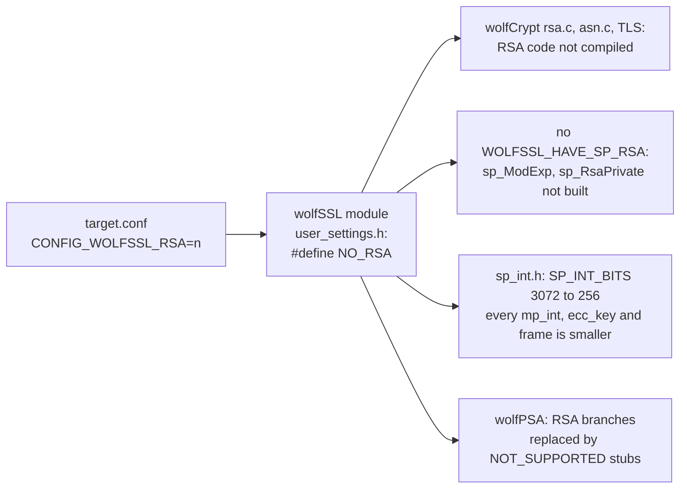
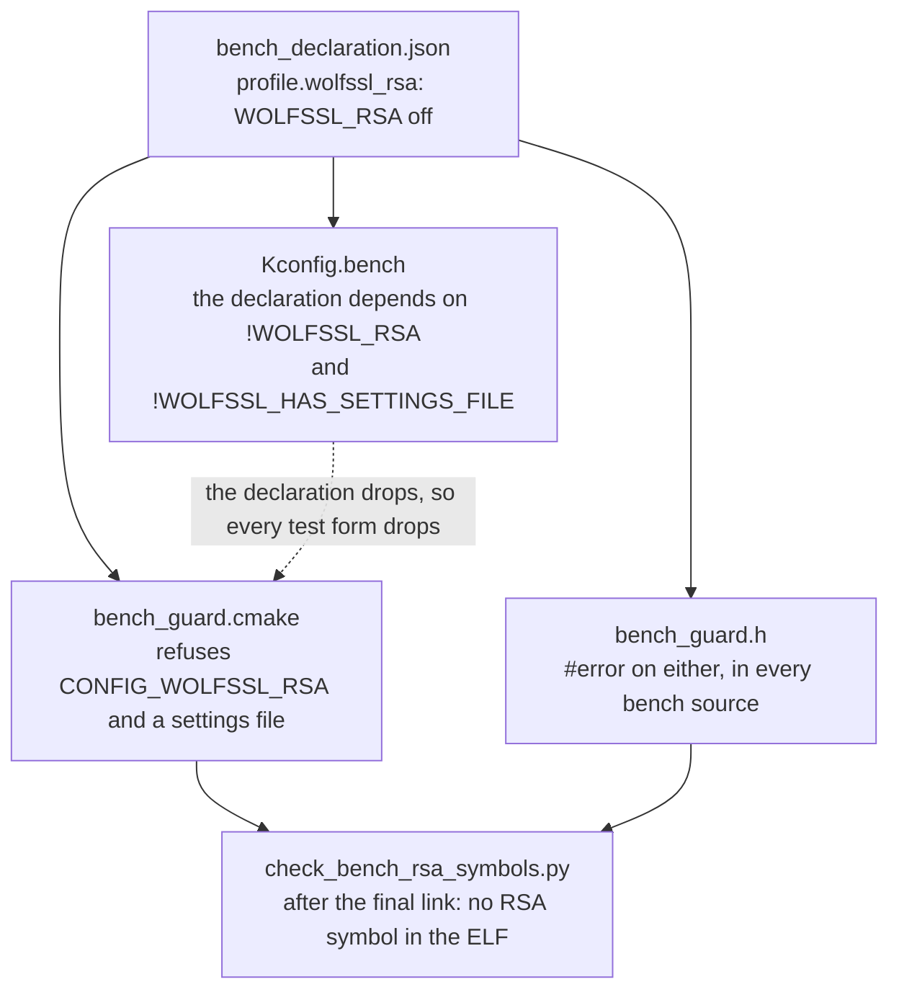

# RSA trimmed from the RT1060-EVKB bench image (row C9, decision D11)

Row C9 of stage 2 of the [RT1060-EVKB bench image](rt1060-management-image-feasibility.md#code-changes-and-their-order). Owner decision D11 (2026-11-08) asked to "also trim RSA": the linked bench image held RSA code (`sp_ModExp_3072`, `psa_asymmetric_generate_key_rsa`) that comes from the wolfSSL module's defaults and that the declared profile never uses. The declared profile is TLS 1.3 with P-256, SSH with Ed25519 and `ecdsa-sha2-nistp256`, PBKDF2 login, SFTP, and ECDSA and Ed25519 stored keys.

**Everything here is a compile and link for `mimxrt1060_evk@B//qspi`, a Host script, or a `native_sim` run. Nothing ran on a board. The Flash figures are the linker's. The stack figures are a static estimate, not a measurement.**

## Result

| Question | Answer |
| --- | --- |
| What is the change? | **One line in the bench's `target.conf`: `CONFIG_WOLFSSL_RSA=n`.** The wolfSSL module turns that into `NO_RSA`, which drops wolfCrypt's RSA, the single-precision RSA math, the RSA parts of wolfSSL's TLS, and wolfPSA's RSA. No module, Zephyr file or other composition is edited. |
| Is it the smallest and safest change? | Yes, see [the options](#the-setting-and-the-options-that-were-not-taken): it is one module option, the module does the rest, and a call into what it removes is a compile error. |
| What does it save? | **Flash 596,696 B to 561,340 B: 35,356 B less (5.9 %).** wolfSSL 33,181 B, wolfPSA 2,019 B, application objects 353 B. Static RAM 1,365,804 B to 1,365,740 B (64 B): the heap arena and the stacks are configuration and did not change. [Numbers](#before-and-after). |
| What is gone? | `rsa.c` and `wolfmath.c` as objects, 147 symbols with an RSA name (20,012 B), 65 more that only RSA used or that were inlined with them (the big-number routines, prime tests, PSS and PKCS#1 helpers), and 4 new ones. Five RSA-named symbols stay, by design. [Symbols](#what-disappears). |
| What can the code still call? | The generic PSA entry points (`psa_generate_key`, `psa_import_key`, `psa_sign_hash`), which answer an RSA key type with an explicit error. **Every wolfCrypt RSA function is gone, and a call to one does not compile.** Crux code asks for no RSA type. [Callable](#what-the-code-can-still-call). |
| Does the profile still work? | `native_sim`, built with the trim: the integrated image (HTTPS, the command line over SSH, SFTP, the stored keys and PBKDF2 login) passed all 86 checks of its driver, and the Wolf entropy test passed in all four variants. A target build links and passes the new symbol check. **Not run on a board.** [Checks](#checks). |
| Is there a side effect? | **Yes, a large one, and a good one.** Without RSA the single-precision big-number type shrinks from 3,072 bits to 256 bits, so every `ecc_key` and its frames shrink with it. The static stack chains drop by 5 to 9 KB, and the main thread's chain no longer runs along an RSA key generation: **21,200 B to 3,320 B**. [Stacks](#stack-chains). |
| Can RSA come back unnoticed? | No. The setting is refused at the Kconfig, CMake and C levels of the bench guards, a settings file that would hide it is refused, and the linked image is checked for RSA code after the link. [Guards](#guards). |

## The setting and the options that were not taken



| Option | What it does | Taken? |
| --- | --- | --- |
| **`CONFIG_WOLFSSL_RSA=n` in the bench `target.conf`** | The module's own switch (`zephyr/Kconfig:213`, default `y`). `user_settings.h:369-386` defines `NO_RSA` for `n`, and the rest of the module and wolfPSA read `NO_RSA`. Nothing selects the option (no `select` or `imply` in wolfSSL, wolfSSH or wolfPSA). The resolved configuration differs from the untrimmed build in this one line and no other. | **Yes** |
| Trim only the single-precision RSA sizes (`WOLFSSL_SP_NO_2048`, `WOLFSSL_SP_NO_3072`) | Those lines are comments inside the module's `user_settings.h`, which is a read-only input. The Kconfig has no option for them. RSA itself would stay. | No: cannot be set from this repository, and it removes less |
| A wolfSSL settings file (`CONFIG_WOLFSSL_SETTINGS_FILE`) | Would let this repository write `NO_RSA`. The patched TLS socket backend rejects it, and every module option depends on there being none, so it would hide whether RSA is built. | No, and now refused by the guard |
| Drop the `PSA_WANT_*` RSA symbols | wolfPSA derives its RSA support from `NO_RSA`, not from these. The Mbed profile's symbols do not apply on the Wolf profile. | No effect on this image |
| Edit the module's `user_settings.h` or wolfPSA | Forbidden: the module trees are read-only inputs. | No |
| Leave RSA on and rely on `--gc-sections` | RSA code is reachable from the generic PSA key functions and from wolfSSL's TLS code, so the linker keeps it. The baseline shows it: it was in the image. | No |

## Before and after

Both images are the bench image built from the same tree apart from this change: `origin/main` at `4794f4dd` (before), and this branch (after). One build at a time, in `crux-pilot-devcontainer:local`, on the read-only patched Zephyr copy and the read-only module trees of the C1 build. The configure step shows no Kconfig warning, so the assignment was honoured. [Evidence](evidence/rt1060-management-image-feasibility/trim-rsa-c9/README.md).

| Item | Before | After | Difference |
| --- | ---: | ---: | ---: |
| `FLASH` of the linker's report | 596,696 B (7.11 %) | **561,340 B (6.69 %)** | **-35,356 B** |
| `size` text, data, bss | 592,324 B, 4,356 B, 1,361,414 B | 557,000 B, 4,324 B, 1,361,414 B | -35,324 B, -32 B, 0 B |
| `RAM` of the linker's report (SDRAM) | 1,365,804 B | 1,365,740 B | -64 B |
| Flash in input sections, from the link map | 603,226 B | 567,673 B | -35,553 B |
| wolfSSL (TLS, wolfCrypt) | 284,477 B | 251,296 B | -33,181 B |
| wolfPSA | 21,224 B | 19,205 B | -2,019 B |
| Application objects (`libapp.a`) | 144,506 B | 144,153 B | -353 B |
| Objects in the link map | 360 | 358 | `rsa.c.obj` and `wolfmath.c.obj` gone |
| Symbols | 4,303 | 4,095 | 212 gone (31,483 B), 4 new (321 B) |
| `CONFIG_WOLFSSL_RSA` | `y` | not set | the only line of the configuration that differs |
| `check_bench_rsa_symbols.py` on the ELF | 149 symbols refused | **none refused** | |

The earlier stage 0 figures (601,172 B) are of an earlier tree. The rows C1 to C5 changed the image since, so the comparison here is between two builds of today's tree, not with those figures.

By object, the largest changes of the link map:

| Object | Before | After | Difference |
| --- | ---: | ---: | ---: |
| wolfSSL `sp_c32.c` (single-precision math) | 17,258 B | 6,606 B | -10,652 B |
| wolfSSL `rsa.c` | 6,574 B | gone | -6,574 B |
| wolfSSL `sp_int.c` (big-number routines) | 7,314 B | 1,070 B | -6,244 B |
| wolfSSL `internal.c` (TLS) | 46,852 B | 42,557 B | -4,295 B |
| wolfSSL `asn.c` | 28,302 B | 24,944 B | -3,358 B |
| wolfPSA `psa_key_storage.c` | 5,181 B | 4,265 B | -916 B |
| wolfPSA `psa_rsa.c` | 902 B | 14 B | -888 B |
| wolfSSL `tls13.c` | 18,652 B | 17,980 B | -672 B |
| wolfSSL `ssl.c`, `keys.c`, `signature.c`, `tls.c`, `ecc.c`, `hash.c`, `wolfmath.c` | 38,000 B | 36,800 B | about -1,200 B |
| `crux_ssh_sftp.c` and wolfSSH `internal.c` in the application | 46,761 B | 46,420 B | -341 B (not traced; the headers see the new settings) |

The numbers are a reading of the link map, which is not the linker's own report: they differ from `size` by 197 B (padding and sections the map does not own).

## What disappears

| Kind | What | Size |
| --- | --- | ---: |
| Key generation | `wc_MakeRsaKey`, `psa_asymmetric_generate_key_rsa`, `_CheckProbablePrime`, and the prime tests `sp_prime_is_prime_ex`, `sp_prime_miller_rabin` | 964 B, 236 B, 312 B, 540 B, 280 B |
| Sign | `wc_RsaPSS_Sign*`, `RsaSign`, `wc_RsaFunction_ex`, `RsaPad_OAEP`, `sp_RsaPrivate_2048` and `_3072`, `psa_asymmetric_sign_rsa` (652 B to a 14 B stub) | |
| Verify | `VerifyRsaSign`, `wc_RsaPSS_CheckPadding_ex2`, `RsaFunctionCheckIn`, `sp_RsaPublic_2048` and `_3072` | |
| Decode | `wc_RsaPrivateKeyDecode`, `_RsaPrivateKeyDecode`, `wc_RsaPublicKeyDecode_ex`, `DecodeRsaPssParams`, `SetRsaPublicKey`, `wc_RsaKeyToDer`, and `CreateRSAEncodedSig` with the PKCS#1 `digestInfoASN` | |
| Single-precision math | `sp_ModExp_1024`, `_1536`, `_2048`, `_3072`, the 2048-bit and 3072-bit families (`sp_2048_*`, `sp_3072_*`: multiply, square, divide, Montgomery reduction, 36, 53, 72 and 106 words), `sp_exptmod*`, `sp_invmod`, `sp_gcd`, `sp_div`, `sp_mulmod`, `sp_primes` | |
| TLS | RSA-PSS in TLS 1.3 (`TLSX_SignatureAlgorithms_MapPss`, `ConvertHashPss`), the RSA cipher suites and signature algorithms in `InitSuites`, `SendServerKeyExchange`, `SendCertificateVerify` | |
| Total | **147 symbols with an RSA name, 20,012 B. 65 without one, 11,471 B** (the big-number routines, DigestInfo and PSS helpers, and static functions that the compiler had inlined with them, such as `DoServerKeyExchange`, 1,408 B, and `DoCertificateVerify`, 840 B, which are now inside `DoHandShakeMsgType`, +1,072 B). The 65 are counted as gone because a symbol listing cannot tell inlining from removal. The size, not the count, is the result. | 31,483 B, less 321 B new |

The full lists are in [`symbol-diff.txt`](evidence/rt1060-management-image-feasibility/trim-rsa-c9/build/symbol-diff.txt) and [`map-diff.txt`](evidence/rt1060-management-image-feasibility/trim-rsa-c9/build/map-diff.txt).

**Five symbols with RSA in their name stay, and are allowed by name, kind and size** (`check_bench_rsa_symbols.py`):

| Symbol | Why it stays | Size |
| --- | --- | ---: |
| `psa_asymmetric_sign_rsa` | wolfPSA's `NO_RSA` stub: it returns `PSA_ERROR_NOT_SUPPORTED` and writes a zero length. The verify, encrypt and decrypt stubs are not linked. | 14 B (the real function: 652 B) |
| `BEGIN_RSA_PRIV`, `BEGIN_RSA_PUB`, `END_RSA_PRIV`, `END_RSA_PUB` | wolfSSL's PEM label strings, constants of `asn.c` that its PEM code lists for every key type | 29 to 32 B each, read-only data |

## What the code can still call

| What | After the trim | Never silent |
| --- | --- | --- |
| Any wolfCrypt RSA function or type: `RsaKey`, `wc_InitRsaKey`, `wc_MakeRsaKey`, `wc_Rsa*` | `rsa.h` is guarded by `NO_RSA`, so **the declarations are gone and a caller does not compile** (`use of undeclared identifier 'RsaKey'`, `call to undeclared function 'wc_InitRsaKey'`). `rsa.c` compiles to no code. If a caller declared the function itself, the link fails: nothing defines it. | Compile or link error. Host probe: [`probe-no-rsa.txt`](evidence/rt1060-management-image-feasibility/trim-rsa-c9/host/probe-no-rsa.txt) |
| `psa_generate_key` with an RSA key pair type | Still linked, because it is generic. It returns `PSA_ERROR_NOT_SUPPORTED` (`psa_key_storage.c`, the `#else` of the RSA branch). | Explicit error |
| `psa_sign_hash`, `psa_verify_hash`, `psa_asymmetric_encrypt` and `_decrypt` with an RSA key | The `NO_RSA` stubs of `psa_rsa.c` answer `PSA_ERROR_NOT_SUPPORTED` and write a zero output length. | Explicit error |
| `psa_import_key` with an RSA type | The key size cannot be inferred and the import is refused with an error (`wolfpsa_infer_key_bits` ends in `PSA_ERROR_INVALID_ARGUMENT` for a type it has no branch for). Read from source, not run. | Explicit error |
| Crux code | It asks for AES, ECC `secp_r1`, ECC twisted Edwards (Ed25519) and HMAC keys only (`credential_psa.c`, `tls_certificate_psa.c`, `access_psa.c`). **No RSA key type is requested anywhere**, and wolfSSH already refuses RSA (`WOLFSSH_NO_RSA`, with an `#error` in `crux_ssh_wolf_provider.c` if it is lifted). | |
| TLS peers | wolfSSL no longer offers or accepts RSA cipher suites, signature algorithms or certificates. The listener's key is P-256, so RSA suites were never usable with its certificate, and a client that offered only RSA cannot have connected before either. A peer certificate with an RSA key fails to parse with an error. Not run. | Explicit error |
| The stored key decode of Crux Access (`device_key_import`, `psa_import_key`) | The stage 0 chain `psa_import_key`, `wolfpsa_infer_key_bits`, `wc_RsaPrivateKeyDecode` was a static artefact: `wolfpsa_infer_key_bits` branches on the key type and the stored keys are AES and ECC. It is gone, and the chain with it. | |

## Stack chains

The stage 0 script (`commands/callgraph.py`) was run on both ELFs with the same roots, so that the two columns compare. It follows direct calls only, counts a tail branch as a nested call, and merges functions that have one name. After the trim two functions named `ReceiveData` (wolfSSL's global one and wolfSSH's static one) are merged and give the SSH chains a false path through a TLS call. A second script, [`callgraph_by_address.py`](evidence/rt1060-management-image-feasibility/trim-rsa-c9/commands/callgraph_by_address.py), keys each function by its address. On the untrimmed image the two scripts agree for every root that matters here. The by-address column is the one to read for the SSH chains after.

| Root | Configured stack | Before (name) | After (name) | After (address) | What changed |
| --- | ---: | ---: | ---: | ---: | --- |
| `main` | 16,384 B | 21,200 B | 3,320 B | 3,320 B | **Was along `crux_credential_key_ensure`, `psa_generate_key`, `psa_asymmetric_generate_key_rsa`, `wc_MakeRsaKey`**. Now `psa_export_public_key` and the P-256 public key (`wc_ecc_make_pub_ex`). |
| `crux_native_management_start`, `crux_tls_certificate_start`, `crux_credential_key_ensure` | (main) | 21,008 B, 21,008 B, 20,936 B | 3,128 B, 3,128 B, 3,056 B | same | Same path, same reason |
| `crux_credential_start` | (main) | 8,276 B | 1,040 B | 1,040 B | Was `psa_import_key`, `wc_RsaPrivateKeyDecode`. Now `psa_hash_compute` |
| `web_session_work_once` (Crux worker threads, 4 of them) | 8,192 B | 10,364 B | 3,864 B | 3,864 B | **Over the configured stack before, along an RSA key decode. Now along the PBKDF2 derivation (`psa_key_derivation_output_bytes`, `wolfpsa_kdf_compute_output`).** |
| `crux_access_login_password` | (worker) | 9,604 B | 3,104 B | 3,104 B | Same |
| `SendTls13CertificateVerify` | (HTTP server) | 4,468 B | 2,268 B | 2,268 B | Was `RsaSign`, `sp_RsaPrivate_3072`. Now `EccSign`, `sp_ecc_sign_256`. **This is the path a P-256 certificate takes.** |
| `DoTls13ClientHello` | (HTTP server) | 3,656 B | 2,336 B | 2,336 B | The P-256 key share check |
| `wolfSSL_accept` | 8,192 B (since C1) | 10,812 B | 5,280 B | 5,336 B | Along the client certificate and CA path (`ProcessPeerCerts`, `AddCA`), which the listener does not take (no client authentication) |
| `wolfSSH_worker` | 16,384 B | 13,336 B | 5,672 B | **4,672 B** | Was the key exchange (`SendKexDhReply`, frame 6,692 B). Now the public key user authentication (`DoUserAuthRequestPublicKey`, an ECDSA verify). |
| `DoKexDhInit`, `SendKexDhReply`, `DoUserAuthRequestPublicKey` | (SSH worker) | 13,048 B, 13,000 B, 12,660 B | 3,456 B, 3,408 B, 4,384 B | same | |
| `crux_ssh_cli_exec`, `http_server_thread`, `wc_ed25519_sign_msg_ex`, `wc_ecc_sign_hash` and 9 more | | unchanged | unchanged | | No RSA on these paths |

Why the SSH and TLS chains fell although RSA is not on them: with RSA and Diffie-Hellman off, wolfSSL sizes its single-precision big-number type (`sp_int`) for the largest curve only. `sp_int.h:513-514` gives `SP_INT_BITS` 256 for P-256 and `sp_int.h:487-488` gave 3,072 with RSA on. Every `mp_int`, every `ecc_key` and every ECC frame is built from it, so a frame that held several 3,072-bit numbers (`SendKexDhReply`, 6,692 B) now holds 256-bit ones. The same shrink applies on the heap, to every `ecc_key` that wolfSSL, wolfSSH and wolfPSA allocate. **Neither the heap nor the stacks were measured**: the arena (524,288 B) and the stack sizes are not changed here, because no board run says what is safe to take.

What this changes for the earlier rows: the [stage 0 reading](rt1060-management-image-feasibility.md#thread-stacks) that the SSH worker had "about 3 KB left" and that the Crux worker threads were over their stack no longer holds by the static estimate. The estimate is a heuristic, and a board run with the C2 report still has to read the watermarks. The HTTP server thread keeps its 8,192 B.

## Guards

The setting is a profile restriction of the bench image, so it is in the declaration as `profile.wolfssl_rsa` (`bench_declaration.json`) and the three guard levels of C1 refuse it being on. A fourth check looks at the outcome.



| Level | What it refuses | How it is broken in `check_bench_guard.py` |
| --- | --- | --- |
| Kconfig (`Kconfig.bench`) | `CONFIG_WOLFSSL_RSA=y` or a wolfSSL settings file: the declaration drops to `n`, and so does every test form (two `depends on` lines, so that each can be removed by a mutant) | A case for each, with Kconfiglib over a stub |
| CMake (`bench_guard.cmake`, step 5b) | The same two, with the reasons "The bench image has no RSA (D11)" and "takes wolfSSL's settings from the module's Kconfig options only". The manifest records `wolfssl_profile`. | A case for each in script mode |
| C (`bench_guard.h`) | The same two, in every source of the image | A case for each, compiled |
| Linked image (`check_bench_rsa_symbols.py`) | A defined symbol whose name is RSA code or the single-precision RSA and DH math (`Rsa`, `RSA`, `_rsa`, `sp_ModExp_`, `sp_RsaPrivate_`, `sp_2048_`, `sp_3072_`, `sp_4096_`), except the five allowed ones by kind and size. A missing image, an `nm` that fails and an image with no symbols exit 2: **never a pass**. It runs as a custom target after `zephyr_final`, so a build that brings RSA back fails. | `tests/build/test_management_bench_rsa_symbols.py` builds objects with the host compiler and a stand-in `nm`, and breaks the script in a copy |

Every existing bench guard stays: no refusal, case or mutant was removed, and the new cases and mutants were added beside them. The mutants of the guard script found the two new CMake refusals, the two `#error` lines and the two `depends on` lines on their own, because the script derives its mutants from the files.

Where the guards do not reach: a different route that makes RSA code reachable **and** still links (for example another source that carries RSA code under another name) is caught only if the name matches the patterns, which are the names that wolfCrypt, wolfPSA and the single-precision math use. The patterns are a reading of today's link map.

## Checks

Who ran what: the author ran everything below, on the host, in the Dev Container or as `native_sim`. The independent review and CI are recorded in the pull request. The evidence for each row is in [`evidence/.../trim-rsa-c9/`](evidence/rt1060-management-image-feasibility/trim-rsa-c9/README.md).

| Check | Result |
| --- | --- |
| **Red first.** `check_bench_guard.py` with the new cases and no guard | 15 failures: neither CMake nor C nor Kconfig refused RSA on or a settings file ([output](evidence/rt1060-management-image-feasibility/trim-rsa-c9/host/check_bench_guard-red.txt)). `test_management_bench_rsa_symbols.py` and the declaration test failed too (the script and the setting did not exist). |
| `check_bench_guard.py --verbose`, green | CMake, C and Kconfig levels ok, **63 of 63 mutants killed** (57 of 57 on `origin/main`: the six new ones are the two CMake refusals, the two `#error` lines and the two `depends on` lines) |
| `tests/build/test_management_bench_declaration.py`, `test_management_target_lists.py`, `test_management_bench_rsa_symbols.py` | 18 tests pass. The symbol check's own mutants (each pattern line, each allowance line, and the rules for kind, size, weak and undefined symbols) are all killed. |
| `python3 -m unittest discover -s tests/build` on the Mac host | 58 failures and 6 errors **on `origin/main` and on this branch alike, the same 64 tests**: they need the Linux toolchain and the Zephyr workspace. The tests of this change are not among them. CI runs this suite on Linux. |
| Target build, before and after, `mimxrt1060_evk@B//qspi` | Both link. After: the symbol check ran as part of the build and passed (5,547 defined symbols). [Numbers](#before-and-after). A first build of the after tree stopped at that check, which named the five leftovers (`psa_asymmetric_sign_rsa` and four PEM labels): that is why they are allowed by kind and size. |
| The same symbol check on the untrimmed ELF | 149 symbols refused |
| `native_sim`, `scripts/test-wolf-entropy.sh all`, unmodified | `runtime`, `init-fails`, `fallback` run, `guard` refuses to compile, as designed. `CONFIG_WOLFSSL_RSA=y` in each (the default). |
| The same script with `-DCONFIG_WOLFSSL_RSA=n` added by one `sed` (recorded in `script.diff`) | The same result in all four variants, with `CONFIG_WOLFSSL_RSA` not set in each resolved configuration |
| `native_sim`, `scripts/test-ssh-integrated.sh all`, with the image built with `CONFIG_WOLFSSL_RSA=n` (the script's own hook `CRUX_SSH_TEST_EXTRA_CONF`) | **0 failures in 86 checks**: HTTPS login, `ssh` with an Ed25519 key and CLI commands, `sftp` upload and download, the session limits, the listeners together, the host key kept across a restart, **and "ssh: an RSA key is refused"**. The symbol check on that `zephyr.exe`: none. The Zephyr copy was the C1 build's patched one, read-only, not a new one. An unmodified run of the same script was not made. |
| Host probe of wolfCrypt's own headers and `rsa.c` with and without `NO_RSA` | With it a caller of `wc_InitRsaKey` and `wc_MakeRsaKey` does not compile, and `rsa.c` compiles to no symbol ([output](evidence/rt1060-management-image-feasibility/trim-rsa-c9/host/probe-no-rsa.txt)) |
| `scripts/check-ssh-boundaries.py`, `check-native-interfaces.py`, `check-mgmt-services-boundary.py` | Pass |
| `clang-format` 18 on the one C file changed (`bench_guard.h`), in the Dev Container | Passes |
| Documentation link check (`scripts/check_docs.py`, lychee) | **Not run locally**: it needs a pinned download that was not approved. The relative links and anchors of the three new or changed documents were checked by a script and resolve. CI runs the check. |
| **Other compositions unchanged** | Three ways. (1) Every file of the change is in `tests/zephyr/management_rt1060_compile/` (the bench's own files), `tests/build/` (new and extended tests) or `docs/`: no component, native composition, module, script or shared configuration file is touched, and `CONFIG_WOLFSSL_RSA` and the new Kconfig lines exist only in the bench's `Kconfig.bench`. (2) A non-bench composition for the same board, `tests/zephyr/ssh_provider` with `rt1060.conf` (wolfSSL and wolfSSH, RSA on), built from `origin/main` and from this branch: **the two `zephyr.bin` have the same SHA-256**, Flash 300,528 B in both, `CONFIG_WOLFSSL_RSA=y` in both, the symbol tables and the resolved configurations are identical. (3) The two Wolf-profile `native_sim` scripts ran unmodified (above). |
| `scripts/test-psa-crypto.sh host tf-psa-crypto` and the other suites of the `psa-crypto` and `host` workflows | **Not run locally.** They build the Mbed profile and no file of this change, and CI runs them on the pull request. |
| Not run | A board, a handshake or login on the target image, the Mbed profile, the microSD form of the bench |

## Not covered

| Item | Why |
| --- | --- |
| Anything on a board | No hardware in stage 2 |
| A TLS handshake, an SSH login or a login on the target image | Not run. `native_sim` runs the same sources on a 64-bit host with 64-bit single-precision words, where the target uses the 32-bit words of `sp_c32.c`. The code that the trim changes is the same, but the word size is not. |
| Stack and heap use on the target | Static estimate only. The chains above overstate some paths and are no bound. |
| That an RSA peer, certificate or key is refused at run time | Read from source, not run. The profile does not use RSA, so nothing in the declared use depends on it. |
| `psa_import_key` with an RSA type | Read from source only |
| Why `crux_ssh_sftp.c` and wolfSSH's `internal.c` changed by 341 B in all | Not traced: they are compiled with the trimmed settings |
| Other compositions | Unchanged by construction: see [the check](#checks) |
| The CI workflows | `.github/` is protected and not changed |

## Decisions for review

| # | Decision | Why |
| --- | --- | --- |
| C9-1 | The setting is in the bench `target.conf`, not in a profile file shared with other images | "Do not touch non-bench images": a shared file would change every Wolf image and the native tests that exercise RSA rejection |
| C9-2 | `CONFIG_WOLFSSL_RSA` and `CONFIG_WOLFSSL_HAS_SETTINGS_FILE` are refused by the guards, not only set | A guard that only the file sets is a default that a later edit can remove silently |
| C9-3 | A fourth check on the linked image, beside the three levels | A module update or another definition can bring RSA back with the option off. The three levels see the option, not the result. |
| C9-4 | Five RSA-named leftovers are allowed by name, kind and size, and the allowance is part of the script and its tests | They are a 14 B stub and four label strings. Allowing the name alone would let the real function return under it. |
| C9-5 | No stack size, arena or network buffer is changed | The shrink is a static estimate, and the C2 report needs a board run to say what is safe. C6 owns the buffer counts. |
| C9-6 | The static chains were also recomputed by address | The name-keyed script merges two functions named `ReceiveData` and overstates the SSH chains after the trim. The stage 0 script and its evidence are unchanged. |

## Follow-up

| Item | Who |
| --- | --- |
| Read the stack watermarks and the heap peak with the C2 report on the board run, and decide then whether the SSH worker's 16,384 B, the Crux worker threads' 8,192 B or the arena can be smaller | The board run, after the owner's approval |
| Record the new Flash figure in the image manifest of C8 | C8 |
| The same trim for the other Wolf images, if the owner wants it | A separate decision: D11 covers the bench image |

## Reproduce

Host checks, on any host with `cmake`, a C compiler and Python 3:

```bash
python3 tests/zephyr/management_rt1060_compile/check_bench_guard.py --verbose
python3 -m unittest tests/build/test_management_bench_declaration.py tests/build/test_management_bench_rsa_symbols.py
```

The target build is the C3 build with the bench's password file (`CRUX_BENCH_PASSWORD_FILE`, outside the repository). The scripts that ran are in [`commands/`](evidence/rt1060-management-image-feasibility/trim-rsa-c9/commands/): `c9_build.sh` (configure, build, `size`, `nm`, the chains), `c9_native.sh` (the `native_sim` steps), `c9_post.sh` (the chains by address), the three `run_*` wrappers that take the build lock and start the container, and the three analysis scripts (`map_diff.py`, `symbol_diff.py`, `callgraph_by_address.py`).
