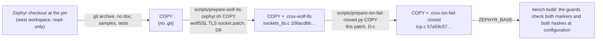

# TCP initial sequence number that fails closed (row C11, decision D-c)

Row C11 of stage 2 of the [RT1060-EVKB bench image](rt1060-management-image-feasibility.md). It closes the follow-up of [row C5](rt1060-wolf-entropy.md#follow-up): Zephyr's `tcp_init_isn` ignores a failed `sys_csrand_get`.
Refs #183.

**Everything here ran on the Host, on `native_sim`, or as a compile and link for `mimxrt1060_evk@B//qspi`. Nothing ran on a board.**

## The owner's decision

> Owner, 2026-11-09, in the session that manages stage 2 of the bench image: "1-8까지 너의 추천대로 진행해줘". The recommendation for D-c was: **patch** the bench image's build-local Zephyr copy, not a check in the composition and not acceptance.

Decision D-c was open in [the image plan](rt1060-bench-image-plan.md#what-blocks-the-plan-today) and in [`board-image-profiles.md`](board-image-profiles.md). This record is its implementation.

## Result

| Question | Answer | Evidence |
| --- | --- | --- |
| Does the pinned Zephyr keep a zero key after a failed read? | **Yes, but that is not the whole finding.** The read is ignored and the key stays zero, as C5 said. In addition the pinned code **never uses the key**: it asks PSA for a SHA-256 digest (32 bytes) into a 16-byte buffer, PSA answers `PSA_ERROR_BUFFER_TOO_SMALL` for both providers (Mbed TLS and wolfPSA), and that answer is ignored too. The initial sequence number is then the uptime plus uninitialised stack. The zero key is **latent**: it is what a fix of the buffer alone would expose. | [The two defects](#the-two-defects); the red run's `isn=unkeyed` even after a read that works |
| What does the patch do? | A missing key or a failed hash makes `tcp_init_isn` return an error. A SYN to a listening port gets a **RST**; `net_context_connect()` returns **`-EIO`** and sends no SYN. The next attempt reads the key again. When the read works, the number is the hash of the key and the tuple plus the uptime, as the code means. | [Behaviour](#what-the-stack-does-now) |
| Is it unchanged when the read succeeds? | **Yes** for the formula and for the call order. The only change is that the hash now succeeds. | [Patch](#the-patch) |
| Was it proved? | Three ways, below. | [Proof](#proof) |
| Does it change the web, SSH or serial behaviour? | Only when the read fails: new TCP connections to the board are refused (HTTPS and SSH clients see a reset), established ones are untouched, the serial line and UDP do not use TCP. | [Behaviour](#what-the-stack-does-now) |

## The two defects

Both are in `subsys/net/ip/tcp.c` of Zephyr v4.4.2 (`dccb0959`), SHA-256 of the file `393b940e0d96adba9a0f7667c061b9e0e5d8d0ea2f49642e60f29ce1efdb7ad6`.

| # | At the pin | Consequence | Found by |
| --- | --- | --- | --- |
| 1 | `tcpv4_init_isn` and `tcpv6_init_isn` each call `sys_csrand_get(unique_key, sizeof(unique_key))` once, ignore its result and set `once = true` | After a failed read the 16-byte key stays all zero for the rest of the boot | C5's call-site scan; [C5 follow-up](rt1060-wolf-entropy.md#follow-up) |
| 2 | `uint8_t hash[16]; psa_hash_compute(PSA_ALG_SHA_256, …, hash, sizeof(hash), &hash_len);` and the result is ignored | A SHA-256 digest is 32 bytes. Mbed TLS PSA and wolfPSA (`psa_hash_finish`, `hash_size < expected_hash_size`) both return `PSA_ERROR_BUFFER_TOO_SMALL` and write nothing, so `hash` is uninitialised stack: **the sequence number is made from no key** | C11's native_sim red run, then read in the Mbed TLS and wolfPSA sources |

Defect 2 changes what the patch has to do. A check of the key alone, with the 16-byte buffer left, would have refused **every** connection
the moment it also checked the hash result, and without that check the key would still be unused. So the patch fixes both together.
The upstream status of either defect was not checked.

```mermaid
flowchart TD
    subgraph before["Pinned Zephyr"]
        b1["tcp_init_isn: first call"] --> b2["sys_csrand_get(key): result ignored, once = true"]
        b2 --> b3["psa_hash_compute(SHA-256, hash[16]): refused, result ignored"]
        b3 --> b4["ISN = uptime + uninitialised stack"]
        b4 --> b5["SYN-ACK or SYN is sent, whatever the read did"]
    end
    subgraph after["With the patch"]
        a1["tcp_init_isn"] --> a2{"key read before?"}
        a2 -- no --> a3["sys_csrand_get(local buffer)"]
        a3 -- failed --> a4["return the error, once stays false"]
        a3 -- ok --> a5["copy to unique_key, once = true"]
        a2 -- yes --> a6["psa_hash_compute(SHA-256, hash[32])"]
        a5 --> a6
        a6 -- failed --> a4
        a6 -- ok --> a7["ISN = hash of key and tuple + uptime"]
        a4 --> a8["passive: RST, no connection<br/>active: connect returns the error, no SYN"]
    end
```

## What the stack does now

| Path | Caller | Before | With the patch | Why it is safe |
| --- | --- | --- | --- | --- |
| Passive open (a SYN to a listening port) | `tcp_conn_new`, which `tcp_recv` calls | A SYN-ACK with a number from no key | The new context is released with `net_context_put`, `conn = NULL`, `goto err`. `tcp_recv` then sends a **RST** (`net_tcp_reply_rst`), and the drop is counted (`conndrop`) | The same three lines as a failed `net_context_bind` just above and a failed `net_conn_register` just below use at this point |
| Active open (`net_context_connect`) | `net_tcp_connect` | A SYN with a number from no key | `goto out` with the error, **before** `net_context_set_state(CONNECTING)`, the connection registration and the handshake. Nothing is sent, and the caller sees the negative error (`-EIO` from `sys_csrand_get`; `-EIO` for a failed hash) | The same exit as the earlier `-EINVAL` returns of the function, before any state is set |
| Another address family, `CONFIG_NET_TCP_ISN_RFC6528=n` | `tcp_init_isn` | `sys_rand32_get()` | Unchanged (`sys_rand32_get()`). The bench guards require the setting to be on, so the patch protects something | [Guards](#the-guards) |

| Effect on the bench image | With a failed key read |
| --- | --- |
| HTTPS (443) and SSH (22) clients | A new connection is reset. The listener stays up. The next SYN reads the key again, so a read that works later makes the next connection succeed |
| Connections that already exist | Untouched: they have their number |
| The serial line (the CRUX-ENTROPY and bench report lines) | Not TCP: unaffected. The entropy line of C5 already reports a failed first read at boot |
| UDP, ICMP | Not affected |
| The log | One `NET_ERR` per refusal ("Cannot read the key of the initial sequence number" and "No initial sequence number … refused") |

A refusal per SYN costs one read of 16 bytes from the TRNG, so a flood of SYNs against a failing TRNG repeats the failing read. That is the safe direction for the bench, and a board run will show whether the TRNG fails after a start at all.

## The patch

`patches/zephyr/zephyr-isn-fail-closed.patch`, SHA-256 `6ab0d074f3ddab826dd417b0fba10f1622f6ffeb006828b172d6313e8234aaa7`, one file, 86 lines added and 34 removed (most of it the two caller blocks, the key function and the changed signatures).

| Hunk | Change |
| --- | --- |
| New `tcp_isn_key_get()` | Reads the key into a **local** buffer, copies it into `unique_key` and sets `once` only after a successful read. A failed read, or a read racing another, never changes the key in use |
| `tcpv6_init_isn`, `tcpv4_init_isn` | Return `int` and the number through a pointer. The `once` blocks go (the key is read by `tcp_isn_key_get`). The digest buffer is `PSA_HASH_LENGTH(PSA_ALG_SHA_256)`, and a failed `psa_hash_compute` returns `-EIO` |
| `tcp_init_isn` | Returns `int`, calls `tcp_isn_key_get()` first. `sys_rand32_get()` for the no-RFC 6528 case, as before |
| The `#else` stubs | `tcp_isn_key_get()`, `tcpv4_init_isn(...)`, `tcpv6_init_isn(...)` expand to `(0)` |
| The two callers | The refusals of [the table above](#what-the-stack-does-now) |

Limits of the patch: `once` is a plain `static bool`, as it was (no memory barrier: single-core, as the bench image is). `psa_hash_compute` returns `PSA_ERROR_BAD_STATE` while PSA is not initialised, so a SYN before PSA's initialisation is refused too, which is the safe direction. The patch is not an upstream fix.

## How the copy is made

The copy is a build-local tree outside the repository. A copy that other sessions or an earlier run already use as a read-only input is **never changed in place**: make a new one.

| Step | Command | Checks |
| --- | --- | --- |
| 1 | `scripts/prepare-wolf-tls-zephyr.sh COPY` | The checkout is at the `west.yml` pin; the osp patch's SHA-256 `3d1cc030…`; `sockets_tls.c` SHA-256 `106acdbb…` |
| 2 | `scripts/prepare-isn-fail-closed.py COPY` | `COPY` is not a Git checkout; the patch file's SHA-256 `6ab0d074…`; `tcp.c` is the pinned file (`393b940e…`) before and `57a59c57…` after; a patched `tcp.c` without the marker is refused; a second run changes nothing |
| 3 | Build with `ZEPHYR_BASE=COPY` | `bench_guard.cmake` reads both markers (`<pin> <patch sha256>`) and both patched files' hashes from `bench_declaration.json`, and refuses a copy that has only the first |

The order is the TLS patch first. The two patches touch different files; step 2 would refuse a TLS patch that had touched `tcp.c`, because it checks the original's hash. The manifest of the build records both (`patched_zephyr` and `patched_zephyr.isn_fail_closed`).

**What whoever builds the bench image next must do.** The board image is built later from a pinned commit by the main session. Make a **new** copy with the two commands above (do not use a copy that only has the TLS patch: configuration refuses it), build from the pinned commit, and keep the manifest. A freeze that pins stock Zephyr records a tree that was not compiled ([blocker B2](rt1060-bench-image-plan.md)): it now has two patches to account for, and the plan's options for the copy apply to both.

### How this relates to the freeze design

[`rt1060-bench-freeze-and-capture-design.md`](rt1060-bench-freeze-and-capture-design.md) (merged as #373) proposes, for the later freeze of the copy, a declaration with an **ordered list** of patches and one marker that carries every patch's hash. Its finding F12 could not read the shape of this patch. Here it is: one file (`subsys/net/ip/tcp.c`), changed by this patch only and not by the TLS patch (the copy's `tcp.c` is the pinned file after the first patch, [evidence](evidence/rt1060-management-image-feasibility/isn-fail-closed-c11/copy/tls-copy-hashes.txt)), applied second.
This row does **not** migrate to that shape: it keeps the existing D8 keys and the marker `.crux-wolf-tls` exactly as they are, and adds a sibling block `patched_zephyr.isn_fail_closed` with its own marker `.crux-isn-fail-closed`, because extending the first marker would change a check that must stay as it is. Two markers are what the freeze design's single marker replaces; the migration is a rewrite of the declaration block and of two guard checks, and is the freeze row's to do ([decision 10](#decisions-for-review)).

## The guards

The existing guards keep every check. New checks, each with a case that fails without it and a mutant that is killed:

| Level | New check | Case that must be refused |
| --- | --- | --- |
| CMake (`bench_guard.cmake`, step 9b) | `.crux-isn-fail-closed` exists with `<pin> <patch sha256>`; `subsys/net/ip/tcp.c` has the declared hash; `CONFIG_NET_TCP_ISN_RFC6528` is set; `CONFIG_NET_TEST` and `CONFIG_NET_TEST_PROTOCOL` are not (they make the stack skip `tcp_init_isn`) | A copy without the marker or without `tcp.c`, a marker on another pin or with another patch hash, another `tcp.c`, no RFC 6528 setting, either test setting |
| C (`src/bench_guard.h`) | `#error` without `CONFIG_NET_TCP_ISN_RFC6528`, and with either test setting | The same three |
| Kconfig (`Kconfig.bench`) | `CRUX_MANAGEMENT_BENCH_IMAGE depends on NET_TCP_ISN_RFC6528` | The setting off: the declaration and every test form drop to `n` |
| Declaration | `patched_zephyr.isn_fail_closed`: decision, row, marker, patch name and hash, patched file, original and patched hashes, the required setting | `tests/build/test_management_bench_declaration.py` keeps it equal to the script, the patch file and `target.conf` |
| Manifest | The block `patched_zephyr.isn_fail_closed` and `CONFIG_NET_TCP_ISN_RFC6528` in `settings` | `check_manifest` in `check_bench_guard.py` |

`check_bench_guard.py` mutants: **127 of 127 killed**: the 104 of the earlier rows stay killed, and 23 are new (the new `message(FATAL_ERROR)` lines, and one weakening of each new comparison, condition and manifest line, in `bench_guard.cmake` and in `bench_guard.h`). The new cases were run first against the original guard files and all failed there ([red run](evidence/rt1060-management-image-feasibility/isn-fail-closed-c11/host/check-bench-guard-red-original-guards.txt))..

## Proof

### 1. The patch applies cleanly to the pinned tree, and every hash matches (Host, red first)

| Check | Result | Evidence |
| --- | --- | --- |
| `test_prepare.py`, before the script existed | Red: 10 of 10 errors | [`host/test-prepare-red-no-script.txt`](evidence/rt1060-management-image-feasibility/isn-fail-closed-c11/host/test-prepare-red-no-script.txt) |
| `test_prepare.py` with the patch and the script | Green: 10 of 10. The pinned `tcp.c` has the hash the patch is for; `git apply --check` and the apply give the declared result hash; the declaration, the script and the patch file agree; one changed byte in the source, a drifted patch, a Git checkout, and a patched file without its marker are all refused and leave the tree alone; a second run changes nothing; the result has the key check and the 32-byte digest and no call that ignores the read | [`host/test-prepare-green.txt`](evidence/rt1060-management-image-feasibility/isn-fail-closed-c11/host/test-prepare-green.txt) |
| The scripts on a real copy (Dev Container) | `prepare-wolf-tls-zephyr.sh` leaves `tcp.c` at `393b940e…`; `prepare-isn-fail-closed.py` makes it `57a59c57…` and writes the marker; a second run is `already prepared`; the workspace's Zephyr checkout is refused | [`copy/`](evidence/rt1060-management-image-feasibility/isn-fail-closed-c11/copy/prepare-isn.txt) |

### 2. A TCP connection attempt is refused when `sys_csrand_get` fails after the start (native_sim, red then green)

`tests/native/isn_fail_closed` builds Zephyr's real network stack on `native_sim` with a dummy interface, the real `CONFIG_HARDWARE_DEVICE_CS_GENERATOR` `sys_csrand_get()` over a test entropy device whose reads fail on request, and Mbed TLS PSA for the hash. The test starts with the device working (so PSA initialises, as after a good boot check), then (A) makes every read fail, injects a SYN from a peer and calls `net_context_connect`, then (B) makes the read work again and does both once more. It reads what the stack sends in the device's send function, and it classifies each sequence number as made from the key the device gave (**keyed**), from the all-zero key (**zero-key**), or from neither (**unkeyed**).
`scripts/test-isn-fail-closed.sh` runs it on the pinned tree and on a copy with the patch, and requires the first to fail and the second to pass.

| Phase | Path | Unpatched pinned tree (red) | Patched copy (green) |
| --- | --- | --- | --- |
| A, the read fails | SYN to a listening port | `SYN|ACK`, number **unkeyed** | **`RST|ACK`**, no connection accepted |
| A, the read fails | `net_context_connect` | returns `-EINPROGRESS` (-115), a **SYN is sent**, number **unkeyed** | returns **`-EIO` (-5)**, **nothing is sent** |
| B, the read works again | SYN to a listening port | `SYN|ACK`, number **unkeyed** | `SYN|ACK`, number **keyed** |
| B, the read works again | `net_context_connect` | SYN sent, number **unkeyed** | SYN sent, number **keyed** |

The red run is the finding of [the two defects](#the-two-defects): the pinned stack answers and connects with a failed read, and even with a working read it never makes the number from the key, because the hash is refused. **The red run does not show the zero key itself**: with defect 2 present the zero key is never reached (`zero-key` is a classification of the test that no run produced). The zero key is latent, and what the red run proves is that nothing refuses.
The green run shows the key check and the hash fix together: refusal when the read fails, recovery when it works, and a keyed number that equals the hash of the key and the tuple plus the uptime.

| Run | Exit | Evidence |
| --- | --- | --- |
| Unpatched | 1 (`PROJECT EXECUTION FAILED`; the script requires it) | [`native-sim/unpatched-run.txt`](evidence/rt1060-management-image-feasibility/isn-fail-closed-c11/native-sim/unpatched-run.txt) |
| Patched | 0 (`PROJECT EXECUTION SUCCESSFUL`) | [`native-sim/patched-run.txt`](evidence/rt1060-management-image-feasibility/isn-fail-closed-c11/native-sim/patched-run.txt) |

### 3. The target cross-build, the guards and the call sites in the ELF (Dev Container, compile and link only)

Two builds of the bench image for `mimxrt1060_evk@B//qspi` from clean detached checkouts, with a throwaway first-account password file made by C4's generator outside every repository (deleted afterwards), the C1 recipe (`-j2`, the Dev Container under emulation) and the same module pins.
**Before** is `origin/main` `52e894e8` on a copy with the TLS patch only. **After** is this branch (`e479e2de`, the code of `d4fcaa83`) on a copy with both patches.

| | Before | After |
| --- | --- | --- |
| The guards in the configure | passed | passed, including the new ones; the manifest records `patched_zephyr.isn_fail_closed` and `CONFIG_NET_TCP_ISN_RFC6528=y` |
| Flash (`text` + `data`) | 562,212 B (557,864 + 4,348) | **562,296 B** (557,948 + 4,348): **+84 B** |
| RAM (`data` + `bss`, all SDRAM) | 2,171,998 B (4,348 + 2,167,650) | 2,171,998 B: **unchanged** |
| `zephyr.bin` SHA-256 | `be4ff311…` | `f7b03a1c…` (the same in two runs of each) |
| Warnings | 4 (wolfSSH `wolfsftp.c`, wolfPSA `psa_key_storage.c`) | the same 4, none in `tcp.c` |
| C4's scan for the throwaway password | clean | clean |
| Negative control: the real configure of the after tree on the copy with the TLS patch only | | **refused**: `.crux-isn-fail-closed is missing` ([log](evidence/rt1060-management-image-feasibility/isn-fail-closed-c11/copy/control-tls-only-configure.log)) |

The call-site scan ([`call-sites.txt`](evidence/rt1060-management-image-feasibility/isn-fail-closed-c11/build/after/call-sites.txt)) lists the same functions before and after (`tcp_init_isn` is the one caller of `sys_csrand_get`). The disassembly of `tcp_init_isn` shows the difference:

| | Before ([`disasm`](evidence/rt1060-management-image-feasibility/isn-fail-closed-c11/build/before/disasm-tcp_init_isn.txt)) | After ([`disasm`](evidence/rt1060-management-image-feasibility/isn-fail-closed-c11/build/after/disasm-tcp_init_isn.txt)) |
| --- | --- | --- |
| After the call to `z_impl_sys_csrand_get` | `strb r5, [r4]` stores `once = 1` at once; `r0` is never read | `subs r4, r0, #0` and `blt` to the exit: the result is tested **before** the key is copied and `once` is set |
| Where the read goes | straight into `unique_key` | into a stack buffer (`add r0, sp, #40`), copied after a good result |
| Digest buffer for `psa_hash_compute` | `movs r3, #16` | `movs r3, #32` |
| After the call to `psa_hash_compute` | the result is dropped; the number is read from the buffer (`ldr r4, [sp, #12]`) | `mov r4, r0` and `cbnz r0`: a failed hash returns `-5` (`mvn.w r4, #4`, `-EIO`) and the number is written through the pointer only on success |

## Not covered

| Not covered | Why, and what covers it |
| --- | --- |
| A board | No board operation is allowed here. Whether a TRNG read fails **after** a successful start on the RT1060-EVKB is seen only on a board; this row only makes the stack safe if it does |
| wolfPSA at run time | `native_sim` uses Mbed TLS PSA (the optional Mbed group) for the hash. wolfPSA's `psa_hash_finish` returns `PSA_ERROR_BUFFER_TOO_SMALL` for a 16-byte buffer by its source (read, not run). The bench image **links** with it, and the disassembly shows the 32-byte buffer and the tested result |
| The board's CSPRNG path | The board's `sys_csrand_get` is `CONFIG_PSA_CSPRNG_GENERATOR` over wolfPSA; the native test uses `CONFIG_HARDWARE_DEVICE_CS_GENERATOR` over a test device. Both return a negative value on failure, and `tcp.c` only tests that. C5 shows the board's path fails with `-EIO` |
| IPv6 | The bench image has IPv6 off (a guard), and the native test too. The IPv6 functions are compiled (they sit in the same block) and have the same change; they were not run |
| Concurrency | `once` is a plain `static bool`, as upstream, with no memory barrier: a single core, as the bench image. Two first SYNs racing may both read the key, and the later write wins: the key is always a whole good key |
| A hash failure that is not a size | `PSA_ERROR_BAD_STATE` before PSA's initialisation also refuses (the safe direction) and is not exercised |
| The other random users | `sys_rand_get()` in `tcp_derive_rto`, `find_available_port` and `eth_nxp_enet_init` still falls back to the cycle counter when the TRNG fails ([C5](rt1060-wolf-entropy.md#every-place-that-could-fall-back)): not keys, and not changed here |
| The CI workflows | The new native test needs the optional west group (Mbed TLS) and a Linux container, and `.github` is protected: no workflow runs it. The guard script and the declaration test run where they ran before; `test_prepare.py` needs `ZEPHYR_BASE` |
| Upstream | Whether Zephyr has fixed the two defects after v4.4.2 was not checked. The patch is a build-local copy until it is |
| A freeze of the image | The plan's blocker B2 (a freeze that sees the copy) is not solved here: the copy has two patches now |

## Decisions for review

| # | Decision taken for lack of an answer | Why, and the other way |
| --- | --- | --- |
| 1 | **The patch file lives in `patches/zephyr/`**, which is not a protected path. The TLS patch is not in the repository at all (the scripts fetch it from its upstream by revision), so there was no existing in-repo place for "the patch beside it". `patches/zephyr/` already holds Crux's own patches of Zephyr files (the Mbed TLS entropy, the MDIO and the MMC corrections) with a README | A different place needs only a move and the three hashes' file name. Reported to the main session in the hand-over |
| 2 | **The scope grew to defect 2, the 16-byte digest buffer.** A check of the key alone would leave the key unused, and a check of the hash result with the old buffer would refuse every connection | Without it the task's goal (a failed read does not lead to a predictable number) is not met in a way the red run can show |
| 3 | A refused passive open is a **RST** and a refused connect returns the error of the read (`-EIO`), sending nothing | These are the stack's own exits for a failed bind and for the early errors of `net_tcp_connect`. Dropping the SYN silently is the other choice: it needs a different exit and leaves the peer waiting |
| 4 | The key is read again at **every** attempt until a read works, rather than latching the failure | A TRNG that works again is then used. The cost is one failing read per SYN |
| 5 | The guards also refuse `CONFIG_NET_TEST` and `CONFIG_NET_TEST_PROTOCOL` | Both make the stack skip `tcp_init_isn()`, so the patch would protect nothing. Neither is in the bench |
| 6 | The new script is `scripts/prepare-isn-fail-closed.py`, a new file, and it does **not** edit `prepare-wolf-tls-zephyr.sh`, which is on a protected path | The bench copy is made with two commands in a fixed order. A single script for both needs an approved edit of the protected one |
| 7 | The script refuses a Git checkout and changes the tree **in place** | A copy that other sessions use as a read-only input is never changed: the next copy is made new |
| 8 | The decision keeps the plan's label **D-c** and the declaration says `"row": "C11"`; the marker is `.crux-isn-fail-closed` | Names follow `.crux-wolf-tls` and the existing `D8` block |
| 9 | The native test classifies numbers by recomputing the hash. The passive path hashes with a port the stack chooses at random, so the test tries all 65,536 ports | The port is not observable from outside; the cost is a fraction of a second |
| 10 | **Two markers now, not the single extended marker of the freeze design (#373)** | The existing guard compares `.crux-wolf-tls` to one exact text and the task keeps the D8 entries and checks as they are. The freeze row can fold the two blocks into its ordered list |

Approvals needed: the owner's review of the PR and the independent review. A merge needs the owner's explicit authorisation (`AGENTS.md`).
