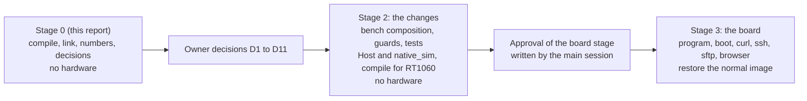
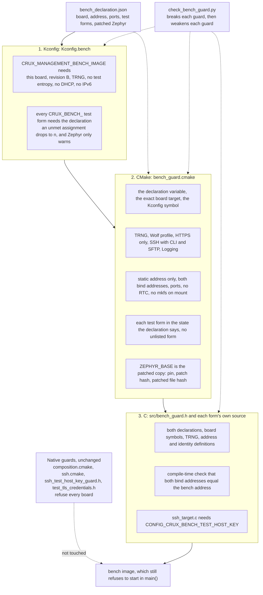
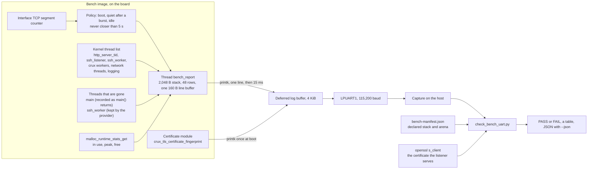
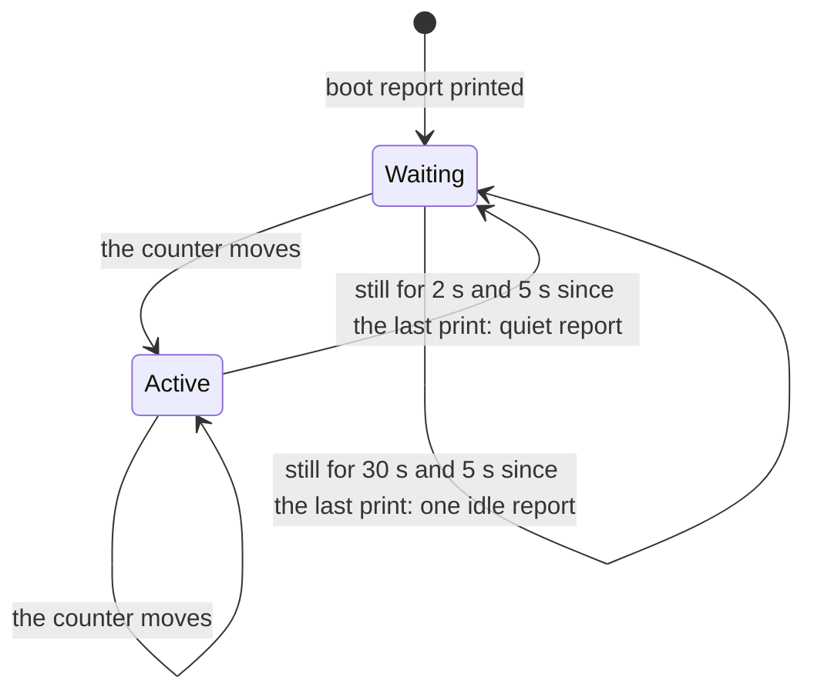
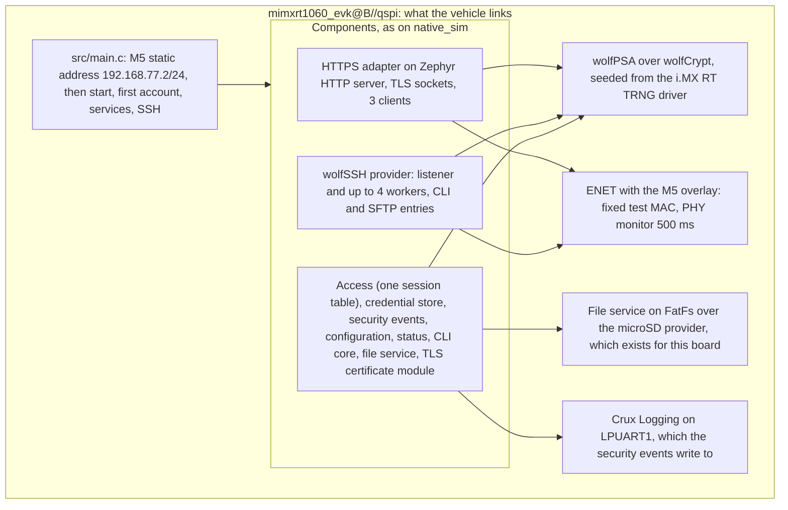

# The integrated management image on RT1060-EVKB: a build and feasibility report

Status: **stage 0 of putting the integrated management image on the real board** (merged, #344), **its stage 2 row C1** ([below](#stage-2-row-c1-the-bench-composition)) **and its row C2** ([the UART report](#stage-2-row-c2-the-uart-report)),
for review in a Draft PR. Refs #197. It authorises no hardware operation, and **nothing here ran on a board**: every result is a compile and link for
`mimxrt1060_evk@B//qspi`, a host script, a configure-only run, or a reading of source and of the linked image. The owner approved stage 0 in the working
session on 2026-11-08 ("0 단게 시작해") and took the decisions D1 to D11 the same day ([Owner decisions](#owner-decisions)). **Nothing here reads as an approval of a
board stage**: the image still refuses to start, and the approval documents are the main session's.

## Result

| Question | Answer |
| --- | --- |
| Can the integrated image (HTTPS web, the command line over SSH, SFTP) be built for RT1060-EVKB rev B on the Wolf profile? | **Yes, as a compile vehicle** that the existing native files could not give: `tests/zephyr/management_rt1060_compile`. It compiles and links with `-Werror` on Crux's own code, and a clean rebuild of the committed tree gave the same configuration and 80 B more Flash ([Build](#build)). It is not a product. It is a bootable QSPI image (the boot header must be there) that **refuses to start**, so that it cannot be run by mistake: [what it fakes](#what-the-vehicle-is-and-is-not). |
| Why not the native composition as it is? | It refuses a board at three places on purpose ([guards](#the-guards-the-native-composition-puts-in-the-way)). The vehicle does not edit or relax any of them. |
| Real size | **Flash 601,172 B of 8 MB (7.2 %), 601,252 B in the committed tree. RAM 833,708 B, all of it in the 32 MB SDRAM** (ITCM, DTCM and OCRAM hold nothing). [Numbers](#sizes-measured-on-the-target-build). |
| Biggest risks found | **The HTTP server thread's default 4,096 B stack** runs the TLS handshake, and a static estimate of one handshake path is 4,272 B: **the bench image has 8,192 B from C1** (owner's request, [below](#stage-2-row-c1-the-bench-composition)). **The SSH worker's 16,384 B** leaves about 3 KB over a static 13.3 KB key-exchange chain. Neither is measured on a target. [Stacks](#thread-stacks). |
| Ready for a board run? | **No.** The eleven owner decisions are taken (2026-11-08) and row C1 is done. Rows C2 to C9, the first account and the approval documents of the main session still come first. [What still blocks a board run](#what-still-blocks-a-board-run), [changes and order](#code-changes-and-their-order). |
| What did C2 change? | The bench image prints the stack watermark of every thread, the heap's in-use and peak, and the listener certificate's fingerprint (D4) on the UART, and a host script judges the capture, with a stated margin for the HTTP server thread's stack. [Stage 2, row C2](#stage-2-row-c2-the-uart-report). |
| What did C1 change? | The vehicle is now a **bench composition** under a declaration for RT1060-EVKB rev B, with guards at three levels, a host script that breaks each guard, a manifest, and listeners bound to the bench address. [Stage 2, row C1](#stage-2-row-c1-the-bench-composition). |



## Stage 2, row C1: the bench composition

Row C1 promotes the compile vehicle of stage 0 to a **bench composition**: the same components, under a declaration for RT1060-EVKB rev B and its bench, with guards that accept the test forms there
and nowhere else. It adds no hardware step. The directory is still `tests/zephyr/management_rt1060_compile`, because the evidence of stage 0 names that path. **The image still refuses to start**, and nothing in
C1 approves running it.

| Question | Answer |
| --- | --- |
| What is the declaration? | `tests/zephyr/management_rt1060_compile/bench_declaration.json`: the image identity `crux-mgmt-bench-rt1060-evkb-b`, the board `mimxrt1060_evk@B//qspi`, the bench address `192.168.77.2/24` (host `192.168.77.1`) on the dedicated link, the listener ports, the four test forms with their decisions, and the build-local Zephyr copy of D8. CMake, the host script, the unit test and the manifest all read this one file. |
| What do the guards allow? | The test host key form (D5) and no time source (D7), on that board, with the TRNG, on the Wolf profile, with both listeners bound to the bench address. Everything else is refused: [the list](#what-each-guard-refuses). |
| Did a native guard change? | **No.** `composition.cmake:13/17`, `ssh.cmake:16/20`, `ssh_test_host_key_guard.h:12` and `test_tls_credentials.h:10` are untouched and still refuse every board. |
| What else changed in product code? | One optional setting for each listener, **empty by default, which keeps every address as before**: `CONFIG_CRUX_WEB_BIND_ADDRESS` (the HTTPS adapter) and `CONFIG_CRUX_SSH_BIND_ADDRESS`, passed to the provider as the new field `crux_ssh_config_t.bind_address`. [Listeners](#listeners-d10). |
| Size | **Flash 601,004 B of 8 MB (7.16 %), RAM 837,804 B (SDRAM, 2.50 %)**, ITCM, DTCM and OCRAM empty. Flash is 248 B less than the stage 0 committed tree, and RAM 4,096 B more, which is the HTTP server stack at 8,192 B: [Build in C1](#build-in-c1). |
| Can it run? | **No.** [What still blocks a board run](#what-still-blocks-a-board-run). |

### The three levels of the bench guards

A build passes the Kconfig level first, then the CMake level at configuration, then the C level at every compile. The CMake level and the C level each refuse on their own, and the host script shows it. The Kconfig level only drops the assignment, because Zephyr warns and goes on, so the CMake level is what turns that into a refusal ([the configure-only breaks](#checks-and-controls)).



### What each guard refuses

| Setting that is broken | Kconfig | CMake | C |
| --- | :---: | :---: | :---: |
| No CMake declaration (`CRUX_MANAGEMENT_BENCH_IMAGE`), or only a native test image's | | refused | refused |
| No Kconfig declaration | | refused | refused |
| `native_sim`, another board, another target of this board, revision A | refused | refused | refused |
| A test random generator, fake entropy, no TRNG driver | refused | refused | refused |
| Mbed profile, no wolfPSA | | refused | |
| No SSH, CLI or SFTP, no web, plain HTTP, no Crux Logging | | refused | |
| DHCP, IPv6, automatic address configuration | refused (DHCP, IPv6) | refused | |
| A listener on every address, on `0.0.0.0`, on another address or the host's | | refused | refused (compile-time string compare) |
| Another listener port | | refused | |
| A time source (`CONFIG_RTC`), mkfs on mount | refused (RTC) | refused | |
| A test form without the declaration | refused | | |
| A selected form that is not set, a reserved form that is set, a form the declaration does not list | | refused | |
| A source that holds a test form compiled without the guard header, or without its form symbol | | | refused |
| ZEPHYR_BASE without the patch marker, on another pin, with another patched file | | refused | |

### Listeners (D10)

| Listener | Setting | Where it takes effect | If the text is not an address |
| --- | --- | --- | --- |
| HTTPS | `CONFIG_CRUX_WEB_BIND_ADDRESS`, the `host` of Zephyr's `HTTPS_SERVICE_DEFINE` | `components/web/ports/zephyr/web_http_server.c` | **Zephyr's server falls back to every address**, so the bench guards compare the text with the declared address at configuration and at compile time |
| SSH | `CONFIG_CRUX_SSH_BIND_ADDRESS`, filled by the composition into `crux_ssh_config_t.bind_address` | `open_listener()` in `components/ssh/ports/zephyr/crux_ssh_wolf_provider.c` | The provider **fails to start** (`zsock_inet_pton` must return 1) |

Both default to empty, which is the behaviour of every earlier image. `main()` also checks at run time that the interface holds the bench address and no other IPv4 address. **Not exercised on a target or on `native_sim`**: the provider and adapter lines compile for the board, and the behaviour on a socket is read from source ([not covered](#what-c1-did-not-cover)).

### Build in C1

The same method as stage 0 (`commands/zbuild_wolf.sh`, a fresh patched Zephyr copy, `-j2`, the Dev Container under emulation, one build), on the **committed tree `26433622`** of this PR (the manifest says `source_tree_modified: false`) and the same pins. The bench guards ran inside the real configure and passed, and the manifest was written. A first build of the tree before the review fixes (Flash 601,004 B, RAM 833,708 B, HTTP stack 4,096 B) is what the guard breaks ran against; only the stack, the SSH bind line and the manifest changed since.

| Item | Stage 0, committed tree (`a0ef59db`) | C1 |
| --- | ---: | ---: |
| FLASH (`0x60000000`, 8 MB) | 601,252 B | **601,004 B** (7.16 %), 248 B less |
| RAM = SDRAM (`0x80000000`, 32 MB) | 833,708 B | **837,804 B** (2.50 %), 4,096 B more: the HTTP server stack, 4,096 B to 8,192 B |
| ITCM, DTCM, OCRAM, OCRAM2 | 0 B | 0 B |
| `size`: text, data, bss | 596,748, 4,480, 829,154 | 596,504, 4,480, 833,254 |
| Steps, warnings | 544 steps, 3 warnings | 551 steps, **the same 3 warnings**, all in wolfSSH `wolfsftp.c`, outside `-Werror` as before |
| `zephyr.bin` SHA-256 | `3af5b464...a522f` | `8b557969dc8c34fbb015d2f361bf3e8837af7d7cbe1623b56c87a86c8fb3a420` |
| `zephyr.elf` SHA-256 | `5c9c04c3...d607` | `f6765d538a68c6132a00be08aa1508cf229c5032f647b4dc7bba6c754a1bb7fb` (the build path differs, so the hash may) |

Why 248 B less: the public-password step and its `strlen` are gone, and the bench banner is longer than the old refusal string. The only size that changed is the HTTP server stack (`CONFIG_HTTP_SERVER_STACK_SIZE=8192`, in `.config`), and the RAM figure moved by exactly that, 4,096 B. No other stack, buffer, arena or session size changed.
Reading the linked image: the string `composition test password` occurs **0 times** in `zephyr.elf` (`strings -a`), and the bench banner lines, the image identity and the bench address do occur ([evidence](evidence/rt1060-management-image-feasibility/bench-composition-c1/README.md)).
The link map, the resolved configuration, the build and configure logs, the manifest and the sizes are in that evidence record.

### The HTTP server stack in C1

`CONFIG_HTTP_SERVER_STACK_SIZE=8192` in `target.conf`, against the module default of 4,096 B (`zephyr/Kconfig`). The server thread runs each TLS handshake inside `accept`.

| Item | Number | Source |
| --- | ---: | --- |
| Static chain of one handshake path (P-256 client share) | 4,272 B | [Thread stacks](#thread-stacks): 616 B of handshake frames plus 3,656 B, **before** the socket layer's and the server's own frames |
| Other server frames seen in the stage 0 frame table | 256 B (`handle_http1_request`), 568 B (`http1_dynamic_response`) | `integrated-vehicle/frames-top200.txt`. They sit on the request path, not under `accept`. |
| Margin of 8,192 B over the handshake chain alone | 1.9 times | 8,192 / 4,272 |
| Margin if the socket layer and the server add about 1 KB, which is a guess and not a number | about 1.6 times | |
| RAM cost | **+4,096 B**: RAM 833,708 B to 837,804 B (2.50 % of the 32 MB SDRAM), measured from the linker's report, against the first build of this PR (HTTP stack 4,096 B), which differed only in that setting, the SSH bind line and the manifest function, none of which changes Flash or `.text` | [Build in C1](#build-in-c1), `build/build.log` |

Nothing in the code needs more as far as the static view goes: a 16 KiB TLS record is held in wolfSSL's heap buffers and not on this stack, and the response piece is a static buffer (`CONFIG_CRUX_WEB_RESPONSE_PIECE` 1,024 B, shared by every exchange). **This is not a measurement.** The static chains follow direct calls only and are neither an upper nor a lower bound (see Thread stacks). Row C2 reads the watermark on a target run, and the starting value goes higher only if that says so.

### The manifest

CMake writes `bench-manifest.json` into the build directory at configuration. It is a record and not a check: the declaration, the resolved `CONFIG_CRUX_*` settings and a few sizes, the state of each test form, the patched Zephyr copy (D8: pin, patch name and hash, patched file and hash), the source revision of the repository and whether the tree was modified, and the SHA-256 of every source of the image's own targets (`app`, the SSH provider and its entries). `run_refused` records the switch in `main()`. Row C8 builds the plan and the frozen-input manifest on the stage 1 pattern from it.

### What the next rows need to know

| Row | Files it touches | What C1 left for it |
| --- | --- | --- |
| C2 (stack watermark and heap line) | `target.conf` (`CONFIG_HTTP_SERVER_STACK_SIZE`, already 8,192 B), `src/main.c` or a new `src/bench_stats.c` listed in `CMakeLists.txt` | No guard pins a stack size, so C2 may raise it. The starting value is 8,192 B (see [the HTTP server stack](#the-http-server-stack-in-c1)). The manifest records `CONFIG_HTTP_SERVER_STACK_SIZE` and `CONFIG_MAIN_STACK_SIZE`. A new source includes `bench_guard.h` as the first project header. |
| C3 (RAM disk) | `zephyr/Kconfig` and the file provider's CMake for the backend, a mount rule in a copy of `medium_ready()`, `target.conf` | `CONFIG_CRUX_BENCH_FILE_RAM_DISK` is declared in `Kconfig.bench`, **reserved**, and refused by `bench_guard.cmake` until `bench_declaration.json` says `"state": "selected"` for `ram_disk`. The declaration test and the host script then require it to be set in `target.conf`. `medium_ready()` in `src/mgmt_start.c` still calls `fs_mkfs` after a failed mount, which formats a card: the copy test pins that line, so C3 changes the copy and its declared edit together. |
| C4 (first account) | `src/bench_first_account.c`, `target.conf`, `bench_declaration.json` | `crux_bench_first_account()` is called from `main()` on an empty store and returns false today. The public test password is not in the image and the copy test pins that. Flip `first_account_file` to `selected` when it is implemented. |
| C5 (TRNG failure path) | A native test, `src/` for a boot line | Needs nothing from C1 beyond `bench_guard.h`. |
| every row | `check_bench_guard.py`, `tests/build/test_management_bench_declaration.py` | Run both. A new source in `src/` must include `bench_guard.h`, or the script says so. A new `CRUX_BENCH_` symbol must be listed in `bench_declaration.json` and sit under the declaration in `Kconfig.bench`. |

| What | Where |
| --- | --- |
| The declaration | `tests/zephyr/management_rt1060_compile/bench_declaration.json` |
| Kconfig level | `tests/zephyr/management_rt1060_compile/Kconfig` (sources `Kconfig.bench`), symbols `CRUX_MANAGEMENT_BENCH_IMAGE`, `CRUX_BENCH_TEST_HOST_KEY`, `CRUX_BENCH_NO_TIME_SOURCE`, `CRUX_BENCH_FILE_RAM_DISK`, `CRUX_BENCH_FIRST_ACCOUNT_FILE` |
| CMake level, definitions, manifest | `bench_guard.cmake`: `crux_bench_guard()`, `crux_bench_definitions()`, `crux_bench_manifest()`, called from `management_target.cmake` and `CMakeLists.txt` |
| C level | `src/bench_guard.h`, included by every source in `src/` |
| Refusal in `main()` | `set(CRUX_BENCH_RUN_REFUSED ON)` in `CMakeLists.txt`, read by `src/main.c`, pinned by a unit test |
| Listener settings | `zephyr/Kconfig` (`CRUX_WEB_BIND_ADDRESS`, `CRUX_SSH_BIND_ADDRESS`), `target.conf` |
| Host checks | `check_bench_guard.py` (breaks each guard and weakens each guard), `tests/build/test_management_bench_declaration.py`, `tests/build/test_management_target_lists.py` |

### What still blocks a board run

| Blocker | Row or owner | State |
| --- | --- | --- |
| The refusal in `main()` | A reviewed change after the approval | **Stays** |
| Stack watermark and heap line on the UART, and the read of the HTTP thread's headroom (the stack itself is 8,192 B since C1) | C2 | **Done in the C2 PR**, as code and a host judge. No figure was read: that needs the board run. [Row C2](#stage-2-row-c2-the-uart-report) |
| A RAM disk as the file backend, and a mount rule that never formats a card | C3 (D2) | Not done. The image still links the microSD provider and its `fs_mkfs` call. |
| The first account from an untracked file, hashed into the manifest | C4 (D3) | Not done. The step fails, so the image cannot serve. |
| A native test of the failing TRNG path, and a boot line for the first random read | C5 | Not done |
| Network buffer counts and the arena for 16 KiB records and an SFTP window | C6 | Not done, needs C2's measurements |
| The programmer's limit raised and `loadfile` split from `verifybin` | C7 (D11) | Not done. `tests/target/` is not touched here. |
| The image manifest on the stage 1 pattern and the plan for the board | C8 | Not done. The approval documents are the main session's and are not written here. |
| RSA trimmed from the wolfSSL settings | C9 (D11) | Not done |
| The certificate fingerprint printed on the UART (D4) | C2 (the main session put it there) | **Done in the C2 PR**: `BENCH-CERT`, and `check_bench_uart.py` compares it with the listener's certificate. Not run on a board. |
| The owner's approval of the board stage, the root mount guard, the profile of the generalised tools | Main session, owner, `Crux Pilot` session | Not given |

### What C1 did not cover

| Item | Why |
| --- | --- |
| Anything on a board | No hardware in this stage |
| The listeners' behaviour on a socket | Not run: the bind code compiles for the target and is read from source. No `native_sim` run was made. |
| The Kconfig level as a refusal on its own | **It is not one.** Zephyr only warns when Kconfig drops an assignment, and the build goes on: the configure-only breaks below show the warning and then the CMake level stopping it. The Kconfig level is checked with Kconfiglib over a stub of the Zephyr symbols it names, and it makes the CMake level's test of `CONFIG_CRUX_MANAGEMENT_BENCH_IMAGE` mean something. |
| The CMake guard inside a real configure, for every setting | The target build passes it, and six broken configurations were configured for real ([below](#checks-and-controls)). The other settings of the 40 run in script mode only. |
| The CI workflow | `.github/` is protected and not changed. The script and the unit tests are not wired into a workflow. |

## Stage 2, row C2: the UART report

Row C2 makes the bench image **say, on the UART, what a board run has to read**: the stack watermark of every thread, the Wolf heap's in-use and peak, and the fingerprint of the listener certificate (D4). It adds a host script that judges the capture. It adds no hardware step. **It measures nothing by itself, and nothing here ran on a board**: the figures of a report come from a run, and the numbers below are the cost of the code (a target build) and what the host and `native_sim` tests showed. The image still refuses to start: C1's switch is untouched.

| Question | Answer |
| --- | --- |
| What does the image print? | `BENCH-CERT` once at boot, after the certificate exists (D4). Then **reports**: one `BENCH-STACK` row per thread and one `BENCH-HEAP` row, between a `begin` and an `end` line, at boot, after the traffic of a client has stopped, and once at idle. [Grammar](#the-lines-of-the-report). |
| How does a host read it? | `tests/zephyr/management_rt1060_compile/check_bench_uart.py CAPTURE [--manifest bench-manifest.json] [--connect 192.168.77.2:443]`. It fails a run whose **HTTP server thread leaves less than 25 percent of its stack unused** (2,048 B of 8,192 B), whose heap peak is over 80 percent of the arena, whose report is torn, short a line or out of sequence, whose sizes differ from the build's manifest, or whose certificate fingerprint is not the one the listener serves. [Margin](#the-http-server-stack-headroom-in-c2). |
| Is the HTTP stack different? | **No: 8,192 B**, as C1 set it. C2 adds the means to read it. The next size is **16,384 B**, taken when a run leaves under 2,048 B unused ([when](#the-next-size-and-when-to-take-it)). |
| Did a guard change? | **No.** `bench_guard.h`, `bench_guard.cmake`, `Kconfig.bench`, `bench_declaration.json` and `check_bench_guard.py` are untouched. The new file in `src/` includes `bench_guard.h`, as the script requires, and the script's 38 mutants (37 in C1, one more for the new source's include) are all killed. |
| What else changed in product code? | One optional setting, **off by default, and then every other image is unchanged**: `CONFIG_CRUX_SSH_STACK_REPORT` in `zephyr/Kconfig`, read by the SSH provider ([why](#why-the-ssh-provider-changed)). |
| Cost on the target | **Flash +5,008 B** (601,004 B to 606,012 B, 7.22 % of 8 MB), **RAM +4,736 B** (837,804 B to 842,540 B, in SDRAM, 2.51 % of 32 MB). Stack of the printing thread: 2,048 B configured, about 0.5 KB by a static estimate. [Cost](#what-the-report-costs). |
| What ran | Host: the formatter and the policy built with `-Wall -Wextra -Werror` and the address and undefined-behaviour sanitizers, 45 unit tests, the guard script, three boundary scripts, 9 + 13 mutants killed. `native_sim`: the kernel side with 66 threads and a minute of kernel time. Target: compile and link of the bench image and, for the delta, of `origin/main`. [Checks](#checks-in-c2). |



### The lines of the report

Every line starts with a marker that nothing else prints, and is at most 159 characters, **whole or absent**: the formatter returns nothing when a line does not fit, and the checker rejects a line over the limit. The capture may hold other lines, and log prefixes in front of a marker.

| Line | Fields | When |
| --- | --- | --- |
| `BENCH-CERT v=1 sha256=<32 upper-case pairs joined by colons> source=generated\|stored` | The SHA-256 of the certificate's DER, in the form that `openssl x509 -fingerprint -sha256` prints after its label | Once at boot, after the services started, before the SSH start. If it cannot be read, the image prints `BENCH-CERT unavailable` and stops: it must not look ready. |
| `BENCH-REPORT v=1 begin seq=N reason=boot\|quiet\|idle uptime_ms=T bursts=B` | `seq` counts reports from 1 at each boot, `bursts` the bursts of traffic seen | Opens a report |
| `BENCH-STACK seq=N thread=NAME size=S used=U unused=F state=live\|ended` | Bytes of the usable stack, its high-water mark, and what was never touched. `U + F = S` | One per live thread, and one per recorded thread that is gone |
| `BENCH-HEAP seq=N arena=A in_use=I peak=P free=R` | The configured arena (`CONFIG_COMMON_LIBC_MALLOC_ARENA_SIZE`) and `sys_memory_stats`. TLS, wolfSSH and wolfPSA all allocate here. | One per report |
| `BENCH-REPORT v=1 end seq=N lines=L missed=M` | `L` is the number of `BENCH-STACK` and `BENCH-HEAP` lines before it. `M` is the threads that the 48-row table could not hold, or whose row did not format. | Closes a report. The checker fails on an `L` that is not what arrived, and on `M` above 0. |

A thread name is cut to 23 characters, and any byte other than `A-Z a-z 0-9 _ . [ ] -` becomes `_`. A thread without a name prints as `thread@<address>`. If the certificate line cannot be printed the image stops before `BENCH ready` and the SSH start, but the HTTPS listener that the services started keeps serving, as the existing `BENCH ssh failed` path also leaves it: the image is a bench vehicle that does not claim to be ready, not one that shuts itself down.

### When it prints

The report thread wakes every 250 ms and reads a counter of the TCP segments that crossed the one interface (received plus sent). No component has a hook: a client is "something moved the counter". The policy is a function of the time and the counter only, and a host test runs it over traces, including the wrap of both 32-bit values.



| Rule | Value | What it bounds |
| --- | ---: | --- |
| Poll | 250 ms | The delay between the end of a burst and the decision |
| Quiet period | 2,000 ms | A burst has ended when the counter has not moved for this long. A long SFTP transfer is one burst. An SSH shell that the client keeps open, and that is silent for 2 s, reports with its worker alive. |
| Minimum gap | 5,000 ms | **No two reports are closer.** The output has a ceiling of one report per 5 s whatever arrives: about 20 lines of 100 to 150 characters, which is about 0.5 KB/s, 4 percent of 115,200 baud. |
| Idle period | 30,000 ms | One `idle` report after boot and after each burst |
| Pause after a line | 15 ms | 160 characters take 14 ms on the wire, so the 4 KiB log buffer (it drops on overflow) holds a line or two, and a report is not cut by a dropped message. The `native_sim` run used the same log settings and printed 84 lines with none dropped. |

A stack figure is a **high-water mark**, so a report after a burst shows the deepest use up to then, and no report per request is needed. The one exception is a worker that ends and whose slot starts the next session: the kernel paints that stack again ([below](#why-the-ssh-provider-changed)).

### Which threads

| Thread | Source | Name in the report | Note |
| --- | --- | --- | --- |
| HTTP server | The kernel list: Zephyr's `K_THREAD_DEFINE(http_server_tid, ...)` | `http_server_tid` | 8,192 B. Runs each TLS handshake inside `accept`. |
| SSH listener | The kernel list, named by the provider | `ssh_listener` | 4,096 B |
| SSH workers | The kernel list while alive, named `ssh_worker`. The provider's figure for the ones that ended, as a `state=ended` row of the same name. | `ssh_worker` | 16,384 B each. The checker takes the lowest unused over every row of a name. |
| Main | The kernel list until `main()` returns, then the figure that `main()` records on every way out | `main` | 16,384 B. The main thread ends at `BENCH ready`, so its row is `state=ended` in every report after that. |
| Crux workers, logging, system work queue, network threads, the report thread, idle | The kernel list | The kernel's name, or `thread@<address>` where Zephyr gives none | The report thread's own row shows what printing costs on its stack. The first report cannot show it all: the deepest part, `printk`, runs after the row is read. |

The table holds 48 rows. A 49th thread is counted in `missed=` and fails the check, so a thread that is not seen is never silent. The `native_sim` run with 66 threads printed 48 rows and `missed=17`, and the checker failed it for that reason and for the HTTP row that fell outside the table.

### The HTTP server stack headroom in C2

The stack is **8,192 B** (`CONFIG_HTTP_SERVER_STACK_SIZE` in `target.conf`, the owner's request), 1.9 times the static estimate of one handshake path (4,272 B). The static chain is neither an upper nor a lower bound, so C2 builds the means to read the real figure, and states a rule for what is enough.

**The proposed margin: at least 25 percent of the stack unused at the lowest point of any report, which is 2,048 B of 8,192 B (used at most 6,144 B).** It is the script's default, `--http-margin-percent 25`.

| Part of the margin | Bytes | Why |
| --- | ---: | --- |
| A path that the run did not take | 1,672 | The static chains of the two handshake paths in the [thread table](#thread-stacks) differ by this much: 4,272 B for a P-256 client share, about 2.6 KB for X25519 (4,272 − 2,600). A run that exercises only the shallower path under-reads the deeper one by up to this. |
| Exception frames on the thread stack | 240 | Stage 0's allowance for interrupt frames with the FPU, which the static chains leave out |
| Sum | 1,912 | |
| Margin | **2,048** | 25 percent of 8,192 B: the sum rounded up to a quarter of the stack |

The margin sits on top of a **measured** watermark, which already includes the socket layer's and the server's own frames that the static chain leaves out. What it covers is the paths a run did not take and the exception frames. This is a proposal for the owner to adopt or change, **not a measurement**, and the script takes it as a parameter.

### The next size and when to take it

| Question | Answer |
| --- | --- |
| Next size | **16,384 B** (`CONFIG_HTTP_SERVER_STACK_SIZE=16384`). It costs **8,192 B more RAM** in SDRAM, 0.02 percent of its 32 MB, and no Flash. The same rule then asks for used at most 12,288 B. |
| When | When a board run's lowest unused HTTP stack is **under 2,048 B** (used over 6,144 B). The checker prints the verdict and the next size. A smaller stack is not proposed: the owner asked for 8,192 B, and a run that shows less use does not take it back. |
| What a run must do to count | It must exercise the deepest path, because a report of a run of only `curl` can flatter. The [plan](#the-plan-outline-for-the-board-stage) asks for `openssl s_client -groups P-256`, `-groups X25519`, a client that rejects the certificate, `curl` and a browser, with 3 s between clients. The checker cannot know which ran: the plan's list is the control. |
| How it is read | The lowest `unused` of `http_server_tid` over all reports of the capture, because the stack is painted once when the thread is created and the mark only grows |

### Why the SSH provider changed

A worker's stack is painted again each time its slot starts a connection, so a read after the fact shows the newest session and not the deepest, and a worker that has ended is in no thread list. A host cannot recover either from outside the provider. The change is under `CONFIG_CRUX_SSH_STACK_REPORT` (Kconfig, **off by default**, so every other image is unchanged):

| Change | Where | Cost |
| --- | --- | --- |
| The listener and each worker get a name (`ssh_listener`, `ssh_worker`) | `crux_ssh_wolf_provider.c`, a call after each thread is created | Two calls and two strings |
| A worker that ends records `k_thread_stack_space_get()` of itself, the lowest of all, with a compare-and-swap | The end of `connection_thread`, before its slot is freed | One pass over the stack when a connection ends |
| `crux_ssh_wolf_worker_stack_ended()` returns that figure | `crux_ssh_wolf_provider.h`, under the same symbol | 60 B of Flash and 8 B of RAM |

### What the report costs

Measured from the linker's report of two target builds of the same recipe: the bench image of this change, and `origin/main` at `a47c1590` (C1). The base build reproduces C1's recorded `zephyr.bin` SHA-256 `8b557969...`, so the delta is against the merged image. The partition below is read from the symbol tables (`build/c2-symbol-diff.txt`) and is approximate; the totals are the linker's.

| Item | C1 (`a47c1590`) | C2 | Delta |
| --- | ---: | ---: | ---: |
| FLASH | 601,004 B | **606,012 B** (7.22 %) | **+5,008 B** (0.83 %) |
| RAM (SDRAM) | 837,804 B | **842,540 B** (2.51 %) | **+4,736 B** |
| `size`: text, data, bss | 596,504, 4,480, 833,254 | 601,328, 4,668, 837,802 | +4,824, +188, +4,548 |
| Steps, warnings | 551, 3 | 557, the same 3 (wolfSSH `wolfsftp.c`) | +6, 0 |
| `zephyr.bin` SHA-256 | `8b557969dc8c...` | `459cab7dff38...` | |

| Where the bytes go | Flash | RAM |
| --- | ---: | ---: |
| The report's own code (formatter, policy, thread, glue; 24 symbols) | about 2,430 B | |
| Stack of the report thread (2,048 B and 64 B that Zephyr adds to a stack object) | | 2,112 B |
| The thread table (48 rows of 36 B) | | 1,728 B |
| Thread object, line buffer (160 B), rows of ended threads (144 B) | | 504 B |
| Kernel and certificate functions that the report is the first caller of (`k_thread_foreach_unlocked`, heap statistics, the fingerprint) | about 330 B | |
| `CONFIG_NET_STATISTICS` with the per-interface TCP counters (the report's activity signal) | about 1,300 B | about 390 B with the report's lock and counters |
| The SSH provider's change | about 160 B | 8 B |
| The rest: strings of the lines, alignment | about 780 B | |

| Cost | Value |
| --- | --- |
| Stack of the printing thread | **2,048 B** configured. A static estimate along direct calls is **528 B**: the loop 40 B and the snapshot 72 B (the frames in `build/c2-report-frames.txt`; the formatter and the line printer are inlined into the snapshot), plus `printk` and the log core 416 B (`build/c2-static-chains.json`). The call-graph tool's own entries for the loop and the snapshot (632 B, 592 B) follow another function that is also called `emit` and are not used. This is not a measurement: the report thread's row says what a run used. |
| CPU | A report reads each thread's stack once (the longest, 16 KiB, is one pass) and sleeps 15 ms per line, so about 0.3 s of wall time at the lowest priority for 20 lines. The walk over the thread list runs with the scheduler locked, which takes a few milliseconds for the stacks of all threads (about 100 KB of reads), so that a worker cannot end and its slot start a new connection while the list is being followed: Zephyr says the memory of an aborted thread must not be reused during an iteration. The activity counter is read every 250 ms. `NET_STATISTICS` adds a counter update per TCP segment. |
| Printing bound | At most one report per 5 s, each of at most 48 + 2 + 1 + 2 lines, each at most 159 characters, from static buffers. No allocation in the path. |

### Checks in C2

| Check | Result | Who ran it |
| --- | --- | --- |
| The formatter and the policy, `bench_report_host_test.c`, built with `-Wall -Wextra -Werror` and the address and undefined-behaviour sanitizers | Pass. Red first: four checks failed (a 134-character certificate line against a 128-character limit, now 160, and an unclean buffer after a refusal). **9 of 9 mutants killed**; two survived at first (idle not re-armed by a burst, the clock wrap tested on the wrong side of the wrap) and two cases were added. [Output](evidence/rt1060-management-image-feasibility/bench-report-c2/host/c-mutants.txt) | The author, on the host |
| `check_bench_uart.py`, `tests/build/test_management_bench_report.py` | 31 tests pass, over hand-made captures and over the C code's own sample report. Red first (no script). **13 of 13 mutants of the script killed**; one survived at first (the line limit, which a malformed line also trips) and its test now asserts the reason. [Output](evidence/rt1060-management-image-feasibility/bench-report-c2/host/checker-mutants.txt) | The author, on the host |
| `python3 -m unittest` of that file and the two C1 files | 45 tests pass | The author, on the host |
| `check_bench_guard.py --verbose` | CMake, C and Kconfig levels ok, **38 of 38 mutants killed** ([output](evidence/rt1060-management-image-feasibility/bench-report-c2/host/check_bench_guard-verbose.txt)) | The author, on the host |
| `check-ssh-boundaries.py`, `check-native-interfaces.py`, `check-mgmt-services-boundary.py` | Pass | The author, on the host |
| clang-format 18 over the new and changed C | Clean after formatting | The author, in the Dev Container |
| `native_sim` run of the kernel side (`tests/native/bench_report`) | Built with `-Werror` and no warning. The run (`-no-rt`) printed 4 reports with the bench image's log settings, **no dropped message**, no duplicate line: boot at 0 ms, quiet at 12.8 s (the burst ended at 10.5 s), idle at 40.9 s, and the overflow report `lines=51 missed=17`. `check_bench_uart.py` passes reports 1 to 3 and fails report 4, as it must. **The stack numbers of `native_sim` mean nothing** (a thread runs on a host stack). [Output](evidence/rt1060-management-image-feasibility/bench-report-c2/native/run-no-rt.txt) | The author, in the Dev Container |
| Compile and link for `mimxrt1060_evk@B//qspi` | **Linked** from the committed tree `75934e04`, `source_tree_modified: false`, the bench guards inside the configure, three warnings as before. [Cost](#what-the-report-costs) | The author, in the Dev Container |
| `strings` on the linked image | The marker strings are in it. The public test password occurs 0 times. | The author |
| **Not run** | A board and any client, the image's own boot and its report lines, the TLS handshake and its stack, the log path on the real UART, the script against a real capture, `--connect` against a listener (the openssl step ran against a certificate that openssl made), the CI workflows | |

### Decisions taken in C2

Taken without the owner, each the narrower choice. The owner's decisions are recorded above.

| # | Decision | Why |
| --- | --- | --- |
| C2-1 | The margin is **25 percent of the stack**, a parameter of the script, for the owner to adopt or change | The stack is the owner's concern ("big enough that it is no problem"). The rule gives a run a number to fail on, and the arithmetic is above. |
| C2-2 | A client is **traffic**, not a hook in a component: the TCP segment counter of the interface moves | No component changes for a report. Any TCP segment counts, a refused connection too. The report cannot say which kind of client it follows: the host knows the order of its own steps. |
| C2-3 | The reports print **after** a burst and at idle, and never closer than 5 s | A watermark only grows, so a report after a burst holds what the burst did, and the output has a ceiling |
| C2-4 | Every thread is listed, up to 48 rows, and one that does not fit fails the check | "Every thread that matters" is not a list that stays in step with Zephyr's own threads. 48 is a guess for about 25 threads that nobody counted on a target. |
| C2-5 | The certificate fingerprint is the **module's** (`crux_tls_certificate_fingerprint`), and the host checks it against what the listener serves | The module hashes the bytes that `crux_tls_certificate_material_take` hands to the TLS credentials. The comparison with `openssl s_client` is what shows that the listener serves them. A second hash in the image would check nothing the host does not. |
| C2-6 | One small change to the SSH provider, under an off-by-default symbol | No other way gives the worker figure after the thread is gone: [why](#why-the-ssh-provider-changed) |
| C2-7 | The formatter and the policy have no libc formatting and no Zephyr, and live in `report/`, outside `src/` | A host compiler tests them with the sanitizers. `check_bench_guard.py` requires every file in `src/` to include the guard, and these hold no test form. |
| C2-8 | `check_bench_uart.py` sits beside the image, as `check_bench_guard.py` does, and not in `scripts/` | `scripts/` is protected |
| C2-9 | A thread other than the HTTP server **warns** under the margin, and fails only with `--strict` or `--fail-thread` | The task asks for the HTTP stack to fail a run. The other figures are findings for C6 and the owner, and some of those stacks have defaults that nobody here chose. |
| C2-10 | A heap peak over 80 percent of the arena fails | A proposal in the same spirit, as a parameter. The paper rule is 60 percent and `native_sim` read 19 percent. |
| C2-11 | `CONFIG_NET_STATISTICS` (TCP, per interface) is on in the bench image | It is the signal for "a client is talking" without touching a component, for about 1.7 KB in all. Row C6 may want the network buffer counts as well: not added here. |
| C2-12 | The thread walk runs with the scheduler locked | A worker that ends and whose slot starts the next connection during the walk would make the iterator follow a reused thread object. It costs a few milliseconds every 5 s at most, at a quiet moment. |
| C2-13 | Two threads with one name and different stack sizes are judged apart (`name/size`) and only warn, except for the HTTP thread's name, which fails | Names are cut to 23 characters and drivers may name two threads alike. A good run must not fail for that. |

## What the vehicle is and is not

This section and the ones below it are the report of stage 0. Where C1 changed a statement, the row says so, and [Stage 2, row C1](#stage-2-row-c1-the-bench-composition) is the current state. The word "vehicle" is the same image, now under the bench declaration.

The vehicle composes the same component sources as `tests/native/management_composition` (the list is repeated and compared by
`tests/build/test_management_target_lists.py`), on the real Wolf profile: wolfSSL behind Zephyr's TLS sockets (on a build-local patched Zephyr, as for the
native images), wolfPSA for Crux code and wolfSSH for SSH, all over one wolfCrypt.



| Item | State in the vehicle |
| --- | --- |
| Components, Access, store, services, SSH, SFTP, web adapter | **Real**, compiled for the target |
| Entropy | **The TRNG driver**, with no test generator and no fake entropy. The vehicle's CMake refuses both. |
| TLS certificate | **Generated** by the certificate module and handed to the TLS credentials with `crux_tls_certificate_material_take` ([`docs/tls-certificate.md`](tls-certificate.md), step 6). The declared test certificate is not used. |
| Host key | **Test form** (D5): the store generates it, and the provider borrows it from a static buffer that is never wiped, as on `native_sim`. **Since C1 it is accepted only under the bench declaration.** |
| First account | In stage 0: a declared test step with a public password (`crux_native_management.h:34`). **Since C1 that step is not in the image**: the copy of `crux_native_management.c` has no such function, and `bench_first_account.c` is a placeholder that fails until row C4 ([D3](#owner-decisions)). |
| File service backend | The microSD provider of the board. **Nothing was run on any card.** |
| Network settings | The no-op apply port. The static address comes from `main.c`, as in the M5 image. |
| Time | No source. The wall clock is Zephyr's realtime clock, which nothing sets. |
| Frontend | The services image's one-page folder, as on `native_sim` |
| Refusal | In stage 0, `main()` printed `MGMT_RT1060 compile-only vehicle: refusing to start` and returned. **Since C1** it prints the bench banner and `BENCH refusing to start: this image is not approved to run`. The check reads a `volatile const` flag that `CRUX_BENCH_RUN_REFUSED` in `CMakeLists.txt` sets, so all the code stays linked. The clean rebuild of the stage 0 tree was 80 B larger in Flash and identical in RAM ([rebuild](evidence/rt1060-management-image-feasibility/rebuild-of-committed-tree/README.md)). |
| Not built | A product composition, a product host key rule, a serial console, a board run, and since C1 also a first account, a RAM disk and the stack and heap lines (rows C2 to C4) |

## The guards the native composition puts in the way

The native files hold the declared test forms, so each refuses a board. None was edited or weakened, in stage 0 or in C1. The bench image has its own guards, which accept the test forms on one board and one bench ([the three levels](#the-three-levels-of-the-bench-guards)).

| Where | Refuses | Consequence for the vehicle |
| --- | --- | --- |
| `composition/composition.cmake:13` and `:17` | A board, and test entropy that changed | The vehicle repeats the source lists in `management_target.cmake` |
| `composition/ssh.cmake:16` and `:20`, `ssh_test_host_key_guard.h:12` | A board, an image that is not a declared native test image, the test host key | `ssh_target.c` is a copy without the native parts, and holds the test host key form only under the bench declaration (C1) |
| `tests/native/tls_offload_probe/credentials/test_tls_credentials.h:10` | Any build but `native_sim`, because the key of the declared test certificate is public. **The first build failed here.** | The vehicle compiles copies of two native files (`mgmt_start.c`, `mgmt_services.c`) whose only difference is the certificate hand-off. `test_management_target_lists.py` fails when a copy differs from its native file by anything else. |
| The bench image's own guards (`bench_guard.cmake`, `src/bench_guard.h`, `Kconfig.bench`) | Anything that is not the declared bench: [the list](#what-each-guard-refuses) | Broken one at a time by `check_bench_guard.py`: [controls](#checks-and-controls) |

## Item by item

Verdict: **exists** (nothing to change), **small** (a bounded change) or **decision** (the owner decides first).

| # | Item | Verdict | What exists, with the source |
| --- | --- | --- | --- |
| 1 | Ethernet and the static address | **exists** | The M5 profile: fixed test MAC and PHY without the interrupt line in `samples/controller/zephyr/m3-network.overlay`, the address in `tests/networking_physical/main.c:26-30`. The vehicle uses both. Stage 1 proved link and TCP and UDP echo on this bench with that profile ([record](evidence/networking-physical-stage1-run3/README.md)). |
| 2 | TLS listener on the Wolf profile | **exists, one decision** | `tests/zephyr/web_compile/wolfssl.conf` compiled before ([`https-composition.md`](https-composition.md)). The vehicle links the whole listener. The socket backend is a patch on a build-local Zephyr copy, and `scripts/prepare-wolf-tls-zephyr.sh:4-5` says that is for Host and `native_sim`: [D8](#owner-decisions). |
| 3 | SSH and SFTP | **exists** | `zephyr/Kconfig:350-439` (338-415 before C1 added the bind address), `wolf_ssh_settings.cmake`; compiled for this board by `tests/zephyr/ssh_provider` (baseline below) and now inside the integrated image. wolfSSH's own three warnings stay `-Wno-error` (`wolf_ssh_settings.cmake:109`). |
| 4 | Credential store | **exists** | Linked on the PSA ports. It lives on the File service's two reserved roots, so its persistence is the File backend's: item 5. |
| 5 | File service backend | **decision** | The board has the microSD provider `CRUX_FILE_FATFS_RT1060` (`zephyr/Kconfig:194`). **There is no RAM disk selection for a board**: `CRUX_FILE_FATFS_SIMULATOR` needs `BOARD_NATIVE_SIM` (`zephyr/Kconfig:184-186`). A RAM disk needs a small Kconfig and CMake change. Also `medium_ready()` runs `fs_mkfs` when the first mount fails (`crux_native_management.c:123`), which would format a card. [D2](#owner-decisions). |
| 6 | What persists | **decision** | With the SD provider: the store, accounts, keys, certificate and configuration persist across reset, and the card is touched. With a RAM disk: **nothing persists**. Every boot is a first boot, the first account is provisioned again, and the host key and the certificate change, so a client sees a new fingerprint each time. QSPI Flash holds only the image. |
| 7 | Accounts and the first account | **decision** | `crux_native_management_provision_test_account()` (`crux_native_management.c:289-296`) uses the password in `crux_native_management.h:34`, which is public in this repository. The serial `!setup` step of the CLI contract is composed in no image (`management-in-a-product.md:32`). [D3](#owner-decisions). |
| 8 | The test certificate | **small** | Not needed: the certificate module generates one and `crux_tls_certificate_material_take` hands it over. The vehicle does this and compiles. How it behaves on a target is **not run**. The bench address and name are set in `mgmt_services.c`. |
| 9 | The test host key | **decision** | The store generates it at the first boot and the provider borrows it from a static buffer (`crux_native_management_ssh.c:21`, `ssh_target.c`). No hold and wipe rule exists: [D5](#owner-decisions). |
| 10 | Entropy | **exists** | The TRNG driver, on the Wolf profile **fails closed**: [evidence below](#entropy-and-what-happens-when-the-read-fails). Not run on a board. |
| 11 | Network settings apply port | **decision** | Only `network_settings_no_apply.c` exists: `apply` returns true and `running` returns false (`network_settings_no_apply.c:3-12`). Nothing is applied to the interface, and the network routes show no running values. The bench uses the static address of `main.c`: [D6](#owner-decisions). |
| 12 | Time source | **decision** | `CONFIG_RTC=y` **does not compile** with wolfSSL on this board: `wc_port.c` `z_time()` looks up a devicetree label `rtc`, which the board does not have (it has `snvs_rtc` and `counter_rtc` behind an alias). The vehicle leaves `CONFIG_RTC` off, so the wall clock is Zephyr's realtime clock, set by nothing: [D7](#owner-decisions). |
| 13 | Web asset folder | **exists** | The services image's one-page folder, packaged by `crux_web_assets` into the HTTP server's resources (Flash). A frontend is a product choice. |
| 14 | Logging | **exists** | The security events write to Crux Logging (`security_event_internal.h:4`), so the image needs `CONFIG_CRUX_LOGGING` and a log UART. The vehicle puts it on LPUART1 as `tests/logging_consumer` does. **The first link failed without it.** printk then goes through the same backend. |

## Build

| Item | Value |
| --- | --- |
| Source | `origin/main` at `bb73f53c` plus this change |
| Zephyr | v4.4.2, `dccb09599635bdff17633fa7e9dab014b91dce90`, the revision of the earlier board session's workspace (read-only) and of `west.yml`. A build-local copy with the wolfSSL TLS socket patch (`zephyr-tls-4.4.1.patch`, hashes checked by `prepare-wolf-tls-zephyr.sh`) was the `ZEPHYR_BASE`. |
| Modules | wolfSSL `3c5eead4` (v5.9.4), wolfSSH `8221e4ee` (v1.6.0), wolfPSA `55ae0ec5` (v5.9.4), mbedtls `a3e190fe` and tf-psa-crypto `dc575a2d` (found for Kconfig, not built), fatfs `f4ead3bf`, hal_nxp `7554bc0f`, all at the `west.yml` pins, fetched with `git fetch --depth 1` into a folder outside the repository |
| Toolchain | Zephyr SDK 1.0.1, `arm-zephyr-eabi` GCC 14.3.0, CMake 3.28.4, in `crux-pilot-devcontainer:local` (linux/amd64 under emulation, 2 CPUs, 2 GB, `-j2`, one build at a time) |
| Board | `mimxrt1060_evk@B//qspi` |
| Commands | The scripts that ran, in [`evidence/.../commands/`](evidence/rt1060-management-image-feasibility/commands/container.sh): the container, `zbuild_wolf.sh` (patched Zephyr copy, configure, ninja, `size`) and `zbuild.sh` |
| Sources | The build ran on the vehicle sources listed in `integrated-vehicle/vehicle-source-sha256-at-build.txt`. They were then reformatted with clang-format 18 (comment wrapping, and `<errno.h>` ahead of `<ff.h>` in `mgmt_start.c`): the committed hashes are in `vehicle-source-sha256-committed.txt`. The reformat and the refusal in `main.c` (review finding B1) came after it, and the committed tree was rebuilt clean: [Flash 601,252 B, RAM 833,708 B, the same configuration and the same three warnings](evidence/rt1060-management-image-feasibility/rebuild-of-committed-tree/README.md). The map, the static frames and the chains are from the first build. |
| Result | **Configured with no Kconfig warning, 544 steps, linked**, three warnings, all in wolfSSH's `wolfsftp.c` and kept out of `-Werror` by the existing setting |
| Image | `zephyr.bin` 601,172 B, SHA-256 `c01ac20308a809374824e49ee43d5d3713e7cce5913c1e2eb8dc6600c95cb07a`; `zephyr.elf` SHA-256 `00d0f2aa02e5cd78b8f86e78cf32e80055b9ce3e59b4699fa6387312738a63d4` (the build path differs from the script's, so the hashes may differ) |

What the builds found, in order. Each is a real finding and none needed a change to a native file.

| Build | Result | Cause and answer |
| --- | --- | --- |
| Baseline: `tests/zephyr/ssh_provider` with `rt1060.conf` | Links. Flash 300,072 B, RAM 703,884 B | The existing image: **no TLS, no web, no store, and `CONFIG_TEST_RANDOM_GENERATOR=y`** (`prj.conf:21`), so it is not an entropy baseline. The document of #192 recorded 298,848 B, 1,224 B less, from an earlier revision. |
| Vehicle, first | Configured. Stopped compiling `crux_native_management.c` | `test_tls_credentials.h:10` refuses a board. Answer: the two copies and the certificate hand-off. |
| Vehicle, second | Stopped linking the security events | `crux/logging.h` was missing. Answer: Crux Logging on LPUART1. |
| Vehicle, third | Stopped compiling wolfSSL's `wc_port.c` | `CONFIG_RTC=y` and the missing `rtc` label. Answer: `CONFIG_RTC` off ([item 12](#item-by-item)). |
| Vehicle, fourth | **Linked** | |

## Sizes measured on the target build

Source: the linker's memory report of the build, `arm-zephyr-eabi-size`, `nm -S` and the link map of the vehicle
([evidence](evidence/rt1060-management-image-feasibility/integrated-vehicle/build.log)). They are the sizes of the linked image. **Nothing ran.**

| Region | Used | Size | Share |
| --- | ---: | ---: | ---: |
| QSPI Flash (`FLASH`, XIP at `0x60000000`) | 601,172 B | 8 MB | 7.17 % |
| `RAM` = SDRAM at `0x80000000` (`zephyr,sram = &sdram0`, `mimxrt1060_evk.dtsi`) | 833,708 B | 32 MB | 2.48 % |
| ITCM, DTCM | 0 B | 128 KB each | 0 % |
| OCRAM, OCRAM2 | 0 B | 256 KB, 512 KB | 0 % |

All code, data, stacks, the heap arena and the network buffers sit in Flash or in SDRAM. **No stack or buffer is in the tightly coupled memories.** The
RAM figure includes the configured arena and stacks, so it is a configuration and not a use.

### Flash by source

From the link map, objects placed in the Flash range, grouped by the library that holds them:

| Group | Flash |
| --- | ---: |
| wolfSSL (TLS, wolfCrypt, one copy for TLS, PSA and SSH) | 284,477 B |
| Crux components and the composition (without wolfSSH) | 93,501 B, of which the SFTP entries 16,278 B and `file_service` 6,522 B |
| wolfSSH (its sources are built into the application) | 45,249 B |
| Zephyr network and HTTP | 62,469 B |
| wolfPSA | 21,224 B |
| libc | 19,622 B |
| Zephyr drivers | 17,585 B |
| FatFs | 11,644 B |
| Everything else (core, kernel, hal_nxp, lib, arch) | about 57,000 B |

The groups add up to 612,922 B, 11,750 B (2 %) more than the 601,172 B image. The cause was not examined: the grouping is a reading of the link map, not the linker's own report.

The linked image also holds **RSA code** (`sp_ModExp_3072`, `psa_asymmetric_generate_key_rsa`) from the wolfSSL module's defaults, which the declared profile
does not use: a size trim for the stage 2 changes, not measured.

### Static RAM and the heap

| Item | Configured | Where it comes from |
| --- | ---: | --- |
| Heap arena (`malloc_arena`) | 524,288 B | `CONFIG_COMMON_LIBC_MALLOC_ARENA_SIZE`, 62.9 % of RAM. TLS, wolfSSH and wolfPSA allocate here. |
| Thread stacks, all | 134,208 B | [below](#thread-stacks) |
| Credential store buffers | 32,776 B and 4,636 B | `nm` |
| Access state | 14,800 B | `crux_access_state` |
| TCP connection slab | 21,504 B | `NET_MAX_CONN` 32 |
| ENET receive buffers | 9,216 B | `nxp_enet_0_rx_buffer` |
| Network buffers, data | 4,096 B transmit and 4,096 B receive, plus headers 896 B each | `NET_BUF_TX_COUNT` and `_RX_COUNT` 32 of 128 B |
| Network packets | 16 receive and 16 transmit, 1,024 B each of slab | `NET_PKT_*_COUNT` |
| The rest (web exchanges, sessions, events, wolfSSL caches, file service) | about 175 KB in all | `nm` |

| Heap | Value | Provenance |
| --- | ---: | --- |
| Configured arena | 524,288 B | **Target build** |
| Peak in the integrated `native_sim` run | 97,496 B in two runs and 100,448 B in a third, which is 19 % of the arena | **Carried from `native_sim`** ([#197](ssh-integrated-image.md#flash-ram-stacks-sockets-and-heap)): a 64-bit host with test entropy, valid as a size class only |
| Paper rule | 4 SSH connections × max(45 KiB, two windows + 5 KiB) = 180 KiB, plus the Wolf TLS arena of 131,072 B declared in `https-composition.md`: **about 315 KB, 60 % of the arena** | The rule of [`ssh-wolf-provider.md`](ssh-wolf-provider.md#resource-use) and the declaration, **not measured here** |
| Peak on this target | **Unknown.** `CONFIG_SYS_HEAP_RUNTIME_STATS=y` is set, so a board run can read it. | |

### Thread stacks

Static, from the target ELF, and not a measurement. The method is a script (`commands/callgraph.py`): the frame of a function is its pushed registers plus its first
`sub sp`, and the chain adds the frames along **direct calls** only. It follows branches that the deployed profile never takes (RSA, client certificates), it counts a tail branch as a nested call, which overstates some chains, and it
does not follow a call through a function pointer. So a chain is neither an upper nor a lower bound for the path a request really takes. It shows where a
configured stack is plainly too small, and where it is tight. Interrupt frames (up to about 240 B with the FPU) are not included.

| Thread | Configured | `native_sim` (64-bit host, carried) | Static chain on the target ELF | Reading |
| --- | ---: | --- | --- | --- |
| HTTP server thread, which also runs each TLS handshake inside `accept` | **4,096 B** (`zephyr/Kconfig:455`). **8,192 B in the bench image since C1.** | Not readable on `native_sim` | `wolfSSL_accept` to the key share check of a **P-256** client share: 616 B of handshake frames plus 3,656 B = **4,272 B**, before the socket layer's and the server's own frames. A client that offers an X25519 share takes a path of about 2.6 KB. ECDSA signing from `accept` is about 2.4 KB. | **Over the stack for a client that offers only P-256, and tight for others.** Raise it and measure: [C2](#code-changes-and-their-order). |
| SSH worker, 4 of them | 16,384 B | 9,216 B used, with `ecdh-sha2-nistp256`, Ed25519, SFTP and the CLI. The probe image of #192 read 13,808 B with `exec` and every key type. | `wolfSSH_worker` chain through the key exchange: **13,336 B**, of which `SendKexDhReply` has a 6,692 B frame | About 3 KB left, 19 %, before interrupt frames. Tight. |
| SSH listener | 4,096 B | Not read | Not computed | Unknown |
| Crux worker threads, 4 of them | 8,192 B | 8,192 B configured | `web_session_work_once` through `crux_access_login_password`: 10,364 B along a path that ends in an RSA key decode the stored keys never take | **Unknown**: the PBKDF2 login and the store save run here |
| Main | 16,384 B | 32,768 B configured, not read | `main` through `crux_native_management_start`: 21,192 B, along a key generation path that ends in RSA | Unknown. The deployed key types are ECDSA and Ed25519. |
| Logging process thread, ENET receive thread, network receive thread, TCP work queue, system work queue, ISR | 2,048 B, 1,600 B, 1,500 B, 1,024 B, 1,560 B, 2,048 B | | | Zephyr's defaults and the M5 image's. There is no network transmit thread (`NET_TC_TX_COUNT=0`). |

The static chains agree in size class with the host figures for SSH (13.3 KB and 13.8 KB). They are not a substitute for a target read, which
`CONFIG_INIT_STACKS` and `CONFIG_THREAD_STACK_INFO` (both set) allow.

### Network buffers, sockets and session slots

| Resource | Configured | Margin and provenance |
| --- | --- | --- |
| Packet buffers | RX 16, TX 16 (the M5 image's) | Chosen for 32-byte echo frames. **Unknown** for 16 KiB TLS records and an SFTP window. A short pool slows TCP and does not break it. |
| Data buffers | RX 32, TX 32 of 128 B, 4 KiB each way | The same. Likely too small for a 16 KiB window: raise in stage 2 and measure. |
| Sockets | `ZVFS_OPEN_MAX` 48, `NET_MAX_CONTEXTS` 32, `NET_MAX_CONN` 32 | `native_sim`: 6 with four SSH shells and 5 at peak under load, plus 3 HTTPS clients: about 9 of 48. **Carried** |
| TLS contexts | `NET_SOCKETS_TLS_MAX_CONTEXTS` 6 | 3 HTTPS clients. **Carried** |
| Network session slots | **7**, shared by HTTPS and SSH (`CRUX_ACCESS_SESSION_MAX` 8, slot 0 serial only: `access_port.h:6-7`) | With four SSH shells, three slots are left for the web. [#197 decision 5](ssh-integrated-image.md#decisions-for-review) |
| Sessions per account | 3 (`access_port.h:9-10`), the oldest ends | Across both channels, **carried** |
| SSH connections, HTTPS clients | 4, 3 | As configured |

### Programming time and the stage 1 tool

The stage 1 programmer stops a J-Link Commander call at **30 s** (`tests/target/capture_m3.py:58`, with the message "Probe timeout; state uncertain; no further hardware changes" at line 72).
Its log of the M5 image (97,544 B, `docs/evidence/networking-physical-stage1-run3/01-third-run/program/03-program-m5.log`) shows 6.5 s for a 131,072 B range, of which compare,
erase, program and verify took 4.0 s. J-Link reports the affected range, 131,072 B for a 97,544 B image, so the range is rounded up to 128 KiB blocks. For 601,172 B that is 640 KiB (655,360 B), 5 times the range: those four steps are about 20 s, plus about 2.5 s that does not scale, **about 23 s for the load alone**, and then the verify read and the reset. This is an extrapolation, not a measurement, and it leaves a margin of a few seconds. [C7](#code-changes-and-their-order).

## Entropy, and what happens when the read fails

| Step | Source | What it does |
| --- | --- | --- |
| Source | `entropy_mcux_trng.c` of Zephyr v4.4.2, `CONFIG_ENTROPY_MCUX_TRNG=y` in the linked image | `TRNG_GetRandomData` failure: `return -EIO` (lines 32-34). Init failure: `-EIO` (lines 54-61), so the device is not ready. |
| wolfCrypt seed | `wolfcrypt/src/random.c`, `wc_GenerateSeed`, Zephyr branch (lines 9447-9466) | Not ready: `RNG_FAILURE_E`. A read that returns nonzero: `RNG_FAILURE_E`. **There is no fallback to `sys_rand_get()`** when a `zephyr,entropy` node exists, and the board has one. |
| wolfPSA | `src/psa_random.c:70-82` | `wc_InitRng_ex` per `psa_generate_random` call, and any wolfCrypt error becomes a PSA error. |
| Crux callers | `credential_psa.c:259`, `tls_certificate_psa.c:61`, `access_psa.c:67`, `web_session_psa.c:21` | Each returns success only on `PSA_SUCCESS`. |

So a failed TRNG read **fails closed**: no key, no certificate, no salt and no session identifier is produced. This is a reading of source, plus the resolved `.config` of the vehicle
(`ENTROPY_MCUX_TRNG`, no `TEST_RANDOM_GENERATOR`, no fake entropy). **It was not run**, on a target or on `native_sim` with a failing device for wolfPSA. The existing
failure-path tests cover TF-PSA-Crypto only ([`psa-crypto-qualification.md`](psa-crypto-qualification.md#entropy-failure)). A TRNG read on every `psa_generate_random` also has a time cost that is unknown. [C5](#code-changes-and-their-order).

The image's other random consumers are Zephyr's own (TCP initial sequence numbers and ports use the xoshiro generator, which the TRNG seeds): not examined.

## The test-image declaration for a bench board

Today the declaration is `CRUX_NATIVE_MANAGEMENT_TEST_IMAGE`, on `native_sim` only, with a tripwire in CMake, in C and in Kconfig
([`ssh-integrated-image.md`](ssh-integrated-image.md#the-test-image-declaration)). Stage 0 proposed a second, distinct declaration for a bench board; the owner took it as D1, and **row C1 implemented it**
([below](#stage-2-row-c1-the-bench-composition)). The table is the proposal of stage 0, with the C1 result in the last column. The change is not pure configuration: the
guards are code, so it needs review as code.

| Level | Today | Proposed for a declared bench image | In C1 |
| --- | --- | --- | --- |
| Name | `CRUX_NATIVE_MANAGEMENT_TEST_IMAGE`, set by the image's CMake | A second, distinct declaration, `CRUX_MANAGEMENT_BENCH_IMAGE`, that no native image can set | Done: a CMake variable of that name set only by the bench image, a Kconfig symbol and a compile definition, all three required. |
| Board | `native_sim` | **Exactly** `mimxrt1060_evk@B//qspi`, and nothing else | Done at all three levels. |
| Entropy | Test entropy is allowed, a test random generator is not | The TRNG driver is required, and both test sources are refused, as the vehicle's CMake already does | Done. |
| Certificate | The declared test certificate, whose header refuses a board | **Unchanged**: the header stays native only. The bench uses the generated certificate. | As proposed. The generated certificate names the bench address. |
| Host key | Test form, static buffer, never wiped | Test form is accepted **only under the bench declaration**, generated on the board by the store from the TRNG, so it is not public. Its fingerprint is printed on the UART. | Accepted only under the declaration, by `CONFIG_CRUX_BENCH_TEST_HOST_KEY`. The fingerprint line existed already (`SSH-HOST-KEY`). |
| First account | A public password | The public password is refused. The password comes from an untracked input or from the serial step: [D3](#owner-decisions). | The public password is **not in the image**. The step is a placeholder that fails until row C4. |
| Network | The host's loopback | The listeners answer on the bench address only: a refusal of DHCP and of any other interface address | Done: both listeners are bound to the bench address, DHCP, IPv6 and automatic configuration are refused, and `main()` checks at run time that the interface has no other IPv4 address. |
| Evidence | The test image's output | The banner and the image manifest name the declaration, so that a bench image cannot be mistaken for a product | Done: the banner and `bench-manifest.json`. |
| Where it is refused | CMake, C, and a host script that compiles the guards with each setting (`check_ssh_guard.py`) | The same three levels, with a script that breaks each guard on purpose | Done: `check_bench_guard.py`, with mutation checks. |

## Owner decisions

Each has a recommendation. **The owner took all of them on 2026-11-08, in the working chat, after being shown these recommendations: "추천대로 진행해주고"** ("proceed as recommended").
The column *Taken* records that, and what it means for the row that implements it. Taking a decision does not approve a board stage.

| # | Decision | Options | Recommendation | Taken |
| --- | --- | --- | --- | --- |
| D1 | Adopt a bench declaration and tripwire for RT1060-EVKB rev B | [As above](#the-test-image-declaration-for-a-bench-board); or keep the vehicle compile-only and run nothing | **Adopt**, as the condition for any board run | **Taken** 2026-11-08, "추천대로 진행해주고". Implemented in C1. |
| D2 | File backend of the bench image | microSD (the existing provider, persistent, the card is touched and `fs_mkfs` can format it); a RAM disk (needs a small change, nothing persists, no card) | **RAM disk for the first board run**: no card and no format risk. SD in a later run, with the M4 microSD tools. | **Taken** 2026-11-08, same quote. Row C3 implements it. C1 reserves `CONFIG_CRUX_BENCH_FILE_RAM_DISK`. |
| D3 | The first account on a reachable board | A password in an untracked file, hashed into the manifest; the serial setup step (not composed, more work); the public test password (refused) | **An untracked file** for the first run, a serial step later | **Taken** 2026-11-08, same quote. Row C4 implements it. C1 removed the public password from the image and reserved `CONFIG_CRUX_BENCH_FIRST_ACCOUNT_FILE`. |
| D4 | The listener certificate | Generated by the certificate module (what the vehicle does); the declared test certificate (refused on a board) | **Generated**, with the fingerprint on the UART | **Taken** 2026-11-08, same quote. The image already generates the certificate. The fingerprint line on the UART was in no row until the main session gave it to C2, which implements it: [row C2](#stage-2-row-c2-the-uart-report). |
| D5 | The host key's hold and wipe rule | Static buffer, never wiped, bench only; a rule like the TLS key's hand-off | **Static buffer under the bench declaration only** for the first run. A product rule stays open ([`ssh-integrated-image.md`](ssh-integrated-image.md#decisions-for-review)). | **Taken** 2026-11-08, same quote. Implemented in C1 as `CONFIG_CRUX_BENCH_TEST_HOST_KEY`. |
| D6 | Network settings apply | The M5 static address in `main` and no apply port; a Zephyr apply port | **The M5 address in `main`.** The network routes then show no running values. | **Taken** 2026-11-08, same quote. C1 keeps the M5 address in `main()` and adds the one-address check. |
| D7 | Time | No source (the vehicle); an RTC label overlay so that `CONFIG_RTC` compiles with wolfSSL; a host-set clock | **No source** for the first run. Events carry boot-relative times. | **Taken** 2026-11-08, same quote. Implemented in C1 as `CONFIG_CRUX_BENCH_NO_TIME_SOURCE`, which excludes `CONFIG_RTC`. |
| D8 | The wolfSSL TLS socket patch on a board image | A build-local patched Zephyr copy, as the vehicle; wait for #185 | **Build-local copy**, declared in the bench manifest | **Taken** 2026-11-08, same quote. C1 declares the copy in `bench_declaration.json`, checks it at configuration and records it in the manifest. |
| D9 | Session sizes | 7 network slots, 4 SSH connections, 15 minute idle, 3 HTTPS clients (#197 decision 5) | **Keep** for the bench, and read what a board shows | **Taken** 2026-11-08, same quote. C1 changes no session size. |
| D10 | Listener exposure | SSH on every IPv4 address and HTTPS dual stack (as on `native_sim`); the bench address only | **The bench address only**, in the bench declaration | **Taken** 2026-11-08, same quote. Implemented in C1. |
| D11 | The programmer's 30 s limit | Raise it for a 601 KB image, and split `loadfile` from `verifybin`; shrink the image (drop RSA, which is unused) | **Raise and split**, reviewed, and also trim RSA | **Taken** 2026-11-08, same quote. Rows C7 and C9, not C1. |

The owner added a requirement on the HTTP server thread stack (4,096 B by default; a static estimate of one handshake path is 4,272 B): it must be big enough that it is no problem, 8,192 B or larger if
the estimate leaves less than a safe margin, and later the same day, in chat: **"http 스택의 경우 8kb가 괜찮다면 처음부터 8kb로 해줘"** ("if 8 KB is fine for the HTTP stack, make it 8 KB from the start"). So **C1 sets it to 8,192 B**
([why](#the-http-server-stack-in-c1)), and row C2 keeps the stack watermark, the heap line and the check of the headroom, and goes higher only if a measurement says so. The bench declaration pins no stack size, so it does not prevent that.

## Code changes and their order

Rough effort is agent time for the change and its tests, without the board. Hardware is never part of stage 2. The state column is as of the C1 PR.

| Order | Change | Needs | Effort | State |
| --- | --- | --- | --- | --- |
| 1 | **C1.** Promote the vehicle to a bench composition: the declaration and guards at three levels, a host script that breaks each guard, and a manifest recording the declaration | D1 | 1.5 to 2 days | **Done in the C1 PR** |
| 2 | **C2.** A stack watermark and heap line printed on the UART at idle and after each client, the check of the headroom of the HTTP server thread (8,192 B since C1), and a higher value only if the measurement says so. Also the D4 fingerprint line. | none | 0.5 to 1 day | **Done in the C2 PR**: the instrumentation and the host judge. The value stays 8,192 B until a board run says otherwise. |
| 2 | **C3.** The file backend of D2: a RAM disk selection (Kconfig and CMake) and a mount and format rule that never formats a card | D2 | 0.5 to 1 day | Not started |
| 2 | **C4.** The first account of D3, with the password never in the repository or the log | D3 | 0.5 to 1 day | Not started |
| 2 | **C5.** A native test of the failing-TRNG path on the Wolf profile, and a boot line that says the first random read succeeded | none | 1 day | Not started |
| 3 | **C6.** Network buffer counts and the arena for 16 KiB records and an SFTP window, from the measurements of C2 | C2 | 0.5 day, then a board read | Not started |
| 3 | **C7.** The programmer's limit: raise it, split the commands, test the change | D11 | 0.5 to 1 day | Not started |
| 3 | **C8.** The image manifest and the plan for the bench image, on the stage 1 pattern. **The approval documents are the main session's, and are not written here.** | C1 to C7 | 1 to 2 days | Not started |
| 4 | **C9.** Trim RSA from the wolfSSL settings and re-measure | D11 | 0.5 day | Not started |

Order: decisions D1 to D11 (taken 2026-11-08), then C1 (done), then C2 to C5, which touch different files and may run in parallel, then C6 and C7, then C8, then the approval, then the board. About 7 to 10 working days if all of it is done in sequence, less if C2 to C5 run in parallel. A
Zephyr apply port for the network settings (2 to 3 days) is not needed for the first run and is not in this list.

## The plan outline for the board stage

Not an approval and not a run plan. It reuses the stage 1 tools and the same safety gates. Each step needs the approval of its own stage. C1 changes nothing here, except that the banner now reads `BENCH image=... declaration=CRUX_MANAGEMENT_BENCH_IMAGE ...`
and the lines of the other steps start with `BENCH` and not `MGMT_RT1060`. Step 3 expects the certificate fingerprint line, which row C2 implements (`BENCH-CERT`).

| Step | Who | What |
| --- | --- | --- |
| 1 | Owner | Arm the mount guard with `tests/target/m5_mount_guard.py start --arm` as root, connect the board, the J-Link and the `en13` link at `192.168.77.1/24`. With D2 as a RAM disk, no card is inserted. |
| 2 | Host | Read-only inventory, then `tests/target/program_m5_image.py identify` of the accepted normal image |
| 3 | Host | `program` the bench image: `loadfile`, `verifybin`, reset. UART capture shows the banner with the declaration, the TRNG, `BENCH-CERT` (the certificate fingerprint), `SSH-HOST-KEY`, the boot report and the ready lines. |
| 4 | Host | HTTPS: `openssl s_client -connect 192.168.77.2:443` to fetch the certificate, compare its fingerprint with the UART's (`check_bench_uart.py --connect`), then `curl --cacert` for the two-request login, `session/me` and `status`. **Also the clients that decide the HTTP stack's margin** ([row C2](#the-next-size-and-when-to-take-it)): `openssl s_client -groups P-256`, `-groups X25519`, a client that rejects the certificate, and a browser at `https://192.168.77.2/` with the warning accepted. A pause of 3 s or more between clients, so that each gets its report. |
| 5 | Host | SSH: `ssh-keyscan -t ed25519 192.168.77.2` against the UART fingerprint, `ssh` for the CLI (`help`, `account list`, the viewer's refusal), `sftp` for put and get with a hash check |
| 6 | Host | The slot limits, four SSH shells and three web logins, and the eighth refused. Handshake and transfer times with `curl -w` and `time`. These are the first target timings of the project. |
| 7 | Host | The UART's stack and heap lines after each step, judged by `check_bench_uart.py` (the HTTP stack's margin, the heap, the certificate), then a reset and the fingerprints again: **with a RAM disk they change**, which also shows the entropy source varies, and is not a statement on its quality |
| 8 | Host | `restore` of the accepted normal image, two verifies, a capture of its normal boot, and an offline replay |

Not covered by that stage: persistence and power loss (RAM disk), a card, the control timing under load, a long run, a scan from another host.

## Checks and controls

| Check | Result | Who ran it |
| --- | --- | --- |
| Compile and link of the vehicle for `mimxrt1060_evk@B//qspi` | Linked, see [Build](#build) | The author, in the Dev Container |
| A second, clean build from the committed tree `a0ef59db` | Linked: Flash 601,252 B, RAM 833,708 B, the resolved configuration identical, the same three warnings ([record](evidence/rt1060-management-image-feasibility/rebuild-of-committed-tree/README.md)). An earlier attempt was stopped at step 56 because free disk was under the 5 GB floor, and was redone when it was not. | The author |
| `python3 -m unittest tests/build/test_management_target_lists.py` | 3 tests pass. **Two mutations fail it** (a changed line in a copy, and a removed source from the list), and the restored files pass. | The author, on the host |
| `scripts/check-ssh-boundaries.py`, `check-native-interfaces.py`, `check-mgmt-services-boundary.py` | Pass (stage 0, and again in C1) | The author, on the host |

C1 adds these. The record is [`evidence/.../bench-composition-c1/`](evidence/rt1060-management-image-feasibility/bench-composition-c1/README.md).

| Check | Result | Who ran it |
| --- | --- | --- |
| `python3 tests/zephyr/management_rt1060_compile/check_bench_guard.py --verbose` | **41 CMake and 17 C refusals, each for its reason**, the declared bench passing at every level, the Kconfig level over a Kconfiglib stub, and **37 of 37 mutants killed** (each guard weakened in turn: a refusal that only logs, an `#error` that only warns, a static assertion that always holds, a removed include, a removed `depends on`, a removed block). [Output](evidence/rt1060-management-image-feasibility/bench-composition-c1/host/check_bench_guard-verbose.txt) | The author, on the host |
| The same script, before it was right | Two mutants survived in its first version, because it accepted a reason that appeared in a `#warning`, and counted an `#error` inside a comment. Both fixed in the script. | The author |
| `python3 -m unittest tests/build/test_management_bench_declaration.py tests/build/test_management_target_lists.py` | 14 tests pass. Six mutations of the files each fail a test (a changed line in a copy, a removed source, the refusal switched off, an emptied bind address, a changed declared address, the public password in a bench source), and the restored files pass. | The author, on the host |
| Compile and link for `mimxrt1060_evk@B//qspi` | **Linked**, with the bench guards inside the configure, on the committed tree: Flash 601,004 B, RAM 837,804 B, the same three warnings. [Build in C1](#build-in-c1) | The author, in the Dev Container |
| Six configure-only runs with one setting broken | Each stops: five at the CMake level, one earlier at a module guard. **Two show that Zephyr only warns when Kconfig drops an assignment.** | The author, in the Dev Container |
| `strings` on the linked image | The public test password occurs 0 times | The author |
| Not run | A board, the image, any client, any `native_sim` image (none built in C1), the native images (their files are unchanged), the CI workflows | |

## What was not measured

| Item | Why |
| --- | --- |
| Anything on a board: boot, the TRNG, the link, a handshake, a login, a transfer | No hardware in this stage |
| Stack use on a target | Static chains only. **Row C2 prints the watermarks, and no run has read them.** |
| Heap peak on a target | The runtime statistics are on, and nothing ran |
| Timing of a handshake, a PBKDF2 login, a key generation, a TRNG read, a transfer | `native_sim` gives CPU work no time, and nothing ran on the target |
| SDRAM and cache effects on a Cortex-M7 running from QSPI with all data in SDRAM | No run. DCACHE and ICACHE are on. |
| The microSD provider with this composition | The card is not touched, and `fs_mkfs` behaviour is read from source only |
| The generated certificate's behaviour on a target, and wolfSSL's time without a clock | Compile only |
| The entropy failure path, on `native_sim` or on a board | Source read only |
| Zephyr's own random users, and ENET and PHY behaviour with this load | Not examined |
| The static chains' accuracy | A heuristic of frame sizes over direct calls, not checked against a debugger or a probe |

## Decisions for review

Taken here without the owner, each the narrower choice.

| # | Decision | Why |
| --- | --- | --- |
| 1 | The vehicle is a new directory beside `tests/zephyr/ssh_provider`, compile only, with no `testcase.yaml` and no workflow | It must not enter default CI: wolfSSL and wolfSSH are GPL and `scripts/check-ssh-boundaries.py` keeps them out |
| 2 | The vehicle compiles two **copies** of native files, held to the originals by an exact test | The native test certificate's header refuses a board and must stay so |
| 3 | `CONFIG_RTC` is off | It breaks wolfSSL on this board: [item 12](#item-by-item) |
| 4 | The File provider is the microSD one | It is the only one that exists for the board. It was compiled, not used. |
| 5 | **In stage 0:** the HTTP server stack stayed at the default 4,096 B in the vehicle | So that the report shows the declared default and its estimate, and not a value chosen to pass. **Superseded in C1**: the owner asked for 8,192 B from the start, and the bench image has it ([why](#the-http-server-stack-in-c1)). |
| 6 | The arena is 524,288 B, as the existing target image's | Between the web profile's 131,072 B and the native run's 1 MiB. It is a configuration, not a measured need. |
| 7 | No script is added to `scripts/`. The commands that ran are kept as evidence. | A script that was not run to the end would be a claim without a check. A script is a stage 2 item (C1). **Done in C1**, beside the image: `check_bench_guard.py`. |
| 8 | The evidence record holds the maps, the resolved configuration, the logs, the static chains and the commands, and not the ELF or the binary | The binary is not reproducible bit for bit from another path, and `*.bin` is ignored by the repository |
| 9 | The report proposes the bench declaration and implements none of it | A security-sensitive design decision and not a pure configuration change. **Superseded**: the owner took D1 and C1 implemented it. |
| 10 | The vehicle declares itself compile-only with `CRUX_MGMT_RT1060_COMPILE_ONLY`, which only its own CMake sets, and refuses to start at run time | It is the one place where a test form (the test host key, the public test password) is compiled for a board. It is allowed only in this vehicle, which cannot run, and is not a bench declaration: that is D1. **Superseded in C1**: `CRUX_MGMT_RT1060_COMPILE_ONLY` is gone, and the test forms are accepted only under the bench declaration. |

### Decisions taken in C1

Taken without the owner, each the narrower choice. The owner's decisions D1 to D11 are recorded above and are not repeated.

| # | Decision | Why |
| --- | --- | --- |
| C1-1 | The directory keeps the name `management_rt1060_compile` | The stage 0 evidence under `docs/evidence/` is protected and names that path. A rename would leave it pointing at nothing. |
| C1-2 | One declaration file, `bench_declaration.json`, read by CMake, the host script, the unit test and the manifest | Two copies of the address or the board would drift, which is what the guards exist to prevent |
| C1-3 | The Kconfig symbols live in the application's own `Kconfig.bench`, not in `zephyr/Kconfig` | Another build cannot assign them: they do not exist there. The only shared symbols are the two bind addresses, which default to empty and change no other image. |
| C1-4 | The reserved forms (`CRUX_BENCH_FILE_RAM_DISK`, `CRUX_BENCH_FIRST_ACCOUNT_FILE`) are declared, and refused until their rows change the declaration | The guards then cannot be satisfied by selecting a form that nothing implements |
| C1-5 | The copy of `crux_native_management.c` loses `crux_native_management_provision_test_account`, a declared edit that the copy test pins | The public password is then not in the linked image at all, whatever `main()` does |
| C1-6 | `crux_ssh_config_t` gains a trailing `bind_address` field | The SSH settings are composition input in this design (`CRUX_SSH_PORT` is the precedent), and a NULL field keeps the old behaviour. It is a private interface, but it is a change to one. |
| C1-7 | `main()` checks at run time that the interface has only the bench address, and the stub for the first account makes the image unable to serve | Both are belt and braces behind the refusal |
| C1-8 | The refusal is a CMake switch (`CRUX_BENCH_RUN_REFUSED`) and a unit test pins it on | Removing it must be one reviewed line that changes a test |
| C1-9 | An existing assertion of `test_management_target_lists.py` moved from `management_target.cmake` to `bench_guard.cmake`, and the copy test follows the declared edits | The approved behaviour changed (the entropy guard moved, and the first account step left the copy). No assertion was weakened: the new test asserts the same guards at their new place, and more. |
| C1-10 | The script lives beside the image, not in `scripts/` | `scripts/` is protected, and `check_ssh_guard.py` is beside its image too |

## Reproduce

C1 checks, on any host with `cmake`, a C compiler and Python 3 (Kconfiglib comes from `ZEPHYR_BASE`, `CRUX_WORKSPACE` or the Zephyr checkout beside the repository; without it the Kconfig level is reported as skipped and the script exits 2):

```bash
python3 tests/zephyr/management_rt1060_compile/check_bench_guard.py --verbose
python3 -m unittest tests/build/test_management_bench_declaration.py tests/build/test_management_target_lists.py
```

The target build, as below, needs the five crypto modules at their `west.yml` pins on `/ws/modules/crypto` (`evidence/.../bench-composition-c1/commands/container.sh`) and writes `bench-manifest.json` into the build directory.

Stage 0:

In the Dev Container image, with the workspace mounts of `commands/container.sh` (Zephyr, hal_nxp, cmsis, fatfs, and the five crypto modules at their `west.yml` pins), run
`commands/zbuild_wolf.sh mgmt_v1 /ws/crux-pilot/tests/zephyr/management_rt1060_compile`. Nothing here touches a board. It needs about 400 MB of disk for the patched Zephyr copy and the build.

The evidence is in [`evidence/rt1060-management-image-feasibility/`](evidence/rt1060-management-image-feasibility/integrated-vehicle/size.txt): the link map, the resolved
configuration, the configure and build logs, `size` and the section tables, the 400 largest symbols, the static frames and chains, and the commands of the container run.
