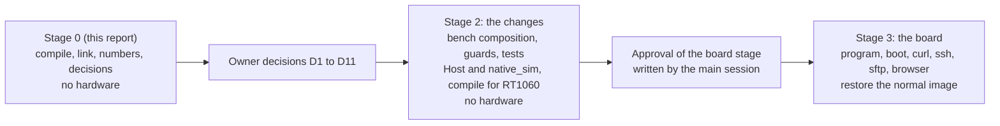
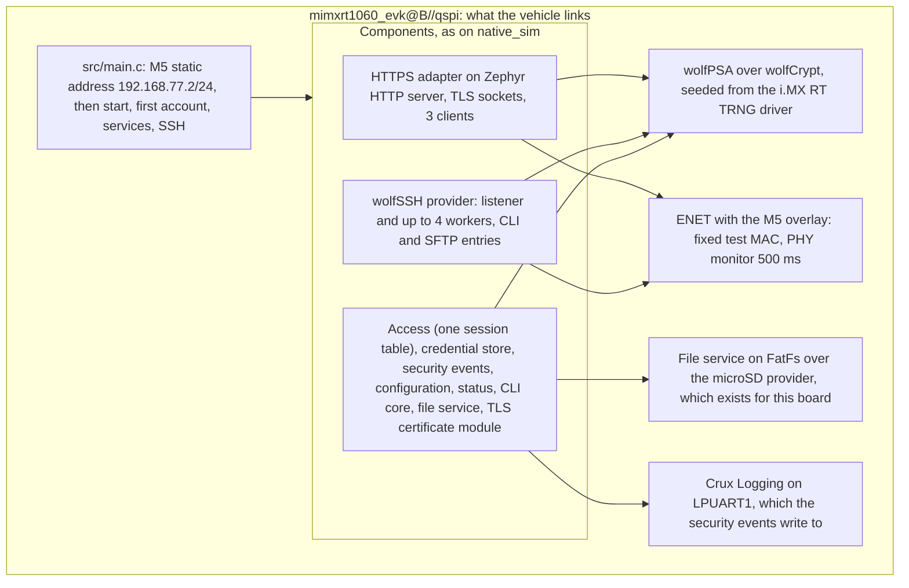

# The integrated management image on RT1060-EVKB: a build and feasibility report

Status: **stage 0 of putting the integrated management image on the real board**, for review in a Draft PR. Refs #197. It authorises no hardware
operation, and **nothing here ran on a board**: every result is a compile and link for `mimxrt1060_evk@B//qspi`, or a reading of source and of the
linked image. The owner approved this stage in the working session on 2026-11-08 ("0 단게 시작해"). It writes no approval document for a board stage.

## Result

| Question | Answer |
| --- | --- |
| Can the integrated image (HTTPS web, the command line over SSH, SFTP) be built for RT1060-EVKB rev B on the Wolf profile? | **Yes, as a compile vehicle** that the existing native files could not give: `tests/zephyr/management_rt1060_compile`. It compiles and links with `-Werror` on Crux's own code. It is not a product. It is a bootable QSPI image (the boot header must be there) that **refuses to start**, so that it cannot be run by mistake: [what it fakes](#what-the-vehicle-is-and-is-not). |
| Why not the native composition as it is? | It refuses a board at three places on purpose ([guards](#the-guards-the-native-composition-puts-in-the-way)). The vehicle does not edit or relax any of them. |
| Real size | **Flash 601,172 B of 8 MB (7.2 %). RAM 833,708 B, all of it in the 32 MB SDRAM** (ITCM, DTCM and OCRAM hold nothing). [Numbers](#sizes-measured-on-the-target-build). |
| Biggest risks found | **The HTTP server thread's 4,096 B stack** runs the TLS handshake, and a static estimate of one handshake path is 4,272 B. **The SSH worker's 16,384 B** leaves about 3 KB over a static 13.3 KB key-exchange chain. Neither is measured on a target. [Stacks](#thread-stacks). |
| Ready for a board run? | **No.** Eleven owner decisions and nine code changes come first, about 7 to 10 working days of agent work in sequence. [Decisions](#owner-decisions), [changes and order](#code-changes-and-their-order). |

## What the vehicle is and is not

The vehicle composes the same component sources as `tests/native/management_composition` (the list is repeated and compared by
`tests/build/test_management_target_lists.py`), on the real Wolf profile: wolfSSL behind Zephyr's TLS sockets (on a build-local patched Zephyr, as for the
native images), wolfPSA for Crux code and wolfSSH for SSH, all over one wolfCrypt.

| Item | State in the vehicle |
| --- | --- |
| Components, Access, store, services, SSH, SFTP, web adapter | **Real**, compiled for the target |
| Entropy | **The TRNG driver**, with no test generator and no fake entropy. The vehicle's CMake refuses both. |
| TLS certificate | **Generated** by the certificate module and handed to the TLS credentials with `crux_tls_certificate_material_take` ([`docs/tls-certificate.md`](tls-certificate.md), step 6). The declared test certificate is not used. |
| Host key | **Test form**: the store generates it, and the provider borrows it from a static buffer that is never wiped, as on `native_sim`. |
| First account | **A declared test step with a public password** (`crux_native_management.h:34`). It must not reach a reachable board: [D3](#owner-decisions). |
| File service backend | The microSD provider of the board. **Nothing was run on any card.** |
| Network settings | The no-op apply port. The static address comes from `main.c`, as in the M5 image. |
| Time | No source. The wall clock is Zephyr's realtime clock, which nothing sets. |
| Frontend | The services image's one-page folder, as on `native_sim` |
| Refusal | `main()` prints `MGMT_RT1060 compile-only vehicle: refusing to start` and returns, because the image would otherwise create an account with a public password, hold the test host key form and could format a card. The check reads a `volatile const` flag, so all the code stays linked. **This change to `main.c` was made after the build and was not rebuilt**: it adds one flag and one branch, and its size effect was not measured. |
| Not built | A product composition, a product host key rule, a serial console, a board run |

## The guards the native composition puts in the way

The native files hold the declared test forms, so each refuses a board. None was edited or weakened. The vehicle has its own, narrower guards.

| Where | Refuses | Consequence for the vehicle |
| --- | --- | --- |
| `composition/composition.cmake:13` and `:17` | A board, and test entropy that changed | The vehicle repeats the source lists in `management_target.cmake` |
| `composition/ssh.cmake:16` and `:20`, `ssh_test_host_key_guard.h:12` | A board, an image that is not a declared native test image, the test host key | `ssh_target.c` is a copy without the native parts, and declares itself compile-only |
| `tests/native/tls_offload_probe/credentials/test_tls_credentials.h:10` | Any build but `native_sim`, because the key of the declared test certificate is public. **The first build failed here.** | The vehicle compiles copies of two native files (`mgmt_start.c`, `mgmt_services.c`) whose only difference is the certificate hand-off. `test_management_target_lists.py` fails when a copy differs from its native file by anything else. |
| The vehicle's own `management_target.cmake` | Not RT1060 rev B, a test random generator, fake entropy, no TRNG, the Mbed profile, no SSH or CLI or SFTP, plain HTTP, no Logging | Shown by the [controls](#checks-and-controls) |

## Item by item

Verdict: **exists** (nothing to change), **small** (a bounded change) or **decision** (the owner decides first).

| # | Item | Verdict | What exists, with the source |
| --- | --- | --- | --- |
| 1 | Ethernet and the static address | **exists** | The M5 profile: fixed test MAC and PHY without the interrupt line in `samples/controller/zephyr/m3-network.overlay`, the address in `tests/networking_physical/main.c:26-30`. The vehicle uses both. Stage 1 proved link and TCP and UDP echo on this bench with that profile ([record](evidence/networking-physical-stage1-run3/README.md)). |
| 2 | TLS listener on the Wolf profile | **exists, one decision** | `tests/zephyr/web_compile/wolfssl.conf` compiled before ([`https-composition.md`](https-composition.md)). The vehicle links the whole listener. The socket backend is a patch on a build-local Zephyr copy, and `scripts/prepare-wolf-tls-zephyr.sh:4-5` says that is for Host and `native_sim`: [D8](#owner-decisions). |
| 3 | SSH and SFTP | **exists** | `zephyr/Kconfig:338-415`, `wolf_ssh_settings.cmake`; compiled for this board by `tests/zephyr/ssh_provider` (baseline below) and now inside the integrated image. wolfSSH's own three warnings stay `-Wno-error` (`wolf_ssh_settings.cmake:109`). |
| 4 | Credential store | **exists** | Linked on the PSA ports. It lives on the File service's two reserved roots, so its persistence is the File backend's: item 5. |
| 5 | File service backend | **decision** | The board has the microSD provider `CRUX_FILE_FATFS_RT1060` (`zephyr/Kconfig:194`). **There is no RAM disk selection for a board**: `CRUX_FILE_FATFS_SIMULATOR` needs `BOARD_NATIVE_SIM` (`zephyr/Kconfig:184-186`). A RAM disk needs a small Kconfig and CMake change. Also `medium_ready()` runs `fs_mkfs` when the first mount fails (`crux_native_management.c:123`), which would format a card. [D2](#owner-decisions). |
| 6 | What persists | **decision** | With the SD provider: the store, accounts, keys, certificate and configuration persist across reset, and the card is touched. With a RAM disk: **nothing persists**. Every boot is a first boot, the first account is provisioned again, and the host key and the certificate change, so a client sees a new fingerprint each time. QSPI Flash holds only the image. |
| 7 | Accounts and the first account | **decision** | `crux_native_management_provision_test_account()` (`crux_native_management.c:289-296`) uses the password in `crux_native_management.h:34`, which is public in this repository. The serial `!setup` step of the CLI contract is composed in no image (`management-in-a-product.md:32`). [D3](#owner-decisions). |
| 8 | The test certificate | **small** | Not needed: the certificate module generates one and `crux_tls_certificate_material_take` hands it over. The vehicle does this and compiles. How it behaves on a target is **not run**. The bench address and name are set in `mgmt_services.c`. |
| 9 | The test host key | **decision** | The store generates it at the first boot and the provider borrows it from a static buffer (`crux_native_management_ssh.c:21`, `ssh_target.c`). No hold and wipe rule exists: [D5](#owner-decisions). |
| 10 | Entropy | **exists** | The TRNG driver, on the Wolf profile **fails closed**: [evidence below](#entropy-and-what-happens-when-the-read-fails). Not run on a board. |
| 11 | Network settings apply port | **decision** | Only `network_settings_no_apply.c` exists: `apply` returns true and `running` returns false (`network_settings_no_apply.c:3-12`). Nothing is applied to the interface, and the network routes show no running values. The bench uses the static address of `main.c`: [D6](#owner-decisions). |
| 12 | Time source | **decision** | `CONFIG_RTC=y` **does not compile** with wolfSSL on this board: `wc_port.c` `z_time()` looks up a devicetree label `rtc`, which the board does not have (it has `snvs_rtc` and `counter_rtc` behind an alias). The vehicle leaves `CONFIG_RTC` off, so the wall clock is Zephyr's realtime clock, set by nothing: [D7](#owner-decisions). |
| 13 | Web asset folder | **exists** | The services image's one-page folder, packaged by `crux_web_assets` into the HTTP server's resources (Flash). A frontend is a product choice. |
| 14 | Logging | **exists** | The security events write to Crux Logging (`security_event_internal.h:4`), so the image needs `CONFIG_CRUX_LOGGING` and a log UART. The vehicle puts it on LPUART1 as `tests/logging_consumer` does. **The first link failed without it.** printk then goes through the same backend. |

## Build

| Item | Value |
| --- | --- |
| Source | `origin/main` at `bb73f53c` plus this change |
| Zephyr | v4.4.2, `dccb09599635bdff17633fa7e9dab014b91dce90`, the revision of the earlier board session's workspace (read-only) and of `west.yml`. A build-local copy with the wolfSSL TLS socket patch (`zephyr-tls-4.4.1.patch`, hashes checked by `prepare-wolf-tls-zephyr.sh`) was the `ZEPHYR_BASE`. |
| Modules | wolfSSL `3c5eead4` (v5.9.4), wolfSSH `8221e4ee` (v1.6.0), wolfPSA `55ae0ec5` (v5.9.4), mbedtls `a3e190fe` and tf-psa-crypto `dc575a2d` (found for Kconfig, not built), fatfs `f4ead3bf`, hal_nxp `7554bc0f`, all at the `west.yml` pins, fetched with `git fetch --depth 1` into a folder outside the repository |
| Toolchain | Zephyr SDK 1.0.1, `arm-zephyr-eabi` GCC 14.3.0, CMake 3.28.4, in `crux-pilot-devcontainer:local` (linux/amd64 under emulation, 2 CPUs, 2 GB, `-j2`, one build at a time) |
| Board | `mimxrt1060_evk@B//qspi` |
| Commands | The scripts that ran, in [`evidence/.../commands/`](evidence/rt1060-management-image-feasibility/commands/container.sh): the container, `zbuild_wolf.sh` (patched Zephyr copy, configure, ninja, `size`) and `zbuild.sh` |
| Sources | The build ran on the vehicle sources listed in `integrated-vehicle/vehicle-source-sha256-at-build.txt`. They were then reformatted with clang-format 18 (comment wrapping, and `<errno.h>` ahead of `<ff.h>` in `mgmt_start.c`): the committed hashes are in `vehicle-source-sha256-committed.txt`. The reformat and the refusal in `main.c` (review finding B1) were made after the build and are **not rebuilt**. |
| Result | **Configured with no Kconfig warning, 544 steps, linked**, three warnings, all in wolfSSH's `wolfsftp.c` and kept out of `-Werror` by the existing setting |
| Image | `zephyr.bin` 601,172 B, SHA-256 `c01ac20308a809374824e49ee43d5d3713e7cce5913c1e2eb8dc6600c95cb07a`; `zephyr.elf` SHA-256 `00d0f2aa02e5cd78b8f86e78cf32e80055b9ce3e59b4699fa6387312738a63d4` (the build path differs from the script's, so the hashes may differ) |

What the builds found, in order. Each is a real finding and none needed a change to a native file.

| Build | Result | Cause and answer |
| --- | --- | --- |
| Baseline: `tests/zephyr/ssh_provider` with `rt1060.conf` | Links. Flash 300,072 B, RAM 703,884 B | The existing image: **no TLS, no web, no store, and `CONFIG_TEST_RANDOM_GENERATOR=y`** (`prj.conf:21`), so it is not an entropy baseline. The document of #192 recorded 298,848 B, 1,224 B less, from an earlier revision. |
| Vehicle, first | Configured. Stopped compiling `crux_native_management.c` | `test_tls_credentials.h:10` refuses a board. Answer: the two copies and the certificate hand-off. |
| Vehicle, second | Stopped linking the security events | `crux/logging.h` was missing. Answer: Crux Logging on LPUART1. |
| Vehicle, third | Stopped compiling wolfSSL's `wc_port.c` | `CONFIG_RTC=y` and the missing `rtc` label. Answer: `CONFIG_RTC` off ([item 12](#item-by-item)). |
| Vehicle, fourth | **Linked** | |

## Sizes measured on the target build

Source: the linker's memory report of the build, `arm-zephyr-eabi-size`, `nm -S` and the link map of the vehicle
([evidence](evidence/rt1060-management-image-feasibility/integrated-vehicle/build.log)). They are the sizes of the linked image. **Nothing ran.**

| Region | Used | Size | Share |
| --- | ---: | ---: | ---: |
| QSPI Flash (`FLASH`, XIP at `0x60000000`) | 601,172 B | 8 MB | 7.17 % |
| `RAM` = SDRAM at `0x80000000` (`zephyr,sram = &sdram0`, `mimxrt1060_evk.dtsi`) | 833,708 B | 32 MB | 2.48 % |
| ITCM, DTCM | 0 B | 128 KB each | 0 % |
| OCRAM, OCRAM2 | 0 B | 256 KB, 512 KB | 0 % |

All code, data, stacks, the heap arena and the network buffers sit in Flash or in SDRAM. **No stack or buffer is in the tightly coupled memories.** The
RAM figure includes the configured arena and stacks, so it is a configuration and not a use.

### Flash by source

From the link map, objects placed in the Flash range, grouped by the library that holds them:

| Group | Flash |
| --- | ---: |
| wolfSSL (TLS, wolfCrypt, one copy for TLS, PSA and SSH) | 284,477 B |
| Crux components and the composition (without wolfSSH) | 93,501 B, of which the SFTP entries 16,278 B and `file_service` 6,522 B |
| wolfSSH (its sources are built into the application) | 45,249 B |
| Zephyr network and HTTP | 62,469 B |
| wolfPSA | 21,224 B |
| libc | 19,622 B |
| Zephyr drivers | 17,585 B |
| FatFs | 11,644 B |
| Everything else (core, kernel, hal_nxp, lib, arch) | about 57,000 B |

The groups add up to 612,922 B, 11,750 B (2 %) more than the 601,172 B image. The cause was not examined: the grouping is a reading of the link map, not the linker's own report.

The linked image also holds **RSA code** (`sp_ModExp_3072`, `psa_asymmetric_generate_key_rsa`) from the wolfSSL module's defaults, which the declared profile
does not use: a size trim for the stage 2 changes, not measured.

### Static RAM and the heap

| Item | Configured | Where it comes from |
| --- | ---: | --- |
| Heap arena (`malloc_arena`) | 524,288 B | `CONFIG_COMMON_LIBC_MALLOC_ARENA_SIZE`, 62.9 % of RAM. TLS, wolfSSH and wolfPSA allocate here. |
| Thread stacks, all | 134,208 B | [below](#thread-stacks) |
| Credential store buffers | 32,776 B and 4,636 B | `nm` |
| Access state | 14,800 B | `crux_access_state` |
| TCP connection slab | 21,504 B | `NET_MAX_CONN` 32 |
| ENET receive buffers | 9,216 B | `nxp_enet_0_rx_buffer` |
| Network buffers, data | 4,096 B transmit and 4,096 B receive, plus headers 896 B each | `NET_BUF_TX_COUNT` and `_RX_COUNT` 32 of 128 B |
| Network packets | 16 receive and 16 transmit, 1,024 B each of slab | `NET_PKT_*_COUNT` |
| The rest (web exchanges, sessions, events, wolfSSL caches, file service) | about 175 KB in all | `nm` |

| Heap | Value | Provenance |
| --- | ---: | --- |
| Configured arena | 524,288 B | **Target build** |
| Peak in the integrated `native_sim` run | 97,496 B in two runs and 100,448 B in a third, which is 19 % of the arena | **Carried from `native_sim`** ([#197](ssh-integrated-image.md#flash-ram-stacks-sockets-and-heap)): a 64-bit host with test entropy, valid as a size class only |
| Paper rule | 4 SSH connections × max(45 KiB, two windows + 5 KiB) = 180 KiB, plus the Wolf TLS arena of 131,072 B declared in `https-composition.md`: **about 315 KB, 60 % of the arena** | The rule of [`ssh-wolf-provider.md`](ssh-wolf-provider.md#resource-use) and the declaration, **not measured here** |
| Peak on this target | **Unknown.** `CONFIG_SYS_HEAP_RUNTIME_STATS=y` is set, so a board run can read it. | |

### Thread stacks

Static, from the target ELF, and not a measurement. The method is a script (`commands/callgraph.py`): the frame of a function is its pushed registers plus its first
`sub sp`, and the chain adds the frames along **direct calls** only. It follows branches that the deployed profile never takes (RSA, client certificates), it counts a tail branch as a nested call, which overstates some chains, and it
does not follow a call through a function pointer. So a chain is neither an upper nor a lower bound for the path a request really takes. It shows where a
configured stack is plainly too small, and where it is tight. Interrupt frames (up to about 240 B with the FPU) are not included.

| Thread | Configured | `native_sim` (64-bit host, carried) | Static chain on the target ELF | Reading |
| --- | ---: | --- | --- | --- |
| HTTP server thread, which also runs each TLS handshake inside `accept` | **4,096 B** (`zephyr/Kconfig:432`) | Not readable on `native_sim` | `wolfSSL_accept` to the key share check of a **P-256** client share: 616 B of handshake frames plus 3,656 B = **4,272 B**, before the socket layer's and the server's own frames. A client that offers an X25519 share takes a path of about 2.6 KB. ECDSA signing from `accept` is about 2.4 KB. | **Over the stack for a client that offers only P-256, and tight for others.** Raise it and measure: [C2](#code-changes-and-their-order). |
| SSH worker, 4 of them | 16,384 B | 9,216 B used, with `ecdh-sha2-nistp256`, Ed25519, SFTP and the CLI. The probe image of #192 read 13,808 B with `exec` and every key type. | `wolfSSH_worker` chain through the key exchange: **13,336 B**, of which `SendKexDhReply` has a 6,692 B frame | About 3 KB left, 19 %, before interrupt frames. Tight. |
| SSH listener | 4,096 B | Not read | Not computed | Unknown |
| Crux worker threads, 4 of them | 8,192 B | 8,192 B configured | `web_session_work_once` through `crux_access_login_password`: 10,364 B along a path that ends in an RSA key decode the stored keys never take | **Unknown**: the PBKDF2 login and the store save run here |
| Main | 16,384 B | 32,768 B configured, not read | `main` through `crux_native_management_start`: 21,192 B, along a key generation path that ends in RSA | Unknown. The deployed key types are ECDSA and Ed25519. |
| Logging process thread, ENET receive thread, network receive thread, TCP work queue, system work queue, ISR | 2,048 B, 1,600 B, 1,500 B, 1,024 B, 1,560 B, 2,048 B | | | Zephyr's defaults and the M5 image's. There is no network transmit thread (`NET_TC_TX_COUNT=0`). |

The static chains agree in size class with the host figures for SSH (13.3 KB and 13.8 KB). They are not a substitute for a target read, which
`CONFIG_INIT_STACKS` and `CONFIG_THREAD_STACK_INFO` (both set) allow.

### Network buffers, sockets and session slots

| Resource | Configured | Margin and provenance |
| --- | --- | --- |
| Packet buffers | RX 16, TX 16 (the M5 image's) | Chosen for 32-byte echo frames. **Unknown** for 16 KiB TLS records and an SFTP window. A short pool slows TCP and does not break it. |
| Data buffers | RX 32, TX 32 of 128 B, 4 KiB each way | The same. Likely too small for a 16 KiB window: raise in stage 2 and measure. |
| Sockets | `ZVFS_OPEN_MAX` 48, `NET_MAX_CONTEXTS` 32, `NET_MAX_CONN` 32 | `native_sim`: 6 with four SSH shells and 5 at peak under load, plus 3 HTTPS clients: about 9 of 48. **Carried** |
| TLS contexts | `NET_SOCKETS_TLS_MAX_CONTEXTS` 6 | 3 HTTPS clients. **Carried** |
| Network session slots | **7**, shared by HTTPS and SSH (`CRUX_ACCESS_SESSION_MAX` 8, slot 0 serial only: `access_port.h:6-7`) | With four SSH shells, three slots are left for the web. [#197 decision 5](ssh-integrated-image.md#decisions-for-review) |
| Sessions per account | 3 (`access_port.h:9-10`), the oldest ends | Across both channels, **carried** |
| SSH connections, HTTPS clients | 4, 3 | As configured |

### Programming time and the stage 1 tool

The stage 1 programmer stops a J-Link Commander call at **30 s** (`tests/target/capture_m3.py:58`, with the message "Probe timeout; state uncertain; no further hardware changes" at line 72).
Its log of the M5 image (97,544 B, `docs/evidence/networking-physical-stage1-run3/01-third-run/program/03-program-m5.log`) shows 6.5 s for a 131,072 B range, of which compare,
erase, program and verify took 4.0 s. J-Link reports the affected range, 131,072 B for a 97,544 B image, so the range is rounded up to 128 KiB blocks. For 601,172 B that is 640 KiB (655,360 B), 5 times the range: those four steps are about 20 s, plus about 2.5 s that does not scale, **about 23 s for the load alone**, and then the verify read and the reset. This is an extrapolation, not a measurement, and it leaves a margin of a few seconds. [C7](#code-changes-and-their-order).

## Entropy, and what happens when the read fails

| Step | Source | What it does |
| --- | --- | --- |
| Source | `entropy_mcux_trng.c` of Zephyr v4.4.2, `CONFIG_ENTROPY_MCUX_TRNG=y` in the linked image | `TRNG_GetRandomData` failure: `return -EIO` (lines 32-34). Init failure: `-EIO` (lines 54-61), so the device is not ready. |
| wolfCrypt seed | `wolfcrypt/src/random.c`, `wc_GenerateSeed`, Zephyr branch (lines 9447-9466) | Not ready: `RNG_FAILURE_E`. A read that returns nonzero: `RNG_FAILURE_E`. **There is no fallback to `sys_rand_get()`** when a `zephyr,entropy` node exists, and the board has one. |
| wolfPSA | `src/psa_random.c:70-82` | `wc_InitRng_ex` per `psa_generate_random` call, and any wolfCrypt error becomes a PSA error. |
| Crux callers | `credential_psa.c:259`, `tls_certificate_psa.c:61`, `access_psa.c:67`, `web_session_psa.c:21` | Each returns success only on `PSA_SUCCESS`. |

So a failed TRNG read **fails closed**: no key, no certificate, no salt and no session identifier is produced. This is a reading of source, plus the resolved `.config` of the vehicle
(`ENTROPY_MCUX_TRNG`, no `TEST_RANDOM_GENERATOR`, no fake entropy). **It was not run**, on a target or on `native_sim` with a failing device for wolfPSA. The existing
failure-path tests cover TF-PSA-Crypto only ([`psa-crypto-qualification.md`](psa-crypto-qualification.md#entropy-failure)). A TRNG read on every `psa_generate_random` also has a time cost that is unknown. [C5](#code-changes-and-their-order).

The image's other random consumers are Zephyr's own (TCP initial sequence numbers and ports use the xoshiro generator, which the TRNG seeds): not examined.

## The test-image declaration for a bench board

Today the declaration is `CRUX_NATIVE_MANAGEMENT_TEST_IMAGE`, on `native_sim` only, with a tripwire in CMake, in C and in Kconfig
([`ssh-integrated-image.md`](ssh-integrated-image.md#the-test-image-declaration)). **This is a decision, and none of it is implemented.** The change is not pure configuration: the
guards are code, so it needs review as code.

| Level | Today | Proposed for a declared bench image |
| --- | --- | --- |
| Name | `CRUX_NATIVE_MANAGEMENT_TEST_IMAGE`, set by the image's CMake | A second, distinct declaration, `CRUX_MANAGEMENT_BENCH_IMAGE`, that no native image can set |
| Board | `native_sim` | **Exactly** `mimxrt1060_evk@B//qspi`, and nothing else |
| Entropy | Test entropy is allowed, a test random generator is not | The TRNG driver is required, and both test sources are refused, as the vehicle's CMake already does |
| Certificate | The declared test certificate, whose header refuses a board | **Unchanged**: the header stays native only. The bench uses the generated certificate. |
| Host key | Test form, static buffer, never wiped | Test form is accepted **only under the bench declaration**, generated on the board by the store from the TRNG, so it is not public. Its fingerprint is printed on the UART. |
| First account | A public password | The public password is refused. The password comes from an untracked input or from the serial step: [D3](#owner-decisions). |
| Network | The host's loopback | The listeners answer on the bench address only: a refusal of DHCP and of any other interface address |
| Evidence | The test image's output | The banner and the image manifest name the declaration, so that a bench image cannot be mistaken for a product |
| Where it is refused | CMake, C, and a host script that compiles the guards with each setting (`check_ssh_guard.py`) | The same three levels, with a script that breaks each guard on purpose |

## Owner decisions

Each has a recommendation. None is taken here.

| # | Decision | Options | Recommendation |
| --- | --- | --- | --- |
| D1 | Adopt a bench declaration and tripwire for RT1060-EVKB rev B | [As above](#the-test-image-declaration-for-a-bench-board); or keep the vehicle compile-only and run nothing | **Adopt**, as the condition for any board run |
| D2 | File backend of the bench image | microSD (the existing provider, persistent, the card is touched and `fs_mkfs` can format it); a RAM disk (needs a small change, nothing persists, no card) | **RAM disk for the first board run**: no card and no format risk. SD in a later run, with the M4 microSD tools. |
| D3 | The first account on a reachable board | A password in an untracked file, hashed into the manifest; the serial setup step (not composed, more work); the public test password (refused) | **An untracked file** for the first run, a serial step later |
| D4 | The listener certificate | Generated by the certificate module (what the vehicle does); the declared test certificate (refused on a board) | **Generated**, with the fingerprint on the UART |
| D5 | The host key's hold and wipe rule | Static buffer, never wiped, bench only; a rule like the TLS key's hand-off | **Static buffer under the bench declaration only** for the first run. A product rule stays open ([`ssh-integrated-image.md`](ssh-integrated-image.md#decisions-for-review)). |
| D6 | Network settings apply | The M5 static address in `main` and no apply port; a Zephyr apply port | **The M5 address in `main`.** The network routes then show no running values. |
| D7 | Time | No source (the vehicle); an RTC label overlay so that `CONFIG_RTC` compiles with wolfSSL; a host-set clock | **No source** for the first run. Events carry boot-relative times. |
| D8 | The wolfSSL TLS socket patch on a board image | A build-local patched Zephyr copy, as the vehicle; wait for #185 | **Build-local copy**, declared in the bench manifest |
| D9 | Session sizes | 7 network slots, 4 SSH connections, 15 minute idle, 3 HTTPS clients (#197 decision 5) | **Keep** for the bench, and read what a board shows |
| D10 | Listener exposure | SSH on every IPv4 address and HTTPS dual stack (as on `native_sim`); the bench address only | **The bench address only**, in the bench declaration |
| D11 | The programmer's 30 s limit | Raise it for a 601 KB image, and split `loadfile` from `verifybin`; shrink the image (drop RSA, which is unused) | **Raise and split**, reviewed, and also trim RSA |

## Code changes and their order

Rough effort is agent time for the change and its tests, without the board. Hardware is never part of stage 2.

| Order | Change | Needs | Effort |
| --- | --- | --- | --- |
| 1 | **C1.** Promote the vehicle to a bench composition: the declaration and guards at three levels, a host script that breaks each guard, and a manifest recording the declaration | D1 | 1.5 to 2 days |
| 2 | **C2.** `CONFIG_HTTP_SERVER_STACK_SIZE` at 8,192 B in the bench image, a stack watermark and heap line printed on the UART at idle and after each client | none | 0.5 to 1 day |
| 2 | **C3.** The file backend of D2: a RAM disk selection (Kconfig and CMake) and a mount and format rule that never formats a card | D2 | 0.5 to 1 day |
| 2 | **C4.** The first account of D3, with the password never in the repository or the log | D3 | 0.5 to 1 day |
| 2 | **C5.** A native test of the failing-TRNG path on the Wolf profile, and a boot line that says the first random read succeeded | none | 1 day |
| 3 | **C6.** Network buffer counts and the arena for 16 KiB records and an SFTP window, from the measurements of C2 | C2 | 0.5 day, then a board read |
| 3 | **C7.** The programmer's limit: raise it, split the commands, test the change | D11 | 0.5 to 1 day |
| 3 | **C8.** The image manifest and the plan for the bench image, on the stage 1 pattern. **The approval documents are the main session's, and are not written here.** | C1 to C7 | 1 to 2 days |
| 4 | **C9.** Trim RSA from the wolfSSL settings and re-measure | D11 | 0.5 day |

Order: decisions D1 to D11, then C1, then C2 to C5, which touch different files and may run in parallel, then C6 and C7, then C8, then the approval, then the board. About 7 to 10 working days if all of it is done in sequence, less if C2 to C5 run in parallel. A
Zephyr apply port for the network settings (2 to 3 days) is not needed for the first run and is not in this list.

## The plan outline for the board stage

Not an approval and not a run plan. It reuses the stage 1 tools and the same safety gates. Each step needs the approval of its own stage.

| Step | Who | What |
| --- | --- | --- |
| 1 | Owner | Arm the mount guard with `tests/target/m5_mount_guard.py start --arm` as root, connect the board, the J-Link and the `en13` link at `192.168.77.1/24`. With D2 as a RAM disk, no card is inserted. |
| 2 | Host | Read-only inventory, then `tests/target/program_m5_image.py identify` of the accepted normal image |
| 3 | Host | `program` the bench image: `loadfile`, `verifybin`, reset. UART capture shows the banner with the declaration, the TRNG, `SSH-HOST-KEY`, the certificate fingerprint and the ready lines. |
| 4 | Host | HTTPS: `openssl s_client -connect 192.168.77.2:443` to fetch the certificate, compare its fingerprint with the UART's, then `curl --cacert` for the two-request login, `session/me` and `status`. A browser at `https://192.168.77.2/` with the warning accepted. |
| 5 | Host | SSH: `ssh-keyscan -t ed25519 192.168.77.2` against the UART fingerprint, `ssh` for the CLI (`help`, `account list`, the viewer's refusal), `sftp` for put and get with a hash check |
| 6 | Host | The slot limits, four SSH shells and three web logins, and the eighth refused. Handshake and transfer times with `curl -w` and `time`. These are the first target timings of the project. |
| 7 | Host | The UART's stack and heap lines after each step, then a reset and the fingerprints again: **with a RAM disk they change**, which also shows the entropy source varies, and is not a statement on its quality |
| 8 | Host | `restore` of the accepted normal image, two verifies, a capture of its normal boot, and an offline replay |

Not covered by that stage: persistence and power loss (RAM disk), a card, the control timing under load, a long run, a scan from another host.

## Checks and controls

| Check | Result | Who ran it |
| --- | --- | --- |
| Compile and link of the vehicle for `mimxrt1060_evk@B//qspi` | Linked, see [Build](#build) | The author, in the Dev Container |
| A second, clean build from the committed tree | **Not done.** It was started and stopped at step 56 of 550 because free disk fell under the 5 GB floor. The numbers above are from the build of the uncommitted tree whose vehicle sources have the SHA-256 values in `integrated-vehicle/vehicle-source-sha256-at-build.txt`. | The author |
| `python3 -m unittest tests/build/test_management_target_lists.py` | 3 tests pass. **Two mutations fail it** (a changed line in a copy, and a removed source from the list), and the restored files pass. | The author, on the host |
| `scripts/check-ssh-boundaries.py`, `check-native-interfaces.py`, `check-mgmt-services-boundary.py` | Pass | The author, on the host |
| Not run | A board, the image, any client, the native images (unchanged), CI | |

## What was not measured

| Item | Why |
| --- | --- |
| Anything on a board: boot, the TRNG, the link, a handshake, a login, a transfer | No hardware in this stage |
| Stack use on a target | Static chains only. The thread analyser and the watermarks need a run. |
| Heap peak on a target | The runtime statistics are on, and nothing ran |
| Timing of a handshake, a PBKDF2 login, a key generation, a TRNG read, a transfer | `native_sim` gives CPU work no time, and nothing ran on the target |
| SDRAM and cache effects on a Cortex-M7 running from QSPI with all data in SDRAM | No run. DCACHE and ICACHE are on. |
| The microSD provider with this composition | The card is not touched, and `fs_mkfs` behaviour is read from source only |
| The generated certificate's behaviour on a target, and wolfSSL's time without a clock | Compile only |
| The entropy failure path, on `native_sim` or on a board | Source read only |
| Zephyr's own random users, and ENET and PHY behaviour with this load | Not examined |
| The static chains' accuracy | A heuristic of frame sizes over direct calls, not checked against a debugger or a probe |

## Decisions for review

Taken here without the owner, each the narrower choice.

| # | Decision | Why |
| --- | --- | --- |
| 1 | The vehicle is a new directory beside `tests/zephyr/ssh_provider`, compile only, with no `testcase.yaml` and no workflow | It must not enter default CI: wolfSSL and wolfSSH are GPL and `scripts/check-ssh-boundaries.py` keeps them out |
| 2 | The vehicle compiles two **copies** of native files, held to the originals by an exact test | The native test certificate's header refuses a board and must stay so |
| 3 | `CONFIG_RTC` is off | It breaks wolfSSL on this board: [item 12](#item-by-item) |
| 4 | The File provider is the microSD one | It is the only one that exists for the board. It was compiled, not used. |
| 5 | The HTTP server stack stays at the default 4,096 B in the vehicle | So that the report shows the declared default and its estimate, and not a value chosen to pass |
| 6 | The arena is 524,288 B, as the existing target image's | Between the web profile's 131,072 B and the native run's 1 MiB. It is a configuration, not a measured need. |
| 7 | No script is added to `scripts/`. The commands that ran are kept as evidence. | A script that was not run to the end would be a claim without a check. A script is a stage 2 item (C1). |
| 8 | The evidence record holds the maps, the resolved configuration, the logs, the static chains and the commands, and not the ELF or the binary | The binary is not reproducible bit for bit from another path, and `*.bin` is ignored by the repository |
| 9 | The report proposes the bench declaration and implements none of it | A security-sensitive design decision and not a pure configuration change |
| 10 | The vehicle declares itself compile-only with `CRUX_MGMT_RT1060_COMPILE_ONLY`, which only its own CMake sets, and refuses to start at run time | It is the one place where a test form (the test host key, the public test password) is compiled for a board. It is allowed only in this vehicle, which cannot run, and is not a bench declaration: that is D1. |

## Reproduce

In the Dev Container image, with the workspace mounts of `commands/container.sh` (Zephyr, hal_nxp, cmsis, fatfs, and the five crypto modules at their `west.yml` pins), run
`commands/zbuild_wolf.sh mgmt_v1 /ws/crux-pilot/tests/zephyr/management_rt1060_compile`. Nothing here touches a board. It needs about 400 MB of disk for the patched Zephyr copy and the build.

The evidence is in [`evidence/rt1060-management-image-feasibility/`](evidence/rt1060-management-image-feasibility/integrated-vehicle/size.txt): the link map, the resolved
configuration, the configure and build logs, `size` and the section tables, the 400 largest symbols, the static frames and chains, and the commands of the container run.
