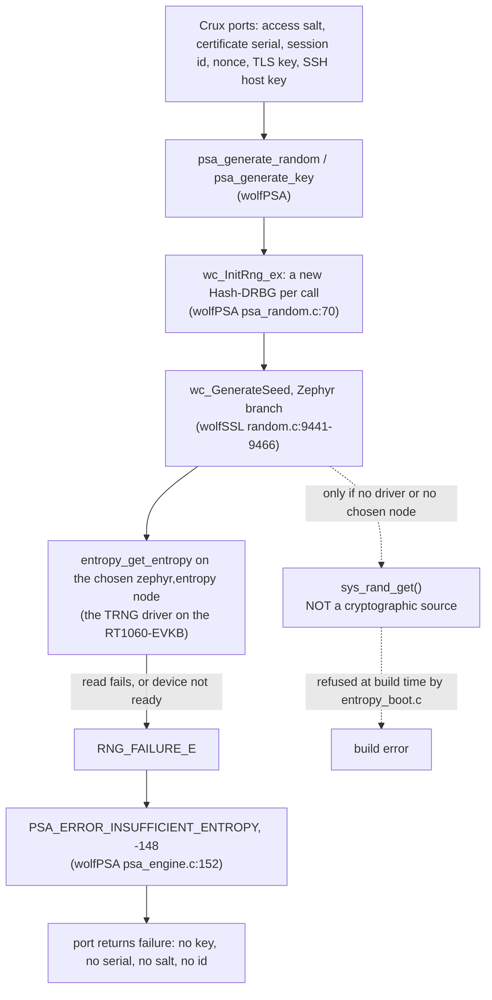

# Wolf profile entropy: a failed random read fails closed (row C5)

Row C5 of stage 2 of the [RT1060-EVKB bench image](rt1060-management-image-feasibility.md#entropy-and-what-happens-when-the-read-fails): the integrated management image (HTTPS web, the command line over SSH, SFTP) needs the Wolf profile, because wolfSSH needs wolfSSL.
The Mbed profile has [fail-closed entropy](psa-crypto-qualification.md#entropy-failure) since 6 November 2026. Stage 0 read from source that the Wolf profile fails closed too, and did not run it. This record runs it.

**Everything here ran on `native_sim`, on the Host, or as a compile for `mimxrt1060_evk@B//qspi`. Nothing ran on a board, and nothing here says anything about the quality of the RT1060 TRNG.**

## Result

| Question | Answer | Evidence |
| --- | --- | --- |
| Does the Wolf profile fail closed today, before any change? | **Yes.** With the stub boot check still in place (red run), the three cases of the consumers passed: with a failing device every Crux random and key consumer fails, and no output is written. | [`evidence/rt1060-wolf-entropy-c5/red/`](evidence/rt1060-wolf-entropy-c5/red/runtime-run.txt) |
| Is a fix needed in the seed path? | **No.** No script, patch or Zephyr change was made. `scripts/prepare-mbedtls-entropy.py` is the precedent for a fix and it was not needed. | The red run, and [the table of fallbacks](#every-place-that-could-fall-back) |
| Is there a boot line? | **Yes**, one line of a fixed format, printed once before any key, **and in the refused image too since row C10**, and a refusal path that prints a line and stops. | [format](#the-boot-line), [order in `main()`](#where-it-runs-in-the-bench-image) |
| Does a composition that would use `sys_rand_get()` compile? | **No.** The boot check refuses it at build time, and a control shows what such an image does. | [controls](#what-was-proved) |
| Reseed after a successful start | **Partly.** A read that fails after a successful start is exercised, for every consumer. wolfCrypt's reseed inside one generator is **not covered**. | [reseed](#reseed) |

## The path of a random read



The wolfCrypt Hash-DRBG is seeded again each time a generator is made. wolfPSA makes one per `psa_generate_random` call, wolfSSL one per TLS object (`internal.c:8404`) and wolfSSH one per SSH session (`internal.c:1789`), all through `wc_GenerateSeed`.

## Every place that could fall back

| Place | What it does on a failed or missing entropy source | Verdict |
| --- | --- | --- |
| `entropy_mcux_trng.c` (Zephyr v4.4.2), read | `TRNG_GetRandomData` failure returns `-EIO` | Fails. The device is not a fallback. |
| `entropy_mcux_trng.c`, init | A failed init returns `-EIO`, so the device is not ready | Fails: wolfCrypt checks `device_is_ready` first. Run: variant `init-fails`, the device is never read. |
| `wc_GenerateSeed`, Zephyr branch | Not ready or a nonzero read: `RNG_FAILURE_E`. **Calls `sys_rand_get()` only when `CONFIG_ENTROPY_HAS_DRIVER` is off or there is no chosen `zephyr,entropy` node** | Fails closed in the bench image. The fallback branch is **not compiled in**: see [the call sites](evidence/rt1060-wolf-entropy-c5/bench/call-sites.txt) (`wc_GenerateSeed` makes no call to `sys_rand_get`). |
| That fallback branch, as a state of a composition | `ENTROPY_HAS_DRIVER` depends on `ENTROPY_GENERATOR`, and Zephyr's own random subsystem does not compile with `ENTROPY_GENERATOR` on and no chosen node. So a composition reaches the branch only with `ENTROPY_GENERATOR` off. | Run as a control (`fallback`): the Crux consumers **succeed**, with a test generator and no device. This is why `entropy_boot.c` refuses to compile in that state (variant `guard`). |
| wolfPSA `psa_random.c` | A new `wc_InitRng_ex` per call, and any wolfCrypt error becomes a PSA error. `RNG_FAILURE_E` is `PSA_ERROR_INSUFFICIENT_ENTROPY`. | Run: status `-148` on every failed line. |
| Crux callers (`credential_psa.c`, `tls_certificate_psa.c`, `access_psa.c`, `web_session_psa.c`) | Success only on `PSA_SUCCESS` | Run: all five consumers, and both key types, fail and leave their buffers zero. |
| `CONFIG_TEST_RANDOM_GENERATOR`, `CONFIG_FAKE_ENTROPY_NATIVE_SIM` | Not present in the bench image. C1's CMake refuses both, and `entropy_boot.c` refuses the first. | Resolved bench configuration: [`entropy-config.txt`](evidence/rt1060-wolf-entropy-c5/bench/entropy-config.txt). |
| `CONFIG_XOSHIRO_RANDOM_GENERATOR` with `ENTROPY_NEEDS_PRNG` (`sys_rand_get`) | Zephyr's general-purpose generator. **If the entropy read fails at its seeding it seeds from `k_cycle_get_32()`** (`random_xoshiro128.c`). It does **not** feed wolfCrypt: in the linked bench image the functions that branch to `z_impl_sys_rand_get` are `eth_nxp_enet_init`, `find_available_port`, `tcp_derive_rto` and `tcp_init_isn` ([call sites](evidence/rt1060-wolf-entropy-c5/bench/call-sites.txt)). | **Zephyr's own users are weak if the TRNG fails. Not changed here** (Zephyr's code, not a key). The boot refusal stops the image before any connection, but the network stack has already been initialised by then. |
| `sys_csrand_get`, the CSPRNG choice | In the bench's Zephyr copy (v4.4.2 plus the wolfSSL/osp socket patch, which also changes `subsys/random`: `PSA_CSPRNG_GENERATOR` is the default with wolfPSA) the resolved configuration is `CONFIG_PSA_CSPRNG_GENERATOR=y`. `z_impl_sys_csrand_get` (`random_psa.c`) branches to `psa_generate_random`, so it is wolfPSA, then `wc_GenerateSeed`: **it fails closed and returns `-EIO`**. | Fails closed. Its one caller in the image is `tcp_init_isn` (`tcp.c:2390` and `:2425`, `NET_TCP_ISN_RFC6528=y`), which **ignores the return value** and sets its `once` flag: **after a failed read the TCP initial sequence number key stays all zero for the rest of the boot**, so ISNs are predictable. Zephyr's code, not a Crux key, not changed here: see [follow-up](#follow-up). |
| DTLS Connection ID in `sockets_tls.c` | `sys_csrand_get` or `sys_rand_get` | Not in the image: `CONFIG_NET_SOCKETS_ENABLE_DTLS` is off. |

The call-site scan lists every instruction that branches to a random function, tail calls included (a branch inside the function itself shows as a branch to its own `+offset` and is not a call). It cannot show the read of the entropy driver, which is an indirect call through the driver's function table: that is the `blx r3` in `wc_GenerateSeed`.
The native_sim test runs on the unpatched pinned Zephyr tree, because it needs no TLS socket backend. The bench image is built on the patched copy, and the patched `subsys/random` is the reason for the `sys_csrand_get` row.

## The boot line

`tests/zephyr/entropy_boot/` makes the first random read through the function that makes every key (`psa_generate_random`), prints one line, and returns true only on success. It wipes the 32 bytes and uses them for nothing.

```text
CRUX-ENTROPY first-read=<ok|failed> source=<node> compatible=<first compatible> bytes=32 status=<PSA status> device-ready=<1|0>
```

| Field | Meaning |
| --- | --- |
| `first-read` | `ok` only if `psa_crypto_init` and the read returned `PSA_SUCCESS` |
| `source` | The name of the chosen `zephyr,entropy` node, the one device that wolfCrypt reads. On the RT1060-EVKB this is the TRNG node. |
| `compatible` | Its first compatible string |
| `bytes` | The size of the read |
| `status` | The PSA status, `0` on success, `-148` for a failed seed |
| `device-ready` | `device_is_ready()` of that node |

Real lines from the runs (the test device is not an entropy source):

```text
CRUX-ENTROPY first-read=ok source=crux-test-entropy compatible=crux,test-entropy bytes=32 status=0 device-ready=1
CRUX-ENTROPY first-read=failed source=crux-test-entropy compatible=crux,test-entropy bytes=32 status=-148 device-ready=1
CRUX-ENTROPY first-read=failed source=crux-test-entropy compatible=crux,test-entropy bytes=32 status=-148 device-ready=0
```

`ok` says that the first read worked and which node was asked. It does not say that the node is a good source. On a board a host checks the line, then the fingerprints that follow.

## Where it runs in the bench image

The bench image still refuses to start (C1). **Since row C10 the check runs before that refusal**, so the refused image prints the banner and the `CRUX-ENTROPY` line and then refuses. The owner decided this on 2026-11-09 (quote: "1-8까지 너의 추천대로 진행해줘"), which supersedes the placement that C5 recommended ([decision 5](#decisions-for-review), D-a of [the image plan](rt1060-bench-image-plan.md)). `tests/build/test_wolf_entropy_boot.py` pins the order.

| Step in `main()` | |
| --- | --- |
| 1 | `banner()`: two `BENCH` lines |
| 2 | **`crux_entropy_boot_check()`**: one `CRUX-ENTROPY` line. If false: `BENCH refusing to start: the first random read failed, no key or listener made`, and `return 1` |
| 3 | the refusal that stands in the image (`CRUX_BENCH_RUN_REFUSED`): `BENCH refusing to start: this image is not approved to run`, and `return 1` |
| 4 | the bench address, then `crux_native_management_start()` (the store and its keys), the first account, the services (HTTPS), SSH (host key), the report |

What each image prints, by the source:

| Image | UART, in order |
| --- | --- |
| Refused, first read ok (the image as merged) | banner (2 lines), `CRUX-ENTROPY first-read=ok ...`, `BENCH refusing to start: this image is not approved to run` |
| Refused, first read failed | banner, `CRUX-ENTROPY first-read=failed ...`, `BENCH refusing to start: the first random read failed, no key or listener made` (the refusal of the switch is not reached) |
| Lifted, first read ok | banner, `CRUX-ENTROPY first-read=ok ...`, then the address, store, services and SSH lines |

The refused image is as inert as C1 made it: the read is `psa_crypto_init` and one `psa_generate_random` of 32 bytes, which makes no key, no certificate, no address and no listener. It does start the PSA crypto and read the TRNG, which the refused image of C1 did not.

No guard of C1 was weakened: the CMake, C and Kconfig guards and their mutation script pass unchanged (below). C10 made the unit test of the refusal stricter and changed the order that `test_wolf_entropy_boot.py` pins.

## What was proved

| # | Case | Profile | Target | Result |
| --- | --- | --- | --- | --- |
| 1 | Healthy device: every consumer works, the device was read | Wolf (wolfCrypt under wolfPSA) | `native_sim` | Pass |
| 2 | Every read fails: `psa_generate_random`, access salt, certificate serial, session id, nonce, and the TLS (P-256) and SSH host (Ed25519) key generation all fail, and write nothing | Wolf | `native_sim` | **Pass, already before any change** |
| 3 | A read fails after a successful start, then is healthy again | Wolf | `native_sim` | Pass |
| 4 | Boot check, healthy: returns true, prints exactly the `ok` line, the device was read | Wolf | `native_sim` | Red with the stub, then pass |
| 5 | Boot check, first read fails: returns false, prints the `failed` line with a nonzero status, `device-ready=1` | Wolf | `native_sim` | Red with the stub, then pass |
| 6 | Device that does not start: consumers fail, **the device is never read**, boot check false, `device-ready=0` | Wolf | `native_sim` | Pass |
| 7 | Control: no entropy driver, a test generator: **the consumers succeed** (the fallback exists) | Wolf | `native_sim` | Pass, as a control |
| 8 | Control: the boot check in that composition does not compile, for its reason | Wolf | `native_sim` | Build refused, as designed |
| 9 | The bench image links with the check wired in, the same three wolfSSH warnings as C1 | Wolf, TRNG driver | `mimxrt1060_evk@B//qspi`, **compile only** | Flash 601,464 B (C1: 601,004 B), RAM 837,932 B |
| 10 | In the linked bench image `wc_GenerateSeed` makes one call (`device_is_ready`) and one indirect call through the driver's function table (`blx r3`), and no call to `sys_rand_get`. Every branch to `z_impl_sys_rand_get` and `z_impl_sys_csrand_get` is listed. | Wolf, TRNG driver | Disassembly of the ELF | [`call-sites.txt`](evidence/rt1060-wolf-entropy-c5/bench/call-sites.txt), [`wc_GenerateSeed.disasm.txt`](evidence/rt1060-wolf-entropy-c5/bench/wc_GenerateSeed.disasm.txt) |
| 11 | The order in `main()`, and the check's own rules (no side door, the format, the build refusals) | | Host | 6 tests pass (C5); 7 since C10 |
| 12 | C1's guards: 37 of 37 mutants killed, 14 tests | | Host | Pass, unchanged |

Cases 1 to 8 are one test ([`tests/psa_entropy/wolf`](../tests/psa_entropy/wolf/src/main.c)) built as four images by [`scripts/test-wolf-entropy.sh`](../scripts/test-wolf-entropy.sh): `runtime` (1 to 5), `init-fails` (6), `fallback` (7) and `guard` (8).
It uses the real `access_psa.c`, `credential_psa.c`, `tls_certificate_psa.c` and `web_session_psa.c` over wolfPSA at its pin, with wolfSSL's settings of a management image. The device is wired as `zephyr,entropy`, the way the TRNG is, and `native_sim`'s own generator is switched off.

| Red, then green | Before (stub boot check) | After |
| --- | --- | --- |
| `runtime`, 5 cases | 3 pass, **2 fail** ([log](evidence/rt1060-wolf-entropy-c5/red/runtime-run.txt)) | 5 pass ([log](evidence/rt1060-wolf-entropy-c5/green/runtime-run.txt)) |
| `init-fails`, 2 cases | not run | 2 pass ([log](evidence/rt1060-wolf-entropy-c5/green/init-fails-run.txt)) |
| `fallback`, 1 case | not run | 1 pass ([log](evidence/rt1060-wolf-entropy-c5/green/fallback-run.txt)) |
| `guard` | not run | refused ([log](evidence/rt1060-wolf-entropy-c5/green/guard-build.log)) |

## Reseed

| What | Covered |
| --- | --- |
| A read that fails after a successful start, reaching the same function as the first read, for every consumer (case 3). It works because each call seeds a new Hash-DRBG. | **Yes**, on `native_sim` |
| wolfCrypt's reseed inside one generator (after a very large number of requests), where a failed read would be met in the middle of a long-lived generator | **Not covered**: no consumer in the image keeps a generator that long, and no test makes one |
| The seed of a TLS context or an SSH session (wolfSSL, wolfSSH) when the read fails after the start | **Not covered.** It is the same `wc_GenerateSeed`, but no handshake was run with a failing device. |

## Not covered

| Item | Why |
| --- | --- |
| Anything on a board: the TRNG, the boot line on the UART, a real failed read | No hardware in this stage |
| The quality of the TRNG's output, the time of a read, and that `ok` means a good source | Not claimed |
| The full integrated image (HTTPS, SSH, SFTP) on `native_sim` with a failing device | The native composition refuses a build whose entropy is not its declared test source, and the bench image cannot run. The consumers that the image uses were run instead. |
| A TLS handshake or an SSH key exchange with a failing device | See [reseed](#reseed) |
| Zephyr's own random users on a failed TRNG | See [the table](#every-place-that-could-fall-back): weak, and not changed |
| That no key is made if `main()` is changed | The order is pinned by a test, which a reviewed change can edit |

## Follow-up

| Item | Why it is not in C5 |
| --- | --- |
| `tcp_init_isn` ignores a failed `sys_csrand_get` and keeps a zero key. After a read that fails **after** the boot check passed, TCP initial sequence numbers of the bench image would be predictable. A Zephyr change or a check in the composition would close it. | It is Zephyr's code, and it is not a Crux key. It needs an owner decision on whether to patch the Zephyr copy (a build-local copy as for the TLS patch), and a board run is the only way to see whether a TRNG read fails after a successful start. |

## Decisions for review

| # | Decision | Why |
| --- | --- | --- |
| 1 | No change to the seed path, no patch and no script change | The red run showed that it fails closed, and a build-time check keeps it so |
| 2 | The check is a build refusal, not a patch: `entropy_boot.c` does not compile where wolfCrypt would use `sys_rand_get()` | It is the one state where a failed read does not fail, and a refusal is the least invasive mechanism |
| 3 | The source named in the line is the chosen `zephyr,entropy` node | It is the only device wolfCrypt reads |
| 4 | The check lives in `tests/zephyr/entropy_boot/` and is not a component | No public interface is adopted, and the bench image is under `tests/` |
| 5 | The check runs **before** the bench image's refusal (**changed in row C10**, owner decision of 2026-11-09, "1-8까지 너의 추천대로 진행해줘"; row C5 had placed it after) | The refused image now prints the line, so that a host can read the entropy source from the image that is built and refused, and a failed first read stops the image before the refusal. Nothing that makes a key or opens a listener moved. |
| 6 | `scripts/test-wolf-entropy.sh` is a **new** file in a protected directory, and no existing protected file is changed | A new check script may be added within a task. It stays out of default CI like the other wolfSSL tests. |

## Reproduce

In the Dev Container image, with Zephyr at its pin and wolfssl, wolfpsa, mbedtls and tf-psa-crypto from the `crux-secure-management` group (`mbedtls` and `tf-psa-crypto` are found, not built):

```bash
scripts/test-wolf-entropy.sh all
python3 -m unittest tests/build/test_wolf_entropy_boot.py tests/build/test_management_bench_declaration.py tests/build/test_management_target_lists.py
```

The bench compile is [`tests/zephyr/management_rt1060_compile`](../tests/zephyr/management_rt1060_compile/CMakeLists.txt) as in [C1](rt1060-management-image-feasibility.md#stage-2-row-c1-the-bench-composition); the commands that ran are in [`evidence/rt1060-wolf-entropy-c5/commands/`](evidence/rt1060-wolf-entropy-c5/commands/container.sh).
