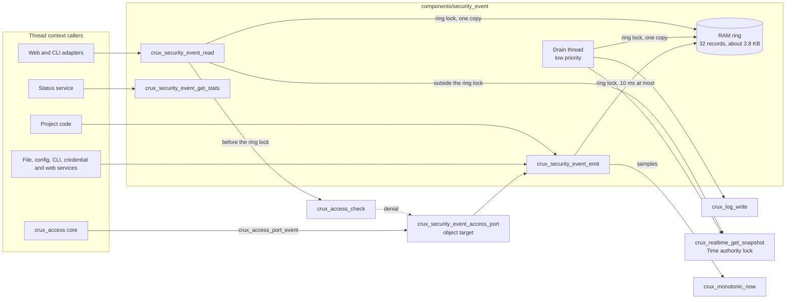
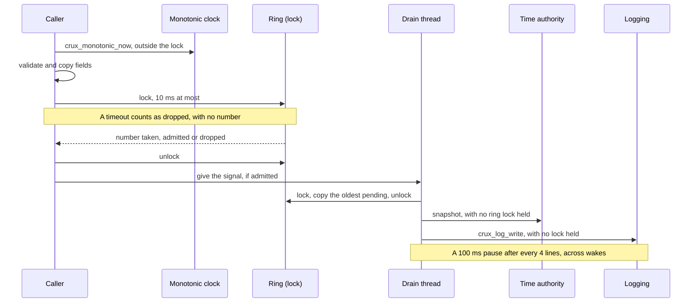
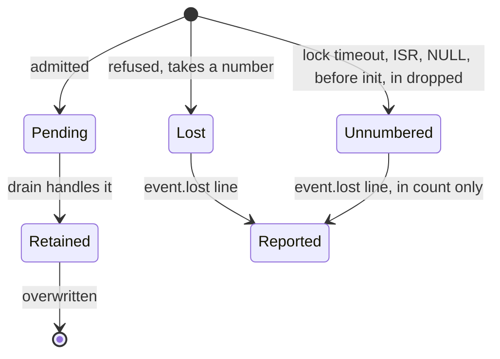

# Security event contract

Status: Host implementation for review under Issue #182, with fakes. The contract is not adopted until this review
and gate #183 pass. The decisions and reasoning are in [the accepted proposal](plans/security-events-contract-proposal.md),
with decisions E1 to E6 accepted in the [gate record](https://github.com/wonny-labs/crux-pilot/pull/209). This document does not
repeat the reasoning. It states what
was built, what was chosen, and what is not known.

Owner: `components/security_event`. Public header `<crux/security_event.h>`, usage target `crux::security_event`.
Provider of the Access event port: object target `crux_security_event_access_port`. Depends on the
[Access](access-contract.md), [Logging](logging-contract.md), Sync, Thread and Time contracts.

## What exists

| Item | State |
| --- | --- |
| Public contract and identifier table | Implemented as proposed, with the choices below |
| Portable core: ring, admission, sequence numbers, read, counters | Builds and runs on Host |
| Drain to Logging on a low-priority thread | Runs on Host, with the Linux Logging provider |
| Provider of `crux_access_port_event` | Implemented, every port event and result mapped |
| Recording fake of the public contract | `tests/security_event/fake`, for consumers' Host tests |
| Provider of `crux_credential_port_event` | `crux_credential_security_events`, in the store's component, because this component names no storage type |
| Emitters outside Access: file, CLI, web, SSH, reboot | Identifiers exist. The emitters are other issues. The credential store, the configuration service and the network settings service emit, through their providers. |
| Providers of the command line's and the file service's ports | `crux_cli_security_events` and `crux_file_service_security_events`, in those components, added by #242: [below](#from-the-command-line-and-file-service-ports). Host against the recording fake, and `native_sim` in the [services image](native-composition-242.md). |
| Provider of the network settings service's port | `crux_network_settings_security_events`, in that component. It records `network.changed`, `network.save_failed` and `network.saved_ignored`, with no subject: [network settings service](network-settings-service.md#security-events). |
| `GET /api/v1/events` | Not implemented, M11. The read function it needs exists. |
| Status items from the counts | `crux_mgmt_status_security_events`, in [the status service](status-configuration-services.md) |
| Zephyr composition on `native_sim` | [For tests](native-management-composition.md), on the Crux Logging provider with an emulated UART, which shows the drain's counts and nothing on a wire |
| Target | Not implemented. See [What is not known](#what-is-not-known). |
| Persistence | None, by decision E5. A reset loses the ring. |

## Structure



A final link goes through the provider in both directions: Access calls the port, and the read path calls
`crux_access_check`. `crux_access` does not link this component, so the targets have no cycle. A composition links the
provider as objects, which resolves the link:

```cmake
target_link_libraries(image PRIVATE crux::security_event crux_security_event_access_port)
```

An image that uses `crux::security_event` without a provider does not link, on `crux_access_port_event`. The boundary
script tests both.

A composition starts in this order, from one thread:

1. `crux_security_event_init`, before anything that emits. A failure is a management start failure.
2. `crux_realtime_init`, and `crux_access_init` and the other services. Their events wait in the ring.
3. `crux_security_event_start`. A failure is a management start failure, and the ring still fills and can be read.
4. Keep the Logging threshold at `CRUX_LOG_INFO` or more verbose (decision E6).

The component takes one mutex, one semaphore and one thread from the Sync and Thread pools.

## Public contract

Names and fields follow the proposal. `<crux/security_event.h>` is authoritative. These are the functions, and the ones
later issues build on.

```c
crux_status_t crux_security_event_init(const crux_security_event_project_id_t *project_ids, size_t count);
void crux_security_event_emit(const crux_security_event_t *event);
crux_status_t crux_security_event_start(void);
crux_status_t crux_security_event_get_stats(crux_security_event_stats_t *out);
crux_security_event_read_result_t crux_security_event_read(crux_access_session_t session, uint32_t *cursor,
                                                           crux_security_event_record_t *out);
const char *crux_security_event_name(crux_security_event_id_t id);
```

| Function | Context | Waits | Fails |
| --- | --- | --- | --- |
| `crux_security_event_init` | Thread, once, before anything emits | Sync creation | `INVALID_ARGUMENT` for a bad table, `INVALID_STATE` if repeated, or a Sync error. Can be retried. |
| `crux_security_event_emit` | Thread. An ISR call is refused and counted. | Ring lock, 10 ms by default, and Sync's bookkeeping. Never storage or the log. | Returns nothing. Refusals are counted. |
| `crux_security_event_start` | Thread | Thread creation | `NOT_READY`, `INVALID_STATE`, or a Thread error. Can be retried. |
| `crux_security_event_get_stats` | Any thread, before init too | None: atomic loads | `INVALID_ARGUMENT` for NULL |
| `crux_security_event_read` | Thread | The state lock, through `crux_access_check`. Ring lock, 10 ms by default. The Time authority lock. | See the header |
| `crux_security_event_name` | Any thread | None | Returns `event.unknown` for an unknown value |

For a consumer that only emits, such as the status service or the command line:

| Need | Use |
| --- | --- |
| Counts for `security.events_*` | `crux_security_event_get_stats`. Field names are `emitted`, `dropped`, `delivered`, `log_errors`, `invalid_fields` and `high_water`. |
| Record a CLI or config event | `crux_security_event_emit` with `CRUX_SECURITY_EVENT_ID_CLI_LINE_REJECTED`, `_CLI_CONSOLE_ERROR`, `_CONFIG_UPDATED`, `_CONFIG_REJECTED`, `_CONFIG_SAVED` or `_CONFIG_SAVE_FAILED` |
| Its origin | `crux_access_session_origin`, which gives the channel and source in the form the record takes |
| A test without the core | Link `crux_security_event_fake`, include `security_event_fake.h`, and use `security_event_fake_count_of` and `security_event_fake_last`, or set counts with `security_event_fake_stats_set` |

## Emit, drain and read



Each record in the ring has one of these states. A new record may overwrite only a retained one.



### Admission

| Pending records | Routine | Change |
| --- | --- | --- |
| Below 24 | Admitted | Admitted |
| 24 to 31, the reserve | Dropped, with a number | Admitted |
| 32, full | Dropped, with a number | Dropped, with a number |

The class comes from the identifier table. `CRUX_SECURITY_EVENT_RING` and `CRUX_SECURITY_EVENT_RESERVE` are CMake settings, and a
reserve that leaves routine events no room fails to compile. Host suites run with 32 and 8, and again with 8 and 2.

### Log line

```text
evt=access.login_failed seq=184 up=93211 wall=1793750400 clock=rtc chan=ssh src=192.0.2.7 res=denied
evt=access.permission_denied seq=185 up=94002 wall=1793750401 clock=rtc chan=web src=192.0.2.7 user=alice subj=config.save res=denied
evt=event.lost seq=186 up=94100 clock=none first=120 count=64 res=failed
```

Tag `crux.security`. Level `INFO` for a result of `OK`, otherwise `WARN`. Fields are in this order, and an empty field is
omitted. The longest line a test produces is 230 bytes, with a `/64` source of 24 characters. The contract's bound of 245
allows a source of 39. The limit is `CRUX_LOG_TEXT_MAX`, 256. An IPv6 source prints as `2001:db8:0:ab01::/64`. A line is
built without `printf`, so there is no format string, and the drain's stack holds one line of 257 bytes.

### Loss

| Point | Counted by | Visible as |
| --- | --- | --- |
| Ring refused it | `dropped` | `event.lost` with `first` and `count`, a gap in `seq` |
| Lock wait expired, ISR, NULL, before init | `dropped` | `event.lost` in `count`, no gap |
| `crux_log_write` returned an error | `log_errors` | The record stays readable. No retry. |
| Native log queue dropped it after `OK` | Not by Crux | A gap in `seq`, and the native report. Not tested here. |
| Filtered by the Logging threshold | Not by Crux | Missing from the log, still readable, `delivered` overstates. Tested, decision E6. |
| Reset or power loss | Not counted | The sequence restarts |
| UART or later transport | Not by Crux | A gap in `seq` |

A gap does not always mean a lost event. Each `event.lost` line takes a number and is not a ring record, so a reader of the ring
sees a gap at that number too, and a reader of the log sees that line instead.

### Pacing

The drain counts lines across wakes, and sleeps `CRUX_SECURITY_EVENT_DRAIN_PAUSE_MS` each time the count reaches
`CRUX_SECURITY_EVENT_DRAIN_BURST`. A timed wake with nothing signalled restarts the count, because the log buffer has had a whole
wait to empty. So a wake never writes more than the burst has left, whether the records arrive together or in small batches. The
burst also holds at most one `event.lost` line. A pause after a failed wait only stops the drain spinning, and the burst goes on.

## Identifiers

Values are stable. A later change adds values and never reuses one. Projects use 0x8000 and above, declared to
`crux_security_event_init`. `Class` is `R` for routine and `C` for change.

| Value | Name | Class | Emitter |
| --- | --- | --- | --- |
| 0x0100 | `access.login_ok` | C | Access |
| 0x0101 | `access.login_failed` | R | Access |
| 0x0102 | `access.key_failed` | R | Access |
| 0x0103 | `access.delayed` | R | Access |
| 0x0104 | `access.login_busy` | R | Access |
| 0x0105 | `access.login_no_session` | R | Access |
| 0x0106 | `access.login_refused` | R | Access |
| 0x0107 | `access.not_ready` | R | Access |
| 0x0108 | `access.permission_denied` | R | Access |
| 0x0109 | `access.session_invalid` | R | Access |
| 0x010A | `access.logout` | R | Access |
| 0x010B | `access.session_expired` | R | Access |
| 0x010C | `access.provisioned` | C | Access |
| 0x010D | `access.provision_refused` | R | Access |
| 0x0110 | `access.account_created` | C | Access |
| 0x0111 | `access.account_removed` | C | Access |
| 0x0112 | `access.account_disabled` | C | Access |
| 0x0113 | `access.account_enabled` | C | Access |
| 0x0114 | `access.role_changed` | C | Access |
| 0x0115 | `access.password_reset` | C | Access |
| 0x0116 | `access.password_changed` | C | Access |
| 0x0117 | `access.key_added` | C | Access |
| 0x0118 | `access.key_removed` | C | Access |
| 0x0119 | `access.change_failed` | C | Access |
| 0x011A | `access.change_rejected` | R | Access |
| 0x0200 | `credential.state` | C | Credential store, #178 |
| 0x0201 | `credential.slot_invalid` | C | Credential store |
| 0x0202 | `credential.save_failed` | C | Credential store |
| 0x0203 | `credential.key_generated` | C | Credential store |
| 0x0204 | `credential.key_replaced` | C | Credential store |
| 0x0205 | `credential.erased` | C | Credential store |
| 0x0300 | `file.created` | C | File service, #179 |
| 0x0301 | `file.removed` | C | File service |
| 0x0302 | `file.renamed` | C | File service |
| 0x0303 | `file.partial_removed` | C | File service |
| 0x0304 | `file.recovery_needed` | C | File service |
| 0x0305 | `file.name_rejected` | R | File service |
| 0x0306 | `file.commit_failed` | C | File service |
| 0x0307 | `file.storage_failed` | R | File service |
| 0x0400 | `config.updated` | C | Configuration service, #180 |
| 0x0401 | `config.rejected` | R | Configuration service |
| 0x0402 | `config.saved` | C | Configuration service |
| 0x0403 | `config.save_failed` | C | Configuration service |
| 0x0500 | `cli.line_rejected` | R | CLI, #181 |
| 0x0501 | `cli.console_error` | R | CLI |
| 0x0600 | `web.tls_failed` | R | M11 |
| 0x0601 | `web.csrf_rejected` | R | M11 |
| 0x0602 | `web.certificate_replaced` | C | M11, the [TLS certificate](tls-certificate.md), #190 |
| 0x0603 | `web.certificate_rejected` | R | The [TLS certificate](tls-certificate.md), #190 |
| 0x0604 | `web.certificate_unusable` | C | The [TLS certificate](tls-certificate.md), #190: the stored certificate refused at start, so nothing is served |
| 0x0700 | `ssh.auth_limit` | R | M12 |
| 0x0701 | `ssh.host_key_missing` | C | M12 |
| 0x0800 | `network.changed` | C | Network settings service |
| 0x0801 | `network.save_failed` | C | Network settings service |
| 0x0802 | `network.saved_ignored` | C | Network settings service |
| 0x0900 | `system.reboot_requested` | C | Reboot service |
| 0x0901 | `system.reboot_refused` | R | Reboot service |
| 0x0902 | `system.reboot_failed` | C | Reboot service |
| 0x0F00 | `event.unknown` | R | This component |
| 0x0F01 | `event.lost` | R | This component, a line only |

### From the Access port

The provider adds no meaning. A user is what Access named, and an empty field stays empty.

| Port event | Identifier | `user` | `subject` |
| --- | --- | --- | --- |
| `LOGIN_SUCCESS`, `LOGIN_FAILURE`, `KEY_FAILURE`, `LOGIN_REFUSED`, `PROVISIONED` | Its own | `account` | |
| `DELAY_APPLIED`, `LOGIN_BUSY`, `LOGIN_NO_SESSION`, `NOT_READY`, `SESSION_INVALID`, `PROVISION_REFUSED` | Its own | | |
| `PERMISSION_DENIED` | `access.permission_denied` | `actor` | `permission` |
| `LOGOUT`, `SESSION_EXPIRED`, `ACCOUNT_PASSWORD_CHANGED` | Its own | `actor` | |
| `ACCOUNT_CREATED`, `_REMOVED`, `_DISABLED`, `_ENABLED`, `_ROLE_CHANGED`, `_PASSWORD_RESET`, `_KEY_ADDED`, `_KEY_REMOVED` | Its own | `actor` | `account` |
| `CHANGE_FAILED`, `CHANGE_REJECTED` | Its own | `actor` | `account`, if Access named one |

| `crux_access_result_t` | Event result |
| --- | --- |
| `OK` | `OK` |
| `DENIED`, `SESSION_INVALID`, `LAST_ADMINISTRATOR` | `DENIED` |
| `RETRY_LATER` | `DELAYED` |
| `BUSY` | `BUSY` |
| `NO_RESOURCES` | `LIMIT` |
| `INVALID_ARGUMENT`, `NOT_FOUND`, `ALREADY_EXISTS`, `PASSWORD_REJECTED` | `INVALID` |
| `NOT_READY`, `STORE` | `FAILED` |

### From the command line and file service ports

Added by #242. Each provider adds no meaning, as for Access. Neither records client input: the command line's port carries no
line, and the file service's provider leaves out the file names that its port passes.

| Port event | Identifier | Result | `user` | `channel`, `source` | `subject` |
| --- | --- | --- | --- | --- | --- |
| CLI `LINE_REJECTED` | `cli.line_rejected` | From the outcome: `INVALID`, `LIMIT`, `DENIED` | The session's user, or none before login | The CLI's channel, 1 or 3. No source. | None |
| CLI `CONSOLE_ERROR` | `cli.console_error` | From the outcome, `FAILED` | The same | The same | None |
| File `CREATED`, `REMOVED`, `RENAMED`, `PARTIAL_REMOVED` | Its own | `OK` | The session's user, or none | The session's origin, or none | The area |
| File `RECOVERY_NEEDED`, `COMMIT_FAILED` | Its own | `FAILED` | The same | The same | The area |
| File `NAME_REJECTED` | `file.name_rejected` | `INVALID` | The same | The same | The area |
| File `STORAGE_FAILED` | `file.storage_failed` | `LIMIT` for a full medium, otherwise `FAILED` | The same | The same | The area |

## Decisions for review

The owner could not be asked. Each is the narrow choice, and a changed choice is small while nothing depends on it.

| # | Point | Choice | Reason |
| --- | --- | --- | --- |
| 1 | A name for a record | Added `crux_security_event_name(id)`, which is not in the proposal | A read result holds only the value, and M11 must show a name. The project table is private to the core, so no one else can answer. |
| 2 | Cursor ahead of the numbering | Restarts at the oldest record | A cursor kept across a reset would otherwise read `END` until the numbers caught up. The caller sees the sequence fall. A cursor from before a reset is ahead only until the numbering passes it, and then it reads as an ordinary cursor, so this does not detect every reset. |
| 3 | Sequence wrap | Skips zero | Zero is a cursor's start, so a record numbered zero could not be read after a wrap. |
| 4 | Forging a Crux event | `event.lost` passed to an emit records `event.unknown`, counted. `crux_security_event_init` refuses a project name equal to any Crux name, and a name used twice. Only exact names are refused, so `access.other` and `event.lost.x` are allowed. | `event.lost` is a line only, and only the drain writes it. The proposal reserves no name prefix. |
| 5 | Fields the proposal gives no rule for | A channel above 3 or a source length other than 0, 4 or 8 is omitted and counted. A result out of range becomes `FAILED` and is counted. | They fail closed, in the way the listed fields do. |
| 6 | How much of a subject is checked | The first 256 bytes, so an emit stays bounded. A bad character there omits the field. | Text past that is never recorded. |
| 7 | An empty `user` | Omitted and counted, because the rule is 1 to 31 characters. An empty `subject` is simply no subject. | The table's rules, read literally. The provider passes NULL for an empty name. |
| 8 | Which lines the counts cover | `delivered` and `log_errors` count every line, including `event.lost` | The proposal defines them by what `crux_log_write` returned. So `delivered` can exceed `emitted`. |
| 9 | What counts as `dropped` | Also a NULL event, an ISR call and a call before init, each without a number. The next `event.lost` includes them in `count`. | The failure table says that they count as dropped. |
| 10 | Pacing `event.lost` | At most one in a burst, which spans wakes. A later loss waits for the next burst, and is then reported. A burst must be 2 or more lines, or the build fails. | Otherwise new loss between records could fill every burst and starve the records. |
| 11 | Order of `seq` in the log | An `event.lost` line can carry a number above records still pending, because it takes the next number | The proposal asks for this. A reader sorts by `seq`. |
| 12 | The drain's wake | A binary signal, and a timed wake after 1000 ms with nothing signalled | The proposal's "timeout to keep a clock check" is taken as this. A loss with no ring record sends no signal, so the timed wake bounds how late its report can be. |
| 13 | Read when the ring lock times out, or access control gives an unexpected result | `NOT_READY` | No other result fits, and the output stays unchanged. |
| 14 | Wall time that would be negative, or a valid clock with source `NONE` | `clock=none` | Makes no claim, and keeps a line's bound. |
| 15 | `access.change_failed` subject | The target, if Access named one | The proposal lists only `user`, but the access contract names the target, and `access.change_rejected` carries it. |
| 16 | `role_missing` on the port event | Not carried | No field in the record, and the proposal says that role names stay out. |
| 17 | `get_stats` before init | Answers `OK`, with the counts so far | A failed init is the case a status page most needs to show. |
| 18 | Build settings | `RING`, `RESERVE`, `DRAIN_BURST` and `DRAIN_PAUSE_MS` are CMake cache values. `LOCK_MS`, `DRAIN_WAIT_MS` and the stack size are macros with defaults. | A composition sizes the ring and reserve, and matches the burst and its pause to its log buffer. The rest keep the proposal's defaults. |
| 19 | The fake's rules | Field, identifier and project table rules are the real source. Ring, reserve and drain are not modelled, and a test asks for a drop. | A consumer's tests then hold on the core, and it stays small. |
| 20 | `native_sim` | Not attempted | Gate decision G-B approves contract work with fakes and Host tests here. `crux_access` has no Zephyr composition yet, so this needs that first. |

## What is built, faked and untested

| Kind | Items |
| --- | --- |
| Real in Host tests | Ring, admission, sequence numbers, cursors, line format, identifier table and Sync and Thread. In the suites that join Access: its core and the provider. In `integration` alone: Logging, and Time's authority lock and monotonic clock. |
| Never real | Time's realtime provider, which is the controlled `memory` one even in `integration`. Access's crypto and storage ports, which are `tests/access/fake_ports.c` wherever Access runs. |
| Controlled in every suite but `integration`, `public_fake` and `fake_cases` | Through linker wraps: the monotonic clock, unless a case asks for the real one, the Time snapshot, `crux_log_write`, `crux_is_in_isr`, and failures of Sync and Thread creation. The signal and the pause pass through and are counted, and a case can change what a wait reports. |
| Stubbed in `conformance`, `ring`, `ring_small`, `drain`, `time_cases`, `init`, `concurrency` and `public_core` | `crux_access_check`, from `tests/security_event/access_check_stub.c`, which answers what a case sets. These suites do not link Access. |
| Untested | Anything on Zephyr, `native_sim` or a target. The native log queue dropping after `OK`. Emit time on a real thread, and loss under real management load. Stack use of the drain on Zephyr. Whether a pause of 100 ms after every 4 lines suits a real log buffer. |

## What is not known

- **Emit time.** The ring lock wait is bounded and the rest is a memory copy, but Sync's unlock and give have no time bound.
  Nothing here measures it, so the HTTP thread's wait is unproven until target tests.
- **Log buffer.** A full ring can come to about 8 KB of text, and configurations here use a log buffer of 1 or 4 KB. The default
  burst and pause are the proposal's, and no composition has been checked against them.
- **Resources.** The gate record already notes that the integrated image exceeds the default Thread pool, and that the 4 KB stack is
  unmeasured.
- **Time and order.** The clock on a line is the clock at drain, computed backwards, with no accuracy claim. Concurrent emitters
  are ordered by the ring lock, so a record's `seq` order and its `up` order can differ slightly.

## Limits

- No persistence. Nothing is tamper-evident.
- The `host-sanitize` preset is ASan and UBSan, which do not detect data races. See the pull request for what ran under
  ThreadSanitizer and its limits.
- Loss after `crux_log_write` returns `OK` is only visible as a gap, or through the native report.
- A long subject is truncated, with a mark, so two long file names can look alike in a line.
- A caller that passes a secret of allowed characters as a user or subject would record it. Field rules cannot tell, so emitters must follow
  the rule that client input failing validation is never a field. Tests use known values against the real Access emitters only.
- A composition must keep the Logging threshold at `CRUX_LOG_INFO` or more verbose (decision E6). Nothing enforces this, and
  Logging offers no getter.

## Boundary

- `crux::security_event` exposes only its public header, Base and the public Access header. Logging, Sync, Thread and Time are private.
- `scripts/check-security-event-boundary.py` builds `tests/security_event_consumer` in both directions, and also checks that:
  - the header holds no native types;
  - private headers and the Access adapter header are out of reach;
  - a link needs the provider, and works with it;
  - the fake and the test core do not exist outside Crux's own tests;
  - no source names a storage component, and only the drain calls `crux_log_write`.
- A build that sets `CRUX_BUILD_TESTS=ON` creates `crux_security_event_fake` and `security_event_test_core`, which a superproject
  could still link by name, so it must not use that build for a product image.

## Tests

`scripts/test-security-event.sh` runs the suites under the `host-debug` and `host-sanitize` presets, clang-tidy on the sources and
tests, and the boundary check. The root build also runs them as `SecurityEvent.*` under `scripts/check-host.sh`.

| Suite | Composition | Covers |
| --- | --- | --- |
| `conformance` | Core, controlled time and log | Every identifier's value, name, class and length, and that no other exists. Field rules, truncation and omission, every byte value in a user and a subject, and the bounded subject scan. Line format, levels, and the worst-case line. |
| `ring`, `ring_small` | The same, with a 32/8 and an 8/2 ring | Overflow, the reserve, change admitted while routine is dropped, a gap per drop, `event.lost` content, burst bound, lock timeout with a really held lock, log errors, cursors, gaps, overwriting, the wrap, no lock across time or log, high water from pending only |
| `drain` | The same, with real threads and no timed wake in a run | A signal for each admitted record and none for a refused one, a wake by the signal alone, a bounded wait, a signal again after a burst, a pause counted across wakes, one report in a burst across wakes, an idle wake restarting the burst, and a pause after a failed wait that keeps the count |
| `time_cases` | The same | Clock unset, each source, age, snapshot errors, `no_uptime`, set and invalidated between emit and drain, for lines and read results. The `event.lost` line's time and counts. An emit reads no authority. |
| `init` | The same | Before init, failed init and retry, no leak on a failed init, repeated init, project identifiers and their classes, project names that repeat or forge a Crux name, near names that stay allowed, ISR and NULL, thread failure and retry |
| `concurrency` | Core with real threads | Six paced emitters, two readers and the drain, with every event accounted for, for the sanitizers |
| `rejections` | Real Access, real provider, core | Each rejection path of Issue #182 and each row of the result table, including `BUSY` on a login and on an own password change, in the record and in the line. Every port event and every result, one by one. |
| `read` | The same | No session, ended, expired, without `events.read`, forced change, permitted. The denial's own record. The check runs before the ring lock. No effect on the idle timer. |
| `secrets` | The same | Runs Access's own `tests/access/secrets.c` through the real path, and inspects each record and line for known passwords, typed names, keys, salts and verifiers |
| `waits` | The same, with real threads | With the storage fake and the log fake both blocked, a denial and a flood past the ring's size all return. A check still answers. Emit under the state lock returns. |
| `integration` | Product cores, provider as objects, real Logging, Thread and Sync, and Time's real authority lock and monotonic clock over its controlled `memory` provider | Lines on the real provider's stderr. Real read. An emit with the Time authority lock held on another thread. Pacing of 12 lines together and of 36 lines in batches of 3. The threshold limit of E6. |
| `public_core`, `public_fake` | Core, and fake | One suite on the public header alone, on both, so a consumer's test on the fake holds on the core |
| `fake_cases` | Fake | The controls consumers use |
