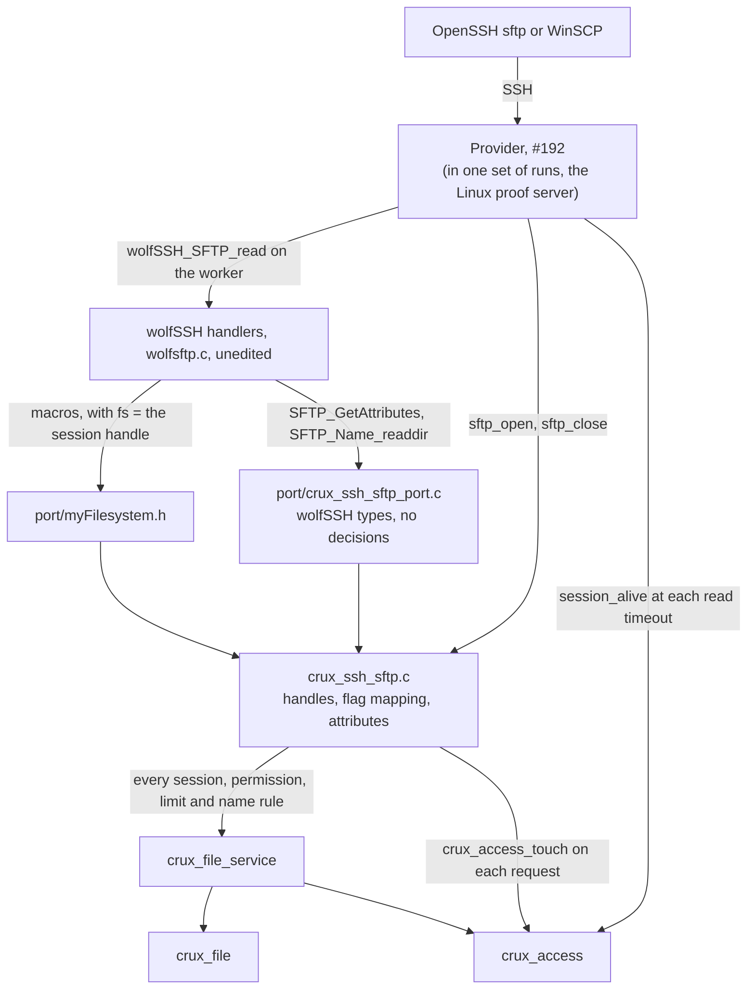
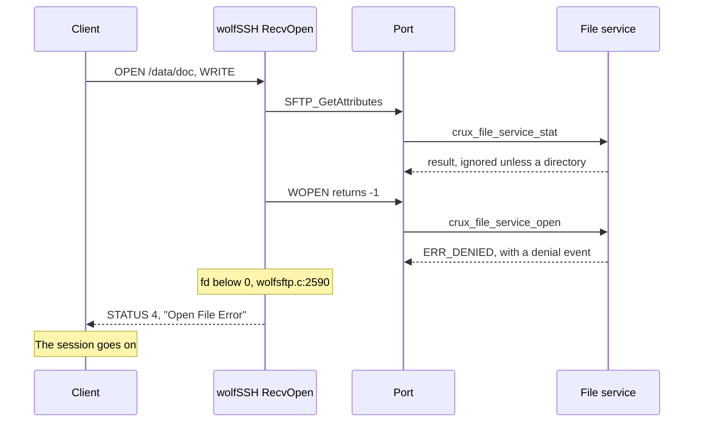
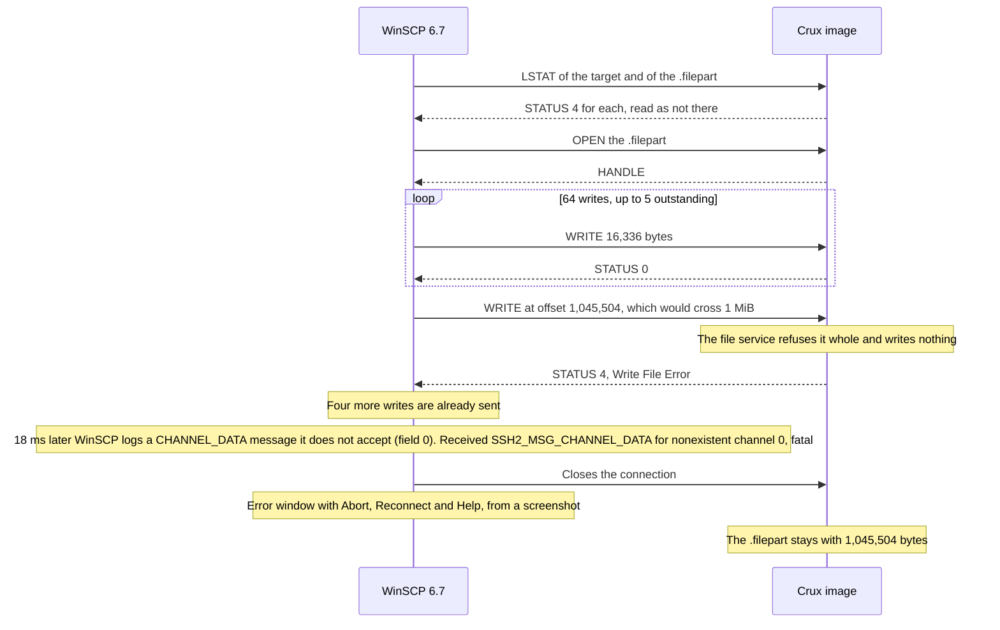

# SFTP over the file service

Status: merged in [PR #264](https://github.com/wonny-labs/crux-pilot/pull/264), with the WinSCP runs of [PR #303](https://github.com/wonny-labs/crux-pilot/pull/303) and [PR #308](https://github.com/wonny-labs/crux-pilot/pull/308), for Issue #194. It runs on Host, on `native_sim` against the provider of #192, and in [the integrated image](ssh-integrated-image.md) of [PR #313](https://github.com/wonny-labs/crux-pilot/pull/313). [Gate #183](https://github.com/wonny-labs/crux-pilot/issues/183#issuecomment-6617722497) has passed, and the owner approved this work in advance. It authorises no hardware operation.

This document says what is built, what is faked, what is untested, and which decisions were taken for lack of an answer. The evidence is of six kinds, and none implies another.

| Kind | What ran | What it shows |
| --- | --- | --- |
| Host, fake provider | `Ssh.sftp`, on the real file service and Access core, with fake File and crypto | What the port owes the file service |
| Host, real wolfSSH | `scripts/test-ssh-sftp-openssh.sh`: OpenSSH 9.6 against the unedited wolfSSH handlers on Linux, through the real port and file service, on the Linux File provider | That the port works with the real handlers and a real client. **The server stands in for the provider** |
| `native_sim`, real provider | `scripts/test-ssh-sftp-native.sh`: OpenSSH 9.6 against the provider of #192, merged in #265, the real access adapter, the port, the file service, and real FatFs over a RAM disk | The acceptance path of #194. **Run on this branch with `main` merged**: 28 cases and the idle case pass. Access ports and the host key are test ones |
| Target compile | `scripts/test-ssh-wolf-settings.sh` and `scripts/test-ssh-sftp-compile.sh` | That it compiles for RT1060 and `native_sim`. Nothing ran |
| Read from source | wolfSSH v1.6.0 `8221e4e`, WinSCP `246bbd4` | What each of them should do. Each statement says so |
| A recorded WinSCP run | WinSCP 6.7 on Windows 11, over a network, against the `native_sim` image of `main` (`f15f69a`), test accounts, a RAM disk and test Access ports. Evidence: three WinSCP 6.7 Debug 1 logs of the run of 7 November 2026, the tester's report with screenshots, server-side records, and the author's investigation, kept as unpublished notes. **None of it is published**; the comments on #194 summarise the tester's report | What WinSCP sent and showed in that run, **as the author read it**. A second short run with keepalive on is recorded without a WinSCP log. One client version, no board. See [the first run](#the-first-run) |

**OpenSSH on `native_sim` passes on `main`**, through the provider of #192 as merged in #265 (`af4c9e6`): 28 cases and the idle case. See [Acceptance](#acceptance).

## What is built

| File | Owns | Tested by |
| --- | --- | --- |
| `components/ssh/sftp/port/crux_ssh_sftp_ops.h` | The operations, with no wolfSSH type | All of the below |
| `components/ssh/sftp/crux_ssh_sftp.c` | `crux_ssh_sftp_open` and `close`, and the operations on the file service | `Ssh.sftp`, and the OpenSSH cases |
| `components/ssh/sftp/crux_ssh_sftp_refuse.c` | The same names, all refusing, for an image with no file service | `Ssh.sftp_stub` |
| `components/ssh/sftp/port/myFilesystem.h` | The macros, each one call | `Ssh.sftp_port_shape`, and the OpenSSH cases |
| `components/ssh/sftp/port/crux_ssh_sftp_port.c` | Translation to `WS_SFTP_FILEATRB` and `WS_SFTPNAME` | The OpenSSH cases. The Host build has no wolfSSH |
| `tests/ssh/sftp/openssh/` | The Linux proof server, and the cases that both kinds of server run | Itself |
| `tests/ssh/sftp/native_sim/` | The image for the provider of #192 | Itself |

**The port is enough, so the mount fallback is not selected.** That is the decision the issue asks for. Each macro receives the session through `fs`, with no thread-local state, and no wolfSSH file is edited.

### Requests and what answers them

Each statement about a status was seen on the wire in `wire_a_refused_open_is_a_general_failure` or a case beside it, except a failure from the port itself in `FSTAT` and in `CLOSE`, which no client can provoke here, and which is read from source (`wolfsftp.c:5958` and the `RecvClose` handler). A client can send an unknown handle, and wolfSSH answers that alone: `CLOSE` gets `FAILURE`, "Close File Error", and `FSTAT` ends that client's connection with no status.

| SFTP request | Port | Service | On refusal the client gets |
| --- | --- | --- | --- |
| `INIT`, `REALPATH` | None. `WGETCWD` gives `/` once | None | Handled by wolfSSH. See [long paths](#long-paths) |
| `OPENDIR`, `READDIR`, `CLOSE` | `WOPENDIR`, `SFTP_Name_readdir`, `WCLOSEDIR` | `area_next` at the root, `dir_*` in an area | `OPENDIR`: `NO_SUCH_FILE`. `READDIR`: see [listing limits](#limits) |
| `STAT`, `LSTAT` | `SFTP_GetAttributes` | `stat`, `area_next` | `FAILURE`, "STAT error" or "LSTAT error" |
| `FSTAT` | `SFTP_GetAttributes_Handle` | `size` | `FAILURE`, "STAT error", from source. An unknown handle ends the connection |
| `OPEN` | `WOPEN` | `open`, after a `stat` that wolfSSH always does first | `FAILURE`, "Open File Error". An area or the root: `FAILURE`, "Not A File" |
| `READ` | `WPREAD` | `read`. Past the end is `EOF` | `FAILURE` |
| `WRITE` | `WPWRITE`, or `WWRITE` for `APPEND` | `write` | `FAILURE`, "Write File Error" |
| `CLOSE` | `WCLOSE` | `close` | `FAILURE` if the close reports an error, from source. An unknown handle: `FAILURE`, "Close File Error" |
| `REMOVE`, `RENAME` | `WREMOVE`, `WRENAME` | `remove`, `rename`. Across areas stops in the port | `FAILURE` |
| `SETSTAT` | `WCHMOD`, `WSETTIME` | `area_next`: accepted with no effect for a visible area | `FAILURE`. Size or owner: `OP_UNSUPPORTED` |
| `FSETSTAT` | `WFCHMOD`, `WFSETTIME` | `size`, which checks the session: accepted with no effect on a live one | `FAILURE`. Size or owner: `OP_UNSUPPORTED` |
| `MKDIR`, `RMDIR` | Macros give `WS_PERMISSIONS` | Only to record a hidden area | `PERMISSION_DENIED`, always |
| `SYMLINK`, `READLINK`, others | None | None | `FAILURE`, "Unknown/Unsupported packet type". The design asked for "permission or unsupported", and wolfSSH has only this |

### Open flags

| SFTP flags | Service mode |
| --- | --- |
| `READ` | `OPEN_READ` |
| `WRITE`, or `READ` and `WRITE` | `OPEN_DIRECT` |
| ... with `CREAT` | `OPEN_DIRECT_CREATE` |
| ... with `CREAT`, `TRUNC` | `OPEN_DIRECT_TRUNCATE` |
| ... with `CREAT`, `EXCL`, and `TRUNC` or not | `OPEN_DIRECT_EXCLUSIVE` |
| ... with `APPEND` added | As above, and each write goes to the current end |
| `TRUNC` or `EXCL` without `CREAT`, or any of `CREAT`, `TRUNC`, `EXCL`, `APPEND` without `WRITE`, or neither `READ` nor `WRITE` | Refused before the service. The file service states no meaning for them |

## How a refused `OPEN` reaches the client

**As `SSH_FX_FAILURE`, code 4, with the text "Open File Error". This is settled, and a permission status is not available without patching wolfSSH.** There are two exceptions. An `OPEN` of an area the session can see, or of the root, gets `FAILURE` with "Not A File", because wolfSSH's own `stat` stops it before the port. And a path of 256 bytes or more ends the connection: see [long paths](#long-paths).

| Question | Answer, from `src/wolfsftp.c` at v1.6.0, and seen on the wire |
| --- | --- |
| Does `WOLFSSH_SFTP_ERRNO` exist? | No, as the contract found. Nothing replaces it |
| What does `WOPEN` returning below zero give? | `WOLFSSH_FTP_FAILURE`, "Open File Error", `:2590` to `:2599`. There is no input to it but the sign |
| Can any path send a permission status for `OPEN`? | Only `GetAndCleanPath` returning `WS_PERMISSIONS`, `:2487`, which only the confinement root can cause. That is one prefix for a session, it runs before the port, and it knows nothing of a session's rights |
| Does the session survive? | Yes. A queued status makes `wolfSSH_SFTP_read` succeed, `:1884` and `:1895`, and each case goes on to the next request |

| Option | Result | Decision |
| --- | --- | --- |
| Accept the general failure | Every refusal looks the same to a client. A security event records the cause for some of them and not all: see [the next table](#each-refusal-and-its-event) | **Chosen** |
| Set the confinement root per request | Not possible: it is one string, and an area and a hidden area sit side by side | No |
| Patch the handler | A security-relevant fork, which the design rejects and the issue forbids without owner approval | Not selected. It would be the only way to a permission status |
| Rewrite the status in the provider | Needs a parser on the data path, for one word | No |

It has one benefit: **a client cannot tell a denial from a missing file**, which the file service contract asks of an adapter for a hidden area, and which holds here for `OPEN`, `STAT` and `REMOVE`. The cost falls on the operator: WinSCP adds its own text about Error code 4, whose list of common reasons has no mention of permissions, so a denied user is told about full disks. The recorded run showed exactly this: see [what WinSCP shows an operator](#what-winscp-shows-an-operator). User documentation should say so.

`REMOVE` and `RENAME` work the same way: `:4996` and `:5088` look only at the sign. `MKDIR` and `RMDIR` are the only two where a port can choose, and the port always says permission denied, since there are no directories to make.

### Each refusal and its event

The design asks for a refusal status and a security event for a rejected file operation, and gate #183's "Hiding" asks for a denial event on direct use of something hidden. **So every use of a hidden area that reaches the port records a denial, and many other refusals record nothing.** The last column says why.

| Refusal | The client gets | Event | Why |
| --- | --- | --- | --- |
| Direct use of a hidden area: `STAT`, `LSTAT`, `SETSTAT`, `OPENDIR`, `REMOVE`, `MKDIR`, `RMDIR`, an area or a file in it, an `OPEN` with flags that mean nothing or past the session's bound, an `OPENDIR` past it | As for a missing one, by request | `access.permission_denied`, once for each call of the port | Hiding. For requests that do not reach the service, the port asks it with a `stat` that stops at the permission, and it changes nothing |
| `OPEN` in a hidden area | "Open File Error" | **Two** denials | wolfSSH's `stat` before `OPEN` is a call of its own |
| `RENAME` naming a hidden area, including across areas | "Rename File Error" | One denial for each hidden area named. **Two** for one hidden area when the other path holds a refused name, as in `RENAME /data/doc /data/my file` | Hiding. The refused name is reported for itself, and the other path is then still direct use |
| Missing area | As for a hidden one | None | No area exists to record it against, and the service says the same. So the two differ in the log, and on the wire they do not |
| Session may read and not write: `OPEN` to write, `REMOVE`, `RENAME` | `FAILURE` | One denial | The service's check |
| Session may write and not read: `OPEN` to read, `STAT` of a file, `OPENDIR` | `FAILURE`, or `NO_SUCH_FILE` for `OPENDIR` | One denial, and two for `OPEN` | The service's check, and wolfSSH's `stat` |
| The same session's successful upload | Success | One denial, from wolfSSH's `stat` before `OPEN` | The port cannot tell it from a client's `STAT` |
| Read-only area (no write permission declared): any write | `FAILURE` | None | The file service contract: the session holds what was checked |
| Write mode that the area does not offer | `FAILURE` | None | The same |
| Name that the rule refuses, in an area the session can read | `FAILURE` | `file.name_rejected`, area only. **Twice** for `OPEN`, as above | The service's rule |
| The same, with write permission alone | `FAILURE` | `file.name_rejected`, area only, by a rename of the text onto itself, which needs write permission and can change nothing | The service's rule. For `OPEN`, one from `stat` and one from `OPEN`, and no denial |
| The same, in a hidden area | As for a hidden area | Denial only | The name is not looked at |
| The same, with no such area, or a bad area name | `FAILURE` | None | No area to record it against |
| `REMOVE` or `RENAME` of an area that the session may write | `FAILURE` | `file.name_rejected`: the name is empty | The service's rule |
| The same, may read and not write | `FAILURE` | One denial | The service's check |
| `OPEN` of an area it can see | "Not A File" | None | wolfSSH stops it before the port. Its `stat` succeeded |
| `OPENDIR` of a file in an area it can see | `NO_SUCH_FILE` | None | No rule was broken, and the file service has no event for it |
| `REMOVE`, `RENAME`, `OPEN` of the root | `FAILURE` | None | No area to record it against |
| `RENAME` across areas it can see | `FAILURE` | None | The port refuses, and `crux_file_service_rename` takes one area. No event identifier fits |
| `OPEN` with flags that mean nothing, in an area it can see | `FAILURE` | None | Not a permission. No event identifier fits |
| Past `CRUX_SSH_SFTP_FILES_MAX` or `DIRS_MAX`, in an area it can see | `FAILURE` or `NO_SUCH_FILE` | None | A resource bound, not a permission. No event identifier fits |
| The service's pools, reservations and a busy name or listing | `FAILURE`, or `NO_SUCH_FILE` for `OPENDIR` | None | The contract gives `ERR_NO_RESOURCES` and `ERR_BUSY` no event |
| A limit, a sparse write | "Write File Error", or "Open File Error" for entries | None | The contract gives `ERR_LIMIT` and `ERR_OUT_OF_RANGE` no event |
| A full medium, a storage failure | `FAILURE` | `file.storage_failed` | The service |
| `MKDIR`, `RMDIR` in an area it can see | `PERMISSION_DENIED` | None, except that a name the rule refuses records `file.name_rejected`, as anywhere | The operation does not exist. The session holds what it holds |
| `SETSTAT` with a size or an owner, in any area, hidden or not | `OP_UNSUPPORTED` | None | wolfSSH stops it before the port |
| `SYMLINK`, `READLINK`, other requests, in any area, hidden or not | `FAILURE` | None | No port call exists |
| `REALPATH` of any path, hidden or not | The normalised path | None | wolfSSH answers it from the text, and it reveals nothing |
| A path of 256 bytes or more, in any area | See [long paths](#long-paths) | None | wolfSSH stops it before the port |
| A session that has ended, by logout or otherwise | `FAILURE`, then the connection ends at the next poll | `access.session_invalid`, **one or more** by request: usually two; one for `STAT` of a missing area, `REMOVE /` and `MKDIR /`; three for `STAT` of an area or a refused name, `SETSTAT` of a file and `MKDIR` in an area; four for `OPEN`, counting wolfSSH's own `stat`; five for a rename across areas | Each comes from the port's `crux_access_touch` or a service check. A close asks nothing |
| A session that the idle limit ended | The same | `access.session_expired` once, from the touch, and `access.session_invalid` from the service. Each later request is as above | Access |

Evidence: `case_each_direct_use_of_a_hidden_area_records_a_denial`, `case_what_the_service_records_for_an_area_used_as_a_file` and `case_a_refused_name_is_recorded_once_with_no_text`, `case_a_session_that_has_ended_is_recorded` and `case_a_session_that_expired_is_recorded_first_as_expired` on Host, and `wire_a_refused_name_is_recorded_with_no_text` on both servers, for `file.name_rejected`. The rows with no event are read from the code. The port reaches events only through the file service: its event port is private, and an identifier for the rows that have none would be a change to the file service and #182, which is outside the files of #194, so I did not add one. [#270](https://github.com/wonny-labs/crux-pilot/issues/270) lists them, as a shared change under G-A and #182.

### Long paths

`WOLFSSH_MAX_FILENAME` is 256. Under that length a long name gets the normal refusal. From it, each handler does its own thing, and a handler that returns with no status leaves the server nothing to answer with, so the connection ends. Measured by `wire_a_long_path_depends_on_the_request`:

| Request | At 256 bytes | At 406 bytes |
| --- | --- | --- |
| `OPEN`, `OPENDIR`, `REALPATH`, `MKDIR` | Connection ends | Connection ends |
| `REMOVE` | `FAILURE` | Connection ends |
| `STAT`, `LSTAT`, `RENAME`, `SETSTAT`, `RMDIR` | `FAILURE` | `FAILURE` |

WinSCP can send one, for a long local name.

## Traversal

| Layer | What it does | Evidence |
| --- | --- | --- |
| wolfSSH `wolfSSH_RealPath` | Resolves `.` and `..` lexically, and stops at `/`, so `/data/../../etc/x` arrives as `/etc/x` | `sftp_traversal_reaches_nothing`, with real `get`, `put` and `cd` |
| `crux_file_service_resolve`, the only parser | Refuses anything but `/area`, `/area/` and `/area/name`, and any name that fails the rule | `case_paths_outside_the_rules_reach_nothing` sends 29 raw shapes to every operation, as if wolfSSH had not cleaned them |
| File | Roots and flat names | The file service's own tests |

**`wolfSSH_SFTP_SetConfinePath` adds nothing here, and the port does not ask for it.** The design calls for it as a second defence. But the virtual root is the client's whole namespace, so the root would be `/`, and at `/` wolfSSH treats a session as unconfined (`:2057`). The real second defence is that `resolve` refuses what `RealPath` should have removed, and a test sends it those shapes. See [decision 6](#decisions-for-review).

## The session, and how it ends

| Event | What happens | Evidence |
| --- | --- | --- |
| A request reaches the port | `crux_access_touch`, ignoring the result, so that the service stays the one that decides | `case_activity_keeps_the_session_and_idleness_ends_it` |
| Nothing for the idle limit | The provider's poll of `session_alive` finds it expired, and it ends the connection | The same, and `idle_session_ends_and_activity_does_not` |
| `REALPATH`, the WinSCP keepalive | It reaches no port, so it does not refresh the session, and a client that only keeps alive still ends at the limit. **Seen once with a real WinSCP, as an outcome only**: with keepalive on and the limit at 120 s, two timed connections of one run (and at least one more) each ended at the limit while packets at about the keepalive's rhythm reached the server ([row 13](evidence/sftp-winscp-runs.md#predicted-and-observed)). No WinSCP log was captured, and the packets were not decoded, so that they are the keepalive is an inference. The mechanism rests on the replay and on the source | `idle_session_ends_and_activity_does_not` |
| A quiet WinSCP connection, keepalive off | The connection ended 900 s after its last traffic: see [row 12](evidence/sftp-winscp-runs.md#predicted-and-observed) for what each time rests on. The tester reported that the window kept working on the next click with no prompt. No WinSCP log shows either | The recorded run: see [the first run](#the-first-run) |
| A quiet WinSCP connection, keepalive on, limit lowered to 120 s | Two timed connections of one run (and at least one more) each ended about 120 s after login, with packets reaching the server about every 30 s. No WinSCP log, packets not decoded, one run | [A second run](evidence/sftp-winscp-runs.md#a-second-run-with-keepalive-on) |
| A session ends mid-transfer | The next chunk fails, as the file service says. A close needs no session | `case_a_session_that_ends_fails_the_next_chunk` |
| A client disconnects | Every transfer and listing comes back. A partial direct write stays where it is, and counts against the area | `case_disconnect_keeps_...`, `wire_disconnect_gives_every_handle_back`, `sftp_disconnect_...` |
| The stale rule needs room | Files with the area's `partial_suffix` go, as the file service states (F5) | `case_partial_counts_until_the_stale_rule_needs_its_room`, Host only |

### Bounds

| Bound | Default | Past it |
| --- | --- | --- |
| `CRUX_SSH_SFTP_SESSIONS_MAX`, sessions at once | 4 | `sftp_open` fails, and the connection ends. A composition sets it to at least `max_connections` |
| `CRUX_SSH_SFTP_FILES_MAX`, files per session | 2, below the service's 3, so that no session takes them all | `OPEN` fails before the service, and nothing is created |
| `CRUX_SSH_SFTP_DIRS_MAX`, listings per session | 2 | `OPENDIR` fails |
| `CRUX_FILE_SERVICE_TRANSFER_MAX`, `DIR_MAX`, across sessions | 3, 1 | `OPEN` or `OPENDIR` fails |
| `WOLFSSH_MAX_FILENAME`, each path buffer | 256 | By request: see [long paths](#long-paths) |

A descriptor holds a generation of the session slot. wolfSSH can close what a client left open as it frees the session, so a descriptor from an earlier connection must not match the slot's next owner, whose files the service would close with no session check. It is a defence: the contract already has the provider free wolfSSH first.

## How this fits the provider of #192

Read from `crux_ssh_wolf_provider.c` as merged in #265 (`af4c9e6`), and run through it on `native_sim`. Nothing here asks for a change to it.

| Item | What the provider does | Why it matters here |
| --- | --- | --- |
| When `sftp_open` runs | As soon as `wolfSSH_accept` has recorded the request, and before `INIT` is answered | The handle is set before the loop, so that no request reaches the port without it. The Linux proof server opens after `accept` returns, which also works, as `wolfSSH_accept` answers `INIT` itself and a second `wolfSSH_SFTP_accept` would return `WS_FATAL_ERROR` with no error set |
| Order at the end | `wolfSSH_SFTP_free`, then `wolfSSH_SetFilesystemHandle(NULL)`, then `sftp_close`, then later `wolfSSH_free` | wolfSSH closes what the client left through the port, with a good handle, and the header's rule holds |
| Channel window and packet | 16 KiB each, by default | Below `WOLFSSH_MAX_SFTP_RW`. WinSCP sizes a read by throughput up to the channel's packet (`SftpFileSystem.cpp:2243`), and a `READ` above 32768 makes wolfSSH return with no status (`wolfsftp.c:4650`), which ends the session. **A composition must not raise the packet above 32768** |
| A window smaller than a reply | OpenSSH asks for 32 KiB blocks, and a 1 MiB transfer passes both ways | So the `WS_WINDOW_FULL` path in `serve_sftp`, which #192's document says had never run, must have run in these cases. No counter shows it |
| `wolfSSH_SFTP_read` failing with nothing to send | Ends the connection | Some requests with a long path come back this way: see [long paths](#long-paths) |
| Receive budget | A receive returns would-block after 16 KiB while data waits, and sleeps 1 ms. At `native_sim`'s 100 Hz that is a 10 ms tick, about 1.6 MB/s of what the server receives | A 1 MiB upload ran at 0.62 to 0.77 MB/s, under the budget, and a download at 4.0 to 6.6 MB/s, above it, because the server then receives only requests. Simulation figures only. Why uploads reach about half the budget was not isolated |
| `session_alive` | Polled each `io_timeout_ms` with no request | `idle_session_ends_and_activity_does_not`, with a 4 s limit |
| `max_connections` | The image uses 4 | `CRUX_SSH_SFTP_SESSIONS_MAX` is 4, and a composition keeps it at least as large |
| `CRUX_SSH_SFTP_FILE_SERVICE` | The composition sets it before including `wolf_ssh_settings.cmake` | Without it SFTP is refused, and #192's own image, with its stand-ins, is unaffected: its `sftp_reaches_the_stand_in` and `repository_stand_ins_refuse` still pass with this branch merged |

### Simulation figures

From the image's heap statistics and #192's stack probe, over the 28 cases on `main`, the same as before #265 merged. **`native_sim` only: a 64-bit image, with a host stack under each thread.** They say nothing about a Cortex-M7, and FatFs with `CONFIG_FS_FATFS_LFN_MODE_STACK` adds its own use there.

| Measure | Result |
| --- | --- |
| Host stack, deepest on a worker | 8,768 B, with key login and every SFTP path above |
| Heap peak, with up to four connections | 92,560 B, in a 512 KiB arena, at a 16 KiB window |
| Heap with no client, before and after | 728 B both times, which the script checks |

## WinSCP

**A first run of WinSCP 6.7 is recorded**: see [the first run](#the-first-run), and [predicted and observed](evidence/sftp-winscp-runs.md#predicted-and-observed) for what matched and what did not. It is one run of one client version on `native_sim`, and several things were not run. The table below was read from WinSCP's source at `246bbd4` before the run (`source/core/SftpFileSystem.cpp` unless named), and each request sequence in it is replayed over real OpenSSH in `tests/ssh/sftp/openssh/cases.py`, on Linux and on `native_sim`. A replay shows that the server answers those requests as expected, and it cannot show what WinSCP then does. The run could, for the cases it covered.

| Behaviour | Source | Checked by | Result |
| --- | --- | --- | --- |
| Asks for SFTP version 3 from a server it does not know, and accepts 3 with no extensions | `:3028` to `:3042` | Source, and `winscp_session_start_and_listing` | Version 3, no extensions |
| Starts with `REALPATH .`, and tries a directory with `LSTAT` | `:3485` | Replay | `/`, and a directory |
| An empty listing makes it read `<dir>/..`, except at the root, and a failure there is an error | `:3660` to `:3714` | Replay | wolfSSH resolves it to `/`, which answers |
| It adds `..` itself when the listing has none | `:3718` | Source | The port sends none |
| Below 100 KiB, new file: `OPEN WRITE,CREAT,EXCL`, writes, `CLOSE`, `SETSTAT` with the time | `:5128`, `:5015` | Replay | Works |
| Below 100 KiB, existing file: `EXCL` fails, `LSTAT` finds it, and after confirmation `TRUNC` | `:5163` to `:5198` | Replay | Works. A failed `LSTAT` throws the first error |
| From 100 KiB: `LSTAT` of target and `.filepart`, `OPEN .filepart WRITE,CREAT,TRUNC`, `CLOSE`, `RENAME` | `:4657`, `:4709`, `:4964` | Replay | Works |
| The two `LSTAT`s treat any status but a lost connection as "not there" | `:3786` to `:3811` | Source and replay | `FAILURE` does for `NO_SUCH_FILE` here |
| Over an existing target: `REMOVE`, then `RENAME`, since there is no `posix-rename` here | `:4939` to `:4964` | Replay | Works. The service refuses a rename over a name |
| Resume: reads the partial size, `OPEN WRITE,CREAT`, writes from that offset | `:4709`, `:4848` | Replay, after a killed client | Works, content verified |
| A partial name it cannot create falls back to the target name, in the default smart mode | `:5153` | Replay, with a 60-byte name | Works. So a name of 55 to 63 bytes uploads directly, with no resume |
| `SETSTAT` with the time on the target. A refusal stops the upload with an error | `:4994`, `:5015`, `TextsCore1.rc:107` | Replay | Accepted with no effect |
| It takes a small file with all rights set for a link, and stops resuming | `:4616` | Replay | The port never sends all rights |
| Writes are pipelined in order, and `CLOSE` goes out before the answers are read | `:4888` | Replay in part | wolfSSH handles requests in order, so no sparse write results |
| Block size follows throughput, limited by the channel's maximum packet | `:2243` to `:2296` | Source | See [the provider](#how-this-fits-the-provider-of-192) |
| `REALPATH /` as a keepalive, only if the session is set to send a dummy command | `:2063` to `:2070` | Replay. **Run once with WinSCP, as an outcome only**: keepalive on, limit 120 s, the connection ended at the limit (row 13) | Does not refresh the idle timer. The replay shows the mechanism. The run shows the same outcome and does not prove the mechanism |
| Uses `RENAME`, not `posix-rename`, by default, and no `limits@openssh.com` | `:3352`, `:3884` | Source | This server advertises neither |

**Not settled by the first run:** whether sorting and "synchronize by time" behave sensibly for entries with no time (the run showed only the dates in [the table](evidence/sftp-winscp-runs.md#predicted-and-observed), and the long name, which always says "Jan  1 00:00", was not looked at); how the listing's long name parses; the order of its pipelined requests beyond the two uploads in the logs; and the dialogs that the run did not meet.

### The first run

Two runs of WinSCP 6.7 (build 17845) on Windows 11 are recorded, on 7 November 2026, against the `native_sim` SFTP image of `main` (`f15f69a`) over a network, with test accounts, a RAM disk and test Access ports. Nothing ran on a board. **The record, with every table and the predicted-and-observed comparison, is [the WinSCP evidence record](evidence/sftp-winscp-runs.md).** No log or screenshot is published, because they hold the tester's account, host and path names, so a reader cannot check these statements against them.

| Run | What it showed | Where |
| --- | --- | --- |
| First, keepalive off, idle limit 900 s | As the administrator: connect, list, upload, download (content identical), rename, delete all work. A name outside the rule and every read-only refusal show WinSCP's generic error dialog with code 4. A write-only role cannot list, and WinSCP shows `Error listing directory` after a successful upload. Dates show as `30/12/1899`. An upload past the per-file limit drops the session. | [First run](evidence/sftp-winscp-runs.md#the-first-run), [predicted and observed](evidence/sftp-winscp-runs.md#predicted-and-observed) |
| Second, keepalive on, idle limit 120 s | An idle connection still ended at the idle limit. For the first connection the tester reported a lost-connection message and a reconnection a few seconds later. No WinSCP log was captured. | [Second run](evidence/sftp-winscp-runs.md#a-second-run-with-keepalive-on) |
| Write-only role | After a successful upload the error comes after `Transfer done`, so the upload succeeded. | [Write permission alone](evidence/sftp-winscp-runs.md#a-session-with-write-permission-alone) |
| A name outside the rule (F4) | A name with a space and a Korean name were refused with code 4 and the generic dialog. | [F4](evidence/sftp-winscp-runs.md#a-file-name-outside-the-rule-f4) |

**Not run:** download and delete as the write-only role, an upload of 100 KiB or more by that role, a rekey, two clients at once, any other WinSCP version or Windows client. The limit that ends a session is in [the next sections](#an-upload-past-the-per-file-limit-with-winscp).

### What WinSCP shows an operator

From the first run. The server's own events are in [the table of refusals](#each-refusal-and-its-event).

| WinSCP shows | What it means here | Evidence |
| --- | --- | --- |
| `Error code: 4`, with the server text `Open File Error`, `Rename File Error` or `Remove File Error`, and a list of "common reasons": a name that exists, a directory that exists, another file system, a full file system, a user disk quota | **Any refusal**: a name outside the rule, a missing permission, a name that exists for the write-only role, or a bound. The server sends one general failure by design, and WinSCP's list never mentions a name rule or a permission, so **a user is pointed at disks and quotas**. The cause is in the server's security events for the refusals that have one | Rows 4, 5 and 9 above: the tester's report for names and refusals, log A for the existing name |
| Dates `30/12/1899` or `03/01/0001` for entries | **No time was sent** (F6). `30/12/1899` is the zero of WinSCP's date type, so it is how WinSCP shows an unset time, not a clock fault. Why a file in a read-only area showed `03/01/0001` is **not understood** | Row 10, from the tester's screen |
| `Error listing directory '/inbox'`, `Error code: 2`, right after an upload by the write-only role | The role cannot list. **The upload had finished** (`Transfer done` in the log, and the file complete when read by someone who may read). Check the result as an account that can read | Log C |
| `Cannot create remote file ... Error code: 4 ... Open File Error`, by the write-only role, for a name that was already in the area (by the server log, not by log A) | A name that exists is refused: see [above](evidence/sftp-winscp-runs.md#a-session-with-write-permission-alone). It is not a full disk | Log A |
| After a quiet period, the next click works with no prompt | The connection ended at the idle limit (900 s in the run, from the server side: see row 12). The tester reported that the window kept working with no prompt. **WinSCP logged in again, as seen from the server side. Whether it used stored credentials or a prompt is not recorded, and no WinSCP log shows it.** With keepalive on, see the next row | Row 12 |
| Keepalive on, and a connection idle past the idle limit | **An idle connection still ended at the idle limit** in the second run. For the first connection the tester reported a message that the connection was lost (its text was not captured), and a few seconds later it was connected again. A later disconnect was also reported, after which the tester waited 10 s and reconnected (chat report, no time, no log). So an operator should not expect WinSCP's keepalive to hold a session open on this server (by the replay: this run shows the outcome). The connections ended at the limit, with one limit value of 120 s and no WinSCP log. The message was reported for the first connection only | [A second run](evidence/sftp-winscp-runs.md#a-second-run-with-keepalive-on), the tester's chat report |
| An error window with `Received SSH2_MSG_CHANNEL_DATA for nonexistent channel 0` and Abort, Reconnect and Help, in the middle of a large upload | An upload past the per-file limit: the session is dropped. See [the limit](#an-upload-past-the-per-file-limit-with-winscp) | Log B for the message, the tester's screenshot for the buttons |

## What is faked and what is untested

| Item | State |
| --- | --- |
| The provider | Faked on Host. On Linux, the proof server has its own loop. On `native_sim`, the real one, as merged in #265 |
| Authentication | Real key login on `native_sim`, through the real adapter and `crux_access`, on #192's test ports: a RAM store, a test random generator, and no PSA. On Linux, the proof server accepts every key and takes a session from the user name, with fake crypto |
| Host key | A test key generated at each boot, on `native_sim`. A file on Linux |
| Medium | Fake File in `Ssh.sftp`, the Linux File provider in the Linux run, and real FatFs over a RAM disk on `native_sim`. No card |
| What the cases see of the medium | On Linux, the directory itself. On `native_sim`, the same server's answers, to an account that may read each area |
| WinSCP | One run of 6.7 on Windows 11, and a second short run with keepalive on: see [the first run](#the-first-run) and [the second](evidence/sftp-winscp-runs.md#a-second-run-with-keepalive-on). Not run: download and delete as the write-only role, an upload of 100 KiB or more by that role, a rekey, two clients at once, any other WinSCP version or any other Windows client. Keepalive on was run once, without a WinSCP log and without decoding its packets. The cause of the drop past the per-file limit is open |
| Composition | The acceptance image of #194 is a test one that does not use #242's composition. [The integrated image](ssh-integrated-image.md) of #313 composes SFTP with HTTPS on real PSA providers on `native_sim`. No product composition holds this yet |
| The target | Compiled, never linked with the service, never run. No board was touched |
| Concurrency | Two sessions at once were held open in the cases, but nothing stresses a race |
| Stack and heap on a target | Not measured. See [the simulation figures](#simulation-figures) |
| Throughput | On `native_sim` only: see [the receive budget](#how-this-fits-the-provider-of-192). Not on a target |
| Power loss | Not measured. Direct writes promise nothing across power loss, as the file service says |
| Leaks | ASan and UBSan ran during the Linux cases, but that server is killed, so no leak check runs at its end. On `native_sim` the heap comes back to its baseline |
| The `crux_ssh_callbacks` table on the real operations | Not linked on Host, as it needs a composition. `Ssh.CallbackTable` links the refusing ones |

## Limits

- **A listing error looks like the end of a listing.** wolfSSH ends the batch on any result but success and sends `EOF` for what it has (`wolfsftp.c:4043`, `:4080`), so a storage error or an expired session gives a shorter or empty list, with no error to the client. The port can do nothing about it. A sync tool could take that as files missing, and an event records a storage failure.
- **A listing is one NAME packet.** wolfSSH sets its end flag after the first reply, so the port cannot page. Heap and packet size grow with the entries, which `max_entries` bounds. By reading the code, and not measured, an entry with the longest name takes about 450 bytes of heap at the peak. A failed allocation for an entry also ends the list early.
- **A listing holds the service's only listing handle from `OPENDIR` until read to the end, and a client can keep it.** One is the default. Every other client's `OPENDIR` of an area then gets `NO_SUCH_FILE`, which reads as a missing directory, though the root still lists. A normal client holds it for as long as a read takes. A client that opens one and never reads holds it until it closes or disconnects, or its session ends. **The idle limit does not bound this**, because any request refreshes the session: a held listing outlived the idle limit by sending `STAT` (`idle_session_ends_and_activity_does_not`). The real bound is the session's absolute limit, and a reconnect can then take the handle again. So **any session with read permission on an area, a viewer for one, can stop an administrator listing any area**. See [decision 5](#decisions-for-review).
- **A long path can end the connection**, depending on the request: see [long paths](#long-paths).
- **A write-only session records a denial for each upload**, because wolfSSH's `stat` before `OPEN` needs the read permission. See [the table](#each-refusal-and-its-event) for each refusal. The port cannot tell this `stat` from a client's. Security event counts run higher than the operations.
- **No times.** F6 leaves them out. `SETSTAT` with a time reports success and stores nothing, so a client that preserves timestamps will not find them. The listing's long name always says "Jan  1 00:00". WinSCP shows `30/12/1899` or `03/01/0001`: see [what WinSCP shows an operator](#what-winscp-shows-an-operator).
- **`declared_size` stays zero.** wolfSSH parses the size that WinSCP sends with `OPEN`, and hands it to no port. So an upload that cannot fit fails when it crosses the limit, not before the data. **With WinSCP that ends the session**: see [the next section](#an-upload-past-the-per-file-limit-with-winscp).
- **Direct writes only.** A managed-only area refuses every SFTP write, as the mode table says.

### An upload past the per-file limit with WinSCP

**For operators.** A WinSCP upload larger than the per-file limit does not end with an error for that file. **It ends the session**, and the cause is open.

| What | State |
| --- | --- |
| The session | Dropped. Log B records `Received SSH2_MSG_CHANNEL_DATA for nonexistent channel 0` and ends at `Answer: Abort`. The error window with Abort, Reconnect and Help is from the tester's screenshot. According to the tester, after Abort the file list is gone until Reconnect, and Reconnect works |
| The partial file | **It stays.** It was `<name>.filepart` in the `data` area, 1,045,504 bytes both times, and it counts against the area's bytes and entries. A later create or write that would hit a limit may remove it, under the stale rule of the file service (F5), because the `data` area of this image declares `.filepart`. An area with no partial suffix never removes it |
| Stored data | Nothing was seen to be damaged, but **the only thing checked was the size of the partial file**, which is exactly the writes that were accepted. The refused write stored nothing, as the file service says. The partial's content was not compared with the source and the files around it were not compared. Because the cause is open, and one candidate is damage in the server's memory, "no damage" is not shown |
| What to tell a user | Keep a file under the per-file limit (1 MiB in this image), reconnect, and remove the partial |
| How often | Twice out of two with WinSCP 6.7 |
| The cause | **Not understood.** No fix is made: see decision 18 |

What the log shows (WinSCP 6.7 Debug 1 log, run of 7 November 2026, log B):

| Observation | Value |
| --- | --- |
| File | 2,077,166 bytes, uploaded to a `.filepart` name, which is the path for 100 KiB or more |
| Limits | 1 MiB per file, 3 MiB per area, 16 entries per area. The `data` area declares `.filepart` as its partial suffix |
| WinSCP's writes | `SSH_FXP_WRITE` of 16,336 bytes each, up to 5 outstanding |
| Accepted | 64 writes, each answered with status 0: 64 x 16,336 = 1,045,504 bytes, which is the size of the partial file |
| Refused | The 65th write, at offset 1,045,504, got status 4, "Write File Error". It is refused whole because it would cross 1,048,576, as the file service contract says. OpenSSH with 32 KiB writes stopped at exactly 1,048,576 |
| After the refusal | Four more writes were already sent (the last at offset 1,110,848). About 18 ms after the status, WinSCP logged `Received SSH2_MSG_CHANNEL_DATA for nonexistent channel 0`, an SSH-level error that it treats as fatal, and closed the connection |

**What the investigation found.** This is the author's investigation of 7 November 2026, kept as unpublished notes and summarised here, so it cannot be checked from this repository. It could not reproduce the drop, and no code that it read explains it:

| Question | Answer |
| --- | --- |
| Reproduced without WinSCP? | **No.** About 40 runs, on the image and on the Linux proof server, with a client that uses channel id 256 as WinSCP does and keeps reading after the first error, with delays and chunking, and with PuTTY 0.81 `psftp`, whose SSH layer WinSCP derives from. **In every paramiko run** the refusal got status 4, later writes got status 4, every server message named the client's channel, and the session went on. `psftp` stops at the first error, so channel messages are not applicable to it. The runs with a read-only account and a closed handle tested other error paths, not the limit |
| What does the message mean? | WinSCP prints the first 32-bit field of the packet. Its first channel id is 256. PuTTY's reader returns 0 for a packet shorter than 4 bytes. So the packet had recipient 0 **or** a body shorter than 4 bytes |
| Is the packet the server's? | Probably, as an inference with no capture: with the cipher and MAC of the run (aes128-ctr, HMAC-SHA-256) a packet changed on the way would have failed the MAC first |
| Does the code send one? | None that it read. The refused write takes the same path as an accepted one, except for the status text, and every data packet is addressed to the channel's peer id, which is set once when the channel opens |
| Where is it then? | **Not located.** The candidates are memory damage in the server that zeroes a field, a path that only WinSCP's traffic reaches, and the network path of the test. Each is a hypothesis, not a finding |

**What would settle it**, and what it needs:

| Step | Needs |
| --- | --- |
| The same WinSCP upload against a debug image with wolfSSH logging on (a build setting, `DEBUG_WOLFSSH`, which needs no edit to wolfSSH, as the investigation used on a scratch copy), and the server log | The tester at the Windows machine, and a rebuilt image |
| The same upload with PuTTY's `psftp.exe -sshrawlog`, which logs the decrypted packet that breaks the session | The tester at the Windows machine |
| A diagnostic log of the peer channel and payload size inside wolfSSH's data send | **A patch to wolfSSH, which needs the owner's approval**, as issue #194 says, even for a scratch build |

**Not run:** a retry of the same upload (it would find the partial file), an upload past the limit as the write-only role, an area with no partial suffix, and any WinSCP other than 6.7.

## Decisions for review

Each was taken without asking, as the narrow and safer choice.

| # | Decision | Why | Alternative |
| --- | --- | --- | --- |
| 1 | A refused `OPEN` is a general failure | No other path without a patch, and it hides denial from absence | Ask the owner to approve a wolfSSH patch |
| 2 | The port is selected, not the mount fallback | It works | None needed |
| 3 | A composition opts in with `CRUX_SSH_SFTP_FILE_SERVICE`, and without it SFTP is refused | So the settings probe and #192 keep linking with no file system, and an image that forgets is closed. No shared file changes | Default on, and the probe opts out, one line in a shared file |
| 4 | 2 files and 2 listings per session, 4 sessions | Each tested client holds one at a time | Larger, at the cost of one session starving others |
| 5 | A listing holds its service handle from `OPENDIR`, not from the first read | wolfSSH turns a read failure into an empty list, so a busy service would look like an empty area, and a sync tool could act on that. A wrong listing is worse than a stalled one. **The cost is that a viewer can stop an administrator listing, up to the session's absolute limit** | Take it at the first read, with a chance of false empty lists. Or a composition raises `CRUX_FILE_SERVICE_DIR_MAX`, which only helps with `CRUX_FILE_DIR_POOL_SIZE` raised too: File's pool is 2, and without that a second listing takes the handle that the stale rule needs. Neither removes the risk, as each session can hold two |
| 6 | `wolfSSH_SFTP_SetConfinePath` is not used | At `/` it has no effect, and the second defence is `resolve` | Put the areas under a prefix, which changes what clients see |
| 7 | Flag sets the service states no meaning for are refused | Narrow | Follow POSIX for each |
| 8 | `SETSTAT` is accepted with no effect for an area the session can see, with no file check | A write-only client must finish an upload, and it costs no storage | Check the file, which breaks write-only uploads |
| 9 | Size and owner in `SETSTAT` are `OP_UNSUPPORTED` | Silently ignoring a truncate would be a false success | Accept them |
| 10 | `WOLFSSH_MAX_FILENAME` is 256, up from the refusing port's 64 | 64 could not hold the 80 bytes the service accepts, and more room means more long names get a refusal and not a disconnect | Lower, for the stack |
| 11 | A refused name reaches the service by cutting the first component, only to record the event, with a `stat` if the session may read and a rename of the text onto itself if it may only write | `resolve` is the only parser and emits nothing, and the contract wants the event. The text goes only to the rule that refuses it, and the path is refused whatever the answer | Skip the event |
| 12 | Every request that reaches the port counts as activity, refused ones included | It is a client that is there, and the absolute limit still applies | Count only those that succeed |
| 13 | Rights: file `0644`, `0444` or `0200`, area `0755`, `0555` or `0300`, root `0555` | The design derives them from the session, and these are never all set, which WinSCP would read as a link | Other values |
| 14 | A Linux proof server and its cases live in `tests/ssh/sftp/openssh` | The issue asks for proof first, and #192 did not exist when this began. It builds only from its script. It stays because a run takes seconds, and because only it can look at the medium itself | Remove it now that the image runs |
| 15 | The `native_sim` image is in `tests/ssh/sftp/native_sim`, and reuses #192's test Access ports and keys by path | So that it stays within the files of #194, and adds no copy of them. It needs the provider, which `main` holds since #265, and on a tree without it the script says so | Add cases to `tests/zephyr/ssh_provider`, as #192's document suggests, which changes #192's files |
| 16 | The port records direct use of a hidden area with a service `stat` that stops at the permission, and sends `REMOVE` and `RENAME` of an area to the service with an empty name | So that Hiding holds with no new interface, and the one rule that decides stays in the service | A new service call for each |
| 17 | No new event identifier for the refusals with none, and a rule outside the file service does not emit one | The event port is the service's, and a new identifier changes the service and #182, outside the files of #194 | Add identifiers in [#270](https://github.com/wonny-labs/crux-pilot/issues/270), as a shared change under G-A and #182 |
| 18 | The upload past the per-file limit is documented as a limit, and no code changes for it | No cause was found, so a change would be a guess. A debug build with wolfSSH logging needs no wolfSSH edit. Only a diagnostic patch inside wolfSSH would, and that needs the owner's approval | A diagnostic wolfSSH build, or a composition change (a larger window, which costs heap per connection), neither with evidence that it helps |

## Follow-ups on #179

They are in the file service, outside the files of #194, and none blocks this.

| Item | Effect here |
| --- | --- |
| A STAT hook test for `rename` during the stale rule | None. It is a test of the service |
| `scripts/test-file-service.sh` is not in CI | None |
| A client removal during the stale rule gives one false `ERR_LIMIT`, and a retry succeeds | One write can fail with "Write File Error". An SFTP client stops that transfer, and a retry resumes it. The service's rule stands |

## Acceptance

| Criterion of #194 | State |
| --- | --- |
| Prove the port first | **Met**, with the unedited wolfSSH handlers |
| Attributes, directory reads and permission errors | **Met**. `WOLFSSH_SFTP_ERRNO` does not exist, and permission errors are as above |
| Virtual root and direct write mode | **Met** |
| Confinement as a second defence | **Not as written**: [decision 6](#decisions-for-review) |
| Traversal, permission, capacity and disconnect with OpenSSH on `native_sim` | **Met** on `main`, with the provider as merged in #265: 28 cases and the idle case |
| Rename and partial files follow the file service | **Met** on Host, on Linux and on `native_sim`. The stale rule's removal is Host only |
| A recorded decision if the port cannot do this | **Recorded**: it can, and the fallback is not selected |
| WinSCP | **A first run and a second, short run are recorded, and two things stay open.** WinSCP 6.7 on Windows 11 ran against the `native_sim` image of `main` on 7 November 2026 (see [the first run](#the-first-run), [predicted and observed](evidence/sftp-winscp-runs.md#predicted-and-observed) and [a second run](evidence/sftp-winscp-runs.md#a-second-run-with-keepalive-on)). Rows 1 to 7 and 10 to 12 matched, and row 13 is consistent as an outcome only (server side, mechanism not shown by the run). **Open:** an upload past the per-file limit drops the session, cause not understood ([the limit](#an-upload-past-the-per-file-limit-with-winscp)); and download and delete as the write-only role were not run. **Run once:** keepalive on, with no WinSCP log and no decoded packets. Why a write-only upload to an existing name is refused is consistent with an exclusive create and is not recorded as a decision |

## How to run

| Command | Needs | Result here |
| --- | --- | --- |
| `ctest -R '^Ssh\.sftp'` in the Host build | Nothing more | In the PR |
| `scripts/test-ssh-sftp-openssh.sh` | `wolfssl` and `wolfssh` at their pins, `ssh`, `sftp`, `openssl` | In the PR |
| `scripts/test-ssh-sftp-native.sh` | That, and `fatfs`. The provider is in `main` since #265 | In the PR |
| `scripts/test-ssh-wolf-settings.sh --target --native`, then `scripts/test-ssh-sftp-compile.sh` | The `crux-secure-management` west group | In the PR |
