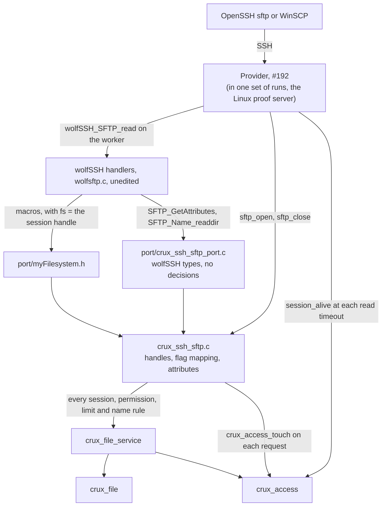
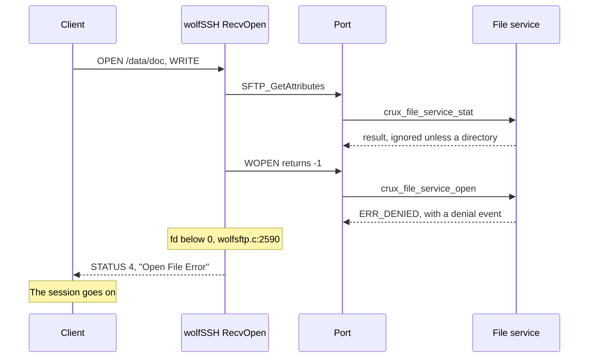
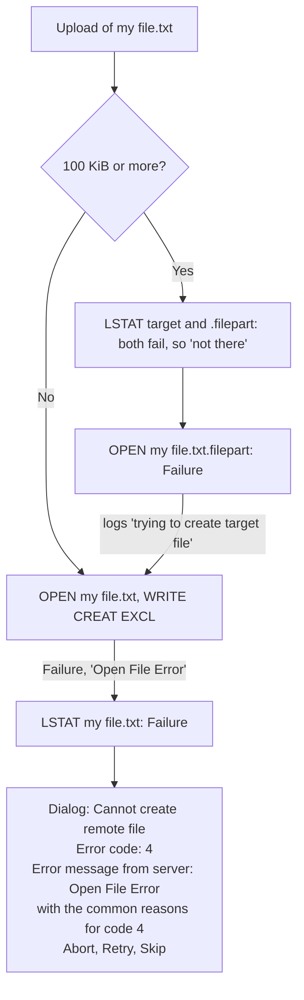

# SFTP over the file service

Status: implemented on Host, Issue #194, for review. [Gate #183](https://github.com/wonny-labs/crux-pilot/issues/183#issuecomment-6617722497) has passed, and the owner approved this work in advance. It authorises no hardware operation.

This document says what is built, what is faked, what is untested, and which decisions were taken for lack of an answer. The evidence is of five kinds, and none implies another.

| Kind | What ran | What it shows |
| --- | --- | --- |
| Host, fake provider | `Ssh.sftp`, on the real file service and Access core, with fake File and crypto | What the port owes the file service |
| Host, real wolfSSH | `scripts/test-ssh-sftp-openssh.sh`: OpenSSH 9.6 against the unedited wolfSSH handlers on Linux, through the real port and file service, on the Linux File provider | That the port works with the real handlers and a real client. **The server stands in for the provider** |
| `native_sim`, real provider | `scripts/test-ssh-sftp-native.sh`: OpenSSH 9.6 against the provider of #192, the real access adapter, the port, the file service, and real FatFs over a RAM disk | The acceptance path of #194. **Run on a scratch merge with #192's branch**, because #192 has not merged. Access ports and the host key are test ones |
| Target compile | `scripts/test-ssh-wolf-settings.sh` and `scripts/test-ssh-sftp-compile.sh` | That it compiles for RT1060 and `native_sim`. Nothing ran |
| Read from source | wolfSSH v1.6.0 `8221e4e`, WinSCP `246bbd4` | What each of them should do. Each statement says so |

**OpenSSH on `native_sim` passes on a merge with #192's branch, and it must be repeated once #192 has merged:** on this branch alone, `scripts/test-ssh-sftp-native.sh` says that it needs the provider, and stops. See [Acceptance](#acceptance).

## What is built

| File | Owns | Tested by |
| --- | --- | --- |
| `components/ssh/sftp/port/crux_ssh_sftp_ops.h` | The operations, with no wolfSSH type | All of the below |
| `components/ssh/sftp/crux_ssh_sftp.c` | `crux_ssh_sftp_open` and `close`, and the operations on the file service | `Ssh.sftp`, and the OpenSSH cases |
| `components/ssh/sftp/crux_ssh_sftp_refuse.c` | The same names, all refusing, for an image with no file service | `Ssh.sftp_stub` |
| `components/ssh/sftp/port/myFilesystem.h` | The macros, each one call | `Ssh.sftp_port_shape`, and the OpenSSH cases |
| `components/ssh/sftp/port/crux_ssh_sftp_port.c` | Translation to `WS_SFTP_FILEATRB` and `WS_SFTPNAME` | The OpenSSH cases. The Host build has no wolfSSH |
| `tests/ssh/sftp/openssh/` | The Linux proof server, and the cases that both kinds of server run | Itself |
| `tests/ssh/sftp/native_sim/` | The image for the provider of #192 | Itself |

**The port is enough, so the mount fallback is not selected.** That is the decision the issue asks for. Each macro receives the session through `fs`, with no thread-local state, and no wolfSSH file is edited.

### Requests and what answers them

Each statement about a status was seen on the wire in `wire_a_refused_open_is_a_general_failure` or a case beside it.

| SFTP request | Port | Service | On refusal the client gets |
| --- | --- | --- | --- |
| `INIT`, `REALPATH` | None. `WGETCWD` gives `/` once | None | Handled by wolfSSH. A path of 256 bytes or more ends the connection |
| `OPENDIR`, `READDIR`, `CLOSE` | `WOPENDIR`, `SFTP_Name_readdir`, `WCLOSEDIR` | `area_next` at the root, `dir_*` in an area | `OPENDIR`: `NO_SUCH_FILE`. `READDIR`: see [listing limits](#limits) |
| `STAT`, `LSTAT` | `SFTP_GetAttributes` | `stat`, `area_next` | `FAILURE`, "STAT error" or "LSTAT error" |
| `FSTAT` | `SFTP_GetAttributes_Handle` | `size` | `FAILURE`, "STAT error" |
| `OPEN` | `WOPEN` | `open`, after a `stat` that wolfSSH always does first | `FAILURE`, "Open File Error". A directory: `FAILURE`, "Not A File" |
| `READ` | `WPREAD` | `read`. Past the end is `EOF` | `FAILURE` |
| `WRITE` | `WPWRITE`, or `WWRITE` for `APPEND` | `write` | `FAILURE`, "Write File Error" |
| `CLOSE` | `WCLOSE` | `close` | `FAILURE` if the close reports an error |
| `REMOVE`, `RENAME` | `WREMOVE`, `WRENAME` | `remove`, `rename`. Across areas stops in the port | `FAILURE` |
| `SETSTAT`, `FSETSTAT` | `WCHMOD`, `WSETTIME` and the handle forms | None: accepted with no effect for a visible area | `FAILURE`. Size or owner: `OP_UNSUPPORTED` |
| `MKDIR`, `RMDIR` | Macros give `WS_PERMISSIONS` | None | `PERMISSION_DENIED`, always |
| `SYMLINK`, `READLINK`, others | None | None | `FAILURE`, "Unknown/Unsupported packet type". The design asked for "permission or unsupported", and wolfSSH has only this |

### Open flags

| SFTP flags | Service mode |
| --- | --- |
| `READ` | `OPEN_READ` |
| `WRITE`, or `READ` and `WRITE` | `OPEN_DIRECT` |
| ... with `CREAT` | `OPEN_DIRECT_CREATE` |
| ... with `CREAT`, `TRUNC` | `OPEN_DIRECT_TRUNCATE` |
| ... with `CREAT`, `EXCL`, and `TRUNC` or not | `OPEN_DIRECT_EXCLUSIVE` |
| ... with `APPEND` added | As above, and each write goes to the current end |
| `TRUNC` or `EXCL` without `CREAT`, or any of `CREAT`, `TRUNC`, `EXCL`, `APPEND` without `WRITE`, or neither `READ` nor `WRITE` | Refused before the service. The file service states no meaning for them |

## How a refused `OPEN` reaches the client

**As `SSH_FX_FAILURE`, code 4, with the text "Open File Error". This is settled, and a permission status is not available without patching wolfSSH.**

| Question | Answer, from `src/wolfsftp.c` at v1.6.0, and seen on the wire |
| --- | --- |
| Does `WOLFSSH_SFTP_ERRNO` exist? | No, as the contract found. Nothing replaces it |
| What does `WOPEN` returning below zero give? | `WOLFSSH_FTP_FAILURE`, "Open File Error", `:2590` to `:2599`. There is no input to it but the sign |
| Can any path send a permission status for `OPEN`? | Only `GetAndCleanPath` returning `WS_PERMISSIONS`, `:2487`, which only the confinement root can cause. That is one prefix for a session, it runs before the port, and it knows nothing of a session's rights |
| Does the session survive? | Yes. A queued status makes `wolfSSH_SFTP_read` succeed, `:1884` and `:1895`, and each case goes on to the next request |

| Option | Result | Decision |
| --- | --- | --- |
| Accept the general failure | Every refusal looks the same to a client. The cause is in a security event: a permission denial from `crux_access_check`, `file.name_rejected` or `file.storage_failed`. A limit, a busy name and a read-only area record none, as the file service states | **Chosen** |
| Set the confinement root per request | Not possible: it is one string, and an area and a hidden area sit side by side | No |
| Patch the handler | A security-relevant fork, which the design rejects and the issue forbids without owner approval | Not selected. It would be the only way to a permission status |
| Rewrite the status in the provider | Needs a parser on the data path, for one word | No |

It has one benefit: **a client cannot tell a denial from a missing file**, which the file service contract asks of an adapter for a hidden area, and which holds here for `OPEN`, `STAT` and `REMOVE`. The cost falls on the operator: WinSCP adds its own text about Error code 4, whose list of common reasons has no mention of permissions, so a denied user is told about full disks. User documentation should say so.

`REMOVE` and `RENAME` work the same way: `:4996` and `:5088` look only at the sign. `MKDIR` and `RMDIR` are the only two where a port can choose, and the port always says permission denied, since there are no directories to make.

## Traversal

| Layer | What it does | Evidence |
| --- | --- | --- |
| wolfSSH `wolfSSH_RealPath` | Resolves `.` and `..` lexically, and stops at `/`, so `/data/../../etc/x` arrives as `/etc/x` | `sftp_traversal_reaches_nothing`, with real `get`, `put` and `cd` |
| `crux_file_service_resolve`, the only parser | Refuses anything but `/area`, `/area/` and `/area/name`, and any name that fails the rule | `case_paths_outside_the_rules_reach_nothing` sends 26 raw shapes to every operation, as if wolfSSH had not cleaned them |
| File | Roots and flat names | The file service's own tests |

**`wolfSSH_SFTP_SetConfinePath` adds nothing here, and the port does not ask for it.** The design calls for it as a second defence. But the virtual root is the client's whole namespace, so the root would be `/`, and at `/` wolfSSH treats a session as unconfined (`:2057`). The real second defence is that `resolve` refuses what `RealPath` should have removed, and a test sends it those shapes. See [decision 6](#decisions-for-review).

## The session, and how it ends

| Event | What happens | Evidence |
| --- | --- | --- |
| A request reaches the port | `crux_access_touch`, ignoring the result, so that the service stays the one that decides | `case_activity_keeps_the_session_and_idleness_ends_it` |
| Nothing for the idle limit | The provider's poll of `session_alive` finds it expired, and it ends the connection | The same, and `idle_session_ends_and_activity_does_not` |
| `REALPATH`, the WinSCP keepalive | It reaches no port, so it does not refresh the session, and a client that only keeps alive still ends at the limit | `idle_session_ends_and_activity_does_not` |
| A session ends mid-transfer | The next chunk fails, as the file service says. A close needs no session | `case_a_session_that_ends_fails_the_next_chunk` |
| A client disconnects | Every transfer and listing comes back. A partial direct write stays where it is, and counts against the area | `case_disconnect_keeps_...`, `wire_disconnect_gives_every_handle_back`, `sftp_disconnect_...` |
| The stale rule needs room | Files with the area's `partial_suffix` go, as the file service states (F5) | `case_partial_counts_until_the_stale_rule_needs_its_room`, Host only |

### Bounds

| Bound | Default | Past it |
| --- | --- | --- |
| `CRUX_SSH_SFTP_SESSIONS_MAX`, sessions at once | 4 | `sftp_open` fails, and the connection ends. A composition sets it to at least `max_connections` |
| `CRUX_SSH_SFTP_FILES_MAX`, files per session | 2, below the service's 3, so that no session takes them all | `OPEN` fails before the service, and nothing is created |
| `CRUX_SSH_SFTP_DIRS_MAX`, listings per session | 2 | `OPENDIR` fails |
| `CRUX_FILE_SERVICE_TRANSFER_MAX`, `DIR_MAX`, across sessions | 3, 1 | `OPEN` or `OPENDIR` fails |
| `WOLFSSH_MAX_FILENAME`, each path buffer | 256 | The connection ends |

A descriptor holds a generation of the session slot. wolfSSH can close what a client left open as it frees the session, so a descriptor from an earlier connection must not match the slot's next owner, whose files the service would close with no session check. It is a defence: the contract already has the provider free wolfSSH first.

## How this fits the provider of #192

Read from `crux_ssh_wolf_provider.c` at #192's `e787b21`, and run through it on `native_sim`. Nothing here asks #192 for a change.

| Item | What the provider does | Why it matters here |
| --- | --- | --- |
| When `sftp_open` runs | As soon as `wolfSSH_accept` has recorded the request, and before `INIT` is answered | The handle is set before the loop, so that no request reaches the port without it. The Linux proof server opens after `accept` returns, which also works, as `wolfSSH_accept` answers `INIT` itself and a second `wolfSSH_SFTP_accept` would return `WS_FATAL_ERROR` with no error set |
| Order at the end | `wolfSSH_SFTP_free`, then `wolfSSH_SetFilesystemHandle(NULL)`, then `sftp_close`, then later `wolfSSH_free` | wolfSSH closes what the client left through the port, with a good handle, and the header's rule holds |
| Channel window and packet | 16 KiB each, by default | Below `WOLFSSH_MAX_SFTP_RW`. WinSCP sizes a read by throughput up to the channel's packet (`SftpFileSystem.cpp:2243`), and a `READ` above 32768 makes wolfSSH return with no status (`wolfsftp.c:4650`), which ends the session. **A composition must not raise the packet above 32768** |
| A window smaller than a reply | OpenSSH asks for 32 KiB blocks, and a 1 MiB transfer passes both ways | So the `WS_WINDOW_FULL` path in `serve_sftp`, which #192's document says had never run, must have run in these cases. No counter shows it |
| `wolfSSH_SFTP_read` failing with nothing to send | Ends the connection | A path of 256 bytes or more comes back this way, as `wire_a_path_too_long_for_wolfssh_ends_the_connection` shows |
| `session_alive` | Polled each `io_timeout_ms` with no request | `idle_session_ends_and_activity_does_not`, with a 4 s limit |
| `max_connections` | The image uses 4 | `CRUX_SSH_SFTP_SESSIONS_MAX` is 4, and a composition keeps it at least as large |
| `CRUX_SSH_SFTP_FILE_SERVICE` | The composition sets it before including `wolf_ssh_settings.cmake` | Without it SFTP is refused, and #192's own image, with its stand-ins, is unaffected: its `sftp_reaches_the_stand_in` and `repository_stand_ins_refuse` still pass on the merge |

### Simulation figures

From the image's heap statistics and #192's stack probe, over all 25 cases. **`native_sim` only: a 64-bit image, with a host stack under each thread.** They say nothing about a Cortex-M7, and FatFs with `CONFIG_FS_FATFS_LFN_MODE_STACK` adds its own use there.

| Measure | Result |
| --- | --- |
| Host stack, deepest on a worker | 8,768 B, with key login and every SFTP path above |
| Heap peak, with up to four connections | 92,560 B, in a 512 KiB arena, at a 16 KiB window |
| Heap with no client, before and after | 728 B both times, which the script checks |

## WinSCP

No Windows machine is available, so **WinSCP has not run, and the recorded run stays open**. What follows was read from its source at `246bbd4` (`source/core/SftpFileSystem.cpp` unless named), and each request sequence below is replayed over real OpenSSH in `tests/ssh/sftp/openssh/cases.py`, on Linux and on `native_sim`. A replay shows that the server answers those requests as expected, and it cannot show what WinSCP then does.

| Behaviour | Source | Checked by | Result |
| --- | --- | --- | --- |
| Asks for SFTP version 3 from a server it does not know, and accepts 3 with no extensions | `:3028` to `:3042` | Source, and `winscp_session_start_and_listing` | Version 3, no extensions |
| Starts with `REALPATH .`, and tries a directory with `LSTAT` | `:3485` | Replay | `/`, and a directory |
| An empty listing makes it read `<dir>/..`, except at the root, and a failure there is an error | `:3660` to `:3714` | Replay | wolfSSH resolves it to `/`, which answers |
| It adds `..` itself when the listing has none | `:3718` | Source | The port sends none |
| Below 100 KiB, new file: `OPEN WRITE,CREAT,EXCL`, writes, `CLOSE`, `SETSTAT` with the time | `:5128`, `:5015` | Replay | Works |
| Below 100 KiB, existing file: `EXCL` fails, `LSTAT` finds it, and after confirmation `TRUNC` | `:5163` to `:5198` | Replay | Works. A failed `LSTAT` throws the first error |
| From 100 KiB: `LSTAT` of target and `.filepart`, `OPEN .filepart WRITE,CREAT,TRUNC`, `CLOSE`, `RENAME` | `:4657`, `:4709`, `:4964` | Replay | Works |
| The two `LSTAT`s treat any status but a lost connection as "not there" | `:3786` to `:3811` | Source and replay | `FAILURE` does for `NO_SUCH_FILE` here |
| Over an existing target: `REMOVE`, then `RENAME`, since there is no `posix-rename` here | `:4939` to `:4964` | Replay | Works. The service refuses a rename over a name |
| Resume: reads the partial size, `OPEN WRITE,CREAT`, writes from that offset | `:4709`, `:4848` | Replay, after a killed client | Works, content verified |
| A partial name it cannot create falls back to the target name, in the default smart mode | `:5153` | Replay, with a 60-byte name | Works. So a name of 55 to 63 bytes uploads directly, with no resume |
| `SETSTAT` with the time on the target. A refusal stops the upload with an error | `:4994`, `:5015`, `TextsCore1.rc:107` | Replay | Accepted with no effect |
| It takes a small file with all rights set for a link, and stops resuming | `:4616` | Replay | The port never sends all rights |
| Writes are pipelined in order, and `CLOSE` goes out before the answers are read | `:4888` | Replay in part | wolfSSH handles requests in order, so no sparse write results |
| Block size follows throughput, limited by the channel's maximum packet | `:2243` to `:2296` | Source | See [the provider](#how-this-fits-the-provider-of-192) |
| `REALPATH /` as a keepalive, only if the session is set to send a dummy command | `:2063` to `:2070` | Replay | Does not refresh the idle timer |
| Uses `RENAME`, not `posix-rename`, by default, and no `limits@openssh.com` | `:3352`, `:3884` | Source | This server advertises neither |

**Not checked, and only a recorded run can settle them:** what it shows for a file with no time attribute (it gets the long name, which always says "Jan  1 00:00", so sorting and "synchronize by time" are suspect); how the listing's long name parses; the exact order of its pipelined requests; and all of its dialogs.

### A file name with a space (F4)

Accepted decision F4 keeps the name rule, so WinSCP cannot upload `my file.txt`. From its source, with each request refused as shown in `winscp_name_with_a_space_is_refused_at_every_step`:

- It sends nothing that a retry could change, and there is no automatic replacement: `ReplaceInvalidChars` applies to local names on download only (`CopyParam.cpp`, `ChangeFileName`).
- The way round it is a rename by the user, or a file mask in the transfer settings. Nothing about the dialog says that the space is the cause.
- The session goes on, so a batch with Skip continues with the next file.
- Each refused request records `file.name_rejected` with the area and no text, and the `OPEN` records it twice, because wolfSSH's `stat` before it counts too.
- A name with a space that is already on the medium is foreign: it is not listed and cannot be fetched.

## What is faked and what is untested

| Item | State |
| --- | --- |
| The provider | Faked on Host. On Linux, the proof server has its own loop. On `native_sim`, the real one, from #192's branch |
| Authentication | Real key login on `native_sim`, through the real adapter and `crux_access`, on #192's test ports: a RAM store, a test random generator, and no PSA. On Linux, the proof server accepts every key and takes a session from the user name, with fake crypto |
| Host key | A test key generated at each boot, on `native_sim`. A file on Linux |
| Medium | Fake File in `Ssh.sftp`, the Linux File provider in the Linux run, and real FatFs over a RAM disk on `native_sim`. No card |
| What the cases see of the medium | On Linux, the directory itself. On `native_sim`, the same server's answers, to an account that may read each area |
| Composition | The image is a test one. #242's composition is not used, and no product composition holds this yet |
| The target | Compiled, never linked with the service, never run. No board was touched |
| Concurrency | Two sessions at once were held open in the cases, but nothing stresses a race |
| Stack and heap on a target | Not measured. See [the simulation figures](#simulation-figures) |
| Throughput, power loss | Not measured. Direct writes promise nothing across power loss, as the file service says |
| Leaks | ASan and UBSan ran during the Linux cases, but that server is killed, so no leak check runs at its end. On `native_sim` the heap comes back to its baseline |
| The `crux_ssh_callbacks` table on the real operations | Not linked on Host, as it needs a composition. `Ssh.CallbackTable` links the refusing ones |

## Limits

- **A listing error looks like the end of a listing.** wolfSSH ends the batch on any result but success and sends `EOF` for what it has (`wolfsftp.c:4043`, `:4080`), so a storage error or an expired session gives a shorter or empty list, with no error to the client. The port can do nothing about it. A sync tool could take that as files missing, and an event records a storage failure.
- **A listing is one NAME packet.** wolfSSH sets its end flag after the first reply, so the port cannot page. Heap and packet size grow with the entries, which `max_entries` bounds. By reading the code, and not measured, an entry with the longest name takes about 450 bytes of heap at the peak. A failed allocation for an entry also ends the list early.
- **A listing holds the service's only listing handle from `OPENDIR` until read to the end.** One is the default. A second client's `OPENDIR` gets `NO_SUCH_FILE`, for as short a time as a client takes to read, so a client's retry is the cure. A client that opens one and never reads holds it until it closes, disconnects or goes idle. A session with read permission can therefore block listing for others. See [decision 5](#decisions-for-review).
- **A path of 256 bytes or more ends the connection**, in wolfSSH, with no status. Under that, a long name gets the normal refusal. WinSCP can send one, for a long local name.
- **A write-only session records a denial for each upload**, because wolfSSH's `stat` before `OPEN` needs the read permission. A refused `OPEN` by a session with neither permission records two, and a refused name two. The port cannot tell this `stat` from a client's. Security event counts run higher than the operations.
- **No times.** F6 leaves them out. `SETSTAT` with a time reports success and stores nothing, so a client that preserves timestamps will not find them. The listing's long name always says "Jan  1 00:00".
- **`declared_size` stays zero.** wolfSSH parses the size that WinSCP sends with `OPEN`, and hands it to no port. So an upload that cannot fit fails when it crosses the limit, not before the data.
- **Direct writes only.** A managed-only area refuses every SFTP write, as the mode table says.

## Decisions for review

Each was taken without asking, as the narrow and safer choice.

| # | Decision | Why | Alternative |
| --- | --- | --- | --- |
| 1 | A refused `OPEN` is a general failure | No other path without a patch, and it hides denial from absence | Ask the owner to approve a wolfSSH patch |
| 2 | The port is selected, not the mount fallback | It works | None needed |
| 3 | A composition opts in with `CRUX_SSH_SFTP_FILE_SERVICE`, and without it SFTP is refused | So the settings probe and #192 keep linking with no file system, and an image that forgets is closed. No shared file changes | Default on, and the probe opts out, one line in a shared file |
| 4 | 2 files and 2 listings per session, 4 sessions | Each tested client holds one at a time | Larger, at the cost of one session starving others |
| 5 | A listing holds its service handle from `OPENDIR`, not from the first read | wolfSSH turns a read failure into an empty list, so a busy service would look like an empty area, and a sync tool could act on that. A wrong listing is worse than a stalled one | Take it at the first read, with a stall-free server and a chance of false empty lists. A composition can also raise `CRUX_FILE_SERVICE_DIR_MAX` |
| 6 | `wolfSSH_SFTP_SetConfinePath` is not used | At `/` it has no effect, and the second defence is `resolve` | Put the areas under a prefix, which changes what clients see |
| 7 | Flag sets the service states no meaning for are refused | Narrow | Follow POSIX for each |
| 8 | `SETSTAT` is accepted with no effect for an area the session can see, with no file check | A write-only client must finish an upload, and it costs no storage | Check the file, which breaks write-only uploads |
| 9 | Size and owner in `SETSTAT` are `OP_UNSUPPORTED` | Silently ignoring a truncate would be a false success | Accept them |
| 10 | `WOLFSSH_MAX_FILENAME` is 256, up from the refusing port's 64 | 64 could not hold the 80 bytes the service accepts, and more room means more long names get a refusal and not a disconnect | Lower, for the stack |
| 11 | A refused name reaches the service by cutting the first component, only to record the event | `resolve` is the only parser and emits nothing, and the contract wants the event. The text goes only to the rule that refuses it, and the path is refused whatever the answer | Skip the event |
| 12 | Every request that reaches the port counts as activity, refused ones included | It is a client that is there, and the absolute limit still applies | Count only those that succeed |
| 13 | Rights: file `0644`, `0444` or `0200`, area `0755`, `0555` or `0300`, root `0555` | The design derives them from the session, and these are never all set, which WinSCP would read as a link | Other values |
| 14 | A Linux proof server and its cases live in `tests/ssh/sftp/openssh` | The issue asks for proof first, and #192 did not exist when this began. It builds only from its script. It stays because a run takes seconds, and because only it can look at the medium itself | Remove it now that the image runs |
| 15 | The `native_sim` image is in `tests/ssh/sftp/native_sim`, and reuses #192's test Access ports and keys by path | So that it stays within the files of #194, and adds no copy of them. It cannot build until #192 merges, and its script says so | Add cases to `tests/zephyr/ssh_provider`, as #192's document suggests, which changes #192's files |

## Follow-ups on #179

They are in the file service, outside the files of #194, and none blocks this.

| Item | Effect here |
| --- | --- |
| A STAT hook test for `rename` during the stale rule | None. It is a test of the service |
| `scripts/test-file-service.sh` is not in CI | None |
| A client removal during the stale rule gives one false `ERR_LIMIT`, and a retry succeeds | One write can fail with "Write File Error". An SFTP client stops that transfer, and a retry resumes it. The service's rule stands |

## Acceptance

| Criterion of #194 | State |
| --- | --- |
| Prove the port first | **Met**, with the unedited wolfSSH handlers |
| Attributes, directory reads and permission errors | **Met**. `WOLFSSH_SFTP_ERRNO` does not exist, and permission errors are as above |
| Virtual root and direct write mode | **Met** |
| Confinement as a second defence | **Not as written**: [decision 6](#decisions-for-review) |
| Traversal, permission, capacity and disconnect with OpenSSH on `native_sim` | **Passes on a scratch merge with #192's branch.** To be repeated on `main` once #192 has merged, as this branch cannot build the image alone |
| Rename and partial files follow the file service | **Met** on Host, on Linux and on that merge. The stale rule's removal is Host only |
| A recorded decision if the port cannot do this | **Recorded**: it can, and the fallback is not selected |
| WinSCP | **Open.** Source and replay only |

## How to run

| Command | Needs | Result here |
| --- | --- | --- |
| `ctest -R '^Ssh\.sftp'` in the Host build | Nothing more | In the PR |
| `scripts/test-ssh-sftp-openssh.sh` | `wolfssl` and `wolfssh` at their pins, `ssh`, `sftp`, `openssl` | In the PR |
| `scripts/test-ssh-sftp-native.sh` | That, the provider of #192, and `fatfs` | In the PR |
| `scripts/test-ssh-wolf-settings.sh --target --native`, then `scripts/test-ssh-sftp-compile.sh` | The `crux-secure-management` west group | In the PR |
