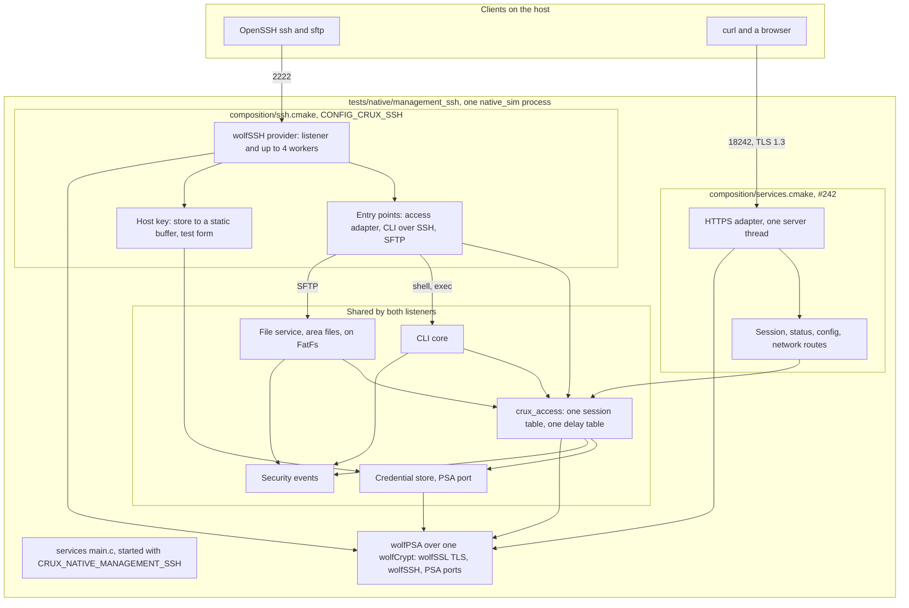
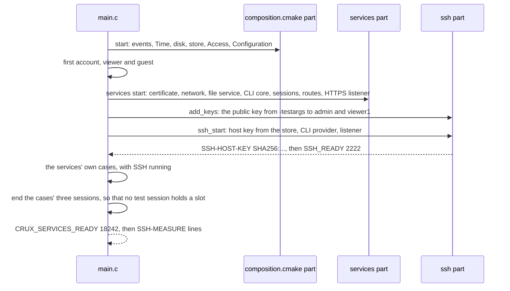
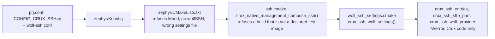
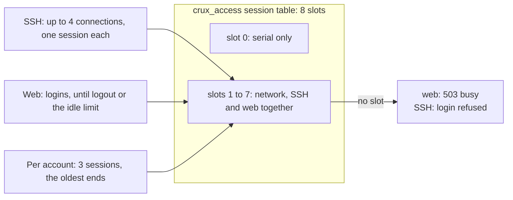

# One `native_sim` image with HTTPS, the command line over SSH and SFTP

Status: first part of [Issue #197](https://github.com/wonny-labs/crux-pilot/issues/197), for review in a Draft PR. It is
the integration that [the wolfSSH provider](ssh-wolf-provider.md#decisions-for-review) (decision 25) and
[the command line over SSH](cli-over-ssh.md) left open: the provider beside the TLS socket backend and wolfPSA in one image, selected by a
Kconfig symbol, on the real Access core and the real PSA providers. It authorises no hardware operation, and **nothing here ran on a
board**. Every result is from `native_sim`, which uses the host's TCP stack through the socket offload and the simulator's clock.
[Real here means](psa-crypto-design.md#what-real-means-on-native_sim) that the protocols and algorithms run for real, and not that any
secret is safe.

#197 stays open. Control jitter, the sizing of the web defaults of #184 and physical evidence are still to do: see
[What was not verified](#what-was-not-verified).

## What is built, faked and untested

| Item | State | Evidence level |
| --- | --- | --- |
| `CONFIG_CRUX_SSH`, with `CONFIG_CRUX_SSH_CLI` and `CONFIG_CRUX_SSH_SFTP`, and the sizes of the provider as Kconfig symbols | **Built**, `zephyr/Kconfig`, read by `wolf_ssh_settings.cmake` | The integrated image; Kconfig loads unchanged in a workspace with no wolfSSH |
| One image with web, sessions, status, configuration, CLI, events, file service, TLS certificate, network settings **and** SSH CLI **and** SFTP | **Built**, `tests/native/management_ssh`, from `management_services` plus `composition/ssh.cmake` | `native_sim`, Wolf profile: [results](#results) |
| wolfSSH 1.6.0 and wolfSSL 5.9.4 beside the TLS socket backend and wolfPSA, in one image | **Built, unedited** | `native_sim` |
| Access core and PSA providers | **Real**, shared by both listeners, as in the services image | Image check reads each from its source |
| Command line and SFTP entry points | **Real**: `crux_ssh_cli.c` and `crux_ssh_sftp.c` on the real CLI core and the real file service on FatFs | `native_sim` |
| Host key | **Real store, test form.** The credential store generates it from test entropy at the first boot and keeps it on the disk. The provider borrows it from a static buffer that is never wiped. | `native_sim`, [guards](#the-test-image-declaration) |
| Entropy | **Test-only**, `fake_entropy_native_sim`, refused outside a declared test image | `native_sim` |
| Listener certificate | **The declared test certificate** of #185, whose key is public | `native_sim` |
| First account, and a public key for two accounts | **Declared test steps**: provisioned by the image, the key from `-testargs key=` | `native_sim` |
| Network path | The host's TCP through the socket offload. **No TAP interface**, so no host privilege is needed. | `native_sim` |
| Commands over SSH | The built-in commands (`help`, `logout`, `passwd`, `account list`) and what the services register. No test command. | `native_sim` |
| A product composition, a product host key store, a board | **Not built** | |
| Anything on RT1060-EVKB | **Not run, not compiled here** | |

## Structure



### Boot order



## Selecting SSH: the Kconfig symbols

SSH keeps no public header and no `crux::` target, so `check-ssh-boundaries.py` still holds. **Selection is a Kconfig symbol and a CMake
call**, as the web adapter's is a symbol and a port directory. The module checks what no composition could make work, and the
composition calls `crux_ssh_wolf_settings()`, which reads the symbols below.

| Symbol | Default | What it does |
| --- | --- | --- |
| `CONFIG_CRUX_SSH` | off | Depends on `CRUX_PILOT_MODULE`, `NETWORKING`, `NET_IPV4`, `NET_SOCKETS`, `MULTITHREADING` and `WOLFSSH`. The module then refuses the Mbed profile and a missing `crux_wolfssh_settings.h` at configuration. |
| `CONFIG_CRUX_SSH_CLI` | on, with SSH | Links the real CLI entry points. The composition then links the CLI core. Off: every shell and `exec` is refused with 255. |
| `CONFIG_CRUX_SSH_SFTP` | on, with SSH | Links the real SFTP entry points and the wolfSSH file port. The composition then links the file service. Off: SFTP is refused. |
| `CONFIG_CRUX_SSH_PORT` | 22 | The composition puts it in `crux_ssh_config_t`. This image sets 2222. |
| `CONFIG_CRUX_SSH_MAX_CONNECTIONS` | 4, range 1 to 4 | Connections at once, authenticated or not. 4 is the provider's compile-time bound. |
| `CONFIG_CRUX_SSH_MAX_AUTH_ATTEMPTS`, `_AUTH_TIMEOUT_MS`, `_IO_TIMEOUT_MS` | 3, 30000, 200 | As in `crux_ssh_config_t`. This image sets the timeout to 10000. |
| `CONFIG_CRUX_SSH_WORKER_STACK_BYTES`, `_LISTENER_STACK_BYTES`, `_WINDOW_BYTES` | 16384, 4096, 16384 | Become the provider's `CRUX_SSH_WOLF_*` settings, the same numbers as its defaults. |



Existing images that call `crux_ssh_wolf_settings()` with their own variables, such as `tests/zephyr/ssh_provider`, set no `CONFIG_CRUX_SSH`
and are unchanged.

**An unsatisfied dependency only warns in Zephyr**, so `CONFIG_CRUX_SSH=y` in a workspace without wolfSSH becomes `n` with a warning, and
a build would go on with no SSH. The first configuration of this image did exactly that, on `NET_TCP`, which an image on offloaded sockets
does not set. The composition therefore stops with `CONFIG_CRUX_SSH is not selected`. That is [decision 2](#decisions-for-review).

## What a consumer uses, and what is test-only

A platform composition, its board and project configuration, its provider selection and its linkage, belongs to the product and not to a Crux
component. This change therefore gives the parts a composition reuses, in the Zephyr layer, and keeps **one thin test composition** that calls them, as
`tests/native/management_services` does.

| Part | Who uses it | Where |
| --- | --- | --- |
| The Kconfig symbols above | A composition sets them in its configuration | `zephyr/Kconfig` |
| `crux_ssh_wolf_settings()` | The composition's CMake calls it after `find_package(Zephyr)`. It reads the symbols, builds the entry points, the file port and the provider with the wolfSSH settings, and keeps wolfSSH's own warnings out of an application built with `-Werror`. | `components/ssh/ports/zephyr/wolf_ssh_settings.cmake` |
| `crux_ssh_callback_table()`, `crux_ssh_cli_set_provider()`, the provider's `start()` and `crux_ssh_wolf_host_key_fingerprint()` | The composition's own C code, to start the provider. The interface stays private: there is no public header. | `components/ssh/src`, `cli`, `ports/zephyr` |
| `crux_ssh_host_key_load()` and `_clear()` | A composition with a credential store, as one way to get a host key | `components/ssh/access/crux_ssh_host_key.c` |
| The CLI core, a provider of its event port, the file service and Access | The composition links them: the symbols above only select the entry points | the components |
| **Test-only:** `ssh.cmake`, `crux_native_management_ssh.c`, the test host key and its guards, the services `main.c` hook, the accounts and the key from `-testargs`, the driver and the script | This image alone | `tests/native/management_composition`, `tests/native/management_ssh`, `scripts/test-ssh-integrated.sh` |

Everything product-shaped is a named hook or an owner decision, and none is built here: **how the host key is held and wiped** (the test image keeps it in a
static buffer), **the first account** (a declared test step), **a frontend** (the image serves the services image's one-page folder, with no login),
**the TLS certificate** (the declared test certificate, as in the existing images), **which interface a listener binds**, and **the session sizes**.

## The test image declaration

The image declares itself a `native_sim` test image with `CRUX_NATIVE_MANAGEMENT_TEST_IMAGE`, as the services image does for its test
entropy. The host key is in test form: the store generates it from test entropy, so it protects nothing, and the provider borrows it from a
static buffer that is never wiped for the life of the process. **No product handling of the host key is defined**, so a tripwire refuses
the form in any other build, at three levels:

| Level | Refuses | Where | Shown by |
| --- | --- | --- | --- |
| CMake | A board; native_sim that is not a declared test image; a test random generator; the Mbed profile; no `CONFIG_CRUX_SSH`; CLI or SFTP not selected | `composition/ssh.cmake` | `check_ssh_guard.py`, in CMake script mode |
| C | The same two conditions at compilation: not `native_sim` and test image, and a test random generator | `composition/ssh_test_host_key_guard.h`, which `crux_native_management_ssh.c` includes before anything of Zephyr's or the stack's | `check_ssh_guard.py` compiles the header, and the source, with each setting |
| Configuration | The Mbed profile, and an image that does not select SSH | `zephyr/CMakeLists.txt`, `ssh.cmake` | `scripts/test-ssh-integrated.sh build` configures with each |

The guards were each broken on purpose: turning the C `#error` into a warning, and removing the CMake test-image check, failed
`check_ssh_guard.py` with "not refused", and the restored files pass. The script needs only `cmake` and `cc`, so it runs on any host.

## What the tests run

`scripts/test-ssh-integrated.sh` builds the image on a patched copy of Zephyr (`prepare-wolf-tls-zephyr.sh`) and `driver.py` runs it. The
clients are OpenSSH 9.6 `ssh` and `sftp`, and `curl` against the declared test certificate. It reuses the image and client helpers of
`tests/zephyr/ssh_provider/openssh_test.py` and the constants of the services driver.

| Case | What it shows |
| --- | --- |
| `case_boot` | The 17 cases that the services image prints pass **with SSH running**, and the printed host key fingerprint is what `ssh-keyscan` and `ssh-keygen -l` report |
| `case_ssh_cli` | Ed25519 key login of `admin`: `help`, `account list` showing the accounts of the image's own cases, `logout`. The viewer's `account list` exits 127, and so does the administrator's `network recover`, which is serial only. Unknown command 127. An unlisted Ed25519, an ECDSA and an RSA key are refused. A shell, a password login and a wrong password. |
| `case_sftp` | `sftp` upload of 3,000 and 60,000 bytes and download with identical SHA-256. A file that the **file service API** wrote is read by SFTP, so one file area is behind both. The viewer reads and cannot write. Remove. |
| `case_https` | `curl`: the two-request login, `session/me`, `status` with 20 items whose security event count **rises after SSH logins**, a configuration update that reads back, the missing CSRF token 403, no cookie 401, a wrong password, logout, the packaged one-page folder |
| `case_ports` | The process holds exactly the two declared listening sockets, read from `/proc` |
| `case_sessions_across_channels` | An account's fourth session ends its oldest, **whichever channel opened it**: a web login ended an SSH shell |
| `case_slots_with_both_busy` | Four SSH shells, then three web logins, then an eighth session refused, and one shell leaving frees the slot: [below](#session-limits-when-both-listeners-are-busy) |
| `case_silent_clients` | A silent client on one listener against a user of the other |
| `case_load_on_every_listener` | SFTP transfers, CLI commands and HTTPS calls at once |
| `case_resource_use` | Heap, stack and socket figures, after an `ecdh-sha2-nistp256` login |
| `case_restart` | A second process on the same disk: the same host key, the same stored public key, HTTPS works |

## Results

Host: Apple silicon, Docker with an `amd64` Dev Container image under emulation, Zephyr v4.4.2 with the TLS socket patch,
OpenSSH 9.6p1, curl 8.5 and OpenSSL 3.0.13. **The wall times below are not a target's.** `native_sim` gives CPU work no simulated time, and the
container is emulated and shared, so they only compare one run with another, and they moved by up to a factor of two between runs of the same revision (the idle HTTPS call read 0.18 s in one run of this PR and 0.26 s in the run below). The figures and the revision: one run of `scripts/test-ssh-integrated.sh all` at `22dafed`, 86 checks. Sizes belong to the revision. The heap peak read 97,496 B in two runs of this PR and 100,448 B in a third, so read it as a size class.

| Kind | What | Result |
| --- | --- | --- |
| Baseline | `management_services`, Wolf profile, built and run unchanged before this work | 0 failures, 72 checks |
| `native_sim`, run | `tests/native/management_ssh/driver.py` | 0 failures, 86 checks, over 11 cases: [below](#what-the-tests-run) |
| `native_sim`, image check | `scripts/check-composition-image.py --services --profile wolf` on the integrated image | 50 symbols from their real sources, no test double, 12 routes and no other, one HTTP service |
| Host | `check_ssh_guard.py` | Passes. Two mutants of the guards fail it. |
| Host | `scripts/check-ssh-boundaries.py`, `scripts/check-format.sh` with clang-format 18 | Pass |
| Control | `scripts/test-ssh-integrated.sh build`: `CONFIG_MBEDTLS=y`, and `CONFIG_CRUX_SSH=n` | Each stops at configuration, for its reason |
| Kconfig | `tests/native/web_http`, no wolfSSH in the workspace | Configures with no warning and no `CRUX_SSH` in `.config` |
| Try it yourself | Every command block of the section, run as written by a script that reads them from this file, except the build block, which `scripts/test-ssh-integrated.sh build` had run, and the browser step | Pass: the shell, a command, the viewer's 127, SFTP put and get with `diff`, and the `curl` login and calls |
| Not run | A board, RT1060-EVKB, a browser, WinSCP, PuTTY | |

### Flash, RAM, stacks, sockets and heap

These are `native_sim` 64-bit figures, which rank choices and are not a Cortex-M7's.

| Measure | `management_services`, Wolf | Integrated image | Note |
| --- | --- | --- | --- |
| Text | 719,118 B | 814,046 B | +94,928 B: wolfSSH, the provider, the entries, the file port |
| Data | 21,698 B | 22,402 B | |
| Bss | 561,384 B | 1,432,416 B | +871,032 B, of which 786,432 B is the arena going from 256 KiB to 1 MiB, so that the run shows use and not a limit |
| Heap peak, all of it | Not recorded | 97,496 B | The whole run, TLS and SSH together, with every load below. After the load, 616 B stay allocated. |
| SSH worker stack, used | | 9,216 B of 16,384 B | Deepest on a worker, with `ecdh-sha2-nistp256`, Ed25519, SFTP and the CLI. [#192's probe image](ssh-wolf-provider.md#resource-use) measured 13,808 B with `exec` and every key type, so **the stack stays an open question for a target** |
| SSH listener stack | | Not read | The probe reads a finished listener only |
| Configured stacks | | HTTP server 4,096 B, SSH workers 4 × 16,384 B, SSH listener 4,096 B, Crux threads 8 × 8,192 B | `native_sim` cannot report a Zephyr stack's use |
| Sockets at rest | 1 listener | 2 listeners | The process holds exactly ports 2222 and 18242 |
| Sockets, four SSH shells | | 6 | Two listeners and four connections. `CONFIG_ZVFS_OPEN_MAX` is 48. |
| Sockets, peak under load | | 5 | |
| Host threads | | 13 at rest, 17 with four SSH shells, 15 at peak under load | |

RT1060-EVKB Flash and RAM for this image are **not measured**: it is a `native_sim` test image by construction. #192 compiled its own test
image, without the socket backend, at 298,848 B Flash and 703,884 B RAM, and #194 and #193 add to it.

### Session limits when both listeners are busy



| Limit | Value | Shared | Observed |
| --- | --- | --- | --- |
| Network session slots | **7**: `CRUX_ACCESS_SESSION_MAX` 8, and slot 0 is reserved for serial | **Both channels** | Four SSH shells and three web logins fill them. The eighth session, on either channel, is refused: the web answers `503 {"code":"busy"}`. A freed SSH slot is the web's again. |
| Sessions per account | 3, `CRUX_ACCESS_SESSIONS_PER_ACCOUNT` | **Both channels** | Three SSH shells of one account, then a web login of it: the oldest, an SSH shell, ended and the two newer stayed |
| SSH connections | 4, `CONFIG_CRUX_SSH_MAX_CONNECTIONS` | SSH only | A fifth client reads "too many connections" at once |
| Web session table | 8, `CRUX_WEB_SESSION_MAX` | Web only | Not reached: the core's table is smaller |
| HTTPS clients | 3, `CONFIG_HTTP_SERVER_MAX_CLIENTS` | Web only | |

**What this means.** With SSH at four connections, **three slots are left for the web**, and an abandoned web session, a browser tab
closed with no logout, holds its slot until the idle limit, 15 minutes in the reference policy, while an SSH slot is free when the
client leaves. The services image's own `main.c` holds three test sessions for the life of its cases, which took three more slots. The
first run of this driver saw `503 busy` for that reason. In this image they end before it reports ready, so a client finds the slots that
a deployment would have. Sizing `CRUX_ACCESS_SESSION_MAX`, `CONFIG_CRUX_SSH_MAX_CONNECTIONS` and the idle limit together is
[decision 5](#decisions-for-review).

### Interference between the listeners

| Situation | Observed | Verdict |
| --- | --- | --- |
| Load on every listener at once: 12 HTTPS calls, 8 CLI commands, 4 SFTP put, get and remove of 48 kB | Every operation succeeded. HTTPS median 0.32 s loaded and 0.26 s idle, CLI 0.39 s and 0.37 s, SFTP 0.80 s and 0.72 s. The sockets returned to 2, and 616 B of the heap stayed allocated at rest after the load. No baseline was taken before it. | **No interference seen.** Simulated CPU work takes no time, so this shows no failure and no starvation of a thread, and says nothing about a CPU's contention. |
| Four silent clients hold every SSH slot | HTTPS login and call 0.62 s. A real SSH user is refused until the clients leave (`auth_timeout_ms`). | **SSH lockout, as [decision 20](ssh-wolf-provider.md#decisions-for-review) records. HTTPS is not affected.** |
| Three silent clients on the HTTPS port | An SSH command 0.21 s. An HTTPS request answered after 5.5 s. | **The web's own limit**: each silent TLS client costs the server thread its handshake limit, 2 s. **SSH is not affected.** |
| Failed SSH logins, then a web login from the same address | The web login succeeded each time | No interference seen, though both use one delay table |
| A web login when the table is full | 503 busy | **Shared slots**: see above |
| A web login with three SSH shells of the account open | The oldest SSH shell ended | **Shared account cap**: a user can lose an SSH session by logging in on the web |

## Try it yourself

In the Dev Container, from the root of this repository. It needs the optional stacks: `west config manifest.group-filter -- +crux-secure-management
&& west update`, and the `fatfs` module. Nothing here touches a board.

**1. Build the image**, which takes a while under emulation. It also runs the two configuration controls.

```bash
scripts/test-ssh-integrated.sh build
```

**2. Start it** in one terminal, and leave it running. The key is the public key that the image gives to `admin` and `viewer1`.

```bash
mkdir -p build/ssh-demo && ssh-keygen -q -t ed25519 -N '' -f build/ssh-demo/key
build/ssh-integrated/build/zephyr/zephyr.exe --flash=build/ssh-demo/disk.bin --seed=1 \
  -testargs key=$(python3 -c "import base64,sys; print(base64.b64decode(open(sys.argv[1]).read().split()[1]).hex())" build/ssh-demo/key.pub)
```

It prints `SSH-HOST-KEY SHA256:...`, 17 `CASE ... ok` lines, `SSH_READY 2222` and `CRUX_SERVICES_READY 18242`. The accounts are `admin`
with the password `composition test password`, `viewer1` and `guest1` with `a password changed at first login`. They are declared test
accounts of a test image.

**3. The command line over SSH**, in a second terminal. A shell shows the prompt `> `. Try `help`, `account list`, then `logout`.

```bash
ssh -p 2222 -i build/ssh-demo/key -o IdentitiesOnly=yes -o StrictHostKeyChecking=accept-new -o UserKnownHostsFile=build/ssh-demo/known_hosts admin@127.0.0.1
```

One command, with no shell, and the viewer, who is not allowed `account list`: its exit status is 127.

```bash
ssh -p 2222 -i build/ssh-demo/key -o IdentitiesOnly=yes -o UserKnownHostsFile=build/ssh-demo/known_hosts admin@127.0.0.1 account list
ssh -p 2222 -i build/ssh-demo/key -o IdentitiesOnly=yes -o UserKnownHostsFile=build/ssh-demo/known_hosts viewer1@127.0.0.1 account list; echo "exit $?"
```

**4. SFTP.** The only area is `files`, the root lists it.

```bash
echo "hello from the host" > build/ssh-demo/hello.txt
sftp -P 2222 -i build/ssh-demo/key -o IdentitiesOnly=yes -o UserKnownHostsFile=build/ssh-demo/known_hosts -b - admin@127.0.0.1 <<'EOF'
ls /
put build/ssh-demo/hello.txt /files/hello.txt
ls -l /files
get /files/hello.txt build/ssh-demo/hello.down
EOF
diff build/ssh-demo/hello.txt build/ssh-demo/hello.down && echo "identical"
```

**5. HTTPS with `curl`**: the two-request login, then two calls. The certificate is the declared test certificate, whose key is public.

```bash
CURL="curl -sS --cacert tests/native/tls_offload_probe/credentials/test-server.crt --resolve localhost:18242:127.0.0.1 -b build/ssh-demo/jar -c build/ssh-demo/jar"
ID=$($CURL -H 'Origin: https://localhost:18242' -H 'Content-Type: application/json' -d '{"user":"admin","password":"composition test password"}' https://localhost:18242/api/v1/session | python3 -c 'import sys,json; print(json.load(sys.stdin)["id"])')
for i in 1 2 3 4 5; do R=$($CURL -H 'X-Crux-Request: 1' https://localhost:18242/api/v1/session/attempt/$ID); echo "$R"; case "$R" in *pending*) sleep 1 ;; *) break ;; esac; done
$CURL https://localhost:18242/api/v1/session/me; echo
$CURL https://localhost:18242/api/v1/status | python3 -m json.tool | head -20
```

**6. A browser.** Open `https://localhost:18242/`. It shows the services image's one-page folder, which proves the TLS listener and the packaged folder
and has no login: the management API is for `curl`, as in step 5, and a product brings its own frontend. The certificate is self-signed, so
the browser warns: continue, or import `tests/native/tls_offload_probe/credentials/test-server.crt`. In a Dev Container the port must be
forwarded to the machine that runs the browser, which VS Code does for a port that a process listens on, and the Ports panel can do by hand for 18242 and 2222.

**This step was not run in a browser.** The built-in browser of the session refuses a self-signed certificate, and changing what the machine trusts is
the user's to do. The same page was fetched with `curl` in the driver.

With the image running, log in on the web with `curl` as `admin` three times while three `ssh` shells of `admin` are open, and the oldest shell ends.

**7. Stop it** with Ctrl-C in the first terminal. Starting it again on the same `disk.bin` gives the same host key and the same accounts.

## Other findings

| Finding | Effect |
| --- | --- |
| `composition.cmake` builds `app` with `-Werror`, and the wolfSSH module adds its sources to `app` | The first build stopped on wolfSSH's own unused parameters. `crux_ssh_wolf_settings()` gives those files `-Wno-error` under `CONFIG_CRUX_SSH`: [decision 3](#decisions-for-review) |
| An unsatisfied Kconfig dependency only warns | `CONFIG_CRUX_SSH=y` fell to `n` on `NET_TCP` and the build went on with no SSH, until the composition's check stopped it: [decision 2](#decisions-for-review) |
| The SSH listener binds every IPv4 address, and the HTTPS listener the IPv6 any address, which is dual-stack, so that IPv4 reaches it too (read from `/proc/net/tcp` and `tcp6`) | On a device both would answer on every interface. Which interface a management listener may use is a product choice that no setting here makes. The "only the declared listeners" check of #197 needs a device and its addresses. |
| With `CONFIG_MBEDTLS=y`, the `mbedtls` module's own CMake fails first when `tf-psa-crypto` is not on the module path | The Mbed control then stops for the module's reason and not ours, so the script puts both in the module list, as a west workspace with the group does |
| With one `-seed`, every blank disk generates the same host key | Known from [#192](ssh-wolf-provider.md#findings). The demonstration uses one seed. |
| An abandoned web session holds a shared slot until its idle limit | [Session limits](#session-limits-when-both-listeners-are-busy) |

## Decisions for review

Each was taken without the owner, and the narrower choice was taken where there was one.

| # | Decision | Why | Impact if changed |
| --- | --- | --- | --- |
| 1 | The symbols of [the table above](#selecting-ssh-the-kconfig-symbols), and `CONFIG_CRUX_SSH` as the selector, with no `crux::ssh` target | The web adapter's pattern, and `check-ssh-boundaries.py` holds SSH private. They are new public configuration names, which `CONTRIBUTING.md` says to review. | Renames before any consumer uses them are free |
| 2 | `CONFIG_CRUX_SSH` depends on `NET_SOCKETS`, not `NET_TCP`, and the composition stops when the symbol dropped out | An image on offloaded sockets has no `NET_TCP`, and Zephyr only warns about an unsatisfied dependency | A target image keeps `NET_TCP` through its sockets anyway |
| 3 | The wolfSSH sources keep their own warnings, with `-Wno-error` on those files only, set by `crux_ssh_wolf_settings()` when `CONFIG_CRUX_SSH` is on | An application that builds `app` with `-Werror` would otherwise stop on wolfSSH's own unused parameters, as this image's first build did. wolfSSH 1.6.0 is unedited, and Crux's own sources, built apart, keep `-Werror`. | A separate library for wolfSSH, which the module would have to provide |
| 4 | The image is a declared test image, and the host key is in test form with three guards | See [the declaration](#the-test-image-declaration) | |
| 5 | The session capacity of the shared Access table, 7 network slots, is not changed | It is the Access contract's default, and the right numbers depend on how many web users and SSH sessions a product expects. **Owner decision**: `CRUX_ACCESS_SESSION_MAX`, `CONFIG_CRUX_SSH_MAX_CONNECTIONS` and the idle limit, and whether an abandoned web session should end sooner than 15 minutes. | One setting each |
| 6 | The file service's area in this image allows managed and direct writes, 64 KiB a file, 256 KiB an area, 16 entries and `.filepart` | A managed-only area refuses every SFTP write. The partition is 512 KiB. | The services image keeps its own area: the change is behind `CRUX_NATIVE_MANAGEMENT_SSH` |
| 7 | The image ends the cases' three test sessions before it reports ready | They would take three of the seven slots for ever. The services image is unchanged. | The first run's 503 would return |
| 8 | **The Wolf profile only.** The Mbed profile cannot carry SSH. | wolfSSH needs wolfSSL, and two TLS stacks in one image are not a supported composition. `provider_sources.cmake`, `zephyr/CMakeLists.txt` and `ssh.cmake` refuse it, and the control shows the message. | A wolfSSH on Mbed TLS would be a new provider |
| 9 | `scripts/test-ssh-integrated.sh` is a new file in the protected `scripts/`, and no workflow runs it | A new check script is allowed within the task. Naming it in a workflow would break `check-ssh-boundaries.py`, which keeps wolfSSH out of default CI (decision 15 of the provider). **Owner decision**: whether and how to wire it into a workflow that already has the secure management group. | |

**Owner decisions that this work lists and does not take:**

| Decision | Why it is open |
| --- | --- |
| How a product holds the host key for the provider, and wipes it | `start()` borrows the bytes until `stop()`. This image keeps them in a static buffer. A product needs a rule like the TLS key's hand-off of #284. |
| Showing the host key fingerprint to a user with `access.manage`, and replacing the key | The `device fingerprint` command of the CLI contract is not built, and nothing calls `crux_credential_key_replace()` ([decision 24](ssh-wolf-provider.md#decisions-for-review)) |
| The slot numbers and the abandoned session rule | Decision 5 |
| Whether this script runs in a workflow | Decision 9, and `.github` is protected |

## What was not verified

| Item | Why |
| --- | --- |
| Anything on a board: Flash, RAM and stack use on a Cortex-M7, handshake time, throughput | No hardware, and the image is `native_sim` only. Physical evidence needs its own approval. |
| **Control jitter with and without management load** | There is no control workload in this image. `native_sim` also gives CPU work no simulated time, so a jitter figure here would measure nothing. |
| The sizing of the web defaults of #184 against this image | Not done. The figures above show where SSH and the web meet, and do not size the web's client limit, inactivity timer, header capture, deadlines, stack or send timeout. |
| A port scan from outside | The listeners are read from `/proc`, for the process. A scan of a device's address needs a device. |
| Time slicing between SSH workers, the web thread and Crux threads | No CPU time is simulated. `CONFIG_TIMESLICING` and `CONFIG_TIMESLICE_SIZE` are as the provider requires. |
| A browser against this image, and the Preact and Angular examples against it | The one-page folder was fetched with `curl`. No browser was used, and `web/e2e` was not run against this image: it needs Node.js 24.22.2 and Chrome. |
| WinSCP, PuTTY, any client but OpenSSH 9.6 | OpenSSH is what the harnesses use |
| Real TAP networking, IPv6 | The offload reaches the host through loopback |
| Concurrent large transfers with CPU contention, a full file area, a full arena | Not walked in this image. #192 walked the arena on its own image. |
| `ssh-audit` and the algorithm audit of #195 | Not part of this change |
| The Mbed profile with SSH | Refused by design |
| Product composition, product host key, board support | Not built |
