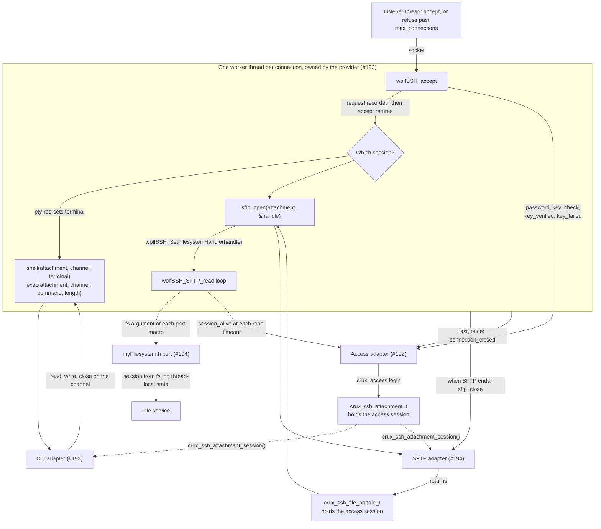

# SSH provider contract

Status: merged in [PR #239](https://github.com/wonny-labs/crux-pilot/pull/239) for Issue #205, part of gate #183, which has
passed. It fixes what the SSH, CLI and SFTP session channels share, and [the wolfSSH provider](ssh-wolf-provider.md), the
[command line over SSH](cli-over-ssh.md) and [SFTP](sftp-design.md) now implement it. It authorises no hardware operation.

The evidence is of three different kinds. Host tests run the fake provider and the conformance cases. Build results come
from compiling and linking probe images, which the work of #239 never ran. Statements about wolfSSH behaviour come from reading its
source at v1.6.0 (`8221e4e`). See [Evidence and limits](#evidence-and-limits).

Issue #192 has since implemented the provider: [the wolfSSH provider](ssh-wolf-provider.md) records what it chose and what ran.

## The interface

[`components/ssh/src/crux_ssh_provider.h`](../components/ssh/src/crux_ssh_provider.h) is the private interface. A
provider offers `start`, `stop` and channel `read`, `write` and `close`. Crux supplies credential, `shell`, `exec`, SFTP and
`session_alive` callbacks. The provider also accepts `pty-req` and `window-change` with no callback, and refuses every other
request and channel type with no callback. The header documents each result and the rules for names and attempts.

It is private: there is no `components/ssh/include`, no `crux::ssh` target, and the `crux_ssh_provider` and `crux_ssh_adapter`
targets are linked PRIVATE by Crux adapters only. It names no SSH library type, Zephyr header or access control type, so the CLI and SFTP
pieces can build and test on the Host with no SSH library. `scripts/check-ssh-boundaries.py` checks all of this, and runs
in the Host CTest as `Ssh.Boundaries`.

SSH user keys are Ed25519 and ECDSA, by owner decision, and the design's algorithm table fixes the ECDSA curve to P-256. The key
type enum has no RSA value, the provider refuses any other key, and a blob that is not exactly its type's form, before a callback, and `crux_wolfssh_settings.h` removes RSA from wolfSSH. wolfSSL keeps RSA for TLS.

## Ownership

### Threads and the wolfSSH loop

The provider owns every thread and all of the wolfSSH state. No other code calls wolfSSH.

| Item | Owner | Rule |
| --- | --- | --- |
| Listening socket and accept | Provider | A connection past `max_connections` is closed without a callback. |
| One worker thread per connection | Provider | At most `max_connections` workers and one listener. Stack sizes come from measurement in #192. |
| `WOLFSSH_CTX`, `WOLFSSH`, socket callbacks | Provider | Each `WOLFSSH` is used by its own worker only. |
| `wolfSSH_accept`, `wolfSSH_worker`, stream calls, the SFTP loop | Provider | They run on the worker. |
| Attempt and unauthenticated time limits | Provider | From `crux_ssh_config_t`. |
| Algorithm lists, strict key exchange, host key loading | Provider, #192 | The host key bytes arrive through the configuration, borrowed until `stop` returns. |
| Password verification and sessions | Access adapter calling `crux_access`, #192 | Runs on the worker of its connection, so it stalls no other connection. |
| Line handling, command execution, exit status | CLI, #193 | Runs inside the `shell` or `exec` callback, on the worker. It creates no thread. `shell` says whether a terminal exists, which sets the CLI's echo. |
| File operations | SFTP port, #194 | Run on the worker, called by wolfSSH with the session's file handle. |
| Ending an idle SFTP session | Provider polls, access adapter answers | SFTP has no session callback of its own, so the worker calls `session_alive` each time it has waited `io_timeout_ms` with no request, and ends the connection on false. |

Every Crux callback runs on the thread of its connection, with no provider lock held, and can block that thread only. So a
slow client or a slow verification holds one connection and no other. A callback must not call `stop`, and a channel must
not be used after its session callback returns. #192 uses native threads, because the gate decisions record notes that the Crux thread
default of four is too low for the integrated composition.

The wolfSSH channel callbacks run while a packet is being parsed, and `wolfssh/ssh.h` warns against re-entering the receive
side from such a callback. So the provider's wolfSSH channel callbacks only record a request. The worker calls the Crux `shell`,
`exec` or `sftp_open` callback after `wolfSSH_accept` has returned, so the request is already granted by then and a failure of
those callbacks reaches the client only as the connection ending. `wolfSSH_SetUserAuth` and `wolfSSH_SetUserAuthResult`
do call Crux, because the login decision belongs there, and they have no channel to use. wolfSSH's success value is zero,
so #192 maps `CRUX_SSH_AUTH_ACCEPTED` explicitly and every other value to failure.

The provider's `io_timeout_ms` is one value for the server. `crux_cli_io_t` in `components/cli/adapter/crux_cli_adapter.h`, which
arrives with #238, takes a `timeout_ms` for each call, and an adapter on this interface cannot shorten the wait below `io_timeout_ms`. So a composition sets
`io_timeout_ms` no longer than the CLI's shortest bound, and the adapter returns 0 after that wait. A conformance case proves that
`read`, `write` and `terminal` can carry that shape, including a line of the CLI's default limit of 320 bytes.

### One session per connection

A connection carries one session channel, and the first `shell`, `exec` or SFTP request starts its session. The provider
refuses a second channel and ends the connection when the session ends. This matches the flow of `wolfSSH_accept` and is
the simplest bound on memory. It rules out OpenSSH connection sharing (`ControlMaster`): each `ssh` or `sftp` client process
then needs its own connection and slot. A later change could relax this, and it would be a change to this contract.

### User names and attempts

These come from `src/internal.c` in wolfSSH, and the header records them as the rule for any provider. The first authentication
request binds the name to the connection (`src/internal.c:11859`). An empty name, or a later request with another name, ends the
connection with no callback (`src/ssh.c:2143`), so a client that wants another user reconnects. An authentication request after a
successful login also ends the connection before any hook (`src/internal.c:879` and `:14036`). Every refused attempt counts, and the
opening `none` request does not (`src/internal.c:11921`).

### From a connection to Crux

The provider's header names two opaque types and defines neither. Each is an incomplete type that its owner defines in its own
source, so nothing in that header depends on `crux_access`.

| Type | Defined by | Provider's part | Life |
| --- | --- | --- | --- |
| `crux_ssh_attachment_t` | Access adapter, #192 | Stores the pointer and passes it to each session callback and to `connection_closed` | From an accepted credential to `connection_closed`, which runs exactly once and last |
| `crux_ssh_file_handle_t` | SFTP port, #194 | Passes the pointer to `wolfSSH_SetFilesystemHandle` | From `sftp_open` to `sftp_close` |
| `crux_ssh_channel_t` | Each provider | Its own | During one session callback |

This is how a connection reaches Crux, and how an attachment reaches a file handle. Everything inside the box runs on one worker
thread, and the wolfSSH calls belong to the provider alone.

### How #192 connects this to `crux_access`

The adapter defines `struct crux_ssh_attachment` to hold a `crux_access_session_t`, in a static pool of
`CRUX_SSH_ACCESS_ATTACHMENT_MAX`, which is no smaller than `max_connections`. It works out the origin for each call. It is a small mapping onto `components/access/adapter/crux_access_adapter.h`:

| Provider callback | Adapter call | Accepted when |
| --- | --- | --- |
| `password` | `crux_access_login_password` | It returns `CRUX_ACCESS_OK`. A slot is taken, and the session goes into the attachment. |
| `key_check` | `crux_access_key_is_authorised`, passing `signed_request` | It returns `CRUX_ACCESS_OK`. It creates nothing. |
| `key_verified` | `crux_access_login_verified` | It returns `CRUX_ACCESS_OK`, as for `password`. |
| `key_failed` | `crux_access_report_key_failure` | Not applicable |
| `session_alive` | `crux_access_session_user`, which does not refresh the idle timer | It returns `CRUX_ACCESS_OK` |
| `connection_closed` | `crux_access_logout`, then the slot is freed | Not applicable |

The origin uses `CRUX_ACCESS_CHANNEL_SSH`, with the peer address as its source. For IPv6 the adapter passes the /64 prefix,
as the access contract says. Every access result other than success is a denial on the wire, including
`CRUX_ACCESS_ERR_RETRY_LATER` and `CRUX_ACCESS_ERR_BUSY`. The user name reaches `crux_access` already checked for length and
embedded NUL, and `crux_access` checks its character set.

The CLI and SFTP pieces get the session from the attachment with `crux_ssh_attachment_session()`, declared in
[`components/ssh/adapter/crux_ssh_attachment.h`](../components/ssh/adapter/crux_ssh_attachment.h). #192 defines it in
`components/ssh/access/`. On the Host, `tests/ssh/fake_attachment.h` is a double
that holds any session a test gives it. Linking both the table and the double fails with `multiple definition of
crux_ssh_attachment_session`, so a CLI or SFTP test links the double and its own entry points, not the table.

A session belongs to one SSH connection. `crux_access_touch` is the caller's job, so #193 and #194 call it on user activity.

### Which files a change touches

The three sessions that shared this ownership table, #192, #193 and #194, have merged, and the stand-ins they replaced are gone from the images that use the real entry points. What stays is the rule about shared files: a change to `components/ssh/CMakeLists.txt`, `components/ssh/src/`, `components/ssh/adapter/`, `components/ssh/ports/zephyr/crux_wolfssh_settings.h`, `wolf-ssh.conf`, `wolf_ssh_settings.cmake`, `tests/ssh/CMakeLists.txt` or the files directly in `tests/ssh/` is one reviewed change, because every channel's build and tests read them. The access mapping, the CLI entry points and the SFTP entry points each live in their own directory (`components/ssh/access/`, `cli/`, `sftp/`) with their own `sources.cmake`.

The refusing entry points remain for an image that selects no command line or no SFTP, and `tests/ssh/{cli,sftp}/stub_test.c` show that they fail closed. `wolfssh/port.h` includes `myFilesystem.h` whenever SFTP is on, so wolfSSH cannot compile without a file port: the refusing one in `components/ssh/sftp/port/` is used until a composition sets `CRUX_SSH_SFTP_FILE_SERVICE`, as [the SFTP design](sftp-design.md) says.

## wolfSSL and wolfSSH settings

### Decision

Keep wolfSSL on its Kconfig-driven module settings, and give wolfSSH its own settings through the module's own hook. No
vendor file is edited, and the include path plays no part.

| Setting | Where | Reaches |
| --- | --- | --- |
| `#undef NO_FILESYSTEM`, `WOLFSSH_USER_FILESYSTEM`, `WOLFSSH_SFTP`, `#undef WOLFSSH_ZEPHYR`, `WOLFSSH_USER_IO`, `WOLFSSH_NO_RSA`, `WOLFSSH_NO_SHA1`, `WOLFSSH_NO_AES_CBC` | [`crux_wolfssh_settings.h`](../components/ssh/ports/zephyr/crux_wolfssh_settings.h), through `CONFIG_WOLFSSH_SETTINGS_FILE` | wolfSSH only |
| `CONFIG_WOLFSSH`, `CONFIG_WOLFSSL_CURVE25519` | [`wolf-ssh.conf`](../components/ssh/ports/zephyr/wolf-ssh.conf) | The whole image |
| `WOLFSSL_WOLFSSH`, `WOLFSSL_AES_COUNTER`, `WOLFSSL_KEY_GEN`, `WOLFSSL_ED25519_STREAMING_VERIFY` | [`wolf_ssh_settings.cmake`](../components/ssh/ports/zephyr/wolf_ssh_settings.cmake), on the module's `wolfSSL` interface target | Every translation unit |

`wolfssh/settings.h` includes `CONFIG_WOLFSSH_SETTINGS_FILE` after the wolfSSL `user_settings.h`, so a `#undef` there holds
for the rest of a wolfSSH translation unit. That module hook is why no wrapper is needed.

### Why

- **wolfSSL keeps `NO_FILESYSTEM`.** Removing it for the whole image, as the first probe and the wrapper below do, gives the
  TLS layer its own direct file code. Here TLS sees exactly the settings it
  sees in an HTTPS-only image, and wolfSSH reaches files only through the port.
- **`WOLFSSH_ZEPHYR` has to go as well.** The module always defines it. With `NO_FILESYSTEM` undefined, it compiles wolfSSH's
  direct Zephyr file code in `port.c` and `ssh.c`, even with `WOLFSSH_USER_FILESYSTEM`, and it compiles the `SETSTAT` and
  `FSETSTAT` handlers out of `wolfsftp.c`. Removing it resolves the finding in the gate decisions record (PR #209) that "accepted without effect"
  could not hold. Its other effects are:
  - The socket code, which `WOLFSSH_USER_IO` replaces with provider callbacks using `zsock_recv` and `zsock_send`.
  - The Zephyr default directory, which the port supplies through `WGETCWD`.
  - A `/RAM:` path rule for the FAT layout, which the virtual root does not use.
  - `WLOCALTIME` becomes `localtime_r` in place of `gmtime_r` (`wolfssh/port.h:737`). SFTP long names call it (`src/wolfsftp.c:3252`), because
    `WOLFSSH_NO_TIMESTAMP` guards only `src/log.c:145`. Zephyr's minimal C library provides it and gives UTC on `native_sim`
    (`lib/libc/common/source/time/localtime_r_utc.c`), and on the target it comes from Picolibc. #194 has nothing to redefine.
  - `wolfssh/port.h:682` includes `<stdio.h>` in place of `<strings.h>`.
- **`WOLFSSL_ED25519_STREAMING_VERIFY` matters.** wolfSSH defines `WOLFSSH_NO_ED25519` without it. The first probe did not set
  it, or `CONFIG_WOLFSSL_CURVE25519`, so `ssh-ed25519` was missing from its figures. The probe now fails to compile if a
  required algorithm is missing, or if RSA, SHA-1 or CBC is present.

A wolfSSH translation unit and wolfSSL now disagree about `NO_FILESYSTEM`, which is safe only if nothing they share depends on it.
`scripts/check-ssh-wolf-headers.py` preprocesses each of the 13 wolfSSH sources for the target with its real flags, as built and with a
copy of the settings file that lacks the `#undef`, and compares the text of each wolfSSL header. Most sources read `wolfcrypt/wc_port.h`
through `wolfcrypt/types.h` before the `#undef` takes effect, so it cannot differ for them. `port.c`, `ossh.c` and `wolfscp.c` read it
after, and there it differs by 16 lines: the declarations of `z_fs_open`, `wc_FileLoad` and similar, and the type `ReadDirCtx` that only
those functions take. wolfSSH calls none of them, as the images link, and no structure that the two share mentions them. The check requires
exactly those lines in that order, and fails on any other difference, or on no difference at all. A stack upgrade could change this, so the recipe runs it.

### Rules for Crux code that includes wolfSSH headers

The module adds the wolfSSH sources and its definitions to the `app` target, and `-Wall -Wextra -Werror` must not reach them.
So the provider and the port go in their own libraries, which `crux_ssh_wolf_settings()` creates with `crux_ssh_wolfssh_client(<target>)`.
That gives them the same definitions and settings as wolfSSH. A translation unit without `WOLFSSH_ZEPHYR` defined would skip
`crux_wolfssh_settings.h` and see different settings, without any error.

### Alternatives tested or considered

| Option | Result | Decision |
| --- | --- | --- |
| `CONFIG_WOLFSSH_SETTINGS_FILE`, with wolfSSL unchanged | RT1060 combined image builds: 418,016 B Flash, 219,924 B RAM, when compared with the wrapper. With the callback table added since, 418,116 B Flash. | **Chosen** |
| A Crux `user_settings.h` earlier on the include path, with `#include_next` and `#undef NO_FILESYSTEM` | RT1060 combined image builds: 418,040 B Flash, 219,924 B RAM | Not chosen. See below. |
| `CONFIG_WOLFSSL_SETTINGS_FILE` | Rejected at configuration with the socket backend: a control in the recipe | Not possible |
| Deleting the line in a copy of the module | Built in the first probe | An edited vendor file. Rejected. |

The wrapper was the candidate to test first, and it works. It costs only 24 B of Flash after linking, because the linker drops
what no one calls. It was not chosen for four reasons. The wolfSSL library then compiles its file functions (5 of the 5 checked
names, against none here), so the TLS layer holds direct file code that a later call could reach past the file service. It has
to change the whole image, TLS included, to serve wolfSSH. It depends on include order, and took `BEFORE` on `zephyr_interface` to
take effect. And it removes no step, as `WOLFSSH_ZEPHYR` still needs `CONFIG_WOLFSSH_SETTINGS_FILE` to undefine it.

Flash is higher than the 369,152 B of the first probe. That probe had no Ed25519 or Curve25519, so it could not offer the design's
preferred algorithms, and it also lacked the SFTP `SETSTAT` handlers. RAM includes the same configured 32 KB main stack and 128 KB
allocation arena, so it is not measured use.

### The mount fallback is not used

[The SFTP design](sftp-design.md) chose the file port and not wolfSSH's own Zephyr mount code (its decision 2), so the wrapper that the mount code would need is not built. It was built once for the target in a scratch copy: 415,384 B Flash, 219,988 B RAM, with `SETSTAT` and `FSETSTAT` compiled out.

### Recipe

`scripts/test-ssh-wolf-settings.sh` builds all of this, and never flashes or runs an image. It needs a workspace with the
optional stacks: `west config manifest.group-filter -- +crux-secure-management`, then `west update`. It fetches the wolfSSL
socket patch by revision, checks its SHA-256, merges it into a separate sparse copy of Zephyr, and checks the merged tree
against a recorded Git tree ID. No default workflow runs it. How a real composition applies the patch stays with #185.

The script fails unless the image holds the wolfSSH SFTP path and the required algorithms, holds none of wolfSSL's file
functions, wolfSSH's Zephyr file code or a Zephyr file system, the shared headers agree, and the two modules are unedited at their pins. Two controls
must fail for the expected reason: `CONFIG_WOLFSSL_SETTINGS_FILE` with the socket backend, and the probe with no wolfSSH
settings file.

## Testing on native_sim

### Decision

SSH is tested on `native_sim` without the TLS socket backend, on an unpatched Zephyr. [`native_sim.conf`](../tests/zephyr/ssh_wolf_probe/native_sim.conf)
holds the settings: `CONFIG_POSIX_API=n`, `CONFIG_POSIX_SYSTEM_INTERFACES=y`, no TLS sockets, and the native socket offload, which is
how OpenSSH on the host is meant to reach the image, with `CONFIG_ETH_NATIVE_TAP=n` as upstream's `overlay-nsos.conf` sets it. It uses
Zephyr's minimal C library, and has no file system.

This builds for `native_sim/native/64` on Zephyr v4.4.2. #239 did not run it. An SSH test has no use for TLS, and this way #192, #193 and #194
do not depend on a patch that is not stored in this repository.

### The combined image also builds

wolfSSH and the socket backend together do build on `native_sim`, with the settings in
[`native_sim_combined.conf`](../tests/zephyr/ssh_wolf_probe/native_sim_combined.conf), on a patched Zephyr. The fix is
`CONFIG_POSIX_REALTIME_SIGNALS=y`, which supplies the `union sigval` that `CONFIG_POSIX_TIMERS` needs. This confirms the Kconfig gap
suspected in #176. It was not run. This configuration keeps the board's default TAP Ethernet, so its path to the host needs a TAP
interface, which needs host privileges. #197 has that still to settle.

`CONFIG_POSIX_API=y` was not made to work. An attempt with `CONFIG_PICOLIBC=y`, the libc the networking tests use, was stopped before
it finished because the settings above made it unnecessary, so that attempt has no result.

### What is still open

#239 had no evidence that wolfSSH's socket callbacks work over the native socket offload. Its independent review reported that
a review-only server on these settings ran OpenSSH 9.6 through a handshake, password login, key login, `exec` and a shell over the offload. #192 now
shows this with [the design's OpenSSH cases](ssh-wolf-provider.md#results), so the TAP fallback was not needed.

Building with the offload gives a compiler warning from Zephyr: an implicit declaration of `strdup` at `drivers/net/nsos_sockets.c:1556`, with
the minimal C library. On 64-bit `native_sim` that call returns a truncated pointer if a host name lookup returns a canonical name. The SSH
server does not look up names. It is Zephyr's source, so it stays as it is, and a test that resolves names has to allow for it.

## Findings for the provider session

Superseded by [the wolfSSH provider](ssh-wolf-provider.md): the heap and window are in [resource use](ssh-wolf-provider.md#resource-use), the wait while `wolfSSH_stream_exit` runs is its decision 18.

## Host tests

| Test | What it holds |
| --- | --- |
| `Ssh.ProviderConformance` | The cases in [`tests/ssh/conformance.c`](../tests/ssh/conformance.c), on the fake provider: 52 now, and 51 when #239 recorded its results below |
| `Ssh.ConformanceCatchesDefects` | Each of the fake's deliberate defects must fail its named case: 61 now, 60 at #239 |
| `Ssh.FakeProvider` | What the fake promises to other tests: a buffer of at least 1 KiB, a failed `send` reported, and key blobs of real size |
| `Ssh.AttachmentDouble` | `crux_ssh_attachment_session()` on the Host double. A test links the double or the table, not both, because each brings a definition of it. |
| `Ssh.CallbackTable` | Every member of the shared table is the named entry point, and a provider accepts it |
| `Ssh.cli_stub`, `Ssh.sftp_stub` | The refusing entry points of an image with no command line or no SFTP fail closed |
| `Ssh.access_adapter`, `Ssh.host_key` | The access mapping on the real `crux_access` core, and the host key's way from the credential store, with fake ports |
| `Ssh.ProviderTypes` | SSH library names stay in the provider and the file port |
| `Ssh.Boundaries` | `scripts/check-ssh-boundaries.py` |

The cases go through a scripted client (`ssh_test_client.h`), which also supplies the key and address material, because a real library parses what the
fake does not. They are written so that a provider can run them with its own client, following wolfSSH's rules on names and granted requests. The wolfSSH
provider runs them on `native_sim` with [its own client](ssh-wolf-provider.md#results).

The cases fix the order and content of the calls that the defects cover: password bytes and length, the peer and key on each credential callback with two
connections at once, which refusals count, the handle and attachment each SFTP call receives, and what happens when `stop` or a drop comes during a session.
They do not cover everything a mutation could break. The fake runs every callback on the calling thread, a session callback runs inside `channel_request`,
and it models a signature check by being told the outcome. So they cannot show concurrency, timing, a real signature check or any real protocol behaviour.
Those belong to #192 on `native_sim`.

## Findings for the SFTP session

Superseded by [the SFTP design](sftp-design.md), which settles how a refused `OPEN` reaches the client, what the port must supply (`myFilesystem.h`, `SFTP_GetAttributes`, `SFTP_Name_readdir`) and what `SETSTAT` does.

## Evidence and limits

Recorded on 4 November 2026 at the revision of #239 that added this document, with Zephyr v4.4.2 `dccb095`, `hal_nxp` `7554bc0`, wolfSSL
`3c5eead`, wolfSSH `8221e4e` and Zephyr SDK 1.0.1, in the Dev Container image. Size figures are from the linker memory report.

| Kind | What | Result |
| --- | --- | --- |
| Host | The `Ssh.*` CTest cases, Clang 18 | 9 of 9 pass. 51 cases on the fake, and all 60 deliberate defects caught. |
| Host | The same with ASan and UBSan, GCC 13, because the image lacks the Clang sanitizer runtime | 9 of 9 pass |
| Target compile, not flashed | Combined image for `mimxrt1060_evk@B//qspi`: wolfSSH, SFTP through the refusing port, the callback table and the TLS socket backend | Links: 418,116 B Flash, 219,924 B RAM, of which the probe configures a 32 KB main stack and a 128 KB arena |
| `native_sim` build, not run | `native_sim/native/64`, wolfSSH without the socket backend, on an unpatched Zephyr, with TAP off | Links |
| `native_sim` build, not run | `native_sim/native/64`, wolfSSH with the socket backend, on a patched Zephyr | Links |
| Target build, source check | `scripts/check-ssh-wolf-headers.py` on the target build | 13 wolfSSH sources and 56 wolfSSL headers compared. Only `wolfcrypt/wc_port.h` differs, in `port.c`, `ossh.c` and `wolfscp.c`, by the 16 listed lines |
| Control | `CONFIG_WOLFSSL_SETTINGS_FILE` with the socket backend | Refused at configuration, as Kconfig warnings stop the build |
| Control | The probe with no wolfSSH settings file | Stops at the probe's check that wolfSSH sees `NO_FILESYSTEM` |
| One-off, in a scratch copy, on an earlier revision | The `#include_next` wrapper, and the mount fallback with it, both for the target | Link. Figures above. These are not in the recipe. |

Compiling wolfSSH gives two warnings in `wolfsftp.c` from the vendor source (`maybe-uninitialized` and `unused-variable`). They do not stop the
build, because the module's sources are not under the warning policy for owned code.

Not shown by any of this: that wolfSSH works with these settings at run time, a handshake, a login, a transfer, stack use,
timing, or any behaviour on a board. The review's server run, noted above, is the review's evidence, not #239's. [#192's own results](ssh-wolf-provider.md#results) cover the run time on `native_sim`.
