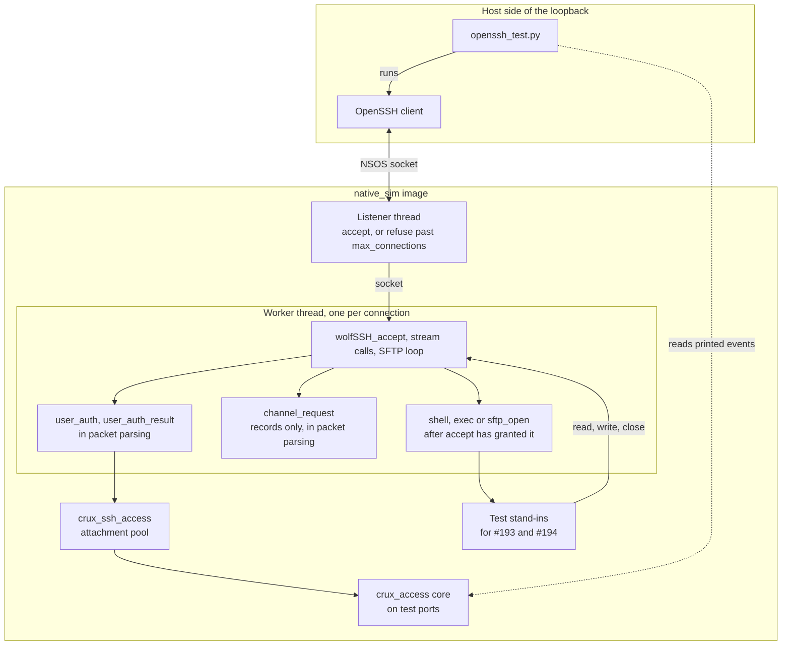
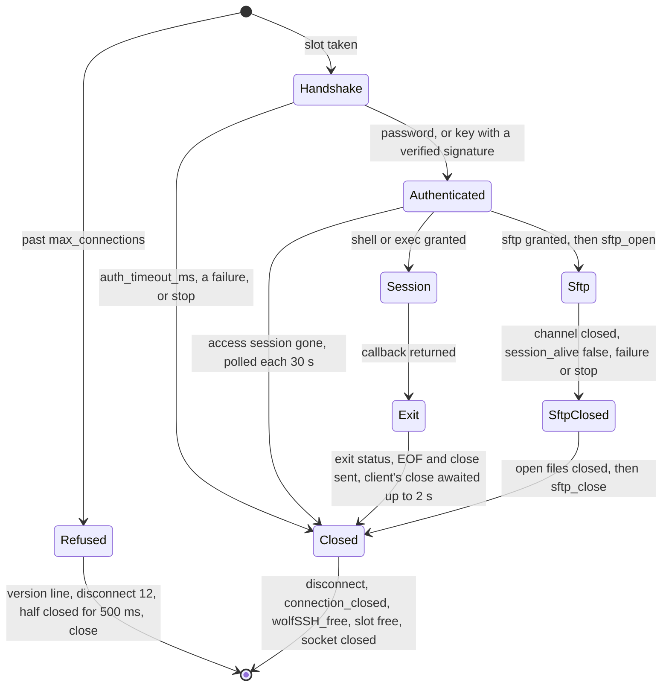

# The wolfSSH provider

Status: for review under Issue #192. It implements [the SSH provider contract](ssh-provider-contract.md) and the
[CLI and file transfer design](plans/secure-management-cli-sftp-design.md), and does not repeat them. It authorises no
hardware operation. Every run recorded here is on `native_sim` or is a compile for RT1060-EVKB. No board was operated.

## What is real, what is a stand-in

| Part | State | Where |
| --- | --- | --- |
| SSH protocol, key exchange, ciphers, signatures | **Real.** wolfSSH v1.6.0 and wolfSSL v5.9.4 at their pins, unedited | `modules/crypto/` |
| Provider behind the private interface | **Real** | `components/ssh/ports/zephyr/crux_ssh_wolf_provider.c` |
| Access adapter and attachment | **Real**, on the real `crux_access` core | `components/ssh/access/crux_ssh_access.c` |
| Host key from the credential store | **Real mapping, not yet in an image.** Host tests use the store's fake ports. | `components/ssh/access/crux_ssh_host_key.c` |
| Client in the OpenSSH cases | **Real.** OpenSSH 9.6 in the container, and 9.9 for ML-KEM | |
| Client in the conformance cases | Written for this test on wolfCrypt, because the cases need requests that a normal client never sends | `tests/zephyr/ssh_provider/src/conformance_client.c` |
| Access ports in the test image | **Fake.** The store is RAM, and random numbers come from `native_sim`'s test generator. The derivation and the keyed hash are real wolfCrypt, not the PSA provider. | `tests/zephyr/ssh_provider/src/test_access_ports.c` |
| Host key in the test image | **A declared test key**, generated by wolfCrypt at each boot from the same test generator, and never stored | `tests/zephyr/ssh_provider/src/test_keys.c` |
| Shell and `exec` | Stand-ins, for #193. Test commands in the image, and the repository's refusing entry points in one case. | `tests/zephyr/ssh_provider/src/test_sessions.c` |
| SFTP | Stand-in, for #194. A test handle over the refusing port, so a client gets as far as its first file operation. | `components/ssh/sftp/port/` |
| PSA ports | **Not used.** #242 is in progress and has not merged. | |

## Structure

## Connection life

The slot is free before the socket closes, so a client that sees the close can connect again at once.

## Settings of the provider

| Setting | Default | Note |
| --- | --- | --- |
| `CRUX_SSH_WOLF_CONNECTIONS_MAX` | 4 | Upper bound for `max_connections`, and the number of worker stacks |
| `CRUX_SSH_WOLF_WORKER_STACK_BYTES` | 16384 | Not measured on a target. See [Resource use](#resource-use). |
| `CRUX_SSH_WOLF_LISTENER_STACK_BYTES` | 4096 | The same |
| `CRUX_SSH_WOLF_WINDOW_BYTES` | 16384 | In place of wolfSSH's 128 KiB, which is most of a connection's heap |
| `CRUX_SSH_WOLF_PACKET_BYTES` | 16384 | Largest channel packet in either direction |
| `CRUX_SSH_WOLF_THREAD_PRIORITY` | lowest application priority | Below control work |
| `CRUX_SSH_WOLF_COMMAND_MAX` | 1023 | A longer `exec` is refused |
| `CRUX_SSH_WOLF_OFFER_MLKEM` | off | Offers `mlkem768x25519-sha256` first, if `CONFIG_WOLFSSL_MLKEM=y` compiled it |

A composition sets these on the target `crux_ssh_wolf_provider`, which `crux_ssh_wolf_settings()` creates. The test image does.

**The host key form** is what the issue left to this document: the private part, then the public part. That is seed and public key for
Ed25519, 64 bytes, and scalar and uncompressed point for ECDSA P-256, 97 bytes. These are the parts of a credential store key record, and
`crux_ssh_host_key_load()` assembles them. `start()` returns `CRUX_ERR_IO` for another length, and for parts that disagree, since a
fingerprint comes from the public part while wolfSSH derives what it sends from the private part.

## Results

Revision, tools and commands are in the pull request. `scripts/test-ssh-provider.sh` repeats all of this except the OpenSSH 9.9 run, which was by hand: its client is outside the container, and the script needs none. No workflow runs the script: see decision 15.

| Kind | What | Result |
| --- | --- | --- |
| Host | `Ssh.*` CTest, including the access adapter on the real `crux_access` core | All pass |
| `native_sim`, run | The 51 conformance cases of `tests/ssh` on this provider, over real sockets, with the scripted client | 51 pass, and the provider's own host key rules. The earlier failures are [below](#how-the-cases-went-from-red-to-green). |
| `native_sim`, run | `openssh_test.py`, with OpenSSH 9.6 | All cases pass. See the table below. |
| `native_sim`, run | OpenSSH 9.9 on the development machine, through a relay into the container | `mlkem768x25519-sha256`, `curve25519-sha256` and `ecdh-sha2-nistp256` each log in by key |
| RT1060-EVKB, compile only | The test image, without the TLS socket backend | Links: 298,848 B Flash, 703,884 B RAM, of which the test configures a 512 KiB arena |
| Control | `CONFIG_MBEDTLS=y` | Stops at configuration, with the message in `provider_sources.cmake` |

What each OpenSSH case shows, on a real socket:

| Case | Shown |
| --- | --- |
| `host_key_fingerprint_matches_openssh` | The printed fingerprint is what `ssh-keyscan` and `ssh-keygen -l` report, for Ed25519 and ECDSA P-256 host keys |
| `password_login`, `key_login` | Each logs in, the session reports user and role through the attachment, on channel 3, and logs out. Ed25519 and ECDSA keys run no password verifier. |
| `wrong_password`, `wrong_user`, `wrong_key` | Refused, with the same words for a wrong password and an unknown name and the same verifier cost. An RSA key is refused. |
| `attempts_on_a_connection_are_bounded` | Three failures end the connection, of six that the client would have tried |
| `refused_attempts_meet_the_delay` | Six failures, then the **right** password is refused inside the window, with no verification and a delay event. It works once the window passes. |
| `algorithm_list` | The server's `KEXINIT`, read directly, holds exactly the design's lists. No SHA-1, CBC, DES, RC4 or RSA. |
| `each_algorithm_negotiates`, `refused_algorithms_do_not_negotiate` | OpenSSH chooses each listed algorithm when told to, and fails on `aes128-cbc`, `aes256-cbc`, `3des-cbc`, `hmac-sha1`, two `diffie-hellman` groups, `ssh-rsa` and `rsa-sha2-256` |
| `strict_key_exchange` | OpenSSH reports strict ordering. A stray message from a strict client ends the exchange, and the same message from a client without the marker does not, as a control. |
| `connection_limit` | A third client reads "too many connections", no access event runs, held connections stay, and a freed slot works |
| `unauthenticated_time_limit` | A silent client closes about 20 ms after a limit of 1.50 s, and a session may outlast the limit |
| `concurrent_logins_do_not_stall_others` | During a 3 s verification, a key login and its session finish in about 0.2 s and a second password login is refused as busy in under 0.5 s. The first login then succeeds at about 3.1 s. |
| `flood_before_keys_meets_the_login_limit` | A client sending `SSH_MSG_IGNORE` as fast as it can from before the keys ends about 10 ms after a limit of 1.50 s, and another client logs in and finishes in about 0.2 s meanwhile |
| `stop_ends_a_flood` | `stop` returns in about 0.2 s with the flood running |
| `rekey_during_a_transfer` | `RekeyLimit=32K` gives over 20 rekeys while 200 kB goes each way, and the data and exit status arrive |
| `rekey_while_a_shell_waits`, `rekey_while_sftp_waits` | A rekey on a timer does not end a session waiting in `read`, or SFTP waiting for a request |
| `exit_status_survives_back_pressure` | With every third send reporting that it would block, each exit status arrives, and logins, 100 kB out and a 30 kB round trip work |
| `clean_close` | Exit statuses 0, 1, 7 and 255 arrive. 200 kB out, five times, arrives intact and with its status. 50 kB round trip. A terminal is reported with `-tt` and not without. |
| `nothing_is_left_behind` | The heap is the same before and after repeated logins, refusals and dropped connections. After `stop`, 128 B stays allocated. |
| `forwarding_is_refused` | `-R` fails, and `-L` is refused when used |
| `sftp_reaches_the_stand_in` | `sftp_open` and `sftp_close` run once each, and the client stops at the refusing port's first operation |
| `repository_stand_ins_refuse` | With the table as it is in the repository, `exec` and `shell` exit 255, and SFTP ends the connection |

### How the cases went from red to green

| Step | Observed | Change |
| --- | --- | --- |
| Adapter test on the stand-in | 55 failures | The real mapping |
| Review of `383f0bf`, the cases below added first | Flood: another client timed out, `stop` never returned, a read ran past its timeout through 2,000 packets. Rekey: `cat` and an idle shell ended with status 255. Back-pressure: `exit 7` gave 255. | A receive budget, a worker's success kept as success, and a bounded wait around the end of a session. See decisions 17 and 18. |
| First connection | `socket error` at once | Set the I/O contexts after `wolfSSH_set_fd()` |
| 51 cases, first run | 46 pass | Below |
| Data sent before a session | Connection ended | wolfSSH's rule, so the client holds it. See [Findings](#findings). |
| `sftp_handles_are_per_session` | First connection gone | `session_alive` answered false by default during a slow case |
| `session_alive_belongs_to_its_connection` | First connection gone | The client's keep-busy request had no body |

## Resource use

These are **simulation results only**: a 64-bit image, where each thread runs on a host stack and CPU work takes no simulated time. They rank
choices. They are not figures for a Cortex-M7, whose frames, alignment and crypto paths differ. The provider paints each thread's host stack and
finds the deepest change, because `k_thread_stack_space_get` says nothing on `native_sim`.

Each figure comes from the image's heap statistics and the stack probe, with OpenSSH as the client. Host stack: **13,808 B** at most on a worker, with `exec`, password and both key types, and about the same at every window size. 2,344 B on the listener.

| Window | One idle session | Peak after 300 kB down and 100 kB up | Four sessions at once | One client before keys |
| --- | --- | --- | --- | --- |
| 8 KiB | 12,616 B | 20,872 B | 48,304 B | 44,688 B |
| **16 KiB, the default** | **20,808 B** | **37,256 B** | **81,072 B** | **44,688 B** |
| 32 KiB | 37,192 B | 53,640 B | 146,608 B | 44,688 B |
| 128 KiB, wolfSSH's default | 135,496 B | 151,944 B | 539,824 B | 44,688 B |

So, as the contract's note expected, the window decides the heap of a logged-in session: about one window and 4.4 KiB, and one direction of a transfer about one more window. A 512 KiB arena served four sessions at 16 KiB, and **failed the fourth at 128 KiB**.

**A client that has not logged in can cost more.** It announces a packet of up to 34,988 B before any key exchange, and wolfSSH's input buffer grows to fit, whatever the window. That is more than a logged-in session at the default, and it costs the client nothing. Decision 19 says why the limit stays.

**The rule on these figures is `max_connections` × max(45 KiB, two windows + 5 KiB)**, which is 180 KiB for four connections at the default window. In a 151,552 B arena, three clients before keys made a valid login fail, closed, until they left.

The kernel's report on these stacks would have read 16,344 B free of 16,384 B, because a thread's Zephyr stack sees almost nothing on `native_sim`. The target's stack is the open question, and a CLI or file service adds its own use on top: issue #197 measures it. A worker's 16 KiB default leaves little margin even if a Cortex-M7 build needs only what this 64-bit build does.

## Cost of `mlkem768x25519-sha256`

Measured with `CONFIG_WOLFSSL_MLKEM=y` and `CRUX_SSH_WOLF_OFFER_MLKEM`, on the module's small-memory settings. OpenSSH 9.6 in the container cannot choose it, so OpenSSH 9.9 on the development machine did.

| Measure | `curve25519-sha256` in the same image | `mlkem768x25519-sha256` | Difference |
| --- | --- | --- | --- |
| RT1060 Flash, compile only | 298,848 B (image without ML-KEM) | 306,584 B | +7,736 B |
| RT1060 static RAM, compile only | 703,884 B | 703,884 B | None |
| `native_sim` heap peak, one login | 22,320 B | 25,456 B | +3,136 B during the exchange |
| `native_sim` heap in a session | 22,160 B | 22,160 B | None, though the build adds 1,352 B per session over one without ML-KEM |
| `native_sim` worker stack | 13,152 B | 13,152 B | None seen. `ecdh-sha2-nistp256` was the deepest at 13,600 B. |
| Handshake time | Not measured | Not measured | CPU work takes no simulated time, so it needs a target |

The memory cost looks small. **Time is the unknown**, so it stays off until a target run: decision 12. OpenSSH 10.1's warning stays a known limitation until then.

## Decisions for review

Each was taken without the owner, and the narrower choice was taken where there was one.

| # | Decision | Why | Impact if changed |
| --- | --- | --- | --- |
| 1 | Native Zephyr threads and static stacks in the provider, and no `crux::thread` | The gate record notes that its default of four is too low, and the provider is a port already | A wrapper around `k_thread_create` |
| 2 | Non-blocking socket calls and a poll of at most 50 ms | A worker sees `auth_timeout_ms`, `session_alive` and a stop however quiet the client is. It costs up to 20 wake-ups a second per idle connection. | Socket wake-ups would need a primitive that both the offload and the target stack support |
| 3 | `wolfSSH_CTX_SetChannelReqAnyCb` decides every channel request | It sees the raw request, so an embedded NUL and a subsystem name are refused before wolfSSH keeps them. `pty-req` and `window-change` are accepted with `WOLFSSH_TERM` off, which keeps its terminal code out. | The typed callbacks cannot see a NUL |
| 4 | `sftp_open` runs as soon as the request is granted, before the client's `SSH_FXP_INIT` | A client that never sends it still gets the idle poll and the close. No file operation can come before `INIT`. | It could wait, and a silent client would then hold no file handle |
| 5 | Refusal past the limit is the version line and a plain `SSH_MSG_DISCONNECT` with reason 12, in one non-blocking send from the listener, and the socket stays half closed for 500 ms, for at most two refusals at a time | The design asks for a disconnect message, and the listener must not wait on a client. A prompt close raced the client's own write, which reset the connection and lost the message in one run. OpenSSH prints "too many connections". A composition counts two more sockets. | A bare close |
| 6 | A logged-in connection with no session polls `session_alive` every 30 s | The interface names SFTP only, and otherwise an expired session could hold a slot until the client left. The case for `auth_timeout_ms` forbids applying that limit here. | The slot stays held until the client leaves |
| 7 | Only a finished SFTP request resets the SFTP idle timer, and `SSH_MSG_IGNORE` does not, by the loop's construction and with no test of its own | A client cannot defer the poll with traffic that does nothing | None for a normal client |
| 8 | An IPv4-mapped IPv6 address is that IPv4 source for the delay key | Passing its /64 would put every IPv4 client in one bucket | One test |
| 9 | The attachment is taken before the login, and a full pool is a denial with no verification | Nothing is verified that cannot be kept | One line |
| 10 | IPv4 listener only | The test image and the current networking profile have no IPv6. The address and delay code handle it, on the Host only. | A second listener, and tests |
| 11 | The window defaults to 16 KiB | See [Resource use](#resource-use). Transfer speed is for #194 to measure against it. | One setting |
| 12 | `mlkem768x25519-sha256` is off by default | See [its cost](#cost-of-mlkem768x25519-sha256). The design says to declare the OpenSSH 10.1 warning if it is too expensive, and that judgement needs a target measurement. | One setting and one Kconfig option |
| 13 | The server's version string is `SSH-2.0-Crux`, with no library version | It tells a scanner less | One string |
| 14 | `tests/zephyr/ssh_wolf_probe` gains `src/access_refused.c` and three lines of CMake, outside the contract's list for #192 | The entry points now call `crux_access`, so the probe would not link. #193 will meet the same with `crux_cli`. | The probe could link the core and ports instead |
| 15 | wolfSSH stays out of default CI, and no workflow runs `scripts/test-ssh-provider.sh` | `scripts/check-ssh-boundaries.py` forbids a default workflow to select the stack, and #247 owns that rule. Naming the script differently to pass the check would defeat it. | #247 can add this script to its workflow |
| 16 | `tests/ssh/conformance.c` gains two lines beyond the follow-up, so that `session_alive` answers true unless a case says otherwise | A real provider polls during a case that takes its time, and a fake never does. No check changed. | Each SFTP case would set it |
| 17 | `io_receive` hands back after 16 KiB with a 1 ms sleep, as if the socket were empty | wolfSSH loops while the socket has data, so with no budget a sender held off every limit, and every other connection in simulated time. It bounds a connection to about 16 MB/s, more than the target's link. | A bigger budget |
| 18 | While `wolfSSH_stream_exit` runs, a send that would block waits for room, for up to 2 s. It is not retried from the worker loop. | That call stops at the first message that would block, and repeating it would send the status twice. A stop cuts the wait short. A very slow client can hold its own worker for that long, and no other. | None |
| 19 | wolfSSH's `MAX_PACKET_SZ` stays, and the memory rule below allows for it | RFC 4253 section 6.1 requires packets up to 35,000 bytes, and a client announces the size before keys | A lower limit would be a shared setting that refuses a conforming client |
| 20 | **The slot lockout stays, as a recorded limit.** `max_connections` silent clients hold every slot for `auth_timeout_ms`, and a real user is refused meanwhile. | Nothing unauthenticated can be told from a slow login, and a reserved slot needs a policy for who may use it. A composition chooses the two numbers. The limit is short and repeats only while an attacker keeps connecting. | A slot reserved for clients that have logged in before, or by source |

## Findings

From running wolfSSH v1.6.0, for whoever works on this next.

| Finding | Effect |
| --- | --- |
| Channel data before a session request makes `wolfSSH_accept()` fail, because `WS_CHAN_RXD` is not a retry there | The connection ends. OpenSSH does not do this. The conformance client holds such data until the grant, and says so. |
| `wolfSSH_set_fd()` points the I/O contexts at wolfSSH's copy of the socket | Set the contexts after it, or the callbacks read an `int` as a connection |
| An SFTP request with no body ends the session (`SFTP_CheckRecvSz`) | Not a client's normal behaviour. #194's traces should show it if it matters. |
| The key exchange list also holds `ext-info-s` and `kex-strict-s` | Markers added by wolfSSH. They name nothing that can be negotiated. |
| A concurrent password login gets `CRUX_ACCESS_ERR_BUSY`, which is a denial on the wire and counts as an attempt | The contract asks for this. A user can see a refused password while another login is verifying. |

The provider wipes a password from wolfSSH's input buffer once the callback returns. That covers the plain text in that one buffer, and no copy that the TCP path or the client keeps.

## What was not verified

| Item | Why |
| --- | --- |
| Anything on a board, stack use on Cortex-M7, handshake time, timing of the verifier | Hardware is excluded |
| Time slicing between workers of equal priority on a target | CPU work takes no simulated time on `native_sim`, so a verifier was modelled with a sleep. The provider refuses to compile without `CONFIG_TIMESLICING` and a `CONFIG_TIMESLICE_SIZE` above zero. Zephyr's default is on, at 20 ms, and a composition should check that it suits. |
| Rekey | **Shown on `native_sim`** with OpenSSH on bytes and on time, for `exec`, a shell and SFTP waiting. Not during an SFTP transfer, not started by the server, and not with PuTTY or WinSCP. |
| Back-pressure on send | **Shown by injection** at every third send, for logins, `exec`, shell input and output, and the end of a session. Not with a real full socket and a client that stops reading, and not in SFTP. |
| Floods | **Shown on `native_sim`** for a sender before keys, against the login limit, another client and `stop`, and for a read's timeout after login. On a target, the budget's effect on throughput and on control work is not known. |
| Arena exhaustion | **Shown on `native_sim`** in a 151,552 B arena: clients before keys can use it up, a login then fails closed, and it works once they leave. wolfSSL's behaviour at each allocation failure was not walked. |
| The slot lockout | Recorded as decision 20, and not fixed |
| Real PSA ports, a host key generated and stored through the credential store in an image | #242 |
| SFTP file transfer, and the window-full path in the SFTP loop | #194. The port refuses every operation. |
| WinSCP | Needs a Windows host, and belongs to #194's acceptance |
| `ssh-audit` | Not installed, and not fetched. The OpenSSH cases read the server's `KEXINIT` directly and test strict key exchange with a control. |
| IPv6 through the provider | Decision 10 |
| `scripts/test-ssh-wolf-settings.sh`, and with it the provider beside the TLS socket backend | This author's workspace is a shallow clone, and the recipe's patch needs blobs it lacks. The probe was built without the backend instead. The independent review measured the probe with a reference to the provider at 426,196 B Flash and 291,028 B RAM. |
| wolfSSH in CI | Decision 15. Host suites run in CI, and the `native_sim` results here are from local runs. |
| OpenSSH 10.1's warning | No such client here. 9.9 was the newest available. |

## What #193 and #194 need

| Session | What to know |
| --- | --- |
| Both | `tests/zephyr/ssh_provider` and `scripts/test-ssh-provider.sh` are the end-to-end path. Replace the stand-ins in `src/test_sessions.c` and add cases to `openssh_test.py`. |
| Both | A callback runs on a worker whose stack wolfSSH already uses heavily. Set `CRUX_SSH_WOLF_WORKER_STACK_BYTES` for your own use on top: see [Resource use](#resource-use). |
| Both | `crux_ssh_attachment_session()` is real. `crux_access_touch` is yours to call on user activity. The session ends when `connection_closed` runs. |
| Both | Your entry points must link in `tests/zephyr/ssh_wolf_probe`, as `src/access_refused.c` does for access. |
| #193 | `read` and `write` wait up to `io_timeout_ms`, which the composition sets. `CRUX_ERR_TIMEOUT` leaves the channel usable. `CRUX_ERR_NO_DATA` is EOF, and a short write is success. `terminal` is true when `pty-req` came first. |
| #193 | Host key display: `crux_ssh_wolf_host_key_fingerprint()` needs no SSH type. It belongs to the composition to pass the string to the CLI, so that the CLI does not link a provider header. |
| #193 | The exit status goes out when your callback returns, and the provider waits for the client's close. Do not send it yourself. |
| #194 | `sftp_open` runs before `SSH_FXP_INIT`. The handle is set with `wolfSSH_SetFilesystemHandle`, and `wolfSSH_SFTP_free` runs before `sftp_close`, so that closing what a client left open happens with the handle still valid. |
| #194 | Measure transfers against the 16 KiB window and packet, and change `CRUX_SSH_WOLF_WINDOW_BYTES` if needed. The `WS_WINDOW_FULL` branch of `serve_sftp` has never run. |
| #194 | `session_alive` is polled each `io_timeout_ms` with no request, and only an SFTP request resets that. |
