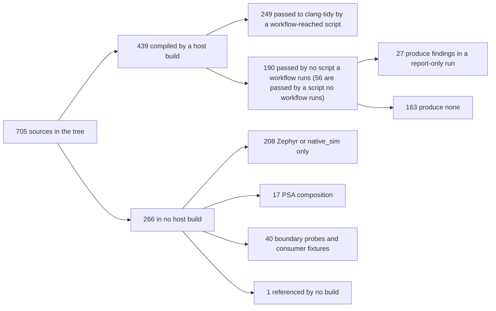
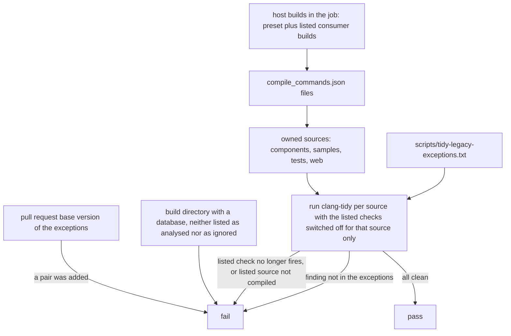

# Static-analysis coverage of the host build

Status: **proposal and measurement**, no check or script of the repository is changed by this document.
Measured on commit `48bc13be` on 2026-11-09. Refs #161.

The configured static analysis is clang-tidy 18 with [.clang-tidy](../.clang-tidy)
(`WarningsAsErrors: '*'`). This document measures how many host-compiled sources it sees today, what a
full run would flag, and proposes a staged way to include every compiled source automatically. It does
not claim MISRA C, CERT C or functional-safety compliance, and it adds no check:
[coding-guidelines.md](coding-guidelines.md) requires a separate justification for new mandatory checks.

Every number is **MEASURED** (with the command in [How it was measured](#how-it-was-measured)) unless it
is marked **INFERRED**.

## Summary

- 705 C and C++ sources exist under `components`, `samples`, `tests` and `web`. The Linux host builds
  compile 439 of them (389 in the `host-debug` preset, 50 more only in standalone consumer builds).
  266 are in no host build: 208 need Zephyr or `native_sim`, 17 need the PSA composition, 40 are
  boundary probes and consumer fixtures, 1 is referenced by no build.
- `scripts/analyze-host.sh` passes 90 explicit paths. It is **not** the only place that runs clang-tidy:
  12 other scripts do, most with shell globs, which pick up new files in the globbed directories. Of
  those 13 scripts, 7 run their clang-tidy step in a mode that a workflow selects; 6 never do in CI.
- **150** of the 389 `host-debug` sources, and **190** of the 439 compiled sources, are passed
  to clang-tidy by no script that a workflow runs. Counting only `analyze-host.sh`, the numbers are 309
  and 349.
- Running the repository's own configuration over those 190 sources, report-only: **163 produce no
  diagnostic, 27 produce 64** (1 of the 27 is a deliberate compile-fail probe, which needs an
  exclusion, not a fix). Of the 63 real findings, 5 are reported in `components/` files (3 of them in
  `components/queue/src/queue.c`, reached through an include in the test `tests/queue/faults.c`), 1 in
  `samples/` and 57 in tests and test fixtures; attributed to the source being analysed, 2 are in
  `components/` sources, 1 in `samples/` and 60 in tests. The run takes about 100 s of clang-tidy time for the 150
  `host-debug` sources, and about 275 s for the 429 sources run, including 239 that are already analysed.
- No clang-tidy run exists for any of the 208 Zephyr-only sources.
- Proposal: generate the list from the compile databases of the job's listed builds, and keep today's
  failures in a per-source, per-check exceptions file that a check forces to shrink. The prototype
  analyses 420 of the 439 compiled sources; the other 19 are named in
  [What the prototype leaves out](#what-the-prototype-leaves-out).

## How it was measured

| Item | Value |
|---|---|
| Base commit | `48bc13be0ebd8617a9ec9427c446bbc5bcdf375f` |
| Environment | native arm64 Ubuntu 24.04 container, 4 CPUs, 2 GB memory, clang 18.1.3 and clang-tidy 18.1.3 (`1:18.1.3-1ubuntu1`), CMake 3.28.4, Ninja 1.11.1, `libssl-dev` installed (see below) |
| Why not the amd64 Dev Container | MEASURED: configure took 2.5 s native and 19 s emulated; the build 7.5 s and 114 s. Emulated clang-tidy was 1.8 times slower per source on a 30-source sample. Diagnostics were identical on the 30 sources (20 with findings, 10 clean). |
| Presets | `cmake --preset host-debug` and `host-sanitize`. The 389 owned sources are the same set in both. |
| Consumer builds | 18 standalone projects under `tests/` configured with `-DCMAKE_EXPORT_COMPILE_COMMANDS=ON`, which approximates the commands of the CI scripts (INFERRED to compile the same sources) |
| Tool | [measure-tidy-coverage.py](../scripts/measure-tidy-coverage.py) (`--self-test` runs its unit tests). Not written test-first: the approach changed while the data was explored. Alternative verification: the unit tests, the cross-check of its counts against the clang-tidy runs, and a control run over the 239 sources that CI already analyses, which gave no diagnostic. |
| clang-tidy run | one process per source, `clang-tidy-18 -p <build dir> --quiet <source>`, no `--fix`, no file changed |

`libssl-dev` matters: without OpenSSL headers CMake skips `tests/tls_certificate/differential.c` and the
`host-debug` set has 388 sources, not 389. The Dev Container image has the headers; the CI runner image
is INFERRED to have them too, because its `host.yml` installs no OpenSSL package and the Dev Container
and GitHub-hosted Ubuntu images both ship them. This is not verified against a CI log.

## Where clang-tidy runs today



Thirteen scripts call clang-tidy. A script counts as reached when a workflow names it directly or through
another script. Reached is not the same as run: a script can call clang-tidy only in a mode that no
workflow selects.

| Script | Passes | Reached by a workflow | Note |
|---|---|---|---|
| `scripts/analyze-host.sh` | 90 explicit paths | `host.yml` | the only script with a hand-written list |
| `scripts/test-access.sh`, `test-cli.sh`, `test-credential.sh`, `test-security-event.sh`, `test-mgmt-services.sh` | globs of `components/<c>/src`, `tests/<c>` | `host.yml` | new files in those directories are picked up |
| `scripts/test-web.sh` | globs, `host` mode | `host.yml` runs `host`; other workflows run other modes | |
| `scripts/test-web-assets.sh`, `scripts/test-web-session.sh` | globs, in `run_host` | **no, in effect** | the workflows call these with `native`, and `native` does not call `run_host` (read from the scripts) |
| `scripts/test-file-service.sh`, `test-network-settings.sh`, `test-reboot.sh`, `test-tls-certificate.sh` | globs | **no** | named by no workflow and no script |

The measurement script reads these from the scripts, expands the globs against the tree, and follows
workflow references through scripts. The two `--not-run` exclusions above were set by hand after reading
the mode dispatch of those scripts, because the script cannot read shell control flow.

Six of the thirteen scripts therefore never run their clang-tidy step in CI: `test-file-service.sh`,
`test-network-settings.sh`, `test-reboot.sh` and `test-tls-certificate.sh` are reached by no workflow,
and `test-web-assets.sh` and `test-web-session.sh` are reached only in `native` mode. Their selections
are described in documents such as [reboot-service.md](reboot-service.md) and the
[test guide](../tests/README.md), which say the scripts run clang-tidy, but a pull request never runs them.

### The gap by definition

| Definition of "analysed" | `host-debug` sources not analysed | all compiled sources not analysed |
|---|---|---|
| passed by `scripts/analyze-host.sh` only | 309 | 349 |
| passed by any script a workflow reaches in a selecting mode | **150** | **190** |
| passed by any script, even one no workflow runs | 94 | 134 |

The second row is the working definition below. For every clang-tidy invocation whose `-p` directory
matches a database given to the script, every analysed path is in that database (0 exceptions). Two
invocations have a directory that matches none (`test-tls-certificate.sh` uses `$first`, 15 files, and
`$build`, the PSA composition build, 2 PSA-composition sources), so membership is not checked for those
17 paths; `analyze-host.sh`'s `$build_dir` is taken to be `build/linux/debug`, its documented default.
Every analysed path exists in the tree (0 exceptions).

### The gap by directory

150 `host-debug` sources, with the result of the report-only run of [the next section](#what-a-full-run-would-flag).

| Directory | Compiled, not analysed | With a finding | Findings |
|---|---|---|---|
| `components/file_service` | 2 | 1 | 1 |
| `components/ssh` | 2 | 1 | 1 |
| `components/network_settings` | 5 | 0 | 0 |
| `components/reboot` | 4 | 0 | 0 |
| `components/gpio`, `components/i2c`, `components/spi`, `components/tls_certificate` | 3 each | 0 | 0 |
| `components/interrupt`, `components/queue`, `components/time`, `components/web` | 1 each | 0 | 0 |
| `samples/web_project` | 1 | 0 | 0 |
| `tests/network_settings`, `tests/tls_certificate` | 13 each | 0 | 0 |
| `tests/time` | 12 | 4 | 18 |
| `tests/reboot` | 12 | 1 | 1 |
| `tests/ssh` | 9 | 0 | 0 |
| `tests/web` | 8 | 1 | 1 |
| `tests/queue` | 7 | 2 | 6 |
| `tests/file` | 6 | 4 | 16 |
| `tests/file_service`, `tests/i2c`, `tests/networking`, `tests/spi` | 5 each | 3 in all | 4 in all |
| `tests/gpio`, `tests/management_providers`, `tests/thread` | 3 each | 2 in all | 5 in all |
| `tests/bench_first_account` | 1 | 1 | 2 |
| `tests/configuration` | 2 | 0 | 0 |
| eight more `tests/` directories | 1 each | 0 | 0 |

The 29 `components/` sources and the one `samples/` source are production-facing code and are all
analysable today: only two of them produce a finding. The remaining 40 of the 190 are compiled only in
standalone consumer builds: `tests/*_consumer`, `tests/execution_*` and two `samples` controllers.

Zephyr-named files can be in the host build: `components/gpio/ports/zephyr/gpio_status.c`,
`components/interrupt/ports/zephyr/interrupt_zephyr.c`, `components/queue/ports/zephyr/queue_port.c`,
`components/time/ports/zephyr/busy_wait_zephyr.c` and others are compiled against host fakes by the
host tests, so they are part of the 150, not of the Zephyr-only group.

### Sources in no host build

| Reason (INFERRED from the path and from the CMake and script references) | Sources |
|---|---|
| Zephyr or `native_sim` only (`ports/zephyr`, `samples/*/zephyr`, `tests/native`, `tests/zephyr`, device apps) | 208 |
| Boundary probes and consumer fixtures, compiled only under a probe selected by a `check-*-boundary.py` script, or never meant to compile | 40 |
| PSA composition, built by `psa-crypto.yml` with TF-PSA-Crypto | 17 |
| Referenced by no build (`tests/queue/red_stub.c`) | 1 |

Within the 208: 23 are `components/*/ports/zephyr` or SSH ports, 28 are `samples/`, 64 are in
`tests/native`, 27 in `tests/zephyr`, and 66 are in other `tests/` directories (Zephyr subdirectories,
device applications). Several `tests/*_consumer/*` probes are built so that the build must fail (for
example `include_adapter.c`); clang-tidy must never run on them.

### Headers

`HeaderFilterRegex` is `.*(components|samples|tests)/.*`, so every one of the 248 repository headers
matches and is reported when an analysed source includes it.

| Measure | Count |
|---|---|
| Headers in the tree | 248 |
| Included by a compiled source | 166 |
| Included by a source that a workflow-reached script analyses | 125 |
| Included **only** by sources nothing analyses | 41 |
| Included by no compiled source (mostly Zephyr and PSA headers) | 82 |

### The Zephyr side

- 208 Zephyr or `native_sim` sources plus 17 PSA-composition sources are outside every host database.
  No script calls clang-tidy with a Zephyr or `native_sim` build directory: every `-p` argument in the 13
  scripts is `build/linux/debug`, a standalone consumer build, a TLS-certificate preset build, or the
  TLS-certificate PSA composition build (`$build` in `scripts/test-tls-certificate.sh`, a host build with
  TF-PSA-Crypto). **No clang-tidy run covers a Zephyr-only source.**
- Several Zephyr scripts already pass `-DCMAKE_EXPORT_COMPILE_COMMANDS=ON` to `west build`, for example
  `scripts/test-logging.sh` and `scripts/test-system.sh`. The databases of those builds exist in the
  Zephyr jobs. INFERRED: running clang-tidy over a `native_sim` database needs the west workspace and
  the Zephyr SDK already installed by `zephyr.yml`, and extra arguments for the Zephyr include path and
  generated headers; an ARM target database additionally needs `--target` and the toolchain's sysroot
  for clang to parse GCC flags. That is a separate design and is **not** covered here. Nothing was
  built for it.

## What a full run would flag

Report-only, with the repository's `.clang-tidy`, over the 150 `host-debug` sources and the 40
consumer-only sources (each with its own build directory), one process per source on the native arm64
container, one worker.

| Set | Sources | Clean | With findings | Findings | clang-tidy time | Mean per source | Median | Slowest |
|---|---|---|---|---|---|---|---|---|
| `host-debug`, not analysed | 150 | 130 | 20 | 55 | 99.7 s | 0.66 s | 0.04 s | 18.7 s |
| consumer builds only, not analysed | 40 | 33 | 7 | 9 | 1.3 s | 0.03 s | 0.03 s | 0.15 s |
| already analysed (control) | 239 | 239 | 0 | 0 | 173.6 s | 0.73 s | 0.09 s | 15.6 s |

The control shows the setup reproduces today's clean state: the 239 sources that CI already analyses
produce no diagnostic here either. Because `WarningsAsErrors` is `'*'`, every diagnostic below would be a
failure of the step.

### By check

| Findings | Check | Where |
|---|---|---|
| 23 | `bugprone-reserved-identifier` | 20 `__wrap_*` and `__real_*` linker-wrap names and 3 feature-test macros (`_POSIX_C_SOURCE` twice, `_XOPEN_SOURCE` once), all in tests |
| 20 | `bugprone-easily-swappable-parameters` | 2 in `components/`, rest in tests and fixtures |
| 4 | `clang-analyzer-security.insecureAPI.strcpy` | `tests/file/fake_file.c` |
| 4 | `bugprone-suspicious-memory-comparison` | `tests/networking`, `tests/time` |
| 3 | `clang-analyzer-core.StackAddressEscape` | reported in `components/queue/src/queue.c`, reached through an `#include` of `queue.c` in the test `tests/queue/faults.c` |
| 2 | `bugprone-implicit-widening-of-multiplication-result` | `tests/file`, `tests/bench_first_account` |
| 2 | `clang-analyzer-deadcode.DeadStores` | `tests/file_service_consumer` |
| 1 | `bugprone-not-null-terminated-result` | `tests/bench_first_account` |
| 1 | `clang-analyzer-optin.core.EnumCastOutOfRange` | `tests/file/conformance.c` |
| 1 each | `bugprone-multi-level-implicit-pointer-conversion`, `bugprone-suspicious-include`, `bugprone-sizeof-expression`, `clang-diagnostic-unused-result` | tests |

Thirteen checks in all; the first two account for 43 of 64. The `clang-diagnostic-unused-result`
finding is `tests/reboot/probe/nodiscard_probe.c`, a probe built with `EXCLUDE_FROM_ALL` that must fail to
compile; it is an exclusion, not a defect. Two production sources, `components/file_service/src/file_service_security_events.c` and
`components/ssh/sftp/crux_ssh_sftp_refuse.c`, have a finding (`bugprone-easily-swappable-parameters`).
A third group is reported in `components/queue/src/queue.c` only because the fixture `tests/queue/faults.c`
includes that file; the cause is in the fixture's global (`faults.c`), not in a production source.

### By directory

Findings by directory of the reported file (paths normalised): `tests/time` 18, `tests/file` 16,
`tests/thread` 4, `tests/serial_consumer` 4, `tests/networking` 3, `tests/queue` 3, `components/queue` 3,
`tests/bench_first_account` 2, `tests/execution_runtime` 2, `tests/file_service_consumer` 2, one each in
`components/file_service`, `components/ssh`, `samples/serial`, `tests/i2c`, `tests/management_providers`,
`tests/reboot`, `tests/web`. Attributed instead to the source that was analysed, `tests/queue` has 6 and
`components/queue` none.

### CI time

- clang-tidy time of the analysed set today: 174 s of work for the 239 `host-debug` sources that are already
  analysed (the 10 logging and system consumer sources of `analyze-host.sh` were not timed). The 429
  sources run here are about 275 s of work, 58 percent more than the 239.
- The proposed single run over 420 sources with two workers took **151 s wall time** (2 m 30.7 s) on the container
  above (INFERRED to be of the same order on a GitHub-hosted runner; the emulated sample was 1.8 times
  slower, so 90 to 300 s is a fair range). Some sources are INFERRED to be analysed twice today, once by a
  per-component script and once by another; dropping the duplicates later saves time.
- A few sources dominate: the six slowest, of which `tests/networking/client_test.cpp` (18.7 s) and
  `components/file_service/src/file_service.c` (15.1 s) are two, take 9.9 to 18.7 s each.

## Design

### Principles

1. The list of sources comes from the compile databases that the job's own builds produce, so a new
   source is analysed as soon as a build compiles it. Nobody maintains a path list.
2. Today's failures stay visible and shrink. They are named per source and per check, not excluded by
   directory or by disabling a check for everybody.
3. Compiled in a listed build means analysed. A source in the database of a listed build is analysed
   or named in the exceptions file; a build directory that is neither listed nor ignored fails the step.
   The design does not see sources that are compiled elsewhere (see
   [What the prototype leaves out](#what-the-prototype-leaves-out)).
4. Protected files change only within an explicit human approval ([AGENTS.md](../AGENTS.md)).

### The generated list



A prototype of the whole mechanism was written and tested in a throwaway copy, not committed here:
a new `scripts/tidy-sources.py` (about 190 lines with its own unit tests), a rewrite of
`scripts/analyze-host.sh`, a new exceptions file with 25 entries, one module `tests/build/test_tidy_sources.py`
so the existing `unittest discover` step runs its tests, and a 12-line step in `host.yml`. What it does:

- **List.** It reads `compile_commands.json` of `build/linux/debug` first, then of each listed build
  directory, keeps sources under `components`, `samples`, `tests`, `web`, and de-duplicates (the first
  database wins). With the CI builds present it analysed 420 sources.
- **Build directories are listed, not discovered.** `analyze-host.sh` holds two short arrays,
  *analysed* and *ignored with a reason*. A build directory with a database that is in neither fails the
  step. Discovering every `build/*/compile_commands.json` was rejected: the boundary builds
  (`build/*-boundary`) hold probe sources that must fail to compile. A new CI build is a deliberate act,
  so listing it once costs little, and every source inside it is then analysed with no further list.
- **Exceptions file.** One line per source: `source ; check[,check] ; reference`, comments with `#`.
  The listed checks are switched off for that source only (`--checks=-check`; clang-tidy appends the
  command-line list to the configuration, and a direct clang-tidy run below shows another check still reported); the pseudo check `@skip` marks a probe that must fail to compile.
- **It can only shrink.** The tool fails when a listed check no longer fires for its source or when the
  source is no longer compiled, so a fixed source forces its entry out. A `host.yml` step on pull
  requests compares the file with the base branch version and fails when a source-and-check pair was
  added. The first pull request has no base version and is exempt; a failed fetch fails the step. `scripts/` is a protected path, so
  any edit to the file also needs human approval and an independent review.
- **A new source cannot skip analysis** because the list is the database (case C and D below).

Tests of the prototype, in a throwaway container with the final patch applied, only the ten listed
builds plus `host-debug` present, `CRUX_ANALYZE_REQUIRE_ALL_BUILDS=1`, each case a full run of the real
`scripts/analyze-host.sh` on a freshly regenerated compile database (about 150 s each):

| Case | Result |
|---|---|
| 0. Unchanged tree, 25 exceptions | exit 0, 420 sources analysed |
| A. One exception removed | exit 1, `clang-tidy failed on tests/time/clock_linux_test.c` with its reserved-identifier findings |
| B. A check that does not fire added to an entry | exit 1, "tests/web/assets/cpp_header.cpp no longer triggers bugprone-foo" |
| C. A new source with a reserved identifier, added to CMake | exit 1, names `tests/time/zz_new_probe.c` and the check; 421 sources |
| D. The same source without the defect | exit 0, 421 sources |
| E. A new finding of an already listed check in a listed source | **exit 0**: the limit named below |
| F. Another function added to a listed source (meant to trigger `bugprone-easily-swappable-parameters`) | exit 0, inconclusive: the check did not fire on that function |
| Direct clang-tidy runs, with and without `--checks=-bugprone-reserved-identifier`, on a source with reserved-identifier and `DeadStores` findings | the reserved-identifier findings disappear and the `DeadStores` finding remains: other checks stay active |
| Unlisted build directories present (the eight consumer builds made by hand), no exceptions run | exit 2, names each (an earlier run) |
| A listed build missing, all required | exit 2 (same run) |
| `--shrink-only` against the baseline: unchanged, shrunk, grown | exit 0, 0, 1 (an earlier run) |

An earlier run of cases A to D used a stale database and the 27-entry draft of the exceptions file; its
results were discarded for the table above. Not tested: a real CI run, the `host.yml` step itself, and
the build directories that exist at that point of the CI job.

### What the prototype leaves out

The prototype analyses 420 of the 439 compiled sources. The 19 it
does not analyse are in eight standalone consumer builds that are in neither of its two lists:

| Consumer build | Sources |
|---|---|
| `access`, `cli`, `credential`, `security_event`, `web`, `file_service`, `networking` consumers | 2 each (14) |
| `configuration` consumer | 5 |

INFERRED from the scripts, CI builds some of these in places the guard cannot see: the
`check-access-boundary.py`, `check-cli-boundary.py`, `check-credential-boundary.py` and
`check-security-event-boundary.py` scripts default to `build/*-boundary` (which the prototype ignores,
because their probe sources must fail to compile), and `check-web-boundary.py` uses a temporary directory.
Where the other three are built was not established. Their default-probe sources, `consumer.c` and
`consumer.cpp`, do compile; a later stage can analyse them by pointing a listed build at the default
probe. Among the 19 are the two `tests/file_service_consumer` sources, which have two `DeadStores`
findings that the prototype neither analyses nor lists. The 27 failing sources are therefore 24 sources
with findings that the prototype analyses, those 2 consumer sources, and the `@skip` probe; the exceptions
file has 24 + 1 = 25 entries.

Other limits of the gate, stated plainly:

- A new finding of an **already listed** check in a listed source passes, because the check is switched
  off for the whole source and the ratchet only tests that the check still fires somewhere in it.
  A new finding of any **other** check fails. A per-location baseline would close the gap and costs
  line numbers in the exceptions file.
- The exceptions for consumer-only sources fail as "not compiled" when a local run lacks that build.
  CI sets `CRUX_ANALYZE_REQUIRE_ALL_BUILDS=1`; a developer without the build sees the failure.
- The pull-request step compares with `origin/<base>`; it fails when the fetch fails, and is exempt only
  when the base has no exceptions file.

### How to treat the findings

| Option | What it does | Cost | Verdict |
|---|---|---|---|
| **A. Fix first** | fix all 63 real findings, then switch on the generated list | one change touching 26 sources (2 production, 1 sample, 23 tests and fixtures); `__wrap_`/`__real_` names are the linker `--wrap` convention and cannot be renamed, so these need a `NOLINT` with a reason or a check option | right end state, wrong first step: it delays coverage of the 163 clean sources |
| **B. Baseline per source and check** (proposed) | the exceptions file above, 25 entries, shrinking | one new file under a protected path; each entry is a visible debt; a new finding of another check in a listed source still fails; a new finding of an already listed check passes | recommended first step |
| **C. Switch a check off for everybody** | e.g. `-bugprone-easily-swappable-parameters` or `-bugprone-reserved-identifier` | edits `.clang-tidy` (protected), hides future true findings | not recommended for these checks; `bugprone-reserved-identifier` could take `AllowedIdentifiers` for the `--wrap` names as a reviewed follow-up |
| **D. Exclude directories** | skip `tests/` | removes 120 of the 150 `host-debug` sources and 60 of the 63 findings | not recommended: tests are where the gap is |

Two checks deserve a decision of their own, because they are policy, not defects:
`bugprone-easily-swappable-parameters` is a style heuristic (20 findings, 2 in production code) and
`bugprone-reserved-identifier` flags the linker-wrap convention (20 findings) and feature-test macros (3), none in production code.
Neither is a claim about the correctness of the code.

### Stages

| Stage | Change | Blocking | Protected files |
|---|---|---|---|
| 0 | this document and the measurement script | no | none |
| 1 | run the measurement in CI, report-only, as a step that prints the gap | no | `.github/workflows/host.yml` |
| 2 | generated list with the baseline exceptions (option B) | yes | `scripts/analyze-host.sh`, `.github/workflows/host.yml`, new `scripts/tidy-sources.py`, new `scripts/tidy-legacy-exceptions.txt` |
| 3 | burn the baseline down by component, delete the per-component clang-tidy calls that the generated list makes redundant | yes | the 12 `scripts/test-*.sh` files that call clang-tidy |
| 4 | a separate design for Zephyr-only sources, if the owner wants it | decided then | decided then |

Stage 2 adds, besides a changed `analyze-host.sh`, the new files `scripts/tidy-sources.py`,
`scripts/tidy-legacy-exceptions.txt` and `tests/build/test_tidy_sources.py`. The existing protected files
it changes are `scripts/analyze-host.sh` (the hand-written list is replaced by the generator and the
build-directory lists) and `.github/workflows/host.yml` (the shrink-only step on pull requests, and
`CRUX_ANALYZE_REQUIRE_ALL_BUILDS=1` on the analysis step so a listed build that was not built fails).
Neither `.clang-tidy` nor `CMakePresets.json` changes. The new files are new check scripts and may be
added within a task, but they are listed in the PR description with the other protected paths.

### What `check-patch.sh` teaches

[check-patch.sh](../scripts/check-patch.sh) is a diff-based gate: it checks only changed lines, starts
with one diagnostic type (`BRACES`), reuses a pinned upstream tool, and states its limitation openly
(a body edit under an unchanged condition passes). Three points transfer:

1. **Gate new code strictly, tolerate old code visibly.** A changed-source gate for clang-tidy (the
   sources touched by the diff that a database compiles) would fail only on code someone is editing, with
   no baseline file. It is cheaper, but it cannot detect a new source that no database compiles and it
   lets an untouched legacy source rot. The exceptions file closes both holes; the changed-source gate
   remains a cheap alternative if the owner prefers no baseline.
2. **Grow the gate by named checks.** `check-patch.sh` adds diagnostic types one at a time. The same
   works here: the exceptions are per check, so a check can be enforced everywhere the day its last
   entry is removed.
3. **Write the limitation next to the gate.** The generated list covers only what the job's builds
   compile; the sections that follow it say what it misses.

### CI shape and required checks

The analysis needs the compile databases that earlier steps of the `host` job produce, so the proposal
keeps it in the same job: splitting it would repeat the host build (the measured configure and build of
`host-debug` alone is about 10 s native, longer on a runner, plus the consumer builds). INFERRED: a
second job is worth it only if the full host job becomes the bottleneck.

GitHub required status checks are named by the job. The workflow `host-foundation` has one job, `host`,
so the required check is `host`; the analysis would be part of it and add no new name. The other
workflows have the jobs `links` (docs-links), `psa-crypto`, `specification`, `client`, `browser` and
`angular` (web), and `shard` and `zephyr` (zephyr-software). If the owner prefers a separate required
check for analysis, split it into a job named for example `static-analysis` with its own build, and
require that name. `main` has no branch protection today, so none of these names is required yet
(Issue #162 covers what GitHub enforces).

## Open decisions for the owner

| # | Decision | Recommendation | Reason |
|---|---|---|---|
| 1 | Replace the hand-written list by the generated list | **Yes**, stage 2 | a new source cannot skip analysis; 163 of 190 gap sources are already clean |
| 2 | Handle today's 27 failing sources by baseline (B), fix-first (A) or exclude a check (C) | **B first**, then burn down | keeps coverage at once and keeps debts visible |
| 3 | Approve changes to protected paths: `scripts/analyze-host.sh`, `.github/workflows/host.yml`, and the new scripts | **Yes**, within one reviewed PR | the check definitions are protected by [AGENTS.md](../AGENTS.md) |
| 4 | Let the `--wrap` names pass `bugprone-reserved-identifier` through `AllowedIdentifiers` in `.clang-tidy` | **Yes, as a separate reviewed change** | 20 of the 23 findings are a convention, not defects; the other 3 are feature-test macros and need a `NOLINT` with a reason or a compile definition; this edits a protected file |
| 5 | Keep or remove the 12 per-component clang-tidy calls once the generated list exists | **Remove in stage 3** | they duplicate the list; 6 of them never run their clang-tidy step in CI today |
| 6 | Analyse the boundary and probe consumer builds | **No**; list them as ignored with a reason | some of their sources must fail to compile |
| 7 | Cover Zephyr-only sources | **Not now**; decide after stage 3 | needs a west workspace and an ARM-aware setup; 208 sources, 0 covered today |
| 8 | One job or a separate required `static-analysis` check | **Same job** | avoids repeating the host build |
| 9 | Whether a documentation claim that a script "runs clang-tidy" must match a workflow | **Yes**: fix or delete the claims for the six scripts that never run it in CI | a reader is told a check runs that never runs |

## What is not covered

- Zephyr and `native_sim` sources, the PSA composition and the boundary probes (above).
- MISRA C and CERT C: no compliance claim exists, none is made. Dedicated analysers would need their
  own justification.
- Coverage (line, branch) and SonarQube: not measured and not designed here.
- The 19 sources of the eight consumer builds that the prototype leaves out, including the two
  `DeadStores` findings of `tests/file_service_consumer`.
- Whether a diagnostic is a true defect: the 63 findings were counted, not triaged one by one.
- Sources compiled only on a platform other than the Linux host.

## What was not verified

- A CI run of the generated list, and which build directories exist when the analysis step runs on a
  GitHub-hosted runner. The two build-directory lists are INFERRED from the scripts.
- That a GitHub-hosted runner has the OpenSSL headers (see [How it was measured](#how-it-was-measured)).
- The 18 consumer builds were configured with the arguments in this session, not by the CI scripts.
- clang-tidy time on a GitHub-hosted runner; the range above is INFERRED from native and emulated runs.
- That `test-web-assets.sh` and `test-web-session.sh` never run `run_host` in CI: read from the scripts
  and the workflow arguments, not observed in a log.
- The Zephyr cost statements (INFERRED).

## Reproduce

```bash
# in a Linux container with clang-tidy-18, cmake and ninja at the pinned versions
cmake --preset host-debug -S . && cmake --build --preset host-debug
python3 scripts/measure-tidy-coverage.py --repo . \
    --db host-debug=build/linux/debug/compile_commands.json \
    --not-run scripts/test-web-assets.sh --not-run scripts/test-web-session.sh \
    --gap-list gap.txt --json coverage.json --headers
```

Add `--db NAME=PATH` for each standalone consumer build, `--db-root` when the databases were produced
at another checkout path, and run `scripts/measure-tidy-coverage.py --self-test` for its tests.
