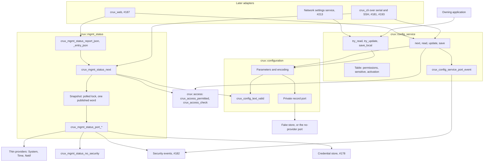
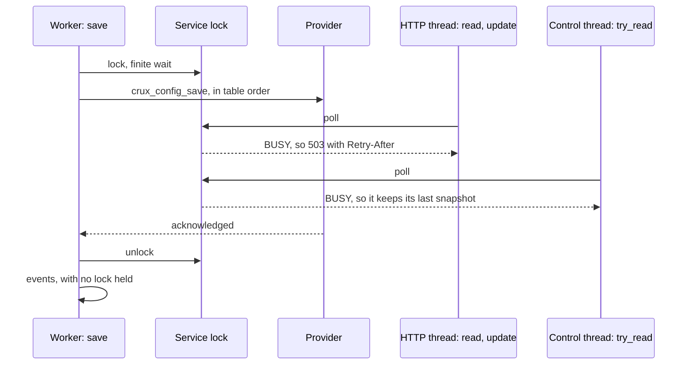
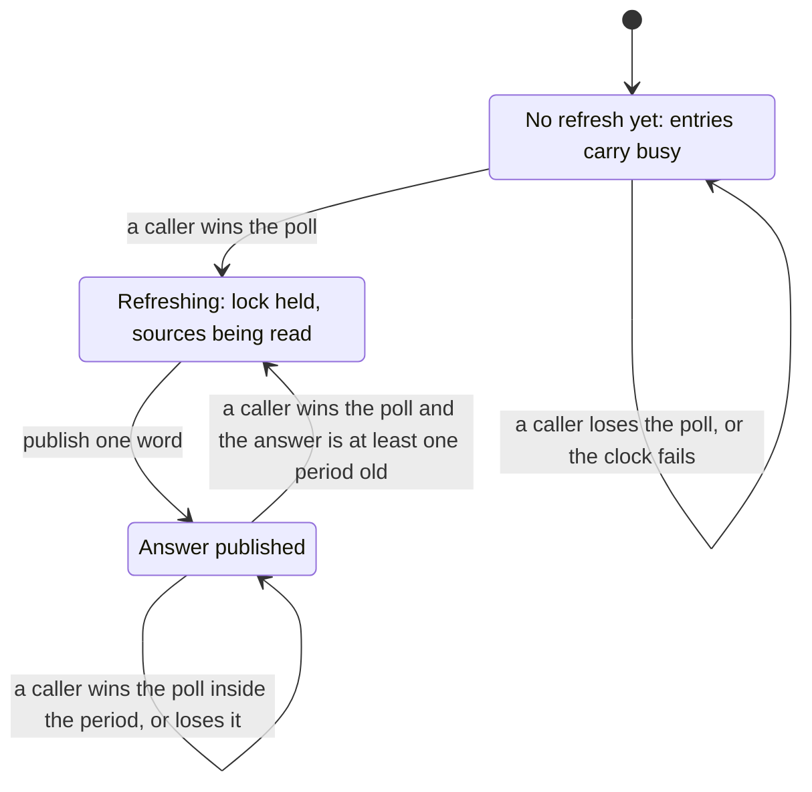

# Status and configuration services

Status: implemented on Host with fakes, Issue #180, with `native_sim` suites through CI. The contract is not adopted until review and gate #183 pass. The owner [accepted decisions C1 to C8 on 3 November 2026](https://github.com/wonny-labs/crux-pilot/pull/209#issuecomment-6616400894) and approved the headers, fakes and Host tests. Target and physical work stays behind M7 and needs its own approval. The reasoning and the threat table are in [the proposal](plans/status-configuration-contract-proposal.md), which this document does not repeat.

| Component | Public header | Usage target |
| --- | --- | --- |
| Configuration additions (C1, C2, C6) | `<crux/configuration.h>` | `crux::configuration`, and `crux_configuration_no_provider` for a composition |
| Configuration service (C3, C4) | `<crux/config_service.h>` | `crux::config_service` |
| Status service (C5, C7, C8) | `<crux/management_status.h>` | `crux::mgmt_status` |

Applying a change safely remains application policy. A successful update changes the accepted value in memory only, and its result carries the activation that the application declared, so an adapter can say so. Sensitive means write-only through the service. It is not encryption: the value stays plain in RAM and in its record, with no confidentiality claim.

## What is built, faked and untested

| Item | State |
| --- | --- |
| String parameters, `crux_config_key`, the character rule | Built. Host and `native_sim` conformance, including each of the two Settings backends on the simulator. |
| No-provider port | Built, and selected by name. A load or save returns `CRUX_CONFIG_ERR_NOT_SUPPORTED`, instead of an image failing to link. |
| Configuration service | Built. Host on the real Access core, with fake ports. `native_sim` on the real Sync, with an access double. |
| Status service, including the JSON forms | Built. Host on the real Access core with fake sources, and on the real System, Time and Netif on Linux. `native_sim` on the real System, Time and Sync. |
| Thin providers for System, Time and Netif | Built. The Netif one has run on Linux only. |
| Access | Real core with its fake ports on Host, and a double in `tests/native/mgmt_services`. The [management composition](native-management-composition.md) runs both services on the real core and real ports, on `native_sim`. |
| Event port of the configuration service | `crux_config_service_security_events`, over `crux_security_event_emit`. The service's own suites keep their recording port. |
| Security event counts in status | `crux_mgmt_status_security_events`, over `crux_security_event_get_stats`. `crux_mgmt_status_no_security_events` omits them. |
| Credential store items in status | `crux_mgmt_status_credential`, over `crux_credential_store_get_info`. `crux_mgmt_status_no_credential` omits them, and `crux_mgmt_status_no_security` is both. |
| Target Configuration provider | None, by decision C6. It waits for #16. |
| Zephyr module integration, Kconfig | None. The `native_sim` suite compiles the sources directly. |
| Target or physical runs | None, and out of scope. Target results would be compile only under the current approval. |

Not verified at all: stack use with strings, handler time on the HTTP server thread, watchdog feed and clock jitter under a status poll, and a real save on a target. Each needs separately approved target work.

## Structure

## Configuration additions

`crux_config_init_string` takes caller-owned storage and leaves `crux_config_spec_t` unchanged, so existing positional initialisers still compile (C1). Strings are well-formed UTF-8 of at most `CRUX_CONFIG_STRING_MAX` bytes, default 128, with no NUL, C0 control, DEL or C1 control (C2). The [Configuration contract](configuration-contract.md#string-parameters) holds the behaviour and the encoding.

## Configuration service

A composition passes a constant table of up to `CRUX_CONFIG_SERVICE_MAX` entries, default 32, to `crux_config_service_start`. The table sits above the Configuration mechanism, and it does not change that mechanism. After a refused table every operation returns `NOT_READY`, and a corrected table can still start.

### Permissions

Each operation checks the session first. A permission is always named, and a check or probe that returns anything but success denies. A NULL `write_permission` is treated as not held, with no call for it.

| Session holds | Listing | Read | Update |
| --- | --- | --- | --- |
| Neither | Hidden, with no event | `NOT_FOUND`, with a denial from `crux_access_check` | `NOT_FOUND`, with a denial |
| Read only | Shown | Value, or `WRITE_ONLY` if sensitive | `DENIED`, with a denial. A read-only parameter records no denial, because nothing was refused by a check. |
| Write only | Shown, `readable` false | `DENIED` with a denial, or `WRITE_ONLY` if sensitive | Allowed |
| Both | Shown | Value, or `WRITE_ONLY` if sensitive | Allowed |

`crux_config_service_save` needs the fixed permission `config.save`, and returns `DENIED` without it. A name that is missing and a name that is hidden both give `NOT_FOUND`, and timing is not equalised. Only a parameter in the table can produce an event, because a name that failed to match is a client's text.

A cursor counts entries the session cannot see, so an adapter keeps it on the server and never sends it to a client. It stays where it was at the end of a list, so that the end does not disclose the size of the table.

### Text forms

Web and CLI share one parser, so they cannot differ.

| Type | `read` writes | `update` accepts | Anything else |
| --- | --- | --- | --- |
| BOOL | `true`, `false` | Exactly those | `INVALID_ARGUMENT` |
| U32 | Decimal | Decimal with no sign or leading zeros, up to 4294967295 | `INVALID_ARGUMENT` |
| STRING | The bytes | The bytes as given, with no terminator needed | `REJECTED` for a character rule, capacity or validator refusal |

### Locks

| Caller | Lock wait | Context |
| --- | --- | --- |
| `next`, `read`, `update` | Polls, `ERR_BUSY` if held | Safe on the HTTP server thread if validators are quick |
| `save`, `save_local` | Finite wait, `CRUX_CONFIG_SERVICE_SAVE_WAIT_MS`, default 5000, and holds the lock across storage | Worker, SSH session or console thread only |
| `try_read`, `try_update` | Polls, `ERR_BUSY` if held | A control thread, which keeps its last snapshot on `BUSY` |

A control thread never waits on the service lock or on storage. It can still wait briefly, with no stated bound, on the global Sync metadata lock, and a poll also returns `BUSY` if another reader holds the lock, so a web read can get `503` with no save running. `try_update` and `save_local` produce no event, so a control thread never meets the event lock.

Once a parameter is in a started table, no thread calls `crux_config_read`, `_update`, `_load` or `_save` on it, and no thread calls `crux_config_save` or `crux_config_load` on any parameter, because the provider is caller-serialised too. A parameter the application keeps private goes in the table under a permission no role holds. Validators run with the lock held, so they stay short and never call this service: a call back returns `NOT_READY`.

### Save

Each `unsaved` parameter is saved in table order, stopping at the first failure. Earlier saves stay saved, there is no atomicity, and the failed one keeps its mark because stored bytes may already have changed. **Table order is therefore how a composition decides what is saved last.** Every accepted update sets the mark, with no comparison of values.

Holding `config.save` does not show a session the table. A session's save writes every marked parameter, and its report follows the rule of a listing:

| What the save touched | `report.saved` | `report.failed_name` | Result and `failed_result` | Events |
| --- | --- | --- | --- | --- |
| A parameter the session can read or write | Counted | Its key, if it failed | The failure | Name it |
| A parameter the session cannot read or write | Not counted | `NULL`, if it failed | The failure, which stays known | Name it, for the operator |
| Anything, in `crux_config_service_save_local` | Counted | Its key, if it failed | The failure | None |

With no provider, a save returns `ERR_STORE` with `CRUX_CONFIG_ERR_NOT_SUPPORTED` in `failed_result`, and an adapter says that saving is not available. `web/api/openapi.yaml` holds `501` and `not_supported` for this.

## Status service

### Items

Built-in items need `status.read`. A project's item names its own permission. Each entry has its own result, so one failed source hides nothing else.

| Name | Type | Source | Result when there is no answer |
| --- | --- | --- | --- |
| `system.uptime_ms` | u64 | Port, read on each call. It also dates the snapshot. | The source's result |
| `system.clock` | text: `unset`, `unknown`, `rtc`, `manual`, `external` | Snapshot | `busy` before the first refresh, then the source's result |
| `system.watchdog_state` | text: `unavailable`, `idle`, `active`, `faulted`, `expired` | Snapshot | The same, and its `watchdog_status` passes through |
| `reset.causes`, `reset.supported` | u32 masks of `CRUX_RESET_CAUSE_*` | What the boot owner passed (C8) | What the boot owner's read returned |
| `net.link` | bool | Port, read on each call | `no_data` when the driver cannot tell |
| `net.admin_up` | bool | Port | The source's result |
| `net.ipv4` | text | Port | `no_data` when there is no address |
| `version.platform`, `version.project` | text | What the composition passed, copied at start | None |
| `security.credential_state`, `_basis`, `_evidence` | text | Port, #178 | Omitted if not linked |
| `security.credential_confidential`, `_forgery_detected`, `_rollback_detected` | bool | Port, #178 | Omitted if not linked |
| `security.events_emitted`, `_dropped`, `_delivered`, `_log_errors` | u32 | Port, #182 | Omitted if not linked |

A project's text that fails rule C2, a wrong type and a result that is not a Base error each give `io`. Hiding leaves no event, because a polled page would otherwise fill the event ring, and the call does not refresh the idle timer. During a forced password change `crux_access_permitted` reports false for everything, so the list is empty.

### Snapshot

| Rule | How |
| --- | --- |
| At most one read per period | A caller holding the polled lock reads only if the answer is at least `CRUX_MGMT_STATUS_REFRESH_MS` old. The time is taken before the read. |
| A failed read counts | It sets that entry's result and keeps the other, and the next read still waits a period. |
| No waiting behind a refresh | A caller that loses the poll reads the published word, with no lock. |
| A clock that fails or runs backwards | Nothing new is read. The limit on reads matters more than a fresh answer, and a monotonic clock does neither. |

This bounds how often status takes locks that control threads also take, and it does not remove that. `crux_watchdog_feed` takes the same System lock and clock reads share the Time lock, both with an unbounded native wait, so a status read can still delay a control thread by an unmeasured amount. **The design's rule that management must not block control work stays unproven for these two sources until target measurement.** The System contract also lets an observation update the watchdog lifecycle, including a latched fault after a failed probe.

### JSON

`crux_mgmt_status_report_json` writes the `StatusReport` of [`web/api/openapi.yaml`](../web/api/openapi.yaml), and `crux_mgmt_status_entry_json` writes one `StatusItem`, for an adapter that sends more than one buffer holds.

| Case | Form |
| --- | --- |
| u64 | `{"name":"system.uptime_ms","status":"ok","type":"u64","value":"86400000"}`, decimal text |
| u32 | `{"name":"app.cycle_count","status":"ok","type":"u32","value":42}` |
| bool | `{"name":"net.link","status":"ok","type":"bool","value":true}` |
| text | `{"name":"net.ipv4","status":"ok","type":"text","value":"192.0.2.10"}`, with `"` and `\` escaped |
| Failed source | `{"name":"system.watchdog_state","status":"busy"}`, with no `type` or `value` |
| Nothing visible, as during a forced change | `{"items":[]}` |

| Result of `crux_mgmt_status_report_json` | What an adapter sends |
| --- | --- |
| `CRUX_OK` | `200` with the document |
| `CRUX_ERR_INVALID_STATE` | `401` `unauthorized` |
| `CRUX_ERR_NOT_READY` | `503` `not_ready` |
| `CRUX_ERR_NO_RESOURCES` | Its buffer is too small for this composition's items, so it streams instead |

## How the event and store providers connect

| Port | Provider | Calls |
| --- | --- | --- |
| `crux_config_service_port_event` | `components/config_service/src/config_service_events.c` | `crux_security_event_emit`, with `CRUX_SECURITY_EVENT_ID_CONFIG_UPDATED`, `_REJECTED`, `_SAVED` and `_SAVE_FAILED`. Results are `OK`, `INVALID`, `OK` and `FAILED`. `subject` is the name. Channel and source come from `crux_access_session_origin`, and user from `crux_access_session_user`. A session that has ended leaves the record, with no origin and no user. |
| `crux_mgmt_status_port_has_security_events`, `crux_mgmt_status_port_security_events` | `components/mgmt_status/src/source_security_events.c` | `crux_security_event_get_stats`, copying `emitted`, `dropped`, `delivered` and `log_errors` |
| `crux_mgmt_status_port_has_credential`, `crux_mgmt_status_port_credential` | `components/mgmt_status/src/source_credential.c` | `crux_credential_store_get_info`, mapped to the words `unusable`, `empty` or `valid`, `none`, `device_id_key`, `hardware_bound` or `undeclared`, and `host_fake`, `software`, `physical` or `undeclared` |

`ManagementProviders.*` holds each mapping to a controlled answer. Tests of an adapter can use `crux_security_event_fake` in place of the recording port.

## For the adapters

| Issue | Uses | Notes |
| --- | --- | --- |
| #187, web | `crux_mgmt_status_report_json`, or `crux_mgmt_status_next` with `crux_mgmt_status_entry_json` to stream. `crux_config_service_next`, `_read`, `_update`, `_save`. | `web/api/openapi.yaml` holds no configuration routes yet, so adding them is a change under its rule. `read` gives `type`, which chooses the JSON form. A hidden parameter and a missing one are both `404`, and `ERR_BUSY` is `503` with `Retry-After`. A route that may run a slow validator, and every save, runs on the worker. After an update, the response carries `applied.activation` and no value, and a read follows only for a parameter that is not sensitive. A save's `ERR_STORE` can come with `failed_name` `NULL`, so test the result. A cursor stays on the server: a paged route uses its own opaque token. |
| #193, CLI over SSH | The same calls through #181's registry, and `crux_mgmt_status_result_name` for an item that failed | `config set` on a sensitive parameter takes its value by prompt, not as an argument. Permitted and refused commands stay the same on serial. |
| #213, network settings | Its parameters in the composition's table, under a permission no role holds. `crux_config_service_try_read`, `_try_update` and `_save_local`. Its own session check with `crux_access_check`. | Table order puts the check key after the values it covers. `_save_local` saves every marked parameter, so anything else marked is saved with them, and a failure stops there. **A session's `crux_config_service_save` also writes these marks, so it can land part way through the set, between two `_try_update` calls, and leave a mixed set stored.** The check key has to catch that as it catches an interrupted save. `failed_result` of `CRUX_CONFIG_ERR_NOT_SUPPORTED` is the state until #16 decides a provider. `_try_*` polls, so it returns `ERR_BUSY` during any save. |

## Decisions taken for lack of an answer

Each is open to review, and a changed choice is small while nothing depends on it.

| Point | Choice | Reason |
| --- | --- | --- |
| The proposal says one `crux_mutex` guards the snapshot, and a caller that loses the poll answers from the previous one | The mutex guards the refresh, and the answer is published as one atomic word | A loser cannot read what the lock holder is writing through the lock it just failed to take. Two words of the same answer cannot tear. It needs a lock-free 32-bit atomic, as #234's counters do. |
| The character rule in a second component | `crux_config_text_valid` is public in `crux/configuration.h`, in the library `crux_configuration_text`, and status links that privately | One rule cannot differ between components, and the tests share one vector table. This adds a function, and a dependency beyond the proposal's table. A status-only image needs no Configuration provider, which `MgmtStatus.real_sources` shows. It is a library and not only an object because Zephyr links each library registered with it as a whole archive (`WHOLE_ARCHIVE_LIBS` in Zephyr's `CMakeLists.txt`), so one archive would pull in the mechanism and its port. The test script checks that this archive refers to no port. The alternative is a second copy. |
| What a save's report tells a session | A session holding `config.save` learns only what it may see: `saved` counts what it can read or write, and `failed_name` is `NULL` for anything else, with `ERR_STORE` and `failed_result` kept. A probe that fails counts as not visible. `crux_config_service_save_local` is unchanged. | **The proposal conflicts with itself.** Its Save section says "`saved` and `failed_name` go back to the caller". Its threat table says a parameter the session cannot read or write "is absent from listings and looks missing when named", and its permission table and "Hiding" in the gate record agree. Independent review found that the report broke the rule for a session with an empty listing, and hiding wins. The result and `failed_result` stay, because a caller must be able to tell a failure from a success, so such a session learns that something it cannot see failed, and not what. The events still name everything, for the operator. |
| Stack copies of a sensitive scalar | The update clears its candidate as well as its parse buffer | A sensitive value may be a scalar. The Configuration mechanism's own locals are not cleared, which fits the absence of a confidentiality claim. |
| JSON | Three functions beyond the proposal: `crux_mgmt_status_entry_json`, `_report_json` and `_result_name` | The shape must match the merged schema, and web and any other adapter should not each carry it |
| Repeating `crux_config_service_start` | `ERR_INVALID_ARGUMENT`, and nothing changes | The accepted result list has no "exists" value |
| Repeating `crux_mgmt_status_start` | `CRUX_ERR_INVALID_STATE`, and nothing changes | The Base result that fits |
| A refused table or a failed lock creation | Start can be retried | As the file service does, and it costs nothing while the service fails closed |
| Order of checks | Session, then permission, then missing pointers. A missing pointer gives no event. | "Each operation checks the session first", and a programming error is no client's refused value |
| An expired or ended session in `crux_config_service_next` | Reported once by `crux_access_session_user` and ended | The same as the file service. A status poll stays silent instead: it uses only `crux_access_permitted`, and the adapter's own check reports it. |
| Bad default at `crux_config_init_string` | No text, overlapping storage or a capacity that cannot hold it: `INVALID_ARGUMENT`. A failed rule, mismatched length or validator: `REJECTED`. | The same split as a scalar's bad key and bad default |
| Text over the maximum at `update` | `ERR_REJECTED`, with no copy | The same result as a shorter parameter's capacity |
| `net.link` unknown, and no IPv4 address | `no_data` | The schema's `net.link` is a bool, and `no_data` means no valid observation |
| `reset.causes` and `reset.supported` | u32 masks | The proposal names no form, and a client's table can name the bits |
| Project items | `CRUX_MGMT_STATUS_PROJECT_ITEMS_MAX`, 32 | Start compares every pair, so its work stays bounded |
| Narrow port types | Net, clock and credential answers have their own private types | The core needs no Time, Netif or store header, and a composition may not link them |
| `CRUX_CONFIG_STRING_MAX` in CMake | Empty by default, and a value becomes a public compile definition | Consumers that keep the default see no new definition |
| `crux_mgmt_status_port_has_*` | Asked once, at start | An item's presence never changes while a client reads a list |

## Limits

- Accepted is not applied.
- Sensitive is write-only handling, not protection at rest. Crux accounts and device keys never use it. The update's parse buffer and candidate are cleared by volatile writes, and tests read them from inside the event that follows. The wire buffer of a load or save is cleared the same way just before the function returns, where no test can read it without undefined behaviour, so that is checked by reading the code. The provider's own buffer is not cleared.
- Saves are per parameter, with no atomicity and no rollback. A save covers every marked parameter, and there is no call to save one set alone. So a session's save also writes marks the application made, which can land part way through a set the application is updating, such as #213's.
- A session holding `config.save` can learn that a save of something it cannot see failed, though not what, and can cause that save.
- The service covers scalars and bounded strings, with no arrays or blobs.
- There is no save provider on the target.
- Validators give no reason for a rejection.
- Timing of status sources is unmeasured.
- A list spans several calls, so its items are not one instant.
- The application cannot reload a table parameter after start.
- A value passes rule C2 and can still display misleadingly: U+2028, bidirectional controls and similar. Adapters escape for their format.
- Project code is trusted, and could read any parameter.

## Tests

`scripts/test-mgmt-services.sh` runs the Host suites below under the debug and sanitizer presets, the two thread suites under ThreadSanitizer, clang-tidy, the consumers and `scripts/check-mgmt-services-boundary.py`. `scripts/test-storage-simulators.sh` runs the `native_sim` ones.

| Suite | Covers |
| --- | --- |
| `Configuration.Conformance` | The existing scalar cases unchanged, then each C2 vector on init, update and load, the maximum length across a reload, record metadata, short transfers, type mismatch in each direction, wrong init function, aliasing, fallback, and scalar records byte-identical |
| `Configuration.NoProvider` | Load and save on the selected port, linked as a composition links it |
| `ConfigService.permissions` | Every row above for listing, read, update and save, with success, unauthenticated, unpermitted and invalid input, forced change, table validation and the bound |
| `ConfigService.values` | Parser limits, validators, string forms, sensitive values absent from every result and event, and the application's calls |
| `ConfigService.save` | Table order, marks, failure part of the way through a list, stored bytes changed by a failed save, events with no lock held, and what a report tells a session that sees none, some or all of what was saved |
| `ConfigService.concurrency` | `BUSY` during a held save for each polling call, a second save timing out, a validator calling back, and threads under load |
| `ConfigService.lock_faults` | Each result the Sync contract can give, through a wrapped lock |
| `ConfigService.no_provider` | The service over the selected port |
| `MgmtStatus.items` | Each built-in and word, per-entry failure, omitted sources, project items of each type with bad text and wrong types, filtering, forced change, the idle timer, and start refusals |
| `MgmtStatus.snapshot` | Age with a controlled clock, a failed read, a failed or backward clock, a loser during a refresh, and concurrent polls counting source reads |
| `MgmtStatus.lock_faults` | The snapshot's lock is only ever polled, and a lock that fails means no read, through a wrapped lock |
| `MgmtStatus.source_mapping` | Each mapping in the thin providers, over a stand-in for the contract each one calls |
| `MgmtStatus.json` | Exact text of each form, escapes, the promised buffer's worst case, and each buffer size below what fits |
| `MgmtStatus.openapi_schema` | Reports from the service held to the schema read from the merged specification, with negative controls showing that the check can fail |
| `MgmtStatus.real_sources` | The thin providers on the real System, Time and Netif, with no Configuration provider linked, and each clock source through the real authority |
| `tests/configuration/zephyr`, `native_sim` | The same scalar and string conformance |
| `tests/native/configuration_settings`, `_file`, `native_sim` | A string of the maximum length through each real backend |
| `tests/native/mgmt_services`, `native_sim` | After any number of status polls, `crux_system_reset_cause_clear` returns `INVALID_STATE` until the boot owner reads the cause. The rate limit on the real clock with the real System, and `BUSY` on the real Sync. |

These show contract behaviour. They do not show that applying a change is safe, which stays application policy, and they say nothing about a target.
