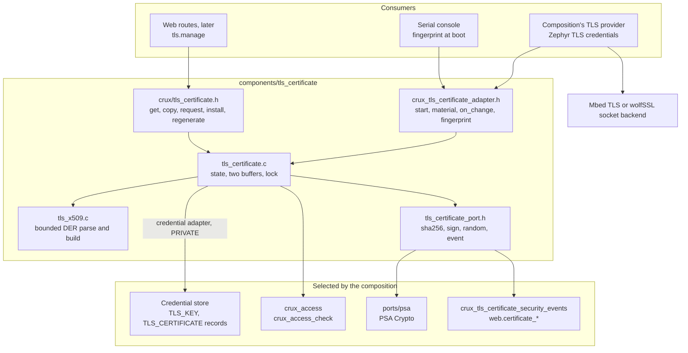
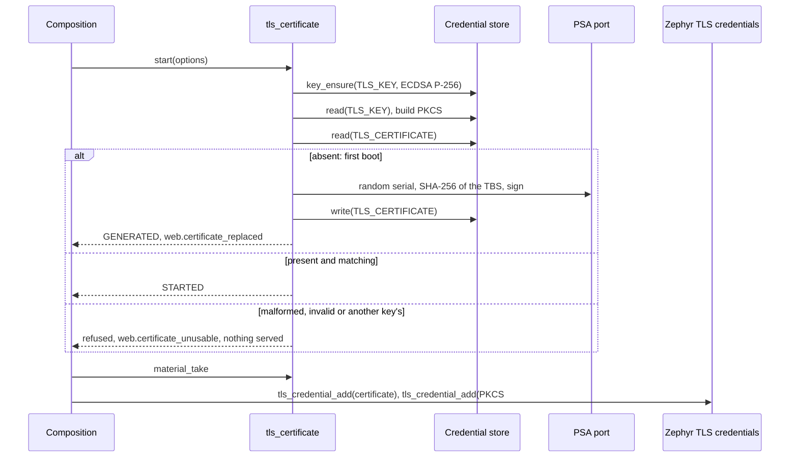
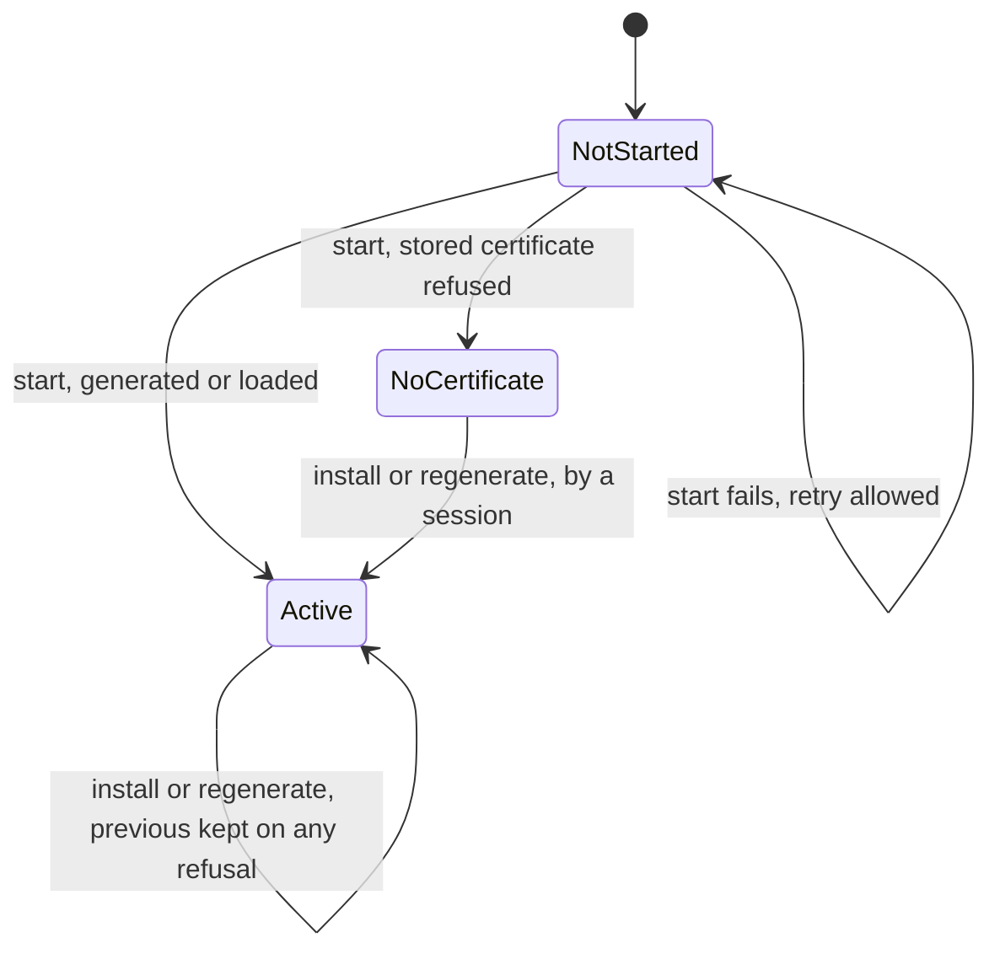

# TLS certificate model

Status: Host implementation for review under [Issue #190](https://github.com/wonny-labs/crux-pilot/issues/190), in a
Draft PR. The interface is not adopted until that review and gate #183 pass. **Nothing here ran on `native_sim` or a
board**: the evidence is Host suites on fakes and on the real credential store, and a Linux Host composition of the PSA
ports on TF-PSA-Crypto whose output OpenSSL checks. The design follows the
[certificate model](plans/secure-management-web-design.md#certificate-model) of the web design.

Owner: `components/tls_certificate`. Public header `<crux/tls_certificate.h>`, usage target `crux::tls_certificate`.
Adapter header `crux_tls_certificate_adapter.h`, target `crux_tls_certificate_adapter`, for a composition and its TLS
provider only. Private ports in `components/tls_certificate/src/tls_certificate_port.h`, with the PSA provider in
`components/tls_certificate/ports/psa` and the event provider `crux_tls_certificate_security_events`.

## Acceptance criteria of #190

| # | Criterion | State | Evidence |
| --- | --- | --- | --- |
| 1 | Invalid, mismatched and malformed uploads are rejected and logged | **Met on Host.** Each refusal after the permission check keeps the previous certificate, writes nothing, and emits `web.certificate_rejected` with the user, the origin and the reason. | `install.c`, `store.c` on the real store, `events.c`, and the [mutations](#mutations) |
| 2 | The private key is never exported | **Met on Host, as defined [below](#the-private-key).** No public operation returns it, no output or event holds it, and it reaches only the TLS stack in the same image through the composition-only adapter. | `test_private_key_in_no_output`, the credential boundary rule on the adapter |
| 3 | Results state that an uploaded certificate is checked for format and key match only | **Met.** Every description carries `CRUX_TLS_CERTIFICATE_CHECKS`, and the header says the same. | `test_checks_statement`, `test_accepted` |

| Scope of #190 | State |
| --- | --- |
| ECDSA P-256 key and self-signed certificate at first boot | Built. The key comes from the credential store, the signature from the PSA port. |
| Certificate request | Built: PKCS #10, signed by the device key, alternative names requested |
| Certificate installation | Built: one DER certificate for the device key |
| Fingerprint display | Built: SHA-256 in every description, and without a session for the serial console |
| Rejection keeping the previous certificate | Built |
| User guidance for the first-connection warning and for expiry | [Below](#user-guidance) |
| Web routes | **Not in this PR.** The routes of the web design call these operations later. |

## What is built, faked and untested

| Item | State | Evidence |
| --- | --- | --- |
| Public operations: describe, copy, request, install, regenerate, dates | **Built** | Host, on the real Access core |
| Composition adapter: start, material for a TLS stack, change callback, fingerprint | **Built** | Host |
| Bounded DER parser and builders | **Built** | Host, with every truncation, every flipped byte and 60,000 seeded mutations, also under ASan and UBSan |
| Credential store | **Real** in `store.c` over the File fake with the store's test-only protection. **Faked** in the other suites, for fault injection. | Host |
| Hash, signature and random source | **Faked** in the Host suites: real SHA-256, but the "signature" is not ECDSA. **Real** PSA ports on TF-PSA-Crypto in `tests/tls_certificate/psa`. | Host |
| Self-signed certificate, request and PKCS #8 key from a real P-256 key | **Checked**: TF-PSA-Crypto's own key parser takes the key and verifies both signatures with it; OpenSSL 3.0.13 parses all three, verifies the certificate and the request, and completes a TLS 1.3 handshake with them | Host |
| Event provider onto `web.*` records | **Built** | Host, on the recording fake of the event contract |
| Registration with Zephyr's TLS credentials, on either profile | **Not built.** The adapter is the interface a composition uses; the declared test certificate of #263 stays in the `native_sim` images. | None |
| wolfPSA signing, wolfSSL parsing the key and the certificate | **Not run** | None |
| Browsers accepting the self-signed profile | **Not run** | None |
| RT1060-EVKB | **Not compiled** | None |

## Structure

The module depends on neither TLS library. Both socket backends read Zephyr's TLS credentials, so a composition hands
the material to `tls_credential_add` for either profile.

| Target | Who links it | What it exposes |
| --- | --- | --- |
| `crux::tls_certificate` | A web or command-line service, a project | The public header. It links the core, which needs the ports, so an image without providers does not link. |
| `crux_tls_certificate_adapter` | A composition and its TLS provider, always `PRIVATE` | The adapter header. It links `crux_credential_adapter` on purpose, so `cmake/CruxCredentialBoundary.cmake` refuses any public target or project that reaches it. |
| `crux_tls_certificate_security_events` | A composition | Nothing. It implements the event port. |
| `ports/psa/tls_certificate_psa.c` | A composition with a PSA provider | Nothing. It implements the hash, signature and random ports. |

### Boot order

| Step | Call | Notes |
| --- | --- | --- |
| 1 | `crux_credential_start` | As the store requires |
| 2 | `crux_access_init`, `crux_security_event_init` | As their contracts require |
| 3 | `crux_tls_certificate_on_change` | Optional, before start |
| 4 | `crux_tls_certificate_start(options, &how)` | Ensures the P-256 key, then loads or generates the certificate. A failure can be retried, except a refused stored certificate, which stays refused until an operator acts. |
| 5 | `crux_tls_certificate_fingerprint` | The composition prints it on the serial console, for the first connection |
| 6 | `crux_tls_certificate_material_take`, then `tls_credential_add` for the certificate and the key | Before the TLS listener starts. Nothing is served if this fails. |

### States

| State | Describe, copy, material, fingerprint | Request | Install, regenerate |
| --- | --- | --- | --- |
| NotStarted | `NOT_READY` | `NOT_READY` | `NOT_READY` |
| NoCertificate | `NOT_READY`, so a TLS provider serves nothing | Allowed: it needs the key alone | Allowed, for recovery |
| Active | Allowed | Allowed | Allowed |

## Interface

### Public operations

Every operation checks `tls.manage` through `crux_access_check` first, before the module's lock, as the
[gate's lock rule](plans/secure-management-gate-decisions.md#rules-across-the-contracts) asks. The lock is polled: an
operation that finds another running returns `BUSY` and does not wait.

| Operation | Does | Waits on storage | Logs |
| --- | --- | --- | --- |
| `crux_tls_certificate_get` | Describes the active certificate: source, SHA-256 fingerprint and its text, subject and issuer common names, dates, length, and `CRUX_TLS_CERTIFICATE_CHECKS` | No | Nothing |
| `crux_tls_certificate_copy` | Copies its DER bytes, which are public | No | Nothing |
| `crux_tls_certificate_request` | Builds a PKCS #10 request for the device key, with given names or the start's | No | Nothing |
| `crux_tls_certificate_install` | Checks, saves and activates an operator's certificate | Yes, one save | `web.certificate_replaced`, or `web.certificate_rejected` |
| `crux_tls_certificate_regenerate` | Makes a new self-signed certificate with a new serial number | Yes, one save | `web.certificate_replaced`, `self_signed` |
| `crux_tls_certificate_dates_at` | Compares dates with a clock that may be unset | No, and needs no session | Nothing |

| Result | Meaning |
| --- | --- |
| `ERR_MALFORMED` | Not one strict DER X.509 certificate with nothing after it: a PEM file, a truncated one, a request, any DER rule broken, universal tag 0, a name value that is not one of the string types names use or whose content breaks its type (UTF-8, PrintableString, IA5String, NumericString, BMPString, UniversalString), a GeneralizedTime for a year from 1950 to 2049, or a malformed value of basic constraints, key usage, extended key usage, subject alternative names or subject key identifier |
| `ERR_INVALID` | Well formed, but not X.509 v3, not an uncompressed P-256 key, inner and outer signature algorithms differ, notAfter before notBefore, a serial over 20 octets, one extension twice, more than 32 extensions, or a critical extension the device does not recognise |
| `ERR_KEY_MISMATCH` | Another key's certificate |
| `ERR_TOO_LARGE` | Over 4,088 bytes, the largest that fits the store's certificate record with this module's header |
| `ERR_STORE` | The save failed and the previous certificate stays active. As for any replaced record of the store, a failed save can still win at the next boot if the store could not invalidate it. |
| `ERR_BUSY` | Another operation runs, or both buffers are held by the TLS side. Nothing was checked or logged. |

### Composition adapter

| Function | Does |
| --- | --- |
| `crux_tls_certificate_start` | Validates the options, ensures the key, loads or generates, as in the sequence above |
| `crux_tls_certificate_material_take`, `_release` | Borrow the active certificate's buffer and the key, for a TLS stack that keeps pointers |
| `crux_tls_certificate_on_change` | A callback after an install or a regeneration, on that thread, with no lock held |
| `crux_tls_certificate_fingerprint` | The fingerprint text without a session, for the serial console and boot log |

Zephyr's `tls_credential_add` keeps the pointer it is given. The module therefore owns two certificate buffers and one key
buffer. A change writes the buffer that is not active, and returns `BUSY` if the TLS side still holds that one. A TLS
provider's change callback takes the new material, registers it, and releases the old, so neither buffer changes under
the stack. `test_material_held_blocks_overwrite` holds both and shows the refusal.

On the Wolf profile the socket patch may read credentials when the listener is created rather than at each handshake.
Whether a change needs the listener recreated there is **not known**, because nothing registered this material on either
profile.

### Stored record

The `CRUX_CREDENTIAL_RECORD_TLS_CERTIFICATE` record of the store, sealed with the rest of the image.

| Offset | Size | Field | Rule |
| --- | --- | --- | --- |
| 0 | 4 | Magic | `CXTC` |
| 4 | 1 | Format | 1 |
| 5 | 1 | Source | 1 self-signed, 2 installed |
| 6 | 2 | Reserved | Zero |
| 8 | n | Certificate | DER, at most 4,088 bytes, so the record fits the store's 4,096-byte limit exactly, which a build assertion holds |

Any other header, a certificate that does not parse, or one for another key, is refused at start and never replaced
there.

## The certificate

### What the device generates

| Field | Value | Why |
| --- | --- | --- |
| Version | 3 | Extensions |
| Serial number | 16 random bytes, the top two bits `01` | Positive, always 16 bytes, new at each regeneration, so a browser never sees two certificates with one issuer and serial |
| Signature | `ecdsa-with-SHA256` over the device key | P-256 on both profiles |
| Subject and issuer | `CN=` the composition's common name | 1 to 64 of `[A-Za-z0-9 ._-]` |
| notBefore | The composition's value, by default 2026-01-01T00:00:00Z | See [Dates](#dates-without-a-clock) |
| notAfter | `99991231235959Z`, or notBefore plus the composition's days | |
| Basic constraints | Critical, not a CA | |
| Key usage | Critical, digital signature | TLS 1.3 with ECDSA |
| Extended key usage | Server authentication | Safari's platform requires it of a TLS server certificate |
| Subject alternative names | The composition's DNS names and IPv4 and IPv6 addresses, at most 4, left out when none | Browsers match the name here and ignore the common name |

### What an upload is checked for

| Checked | Not checked |
| --- | --- |
| Exactly one DER element, with definite and minimal lengths, low tag numbers, no universal tag 0, and nothing after it | The signature, so any issuer and any signature algorithm is accepted |
| The X.509 shape: TBS, algorithm, signature, and inside the TBS each field in order | The chain: one certificate only, and no intermediate is kept or served |
| Version 3, a serial of at most 20 octets, the same algorithm inside and outside | Trust in any CA |
| Names: each value one of UTF8String, PrintableString, IA5String, NumericString, TeletexString, BMPString or UniversalString, with its content valid for the type. TeletexString content is not checked. | Revocation |
| Times: `YYMMDDHHMMSSZ` for 1950 to 2049 and `YYYYMMDDHHMMSSZ` otherwise, real dates, notAfter not before notBefore | The names against the device's address |
| Extensions: each well formed, none twice, at most 32. The values of basic constraints, key usage, extended key usage, subject alternative names and subject key identifier are parsed for their structure. A critical extension other than those and name constraints, certificate policies, policy mappings, policy constraints and inhibit any policy is refused. | The values of any other extension, which are not parsed |
| An uncompressed P-256 point equal to the device key's | What the parsed values say: a certificate whose key usage lacks digital signature, or whose extended key usage lacks server authentication, is installed, and clients will refuse it |
| At most 4,088 bytes | The dates against any clock: an expired certificate is installed and reported |

The parser has no recursion and no allocation. Each read is checked against what remains of its parent, and each parent
must be used up exactly. It copies the subject's and issuer's first common name, with any byte outside printable ASCII
shown as `?`, so a description never carries raw input.

PrintableString is checked against its specified character set, which is stricter than OpenSSL: OpenSSL loads a
PrintableString holding `*`, `@`, `_` or `&`, and this parser refuses it. An older CA's certificate with a wildcard
common name in a PrintableString is therefore refused as malformed. That follows the specification and fails safe:
nothing is installed, and the previous certificate stays.

A differential test holds the parser to OpenSSL's decoder: of 300,000 seeded mutations of the OpenSSL fixtures, every one
the parser accepts must also decode with `d2i_X509`. Before the review fixes, 9,994 did not. After them, none.

### Dates without a clock

**Decision: the module reads no clock.** The composition passes notBefore and a validity in days.

| Case | notBefore | notAfter |
| --- | --- | --- |
| Reference, clock unset or untrusted | `CRUX_TLS_CERTIFICATE_DEFAULT_NOT_BEFORE_S`, 2026-01-01T00:00:00Z | `99991231235959Z`, RFC 5280's value for no well-defined expiration |
| A composition that trusts its clock | Its time | Its choice, such as 825 days |

A fixed notBefore in the past is valid for any client whose own clock is right. A fixed notAfter would expire on one
date whatever the boot date, and a device with no clock cannot renew on time, so the reference sets none. Safari's
platform has refused TLS server certificates valid for more than 825 days; whether that applies to a self-signed
certificate a user has accepted is **not tested**, because no browser ran. A composition with a trusted clock can set
825 days and regenerate before then.

`crux_tls_certificate_dates_at` reports `UNKNOWN` when the clock is unset, and never `EXPIRED` for no expiry.

## The private key

| Where | Form | Who can reach it |
| --- | --- | --- |
| Credential store, `TLS_KEY` record | 32-byte scalar, sealed with the image | The store's adapter, linked privately. On the pilot basis someone with the medium and the chip ID can read it, as the [store declares](credential-store.md#limits). |
| This module's RAM | One PKCS #8 copy of 138 bytes, for the life of the program | The TLS stack, through the material, and the signature port. The copy read from the store is cleared at once. |
| Zephyr TLS credentials | A pointer to that copy | The socket backend, which parses it per connection |
| Signature port | The scalar, for one signature | PSA imports it into a volatile key slot, signs and destroys the slot |

"Exported" here means leaving the device, or reaching a public header, a management route, a command, a file area, an
event or a log. The TLS stack in the same image is the key's user, and Zephyr's credential interface takes key bytes on
both profiles, so the material holds them. An opaque PSA key would keep the scalar out of the TLS stack on the Mbed
profile, but Zephyr's TLS credentials at the pinned revision take no key handle, and wolfSSL does not use PSA.

## Events

| Identifier | Class | Result | Subject | When |
| --- | --- | --- | --- | --- |
| `web.certificate_replaced` 0x0602 | C | `OK` | `self_signed` | First boot, with no user, or a regeneration, with the session's user and origin |
| `web.certificate_replaced` 0x0602 | C | `OK` | `installed` | An install |
| `web.certificate_replaced` 0x0602 | C | `FAILED` | `save_failed` | A save failed and the previous certificate stays |
| `web.certificate_rejected` **0x0603, new** | R | `INVALID` | `malformed`, `invalid`, `key_mismatch`, `too_large` | An upload refused after the permission check |
| `web.certificate_unusable` **0x0604, new** | C | `FAILED` | `malformed`, `invalid`, `key_mismatch` | The stored certificate refused at start, so nothing is served. A change event, like `credential.slot_invalid`, so a full ring still admits it. |

A refused permission is Access's `access.permission_denied`, and this module logs nothing for it, so a session without
`tls.manage` learns nothing about its upload. No event holds certificate or key bytes: the port's structure has none.

## Permissions

`tls.manage`, the name the [gate record](plans/secure-management-gate-decisions.md#rules-across-the-contracts) fixes,
covers every public operation, as the web design's route table states. A product's role table grants it. The fingerprint
for the first connection therefore comes from the serial console, not from a route.

## User guidance

### The first connection

The device's own certificate is not signed by anyone the browser trusts, so the first visit shows a warning. Do not
click through it blindly.

1. Read the device's SHA-256 fingerprint from the serial console, where the composition prints it at boot, or from
   someone who has.
2. In the browser's warning, open the certificate details and find its SHA-256 fingerprint.
3. Compare all 32 pairs. If they match, accept the certificate for this site. If they differ, stop: something between
   you and the device may be presenting its own certificate, or the device has a new one, which its console shows.
4. A browser remembers the exception for one name or address. Another name, or a new address, asks again.
5. To end the warnings, have the device's request signed by a CA your clients trust, and install the result.

### Replacing the certificate

1. `POST /api/v1/tls/csr`, once routes exist, or `crux_tls_certificate_request`: the device signs a request with its own
   key. The key never leaves the device.
2. Have the request signed. The device does not check the result's chain, so the CA's intermediate certificates must
   already be known to clients.
3. Install the signed certificate in DER form. A PEM file is refused as malformed. The result states that the
   certificate was checked for format and a key match only.
4. A refused upload changes nothing, and the device keeps serving the previous certificate.

### Expiry

| Certificate | What happens |
| --- | --- |
| The reference self-signed one | It does not expire. Browsers still warn, because nobody they trust signed it. |
| An installed one | The device keeps serving it after notAfter, and its description shows the dates. With a trusted clock, `dates_at` reports `EXPIRED`. Browsers refuse it until a renewed certificate is installed. Install the renewal before notAfter. |
| Any | The device does not check dates on upload, so it accepts a certificate that has already expired or is not yet valid. Check the dates in the result. |

The reference configuration sends no HSTS, so an expired or reset certificate brings back the warning rather than
locking users out, as the web design explains.

### An address change

| Certificate | What happens |
| --- | --- |
| Self-signed | It is not regenerated by itself. Its alternative names still give the old address, so browsers add a name mismatch to the warning. The fingerprint is unchanged, so the comparison above still works. An operator can regenerate it with the new names, which gives a new fingerprint to compare. |
| Installed | It no longer names the device's address. The device keeps serving it until an operator installs one that does. |

### Recovery

When the stored certificate is refused at boot, as after a key rotation through `crux_credential_key_replace`, the device
serves no HTTPS, and the event log shows `web.certificate_unusable` with the reason. An administrator on the serial console
installs a certificate for the key or regenerates a self-signed one. Nothing regenerates silently.

## Tests

`scripts/test-tls-certificate.sh host` runs the suites under the `host-debug` and `host-sanitize` presets and clang-tidy
on the module and its suites. The root Host build also runs them as `TlsCertificate.*` under `scripts/check-host.sh`, which
CI runs. `scripts/test-tls-certificate.sh psa` runs the PSA composition and the OpenSSL checks, which CI does not run.

| Suite | Covers |
| --- | --- |
| `tls_certificate_x509` | Six certificates made by OpenSSL; hand-made variants of each refusal, including each string type and its content, universal tag 0, the time form for each year, each parsed extension value, unknown critical extensions, 32, 33 and 120 extensions, an element after the key, and unique-identifier bits; the review's three byte edits of a certificate for the device key; every truncation of four certificates; every byte of one flipped three ways; 60,000 seeded random mutations; the builders' output, bounds, signature encoding, serial forms, dates across 2050, the largest names, name rules, and the PKCS #8 bytes |
| `tls_certificate_differential` | 300,000 seeded mutations of the fixtures; every one the parser accepts must decode with OpenSSL's `d2i_X509`. Built only where CMake finds OpenSSL's headers. |
| `TlsCertificate.boundary_leak`, `boundary_clean` | A separate project configured twice: a consumer reaching the adapter is refused by the credential boundary rule, and one of the public target is accepted |
| `tls_certificate_service` | First boot, a later boot, start's arguments and failures, a stored record refused for each reason and recovered, read failures, permissions, the request, regeneration and an address change, the material and its two buffers, contention, no output holding the private key, and the key record and the PKCS #8 copy cleared when start fails |
| `tls_certificate_install` | The acceptance criteria: each kind of refusal logged with nothing changed, every truncation and flip of another key's certificate, accepted certificates, a failed save, and the checks statement |
| `tls_certificate_store` | The module on the real credential store: first boot, a power cycle, refused uploads leaving the stored record, an installed certificate across a power cycle, an unusable store, and a store-generated key |
| `tls_certificate_events` | Each port event to its record, on the recording fake of the event contract |
| `tls_certificate_cpp_headers` | Both headers from C++ |
| `tests/tls_certificate/psa` | The PSA ports on TF-PSA-Crypto: SHA-256 known answer, random draws, a refused zero scalar; a real P-256 key's certificate, request and PKCS #8 key, parsed and verified with TF-PSA-Crypto's key parser. OpenSSL then parses all three, verifies the certificate for the server purpose and the request, matches the key to both, completes a TLS 1.3 handshake, and gives the same fingerprint text. |

`fixtures.h` holds only public parts of the OpenSSL certificates: no private key of any of them is in the repository.

### Mutations

Each was applied once to the source on Host, at the review fixes, and the parser, service, install, store and
differential suites were run. A count is the failing checks. 45 mutations: 44 caught, one equivalent. Three came from
the re-check of `c73ed8d`, which no case caught until one was added for each, with no change to the parser. The first
run, at
`f51e277`, also found a gap, a two-byte length that fits one byte, which a case now covers.

| Mutation | Caught by |
| --- | --- |
| Key match skipped | 6 in `service.c`, 258 in `install.c`, 2 in `store.c` |
| Key match on the first byte only | 6 in `service.c`, 258 in `install.c`, 2 in `store.c` |
| Key match on all but the last byte | 8 in `install.c` |
| Bytes after the certificate accepted | 2 in `x509.c`, 8 in `install.c` |
| Non-minimal one-byte long length accepted | 1 in `x509.c` |
| Non-minimal two-byte long length accepted | 2 in `x509.c` |
| A TLV one byte longer than its parent accepted | **Not caught**, also under ASan. Equivalent: each parent must then be used up exactly, and the overrun leaves its count wrapped, so the input is refused before the extra byte is read. |
| Inner and outer algorithms not compared | 1 in `x509.c`, 8 in `install.c`, `differential.c` (at least 10 disagreements with OpenSSL) |
| Reversed dates accepted | 2 in `x509.c` |
| Version 3 not required | 1 in `x509.c` |
| Named curve not checked | 1 in `x509.c`, `differential.c` (at least 10 disagreements with OpenSSL) |
| Point form not checked | 35 in `x509.c`, 2 in `store.c` |
| Unused bits in the key accepted | 2 in `x509.c`, `differential.c` (at least 10 disagreements with OpenSSL) |
| Critical flag not DER TRUE accepted | 2 in `x509.c` |
| Duplicate extension accepted | 1 in `x509.c` |
| Non-minimal integer accepted | 3 in `x509.c`, `differential.c` (1 disagreement) |
| Time without Z accepted | 1 in `x509.c` |
| Policy refusal reported as accepted when malformed checks pass | 27 in `x509.c`, 2 cases crashed in `install.c`, 2 cases crashed in `store.c`, `differential.c` (at least 10 disagreements with OpenSSL) |
| Upload too large not refused as such | 2 in `install.c` |
| Universal tag 0 accepted | 1 in `x509.c` |
| Attribute value type and content not checked | 20 in `x509.c`, `differential.c` (at least 10 disagreements with OpenSSL) |
| UTF-8 overlong forms accepted | 2 in `x509.c` |
| UTF-8 surrogates accepted | 1 in `x509.c` |
| PrintableString content not checked | 2 in `x509.c` |
| GeneralizedTime before 2050 accepted | 2 in `x509.c` |
| Parsed extension values not checked | 16 in `x509.c` |
| Subject alternative names not checked | 6 in `x509.c` |
| Key usage with an unused bit set accepted, from the re-check | 1 in `x509.c`, after a case was added |
| Subject alternative names: directoryName content not checked, from the re-check | 1 in `x509.c`, after a case was added |
| Subject key identifier with data after it accepted, from the re-check | 1 in `x509.c`, after a case was added |
| Unknown critical extension accepted | 2 in `x509.c` |
| Bound of 32 extensions removed | 1 in `x509.c` |
| Element after the key accepted | 1 in `x509.c` |
| Unique identifier unused bits not checked | 1 in `x509.c`, `differential.c` (at least 10 disagreements with OpenSSL) |
| Key record copy not cleared | 4 in `service.c` |
| PKCS #8 copy kept after a failed start | 1 in `service.c` |
| Refusal not logged | 1 in `service.c`, 73 in `install.c`, 1 in `store.c` |
| Refusal logged with the wrong reason | 6 in `install.c` |
| Upload written over the active buffer | 14 in `service.c`, 12 in `install.c` |
| A held buffer overwritten | 5 in `service.c` |
| Refused stored certificate replaced at start (fail open) | 36 in `service.c` |
| Permission not checked | 15 in `service.c`, 5 in `install.c` |
| Failed save treated as saved | 3 in `service.c`, 4 in `install.c` |
| Stored refusal logged as an upload refusal | 9 in `service.c` |
| Absence assumed on a read error at start | 9 in `service.c` |

### Local results

Container `crux-190`, image `crux-pilot-devcontainer:local` under amd64 emulation. CI results are in the pull request.

| Check | Level | Result |
| --- | --- | --- |
| Suites before the implementation, against stubs | Host | Red: `x509` 24 of 26 cases failed, `service` 27 of 27, `install` 10 of 10; the event conformance suite did not compile without the new identifier |
| `TlsCertificate.*` and `SecurityEvent.conformance`, `host-debug`, with clang 18 in the root build and with gcc through the runner | Host | Pass |
| The same under `host-sanitize`, with gcc, because this container's clang has no sanitizer runtime: `scripts/test-tls-certificate.sh all` | Host | Pass |
| clang-tidy 18 on the module, the PSA ports and the suites | Host | No finding |
| `scripts/check-format.sh` | Host | Pass |
| `scripts/check-dependencies.sh`, `scripts/check-credential-boundary.py`, `scripts/check_docs.py` | Host | Pass |
| Negative probe by hand, before the automated one: `crux::tls_certificate` made to link the adapter, root configure | Host | Refused by `cmake/CruxCredentialBoundary.cmake`, as intended. Reverted. |
| `scripts/test-tls-certificate.sh psa`, gcc with ASan and UBSan, TF-PSA-Crypto `dc575a2`, OpenSSL 3.0.13 | Host | Pass |
| The mutations above | Host | 44 of 45 caught, one equivalent |
| Review fixes, tests first | Host | Red before the fixes: `x509` 6 of 32 cases failed, the event tests did not build without `web.certificate_unusable`, and the wipe test did not link without its hook |
| `tls_certificate_differential`, 300,000 rounds | Host | 0 disagreements with OpenSSL 3.0.13's `d2i_X509`; 9,994 on the parser before the fixes |
| `TlsCertificate.boundary_leak`, `boundary_clean` | Host | Leak refused by `cmake/CruxCredentialBoundary.cmake`, clean accepted |
| `scripts/check-host.sh`, both presets | Host | **Not run locally.** CI's host workflow runs it. |
| `native_sim`, target compile | | **Not run** |

## Limits

| Limit | Shown by |
| --- | --- |
| No certificate chain: intermediates are neither kept nor served | By design. The record holds one certificate. |
| The private key is in RAM as PKCS #8 for the program's life | By design, for Zephyr's TLS credentials. The store's confidentiality basis applies to the stored copy. |
| Mbed profile: the signature port and TLS share one PSA core with no lock, as the [PSA design](psa-crypto-design.md#what-a-provider-must-take-care-of) states | **Not shown.** No composition ran. |
| `psa_sign_hash` is outside the qualified subset | Run here on TF-PSA-Crypto on Host only. #142 ran it in tests on both providers. |
| One more mutex from the Sync pool, which the gate record already counts as full | **Not measured.** The integrated composition must raise the pool. |
| 10,840 bytes of static RAM on the 64-bit Host build: two buffers of 8,800 bytes together, a request buffer of 1,600, the key of 138, and the key record of 101 used during start | `size` and `nm` on the Host object. A 32-bit target differs a little, and nothing was measured there. |
| An install or regeneration waits on one store save, so a web route must run it on a worker | The header says so. No route exists. |
| A browser's view of the self-signed profile, including Safari's validity rule | **Not run** |
| A fuzzer with coverage feedback | **Not run**: this container's clang has no fuzzer runtime. The seeded mutation suite under ASan and UBSan, and the differential test against OpenSSL, stand in. |
| What parsed extension values mean is not checked, and other extension values are not parsed | By design, decision 7. A certificate without server authentication installs and clients refuse it. |

## Owner decisions needed before adoption

These are security-sensitive. **An independent review PASS and green CI are not this approval.**

| # | Decision | Recommendation |
| --- | --- | --- |
| A | The reference self-signed validity, 2026-01-01 to 9999-12-31, against Safari's 825-day rule for TLS server certificates, which no browser run has tested | Accept for a device with no trusted clock; a composition with one sets 825 days |
| B | Decision 2: the private key as PKCS #8 bytes in RAM, handed to Zephyr's TLS credentials, which keep the pointer | Accept: both profiles need it at the pinned Zephyr |
| C | Decision 3: `psa_sign_hash` used by a consumer, outside #142's qualified subset, run on TF-PSA-Crypto on Host only | Accept for review now, and qualify it on wolfPSA before a Wolf-profile composition |
| D | Decision 5: the two event identifiers and their classes | Accept |

## Decisions for review

Each was taken without asking the owner, as the task instructs. The narrower choice was taken where there was one.

| # | Decision | Why | If changed |
| --- | --- | --- | --- |
| 1 | A component of its own, `components/tls_certificate`, with a public header for sessions and an adapter for the composition | Keeps it apart from `components/web`, where #281 and #189 work, and from either TLS library | A move into `components/web` |
| 2 | The module reads no clock. The reference notBefore is 2026-01-01, and notAfter `99991231235959Z`. | A device with no clock cannot renew on time, and a fixed expiry date would hit every device at once | A composition with a trusted clock sets its own dates |
| 3 | The TLS stack gets the key as PKCS #8 bytes through the composition-only adapter | Zephyr's TLS credentials take bytes on both profiles and keep the pointer | An opaque key on the Mbed profile alone |
| 4 | The adapter target links the credential adapter, so the existing boundary rule covers it | No change to a protected or shared CMake module | A rule of its own |
| 5 | Two new identifiers: `web.certificate_rejected`, 0x0603, routine like `config.rejected`, for an upload; `web.certificate_unusable`, 0x0604, change class like `credential.slot_invalid`, for the stored certificate refused at start | The contract adds identifiers and never reuses one. A refused upload changes nothing; a refused stored certificate takes HTTPS down, so its record must survive a full ring. Changed after the review of `d7e86bd`, which had one routine identifier for both. | Other classes, or one identifier |
| 6 | A stored certificate refused at start fails closed and is never regenerated there | A missing or invalid credential fails closed in the store's rules, and silent regeneration would replace an operator's certificate | Regenerate with an event |
| 7 | DER only, one certificate, dates not checked, and the meaning of extension values not checked | The design says format and key match only; a client decides the rest | PEM, a chain record, or requiring digital signature and server authentication |
| 8 | Refusal classes: malformed, invalid, key mismatch, too large | Each tells an operator something different | Fewer classes |
| 9 | The lock is polled, so a busy module answers `BUSY` | A web thread never waits behind a save | A bounded wait |
| 10 | Two certificate buffers; a change returns `BUSY` while both are held | Zephyr keeps the pointer; overwriting a registered buffer would race a handshake | A copy into Zephyr's own storage, which it does not offer |
| 11 | The self-signed profile in [the table above](#what-the-device-generates), with no key identifiers | What clients need and no more | Add subject and authority key identifiers |
| 12 | The fingerprint is also available without a session, through the adapter | The first connection needs it before anyone can log in, and it is public | Only through a session |
| 13 | At most 4 alternative names, and a common name of 1 to 64 safe characters | Bounds the request at 1,536 bytes and the certificate well inside its record | Wider rules |
| 14 | The request asks only for alternative names | CAs set usage themselves | Request key usages too |
| 15 | No web routes, no Zephyr registration, no `native_sim` image in this PR | The task makes the interface and its Host tests the deliverable | Follow-up work |
| 16 | "Format" includes what a client's decoder needs: string types and their content in names, the time form for each year, the structure of five extension values, and no unknown critical extension | The review of `d7e86bd` found certificates for the device key that the parser installed and OpenSSL refused, which would leave HTTPS down until someone reached the serial console. Refusing them up front is the narrower outcome. | Parse every extension, or check fewer |
| 17 | TeletexString content is accepted unchecked | Its T.61 repertoire is not decoded consistently by clients, and old CAs wrote Latin-1 in it | Refuse TeletexString |
| 18 | The differential test links the Host's OpenSSL `libcrypto`, and only when CMake finds its headers; otherwise it is skipped with a message | It is a test oracle, not a dependency of the module | Fetch OpenSSL, or keep the test local |
| 19 | The key record read at start is copied into a static buffer, cleared before start returns | A test can then show that it is cleared; on the stack it could not | The stack, with the wipe untested |
| 20 | The module's lock is taken after `crux_access_check` and held across `crux_credential_write`, the Access session getters and the event emit. It is recorded in the [gate's lock order](plans/secure-management-gate-decisions.md#rules-across-the-contracts). | No path takes it from under the store lock, the Access state lock or the ring lock, so there is no cycle today | Release it across the save |
| 21 | One more Sync mutex, beyond the eight the gate record already counts as claimed. Recorded there for #197. | The default pool of 8 is then exceeded in a composition with every service, which must raise `CRUX_SYNC_MUTEX_COUNT` | Share the store's lock |

## Not verified

- Registration of the material with Zephyr's TLS credentials, and a handshake on either profile with it.
- wolfPSA signing, and wolfSSL parsing the PKCS #8 key and the certificate. TF-PSA-Crypto's key parser and OpenSSL took
  them.
- Any browser with the self-signed profile.
- A change of certificate under a running listener on either profile.
- Multithreaded use beyond the contention cases, which run on one thread through hooks.
- RT1060-EVKB compilation, RAM, stack and timing.
- Entropy: Host suites use a counting fake, and the PSA composition uses the Host kernel's random source.
